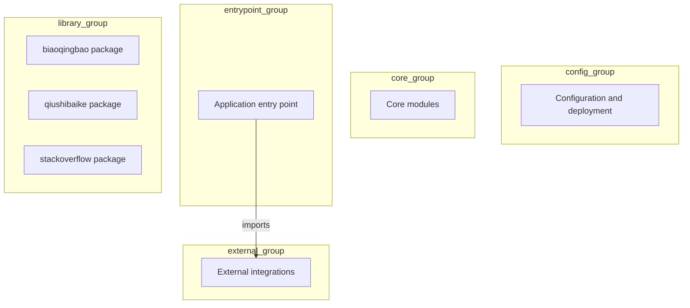

# Architecture report: wistbean/learn_python3_spider

> Automated static analysis. **Observed** = directly seen in files/imports/AST; **Inferred** = interpretation from that evidence. Repository code was not executed.

## 1. Repository at a glance

| Item | Value |
| --- | --- |
| Repository | wistbean/learn_python3_spider |
| Description | python爬虫教程系列、从0到1学习python爬虫，包括浏览器抓包，手机APP抓包，如 fiddler、mitmproxy，各种爬虫涉及的模块的使用，如：requests、beautifulSoup、selenium、appium、scrapy等，以及IP代理，验证码识别，Mysql，MongoDB数据库的python使用，多线程多进程爬虫的使用，css 爬虫加密逆向破解，JS爬虫逆向，分布式爬虫，爬虫项目实战实例等 |
| Language | Python |
| Stars | 22291 |
| Licence | MIT |
| Analysed commit / branch | f5f43b62504d2f06f2a41746e955227aa017fec4 / master |
| Framework(s) | None detected |
| Files analysed | 64 |
| Components | 7 |

## 2. Architecture in one minute

wistbean/learn_python3_spider - python爬虫教程系列、从0到1学习python爬虫，包括浏览器抓包，手机APP抓包，如 fiddler、mitmproxy，各种爬虫涉及的模块的使用，如：requests、beautifulSoup、selenium、appium、scrapy等，以及IP代理，验证码识别，Mysql，MongoDB数据库的python使用，多线程多进程爬虫的使用，css 爬虫加密逆向破解，JS爬虫逆向，分布…. This repository was analysed statically from 64 file(s) (24 Python). Detected technologies (observed from imports/manifests): MongoDB, requests. Files are grouped into 7 component(s): biaoqingbao package, Configuration and deployment, Core modules, Application entry point, External integrations, qiushibaike package, stackoverflow package. Observed entry point(s): biaoqingbao/biaoqingbao.py, dangdang_top_500.py, douban_top_250_books_mul_process.py. Findings below distinguish observed facts from inferred interpretation.

## 3. High-level block diagram

## 4. Main components

### biaoqingbao package (`biaoqingbao`)

- **Kind:** library
- **Status:** Observed
- **Confidence:** 0.85
- **Responsibility:** Groups 1 file(s) under biaoqingbao package (observed from repository paths and static analysis). Observed top-level functions: searchImage, text_reply.
- **Paths:** `biaoqingbao/search.py`
- **Evidence:** [biaoqingbao/search.py:11](https://github.com/wistbean/learn_python3_spider/blob/f5f43b62504d2f06f2a41746e955227aa017fec4/biaoqingbao/search.py#L11)

### Configuration and deployment (`config`)

- **Kind:** config
- **Status:** Observed
- **Confidence:** 0.85
- **Responsibility:** Groups 4 file(s) under configuration and deployment (observed from repository paths and static analysis).
- **Paths:** `qiushibaike/qiushibaike/settings.py`, `qiushibaike/scrapy.cfg`, `stackoverflow/scrapy.cfg`, `stackoverflow/stackoverflow/settings.py`
- **Evidence:** [qiushibaike/qiushibaike/settings.py](https://github.com/wistbean/learn_python3_spider/blob/f5f43b62504d2f06f2a41746e955227aa017fec4/qiushibaike/qiushibaike/settings.py); [qiushibaike/scrapy.cfg](https://github.com/wistbean/learn_python3_spider/blob/f5f43b62504d2f06f2a41746e955227aa017fec4/qiushibaike/scrapy.cfg); [stackoverflow/scrapy.cfg](https://github.com/wistbean/learn_python3_spider/blob/f5f43b62504d2f06f2a41746e955227aa017fec4/stackoverflow/scrapy.cfg); [stackoverflow/stackoverflow/settings.py](https://github.com/wistbean/learn_python3_spider/blob/f5f43b62504d2f06f2a41746e955227aa017fec4/stackoverflow/stackoverflow/settings.py)

### Core modules (`core`)

- **Kind:** core
- **Status:** Observed
- **Confidence:** 0.85
- **Responsibility:** Groups 1 file(s) under core modules (observed from repository paths and static analysis).
- **Paths:** `douban_top_250_books.py`
- **Evidence:** [douban_top_250_books.py](https://github.com/wistbean/learn_python3_spider/blob/f5f43b62504d2f06f2a41746e955227aa017fec4/douban_top_250_books.py)

### Application entry point (`entrypoint`)

- **Kind:** entrypoint
- **Status:** Observed
- **Confidence:** 0.85
- **Responsibility:** Groups 6 file(s) under application entry point (observed from repository paths and static analysis). Observed top-level classes: DownloadBiaoqingbao. Observed top-level functions: download, download_Pic, download_all_images, download_biaoqingbaos, get_distance, get_page_urls.
- **Paths:** `biaoqingbao/biaoqingbao.py`, `dangdang_top_500.py`, `douban_top_250_books_mul_process.py`, `fuck_bilibili_captcha.py`, `ikun_basketball.py`, `meizitu.py`
- **Evidence:** [biaoqingbao/biaoqingbao.py:11](https://github.com/wistbean/learn_python3_spider/blob/f5f43b62504d2f06f2a41746e955227aa017fec4/biaoqingbao/biaoqingbao.py#L11); [dangdang_top_500.py:6](https://github.com/wistbean/learn_python3_spider/blob/f5f43b62504d2f06f2a41746e955227aa017fec4/dangdang_top_500.py#L6); [douban_top_250_books_mul_process.py:8](https://github.com/wistbean/learn_python3_spider/blob/f5f43b62504d2f06f2a41746e955227aa017fec4/douban_top_250_books_mul_process.py#L8); [fuck_bilibili_captcha.py:18](https://github.com/wistbean/learn_python3_spider/blob/f5f43b62504d2f06f2a41746e955227aa017fec4/fuck_bilibili_captcha.py#L18); [ikun_basketball.py:30](https://github.com/wistbean/learn_python3_spider/blob/f5f43b62504d2f06f2a41746e955227aa017fec4/ikun_basketball.py#L30); [meizitu.py:9](https://github.com/wistbean/learn_python3_spider/blob/f5f43b62504d2f06f2a41746e955227aa017fec4/meizitu.py#L9)

### External integrations (`external_integrations`)

- **Kind:** external
- **Status:** Inferred
- **Confidence:** 0.70
- **Responsibility:** Groups 0 file(s) under external integrations (observed from repository paths and static analysis).
- **Evidence:** [biaoqingbao/biaoqingbao.py:5](https://github.com/wistbean/learn_python3_spider/blob/f5f43b62504d2f06f2a41746e955227aa017fec4/biaoqingbao/biaoqingbao.py#L5); [dangdang_top_500.py:1](https://github.com/wistbean/learn_python3_spider/blob/f5f43b62504d2f06f2a41746e955227aa017fec4/dangdang_top_500.py#L1); [douban_top_250_books_mul_process.py:1](https://github.com/wistbean/learn_python3_spider/blob/f5f43b62504d2f06f2a41746e955227aa017fec4/douban_top_250_books_mul_process.py#L1); [fuck_bilibili_captcha.py:2](https://github.com/wistbean/learn_python3_spider/blob/f5f43b62504d2f06f2a41746e955227aa017fec4/fuck_bilibili_captcha.py#L2); [meizitu.py:5](https://github.com/wistbean/learn_python3_spider/blob/f5f43b62504d2f06f2a41746e955227aa017fec4/meizitu.py#L5); [qiushibaike/qiushibaike/pipelines.py:7](https://github.com/wistbean/learn_python3_spider/blob/f5f43b62504d2f06f2a41746e955227aa017fec4/qiushibaike/qiushibaike/pipelines.py#L7)

### qiushibaike package (`qiushibaike`)

- **Kind:** library
- **Status:** Observed
- **Confidence:** 0.85
- **Responsibility:** Groups 6 file(s) under qiushibaike package (observed from repository paths and static analysis). Observed top-level classes: QiushiSpider, QiushibaikeDownloaderMiddleware, QiushibaikeItem, QiushibaikePipeline, QiushibaikeSpiderMiddleware.
- **Paths:** `qiushibaike/qiushibaike/__init__.py`, `qiushibaike/qiushibaike/items.py`, `qiushibaike/qiushibaike/middlewares.py`, `qiushibaike/qiushibaike/pipelines.py`, `qiushibaike/qiushibaike/spiders/__init__.py`, `qiushibaike/qiushibaike/spiders/qiushibaike_spider.py`
- **Evidence:** [qiushibaike/qiushibaike/__init__.py](https://github.com/wistbean/learn_python3_spider/blob/f5f43b62504d2f06f2a41746e955227aa017fec4/qiushibaike/qiushibaike/__init__.py); [qiushibaike/qiushibaike/items.py:11](https://github.com/wistbean/learn_python3_spider/blob/f5f43b62504d2f06f2a41746e955227aa017fec4/qiushibaike/qiushibaike/items.py#L11); [qiushibaike/qiushibaike/middlewares.py:11](https://github.com/wistbean/learn_python3_spider/blob/f5f43b62504d2f06f2a41746e955227aa017fec4/qiushibaike/qiushibaike/middlewares.py#L11); [qiushibaike/qiushibaike/pipelines.py:10](https://github.com/wistbean/learn_python3_spider/blob/f5f43b62504d2f06f2a41746e955227aa017fec4/qiushibaike/qiushibaike/pipelines.py#L10); [qiushibaike/qiushibaike/spiders/__init__.py](https://github.com/wistbean/learn_python3_spider/blob/f5f43b62504d2f06f2a41746e955227aa017fec4/qiushibaike/qiushibaike/spiders/__init__.py); [qiushibaike/qiushibaike/spiders/qiushibaike_spider.py:9](https://github.com/wistbean/learn_python3_spider/blob/f5f43b62504d2f06f2a41746e955227aa017fec4/qiushibaike/qiushibaike/spiders/qiushibaike_spider.py#L9)

### stackoverflow package (`stackoverflow`)

- **Kind:** library
- **Status:** Observed
- **Confidence:** 0.85
- **Responsibility:** Groups 8 file(s) under stackoverflow package (observed from repository paths and static analysis). Observed top-level classes: HttpProxy, StackoverflowDownloaderMiddleware, StackoverflowPipeline, StackoverflowPythonItem, StackoverflowPythonSpider, StackoverflowSpiderMiddleware.
- **Paths:** `stackoverflow/stackoverflow/__init__.py`, `stackoverflow/stackoverflow/items.py`, `stackoverflow/stackoverflow/middlewares.py`, `stackoverflow/stackoverflow/middlewares/StackoverflowDownloaderMiddleware.py`, `stackoverflow/stackoverflow/middlewares/__init__.py`, `stackoverflow/stackoverflow/pipelines.py`, `stackoverflow/stackoverflow/spiders/__init__.py`, `stackoverflow/stackoverflow/spiders/stackoverflow-python-spider.py`
- **Evidence:** [stackoverflow/stackoverflow/__init__.py](https://github.com/wistbean/learn_python3_spider/blob/f5f43b62504d2f06f2a41746e955227aa017fec4/stackoverflow/stackoverflow/__init__.py); [stackoverflow/stackoverflow/items.py:10](https://github.com/wistbean/learn_python3_spider/blob/f5f43b62504d2f06f2a41746e955227aa017fec4/stackoverflow/stackoverflow/items.py#L10); [stackoverflow/stackoverflow/middlewares.py:11](https://github.com/wistbean/learn_python3_spider/blob/f5f43b62504d2f06f2a41746e955227aa017fec4/stackoverflow/stackoverflow/middlewares.py#L11); [stackoverflow/stackoverflow/middlewares/StackoverflowDownloaderMiddleware.py:4](https://github.com/wistbean/learn_python3_spider/blob/f5f43b62504d2f06f2a41746e955227aa017fec4/stackoverflow/stackoverflow/middlewares/StackoverflowDownloaderMiddleware.py#L4); [stackoverflow/stackoverflow/middlewares/__init__.py](https://github.com/wistbean/learn_python3_spider/blob/f5f43b62504d2f06f2a41746e955227aa017fec4/stackoverflow/stackoverflow/middlewares/__init__.py); [stackoverflow/stackoverflow/pipelines.py:9](https://github.com/wistbean/learn_python3_spider/blob/f5f43b62504d2f06f2a41746e955227aa017fec4/stackoverflow/stackoverflow/pipelines.py#L9); [stackoverflow/stackoverflow/spiders/__init__.py](https://github.com/wistbean/learn_python3_spider/blob/f5f43b62504d2f06f2a41746e955227aa017fec4/stackoverflow/stackoverflow/spiders/__init__.py); [stackoverflow/stackoverflow/spiders/stackoverflow-python-spider.py:4](https://github.com/wistbean/learn_python3_spider/blob/f5f43b62504d2f06f2a41746e955227aa017fec4/stackoverflow/stackoverflow/spiders/stackoverflow-python-spider.py#L4)

## 5. Execution flow

**Observed** entry point(s):

- [biaoqingbao/biaoqingbao.py:50](https://github.com/wistbean/learn_python3_spider/blob/f5f43b62504d2f06f2a41746e955227aa017fec4/biaoqingbao/biaoqingbao.py#L50)
- [dangdang_top_500.py:47](https://github.com/wistbean/learn_python3_spider/blob/f5f43b62504d2f06f2a41746e955227aa017fec4/dangdang_top_500.py#L47)
- [douban_top_250_books_mul_process.py:44](https://github.com/wistbean/learn_python3_spider/blob/f5f43b62504d2f06f2a41746e955227aa017fec4/douban_top_250_books_mul_process.py#L44)
- [fuck_bilibili_captcha.py:193](https://github.com/wistbean/learn_python3_spider/blob/f5f43b62504d2f06f2a41746e955227aa017fec4/fuck_bilibili_captcha.py#L193)
- [ikun_basketball.py:122](https://github.com/wistbean/learn_python3_spider/blob/f5f43b62504d2f06f2a41746e955227aa017fec4/ikun_basketball.py#L122)
- [meizitu.py:88](https://github.com/wistbean/learn_python3_spider/blob/f5f43b62504d2f06f2a41746e955227aa017fec4/meizitu.py#L88)

Representative flow (derived from observed entry points and the import graph; steps beyond the entry point are **Inferred**):

1. Execution starts at an observed entry point listed above, if present.
2. `entrypoint` imports `external_integrations` (Application entry point -> External integrations).

## 6. Project structure

### `(root)`

- `.gitattributes` - other (93 bytes)
- `CloudCreat` - other (733 bytes)
- `LICENSE` - docs (1065 bytes)
- `README.md` - docs (16272 bytes)
- `dangdang_top_500.py` - source, Python (1457 bytes)
- `douban_top_250_books.py` - source, Python (2144 bytes)
- `douban_top_250_books_mul_process.py` - source, Python (2670 bytes)
- `fuck_bilibili_captcha.py` - source, Python (6085 bytes)
- `ikun_basketball.py` - source, Python (3990 bytes)
- `meizitu.py` - source, Python (2607 bytes)

### `GaoKao_Score`

- `GaoKao_Score/2006-2016浙江高考录取分数线.html` - other (6424 bytes)
- `GaoKao_Score/2006-2016海南高考录取分数线.html` - other (5647 bytes)
- `GaoKao_Score/2006-2017上海高考录取分数线.html` - other (6014 bytes)
- `GaoKao_Score/2006-2017安徽高考录取分数线.html` - other (6574 bytes)
- `GaoKao_Score/2006-2017山东高考录取分数线.html` - other (6474 bytes)
- `GaoKao_Score/2006-2017山西高考录取分数线.html` - other (6426 bytes)
- `GaoKao_Score/2006-2017新疆高考录取分数线.html` - other (6318 bytes)
- `GaoKao_Score/2006-2017河南高考录取分数线.html` - other (6254 bytes)
- `GaoKao_Score/2006-2017福建高考录取分数线.html` - other (6414 bytes)
- `GaoKao_Score/2006-2017重庆高考录取分数线.html` - other (6414 bytes)
- `GaoKao_Score/2006-2017黑龙江高考录取分数线.html` - other (6396 bytes)
- `GaoKao_Score/2006-2018云南高考录取分数线.html` - other (6574 bytes)
- `GaoKao_Score/2006-2018内蒙古高考录取分数线.html` - other (6580 bytes)
- `GaoKao_Score/2006-2018北京高考录取分数线.html` - other (6470 bytes)
- `GaoKao_Score/2006-2018吉林高考录取分数线.html` - other (6574 bytes)
- `GaoKao_Score/2006-2018四川高考录取分数线.html` - other (6574 bytes)
- `GaoKao_Score/2006-2018天津高考录取分数线.html` - other (6532 bytes)
- `GaoKao_Score/2006-2018宁夏高考录取分数线.html` - other (6574 bytes)
- `GaoKao_Score/2006-2018广东高考录取分数线.html` - other (6620 bytes)
- `GaoKao_Score/2006-2018广西高考录取分数线.html` - other (6808 bytes)
- `GaoKao_Score/2006-2018江西高考分数线.html` - other (6772 bytes)
- `GaoKao_Score/2006-2018河北高考录取分数线.html` - other (6574 bytes)
- `GaoKao_Score/2006-2018湖北高考录取分数线.html` - other (6592 bytes)
- `GaoKao_Score/2006-2018湖南高考录取分数线.html` - other (6574 bytes)
- `GaoKao_Score/2006-2018甘肃高考录取分数线.html` - other (6574 bytes)
- `GaoKao_Score/2006-2018西藏高考录取分数线.html` - other (6574 bytes)
- `GaoKao_Score/2006-2018贵州高考录取分数线.html` - other (6574 bytes)
- `GaoKao_Score/2006-2018辽宁高考录取分数线.html` - other (6414 bytes)
- `GaoKao_Score/2006-2018陕西高考录取分数线.html` - other (6784 bytes)
- `GaoKao_Score/2006-2018青海高考录取分数线.html` - other (6584 bytes)
- `GaoKao_Score/2010-2017江苏高考录取分数线.html` - other (5738 bytes)
- `GaoKao_Score/文科(一本)全国高考录取分数平均值比较.html` - other (8823 bytes)
- `GaoKao_Score/理科(一本)全国高考录取分数平均值比较.html` - other (8821 bytes)

### `biaoqingbao`

- `biaoqingbao/biaoqingbao.py` - source, Python (1769 bytes)
- `biaoqingbao/search.py` - source, Python (553 bytes)

### `qiushibaike`

- `qiushibaike/qiushibaike/__init__.py` - source, Python (0 bytes)
- `qiushibaike/qiushibaike/items.py` - source, Python (366 bytes)
- `qiushibaike/qiushibaike/middlewares.py` - source, Python (3607 bytes)
- `qiushibaike/qiushibaike/pipelines.py` - source, Python (654 bytes)
- `qiushibaike/qiushibaike/settings.py` - source, Python (3247 bytes)
- `qiushibaike/qiushibaike/spiders/__init__.py` - source, Python (161 bytes)
- `qiushibaike/qiushibaike/spiders/qiushibaike_spider.py` - source, Python (1182 bytes)
- `qiushibaike/scrapy.cfg` - config (265 bytes)

### `stackoverflow`

- `stackoverflow/scrapy.cfg` - config (269 bytes)
- `stackoverflow/stackoverflow/__init__.py` - source, Python (0 bytes)
- `stackoverflow/stackoverflow/items.py` - source, Python (379 bytes)
- `stackoverflow/stackoverflow/middlewares.py` - source, Python (3611 bytes)
- `stackoverflow/stackoverflow/middlewares/StackoverflowDownloaderMiddleware.py` - source, Python (220 bytes)
- `stackoverflow/stackoverflow/middlewares/__init__.py` - source, Python (0 bytes)
- `stackoverflow/stackoverflow/pipelines.py` - source, Python (658 bytes)
- `stackoverflow/stackoverflow/requirement.txt` - docs (92 bytes)
- `stackoverflow/stackoverflow/settings.py` - source, Python (3469 bytes)
- `stackoverflow/stackoverflow/spiders/__init__.py` - source, Python (161 bytes)
- `stackoverflow/stackoverflow/spiders/stackoverflow-python-spider.py` - source, Python (1208 bytes)

## 7. Key dependencies and integrations

| Name | Category | Status | Confidence | Evidence |
| --- | --- | --- | --- | --- |
| MongoDB | database | Observed | 0.95 | [qiushibaike/qiushibaike/pipelines.py:7](https://github.com/wistbean/learn_python3_spider/blob/f5f43b62504d2f06f2a41746e955227aa017fec4/qiushibaike/qiushibaike/pipelines.py#L7); [stackoverflow/stackoverflow/pipelines.py:7](https://github.com/wistbean/learn_python3_spider/blob/f5f43b62504d2f06f2a41746e955227aa017fec4/stackoverflow/stackoverflow/pipelines.py#L7) |
| requests | library | Observed | 0.95 | [biaoqingbao/biaoqingbao.py:5](https://github.com/wistbean/learn_python3_spider/blob/f5f43b62504d2f06f2a41746e955227aa017fec4/biaoqingbao/biaoqingbao.py#L5); [dangdang_top_500.py:1](https://github.com/wistbean/learn_python3_spider/blob/f5f43b62504d2f06f2a41746e955227aa017fec4/dangdang_top_500.py#L1); [douban_top_250_books_mul_process.py:1](https://github.com/wistbean/learn_python3_spider/blob/f5f43b62504d2f06f2a41746e955227aa017fec4/douban_top_250_books_mul_process.py#L1); [fuck_bilibili_captcha.py:2](https://github.com/wistbean/learn_python3_spider/blob/f5f43b62504d2f06f2a41746e955227aa017fec4/fuck_bilibili_captcha.py#L2) |

## 8. Data and state

- **MongoDB** (Observed, confidence 0.95) - evidence: [qiushibaike/qiushibaike/pipelines.py:7](https://github.com/wistbean/learn_python3_spider/blob/f5f43b62504d2f06f2a41746e955227aa017fec4/qiushibaike/qiushibaike/pipelines.py#L7); [stackoverflow/stackoverflow/pipelines.py:7](https://github.com/wistbean/learn_python3_spider/blob/f5f43b62504d2f06f2a41746e955227aa017fec4/stackoverflow/stackoverflow/pipelines.py#L7)

## 9. Configuration and deployment clues

- `qiushibaike/scrapy.cfg` (config)
- `stackoverflow/scrapy.cfg` (config)

## 10. Design observations

- An entry/API layer is separated from other code (Inferred from paths and decorators).
- External integrations appear isolated behind a boundary component (Inferred from imports/paths).

These observations are interpretations (**Inferred**) of the observed structure, not guarantees about runtime design.

## 11. Limitations and unknowns

- Static analysis only: repository code was not executed, installed, or imported at runtime.
- Components and relationships are inferred from file paths, imports, and AST structure; runtime behaviour, dynamic imports, and reflection may not be visible.
- 736 file(s) were skipped during inventory (736 x vendored/generated directory excluded).
- File douban_top_250_books.py could not be parsed as Python (possible SyntaxError) and was skipped for AST analysis.
- Repository text was treated as untrusted data; no instructions found in repository files were followed, and likely secret values were redacted/excluded.

## 12. Source references

- [biaoqingbao/biaoqingbao.py:5](https://github.com/wistbean/learn_python3_spider/blob/f5f43b62504d2f06f2a41746e955227aa017fec4/biaoqingbao/biaoqingbao.py#L5)
- [biaoqingbao/biaoqingbao.py:11](https://github.com/wistbean/learn_python3_spider/blob/f5f43b62504d2f06f2a41746e955227aa017fec4/biaoqingbao/biaoqingbao.py#L11)
- [biaoqingbao/biaoqingbao.py:50](https://github.com/wistbean/learn_python3_spider/blob/f5f43b62504d2f06f2a41746e955227aa017fec4/biaoqingbao/biaoqingbao.py#L50)
- [biaoqingbao/search.py:11](https://github.com/wistbean/learn_python3_spider/blob/f5f43b62504d2f06f2a41746e955227aa017fec4/biaoqingbao/search.py#L11)
- [dangdang_top_500.py:1](https://github.com/wistbean/learn_python3_spider/blob/f5f43b62504d2f06f2a41746e955227aa017fec4/dangdang_top_500.py#L1)
- [dangdang_top_500.py:6](https://github.com/wistbean/learn_python3_spider/blob/f5f43b62504d2f06f2a41746e955227aa017fec4/dangdang_top_500.py#L6)
- [dangdang_top_500.py:47](https://github.com/wistbean/learn_python3_spider/blob/f5f43b62504d2f06f2a41746e955227aa017fec4/dangdang_top_500.py#L47)
- [douban_top_250_books.py](https://github.com/wistbean/learn_python3_spider/blob/f5f43b62504d2f06f2a41746e955227aa017fec4/douban_top_250_books.py)
- [douban_top_250_books_mul_process.py:1](https://github.com/wistbean/learn_python3_spider/blob/f5f43b62504d2f06f2a41746e955227aa017fec4/douban_top_250_books_mul_process.py#L1)
- [douban_top_250_books_mul_process.py:8](https://github.com/wistbean/learn_python3_spider/blob/f5f43b62504d2f06f2a41746e955227aa017fec4/douban_top_250_books_mul_process.py#L8)
- [douban_top_250_books_mul_process.py:44](https://github.com/wistbean/learn_python3_spider/blob/f5f43b62504d2f06f2a41746e955227aa017fec4/douban_top_250_books_mul_process.py#L44)
- [fuck_bilibili_captcha.py:2](https://github.com/wistbean/learn_python3_spider/blob/f5f43b62504d2f06f2a41746e955227aa017fec4/fuck_bilibili_captcha.py#L2)
- [fuck_bilibili_captcha.py:18](https://github.com/wistbean/learn_python3_spider/blob/f5f43b62504d2f06f2a41746e955227aa017fec4/fuck_bilibili_captcha.py#L18)
- [fuck_bilibili_captcha.py:193](https://github.com/wistbean/learn_python3_spider/blob/f5f43b62504d2f06f2a41746e955227aa017fec4/fuck_bilibili_captcha.py#L193)
- [ikun_basketball.py:30](https://github.com/wistbean/learn_python3_spider/blob/f5f43b62504d2f06f2a41746e955227aa017fec4/ikun_basketball.py#L30)
- [ikun_basketball.py:122](https://github.com/wistbean/learn_python3_spider/blob/f5f43b62504d2f06f2a41746e955227aa017fec4/ikun_basketball.py#L122)
- [meizitu.py:5](https://github.com/wistbean/learn_python3_spider/blob/f5f43b62504d2f06f2a41746e955227aa017fec4/meizitu.py#L5)
- [meizitu.py:9](https://github.com/wistbean/learn_python3_spider/blob/f5f43b62504d2f06f2a41746e955227aa017fec4/meizitu.py#L9)
- [meizitu.py:88](https://github.com/wistbean/learn_python3_spider/blob/f5f43b62504d2f06f2a41746e955227aa017fec4/meizitu.py#L88)
- [qiushibaike/qiushibaike/__init__.py](https://github.com/wistbean/learn_python3_spider/blob/f5f43b62504d2f06f2a41746e955227aa017fec4/qiushibaike/qiushibaike/__init__.py)
- [qiushibaike/qiushibaike/items.py:11](https://github.com/wistbean/learn_python3_spider/blob/f5f43b62504d2f06f2a41746e955227aa017fec4/qiushibaike/qiushibaike/items.py#L11)
- [qiushibaike/qiushibaike/middlewares.py:11](https://github.com/wistbean/learn_python3_spider/blob/f5f43b62504d2f06f2a41746e955227aa017fec4/qiushibaike/qiushibaike/middlewares.py#L11)
- [qiushibaike/qiushibaike/pipelines.py:7](https://github.com/wistbean/learn_python3_spider/blob/f5f43b62504d2f06f2a41746e955227aa017fec4/qiushibaike/qiushibaike/pipelines.py#L7)
- [qiushibaike/qiushibaike/pipelines.py:10](https://github.com/wistbean/learn_python3_spider/blob/f5f43b62504d2f06f2a41746e955227aa017fec4/qiushibaike/qiushibaike/pipelines.py#L10)
- [qiushibaike/qiushibaike/settings.py](https://github.com/wistbean/learn_python3_spider/blob/f5f43b62504d2f06f2a41746e955227aa017fec4/qiushibaike/qiushibaike/settings.py)
- [qiushibaike/qiushibaike/spiders/__init__.py](https://github.com/wistbean/learn_python3_spider/blob/f5f43b62504d2f06f2a41746e955227aa017fec4/qiushibaike/qiushibaike/spiders/__init__.py)
- [qiushibaike/qiushibaike/spiders/qiushibaike_spider.py:9](https://github.com/wistbean/learn_python3_spider/blob/f5f43b62504d2f06f2a41746e955227aa017fec4/qiushibaike/qiushibaike/spiders/qiushibaike_spider.py#L9)
- [qiushibaike/scrapy.cfg](https://github.com/wistbean/learn_python3_spider/blob/f5f43b62504d2f06f2a41746e955227aa017fec4/qiushibaike/scrapy.cfg)
- [stackoverflow/scrapy.cfg](https://github.com/wistbean/learn_python3_spider/blob/f5f43b62504d2f06f2a41746e955227aa017fec4/stackoverflow/scrapy.cfg)
- [stackoverflow/stackoverflow/__init__.py](https://github.com/wistbean/learn_python3_spider/blob/f5f43b62504d2f06f2a41746e955227aa017fec4/stackoverflow/stackoverflow/__init__.py)
- [stackoverflow/stackoverflow/items.py:10](https://github.com/wistbean/learn_python3_spider/blob/f5f43b62504d2f06f2a41746e955227aa017fec4/stackoverflow/stackoverflow/items.py#L10)
- [stackoverflow/stackoverflow/middlewares.py:11](https://github.com/wistbean/learn_python3_spider/blob/f5f43b62504d2f06f2a41746e955227aa017fec4/stackoverflow/stackoverflow/middlewares.py#L11)
- [stackoverflow/stackoverflow/middlewares/StackoverflowDownloaderMiddleware.py:4](https://github.com/wistbean/learn_python3_spider/blob/f5f43b62504d2f06f2a41746e955227aa017fec4/stackoverflow/stackoverflow/middlewares/StackoverflowDownloaderMiddleware.py#L4)
- [stackoverflow/stackoverflow/middlewares/__init__.py](https://github.com/wistbean/learn_python3_spider/blob/f5f43b62504d2f06f2a41746e955227aa017fec4/stackoverflow/stackoverflow/middlewares/__init__.py)
- [stackoverflow/stackoverflow/pipelines.py:7](https://github.com/wistbean/learn_python3_spider/blob/f5f43b62504d2f06f2a41746e955227aa017fec4/stackoverflow/stackoverflow/pipelines.py#L7)
- [stackoverflow/stackoverflow/pipelines.py:9](https://github.com/wistbean/learn_python3_spider/blob/f5f43b62504d2f06f2a41746e955227aa017fec4/stackoverflow/stackoverflow/pipelines.py#L9)
- [stackoverflow/stackoverflow/settings.py](https://github.com/wistbean/learn_python3_spider/blob/f5f43b62504d2f06f2a41746e955227aa017fec4/stackoverflow/stackoverflow/settings.py)
- [stackoverflow/stackoverflow/spiders/__init__.py](https://github.com/wistbean/learn_python3_spider/blob/f5f43b62504d2f06f2a41746e955227aa017fec4/stackoverflow/stackoverflow/spiders/__init__.py)
- [stackoverflow/stackoverflow/spiders/stackoverflow-python-spider.py:4](https://github.com/wistbean/learn_python3_spider/blob/f5f43b62504d2f06f2a41746e955227aa017fec4/stackoverflow/stackoverflow/spiders/stackoverflow-python-spider.py#L4)
