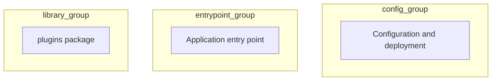

# Architecture report: wshobson/agents

> Automated static analysis. **Observed** = directly seen in files/imports/AST; **Inferred** = interpretation from that evidence. Repository code was not executed.

## 1. Repository at a glance

| Item | Value |
| --- | --- |
| Repository | wshobson/agents |
| Description | Plugins, agents, skills, and commands for Claude Code, Codex CLI, Cursor, OpenCode, Antigravity CLI, GitHub Copilot, and Pi, written once in Markdown and adapted to each tool by generators with validation and evals. |
| Language | Python |
| Stars | 42510 |
| Licence | MIT |
| Analysed commit / branch | 9c61ab243def98f72da12abd41cfcf5bcd91af9d / main |
| Framework(s) | FastAPI, Typer |
| Files analysed | 800 |
| Components | 3 |

## 2. Architecture in one minute

wshobson/agents - Plugins, agents, skills, and commands for Claude Code, Codex CLI, Cursor, OpenCode, Antigravity CLI, GitHub Copilot, and Pi, written once in Markdown and adapted to each tool by generators with valid…. This repository was analysed statically from 800 file(s) (3 Python). Detected technologies (observed from imports/manifests): GitHub Actions, FastAPI, Typer, NumPy, Pydantic, Uvicorn. Files are grouped into 3 component(s): Configuration and deployment, Application entry point, plugins package. Observed entry point(s): plugins/backend-development/skills/api-design-principles/assets/rest-api-template.py, plugins/llm-application-dev/skills/prompt-engineering-patterns/scripts/optimize-prompt.py, plugins/plugin-eval/scripts/eval_all.py. Findings below distinguish observed facts from inferred interpretation.

## 3. High-level block diagram

## 4. Main components

### Configuration and deployment (`config`)

- **Kind:** config
- **Status:** Observed
- **Confidence:** 0.85
- **Responsibility:** Groups 112 file(s) under configuration and deployment (observed from repository paths and static analysis).
- **Paths:** `evals/static-score-snapshot.json`, `plugins/accessibility-compliance/.claude-plugin/plugin.json`, `plugins/accessibility-compliance/.codex-plugin/plugin.json`, `plugins/agent-orchestration/.claude-plugin/plugin.json`, `plugins/agent-teams/.claude-plugin/plugin.json`, `plugins/agent-teams/.codex-plugin/plugin.json`, `plugins/api-scaffolding/.claude-plugin/plugin.json`, `plugins/api-scaffolding/.codex-plugin/plugin.json`, `plugins/api-testing-observability/.claude-plugin/plugin.json`, `plugins/application-performance/.claude-plugin/plugin.json`, `plugins/arm-cortex-microcontrollers/.claude-plugin/plugin.json`, `plugins/avoid-ai-writing/.claude-plugin/plugin.json`, `plugins/avoid-ai-writing/.codex-plugin/plugin.json`, `plugins/backend-api-security/.claude-plugin/plugin.json`, `plugins/backend-development/.claude-plugin/plugin.json`, `plugins/backend-development/.codex-plugin/plugin.json`, `plugins/before-you-build/.claude-plugin/plugin.json`, `plugins/before-you-build/.codex-plugin/plugin.json`, `plugins/block-no-verify/.claude-plugin/plugin.json`, `plugins/block-no-verify/.codex-plugin/plugin.json`, `plugins/blockchain-web3/.claude-plugin/plugin.json`, `plugins/blockchain-web3/.codex-plugin/plugin.json`, `plugins/brand-landingpage/.claude-plugin/plugin.json`, `plugins/brand-landingpage/.codex-plugin/plugin.json`, `plugins/business-analytics/.claude-plugin/plugin.json`, `plugins/business-analytics/.codex-plugin/plugin.json`, `plugins/c4-architecture/.claude-plugin/plugin.json`, `plugins/cicd-automation/.claude-plugin/plugin.json`, `plugins/cicd-automation/.codex-plugin/plugin.json`, `plugins/cloud-infrastructure/.claude-plugin/plugin.json`, `plugins/cloud-infrastructure/.codex-plugin/plugin.json`, `plugins/code-documentation/.claude-plugin/plugin.json`, `plugins/code-refactoring/.claude-plugin/plugin.json`, `plugins/codebase-cleanup/.claude-plugin/plugin.json`, `plugins/comprehensive-review/.claude-plugin/plugin.json`, `plugins/conductor/.claude-plugin/plugin.json`, `plugins/conductor/.codex-plugin/plugin.json`, `plugins/conductor/templates/track-metadata.json`, `plugins/content-marketing/.claude-plugin/plugin.json`, `plugins/content-marketing/.codex-plugin/plugin.json`, `plugins/context-management/.claude-plugin/plugin.json`, `plugins/customer-sales-automation/.claude-plugin/plugin.json`, `plugins/data-engineering/.claude-plugin/plugin.json`, `plugins/data-engineering/.codex-plugin/plugin.json`, `plugins/data-validation-suite/.claude-plugin/plugin.json`, `plugins/database-cloud-optimization/.claude-plugin/plugin.json`, `plugins/database-design/.claude-plugin/plugin.json`, `plugins/database-design/.codex-plugin/plugin.json`, `plugins/database-migrations/.claude-plugin/plugin.json`, `plugins/debugging-toolkit/.claude-plugin/plugin.json`, `plugins/dependency-management/.claude-plugin/plugin.json`, `plugins/deployment-strategies/.claude-plugin/plugin.json`, `plugins/deployment-validation/.claude-plugin/plugin.json`, `plugins/developer-essentials/.claude-plugin/plugin.json`, `plugins/developer-essentials/.codex-plugin/plugin.json`, `plugins/dgx-spark-ops/.claude-plugin/plugin.json`, `plugins/dgx-spark-ops/.codex-plugin/plugin.json`, `plugins/distributed-debugging/.claude-plugin/plugin.json`, `plugins/documentation-generation/.claude-plugin/plugin.json`, `plugins/documentation-generation/.codex-plugin/plugin.json`, `plugins/documentation-standards/.claude-plugin/plugin.json`, `plugins/documentation-standards/.codex-plugin/plugin.json`, `plugins/dotnet-contribution/.claude-plugin/plugin.json`, `plugins/dotnet-contribution/.codex-plugin/plugin.json`, `plugins/error-debugging/.claude-plugin/plugin.json`, `plugins/error-diagnostics/.claude-plugin/plugin.json`, `plugins/file-conversion/.claude-plugin/plugin.json`, `plugins/file-conversion/.codex-plugin/plugin.json`, `plugins/framework-migration/.claude-plugin/plugin.json`, `plugins/framework-migration/.codex-plugin/plugin.json`, `plugins/frontend-mobile-development/.claude-plugin/plugin.json`, `plugins/frontend-mobile-development/.codex-plugin/plugin.json`, `plugins/frontend-mobile-security/.claude-plugin/plugin.json`, `plugins/full-stack-orchestration/.claude-plugin/plugin.json`, `plugins/functional-programming/.claude-plugin/plugin.json`, `plugins/game-development/.claude-plugin/plugin.json`, `plugins/game-development/.codex-plugin/plugin.json`, `plugins/git-pr-workflows/.claude-plugin/plugin.json`, `plugins/hermes-tweet/.claude-plugin/plugin.json`, `plugins/hermes-tweet/.codex-plugin/plugin.json`, `plugins/hr-legal-compliance/.claude-plugin/plugin.json`, `plugins/hr-legal-compliance/.codex-plugin/plugin.json`, `plugins/incident-response/.claude-plugin/plugin.json`, `plugins/incident-response/.codex-plugin/plugin.json`, `plugins/javascript-typescript/.claude-plugin/plugin.json`, `plugins/javascript-typescript/.codex-plugin/plugin.json`, `plugins/julia-development/.claude-plugin/plugin.json`, `plugins/jvm-languages/.claude-plugin/plugin.json`, `plugins/kubernetes-operations/.claude-plugin/plugin.json`, `plugins/kubernetes-operations/.codex-plugin/plugin.json`, `plugins/kubernetes-operations/skills/k8s-manifest-generator/assets/configmap-template.yaml`, `plugins/kubernetes-operations/skills/k8s-manifest-generator/assets/deployment-template.yaml`, `plugins/kubernetes-operations/skills/k8s-manifest-generator/assets/service-template.yaml`, `plugins/kubernetes-operations/skills/k8s-security-policies/assets/network-policy-template.yaml`, `plugins/llm-application-dev/.claude-plugin/plugin.json`, `plugins/llm-application-dev/.codex-plugin/plugin.json`, `plugins/llm-application-dev/skills/prompt-engineering-patterns/assets/few-shot-examples.json`, `plugins/llm-finetuning/.claude-plugin/plugin.json`, `plugins/llm-finetuning/.codex-plugin/plugin.json`, `plugins/machine-learning-ops/.claude-plugin/plugin.json`, `plugins/machine-learning-ops/.codex-plugin/plugin.json`, `plugins/meigen-ai-design/.claude-plugin/plugin.json`, `plugins/multi-platform-apps/.claude-plugin/plugin.json`, `plugins/observability-monitoring/.claude-plugin/plugin.json`, `plugins/observability-monitoring/.codex-plugin/plugin.json`, `plugins/operating-kit/.claude-plugin/plugin.json`, `plugins/payment-processing/.claude-plugin/plugin.json`, `plugins/payment-processing/.codex-plugin/plugin.json`, `plugins/performance-testing-review/.claude-plugin/plugin.json`, `plugins/plugin-eval/.claude-plugin/plugin.json`, `plugins/plugin-eval/.codex-plugin/plugin.json`, `plugins/plugin-eval/pyproject.toml`
- **Evidence:** [evals/static-score-snapshot.json](https://github.com/wshobson/agents/blob/9c61ab243def98f72da12abd41cfcf5bcd91af9d/evals/static-score-snapshot.json); [plugins/accessibility-compliance/.claude-plugin/plugin.json](https://github.com/wshobson/agents/blob/9c61ab243def98f72da12abd41cfcf5bcd91af9d/plugins/accessibility-compliance/.claude-plugin/plugin.json); [plugins/accessibility-compliance/.codex-plugin/plugin.json](https://github.com/wshobson/agents/blob/9c61ab243def98f72da12abd41cfcf5bcd91af9d/plugins/accessibility-compliance/.codex-plugin/plugin.json); [plugins/agent-orchestration/.claude-plugin/plugin.json](https://github.com/wshobson/agents/blob/9c61ab243def98f72da12abd41cfcf5bcd91af9d/plugins/agent-orchestration/.claude-plugin/plugin.json); [plugins/agent-teams/.claude-plugin/plugin.json](https://github.com/wshobson/agents/blob/9c61ab243def98f72da12abd41cfcf5bcd91af9d/plugins/agent-teams/.claude-plugin/plugin.json); [plugins/agent-teams/.codex-plugin/plugin.json](https://github.com/wshobson/agents/blob/9c61ab243def98f72da12abd41cfcf5bcd91af9d/plugins/agent-teams/.codex-plugin/plugin.json); [plugins/api-scaffolding/.claude-plugin/plugin.json](https://github.com/wshobson/agents/blob/9c61ab243def98f72da12abd41cfcf5bcd91af9d/plugins/api-scaffolding/.claude-plugin/plugin.json); [plugins/api-scaffolding/.codex-plugin/plugin.json](https://github.com/wshobson/agents/blob/9c61ab243def98f72da12abd41cfcf5bcd91af9d/plugins/api-scaffolding/.codex-plugin/plugin.json)

### Application entry point (`entrypoint`)

- **Kind:** entrypoint
- **Status:** Observed
- **Confidence:** 0.85
- **Responsibility:** Groups 3 file(s) under application entry point (observed from repository paths and static analysis). Observed application object created via FastAPI. Observed routes: GET /api/users, POST /api/users, GET /api/users/{user_id}, PATCH /api/users/{user_id}, DELETE /api/users/{user_id}. Observed top-level classes: ErrorDetail, ErrorResponse, PaginatedResponse, PaginationParams, PluginRow, PromptOptimizer. Observed top-level functions: build_summary_md, create_user, delete_user, discover_plugins, evaluate_one, format_dim_score.
- **Paths:** `plugins/backend-development/skills/api-design-principles/assets/rest-api-template.py`, `plugins/llm-application-dev/skills/prompt-engineering-patterns/scripts/optimize-prompt.py`, `plugins/plugin-eval/scripts/eval_all.py`
- **Evidence:** [plugins/backend-development/skills/api-design-principles/assets/rest-api-template.py:15](https://github.com/wshobson/agents/blob/9c61ab243def98f72da12abd41cfcf5bcd91af9d/plugins/backend-development/skills/api-design-principles/assets/rest-api-template.py#L15); [plugins/llm-application-dev/skills/prompt-engineering-patterns/scripts/optimize-prompt.py:17](https://github.com/wshobson/agents/blob/9c61ab243def98f72da12abd41cfcf5bcd91af9d/plugins/llm-application-dev/skills/prompt-engineering-patterns/scripts/optimize-prompt.py#L17); [plugins/plugin-eval/scripts/eval_all.py:44](https://github.com/wshobson/agents/blob/9c61ab243def98f72da12abd41cfcf5bcd91af9d/plugins/plugin-eval/scripts/eval_all.py#L44)

### plugins package (`plugins`)

- **Kind:** library
- **Status:** Observed
- **Confidence:** 0.85
- **Responsibility:** Groups 5 file(s) under plugins package (observed from repository paths and static analysis).
- **Paths:** `plugins/dgx-spark-ops/skills/spark-memory-thermal-ops/assets/thermal-sample.sh`, `plugins/dgx-spark-ops/skills/spark-training-gotchas/assets/preflight.sh`, `plugins/dotnet-contribution/skills/dotnet-backend-patterns/assets/repository-template.cs`, `plugins/dotnet-contribution/skills/dotnet-backend-patterns/assets/service-template.cs`, `plugins/kubernetes-operations/skills/helm-chart-scaffolding/scripts/validate-chart.sh`
- **Evidence:** [plugins/dgx-spark-ops/skills/spark-memory-thermal-ops/assets/thermal-sample.sh](https://github.com/wshobson/agents/blob/9c61ab243def98f72da12abd41cfcf5bcd91af9d/plugins/dgx-spark-ops/skills/spark-memory-thermal-ops/assets/thermal-sample.sh); [plugins/dgx-spark-ops/skills/spark-training-gotchas/assets/preflight.sh](https://github.com/wshobson/agents/blob/9c61ab243def98f72da12abd41cfcf5bcd91af9d/plugins/dgx-spark-ops/skills/spark-training-gotchas/assets/preflight.sh); [plugins/dotnet-contribution/skills/dotnet-backend-patterns/assets/repository-template.cs](https://github.com/wshobson/agents/blob/9c61ab243def98f72da12abd41cfcf5bcd91af9d/plugins/dotnet-contribution/skills/dotnet-backend-patterns/assets/repository-template.cs); [plugins/dotnet-contribution/skills/dotnet-backend-patterns/assets/service-template.cs](https://github.com/wshobson/agents/blob/9c61ab243def98f72da12abd41cfcf5bcd91af9d/plugins/dotnet-contribution/skills/dotnet-backend-patterns/assets/service-template.cs); [plugins/kubernetes-operations/skills/helm-chart-scaffolding/scripts/validate-chart.sh](https://github.com/wshobson/agents/blob/9c61ab243def98f72da12abd41cfcf5bcd91af9d/plugins/kubernetes-operations/skills/helm-chart-scaffolding/scripts/validate-chart.sh)

## 5. Execution flow

**Observed** entry point(s):

- [plugins/backend-development/skills/api-design-principles/assets/rest-api-template.py:15](https://github.com/wshobson/agents/blob/9c61ab243def98f72da12abd41cfcf5bcd91af9d/plugins/backend-development/skills/api-design-principles/assets/rest-api-template.py#L15)
- [plugins/llm-application-dev/skills/prompt-engineering-patterns/scripts/optimize-prompt.py:285](https://github.com/wshobson/agents/blob/9c61ab243def98f72da12abd41cfcf5bcd91af9d/plugins/llm-application-dev/skills/prompt-engineering-patterns/scripts/optimize-prompt.py#L285)
- [plugins/plugin-eval/scripts/eval_all.py:301](https://github.com/wshobson/agents/blob/9c61ab243def98f72da12abd41cfcf5bcd91af9d/plugins/plugin-eval/scripts/eval_all.py#L301)

**Observed** routes (from decorators):

- `GET /api/users` -> `list_users` in `plugins/backend-development/skills/api-design-principles/assets/rest-api-template.py:99`
- `POST /api/users` -> `create_user` in `plugins/backend-development/skills/api-design-principles/assets/rest-api-template.py:129`
- `GET /api/users/{user_id}` -> `get_user` in `plugins/backend-development/skills/api-design-principles/assets/rest-api-template.py:142`
- `PATCH /api/users/{user_id}` -> `update_user` in `plugins/backend-development/skills/api-design-principles/assets/rest-api-template.py:164`
- `DELETE /api/users/{user_id}` -> `delete_user` in `plugins/backend-development/skills/api-design-principles/assets/rest-api-template.py:178`

Representative flow (derived from observed entry points and the import graph; steps beyond the entry point are **Inferred**):

1. Execution starts at an observed entry point listed above, if present.
2. No internal import relationships between components were observed.

## 6. Project structure

### `(root)`

- `.gitignore` - other (1854 bytes)
- `.markdownlint.json` - config (296 bytes)
- `AGENTS.md` - docs (7035 bytes)
- `ARCHITECTURE.md` - docs (8901 bytes)
- `CONTRIBUTING.md` - docs (7981 bytes)
- `LICENSE` - docs (1068 bytes)
- `Makefile` - other (13572 bytes)
- `README.md` - docs (10120 bytes)

### `.agents`

- `.agents/plugins/marketplace.json` - config (22920 bytes)

### `.claude-plugin`

- `.claude-plugin/marketplace.json` - config (46765 bytes)

### `.cursor`

- `.cursor/rules/000-project-conventions.mdc` - other (1253 bytes)
- `.cursor/rules/010-python-tooling.mdc` - other (675 bytes)
- `.cursor/rules/020-agent-skill-authoring.mdc` - other (1483 bytes)

### `.cursor-plugin`

- `.cursor-plugin/marketplace.json` - config (36533 bytes)
- `.cursor-plugin/plugin.json` - config (432 bytes)
- `.cursor-plugin/plugins/accessibility-compliance.json` - config (354 bytes)
- `.cursor-plugin/plugins/agent-orchestration.json` - config (304 bytes)
- `.cursor-plugin/plugins/agent-teams.json` - config (356 bytes)
- `.cursor-plugin/plugins/api-scaffolding.json` - config (307 bytes)
- `.cursor-plugin/plugins/api-testing-observability.json` - config (342 bytes)
- `.cursor-plugin/plugins/application-performance.json` - config (327 bytes)
- `.cursor-plugin/plugins/arm-cortex-microcontrollers.json` - config (339 bytes)
- `.cursor-plugin/plugins/avoid-ai-writing.json` - config (439 bytes)
- `.cursor-plugin/plugins/backend-api-security.json` - config (336 bytes)
- `.cursor-plugin/plugins/backend-development.json` - config (335 bytes)
- `.cursor-plugin/plugins/before-you-build.json` - config (304 bytes)
- `.cursor-plugin/plugins/block-no-verify.json` - config (310 bytes)
- `.cursor-plugin/plugins/blockchain-web3.json` - config (332 bytes)
- `.cursor-plugin/plugins/brand-landingpage.json` - config (303 bytes)
- `.cursor-plugin/plugins/business-analytics.json` - config (311 bytes)
- `.cursor-plugin/plugins/c4-architecture.json` - config (365 bytes)
- `.cursor-plugin/plugins/cicd-automation.json` - config (330 bytes)
- `.cursor-plugin/plugins/cloud-infrastructure.json` - config (397 bytes)
- `.cursor-plugin/plugins/code-documentation.json` - config (335 bytes)
- `.cursor-plugin/plugins/code-refactoring.json` - config (306 bytes)
- `.cursor-plugin/plugins/codebase-cleanup.json` - config (291 bytes)
- `.cursor-plugin/plugins/comprehensive-review.json` - config (305 bytes)
- `.cursor-plugin/plugins/conductor.json` - config (369 bytes)
- `.cursor-plugin/plugins/content-marketing.json` - config (308 bytes)
- `.cursor-plugin/plugins/context-management.json` - config (292 bytes)
- `.cursor-plugin/plugins/customer-sales-automation.json` - config (333 bytes)
- `.cursor-plugin/plugins/data-engineering.json` - config (327 bytes)
- `.cursor-plugin/plugins/data-validation-suite.json` - config (337 bytes)
- `.cursor-plugin/plugins/database-cloud-optimization.json` - config (318 bytes)
- `.cursor-plugin/plugins/database-design.json` - config (293 bytes)
- `.cursor-plugin/plugins/database-migrations.json` - config (305 bytes)
- `.cursor-plugin/plugins/debugging-toolkit.json` - config (303 bytes)
- `.cursor-plugin/plugins/dependency-management.json` - config (300 bytes)
- `.cursor-plugin/plugins/deployment-strategies.json` - config (294 bytes)
- `.cursor-plugin/plugins/deployment-validation.json` - config (308 bytes)
- `.cursor-plugin/plugins/developer-essentials.json` - config (384 bytes)
- `.cursor-plugin/plugins/dgx-spark-ops.json` - config (389 bytes)
- `.cursor-plugin/plugins/distributed-debugging.json` - config (285 bytes)
- `.cursor-plugin/plugins/documentation-generation.json` - config (335 bytes)
- `.cursor-plugin/plugins/documentation-standards.json` - config (542 bytes)
- `.cursor-plugin/plugins/dotnet-contribution.json` - config (349 bytes)
- `.cursor-plugin/plugins/error-debugging.json` - config (278 bytes)
- `.cursor-plugin/plugins/error-diagnostics.json` - config (294 bytes)
- `.cursor-plugin/plugins/file-conversion.json` - config (415 bytes)
- `.cursor-plugin/plugins/framework-migration.json` - config (301 bytes)
- `.cursor-plugin/plugins/frontend-mobile-development.json` - config (314 bytes)
- `.cursor-plugin/plugins/frontend-mobile-security.json` - config (338 bytes)
- `.cursor-plugin/plugins/full-stack-orchestration.json` - config (314 bytes)
- `.cursor-plugin/plugins/functional-programming.json` - config (318 bytes)
- `.cursor-plugin/plugins/game-development.json` - config (315 bytes)
- `.cursor-plugin/plugins/git-pr-workflows.json` - config (294 bytes)
- `.cursor-plugin/plugins/hermes-tweet.json` - config (374 bytes)
- `.cursor-plugin/plugins/hr-legal-compliance.json` - config (341 bytes)
- `.cursor-plugin/plugins/incident-response.json` - config (299 bytes)
- `.cursor-plugin/plugins/javascript-typescript.json` - config (314 bytes)
- `.cursor-plugin/plugins/julia-development.json` - config (355 bytes)
- `.cursor-plugin/plugins/jvm-languages.json` - config (302 bytes)
- `.cursor-plugin/plugins/kubernetes-operations.json` - config (356 bytes)
- `.cursor-plugin/plugins/llm-application-dev.json` - config (345 bytes)
- `.cursor-plugin/plugins/llm-finetuning.json` - config (422 bytes)
- `.cursor-plugin/plugins/machine-learning-ops.json` - config (343 bytes)
- `.cursor-plugin/plugins/meigen-ai-design.json` - config (438 bytes)
- `.cursor-plugin/plugins/multi-platform-apps.json` - config (318 bytes)
- `.cursor-plugin/plugins/observability-monitoring.json` - config (340 bytes)
- `.cursor-plugin/plugins/operating-kit.json` - config (473 bytes)
- `.cursor-plugin/plugins/payment-processing.json` - config (337 bytes)
- `.cursor-plugin/plugins/performance-testing-review.json` - config (316 bytes)
- `.cursor-plugin/plugins/plugin-eval.json` - config (191 bytes)
- `.cursor-plugin/plugins/pptx-deck-creation.json` - config (348 bytes)
- `.cursor-plugin/plugins/protect-mcp.json` - config (375 bytes)
- `.cursor-plugin/plugins/python-development.json` - config (325 bytes)
- `.cursor-plugin/plugins/quantitative-trading.json` - config (339 bytes)
- `.cursor-plugin/plugins/reverse-engineering.json` - config (381 bytes)
- `.cursor-plugin/plugins/review-agent-governance.json` - config (457 bytes)
- `.cursor-plugin/plugins/security-compliance.json` - config (334 bytes)
- `.cursor-plugin/plugins/security-scanning.json` - config (352 bytes)
- `.cursor-plugin/plugins/seo-analysis-monitoring.json` - config (313 bytes)
- `.cursor-plugin/plugins/seo-content-creation.json` - config (299 bytes)
- `.cursor-plugin/plugins/seo-technical-optimization.json` - config (324 bytes)
- `.cursor-plugin/plugins/shell-scripting.json` - config (299 bytes)
- `.cursor-plugin/plugins/ship-mate.json` - config (397 bytes)
- `.cursor-plugin/plugins/signed-audit-trails.json` - config (439 bytes)
- `.cursor-plugin/plugins/skill-forge-essentials.json` - config (391 bytes)
- `.cursor-plugin/plugins/social-publishing.json` - config (501 bytes)
- `.cursor-plugin/plugins/startup-business-analyst.json` - config (361 bytes)
- `.cursor-plugin/plugins/superself.json` - config (562 bytes)
- `.cursor-plugin/plugins/systems-programming.json` - config (316 bytes)
- `.cursor-plugin/plugins/tdd-workflows.json` - config (290 bytes)
- `.cursor-plugin/plugins/team-collaboration.json` - config (309 bytes)
- `.cursor-plugin/plugins/ui-design.json` - config (350 bytes)
- `.cursor-plugin/plugins/unit-testing.json` - config (291 bytes)
- `.cursor-plugin/plugins/web-scripting.json` - config (299 bytes)

### `.github`

- `.github/CODE_OF_CONDUCT.md` - docs (3414 bytes)
- `.github/CONTRIBUTING.md` - docs (464 bytes)
- `.github/FUNDING.yml` - config (17 bytes)
- `.github/ISSUE_TEMPLATE/bug_report.yml` - config (3555 bytes)
- `.github/ISSUE_TEMPLATE/config.yml` - config (1391 bytes)
- `.github/ISSUE_TEMPLATE/feature_request.yml` - config (3267 bytes)
- `.github/ISSUE_TEMPLATE/moderation_report.yml` - config (3755 bytes)
- `.github/ISSUE_TEMPLATE/new_subagent.yml` - config (5844 bytes)
- `.github/PULL_REQUEST_TEMPLATE.md` - docs (1841 bytes)
- `.github/dependabot.yml` - config (1144 bytes)
- `.github/workflows/claude-code-review.yml` - ci, YAML (9467 bytes)
- `.github/workflows/claude.yml` - ci, YAML (5608 bytes)
- `.github/workflows/code-quality.yml` - ci, YAML (5497 bytes)
- `.github/workflows/eval-report.yml` - ci, YAML (3839 bytes)
- `.github/workflows/mlops.yml` - ci, YAML (6981 bytes)
- `.github/workflows/validate.yml` - ci, YAML (13386 bytes)

### `docs`

- `docs/agent-skills.md` - docs (36900 bytes)
- `docs/agents.md` - docs (30901 bytes)
- `docs/architecture.md` - docs (13602 bytes)
- `docs/authoring.md` - docs (13632 bytes)
- `docs/harnesses.md` - docs (17146 bytes)
- `docs/mlops.md` - docs (4527 bytes)
- `docs/plugin-eval.md` - docs (24504 bytes)
- `docs/plugins.md` - docs (26386 bytes)
- `docs/round-trip-results.md` - docs (9926 bytes)
- `docs/usage.md` - docs (18000 bytes)

### `evals`

- `evals/README.md` - docs (2264 bytes)
- `evals/static-score-snapshot.json` - config (95988 bytes)

### `plugins`

- `plugins/accessibility-compliance/.claude-plugin/plugin.json` - config (309 bytes)
- `plugins/accessibility-compliance/.codex-plugin/plugin.json` - config (794 bytes)
- `plugins/accessibility-compliance/agents/ui-visual-validator.md` - docs (9423 bytes)
- `plugins/accessibility-compliance/commands/accessibility-audit.md` - docs (14706 bytes)
- `plugins/accessibility-compliance/skills/screen-reader-testing/SKILL.md` - docs (6423 bytes)
- `plugins/accessibility-compliance/skills/screen-reader-testing/references/jaws-talkback.md` - docs (1703 bytes)
- `plugins/accessibility-compliance/skills/screen-reader-testing/references/nvda.md` - docs (2406 bytes)
- `plugins/accessibility-compliance/skills/screen-reader-testing/references/voiceover-ios.md` - docs (1296 bytes)
- `plugins/accessibility-compliance/skills/screen-reader-testing/references/voiceover.md` - docs (2607 bytes)
- `plugins/accessibility-compliance/skills/wcag-audit-patterns/SKILL.md` - docs (2511 bytes)
- `plugins/accessibility-compliance/skills/wcag-audit-patterns/references/details.md` - docs (9972 bytes)
- `plugins/agent-orchestration/.claude-plugin/plugin.json` - config (264 bytes)
- `plugins/agent-orchestration/agents/context-manager.md` - docs (7888 bytes)
- `plugins/agent-orchestration/commands/improve-agent.md` - docs (9220 bytes)
- `plugins/agent-orchestration/commands/multi-agent-optimize.md` - docs (5905 bytes)
- `plugins/agent-teams/.claude-plugin/plugin.json` - config (324 bytes)
- `plugins/agent-teams/.codex-plugin/plugin.json` - config (926 bytes)
- `plugins/agent-teams/README.md` - docs (6795 bytes)
- `plugins/agent-teams/agents/team-debugger.md` - docs (3830 bytes)
- `plugins/agent-teams/agents/team-implementer.md` - docs (3811 bytes)
- `plugins/agent-teams/agents/team-lead.md` - docs (4301 bytes)
- `plugins/agent-teams/agents/team-reviewer.md` - docs (3457 bytes)
- `plugins/agent-teams/commands/team-debug.md` - docs (3744 bytes)
- `plugins/agent-teams/commands/team-delegate.md` - docs (2990 bytes)
- `plugins/agent-teams/commands/team-feature.md` - docs (3720 bytes)
- `plugins/agent-teams/commands/team-review.md` - docs (2880 bytes)
- `plugins/agent-teams/commands/team-shutdown.md` - docs (1766 bytes)
- `plugins/agent-teams/commands/team-spawn.md` - docs (4336 bytes)
- `plugins/agent-teams/commands/team-status.md` - docs (2098 bytes)
- `plugins/agent-teams/skills/multi-reviewer-patterns/SKILL.md` - docs (5192 bytes)
- `plugins/agent-teams/skills/multi-reviewer-patterns/references/review-dimensions.md` - docs (4107 bytes)
- `plugins/agent-teams/skills/parallel-debugging/SKILL.md` - docs (4748 bytes)
- `plugins/agent-teams/skills/parallel-debugging/references/hypothesis-testing.md` - docs (3288 bytes)
- `plugins/agent-teams/skills/parallel-feature-development/SKILL.md` - docs (6667 bytes)
- `plugins/agent-teams/skills/parallel-feature-development/references/file-ownership.md` - docs (2460 bytes)
- `plugins/agent-teams/skills/parallel-feature-development/references/merge-strategies.md` - docs (2342 bytes)
- `plugins/agent-teams/skills/task-coordination-strategies/SKILL.md` - docs (4690 bytes)
- `plugins/agent-teams/skills/task-coordination-strategies/references/dependency-graphs.md` - docs (2706 bytes)
- `plugins/agent-teams/skills/task-coordination-strategies/references/task-decomposition.md` - docs (2738 bytes)
- `plugins/agent-teams/skills/team-communication-protocols/SKILL.md` - docs (7360 bytes)
- `plugins/agent-teams/skills/team-communication-protocols/references/messaging-patterns.md` - docs (2152 bytes)
- `plugins/agent-teams/skills/team-composition-patterns/SKILL.md` - docs (8168 bytes)
- `plugins/agent-teams/skills/team-composition-patterns/references/agent-type-selection.md` - docs (3546 bytes)
- `plugins/agent-teams/skills/team-composition-patterns/references/preset-teams.md` - docs (9116 bytes)
- `plugins/api-scaffolding/.claude-plugin/plugin.json` - config (271 bytes)
- `plugins/api-scaffolding/.codex-plugin/plugin.json` - config (689 bytes)
- `plugins/api-scaffolding/agents/backend-architect.md` - docs (18352 bytes)
- `plugins/api-scaffolding/agents/django-pro.md` - docs (6559 bytes)
- `plugins/api-scaffolding/agents/fastapi-pro.md` - docs (5975 bytes)
- `plugins/api-scaffolding/agents/graphql-architect.md` - docs (6815 bytes)
- `plugins/api-scaffolding/skills/fastapi-templates/SKILL.md` - docs (4483 bytes)
- `plugins/api-scaffolding/skills/fastapi-templates/references/details.md` - docs (13033 bytes)
- `plugins/api-testing-observability/.claude-plugin/plugin.json` - config (296 bytes)
- `plugins/api-testing-observability/agents/api-documenter.md` - docs (7471 bytes)
- `plugins/api-testing-observability/commands/api-mock.md` - docs (42919 bytes)
- `plugins/application-performance/.claude-plugin/plugin.json` - config (283 bytes)
- `plugins/application-performance/agents/frontend-developer.md` - docs (6784 bytes)
- `plugins/application-performance/agents/observability-engineer.md` - docs (12545 bytes)
- `plugins/application-performance/agents/performance-engineer.md` - docs (10384 bytes)
- `plugins/application-performance/commands/performance-optimization.md` - docs (23083 bytes)
- `plugins/arm-cortex-microcontrollers/.claude-plugin/plugin.json` - config (318 bytes)
- `plugins/arm-cortex-microcontrollers/agents/arm-cortex-expert.md` - docs (12457 bytes)
- `plugins/avoid-ai-writing/.claude-plugin/plugin.json` - config (463 bytes)
- `plugins/avoid-ai-writing/.codex-plugin/plugin.json` - config (798 bytes)
- `plugins/avoid-ai-writing/README.md` - docs (2195 bytes)
- `plugins/avoid-ai-writing/skills/avoid-ai-writing/SKILL.md` - docs (7666 bytes)
- `plugins/avoid-ai-writing/skills/avoid-ai-writing/references/pattern-catalog.md` - docs (17313 bytes)
- `plugins/avoid-ai-writing/skills/avoid-ai-writing/references/profiles.md` - docs (7671 bytes)
- `plugins/avoid-ai-writing/skills/avoid-ai-writing/references/word-tiers.md` - docs (11710 bytes)
- `plugins/backend-api-security/.claude-plugin/plugin.json` - config (295 bytes)
- `plugins/backend-api-security/agents/backend-architect.md` - docs (18357 bytes)
- `plugins/backend-api-security/agents/backend-security-coder.md` - docs (9453 bytes)
- `plugins/backend-development/.claude-plugin/plugin.json` - config (295 bytes)
- `plugins/backend-development/.codex-plugin/plugin.json` - config (980 bytes)
- `plugins/backend-development/agents/backend-architect.md` - docs (18356 bytes)
- `plugins/backend-development/agents/event-sourcing-architect.md` - docs (1861 bytes)
- `plugins/backend-development/agents/graphql-architect.md` - docs (6819 bytes)
- `plugins/backend-development/agents/performance-engineer.md` - docs (2587 bytes)
- `plugins/backend-development/agents/security-auditor.md` - docs (2121 bytes)
- `plugins/backend-development/agents/tdd-orchestrator.md` - docs (9862 bytes)
- `plugins/backend-development/agents/temporal-python-pro.md` - docs (10088 bytes)
- `plugins/backend-development/agents/test-automator.md` - docs (2291 bytes)
- `plugins/backend-development/commands/feature-development.md` - docs (15280 bytes)
- `plugins/backend-development/skills/api-design-principles/SKILL.md` - docs (3603 bytes)
- `plugins/backend-development/skills/api-design-principles/assets/api-design-checklist.md` - docs (3884 bytes)
- `plugins/backend-development/skills/api-design-principles/assets/rest-api-template.py` - source, Python (5439 bytes)
- `plugins/backend-development/skills/api-design-principles/references/details.md` - docs (9808 bytes)
- `plugins/backend-development/skills/api-design-principles/references/graphql-schema-design.md` - docs (9323 bytes)
- `plugins/backend-development/skills/api-design-principles/references/rest-best-practices.md` - docs (7571 bytes)
- `plugins/backend-development/skills/architecture-patterns/SKILL.md` - docs (7942 bytes)
- `plugins/backend-development/skills/architecture-patterns/references/advanced-patterns.md` - docs (15592 bytes)
- `plugins/backend-development/skills/architecture-patterns/references/details.md` - docs (10993 bytes)
- `plugins/backend-development/skills/cqrs-implementation/SKILL.md` - docs (3447 bytes)
- `plugins/backend-development/skills/cqrs-implementation/references/details.md` - docs (12656 bytes)
- `plugins/backend-development/skills/event-store-design/SKILL.md` - docs (4148 bytes)
- `plugins/backend-development/skills/event-store-design/references/details.md` - docs (11449 bytes)
- `plugins/backend-development/skills/microservices-patterns/SKILL.md` - docs (2125 bytes)
- `plugins/backend-development/skills/microservices-patterns/references/details.md` - docs (14588 bytes)
- `plugins/backend-development/skills/projection-patterns/SKILL.md` - docs (2666 bytes)
- `plugins/backend-development/skills/projection-patterns/references/details.md` - docs (14266 bytes)
- `plugins/backend-development/skills/saga-orchestration/SKILL.md` - docs (6045 bytes)
- `plugins/backend-development/skills/saga-orchestration/references/advanced-patterns.md` - docs (15201 bytes)
- `plugins/backend-development/skills/saga-orchestration/references/details.md` - docs (10076 bytes)
- `plugins/backend-development/skills/temporal-python-testing/SKILL.md` - docs (4949 bytes)
- `plugins/backend-development/skills/temporal-python-testing/resources/integration-testing.md` - docs (12991 bytes)
- `plugins/backend-development/skills/temporal-python-testing/resources/local-setup.md` - docs (12065 bytes)
- `plugins/backend-development/skills/temporal-python-testing/resources/replay-testing.md` - docs (12381 bytes)
- `plugins/backend-development/skills/temporal-python-testing/resources/unit-testing.md` - docs (8710 bytes)
- `plugins/backend-development/skills/workflow-orchestration-patterns/SKILL.md` - docs (3478 bytes)
- `plugins/backend-development/skills/workflow-orchestration-patterns/references/details.md` - docs (5933 bytes)
- `plugins/before-you-build/.claude-plugin/plugin.json` - config (314 bytes)
- `plugins/before-you-build/.codex-plugin/plugin.json` - config (751 bytes)
- `plugins/before-you-build/README.md` - docs (425 bytes)
- `plugins/before-you-build/skills/before-you-build/SKILL.md` - docs (2794 bytes)
- `plugins/before-you-build/skills/before-you-build/references/risk-checklist.md` - docs (1611 bytes)
- `plugins/block-no-verify/.claude-plugin/plugin.json` - config (257 bytes)
- `plugins/block-no-verify/.codex-plugin/plugin.json` - config (704 bytes)
- `plugins/block-no-verify/commands/block-no-verify.md` - docs (2954 bytes)
- `plugins/block-no-verify/skills/block-no-verify-hook/SKILL.md` - docs (7505 bytes)
- `plugins/blockchain-web3/.claude-plugin/plugin.json` - config (296 bytes)
- `plugins/blockchain-web3/.codex-plugin/plugin.json` - config (811 bytes)
- `plugins/blockchain-web3/agents/blockchain-developer.md` - docs (9281 bytes)
- `plugins/blockchain-web3/skills/defi-protocol-templates/SKILL.md` - docs (7460 bytes)
- `plugins/blockchain-web3/skills/defi-protocol-templates/references/details.md` - docs (5625 bytes)
- `plugins/blockchain-web3/skills/nft-standards/SKILL.md` - docs (7633 bytes)
- `plugins/blockchain-web3/skills/nft-standards/references/details.md` - docs (2582 bytes)
- `plugins/blockchain-web3/skills/solidity-security/SKILL.md` - docs (3565 bytes)
- `plugins/blockchain-web3/skills/solidity-security/references/details.md` - docs (9611 bytes)
- `plugins/blockchain-web3/skills/web3-testing/SKILL.md` - docs (7906 bytes)
- `plugins/blockchain-web3/skills/web3-testing/references/details.md` - docs (1970 bytes)
- `plugins/brand-landingpage/.claude-plugin/plugin.json` - config (298 bytes)
- `plugins/brand-landingpage/.codex-plugin/plugin.json` - config (725 bytes)
- `plugins/brand-landingpage/README.md` - docs (2589 bytes)
- `plugins/brand-landingpage/skills/brand-landingpage/SKILL.md` - docs (15642 bytes)
- `plugins/brand-landingpage/skills/brand-landingpage/references/interview-framework.md` - docs (13743 bytes)
- `plugins/brand-landingpage/skills/brand-landingpage/references/state-and-pitfalls.md` - docs (4172 bytes)
- `plugins/brand-landingpage/skills/brand-landingpage/references/stitch-architecture.md` - docs (13665 bytes)
- `plugins/business-analytics/.claude-plugin/plugin.json` - config (272 bytes)
- `plugins/business-analytics/.codex-plugin/plugin.json` - config (722 bytes)
- `plugins/business-analytics/agents/business-analyst.md` - docs (7276 bytes)
- `plugins/business-analytics/skills/data-storytelling/SKILL.md` - docs (2119 bytes)
- `plugins/business-analytics/skills/data-storytelling/references/details.md` - docs (10306 bytes)
- `plugins/business-analytics/skills/kpi-dashboard-design/SKILL.md` - docs (5511 bytes)
- `plugins/business-analytics/skills/kpi-dashboard-design/references/details.md` - docs (14987 bytes)
- `plugins/c4-architecture/.claude-plugin/plugin.json` - config (329 bytes)
- `plugins/c4-architecture/agents/c4-code.md` - docs (12898 bytes)
- `plugins/c4-architecture/agents/c4-component.md` - docs (9723 bytes)
- `plugins/c4-architecture/agents/c4-container.md` - docs (11258 bytes)
- `plugins/c4-architecture/agents/c4-context.md` - docs (10968 bytes)
- `plugins/c4-architecture/commands/c4-architecture.md` - docs (15948 bytes)
- `plugins/cicd-automation/.claude-plugin/plugin.json` - config (294 bytes)
- `plugins/cicd-automation/.codex-plugin/plugin.json` - config (828 bytes)
- `plugins/cicd-automation/agents/cloud-architect.md` - docs (7740 bytes)
- `plugins/cicd-automation/agents/deployment-engineer.md` - docs (9017 bytes)
- `plugins/cicd-automation/agents/devops-troubleshooter.md` - docs (9532 bytes)
- `plugins/cicd-automation/agents/kubernetes-architect.md` - docs (9349 bytes)
- `plugins/cicd-automation/agents/terraform-specialist.md` - docs (8782 bytes)
- `plugins/cicd-automation/commands/workflow-automate.md` - docs (36478 bytes)
- `plugins/cicd-automation/skills/deployment-pipeline-design/SKILL.md` - docs (5522 bytes)
- `plugins/cicd-automation/skills/deployment-pipeline-design/references/advanced-strategies.md` - docs (15966 bytes)
- `plugins/cicd-automation/skills/deployment-pipeline-design/references/details.md` - docs (12315 bytes)
- `plugins/cicd-automation/skills/github-actions-templates/SKILL.md` - docs (7076 bytes)
- `plugins/cicd-automation/skills/gitlab-ci-patterns/SKILL.md` - docs (5792 bytes)
- `plugins/cicd-automation/skills/secrets-management/SKILL.md` - docs (7670 bytes)
- `plugins/cloud-infrastructure/.claude-plugin/plugin.json` - config (356 bytes)
- `plugins/cloud-infrastructure/.codex-plugin/plugin.json` - config (1021 bytes)
- `plugins/cloud-infrastructure/agents/cloud-architect.md` - docs (7745 bytes)
- `plugins/cloud-infrastructure/agents/deployment-engineer.md` - docs (9022 bytes)
- `plugins/cloud-infrastructure/agents/hybrid-cloud-architect.md` - docs (9555 bytes)
- `plugins/cloud-infrastructure/agents/kubernetes-architect.md` - docs (9354 bytes)
- `plugins/cloud-infrastructure/agents/network-engineer.md` - docs (9607 bytes)
- `plugins/cloud-infrastructure/agents/service-mesh-expert.md` - docs (2109 bytes)
- `plugins/cloud-infrastructure/agents/terraform-specialist.md` - docs (8787 bytes)
- `plugins/cloud-infrastructure/skills/cost-optimization/SKILL.md` - docs (6844 bytes)
- `plugins/cloud-infrastructure/skills/cost-optimization/references/tagging-standards.md` - docs (832 bytes)
- `plugins/cloud-infrastructure/skills/hybrid-cloud-networking/SKILL.md` - docs (6122 bytes)
- `plugins/cloud-infrastructure/skills/hybrid-cloud-networking/references/direct-connect.md` - docs (799 bytes)
- `plugins/cloud-infrastructure/skills/istio-traffic-management/SKILL.md` - docs (6813 bytes)
- `plugins/cloud-infrastructure/skills/linkerd-patterns/SKILL.md` - docs (8084 bytes)
- `plugins/cloud-infrastructure/skills/mtls-configuration/SKILL.md` - docs (2698 bytes)
- `plugins/cloud-infrastructure/skills/mtls-configuration/references/details.md` - docs (5807 bytes)
- `plugins/cloud-infrastructure/skills/multi-cloud-architecture/SKILL.md` - docs (5714 bytes)
- `plugins/cloud-infrastructure/skills/multi-cloud-architecture/references/multi-cloud-patterns.md` - docs (1025 bytes)
- `plugins/cloud-infrastructure/skills/multi-cloud-architecture/references/service-comparison.md` - docs (1765 bytes)
- `plugins/cloud-infrastructure/skills/service-mesh-observability/SKILL.md` - docs (2833 bytes)
- `plugins/cloud-infrastructure/skills/service-mesh-observability/references/details.md` - docs (7715 bytes)
- `plugins/cloud-infrastructure/skills/terraform-module-library/SKILL.md` - docs (5590 bytes)
- `plugins/cloud-infrastructure/skills/terraform-module-library/references/aws-modules.md` - docs (1316 bytes)
- `plugins/cloud-infrastructure/skills/terraform-module-library/references/oci-modules.md` - docs (1471 bytes)
- `plugins/code-documentation/.claude-plugin/plugin.json` - config (296 bytes)
- `plugins/code-documentation/agents/code-reviewer.md` - docs (8434 bytes)
- `plugins/code-documentation/agents/docs-architect.md` - docs (3687 bytes)
- `plugins/code-documentation/agents/tutorial-engineer.md` - docs (4380 bytes)
- `plugins/code-documentation/commands/code-explain.md` - docs (22433 bytes)
- `plugins/code-documentation/commands/doc-generate.md` - docs (17553 bytes)
- `plugins/code-refactoring/.claude-plugin/plugin.json` - config (269 bytes)
- `plugins/code-refactoring/agents/code-reviewer.md` - docs (8432 bytes)
- `plugins/code-refactoring/agents/legacy-modernizer.md` - docs (1242 bytes)
- `plugins/code-refactoring/commands/context-restore.md` - docs (5521 bytes)
- `plugins/code-refactoring/commands/refactor-clean.md` - docs (23266 bytes)
- `plugins/code-refactoring/commands/tech-debt.md` - docs (9864 bytes)
- `plugins/codebase-cleanup/.claude-plugin/plugin.json` - config (254 bytes)
- `plugins/codebase-cleanup/agents/code-reviewer.md` - docs (8432 bytes)
- `plugins/codebase-cleanup/agents/test-automator.md` - docs (10657 bytes)
- `plugins/codebase-cleanup/commands/deps-audit.md` - docs (24463 bytes)
- `plugins/codebase-cleanup/commands/refactor-clean.md` - docs (23266 bytes)
- `plugins/codebase-cleanup/commands/tech-debt.md` - docs (9864 bytes)
- `plugins/comprehensive-review/.claude-plugin/plugin.json` - config (264 bytes)
- `plugins/comprehensive-review/agents/architect-review.md` - docs (7781 bytes)
- `plugins/comprehensive-review/agents/code-reviewer.md` - docs (8436 bytes)
- `plugins/comprehensive-review/agents/security-auditor.md` - docs (9615 bytes)
- `plugins/comprehensive-review/commands/full-review.md` - docs (20125 bytes)
- `plugins/comprehensive-review/commands/pr-enhance.md` - docs (20050 bytes)
- `plugins/conductor/.claude-plugin/plugin.json` - config (339 bytes)
- `plugins/conductor/.codex-plugin/plugin.json` - config (822 bytes)
- `plugins/conductor/README.md` - docs (4818 bytes)
- `plugins/conductor/agents/conductor-validator.md` - docs (6834 bytes)
- `plugins/conductor/commands/implement.md` - docs (7962 bytes)
- `plugins/conductor/commands/manage.md` - docs (28908 bytes)
- `plugins/conductor/commands/new-track.md` - docs (7804 bytes)
- `plugins/conductor/commands/revert.md` - docs (8725 bytes)
- `plugins/conductor/commands/setup.md` - docs (8329 bytes)
- `plugins/conductor/commands/status.md` - docs (8985 bytes)
- `plugins/conductor/skills/context-driven-development/SKILL.md` - docs (2130 bytes)
- `plugins/conductor/skills/context-driven-development/references/artifact-templates.md` - docs (2891 bytes)
- `plugins/conductor/skills/context-driven-development/references/details.md` - docs (10013 bytes)
- `plugins/conductor/skills/track-management/SKILL.md` - docs (1680 bytes)
- `plugins/conductor/skills/track-management/references/details.md` - docs (12347 bytes)
- `plugins/conductor/skills/workflow-patterns/SKILL.md` - docs (1703 bytes)
- `plugins/conductor/skills/workflow-patterns/references/details.md` - docs (12067 bytes)
- `plugins/conductor/templates/code_styleguides/csharp.md` - docs (13649 bytes)
- `plugins/conductor/templates/code_styleguides/dart.md` - docs (13343 bytes)
- `plugins/conductor/templates/code_styleguides/general.md` - docs (4906 bytes)
- `plugins/conductor/templates/code_styleguides/go.md` - docs (10797 bytes)
- `plugins/conductor/templates/code_styleguides/html-css.md` - docs (12574 bytes)
- `plugins/conductor/templates/code_styleguides/javascript.md` - docs (10873 bytes)
- `plugins/conductor/templates/code_styleguides/python.md` - docs (11888 bytes)
- `plugins/conductor/templates/code_styleguides/typescript.md` - docs (9127 bytes)
- `plugins/conductor/templates/index.md` - docs (3200 bytes)
- `plugins/conductor/templates/product-guidelines.md` - docs (4554 bytes)
- `plugins/conductor/templates/product.md` - docs (1646 bytes)
- `plugins/conductor/templates/tech-stack.md` - docs (4356 bytes)
- `plugins/conductor/templates/track-metadata.json` - config (199 bytes)
- `plugins/conductor/templates/track-plan.md` - docs (3940 bytes)
- `plugins/conductor/templates/track-spec.md` - docs (3085 bytes)
- `plugins/conductor/templates/tracks.md` - docs (1597 bytes)
- `plugins/conductor/templates/workflow.md` - docs (4789 bytes)
- `plugins/content-marketing/.claude-plugin/plugin.json` - config (270 bytes)
- `plugins/content-marketing/.codex-plugin/plugin.json` - config (696 bytes)
- `plugins/content-marketing/agents/content-marketer.md` - docs (8215 bytes)
- `plugins/content-marketing/agents/search-specialist.md` - docs (1862 bytes)
- `plugins/content-marketing/skills/social-evidence-research/SKILL.md` - docs (5760 bytes)
- `plugins/content-marketing/skills/social-evidence-research/references/acceptance-examples.md` - docs (8924 bytes)
- `plugins/content-marketing/skills/social-evidence-research/references/evidence-record.md` - docs (7383 bytes)
- `plugins/content-marketing/skills/social-evidence-research/references/report-template.md` - docs (4503 bytes)
- `plugins/context-management/.claude-plugin/plugin.json` - config (253 bytes)
- `plugins/context-management/agents/context-manager.md` - docs (7887 bytes)
- `plugins/context-management/commands/context-restore.md` - docs (5521 bytes)
- `plugins/context-management/commands/context-save.md` - docs (5121 bytes)
- `plugins/customer-sales-automation/.claude-plugin/plugin.json` - config (287 bytes)
- `plugins/customer-sales-automation/agents/customer-support.md` - docs (8207 bytes)
- `plugins/customer-sales-automation/agents/sales-automator.md` - docs (937 bytes)
- `plugins/data-engineering/.claude-plugin/plugin.json` - config (290 bytes)
- `plugins/data-engineering/.codex-plugin/plugin.json` - config (823 bytes)
- `plugins/data-engineering/agents/backend-architect.md` - docs (18353 bytes)
- `plugins/data-engineering/agents/data-engineer.md` - docs (11337 bytes)
- `plugins/data-engineering/commands/data-driven-feature.md` - docs (26599 bytes)
- `plugins/data-engineering/commands/data-pipeline.md` - docs (6779 bytes)
- `plugins/data-engineering/skills/airflow-dag-patterns/SKILL.md` - docs (3135 bytes)
- `plugins/data-engineering/skills/airflow-dag-patterns/references/details.md` - docs (11406 bytes)
- `plugins/data-engineering/skills/data-quality-frameworks/SKILL.md` - docs (4498 bytes)
- `plugins/data-engineering/skills/data-quality-frameworks/references/details.md` - docs (11648 bytes)
- `plugins/data-engineering/skills/dbt-transformation-patterns/SKILL.md` - docs (3279 bytes)
- `plugins/data-engineering/skills/dbt-transformation-patterns/references/details.md` - docs (10449 bytes)
- `plugins/data-engineering/skills/spark-optimization/SKILL.md` - docs (3160 bytes)
- `plugins/data-engineering/skills/spark-optimization/references/details.md` - docs (9844 bytes)
- `plugins/data-validation-suite/.claude-plugin/plugin.json` - config (295 bytes)
- `plugins/data-validation-suite/agents/backend-security-coder.md` - docs (9454 bytes)
- `plugins/database-cloud-optimization/.claude-plugin/plugin.json` - config (270 bytes)
- `plugins/database-cloud-optimization/agents/backend-architect.md` - docs (18364 bytes)
- `plugins/database-cloud-optimization/agents/cloud-architect.md` - docs (7754 bytes)
- `plugins/database-cloud-optimization/agents/database-architect.md` - docs (16794 bytes)
- `plugins/database-cloud-optimization/agents/database-optimizer.md` - docs (10030 bytes)
- `plugins/database-cloud-optimization/commands/cost-optimize.md` - docs (49637 bytes)
- `plugins/database-design/.claude-plugin/plugin.json` - config (257 bytes)
- `plugins/database-design/.codex-plugin/plugin.json` - config (667 bytes)
- `plugins/database-design/agents/database-architect.md` - docs (16779 bytes)
- `plugins/database-design/agents/sql-pro.md` - docs (7171 bytes)
- `plugins/database-design/skills/postgresql-table-design/SKILL.md` - docs (7912 bytes)
- `plugins/database-design/skills/postgresql-table-design/references/details.md` - docs (12094 bytes)
- `plugins/database-migrations/.claude-plugin/plugin.json` - config (265 bytes)
- `plugins/database-migrations/agents/database-admin.md` - docs (9760 bytes)
- `plugins/database-migrations/agents/database-optimizer.md` - docs (10022 bytes)
- `plugins/database-migrations/commands/migration-observability.md` - docs (12672 bytes)
- `plugins/database-migrations/commands/sql-migrations.md` - docs (14453 bytes)
- `plugins/debugging-toolkit/.claude-plugin/plugin.json` - config (265 bytes)
- `plugins/debugging-toolkit/agents/debugger.md` - docs (802 bytes)
- `plugins/debugging-toolkit/agents/dx-optimizer.md` - docs (1797 bytes)
- `plugins/debugging-toolkit/commands/smart-debug.md` - docs (5741 bytes)
- `plugins/dependency-management/.claude-plugin/plugin.json` - config (258 bytes)
- `plugins/dependency-management/agents/legacy-modernizer.md` - docs (1247 bytes)
- `plugins/dependency-management/commands/deps-audit.md` - docs (24463 bytes)
- `plugins/deployment-strategies/.claude-plugin/plugin.json` - config (252 bytes)
- `plugins/deployment-strategies/agents/deployment-engineer.md` - docs (9023 bytes)
- `plugins/deployment-strategies/agents/terraform-specialist.md` - docs (8788 bytes)
- `plugins/deployment-validation/.claude-plugin/plugin.json` - config (266 bytes)
- `plugins/deployment-validation/agents/cloud-architect.md` - docs (7748 bytes)
- `plugins/deployment-validation/commands/config-validate.md` - docs (14000 bytes)
- `plugins/developer-essentials/.claude-plugin/plugin.json` - config (343 bytes)
- `plugins/developer-essentials/.codex-plugin/plugin.json` - config (1096 bytes)
- `plugins/developer-essentials/agents/monorepo-architect.md` - docs (1795 bytes)
- `plugins/developer-essentials/skills/auth-implementation-patterns/SKILL.md` - docs (2677 bytes)
- `plugins/developer-essentials/skills/auth-implementation-patterns/references/details.md` - docs (14194 bytes)
- `plugins/developer-essentials/skills/bazel-build-optimization/SKILL.md` - docs (2091 bytes)
- `plugins/developer-essentials/skills/bazel-build-optimization/references/details.md` - docs (7672 bytes)
- `plugins/developer-essentials/skills/code-review-excellence/SKILL.md` - docs (6804 bytes)
- `plugins/developer-essentials/skills/code-review-excellence/references/review-patterns.md` - docs (4530 bytes)
- `plugins/developer-essentials/skills/code-review-excellence/references/review-techniques.md` - docs (2192 bytes)
- `plugins/developer-essentials/skills/debugging-strategies/SKILL.md` - docs (6210 bytes)
- `plugins/developer-essentials/skills/debugging-strategies/references/tools-and-techniques.md` - docs (6341 bytes)
- `plugins/developer-essentials/skills/e2e-testing-patterns/SKILL.md` - docs (4231 bytes)
- `plugins/developer-essentials/skills/e2e-testing-patterns/references/details.md` - docs (10300 bytes)
- `plugins/developer-essentials/skills/error-handling-patterns/SKILL.md` - docs (4090 bytes)
- `plugins/developer-essentials/skills/error-handling-patterns/references/details.md` - docs (12524 bytes)
- `plugins/developer-essentials/skills/git-advanced-workflows/SKILL.md` - docs (5571 bytes)
- `plugins/developer-essentials/skills/git-advanced-workflows/references/details.md` - docs (3999 bytes)
- `plugins/developer-essentials/skills/monorepo-management/SKILL.md` - docs (5376 bytes)
- `plugins/developer-essentials/skills/monorepo-management/references/details.md` - docs (7752 bytes)
- `plugins/developer-essentials/skills/nx-workspace-patterns/SKILL.md` - docs (2285 bytes)
- `plugins/developer-essentials/skills/nx-workspace-patterns/references/details.md` - docs (8786 bytes)
- `plugins/developer-essentials/skills/sql-optimization-patterns/SKILL.md` - docs (5961 bytes)
- `plugins/developer-essentials/skills/sql-optimization-patterns/references/details.md` - docs (6950 bytes)
- `plugins/developer-essentials/skills/turborepo-caching/SKILL.md` - docs (8201 bytes)
- `plugins/dgx-spark-ops/.claude-plugin/plugin.json` - config (355 bytes)
- `plugins/dgx-spark-ops/.codex-plugin/plugin.json` - config (856 bytes)
- `plugins/dgx-spark-ops/agents/dgx-spark-ops-engineer.md` - docs (5288 bytes)
- `plugins/dgx-spark-ops/commands/spark-preflight.md` - docs (1236 bytes)
- `plugins/dgx-spark-ops/skills/spark-environment-setup/SKILL.md` - docs (8113 bytes)
- `plugins/dgx-spark-ops/skills/spark-environment-setup/references/container-workflow.md` - docs (4171 bytes)
- `plugins/dgx-spark-ops/skills/spark-environment-setup/references/stack-matrix.md` - docs (7064 bytes)
- `plugins/dgx-spark-ops/skills/spark-memory-thermal-ops/SKILL.md` - docs (7980 bytes)
- `plugins/dgx-spark-ops/skills/spark-memory-thermal-ops/assets/thermal-sample.sh` - source, Shell (1017 bytes)
- `plugins/dgx-spark-ops/skills/spark-memory-thermal-ops/references/uma-accounting.md` - docs (4407 bytes)
- `plugins/dgx-spark-ops/skills/spark-training-gotchas/SKILL.md` - docs (7981 bytes)
- `plugins/dgx-spark-ops/skills/spark-training-gotchas/assets/preflight.sh` - source, Shell (2486 bytes)
- `plugins/dgx-spark-ops/skills/spark-training-gotchas/references/gotcha-checks.md` - docs (9598 bytes)
- `plugins/distributed-debugging/.claude-plugin/plugin.json` - config (243 bytes)
- `plugins/distributed-debugging/agents/devops-troubleshooter.md` - docs (9538 bytes)
- `plugins/distributed-debugging/agents/error-detective.md` - docs (1226 bytes)
- `plugins/distributed-debugging/commands/debug-trace.md` - docs (35913 bytes)
- `plugins/documentation-generation/.claude-plugin/plugin.json` - config (290 bytes)
- `plugins/documentation-generation/.codex-plugin/plugin.json` - config (807 bytes)
- `plugins/documentation-generation/agents/api-documenter.md` - docs (7470 bytes)
- `plugins/documentation-generation/agents/docs-architect.md` - docs (3693 bytes)
- `plugins/documentation-generation/agents/mermaid-expert.md` - docs (1250 bytes)
- `plugins/documentation-generation/agents/reference-builder.md` - docs (4765 bytes)
- `plugins/documentation-generation/agents/tutorial-engineer.md` - docs (4386 bytes)
- `plugins/documentation-generation/commands/doc-generate.md` - docs (17553 bytes)
- `plugins/documentation-generation/skills/architecture-decision-records/SKILL.md` - docs (5048 bytes)
- `plugins/documentation-generation/skills/architecture-decision-records/references/decision-templates.md` - docs (5112 bytes)
- `plugins/documentation-generation/skills/architecture-decision-records/references/deprecation-rfc-templates.md` - docs (3435 bytes)
- `plugins/documentation-generation/skills/changelog-automation/SKILL.md` - docs (3348 bytes)
- `plugins/documentation-generation/skills/changelog-automation/references/details.md` - docs (10745 bytes)
- `plugins/documentation-generation/skills/openapi-spec-generation/SKILL.md` - docs (2043 bytes)
- `plugins/documentation-generation/skills/openapi-spec-generation/references/code-first-and-tooling.md` - docs (11762 bytes)
- `plugins/documentation-generation/skills/openapi-spec-generation/references/details.md` - docs (11928 bytes)
- `plugins/documentation-standards/.claude-plugin/plugin.json` - config (492 bytes)
- `plugins/documentation-standards/.codex-plugin/plugin.json` - config (973 bytes)
- `plugins/documentation-standards/skills/grounded-vault/SKILL.md` - docs (5445 bytes)
- `plugins/documentation-standards/skills/grounded-vault/references/details.md` - docs (8431 bytes)
- `plugins/documentation-standards/skills/hads/SKILL.md` - docs (6104 bytes)
- `plugins/dotnet-contribution/.claude-plugin/plugin.json` - config (309 bytes)
- `plugins/dotnet-contribution/.codex-plugin/plugin.json` - config (768 bytes)
- `plugins/dotnet-contribution/README.md` - docs (3639 bytes)
- `plugins/dotnet-contribution/agents/dotnet-architect.md` - docs (6728 bytes)
- `plugins/dotnet-contribution/skills/dotnet-backend-patterns/SKILL.md` - docs (26448 bytes)
- `plugins/dotnet-contribution/skills/dotnet-backend-patterns/assets/repository-template.cs` - source, C# (16802 bytes)
- `plugins/dotnet-contribution/skills/dotnet-backend-patterns/assets/service-template.cs` - source, C# (12453 bytes)
- `plugins/dotnet-contribution/skills/dotnet-backend-patterns/references/dapper-patterns.md` - docs (15464 bytes)
- `plugins/dotnet-contribution/skills/dotnet-backend-patterns/references/ef-core-best-practices.md` - docs (8885 bytes)
- `plugins/error-debugging/.claude-plugin/plugin.json` - config (242 bytes)
- `plugins/error-debugging/agents/debugger.md` - docs (800 bytes)
- `plugins/error-debugging/agents/error-detective.md` - docs (1220 bytes)
- `plugins/error-debugging/commands/error-analysis.md` - docs (36062 bytes)
- `plugins/error-debugging/commands/error-trace.md` - docs (39656 bytes)
- `plugins/error-debugging/commands/multi-agent-review.md` - docs (6196 bytes)
- `plugins/error-diagnostics/.claude-plugin/plugin.json` - config (256 bytes)
- `plugins/error-diagnostics/agents/debugger.md` - docs (802 bytes)
- `plugins/error-diagnostics/agents/error-detective.md` - docs (1222 bytes)
- `plugins/error-diagnostics/commands/error-analysis.md` - docs (36062 bytes)
- `plugins/error-diagnostics/commands/error-trace.md` - docs (39656 bytes)
- `plugins/error-diagnostics/commands/smart-debug.md` - docs (5741 bytes)
- `plugins/file-conversion/.claude-plugin/plugin.json` - config (475 bytes)
- `plugins/file-conversion/.codex-plugin/plugin.json` - config (773 bytes)
- `plugins/file-conversion/README.md` - docs (2459 bytes)
- `plugins/file-conversion/skills/file-conversion/SKILL.md` - docs (8184 bytes)
- `plugins/framework-migration/.claude-plugin/plugin.json` - config (261 bytes)
- `plugins/framework-migration/.codex-plugin/plugin.json` - config (752 bytes)
- `plugins/framework-migration/agents/architect-review.md` - docs (7780 bytes)
- `plugins/framework-migration/agents/legacy-modernizer.md` - docs (1244 bytes)
- `plugins/framework-migration/commands/code-migrate.md` - docs (32279 bytes)
- `plugins/framework-migration/commands/deps-upgrade.md` - docs (21861 bytes)
- `plugins/framework-migration/commands/legacy-modernize.md` - docs (23971 bytes)
- `plugins/framework-migration/skills/angular-migration/SKILL.md` - docs (7131 bytes)
- `plugins/framework-migration/skills/angular-migration/references/details.md` - docs (1818 bytes)
- `plugins/framework-migration/skills/database-migration/SKILL.md` - docs (8155 bytes)
- `plugins/framework-migration/skills/database-migration/references/details.md` - docs (1721 bytes)
- `plugins/framework-migration/skills/dependency-upgrade/SKILL.md` - docs (7624 bytes)
- `plugins/framework-migration/skills/react-modernization/SKILL.md` - docs (6815 bytes)
- `plugins/framework-migration/skills/react-modernization/references/details.md` - docs (4436 bytes)
- `plugins/frontend-mobile-development/.claude-plugin/plugin.json` - config (266 bytes)
- `plugins/frontend-mobile-development/.codex-plugin/plugin.json` - config (793 bytes)
- `plugins/frontend-mobile-development/agents/frontend-developer.md` - docs (6788 bytes)
- `plugins/frontend-mobile-development/agents/mobile-developer.md` - docs (8231 bytes)
- `plugins/frontend-mobile-development/commands/component-scaffold.md` - docs (11392 bytes)
- `plugins/frontend-mobile-development/skills/nextjs-app-router-patterns/SKILL.md` - docs (3714 bytes)
- `plugins/frontend-mobile-development/skills/nextjs-app-router-patterns/references/details.md` - docs (9939 bytes)
- `plugins/frontend-mobile-development/skills/react-native-architecture/SKILL.md` - docs (3602 bytes)
- `plugins/frontend-mobile-development/skills/react-native-architecture/references/details.md` - docs (13728 bytes)
- `plugins/frontend-mobile-development/skills/react-state-management/SKILL.md` - docs (4005 bytes)
- `plugins/frontend-mobile-development/skills/react-state-management/references/details.md` - docs (7750 bytes)
- `plugins/frontend-mobile-development/skills/tailwind-design-system/SKILL.md` - docs (5290 bytes)
- `plugins/frontend-mobile-development/skills/tailwind-design-system/references/advanced-patterns.md` - docs (8108 bytes)
- `plugins/frontend-mobile-development/skills/tailwind-design-system/references/details.md` - docs (10661 bytes)
- `plugins/frontend-mobile-security/.claude-plugin/plugin.json` - config (293 bytes)
- `plugins/frontend-mobile-security/agents/frontend-developer.md` - docs (6785 bytes)
- `plugins/frontend-mobile-security/agents/frontend-security-coder.md` - docs (11004 bytes)
- `plugins/frontend-mobile-security/agents/mobile-security-coder.md` - docs (12170 bytes)
- `plugins/frontend-mobile-security/commands/xss-scan.md` - docs (9092 bytes)
- `plugins/full-stack-orchestration/.claude-plugin/plugin.json` - config (269 bytes)
- `plugins/full-stack-orchestration/agents/deployment-engineer.md` - docs (9026 bytes)
- `plugins/full-stack-orchestration/agents/performance-engineer.md` - docs (10385 bytes)
- `plugins/full-stack-orchestration/agents/security-auditor.md` - docs (9619 bytes)
- `plugins/full-stack-orchestration/agents/test-automator.md` - docs (10665 bytes)
- `plugins/full-stack-orchestration/commands/full-stack-feature.md` - docs (20366 bytes)
- `plugins/functional-programming/.claude-plugin/plugin.json` - config (275 bytes)
- `plugins/functional-programming/agents/elixir-pro.md` - docs (1473 bytes)
- `plugins/functional-programming/agents/haskell-pro.md` - docs (1783 bytes)
- `plugins/game-development/.claude-plugin/plugin.json` - config (278 bytes)
- `plugins/game-development/.codex-plugin/plugin.json` - config (736 bytes)
- `plugins/game-development/agents/minecraft-bukkit-pro.md` - docs (4502 bytes)
- `plugins/game-development/agents/unity-developer.md` - docs (10342 bytes)
- `plugins/game-development/skills/godot-gdscript-patterns/SKILL.md` - docs (2157 bytes)
- `plugins/game-development/skills/godot-gdscript-patterns/references/advanced-patterns.md` - docs (6400 bytes)
- `plugins/game-development/skills/godot-gdscript-patterns/references/details.md` - docs (12383 bytes)
- `plugins/game-development/skills/unity-ecs-patterns/SKILL.md` - docs (2066 bytes)
- `plugins/game-development/skills/unity-ecs-patterns/references/details.md` - docs (14472 bytes)
- `plugins/git-pr-workflows/.claude-plugin/plugin.json` - config (257 bytes)
- `plugins/git-pr-workflows/agents/code-reviewer.md` - docs (8432 bytes)
- `plugins/git-pr-workflows/commands/git-workflow.md` - docs (17395 bytes)
- `plugins/git-pr-workflows/commands/onboard.md` - docs (14530 bytes)
- `plugins/git-pr-workflows/commands/pr-enhance.md` - docs (20050 bytes)
- `plugins/hermes-tweet/.claude-plugin/plugin.json` - config (455 bytes)
- `plugins/hermes-tweet/.codex-plugin/plugin.json` - config (725 bytes)
- `plugins/hermes-tweet/README.md` - docs (1444 bytes)
- `plugins/hermes-tweet/skills/hermes-tweet/SKILL.md` - docs (5508 bytes)
- `plugins/hermes-tweet/skills/hermes-tweet/references/endpoint-contract.md` - docs (1631 bytes)
- `plugins/hermes-tweet/skills/hermes-tweet/references/workflows.md` - docs (1393 bytes)
- `plugins/hr-legal-compliance/.claude-plugin/plugin.json` - config (301 bytes)
- `plugins/hr-legal-compliance/.codex-plugin/plugin.json` - config (783 bytes)
- `plugins/hr-legal-compliance/agents/hr-pro.md` - docs (7865 bytes)
- `plugins/hr-legal-compliance/agents/legal-advisor.md` - docs (1925 bytes)
- `plugins/hr-legal-compliance/skills/employment-contract-templates/SKILL.md` - docs (2395 bytes)
- `plugins/hr-legal-compliance/skills/employment-contract-templates/references/details.md` - docs (14021 bytes)
- `plugins/hr-legal-compliance/skills/gdpr-data-handling/SKILL.md` - docs (2680 bytes)
- `plugins/hr-legal-compliance/skills/gdpr-data-handling/references/details.md` - docs (17439 bytes)
- `plugins/incident-response/.claude-plugin/plugin.json` - config (261 bytes)
- `plugins/incident-response/.codex-plugin/plugin.json` - config (765 bytes)
- `plugins/incident-response/agents/code-reviewer.md` - docs (1529 bytes)
- `plugins/incident-response/agents/debugger.md` - docs (1546 bytes)
- `plugins/incident-response/agents/devops-troubleshooter.md` - docs (9534 bytes)
- `plugins/incident-response/agents/error-detective.md` - docs (1617 bytes)
- `plugins/incident-response/agents/incident-responder.md` - docs (9930 bytes)
- `plugins/incident-response/agents/test-automator.md` - docs (1576 bytes)
- `plugins/incident-response/commands/incident-response.md` - docs (18714 bytes)
- `plugins/incident-response/commands/smart-fix.md` - docs (18590 bytes)
- `plugins/incident-response/skills/connectivity-triage/SKILL.md` - docs (8101 bytes)
- `plugins/incident-response/skills/connectivity-triage/references/details.md` - docs (15168 bytes)
- `plugins/incident-response/skills/incident-runbook-templates/SKILL.md` - docs (5463 bytes)
- `plugins/incident-response/skills/incident-runbook-templates/references/details.md` - docs (8769 bytes)
- `plugins/incident-response/skills/on-call-handoff-patterns/SKILL.md` - docs (3701 bytes)
- `plugins/incident-response/skills/on-call-handoff-patterns/references/details.md` - docs (6276 bytes)
- `plugins/incident-response/skills/postmortem-writing/SKILL.md` - docs (6795 bytes)
- `plugins/incident-response/skills/postmortem-writing/references/details.md` - docs (5851 bytes)
- `plugins/javascript-typescript/.claude-plugin/plugin.json` - config (272 bytes)
- `plugins/javascript-typescript/.codex-plugin/plugin.json` - config (805 bytes)
- `plugins/javascript-typescript/agents/javascript-pro.md` - docs (1209 bytes)
- `plugins/javascript-typescript/agents/typescript-pro.md` - docs (1574 bytes)
- `plugins/javascript-typescript/commands/typescript-scaffold.md` - docs (8439 bytes)
- `plugins/javascript-typescript/skills/javascript-testing-patterns/SKILL.md` - docs (14629 bytes)
- `plugins/javascript-typescript/skills/javascript-testing-patterns/references/advanced-testing-patterns.md` - docs (12837 bytes)
- `plugins/javascript-typescript/skills/modern-javascript-patterns/SKILL.md` - docs (2189 bytes)
- `plugins/javascript-typescript/skills/modern-javascript-patterns/references/advanced-patterns.md` - docs (10110 bytes)
- `plugins/javascript-typescript/skills/modern-javascript-patterns/references/details.md` - docs (10362 bytes)
- `plugins/javascript-typescript/skills/nodejs-backend-patterns/SKILL.md` - docs (1995 bytes)
- `plugins/javascript-typescript/skills/nodejs-backend-patterns/references/advanced-patterns.md` - docs (9405 bytes)
- `plugins/javascript-typescript/skills/nodejs-backend-patterns/references/details.md` - docs (15001 bytes)
- `plugins/javascript-typescript/skills/typescript-advanced-types/SKILL.md` - docs (8035 bytes)
- `plugins/javascript-typescript/skills/typescript-advanced-types/references/details.md` - docs (9027 bytes)
- `plugins/julia-development/.claude-plugin/plugin.json` - config (342 bytes)
- `plugins/julia-development/agents/julia-pro.md` - docs (8249 bytes)
- `plugins/jvm-languages/.claude-plugin/plugin.json` - config (268 bytes)
- `plugins/jvm-languages/agents/csharp-pro.md` - docs (1688 bytes)
- `plugins/jvm-languages/agents/java-pro.md` - docs (7770 bytes)
- `plugins/jvm-languages/agents/scala-pro.md` - docs (5093 bytes)
- `plugins/kubernetes-operations/.claude-plugin/plugin.json` - config (314 bytes)
- `plugins/kubernetes-operations/.codex-plugin/plugin.json` - config (856 bytes)
- `plugins/kubernetes-operations/agents/kubernetes-architect.md` - docs (9355 bytes)
- `plugins/kubernetes-operations/skills/gitops-workflow/SKILL.md` - docs (6076 bytes)
- `plugins/kubernetes-operations/skills/gitops-workflow/references/argocd-setup.md` - docs (2946 bytes)
- `plugins/kubernetes-operations/skills/gitops-workflow/references/sync-policies.md` - docs (2794 bytes)
- `plugins/kubernetes-operations/skills/helm-chart-scaffolding/SKILL.md` - docs (2104 bytes)
- `plugins/kubernetes-operations/skills/helm-chart-scaffolding/assets/Chart.yaml.template` - other (801 bytes)
- `plugins/kubernetes-operations/skills/helm-chart-scaffolding/assets/values.yaml.template` - other (3190 bytes)
- `plugins/kubernetes-operations/skills/helm-chart-scaffolding/references/chart-structure.md` - docs (11498 bytes)
- `plugins/kubernetes-operations/skills/helm-chart-scaffolding/references/details.md` - docs (9414 bytes)
- `plugins/kubernetes-operations/skills/helm-chart-scaffolding/scripts/validate-chart.sh` - source, Shell (6506 bytes)
- `plugins/kubernetes-operations/skills/k8s-manifest-generator/SKILL.md` - docs (3096 bytes)
- `plugins/kubernetes-operations/skills/k8s-manifest-generator/assets/configmap-template.yaml` - config (6222 bytes)
- `plugins/kubernetes-operations/skills/k8s-manifest-generator/assets/deployment-template.yaml` - config (5226 bytes)
- `plugins/kubernetes-operations/skills/k8s-manifest-generator/assets/service-template.yaml` - config (3711 bytes)
- `plugins/kubernetes-operations/skills/k8s-manifest-generator/references/deployment-spec.md` - docs (17698 bytes)
- `plugins/kubernetes-operations/skills/k8s-manifest-generator/references/details.md` - docs (10826 bytes)
- `plugins/kubernetes-operations/skills/k8s-manifest-generator/references/service-spec.md` - docs (14150 bytes)
- `plugins/kubernetes-operations/skills/k8s-security-policies/SKILL.md` - docs (7192 bytes)
- `plugins/kubernetes-operations/skills/k8s-security-policies/assets/network-policy-template.yaml` - config (3157 bytes)
- `plugins/kubernetes-operations/skills/k8s-security-policies/references/rbac-patterns.md` - docs (4150 bytes)
- `plugins/llm-application-dev/.claude-plugin/plugin.json` - config (305 bytes)
- `plugins/llm-application-dev/.codex-plugin/plugin.json` - config (968 bytes)
- `plugins/llm-application-dev/README.md` - docs (4284 bytes)
- `plugins/llm-application-dev/agents/ai-engineer.md` - docs (8142 bytes)
- `plugins/llm-application-dev/agents/prompt-engineer.md` - docs (11018 bytes)
- `plugins/llm-application-dev/agents/vector-database-engineer.md` - docs (4904 bytes)
- `plugins/llm-application-dev/commands/ai-assistant.md` - docs (39999 bytes)
- `plugins/llm-application-dev/commands/langchain-agent.md` - docs (7148 bytes)
- `plugins/llm-application-dev/commands/prompt-optimize.md` - docs (13016 bytes)
- `plugins/llm-application-dev/skills/embedding-strategies/SKILL.md` - docs (2848 bytes)
- `plugins/llm-application-dev/skills/embedding-strategies/references/details.md` - docs (16834 bytes)
- `plugins/llm-application-dev/skills/hybrid-search-implementation/SKILL.md` - docs (2032 bytes)
- `plugins/llm-application-dev/skills/hybrid-search-implementation/references/details.md` - docs (16162 bytes)
- `plugins/llm-application-dev/skills/langchain-architecture/SKILL.md` - docs (8022 bytes)
- `plugins/llm-application-dev/skills/langchain-architecture/references/details.md` - docs (11104 bytes)
- `plugins/llm-application-dev/skills/llm-evaluation/SKILL.md` - docs (3929 bytes)
- `plugins/llm-application-dev/skills/llm-evaluation/references/details.md` - docs (14035 bytes)
- `plugins/llm-application-dev/skills/prompt-engineering-patterns/SKILL.md` - docs (5216 bytes)
- `plugins/llm-application-dev/skills/prompt-engineering-patterns/assets/few-shot-examples.json` - config (4174 bytes)
- `plugins/llm-application-dev/skills/prompt-engineering-patterns/assets/prompt-template-library.md` - docs (3291 bytes)
- `plugins/llm-application-dev/skills/prompt-engineering-patterns/references/chain-of-thought.md` - docs (9401 bytes)
- `plugins/llm-application-dev/skills/prompt-engineering-patterns/references/details.md` - docs (9195 bytes)
- `plugins/llm-application-dev/skills/prompt-engineering-patterns/references/few-shot-learning.md` - docs (11188 bytes)
- `plugins/llm-application-dev/skills/prompt-engineering-patterns/references/prompt-optimization.md` - docs (12792 bytes)
- `plugins/llm-application-dev/skills/prompt-engineering-patterns/references/prompt-templates.md` - docs (11409 bytes)
- `plugins/llm-application-dev/skills/prompt-engineering-patterns/references/system-prompts.md` - docs (5444 bytes)
- `plugins/llm-application-dev/skills/prompt-engineering-patterns/scripts/optimize-prompt.py` - source, Python (9508 bytes)
- `plugins/llm-application-dev/skills/rag-implementation/SKILL.md` - docs (4589 bytes)
- `plugins/llm-application-dev/skills/rag-implementation/references/details.md` - docs (11791 bytes)
- `plugins/llm-application-dev/skills/similarity-search-patterns/SKILL.md` - docs (2775 bytes)
- `plugins/llm-application-dev/skills/similarity-search-patterns/references/details.md` - docs (15410 bytes)
- `plugins/llm-application-dev/skills/vector-index-tuning/SKILL.md` - docs (2325 bytes)
- `plugins/llm-application-dev/skills/vector-index-tuning/references/details.md` - docs (13161 bytes)
- `plugins/llm-finetuning/.claude-plugin/plugin.json` - config (384 bytes)
- `plugins/llm-finetuning/.codex-plugin/plugin.json` - config (1072 bytes)
- `plugins/llm-finetuning/agents/llm-finetuning-architect.md` - docs (8396 bytes)
- `plugins/llm-finetuning/agents/llm-finetuning-eval-engineer.md` - docs (9870 bytes)
- `plugins/llm-finetuning/agents/llm-finetuning-training-engineer.md` - docs (8512 bytes)
- `plugins/llm-finetuning/commands/finetune.md` - docs (12060 bytes)
- `plugins/llm-finetuning/commands/promote-checkpoint.md` - docs (5687 bytes)
- `plugins/llm-finetuning/skills/checkpoint-promotion/SKILL.md` - docs (8125 bytes)
- `plugins/llm-finetuning/skills/checkpoint-promotion/references/gate-templates.md` - docs (13172 bytes)
- `plugins/llm-finetuning/skills/dataset-curation/SKILL.md` - docs (7991 bytes)
- `plugins/llm-finetuning/skills/dataset-curation/references/formats-and-templates.md` - docs (6509 bytes)
- `plugins/llm-finetuning/skills/dataset-curation/references/synthetic-data.md` - docs (12834 bytes)
- `plugins/llm-finetuning/skills/eval-harness-first/SKILL.md` - docs (7992 bytes)
- `plugins/llm-finetuning/skills/eval-harness-first/references/grader-templates.md` - docs (10136 bytes)
- `plugins/llm-finetuning/skills/eval-harness-first/references/judge-calibration.md` - docs (6631 bytes)
- `plugins/llm-finetuning/skills/finetuning-method-selection/SKILL.md` - docs (7926 bytes)
- `plugins/llm-finetuning/skills/finetuning-method-selection/references/memory-math.md` - docs (5405 bytes)
- `plugins/llm-finetuning/skills/finetuning-method-selection/references/model-catalog.md` - docs (2724 bytes)
- `plugins/llm-finetuning/skills/grpo-rlvr-training/SKILL.md` - docs (7823 bytes)
- `plugins/llm-finetuning/skills/grpo-rlvr-training/references/grpo-memory.md` - docs (3622 bytes)
- `plugins/llm-finetuning/skills/grpo-rlvr-training/references/reward-functions.md` - docs (11806 bytes)
- `plugins/llm-finetuning/skills/lora-qlora-recipes/SKILL.md` - docs (7673 bytes)
- `plugins/llm-finetuning/skills/lora-qlora-recipes/references/hyperparameters.md` - docs (5873 bytes)
- `plugins/llm-finetuning/skills/lora-qlora-recipes/references/unsloth-trl-mapping.md` - docs (9835 bytes)
- `plugins/llm-finetuning/skills/preference-optimization/SKILL.md` - docs (7910 bytes)
- `plugins/llm-finetuning/skills/preference-optimization/references/method-configs.md` - docs (6602 bytes)
- `plugins/llm-finetuning/skills/quantized-export/SKILL.md` - docs (7979 bytes)
- `plugins/llm-finetuning/skills/quantized-export/references/export-commands.md` - docs (12736 bytes)
- `plugins/llm-finetuning/skills/trace-to-training-data/SKILL.md` - docs (6251 bytes)
- `plugins/llm-finetuning/skills/trace-to-training-data/references/conversion-recipes.md` - docs (7770 bytes)
- `plugins/llm-finetuning/skills/vision-sft/SKILL.md` - docs (7872 bytes)
- `plugins/llm-finetuning/skills/vision-sft/references/collators-and-pitfalls.md` - docs (5969 bytes)
- `plugins/machine-learning-ops/.claude-plugin/plugin.json` - config (302 bytes)
- `plugins/machine-learning-ops/.codex-plugin/plugin.json` - config (788 bytes)
- `plugins/machine-learning-ops/agents/data-scientist.md` - docs (9988 bytes)
- `plugins/machine-learning-ops/agents/ml-engineer.md` - docs (8905 bytes)
- `plugins/machine-learning-ops/agents/mlops-engineer.md` - docs (11192 bytes)
- `plugins/machine-learning-ops/commands/ml-pipeline.md` - docs (9846 bytes)
- `plugins/machine-learning-ops/skills/ml-pipeline-workflow/SKILL.md` - docs (7095 bytes)
- `plugins/machine-learning-ops/skills/recsys-pipeline-architect/SKILL.md` - docs (8173 bytes)
- `plugins/meigen-ai-design/.claude-plugin/plugin.json` - config (420 bytes)
- `plugins/meigen-ai-design/README.md` - docs (3628 bytes)
- `plugins/meigen-ai-design/agents/gallery-researcher.md` - docs (1895 bytes)
- `plugins/meigen-ai-design/agents/image-generator.md` - docs (2222 bytes)
- `plugins/meigen-ai-design/agents/prompt-crafter.md` - docs (2433 bytes)
- `plugins/meigen-ai-design/commands/find.md` - docs (824 bytes)
- `plugins/meigen-ai-design/commands/gen.md` - docs (1086 bytes)
- `plugins/multi-platform-apps/.claude-plugin/plugin.json` - config (278 bytes)
- `plugins/multi-platform-apps/agents/backend-architect.md` - docs (18356 bytes)
- `plugins/multi-platform-apps/agents/flutter-expert.md` - docs (9007 bytes)
- `plugins/multi-platform-apps/agents/frontend-developer.md` - docs (6780 bytes)
- `plugins/multi-platform-apps/agents/ios-developer.md` - docs (8815 bytes)
- `plugins/multi-platform-apps/agents/mobile-developer.md` - docs (8223 bytes)
- `plugins/multi-platform-apps/agents/ui-ux-designer.md` - docs (9038 bytes)
- `plugins/multi-platform-apps/commands/multi-platform.md` - docs (17826 bytes)
- `plugins/observability-monitoring/.claude-plugin/plugin.json` - config (295 bytes)
- `plugins/observability-monitoring/.codex-plugin/plugin.json` - config (832 bytes)
- `plugins/observability-monitoring/agents/database-optimizer.md` - docs (10027 bytes)
- `plugins/observability-monitoring/agents/network-engineer.md` - docs (9611 bytes)
- `plugins/observability-monitoring/agents/observability-engineer.md` - docs (12546 bytes)
- `plugins/observability-monitoring/agents/performance-engineer.md` - docs (10385 bytes)
- `plugins/observability-monitoring/commands/monitor-setup.md` - docs (13787 bytes)
- `plugins/observability-monitoring/commands/slo-implement.md` - docs (35354 bytes)
- `plugins/observability-monitoring/skills/distributed-tracing/SKILL.md` - docs (2105 bytes)
- `plugins/observability-monitoring/skills/distributed-tracing/references/details.md` - docs (8005 bytes)
- `plugins/observability-monitoring/skills/grafana-dashboards/SKILL.md` - docs (7986 bytes)
- `plugins/observability-monitoring/skills/prometheus-configuration/SKILL.md` - docs (1795 bytes)
- `plugins/observability-monitoring/skills/prometheus-configuration/references/details.md` - docs (8315 bytes)
- `plugins/observability-monitoring/skills/slo-implementation/SKILL.md` - docs (7163 bytes)
- `plugins/observability-monitoring/skills/slo-implementation/references/details.md` - docs (1378 bytes)
- `plugins/operating-kit/.claude-plugin/plugin.json` - config (493 bytes)
- `plugins/operating-kit/agents/code-review-preshipment.md` - docs (3100 bytes)
- `plugins/operating-kit/agents/deploy-with-verification.md` - docs (2437 bytes)
- `plugins/operating-kit/agents/prod-logs-health-check.md` - docs (1664 bytes)
- `plugins/operating-kit/agents/session-end.md` - docs (2603 bytes)
- `plugins/operating-kit/agents/session-start.md` - docs (2503 bytes)
- `plugins/payment-processing/.claude-plugin/plugin.json` - config (298 bytes)
- `plugins/payment-processing/.codex-plugin/plugin.json` - config (821 bytes)
- `plugins/payment-processing/agents/payment-integration.md` - docs (3125 bytes)
- `plugins/payment-processing/skills/billing-automation/SKILL.md` - docs (1899 bytes)
- `plugins/payment-processing/skills/billing-automation/references/details.md` - docs (15442 bytes)
- `plugins/payment-processing/skills/paypal-integration/SKILL.md` - docs (4011 bytes)
- `plugins/payment-processing/skills/paypal-integration/references/details.md` - docs (8559 bytes)
- `plugins/payment-processing/skills/pci-compliance/SKILL.md` - docs (7693 bytes)
- `plugins/payment-processing/skills/pci-compliance/references/details.md` - docs (4651 bytes)
- `plugins/payment-processing/skills/stripe-integration/SKILL.md` - docs (4177 bytes)
- `plugins/payment-processing/skills/stripe-integration/references/details.md` - docs (10356 bytes)
- `plugins/performance-testing-review/.claude-plugin/plugin.json` - config (269 bytes)
- `plugins/performance-testing-review/agents/performance-engineer.md` - docs (10387 bytes)
- `plugins/performance-testing-review/agents/test-automator.md` - docs (10667 bytes)
- `plugins/performance-testing-review/commands/ai-review.md` - docs (14953 bytes)
- `plugins/performance-testing-review/commands/multi-agent-review.md` - docs (6196 bytes)
- `plugins/plugin-eval/.claude-plugin/plugin.json` - config (159 bytes)
- `plugins/plugin-eval/.codex-plugin/plugin.json` - config (710 bytes)
- `plugins/plugin-eval/.python-version` - other (5 bytes)
- `plugins/plugin-eval/README.md` - docs (1993 bytes)
- `plugins/plugin-eval/agents/eval-judge.md` - docs (3070 bytes)
- `plugins/plugin-eval/agents/eval-orchestrator.md` - docs (2320 bytes)
- `plugins/plugin-eval/commands/certify.md` - docs (509 bytes)
- `plugins/plugin-eval/commands/compare.md` - docs (274 bytes)
- `plugins/plugin-eval/commands/eval.md` - docs (2150 bytes)
- `plugins/plugin-eval/pyproject.toml` - manifest (1259 bytes)
- `plugins/plugin-eval/scripts/eval_all.py` - source, Python (9677 bytes)
- `plugins/plugin-eval/skills/evaluation-methodology/SKILL.md` - docs (7908 bytes)
- `plugins/plugin-eval/skills/evaluation-methodology/references/improving-scores.md` - docs (5602 bytes)

## 7. Key dependencies and integrations

| Name | Category | Status | Confidence | Evidence |
| --- | --- | --- | --- | --- |
| GitHub Actions | ci | Observed | 0.90 | [.github/workflows/claude-code-review.yml](https://github.com/wshobson/agents/blob/9c61ab243def98f72da12abd41cfcf5bcd91af9d/.github/workflows/claude-code-review.yml); [.github/workflows/claude.yml](https://github.com/wshobson/agents/blob/9c61ab243def98f72da12abd41cfcf5bcd91af9d/.github/workflows/claude.yml); [.github/workflows/code-quality.yml](https://github.com/wshobson/agents/blob/9c61ab243def98f72da12abd41cfcf5bcd91af9d/.github/workflows/code-quality.yml); [.github/workflows/eval-report.yml](https://github.com/wshobson/agents/blob/9c61ab243def98f72da12abd41cfcf5bcd91af9d/.github/workflows/eval-report.yml) |
| FastAPI | framework | Observed | 0.95 | [plugins/backend-development/skills/api-design-principles/assets/rest-api-template.py:6](https://github.com/wshobson/agents/blob/9c61ab243def98f72da12abd41cfcf5bcd91af9d/plugins/backend-development/skills/api-design-principles/assets/rest-api-template.py#L6); [plugins/backend-development/skills/api-design-principles/assets/rest-api-template.py:7](https://github.com/wshobson/agents/blob/9c61ab243def98f72da12abd41cfcf5bcd91af9d/plugins/backend-development/skills/api-design-principles/assets/rest-api-template.py#L7); [plugins/backend-development/skills/api-design-principles/assets/rest-api-template.py:8](https://github.com/wshobson/agents/blob/9c61ab243def98f72da12abd41cfcf5bcd91af9d/plugins/backend-development/skills/api-design-principles/assets/rest-api-template.py#L8); [plugins/backend-development/skills/api-design-principles/assets/rest-api-template.py:9](https://github.com/wshobson/agents/blob/9c61ab243def98f72da12abd41cfcf5bcd91af9d/plugins/backend-development/skills/api-design-principles/assets/rest-api-template.py#L9) |
| Typer | framework | Observed | 0.85 | [plugins/plugin-eval/pyproject.toml:9](https://github.com/wshobson/agents/blob/9c61ab243def98f72da12abd41cfcf5bcd91af9d/plugins/plugin-eval/pyproject.toml#L9) |
| NumPy | library | Observed | 0.90 | [plugins/llm-application-dev/skills/prompt-engineering-patterns/scripts/optimize-prompt.py:13](https://github.com/wshobson/agents/blob/9c61ab243def98f72da12abd41cfcf5bcd91af9d/plugins/llm-application-dev/skills/prompt-engineering-patterns/scripts/optimize-prompt.py#L13) |
| Pydantic | library | Observed | 0.90 | [plugins/backend-development/skills/api-design-principles/assets/rest-api-template.py:10](https://github.com/wshobson/agents/blob/9c61ab243def98f72da12abd41cfcf5bcd91af9d/plugins/backend-development/skills/api-design-principles/assets/rest-api-template.py#L10); [plugins/plugin-eval/pyproject.toml:8](https://github.com/wshobson/agents/blob/9c61ab243def98f72da12abd41cfcf5bcd91af9d/plugins/plugin-eval/pyproject.toml#L8) |
| Uvicorn | library | Observed | 0.90 | [plugins/backend-development/skills/api-design-principles/assets/rest-api-template.py:184](https://github.com/wshobson/agents/blob/9c61ab243def98f72da12abd41cfcf5bcd91af9d/plugins/backend-development/skills/api-design-principles/assets/rest-api-template.py#L184) |
| Poetry | packaging | Observed | 0.85 | [plugins/plugin-eval/pyproject.toml](https://github.com/wshobson/agents/blob/9c61ab243def98f72da12abd41cfcf5bcd91af9d/plugins/plugin-eval/pyproject.toml) |
| pytest | tooling | Observed | 0.85 | [.github/workflows/claude.yml:113](https://github.com/wshobson/agents/blob/9c61ab243def98f72da12abd41cfcf5bcd91af9d/.github/workflows/claude.yml#L113); [.github/workflows/mlops.yml:88](https://github.com/wshobson/agents/blob/9c61ab243def98f72da12abd41cfcf5bcd91af9d/.github/workflows/mlops.yml#L88); [.github/workflows/validate.yml:133](https://github.com/wshobson/agents/blob/9c61ab243def98f72da12abd41cfcf5bcd91af9d/.github/workflows/validate.yml#L133); [plugins/plugin-eval/pyproject.toml:19](https://github.com/wshobson/agents/blob/9c61ab243def98f72da12abd41cfcf5bcd91af9d/plugins/plugin-eval/pyproject.toml#L19) |

## 8. Data and state

No database, cache, queue, or persistent-state usage was observed in the analysed files. State handling, if any, may be in-memory or in files that were not analysed.

## 9. Configuration and deployment clues

- `.agents/plugins/marketplace.json` (config)
- `.claude-plugin/marketplace.json` (config)
- `.cursor-plugin/marketplace.json` (config)
- `.cursor-plugin/plugin.json` (config)
- `.cursor-plugin/plugins/accessibility-compliance.json` (config)
- `.cursor-plugin/plugins/agent-orchestration.json` (config)
- `.cursor-plugin/plugins/agent-teams.json` (config)
- `.cursor-plugin/plugins/api-scaffolding.json` (config)
- `.cursor-plugin/plugins/api-testing-observability.json` (config)
- `.cursor-plugin/plugins/application-performance.json` (config)
- `.cursor-plugin/plugins/arm-cortex-microcontrollers.json` (config)
- `.cursor-plugin/plugins/avoid-ai-writing.json` (config)
- `.cursor-plugin/plugins/backend-api-security.json` (config)
- `.cursor-plugin/plugins/backend-development.json` (config)
- `.cursor-plugin/plugins/before-you-build.json` (config)
- `.cursor-plugin/plugins/block-no-verify.json` (config)
- `.cursor-plugin/plugins/blockchain-web3.json` (config)
- `.cursor-plugin/plugins/brand-landingpage.json` (config)
- `.cursor-plugin/plugins/business-analytics.json` (config)
- `.cursor-plugin/plugins/c4-architecture.json` (config)
- `.cursor-plugin/plugins/cicd-automation.json` (config)
- `.cursor-plugin/plugins/cloud-infrastructure.json` (config)
- `.cursor-plugin/plugins/code-documentation.json` (config)
- `.cursor-plugin/plugins/code-refactoring.json` (config)
- `.cursor-plugin/plugins/codebase-cleanup.json` (config)
- `.cursor-plugin/plugins/comprehensive-review.json` (config)
- `.cursor-plugin/plugins/conductor.json` (config)
- `.cursor-plugin/plugins/content-marketing.json` (config)
- `.cursor-plugin/plugins/context-management.json` (config)
- `.cursor-plugin/plugins/customer-sales-automation.json` (config)
- `.cursor-plugin/plugins/data-engineering.json` (config)
- `.cursor-plugin/plugins/data-validation-suite.json` (config)
- `.cursor-plugin/plugins/database-cloud-optimization.json` (config)
- `.cursor-plugin/plugins/database-design.json` (config)
- `.cursor-plugin/plugins/database-migrations.json` (config)
- `.cursor-plugin/plugins/debugging-toolkit.json` (config)
- `.cursor-plugin/plugins/dependency-management.json` (config)
- `.cursor-plugin/plugins/deployment-strategies.json` (config)
- `.cursor-plugin/plugins/deployment-validation.json` (config)
- `.cursor-plugin/plugins/developer-essentials.json` (config)
- `.cursor-plugin/plugins/dgx-spark-ops.json` (config)
- `.cursor-plugin/plugins/distributed-debugging.json` (config)
- `.cursor-plugin/plugins/documentation-generation.json` (config)
- `.cursor-plugin/plugins/documentation-standards.json` (config)
- `.cursor-plugin/plugins/dotnet-contribution.json` (config)
- `.cursor-plugin/plugins/error-debugging.json` (config)
- `.cursor-plugin/plugins/error-diagnostics.json` (config)
- `.cursor-plugin/plugins/file-conversion.json` (config)
- `.cursor-plugin/plugins/framework-migration.json` (config)
- `.cursor-plugin/plugins/frontend-mobile-development.json` (config)
- `.cursor-plugin/plugins/frontend-mobile-security.json` (config)
- `.cursor-plugin/plugins/full-stack-orchestration.json` (config)
- `.cursor-plugin/plugins/functional-programming.json` (config)
- `.cursor-plugin/plugins/game-development.json` (config)
- `.cursor-plugin/plugins/git-pr-workflows.json` (config)
- `.cursor-plugin/plugins/hermes-tweet.json` (config)
- `.cursor-plugin/plugins/hr-legal-compliance.json` (config)
- `.cursor-plugin/plugins/incident-response.json` (config)
- `.cursor-plugin/plugins/javascript-typescript.json` (config)
- `.cursor-plugin/plugins/julia-development.json` (config)
- `.cursor-plugin/plugins/jvm-languages.json` (config)
- `.cursor-plugin/plugins/kubernetes-operations.json` (config)
- `.cursor-plugin/plugins/llm-application-dev.json` (config)
- `.cursor-plugin/plugins/llm-finetuning.json` (config)
- `.cursor-plugin/plugins/machine-learning-ops.json` (config)
- `.cursor-plugin/plugins/meigen-ai-design.json` (config)
- `.cursor-plugin/plugins/multi-platform-apps.json` (config)
- `.cursor-plugin/plugins/observability-monitoring.json` (config)
- `.cursor-plugin/plugins/operating-kit.json` (config)
- `.cursor-plugin/plugins/payment-processing.json` (config)
- `.cursor-plugin/plugins/performance-testing-review.json` (config)
- `.cursor-plugin/plugins/plugin-eval.json` (config)
- `.cursor-plugin/plugins/pptx-deck-creation.json` (config)
- `.cursor-plugin/plugins/protect-mcp.json` (config)
- `.cursor-plugin/plugins/python-development.json` (config)
- `.cursor-plugin/plugins/quantitative-trading.json` (config)
- `.cursor-plugin/plugins/reverse-engineering.json` (config)
- `.cursor-plugin/plugins/review-agent-governance.json` (config)
- `.cursor-plugin/plugins/security-compliance.json` (config)
- `.cursor-plugin/plugins/security-scanning.json` (config)
- `.cursor-plugin/plugins/seo-analysis-monitoring.json` (config)
- `.cursor-plugin/plugins/seo-content-creation.json` (config)
- `.cursor-plugin/plugins/seo-technical-optimization.json` (config)
- `.cursor-plugin/plugins/shell-scripting.json` (config)
- `.cursor-plugin/plugins/ship-mate.json` (config)
- `.cursor-plugin/plugins/signed-audit-trails.json` (config)
- `.cursor-plugin/plugins/skill-forge-essentials.json` (config)
- `.cursor-plugin/plugins/social-publishing.json` (config)
- `.cursor-plugin/plugins/startup-business-analyst.json` (config)
- `.cursor-plugin/plugins/superself.json` (config)
- `.cursor-plugin/plugins/systems-programming.json` (config)
- `.cursor-plugin/plugins/tdd-workflows.json` (config)
- `.cursor-plugin/plugins/team-collaboration.json` (config)
- `.cursor-plugin/plugins/ui-design.json` (config)
- `.cursor-plugin/plugins/unit-testing.json` (config)
- `.cursor-plugin/plugins/web-scripting.json` (config)
- `.github/FUNDING.yml` (config)
- `.github/ISSUE_TEMPLATE/bug_report.yml` (config)
- `.github/ISSUE_TEMPLATE/config.yml` (config)
- `.github/ISSUE_TEMPLATE/feature_request.yml` (config)
- `.github/ISSUE_TEMPLATE/moderation_report.yml` (config)
- `.github/ISSUE_TEMPLATE/new_subagent.yml` (config)
- `.github/dependabot.yml` (config)
- `.github/workflows/claude-code-review.yml` (ci)
- `.github/workflows/claude.yml` (ci)
- `.github/workflows/code-quality.yml` (ci)
- `.github/workflows/eval-report.yml` (ci)
- `.github/workflows/mlops.yml` (ci)
- `.github/workflows/validate.yml` (ci)
- `.markdownlint.json` (config)
- `evals/static-score-snapshot.json` (config)
- `plugins/accessibility-compliance/.claude-plugin/plugin.json` (config)
- `plugins/accessibility-compliance/.codex-plugin/plugin.json` (config)
- `plugins/agent-orchestration/.claude-plugin/plugin.json` (config)
- `plugins/agent-teams/.claude-plugin/plugin.json` (config)
- `plugins/agent-teams/.codex-plugin/plugin.json` (config)
- `plugins/api-scaffolding/.claude-plugin/plugin.json` (config)
- `plugins/api-scaffolding/.codex-plugin/plugin.json` (config)
- `plugins/api-testing-observability/.claude-plugin/plugin.json` (config)
- `plugins/application-performance/.claude-plugin/plugin.json` (config)
- `plugins/arm-cortex-microcontrollers/.claude-plugin/plugin.json` (config)
- `plugins/avoid-ai-writing/.claude-plugin/plugin.json` (config)
- `plugins/avoid-ai-writing/.codex-plugin/plugin.json` (config)
- `plugins/backend-api-security/.claude-plugin/plugin.json` (config)
- `plugins/backend-development/.claude-plugin/plugin.json` (config)
- `plugins/backend-development/.codex-plugin/plugin.json` (config)
- `plugins/before-you-build/.claude-plugin/plugin.json` (config)
- `plugins/before-you-build/.codex-plugin/plugin.json` (config)
- `plugins/block-no-verify/.claude-plugin/plugin.json` (config)
- `plugins/block-no-verify/.codex-plugin/plugin.json` (config)
- `plugins/blockchain-web3/.claude-plugin/plugin.json` (config)
- `plugins/blockchain-web3/.codex-plugin/plugin.json` (config)
- `plugins/brand-landingpage/.claude-plugin/plugin.json` (config)
- `plugins/brand-landingpage/.codex-plugin/plugin.json` (config)
- `plugins/business-analytics/.claude-plugin/plugin.json` (config)
- `plugins/business-analytics/.codex-plugin/plugin.json` (config)
- `plugins/c4-architecture/.claude-plugin/plugin.json` (config)
- `plugins/cicd-automation/.claude-plugin/plugin.json` (config)
- `plugins/cicd-automation/.codex-plugin/plugin.json` (config)
- `plugins/cloud-infrastructure/.claude-plugin/plugin.json` (config)
- `plugins/cloud-infrastructure/.codex-plugin/plugin.json` (config)
- `plugins/code-documentation/.claude-plugin/plugin.json` (config)
- `plugins/code-refactoring/.claude-plugin/plugin.json` (config)
- `plugins/codebase-cleanup/.claude-plugin/plugin.json` (config)
- `plugins/comprehensive-review/.claude-plugin/plugin.json` (config)
- `plugins/conductor/.claude-plugin/plugin.json` (config)
- `plugins/conductor/.codex-plugin/plugin.json` (config)
- `plugins/conductor/templates/track-metadata.json` (config)
- `plugins/content-marketing/.claude-plugin/plugin.json` (config)
- `plugins/content-marketing/.codex-plugin/plugin.json` (config)
- `plugins/context-management/.claude-plugin/plugin.json` (config)
- `plugins/customer-sales-automation/.claude-plugin/plugin.json` (config)
- `plugins/data-engineering/.claude-plugin/plugin.json` (config)
- `plugins/data-engineering/.codex-plugin/plugin.json` (config)
- `plugins/data-validation-suite/.claude-plugin/plugin.json` (config)
- `plugins/database-cloud-optimization/.claude-plugin/plugin.json` (config)
- `plugins/database-design/.claude-plugin/plugin.json` (config)
- `plugins/database-design/.codex-plugin/plugin.json` (config)
- `plugins/database-migrations/.claude-plugin/plugin.json` (config)
- `plugins/debugging-toolkit/.claude-plugin/plugin.json` (config)
- `plugins/dependency-management/.claude-plugin/plugin.json` (config)
- `plugins/deployment-strategies/.claude-plugin/plugin.json` (config)
- `plugins/deployment-validation/.claude-plugin/plugin.json` (config)
- `plugins/developer-essentials/.claude-plugin/plugin.json` (config)
- `plugins/developer-essentials/.codex-plugin/plugin.json` (config)
- `plugins/dgx-spark-ops/.claude-plugin/plugin.json` (config)
- `plugins/dgx-spark-ops/.codex-plugin/plugin.json` (config)
- `plugins/distributed-debugging/.claude-plugin/plugin.json` (config)
- `plugins/documentation-generation/.claude-plugin/plugin.json` (config)
- `plugins/documentation-generation/.codex-plugin/plugin.json` (config)
- `plugins/documentation-standards/.claude-plugin/plugin.json` (config)
- `plugins/documentation-standards/.codex-plugin/plugin.json` (config)
- `plugins/dotnet-contribution/.claude-plugin/plugin.json` (config)
- `plugins/dotnet-contribution/.codex-plugin/plugin.json` (config)
- `plugins/error-debugging/.claude-plugin/plugin.json` (config)
- `plugins/error-diagnostics/.claude-plugin/plugin.json` (config)
- `plugins/file-conversion/.claude-plugin/plugin.json` (config)
- `plugins/file-conversion/.codex-plugin/plugin.json` (config)
- `plugins/framework-migration/.claude-plugin/plugin.json` (config)
- `plugins/framework-migration/.codex-plugin/plugin.json` (config)
- `plugins/frontend-mobile-development/.claude-plugin/plugin.json` (config)
- `plugins/frontend-mobile-development/.codex-plugin/plugin.json` (config)
- `plugins/frontend-mobile-security/.claude-plugin/plugin.json` (config)
- `plugins/full-stack-orchestration/.claude-plugin/plugin.json` (config)
- `plugins/functional-programming/.claude-plugin/plugin.json` (config)
- `plugins/game-development/.claude-plugin/plugin.json` (config)
- `plugins/game-development/.codex-plugin/plugin.json` (config)
- `plugins/git-pr-workflows/.claude-plugin/plugin.json` (config)
- `plugins/hermes-tweet/.claude-plugin/plugin.json` (config)
- `plugins/hermes-tweet/.codex-plugin/plugin.json` (config)
- `plugins/hr-legal-compliance/.claude-plugin/plugin.json` (config)
- `plugins/hr-legal-compliance/.codex-plugin/plugin.json` (config)
- `plugins/incident-response/.claude-plugin/plugin.json` (config)
- `plugins/incident-response/.codex-plugin/plugin.json` (config)
- `plugins/javascript-typescript/.claude-plugin/plugin.json` (config)
- `plugins/javascript-typescript/.codex-plugin/plugin.json` (config)
- `plugins/julia-development/.claude-plugin/plugin.json` (config)
- `plugins/jvm-languages/.claude-plugin/plugin.json` (config)
- `plugins/kubernetes-operations/.claude-plugin/plugin.json` (config)
- `plugins/kubernetes-operations/.codex-plugin/plugin.json` (config)
- `plugins/kubernetes-operations/skills/k8s-manifest-generator/assets/configmap-template.yaml` (config)
- `plugins/kubernetes-operations/skills/k8s-manifest-generator/assets/deployment-template.yaml` (config)
- `plugins/kubernetes-operations/skills/k8s-manifest-generator/assets/service-template.yaml` (config)
- `plugins/kubernetes-operations/skills/k8s-security-policies/assets/network-policy-template.yaml` (config)
- `plugins/llm-application-dev/.claude-plugin/plugin.json` (config)
- `plugins/llm-application-dev/.codex-plugin/plugin.json` (config)
- `plugins/llm-application-dev/skills/prompt-engineering-patterns/assets/few-shot-examples.json` (config)
- `plugins/llm-finetuning/.claude-plugin/plugin.json` (config)
- `plugins/llm-finetuning/.codex-plugin/plugin.json` (config)
- `plugins/machine-learning-ops/.claude-plugin/plugin.json` (config)
- `plugins/machine-learning-ops/.codex-plugin/plugin.json` (config)
- `plugins/meigen-ai-design/.claude-plugin/plugin.json` (config)
- `plugins/multi-platform-apps/.claude-plugin/plugin.json` (config)
- `plugins/observability-monitoring/.claude-plugin/plugin.json` (config)
- `plugins/observability-monitoring/.codex-plugin/plugin.json` (config)
- `plugins/operating-kit/.claude-plugin/plugin.json` (config)
- `plugins/payment-processing/.claude-plugin/plugin.json` (config)
- `plugins/payment-processing/.codex-plugin/plugin.json` (config)
- `plugins/performance-testing-review/.claude-plugin/plugin.json` (config)
- `plugins/plugin-eval/.claude-plugin/plugin.json` (config)
- `plugins/plugin-eval/.codex-plugin/plugin.json` (config)
- `plugins/plugin-eval/pyproject.toml` (manifest)

Console scripts declared in packaging metadata (**Observed**):

- `plugin-eval` -> `plugin_eval.cli:app`

## 10. Design observations

- An entry/API layer is separated from other code (Inferred from paths and decorators).

These observations are interpretations (**Inferred**) of the observed structure, not guarantees about runtime design.

## 11. Limitations and unknowns

- Static analysis only: repository code was not executed, installed, or imported at runtime.
- Components and relationships are inferred from file paths, imports, and AST structure; runtime behaviour, dynamic imports, and reflection may not be visible.
- Repository text was treated as untrusted data; no instructions found in repository files were followed, and likely secret values were redacted/excluded.

## 12. Source references

- [.github/workflows/claude-code-review.yml](https://github.com/wshobson/agents/blob/9c61ab243def98f72da12abd41cfcf5bcd91af9d/.github/workflows/claude-code-review.yml)
- [.github/workflows/claude.yml](https://github.com/wshobson/agents/blob/9c61ab243def98f72da12abd41cfcf5bcd91af9d/.github/workflows/claude.yml)
- [.github/workflows/claude.yml:113](https://github.com/wshobson/agents/blob/9c61ab243def98f72da12abd41cfcf5bcd91af9d/.github/workflows/claude.yml#L113)
- [.github/workflows/code-quality.yml](https://github.com/wshobson/agents/blob/9c61ab243def98f72da12abd41cfcf5bcd91af9d/.github/workflows/code-quality.yml)
- [.github/workflows/eval-report.yml](https://github.com/wshobson/agents/blob/9c61ab243def98f72da12abd41cfcf5bcd91af9d/.github/workflows/eval-report.yml)
- [.github/workflows/mlops.yml](https://github.com/wshobson/agents/blob/9c61ab243def98f72da12abd41cfcf5bcd91af9d/.github/workflows/mlops.yml)
- [.github/workflows/mlops.yml:88](https://github.com/wshobson/agents/blob/9c61ab243def98f72da12abd41cfcf5bcd91af9d/.github/workflows/mlops.yml#L88)
- [.github/workflows/validate.yml](https://github.com/wshobson/agents/blob/9c61ab243def98f72da12abd41cfcf5bcd91af9d/.github/workflows/validate.yml)
- [.github/workflows/validate.yml:133](https://github.com/wshobson/agents/blob/9c61ab243def98f72da12abd41cfcf5bcd91af9d/.github/workflows/validate.yml#L133)
- [evals/static-score-snapshot.json](https://github.com/wshobson/agents/blob/9c61ab243def98f72da12abd41cfcf5bcd91af9d/evals/static-score-snapshot.json)
- [plugins/accessibility-compliance/.claude-plugin/plugin.json](https://github.com/wshobson/agents/blob/9c61ab243def98f72da12abd41cfcf5bcd91af9d/plugins/accessibility-compliance/.claude-plugin/plugin.json)
- [plugins/accessibility-compliance/.codex-plugin/plugin.json](https://github.com/wshobson/agents/blob/9c61ab243def98f72da12abd41cfcf5bcd91af9d/plugins/accessibility-compliance/.codex-plugin/plugin.json)
- [plugins/agent-orchestration/.claude-plugin/plugin.json](https://github.com/wshobson/agents/blob/9c61ab243def98f72da12abd41cfcf5bcd91af9d/plugins/agent-orchestration/.claude-plugin/plugin.json)
- [plugins/agent-teams/.claude-plugin/plugin.json](https://github.com/wshobson/agents/blob/9c61ab243def98f72da12abd41cfcf5bcd91af9d/plugins/agent-teams/.claude-plugin/plugin.json)
- [plugins/agent-teams/.codex-plugin/plugin.json](https://github.com/wshobson/agents/blob/9c61ab243def98f72da12abd41cfcf5bcd91af9d/plugins/agent-teams/.codex-plugin/plugin.json)
- [plugins/api-scaffolding/.claude-plugin/plugin.json](https://github.com/wshobson/agents/blob/9c61ab243def98f72da12abd41cfcf5bcd91af9d/plugins/api-scaffolding/.claude-plugin/plugin.json)
- [plugins/api-scaffolding/.codex-plugin/plugin.json](https://github.com/wshobson/agents/blob/9c61ab243def98f72da12abd41cfcf5bcd91af9d/plugins/api-scaffolding/.codex-plugin/plugin.json)
- [plugins/backend-development/skills/api-design-principles/assets/rest-api-template.py:6](https://github.com/wshobson/agents/blob/9c61ab243def98f72da12abd41cfcf5bcd91af9d/plugins/backend-development/skills/api-design-principles/assets/rest-api-template.py#L6)
- [plugins/backend-development/skills/api-design-principles/assets/rest-api-template.py:7](https://github.com/wshobson/agents/blob/9c61ab243def98f72da12abd41cfcf5bcd91af9d/plugins/backend-development/skills/api-design-principles/assets/rest-api-template.py#L7)
- [plugins/backend-development/skills/api-design-principles/assets/rest-api-template.py:8](https://github.com/wshobson/agents/blob/9c61ab243def98f72da12abd41cfcf5bcd91af9d/plugins/backend-development/skills/api-design-principles/assets/rest-api-template.py#L8)
- [plugins/backend-development/skills/api-design-principles/assets/rest-api-template.py:9](https://github.com/wshobson/agents/blob/9c61ab243def98f72da12abd41cfcf5bcd91af9d/plugins/backend-development/skills/api-design-principles/assets/rest-api-template.py#L9)
- [plugins/backend-development/skills/api-design-principles/assets/rest-api-template.py:10](https://github.com/wshobson/agents/blob/9c61ab243def98f72da12abd41cfcf5bcd91af9d/plugins/backend-development/skills/api-design-principles/assets/rest-api-template.py#L10)
- [plugins/backend-development/skills/api-design-principles/assets/rest-api-template.py:15](https://github.com/wshobson/agents/blob/9c61ab243def98f72da12abd41cfcf5bcd91af9d/plugins/backend-development/skills/api-design-principles/assets/rest-api-template.py#L15)
- [plugins/backend-development/skills/api-design-principles/assets/rest-api-template.py:184](https://github.com/wshobson/agents/blob/9c61ab243def98f72da12abd41cfcf5bcd91af9d/plugins/backend-development/skills/api-design-principles/assets/rest-api-template.py#L184)
- [plugins/dgx-spark-ops/skills/spark-memory-thermal-ops/assets/thermal-sample.sh](https://github.com/wshobson/agents/blob/9c61ab243def98f72da12abd41cfcf5bcd91af9d/plugins/dgx-spark-ops/skills/spark-memory-thermal-ops/assets/thermal-sample.sh)
- [plugins/dgx-spark-ops/skills/spark-training-gotchas/assets/preflight.sh](https://github.com/wshobson/agents/blob/9c61ab243def98f72da12abd41cfcf5bcd91af9d/plugins/dgx-spark-ops/skills/spark-training-gotchas/assets/preflight.sh)
- [plugins/dotnet-contribution/skills/dotnet-backend-patterns/assets/repository-template.cs](https://github.com/wshobson/agents/blob/9c61ab243def98f72da12abd41cfcf5bcd91af9d/plugins/dotnet-contribution/skills/dotnet-backend-patterns/assets/repository-template.cs)
- [plugins/dotnet-contribution/skills/dotnet-backend-patterns/assets/service-template.cs](https://github.com/wshobson/agents/blob/9c61ab243def98f72da12abd41cfcf5bcd91af9d/plugins/dotnet-contribution/skills/dotnet-backend-patterns/assets/service-template.cs)
- [plugins/kubernetes-operations/skills/helm-chart-scaffolding/scripts/validate-chart.sh](https://github.com/wshobson/agents/blob/9c61ab243def98f72da12abd41cfcf5bcd91af9d/plugins/kubernetes-operations/skills/helm-chart-scaffolding/scripts/validate-chart.sh)
- [plugins/llm-application-dev/skills/prompt-engineering-patterns/scripts/optimize-prompt.py:13](https://github.com/wshobson/agents/blob/9c61ab243def98f72da12abd41cfcf5bcd91af9d/plugins/llm-application-dev/skills/prompt-engineering-patterns/scripts/optimize-prompt.py#L13)
- [plugins/llm-application-dev/skills/prompt-engineering-patterns/scripts/optimize-prompt.py:17](https://github.com/wshobson/agents/blob/9c61ab243def98f72da12abd41cfcf5bcd91af9d/plugins/llm-application-dev/skills/prompt-engineering-patterns/scripts/optimize-prompt.py#L17)
- [plugins/llm-application-dev/skills/prompt-engineering-patterns/scripts/optimize-prompt.py:285](https://github.com/wshobson/agents/blob/9c61ab243def98f72da12abd41cfcf5bcd91af9d/plugins/llm-application-dev/skills/prompt-engineering-patterns/scripts/optimize-prompt.py#L285)
- [plugins/plugin-eval/pyproject.toml](https://github.com/wshobson/agents/blob/9c61ab243def98f72da12abd41cfcf5bcd91af9d/plugins/plugin-eval/pyproject.toml)
- [plugins/plugin-eval/pyproject.toml:8](https://github.com/wshobson/agents/blob/9c61ab243def98f72da12abd41cfcf5bcd91af9d/plugins/plugin-eval/pyproject.toml#L8)
- [plugins/plugin-eval/pyproject.toml:9](https://github.com/wshobson/agents/blob/9c61ab243def98f72da12abd41cfcf5bcd91af9d/plugins/plugin-eval/pyproject.toml#L9)
- [plugins/plugin-eval/pyproject.toml:19](https://github.com/wshobson/agents/blob/9c61ab243def98f72da12abd41cfcf5bcd91af9d/plugins/plugin-eval/pyproject.toml#L19)
- [plugins/plugin-eval/scripts/eval_all.py:44](https://github.com/wshobson/agents/blob/9c61ab243def98f72da12abd41cfcf5bcd91af9d/plugins/plugin-eval/scripts/eval_all.py#L44)
- [plugins/plugin-eval/scripts/eval_all.py:301](https://github.com/wshobson/agents/blob/9c61ab243def98f72da12abd41cfcf5bcd91af9d/plugins/plugin-eval/scripts/eval_all.py#L301)
