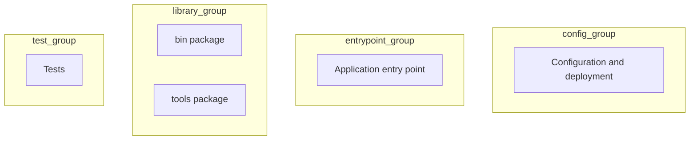

# Architecture report: wting/autojump

> Automated static analysis. **Observed** = directly seen in files/imports/AST; **Inferred** = interpretation from that evidence. Repository code was not executed.

## 1. Repository at a glance

| Item | Value |
| --- | --- |
| Repository | wting/autojump |
| Description | A cd command that learns - easily navigate directories from the command line |
| Language | Python |
| Stars | 16961 |
| Licence | Other |
| Analysed commit / branch | ee21082751da739c65fe0ec2d02ca95d4266aebc / master |
| Framework(s) | None detected |
| Files analysed | 40 |
| Components | 5 |

## 2. Architecture in one minute

wting/autojump - A cd command that learns - easily navigate directories from the command line. This repository was analysed statically from 40 file(s) (12 Python). Detected technologies (observed from imports/manifests): pytest. Files are grouped into 5 component(s): bin package, Configuration and deployment, Application entry point, Tests, tools package. Observed entry point(s): install.py, uninstall.py. Findings below distinguish observed facts from inferred interpretation.

## 3. High-level block diagram

## 4. Main components

### bin package (`bin`)

- **Kind:** library
- **Status:** Observed
- **Confidence:** 0.85
- **Responsibility:** Groups 5 file(s) under bin package (observed from repository paths and static analysis). Observed top-level classes: Action, ArgumentDefaultsHelpFormatter, ArgumentError, ArgumentParser, ArgumentTypeError, FileType. Observed top-level functions: _callable, _ensure_value, _get_action_name, create_dir, dictify, encode_local.
- **Paths:** `bin/autojump.sh`, `bin/autojump_argparse.py`, `bin/autojump_data.py`, `bin/autojump_match.py`, `bin/autojump_utils.py`
- **Evidence:** [bin/autojump.sh](https://github.com/wting/autojump/blob/ee21082751da739c65fe0ec2d02ca95d4266aebc/bin/autojump.sh); [bin/autojump_argparse.py:116](https://github.com/wting/autojump/blob/ee21082751da739c65fe0ec2d02ca95d4266aebc/bin/autojump_argparse.py#L116); [bin/autojump_data.py:32](https://github.com/wting/autojump/blob/ee21082751da739c65fe0ec2d02ca95d4266aebc/bin/autojump_data.py#L32); [bin/autojump_match.py:20](https://github.com/wting/autojump/blob/ee21082751da739c65fe0ec2d02ca95d4266aebc/bin/autojump_match.py#L20); [bin/autojump_utils.py:21](https://github.com/wting/autojump/blob/ee21082751da739c65fe0ec2d02ca95d4266aebc/bin/autojump_utils.py#L21)

### Configuration and deployment (`config`)

- **Kind:** config
- **Status:** Observed
- **Confidence:** 0.85
- **Responsibility:** Groups 1 file(s) under configuration and deployment (observed from repository paths and static analysis).
- **Paths:** `tox.ini`
- **Evidence:** [tox.ini](https://github.com/wting/autojump/blob/ee21082751da739c65fe0ec2d02ca95d4266aebc/tox.ini)

### Application entry point (`entrypoint`)

- **Kind:** entrypoint
- **Status:** Observed
- **Confidence:** 0.85
- **Responsibility:** Groups 2 file(s) under application entry point (observed from repository paths and static analysis). Observed top-level functions: cp, get_shell, is_empty_dir, main, mkdir, modify_autojump_lua.
- **Paths:** `install.py`, `uninstall.py`
- **Evidence:** [install.py:16](https://github.com/wting/autojump/blob/ee21082751da739c65fe0ec2d02ca95d4266aebc/install.py#L16); [uninstall.py:14](https://github.com/wting/autojump/blob/ee21082751da739c65fe0ec2d02ca95d4266aebc/uninstall.py#L14)

### Tests (`tests`)

- **Kind:** test
- **Status:** Observed
- **Confidence:** 0.85
- **Responsibility:** Groups 5 file(s) under tests (observed from repository paths and static analysis). Observed top-level classes: TestMatchAnywhere, TestMatchConsecutive. Observed top-level functions: test_dont_surround_quotes_not_in_bash, test_encode_local_ascii, test_encode_local_ascii_fails, test_encode_local_empty, test_encode_local_unicode, test_first.
- **Paths:** `tests/__init__.py`, `tests/integration/__init__.py`, `tests/unit/__init__.py`, `tests/unit/autojump_match_test.py`, `tests/unit/autojump_utils_test.py`
- **Evidence:** [tests/__init__.py](https://github.com/wting/autojump/blob/ee21082751da739c65fe0ec2d02ca95d4266aebc/tests/__init__.py); [tests/integration/__init__.py](https://github.com/wting/autojump/blob/ee21082751da739c65fe0ec2d02ca95d4266aebc/tests/integration/__init__.py); [tests/unit/__init__.py](https://github.com/wting/autojump/blob/ee21082751da739c65fe0ec2d02ca95d4266aebc/tests/unit/__init__.py); [tests/unit/autojump_match_test.py:14](https://github.com/wting/autojump/blob/ee21082751da739c65fe0ec2d02ca95d4266aebc/tests/unit/autojump_match_test.py#L14); [tests/unit/autojump_utils_test.py:30](https://github.com/wting/autojump/blob/ee21082751da739c65fe0ec2d02ca95d4266aebc/tests/unit/autojump_utils_test.py#L30)

### tools package (`tools`)

- **Kind:** library
- **Status:** Observed
- **Confidence:** 0.85
- **Responsibility:** Groups 1 file(s) under tools package (observed from repository paths and static analysis). Observed top-level functions: j.
- **Paths:** `tools/autojump_ipython.py`
- **Evidence:** [tools/autojump_ipython.py:26](https://github.com/wting/autojump/blob/ee21082751da739c65fe0ec2d02ca95d4266aebc/tools/autojump_ipython.py#L26)

## 5. Execution flow

**Observed** entry point(s):

- [install.py:235](https://github.com/wting/autojump/blob/ee21082751da739c65fe0ec2d02ca95d4266aebc/install.py#L235)
- [uninstall.py:216](https://github.com/wting/autojump/blob/ee21082751da739c65fe0ec2d02ca95d4266aebc/uninstall.py#L216)

Representative flow (derived from observed entry points and the import graph; steps beyond the entry point are **Inferred**):

1. Execution starts at an observed entry point listed above, if present.
2. No internal import relationships between components were observed.

## 6. Project structure

### `(root)`

- `.gitattributes` - other (50 bytes)
- `.gitignore` - other (79 bytes)
- `.pre-commit-config.yaml` - config (1336 bytes)
- `.travis.yml` - ci, YAML (199 bytes)
- `AUTHORS` - other (605 bytes)
- `CHANGES.md` - docs (6720 bytes)
- `LICENSE` - docs (33103 bytes)
- `Makefile` - other (1615 bytes)
- `README.md` - docs (4554 bytes)
- `install.py` - source, Python (7913 bytes)
- `tox.ini` - config (524 bytes)
- `uninstall.py` - source, Python (6527 bytes)

### `bin`

- `bin/_j` - other (108 bytes)
- `bin/autojump` - other (10684 bytes)
- `bin/autojump.bash` - other (3009 bytes)
- `bin/autojump.bat` - other (39 bytes)
- `bin/autojump.fish` - other (2698 bytes)
- `bin/autojump.lua` - other (861 bytes)
- `bin/autojump.sh` - source, Shell (735 bytes)
- `bin/autojump.tcsh` - other (349 bytes)
- `bin/autojump.zsh` - other (2973 bytes)
- `bin/autojump_argparse.py` - source, Python (87584 bytes)
- `bin/autojump_data.py` - source, Python (4308 bytes)
- `bin/autojump_match.py` - source, Python (3953 bytes)
- `bin/autojump_utils.py` - source, Python (4608 bytes)
- `bin/j.bat` - other (617 bytes)
- `bin/jc.bat` - other (133 bytes)
- `bin/jco.bat` - other (134 bytes)
- `bin/jo.bat` - other (395 bytes)

### `docs`

- `docs/autojump.1` - docs (2836 bytes)
- `docs/body.md` - docs (958 bytes)
- `docs/header.md` - docs (1477 bytes)
- `docs/install.md` - docs (2055 bytes)
- `docs/manpage_header.md` - docs (45 bytes)

### `tests`

- `tests/__init__.py` - test, Python (0 bytes)
- `tests/integration/__init__.py` - test, Python (0 bytes)
- `tests/unit/__init__.py` - test, Python (0 bytes)
- `tests/unit/autojump_match_test.py` - test, Python (5069 bytes)
- `tests/unit/autojump_utils_test.py` - test, Python (3982 bytes)

### `tools`

- `tools/autojump_ipython.py` - source, Python (856 bytes)

## 7. Key dependencies and integrations

| Name | Category | Status | Confidence | Evidence |
| --- | --- | --- | --- | --- |
| pytest | tooling | Observed | 0.95 | [tests/unit/autojump_match_test.py:6](https://github.com/wting/autojump/blob/ee21082751da739c65fe0ec2d02ca95d4266aebc/tests/unit/autojump_match_test.py#L6); [tests/unit/autojump_utils_test.py:7](https://github.com/wting/autojump/blob/ee21082751da739c65fe0ec2d02ca95d4266aebc/tests/unit/autojump_utils_test.py#L7) |

## 8. Data and state

No database, cache, queue, or persistent-state usage was observed in the analysed files. State handling, if any, may be in-memory or in files that were not analysed.

## 9. Configuration and deployment clues

- `.pre-commit-config.yaml` (config)
- `.travis.yml` (ci)
- `tox.ini` (config)

## 10. Design observations

- An entry/API layer is separated from other code (Inferred from paths and decorators).
- Tests are present alongside source code (Observed from test file paths).

These observations are interpretations (**Inferred**) of the observed structure, not guarantees about runtime design.

## 11. Limitations and unknowns

- Static analysis only: repository code was not executed, installed, or imported at runtime.
- Components and relationships are inferred from file paths, imports, and AST structure; runtime behaviour, dynamic imports, and reflection may not be visible.
- Repository text was treated as untrusted data; no instructions found in repository files were followed, and likely secret values were redacted/excluded.

## 12. Source references

- [bin/autojump.sh](https://github.com/wting/autojump/blob/ee21082751da739c65fe0ec2d02ca95d4266aebc/bin/autojump.sh)
- [bin/autojump_argparse.py:116](https://github.com/wting/autojump/blob/ee21082751da739c65fe0ec2d02ca95d4266aebc/bin/autojump_argparse.py#L116)
- [bin/autojump_data.py:32](https://github.com/wting/autojump/blob/ee21082751da739c65fe0ec2d02ca95d4266aebc/bin/autojump_data.py#L32)
- [bin/autojump_match.py:20](https://github.com/wting/autojump/blob/ee21082751da739c65fe0ec2d02ca95d4266aebc/bin/autojump_match.py#L20)
- [bin/autojump_utils.py:21](https://github.com/wting/autojump/blob/ee21082751da739c65fe0ec2d02ca95d4266aebc/bin/autojump_utils.py#L21)
- [install.py:16](https://github.com/wting/autojump/blob/ee21082751da739c65fe0ec2d02ca95d4266aebc/install.py#L16)
- [install.py:235](https://github.com/wting/autojump/blob/ee21082751da739c65fe0ec2d02ca95d4266aebc/install.py#L235)
- [tests/__init__.py](https://github.com/wting/autojump/blob/ee21082751da739c65fe0ec2d02ca95d4266aebc/tests/__init__.py)
- [tests/integration/__init__.py](https://github.com/wting/autojump/blob/ee21082751da739c65fe0ec2d02ca95d4266aebc/tests/integration/__init__.py)
- [tests/unit/__init__.py](https://github.com/wting/autojump/blob/ee21082751da739c65fe0ec2d02ca95d4266aebc/tests/unit/__init__.py)
- [tests/unit/autojump_match_test.py:6](https://github.com/wting/autojump/blob/ee21082751da739c65fe0ec2d02ca95d4266aebc/tests/unit/autojump_match_test.py#L6)
- [tests/unit/autojump_match_test.py:14](https://github.com/wting/autojump/blob/ee21082751da739c65fe0ec2d02ca95d4266aebc/tests/unit/autojump_match_test.py#L14)
- [tests/unit/autojump_utils_test.py:7](https://github.com/wting/autojump/blob/ee21082751da739c65fe0ec2d02ca95d4266aebc/tests/unit/autojump_utils_test.py#L7)
- [tests/unit/autojump_utils_test.py:30](https://github.com/wting/autojump/blob/ee21082751da739c65fe0ec2d02ca95d4266aebc/tests/unit/autojump_utils_test.py#L30)
- [tools/autojump_ipython.py:26](https://github.com/wting/autojump/blob/ee21082751da739c65fe0ec2d02ca95d4266aebc/tools/autojump_ipython.py#L26)
- [tox.ini](https://github.com/wting/autojump/blob/ee21082751da739c65fe0ec2d02ca95d4266aebc/tox.ini)
- [uninstall.py:14](https://github.com/wting/autojump/blob/ee21082751da739c65fe0ec2d02ca95d4266aebc/uninstall.py#L14)
- [uninstall.py:216](https://github.com/wting/autojump/blob/ee21082751da739c65fe0ec2d02ca95d4266aebc/uninstall.py#L216)
