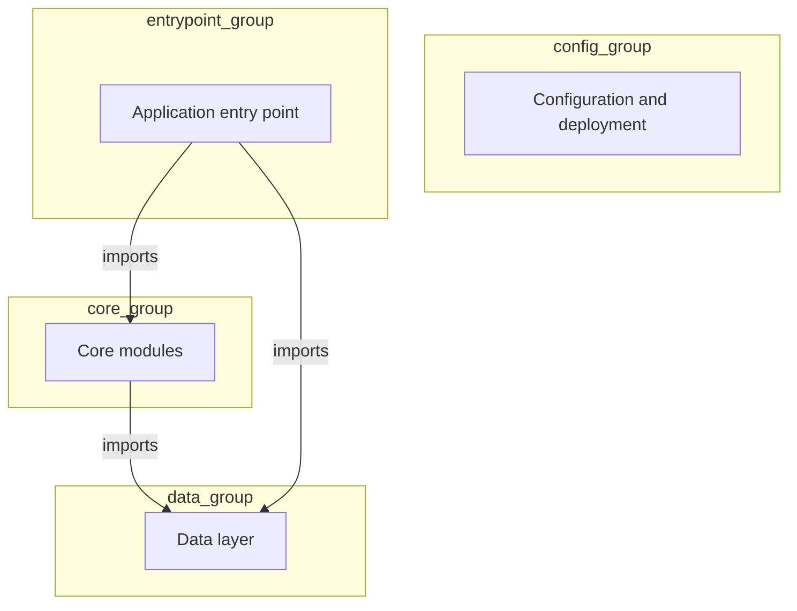

# Architecture report: xai-org/grok-1

> Automated static analysis. **Observed** = directly seen in files/imports/AST; **Inferred** = interpretation from that evidence. Repository code was not executed.

## 1. Repository at a glance

| Item | Value |
| --- | --- |
| Repository | xai-org/grok-1 |
| Description | Grok open release |
| Language | Python |
| Stars | 52235 |
| Licence | Apache-2.0 |
| Analysed commit / branch | 7050ed204b8206bb8645c7b7bbef7252f79561b0 / main |
| Framework(s) | None detected |
| Files analysed | 11 |
| Components | 4 |

## 2. Architecture in one minute

xai-org/grok-1 - Grok open release. This repository was analysed statically from 11 file(s) (4 Python). Detected technologies (observed from imports/manifests): NumPy, Poetry. Files are grouped into 4 component(s): Configuration and deployment, Core modules, Data layer, Application entry point. Observed entry point(s): run.py. Findings below distinguish observed facts from inferred interpretation.

## 3. High-level block diagram

## 4. Main components

### Configuration and deployment (`config`)

- **Kind:** config
- **Status:** Observed
- **Confidence:** 0.85
- **Responsibility:** Groups 2 file(s) under configuration and deployment (observed from repository paths and static analysis).
- **Paths:** `pyproject.toml`, `requirements.txt`
- **Evidence:** [pyproject.toml](https://github.com/xai-org/grok-1/blob/7050ed204b8206bb8645c7b7bbef7252f79561b0/pyproject.toml); [requirements.txt](https://github.com/xai-org/grok-1/blob/7050ed204b8206bb8645c7b7bbef7252f79561b0/requirements.txt)

### Core modules (`core`)

- **Kind:** core
- **Status:** Observed
- **Confidence:** 0.85
- **Responsibility:** Groups 2 file(s) under core modules (observed from repository paths and static analysis). Observed top-level classes: InferenceRunner, ModelRunner, Request, SampleOutput, SampleSettings. Observed top-level functions: copy_from_shm, copy_to_shm, fast_pickle, fast_unpickle, get_load_path_str, insert_slice.
- **Paths:** `checkpoint.py`, `runners.py`
- **Evidence:** [checkpoint.py:43](https://github.com/xai-org/grok-1/blob/7050ed204b8206bb8645c7b7bbef7252f79561b0/checkpoint.py#L43); [runners.py:50](https://github.com/xai-org/grok-1/blob/7050ed204b8206bb8645c7b7bbef7252f79561b0/runners.py#L50)

### Data layer (`data_layer`)

- **Kind:** data
- **Status:** Observed
- **Confidence:** 0.85
- **Responsibility:** Groups 1 file(s) under data layer (observed from repository paths and static analysis). Observed top-level classes: DecoderLayer, DecoderOutput, DenseBlock, InOutEmbed, KVMemory, LanguageModel. Observed top-level functions: _match, apply_rules, cast_bfloat16, ffn_size, hk_rms_norm, init_layer_memories.
- **Paths:** `model.py`
- **Evidence:** [model.py:38](https://github.com/xai-org/grok-1/blob/7050ed204b8206bb8645c7b7bbef7252f79561b0/model.py#L38)

### Application entry point (`entrypoint`)

- **Kind:** entrypoint
- **Status:** Observed
- **Confidence:** 0.85
- **Responsibility:** Groups 1 file(s) under application entry point (observed from repository paths and static analysis). Observed top-level functions: main.
- **Paths:** `run.py`
- **Evidence:** [run.py:24](https://github.com/xai-org/grok-1/blob/7050ed204b8206bb8645c7b7bbef7252f79561b0/run.py#L24)

## 5. Execution flow

**Observed** entry point(s):

- [run.py:70](https://github.com/xai-org/grok-1/blob/7050ed204b8206bb8645c7b7bbef7252f79561b0/run.py#L70)

Representative flow (derived from observed entry points and the import graph; steps beyond the entry point are **Inferred**):

1. Execution starts at an observed entry point listed above, if present.
2. `core` imports `data_layer` (Core modules -> Data layer).
3. `entrypoint` imports `core` (Application entry point -> Core modules).
4. `entrypoint` imports `data_layer` (Application entry point -> Data layer).

## 6. Project structure

### `(root)`

- `.gitignore` - other (37 bytes)
- `CODE_OF_CONDUCT.md` - docs (28 bytes)
- `LICENSE.txt` - docs (11358 bytes)
- `README.md` - docs (2145 bytes)
- `checkpoint.py` - source, Python (7392 bytes)
- `model.py` - source, Python (45779 bytes)
- `pyproject.toml` - manifest (170 bytes)
- `requirements.txt` - manifest (146 bytes)
- `run.py` - source, Python (2264 bytes)
- `runners.py` - source, Python (21845 bytes)

### `checkpoints`

- `checkpoints/README.md` - docs (99 bytes)

## 7. Key dependencies and integrations

| Name | Category | Status | Confidence | Evidence |
| --- | --- | --- | --- | --- |
| NumPy | library | Observed | 0.95 | [checkpoint.py:30](https://github.com/xai-org/grok-1/blob/7050ed204b8206bb8645c7b7bbef7252f79561b0/checkpoint.py#L30); [requirements.txt:3](https://github.com/xai-org/grok-1/blob/7050ed204b8206bb8645c7b7bbef7252f79561b0/requirements.txt#L3); [runners.py:28](https://github.com/xai-org/grok-1/blob/7050ed204b8206bb8645c7b7bbef7252f79561b0/runners.py#L28) |
| Poetry | packaging | Observed | 0.85 | [pyproject.toml](https://github.com/xai-org/grok-1/blob/7050ed204b8206bb8645c7b7bbef7252f79561b0/pyproject.toml) |

## 8. Data and state

- Data component `data_layer` (Observed): Groups 1 file(s) under data layer (observed from repository paths and static analysis). Observed top-level classes: DecoderLayer, DecoderOutput, DenseBlock, InOutEmbed, KVMemory, LanguageModel. Observed top-level functions: _match, apply_rules, cast_bfloat16, ffn_size, hk_rms_norm, init_layer_memor…

## 9. Configuration and deployment clues

- `pyproject.toml` (manifest)
- `requirements.txt` (manifest)

## 10. Design observations

- An entry/API layer is separated from other code (Inferred from paths and decorators).
- Data-related code is grouped separately, suggesting a data-layer boundary (Inferred).

These observations are interpretations (**Inferred**) of the observed structure, not guarantees about runtime design.

## 11. Limitations and unknowns

- Static analysis only: repository code was not executed, installed, or imported at runtime.
- Components and relationships are inferred from file paths, imports, and AST structure; runtime behaviour, dynamic imports, and reflection may not be visible.
- Repository text was treated as untrusted data; no instructions found in repository files were followed, and likely secret values were redacted/excluded.

## 12. Source references

- [checkpoint.py:30](https://github.com/xai-org/grok-1/blob/7050ed204b8206bb8645c7b7bbef7252f79561b0/checkpoint.py#L30)
- [checkpoint.py:43](https://github.com/xai-org/grok-1/blob/7050ed204b8206bb8645c7b7bbef7252f79561b0/checkpoint.py#L43)
- [model.py:38](https://github.com/xai-org/grok-1/blob/7050ed204b8206bb8645c7b7bbef7252f79561b0/model.py#L38)
- [pyproject.toml](https://github.com/xai-org/grok-1/blob/7050ed204b8206bb8645c7b7bbef7252f79561b0/pyproject.toml)
- [requirements.txt](https://github.com/xai-org/grok-1/blob/7050ed204b8206bb8645c7b7bbef7252f79561b0/requirements.txt)
- [requirements.txt:3](https://github.com/xai-org/grok-1/blob/7050ed204b8206bb8645c7b7bbef7252f79561b0/requirements.txt#L3)
- [run.py:24](https://github.com/xai-org/grok-1/blob/7050ed204b8206bb8645c7b7bbef7252f79561b0/run.py#L24)
- [run.py:70](https://github.com/xai-org/grok-1/blob/7050ed204b8206bb8645c7b7bbef7252f79561b0/run.py#L70)
- [runners.py:28](https://github.com/xai-org/grok-1/blob/7050ed204b8206bb8645c7b7bbef7252f79561b0/runners.py#L28)
- [runners.py:50](https://github.com/xai-org/grok-1/blob/7050ed204b8206bb8645c7b7bbef7252f79561b0/runners.py#L50)
