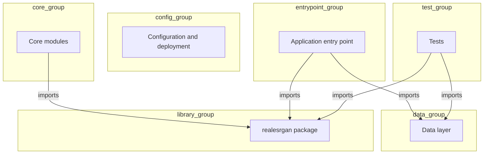

# Architecture report: xinntao/Real-ESRGAN

> Automated static analysis. **Observed** = directly seen in files/imports/AST; **Inferred** = interpretation from that evidence. Repository code was not executed.

## 1. Repository at a glance

| Item | Value |
| --- | --- |
| Repository | xinntao/Real-ESRGAN |
| Description | Real-ESRGAN aims at developing Practical Algorithms for General Image/Video Restoration. |
| Language | Python |
| Stars | 37497 |
| Licence | BSD-3-Clause |
| Analysed commit / branch | a4abfb2979a7bbff3f69f58f58ae324608821e27 / master |
| Framework(s) | None detected |
| Files analysed | 67 |
| Components | 6 |

## 2. Architecture in one minute

xinntao/Real-ESRGAN - Real-ESRGAN aims at developing Practical Algorithms for General Image/Video Restoration.. This repository was analysed statically from 67 file(s) (25 Python). Detected technologies (observed from imports/manifests): GitHub Actions, NumPy, setuptools, pytest. Files are grouped into 6 component(s): Configuration and deployment, Core modules, Data layer, Application entry point, realesrgan package, Tests. Observed entry point(s): inference_realesrgan.py, inference_realesrgan_video.py, realesrgan/train.py. Findings below distinguish observed facts from inferred interpretation.

## 3. High-level block diagram

## 4. Main components

### Configuration and deployment (`config`)

- **Kind:** config
- **Status:** Observed
- **Confidence:** 0.85
- **Responsibility:** Groups 11 file(s) under configuration and deployment (observed from repository paths and static analysis). Observed top-level functions: get_git_hash, get_hash, get_requirements, get_version, readme, write_version_py.
- **Paths:** `MANIFEST.in`, `cog.yaml`, `options/finetune_realesrgan_x4plus.yml`, `options/finetune_realesrgan_x4plus_pairdata.yml`, `options/train_realesrgan_x2plus.yml`, `options/train_realesrgan_x4plus.yml`, `options/train_realesrnet_x2plus.yml`, `options/train_realesrnet_x4plus.yml`, `requirements.txt`, `setup.cfg`, `setup.py`
- **Evidence:** [MANIFEST.in](https://github.com/xinntao/Real-ESRGAN/blob/a4abfb2979a7bbff3f69f58f58ae324608821e27/MANIFEST.in); [cog.yaml](https://github.com/xinntao/Real-ESRGAN/blob/a4abfb2979a7bbff3f69f58f58ae324608821e27/cog.yaml); [options/finetune_realesrgan_x4plus.yml](https://github.com/xinntao/Real-ESRGAN/blob/a4abfb2979a7bbff3f69f58f58ae324608821e27/options/finetune_realesrgan_x4plus.yml); [options/finetune_realesrgan_x4plus_pairdata.yml](https://github.com/xinntao/Real-ESRGAN/blob/a4abfb2979a7bbff3f69f58f58ae324608821e27/options/finetune_realesrgan_x4plus_pairdata.yml); [options/train_realesrgan_x2plus.yml](https://github.com/xinntao/Real-ESRGAN/blob/a4abfb2979a7bbff3f69f58f58ae324608821e27/options/train_realesrgan_x2plus.yml); [options/train_realesrgan_x4plus.yml](https://github.com/xinntao/Real-ESRGAN/blob/a4abfb2979a7bbff3f69f58f58ae324608821e27/options/train_realesrgan_x4plus.yml); [options/train_realesrnet_x2plus.yml](https://github.com/xinntao/Real-ESRGAN/blob/a4abfb2979a7bbff3f69f58f58ae324608821e27/options/train_realesrnet_x2plus.yml); [options/train_realesrnet_x4plus.yml](https://github.com/xinntao/Real-ESRGAN/blob/a4abfb2979a7bbff3f69f58f58ae324608821e27/options/train_realesrnet_x4plus.yml)

### Core modules (`core`)

- **Kind:** core
- **Status:** Observed
- **Confidence:** 0.85
- **Responsibility:** Groups 1 file(s) under core modules (observed from repository paths and static analysis). Observed top-level classes: Predictor. Observed top-level functions: clean_folder.
- **Paths:** `cog_predict.py`
- **Evidence:** [cog_predict.py:27](https://github.com/xinntao/Real-ESRGAN/blob/a4abfb2979a7bbff3f69f58f58ae324608821e27/cog_predict.py#L27)

### Data layer (`data_layer`)

- **Kind:** data
- **Status:** Observed
- **Confidence:** 0.85
- **Responsibility:** Groups 6 file(s) under data layer (observed from repository paths and static analysis). Observed top-level classes: RealESRGANDataset, RealESRGANModel, RealESRGANPairedDataset, RealESRNetModel.
- **Paths:** `realesrgan/data/__init__.py`, `realesrgan/data/realesrgan_dataset.py`, `realesrgan/data/realesrgan_paired_dataset.py`, `realesrgan/models/__init__.py`, `realesrgan/models/realesrgan_model.py`, `realesrgan/models/realesrnet_model.py`
- **Evidence:** [realesrgan/data/__init__.py](https://github.com/xinntao/Real-ESRGAN/blob/a4abfb2979a7bbff3f69f58f58ae324608821e27/realesrgan/data/__init__.py); [realesrgan/data/realesrgan_dataset.py:17](https://github.com/xinntao/Real-ESRGAN/blob/a4abfb2979a7bbff3f69f58f58ae324608821e27/realesrgan/data/realesrgan_dataset.py#L17); [realesrgan/data/realesrgan_paired_dataset.py:11](https://github.com/xinntao/Real-ESRGAN/blob/a4abfb2979a7bbff3f69f58f58ae324608821e27/realesrgan/data/realesrgan_paired_dataset.py#L11); [realesrgan/models/__init__.py](https://github.com/xinntao/Real-ESRGAN/blob/a4abfb2979a7bbff3f69f58f58ae324608821e27/realesrgan/models/__init__.py); [realesrgan/models/realesrgan_model.py:15](https://github.com/xinntao/Real-ESRGAN/blob/a4abfb2979a7bbff3f69f58f58ae324608821e27/realesrgan/models/realesrgan_model.py#L15); [realesrgan/models/realesrnet_model.py:14](https://github.com/xinntao/Real-ESRGAN/blob/a4abfb2979a7bbff3f69f58f58ae324608821e27/realesrgan/models/realesrnet_model.py#L14)

### Application entry point (`entrypoint`)

- **Kind:** entrypoint
- **Status:** Observed
- **Confidence:** 0.85
- **Responsibility:** Groups 8 file(s) under application entry point (observed from repository paths and static analysis). Observed top-level classes: Reader, Writer. Observed top-level functions: extract_subimages, get_sub_video, get_video_meta_info, inference_video, main, run.
- **Paths:** `inference_realesrgan.py`, `inference_realesrgan_video.py`, `realesrgan/train.py`, `scripts/extract_subimages.py`, `scripts/generate_meta_info.py`, `scripts/generate_meta_info_pairdata.py`, `scripts/generate_multiscale_DF2K.py`, `scripts/pytorch2onnx.py`
- **Evidence:** [inference_realesrgan.py:12](https://github.com/xinntao/Real-ESRGAN/blob/a4abfb2979a7bbff3f69f58f58ae324608821e27/inference_realesrgan.py#L12); [inference_realesrgan_video.py:26](https://github.com/xinntao/Real-ESRGAN/blob/a4abfb2979a7bbff3f69f58f58ae324608821e27/inference_realesrgan_video.py#L26); [realesrgan/train.py](https://github.com/xinntao/Real-ESRGAN/blob/a4abfb2979a7bbff3f69f58f58ae324608821e27/realesrgan/train.py); [scripts/extract_subimages.py:12](https://github.com/xinntao/Real-ESRGAN/blob/a4abfb2979a7bbff3f69f58f58ae324608821e27/scripts/extract_subimages.py#L12); [scripts/generate_meta_info.py:7](https://github.com/xinntao/Real-ESRGAN/blob/a4abfb2979a7bbff3f69f58f58ae324608821e27/scripts/generate_meta_info.py#L7); [scripts/generate_meta_info_pairdata.py:6](https://github.com/xinntao/Real-ESRGAN/blob/a4abfb2979a7bbff3f69f58f58ae324608821e27/scripts/generate_meta_info_pairdata.py#L6); [scripts/generate_multiscale_DF2K.py:7](https://github.com/xinntao/Real-ESRGAN/blob/a4abfb2979a7bbff3f69f58f58ae324608821e27/scripts/generate_multiscale_DF2K.py#L7); [scripts/pytorch2onnx.py:7](https://github.com/xinntao/Real-ESRGAN/blob/a4abfb2979a7bbff3f69f58f58ae324608821e27/scripts/pytorch2onnx.py#L7)

### realesrgan package (`realesrgan`)

- **Kind:** library
- **Status:** Observed
- **Confidence:** 0.85
- **Responsibility:** Groups 5 file(s) under realesrgan package (observed from repository paths and static analysis). Observed top-level classes: IOConsumer, PrefetchReader, RealESRGANer, SRVGGNetCompact, UNetDiscriminatorSN.
- **Paths:** `realesrgan/__init__.py`, `realesrgan/archs/__init__.py`, `realesrgan/archs/discriminator_arch.py`, `realesrgan/archs/srvgg_arch.py`, `realesrgan/utils.py`
- **Evidence:** [realesrgan/__init__.py](https://github.com/xinntao/Real-ESRGAN/blob/a4abfb2979a7bbff3f69f58f58ae324608821e27/realesrgan/__init__.py); [realesrgan/archs/__init__.py](https://github.com/xinntao/Real-ESRGAN/blob/a4abfb2979a7bbff3f69f58f58ae324608821e27/realesrgan/archs/__init__.py); [realesrgan/archs/discriminator_arch.py:8](https://github.com/xinntao/Real-ESRGAN/blob/a4abfb2979a7bbff3f69f58f58ae324608821e27/realesrgan/archs/discriminator_arch.py#L8); [realesrgan/archs/srvgg_arch.py:7](https://github.com/xinntao/Real-ESRGAN/blob/a4abfb2979a7bbff3f69f58f58ae324608821e27/realesrgan/archs/srvgg_arch.py#L7); [realesrgan/utils.py:14](https://github.com/xinntao/Real-ESRGAN/blob/a4abfb2979a7bbff3f69f58f58ae324608821e27/realesrgan/utils.py#L14)

### Tests (`tests`)

- **Kind:** test
- **Status:** Observed
- **Confidence:** 0.85
- **Responsibility:** Groups 12 file(s) under tests (observed from repository paths and static analysis). Observed top-level functions: test_realesrgan_dataset, test_realesrgan_model, test_realesrgan_paired_dataset, test_realesrganer, test_realesrnet_model, test_unetdiscriminatorsn.
- **Paths:** `tests/data/gt.lmdb/meta_info.txt`, `tests/data/lq.lmdb/meta_info.txt`, `tests/data/meta_info_gt.txt`, `tests/data/meta_info_pair.txt`, `tests/data/test_realesrgan_dataset.yml`, `tests/data/test_realesrgan_model.yml`, `tests/data/test_realesrgan_paired_dataset.yml`, `tests/data/test_realesrnet_model.yml`, `tests/test_dataset.py`, `tests/test_discriminator_arch.py`, `tests/test_model.py`, `tests/test_utils.py`
- **Evidence:** [tests/data/gt.lmdb/meta_info.txt](https://github.com/xinntao/Real-ESRGAN/blob/a4abfb2979a7bbff3f69f58f58ae324608821e27/tests/data/gt.lmdb/meta_info.txt); [tests/data/lq.lmdb/meta_info.txt](https://github.com/xinntao/Real-ESRGAN/blob/a4abfb2979a7bbff3f69f58f58ae324608821e27/tests/data/lq.lmdb/meta_info.txt); [tests/data/meta_info_gt.txt](https://github.com/xinntao/Real-ESRGAN/blob/a4abfb2979a7bbff3f69f58f58ae324608821e27/tests/data/meta_info_gt.txt); [tests/data/meta_info_pair.txt](https://github.com/xinntao/Real-ESRGAN/blob/a4abfb2979a7bbff3f69f58f58ae324608821e27/tests/data/meta_info_pair.txt); [tests/data/test_realesrgan_dataset.yml](https://github.com/xinntao/Real-ESRGAN/blob/a4abfb2979a7bbff3f69f58f58ae324608821e27/tests/data/test_realesrgan_dataset.yml); [tests/data/test_realesrgan_model.yml](https://github.com/xinntao/Real-ESRGAN/blob/a4abfb2979a7bbff3f69f58f58ae324608821e27/tests/data/test_realesrgan_model.yml); [tests/data/test_realesrgan_paired_dataset.yml](https://github.com/xinntao/Real-ESRGAN/blob/a4abfb2979a7bbff3f69f58f58ae324608821e27/tests/data/test_realesrgan_paired_dataset.yml); [tests/data/test_realesrnet_model.yml](https://github.com/xinntao/Real-ESRGAN/blob/a4abfb2979a7bbff3f69f58f58ae324608821e27/tests/data/test_realesrnet_model.yml)

## 5. Execution flow

**Observed** entry point(s):

- [inference_realesrgan.py:165](https://github.com/xinntao/Real-ESRGAN/blob/a4abfb2979a7bbff3f69f58f58ae324608821e27/inference_realesrgan.py#L165)
- [inference_realesrgan_video.py:397](https://github.com/xinntao/Real-ESRGAN/blob/a4abfb2979a7bbff3f69f58f58ae324608821e27/inference_realesrgan_video.py#L397)
- [realesrgan/train.py:9](https://github.com/xinntao/Real-ESRGAN/blob/a4abfb2979a7bbff3f69f58f58ae324608821e27/realesrgan/train.py#L9)
- [scripts/extract_subimages.py:120](https://github.com/xinntao/Real-ESRGAN/blob/a4abfb2979a7bbff3f69f58f58ae324608821e27/scripts/extract_subimages.py#L120)
- [scripts/generate_meta_info.py:30](https://github.com/xinntao/Real-ESRGAN/blob/a4abfb2979a7bbff3f69f58f58ae324608821e27/scripts/generate_meta_info.py#L30)
- [scripts/generate_meta_info_pairdata.py:23](https://github.com/xinntao/Real-ESRGAN/blob/a4abfb2979a7bbff3f69f58f58ae324608821e27/scripts/generate_meta_info_pairdata.py#L23)
- [scripts/generate_multiscale_DF2K.py:38](https://github.com/xinntao/Real-ESRGAN/blob/a4abfb2979a7bbff3f69f58f58ae324608821e27/scripts/generate_multiscale_DF2K.py#L38)
- [scripts/pytorch2onnx.py:27](https://github.com/xinntao/Real-ESRGAN/blob/a4abfb2979a7bbff3f69f58f58ae324608821e27/scripts/pytorch2onnx.py#L27)
- [setup.py:82](https://github.com/xinntao/Real-ESRGAN/blob/a4abfb2979a7bbff3f69f58f58ae324608821e27/setup.py#L82)

Representative flow (derived from observed entry points and the import graph; steps beyond the entry point are **Inferred**):

1. Execution starts at an observed entry point listed above, if present.
2. `core` imports `realesrgan` (Core modules -> realesrgan package).
3. `entrypoint` imports `data_layer` (Application entry point -> Data layer).
4. `entrypoint` imports `realesrgan` (Application entry point -> realesrgan package).
5. `tests` imports `data_layer` (Tests -> Data layer).
6. `tests` imports `realesrgan` (Tests -> realesrgan package).

## 6. Project structure

### `(root)`

- `.gitignore` - other (1901 bytes)
- `.pre-commit-config.yaml` - config (1483 bytes)
- `CODE_OF_CONDUCT.md` - docs (5251 bytes)
- `LICENSE` - docs (1519 bytes)
- `MANIFEST.in` - manifest (170 bytes)
- `README.md` - docs (16548 bytes)
- `README_CN.md` - docs (15779 bytes)
- `VERSION` - other (6 bytes)
- `cog.yaml` - config (485 bytes)
- `cog_predict.py` - source, Python (6688 bytes)
- `inference_realesrgan.py` - source, Python (7745 bytes)
- `inference_realesrgan_video.py` - source, Python (16910 bytes)
- `requirements.txt` - manifest (100 bytes)
- `setup.cfg` - manifest (684 bytes)
- `setup.py` - manifest, Python (3145 bytes)

### `.github`

- `.github/workflows/publish-pip.yml` - ci, YAML (1012 bytes)
- `.github/workflows/pylint.yml` - ci, YAML (744 bytes)
- `.github/workflows/release.yml` - ci, YAML (1041 bytes)

### `.vscode`

- `.vscode/settings.json` - config (581 bytes)

### `docs`

- `docs/CONTRIBUTING.md` - docs (1876 bytes)
- `docs/FAQ.md` - docs (736 bytes)
- `docs/Training.md` - docs (11322 bytes)
- `docs/Training_CN.md` - docs (11220 bytes)
- `docs/anime_comparisons.md` - docs (8189 bytes)
- `docs/anime_comparisons_CN.md` - docs (8066 bytes)
- `docs/anime_model.md` - docs (3252 bytes)
- `docs/anime_video_model.md` - docs (5716 bytes)
- `docs/feedback.md` - docs (1238 bytes)
- `docs/model_zoo.md` - docs (4186 bytes)
- `docs/ncnn_conversion.md` - docs (580 bytes)

### `experiments`

- `experiments/pretrained_models/README.md` - docs (41 bytes)

### `options`

- `options/finetune_realesrgan_x4plus.yml` - config (4019 bytes)
- `options/finetune_realesrgan_x4plus_pairdata.yml` - config (2940 bytes)
- `options/train_realesrgan_x2plus.yml` - config (3987 bytes)
- `options/train_realesrgan_x4plus.yml` - config (3976 bytes)
- `options/train_realesrnet_x2plus.yml` - config (3175 bytes)
- `options/train_realesrnet_x4plus.yml` - config (3183 bytes)

### `realesrgan`

- `realesrgan/__init__.py` - source, Python (122 bytes)
- `realesrgan/archs/__init__.py` - source, Python (500 bytes)
- `realesrgan/archs/discriminator_arch.py` - source, Python (3020 bytes)
- `realesrgan/archs/srvgg_arch.py` - source, Python (2722 bytes)
- `realesrgan/data/__init__.py` - source, Python (519 bytes)
- `realesrgan/data/realesrgan_dataset.py` - source, Python (8733 bytes)
- `realesrgan/data/realesrgan_paired_dataset.py` - source, Python (5015 bytes)
- `realesrgan/models/__init__.py` - source, Python (510 bytes)
- `realesrgan/models/realesrgan_model.py` - source, Python (11781 bytes)
- `realesrgan/models/realesrnet_model.py` - source, Python (9098 bytes)
- `realesrgan/train.py` - source, Python (281 bytes)
- `realesrgan/utils.py` - source, Python (12605 bytes)

### `scripts`

- `scripts/extract_subimages.py` - source, Python (5062 bytes)
- `scripts/generate_meta_info.py` - source, Python (2114 bytes)
- `scripts/generate_meta_info_pairdata.py` - source, Python (1987 bytes)
- `scripts/generate_multiscale_DF2K.py` - source, Python (1725 bytes)
- `scripts/pytorch2onnx.py` - source, Python (1247 bytes)

### `tests`

- `tests/data/gt.lmdb/meta_info.txt` - test (49 bytes)
- `tests/data/lq.lmdb/meta_info.txt` - test (47 bytes)
- `tests/data/meta_info_gt.txt` - test (21 bytes)
- `tests/data/meta_info_pair.txt` - test (56 bytes)
- `tests/data/test_realesrgan_dataset.yml` - test (700 bytes)
- `tests/data/test_realesrgan_model.yml` - test (2101 bytes)
- `tests/data/test_realesrgan_paired_dataset.yml` - test (222 bytes)
- `tests/data/test_realesrnet_model.yml` - test (1330 bytes)
- `tests/test_dataset.py` - test, Python (6037 bytes)
- `tests/test_discriminator_arch.py` - test, Python (561 bytes)
- `tests/test_model.py` - test, Python (4861 bytes)
- `tests/test_utils.py` - test, Python (3089 bytes)

### `weights`

- `weights/README.md` - docs (54 bytes)

## 7. Key dependencies and integrations

| Name | Category | Status | Confidence | Evidence |
| --- | --- | --- | --- | --- |
| GitHub Actions | ci | Observed | 0.90 | [.github/workflows/publish-pip.yml](https://github.com/xinntao/Real-ESRGAN/blob/a4abfb2979a7bbff3f69f58f58ae324608821e27/.github/workflows/publish-pip.yml); [.github/workflows/pylint.yml](https://github.com/xinntao/Real-ESRGAN/blob/a4abfb2979a7bbff3f69f58f58ae324608821e27/.github/workflows/pylint.yml); [.github/workflows/release.yml](https://github.com/xinntao/Real-ESRGAN/blob/a4abfb2979a7bbff3f69f58f58ae324608821e27/.github/workflows/release.yml) |
| NumPy | library | Observed | 0.95 | [inference_realesrgan_video.py:5](https://github.com/xinntao/Real-ESRGAN/blob/a4abfb2979a7bbff3f69f58f58ae324608821e27/inference_realesrgan_video.py#L5); [realesrgan/data/realesrgan_dataset.py:3](https://github.com/xinntao/Real-ESRGAN/blob/a4abfb2979a7bbff3f69f58f58ae324608821e27/realesrgan/data/realesrgan_dataset.py#L3); [realesrgan/models/realesrgan_model.py:1](https://github.com/xinntao/Real-ESRGAN/blob/a4abfb2979a7bbff3f69f58f58ae324608821e27/realesrgan/models/realesrgan_model.py#L1); [realesrgan/models/realesrnet_model.py:1](https://github.com/xinntao/Real-ESRGAN/blob/a4abfb2979a7bbff3f69f58f58ae324608821e27/realesrgan/models/realesrnet_model.py#L1) |
| setuptools | packaging | Observed | 0.90 | [setup.py:3](https://github.com/xinntao/Real-ESRGAN/blob/a4abfb2979a7bbff3f69f58f58ae324608821e27/setup.py#L3) |
| pytest | tooling | Observed | 0.90 | [tests/test_dataset.py:1](https://github.com/xinntao/Real-ESRGAN/blob/a4abfb2979a7bbff3f69f58f58ae324608821e27/tests/test_dataset.py#L1) |

## 8. Data and state

- Data component `data_layer` (Observed): Groups 6 file(s) under data layer (observed from repository paths and static analysis). Observed top-level classes: RealESRGANDataset, RealESRGANModel, RealESRGANPairedDataset, RealESRNetModel.

## 9. Configuration and deployment clues

- `.github/workflows/publish-pip.yml` (ci)
- `.github/workflows/pylint.yml` (ci)
- `.github/workflows/release.yml` (ci)
- `.pre-commit-config.yaml` (config)
- `.vscode/settings.json` (config)
- `MANIFEST.in` (manifest)
- `cog.yaml` (config)
- `options/finetune_realesrgan_x4plus.yml` (config)
- `options/finetune_realesrgan_x4plus_pairdata.yml` (config)
- `options/train_realesrgan_x2plus.yml` (config)
- `options/train_realesrgan_x4plus.yml` (config)
- `options/train_realesrnet_x2plus.yml` (config)
- `options/train_realesrnet_x4plus.yml` (config)
- `requirements.txt` (manifest)
- `setup.cfg` (manifest)
- `setup.py` (manifest)

## 10. Design observations

- An entry/API layer is separated from other code (Inferred from paths and decorators).
- Data-related code is grouped separately, suggesting a data-layer boundary (Inferred).
- Tests are present alongside source code (Observed from test file paths).

These observations are interpretations (**Inferred**) of the observed structure, not guarantees about runtime design.

## 11. Limitations and unknowns

- Static analysis only: repository code was not executed, installed, or imported at runtime.
- Components and relationships are inferred from file paths, imports, and AST structure; runtime behaviour, dynamic imports, and reflection may not be visible.
- Repository text was treated as untrusted data; no instructions found in repository files were followed, and likely secret values were redacted/excluded.

## 12. Source references

- [.github/workflows/publish-pip.yml](https://github.com/xinntao/Real-ESRGAN/blob/a4abfb2979a7bbff3f69f58f58ae324608821e27/.github/workflows/publish-pip.yml)
- [.github/workflows/pylint.yml](https://github.com/xinntao/Real-ESRGAN/blob/a4abfb2979a7bbff3f69f58f58ae324608821e27/.github/workflows/pylint.yml)
- [.github/workflows/release.yml](https://github.com/xinntao/Real-ESRGAN/blob/a4abfb2979a7bbff3f69f58f58ae324608821e27/.github/workflows/release.yml)
- [MANIFEST.in](https://github.com/xinntao/Real-ESRGAN/blob/a4abfb2979a7bbff3f69f58f58ae324608821e27/MANIFEST.in)
- [cog.yaml](https://github.com/xinntao/Real-ESRGAN/blob/a4abfb2979a7bbff3f69f58f58ae324608821e27/cog.yaml)
- [cog_predict.py:27](https://github.com/xinntao/Real-ESRGAN/blob/a4abfb2979a7bbff3f69f58f58ae324608821e27/cog_predict.py#L27)
- [inference_realesrgan.py:12](https://github.com/xinntao/Real-ESRGAN/blob/a4abfb2979a7bbff3f69f58f58ae324608821e27/inference_realesrgan.py#L12)
- [inference_realesrgan.py:165](https://github.com/xinntao/Real-ESRGAN/blob/a4abfb2979a7bbff3f69f58f58ae324608821e27/inference_realesrgan.py#L165)
- [inference_realesrgan_video.py:5](https://github.com/xinntao/Real-ESRGAN/blob/a4abfb2979a7bbff3f69f58f58ae324608821e27/inference_realesrgan_video.py#L5)
- [inference_realesrgan_video.py:26](https://github.com/xinntao/Real-ESRGAN/blob/a4abfb2979a7bbff3f69f58f58ae324608821e27/inference_realesrgan_video.py#L26)
- [inference_realesrgan_video.py:397](https://github.com/xinntao/Real-ESRGAN/blob/a4abfb2979a7bbff3f69f58f58ae324608821e27/inference_realesrgan_video.py#L397)
- [options/finetune_realesrgan_x4plus.yml](https://github.com/xinntao/Real-ESRGAN/blob/a4abfb2979a7bbff3f69f58f58ae324608821e27/options/finetune_realesrgan_x4plus.yml)
- [options/finetune_realesrgan_x4plus_pairdata.yml](https://github.com/xinntao/Real-ESRGAN/blob/a4abfb2979a7bbff3f69f58f58ae324608821e27/options/finetune_realesrgan_x4plus_pairdata.yml)
- [options/train_realesrgan_x2plus.yml](https://github.com/xinntao/Real-ESRGAN/blob/a4abfb2979a7bbff3f69f58f58ae324608821e27/options/train_realesrgan_x2plus.yml)
- [options/train_realesrgan_x4plus.yml](https://github.com/xinntao/Real-ESRGAN/blob/a4abfb2979a7bbff3f69f58f58ae324608821e27/options/train_realesrgan_x4plus.yml)
- [options/train_realesrnet_x2plus.yml](https://github.com/xinntao/Real-ESRGAN/blob/a4abfb2979a7bbff3f69f58f58ae324608821e27/options/train_realesrnet_x2plus.yml)
- [options/train_realesrnet_x4plus.yml](https://github.com/xinntao/Real-ESRGAN/blob/a4abfb2979a7bbff3f69f58f58ae324608821e27/options/train_realesrnet_x4plus.yml)
- [realesrgan/__init__.py](https://github.com/xinntao/Real-ESRGAN/blob/a4abfb2979a7bbff3f69f58f58ae324608821e27/realesrgan/__init__.py)
- [realesrgan/archs/__init__.py](https://github.com/xinntao/Real-ESRGAN/blob/a4abfb2979a7bbff3f69f58f58ae324608821e27/realesrgan/archs/__init__.py)
- [realesrgan/archs/discriminator_arch.py:8](https://github.com/xinntao/Real-ESRGAN/blob/a4abfb2979a7bbff3f69f58f58ae324608821e27/realesrgan/archs/discriminator_arch.py#L8)
- [realesrgan/archs/srvgg_arch.py:7](https://github.com/xinntao/Real-ESRGAN/blob/a4abfb2979a7bbff3f69f58f58ae324608821e27/realesrgan/archs/srvgg_arch.py#L7)
- [realesrgan/data/__init__.py](https://github.com/xinntao/Real-ESRGAN/blob/a4abfb2979a7bbff3f69f58f58ae324608821e27/realesrgan/data/__init__.py)
- [realesrgan/data/realesrgan_dataset.py:3](https://github.com/xinntao/Real-ESRGAN/blob/a4abfb2979a7bbff3f69f58f58ae324608821e27/realesrgan/data/realesrgan_dataset.py#L3)
- [realesrgan/data/realesrgan_dataset.py:17](https://github.com/xinntao/Real-ESRGAN/blob/a4abfb2979a7bbff3f69f58f58ae324608821e27/realesrgan/data/realesrgan_dataset.py#L17)
- [realesrgan/data/realesrgan_paired_dataset.py:11](https://github.com/xinntao/Real-ESRGAN/blob/a4abfb2979a7bbff3f69f58f58ae324608821e27/realesrgan/data/realesrgan_paired_dataset.py#L11)
- [realesrgan/models/__init__.py](https://github.com/xinntao/Real-ESRGAN/blob/a4abfb2979a7bbff3f69f58f58ae324608821e27/realesrgan/models/__init__.py)
- [realesrgan/models/realesrgan_model.py:1](https://github.com/xinntao/Real-ESRGAN/blob/a4abfb2979a7bbff3f69f58f58ae324608821e27/realesrgan/models/realesrgan_model.py#L1)
- [realesrgan/models/realesrgan_model.py:15](https://github.com/xinntao/Real-ESRGAN/blob/a4abfb2979a7bbff3f69f58f58ae324608821e27/realesrgan/models/realesrgan_model.py#L15)
- [realesrgan/models/realesrnet_model.py:1](https://github.com/xinntao/Real-ESRGAN/blob/a4abfb2979a7bbff3f69f58f58ae324608821e27/realesrgan/models/realesrnet_model.py#L1)
- [realesrgan/models/realesrnet_model.py:14](https://github.com/xinntao/Real-ESRGAN/blob/a4abfb2979a7bbff3f69f58f58ae324608821e27/realesrgan/models/realesrnet_model.py#L14)
- [realesrgan/train.py](https://github.com/xinntao/Real-ESRGAN/blob/a4abfb2979a7bbff3f69f58f58ae324608821e27/realesrgan/train.py)
- [realesrgan/train.py:9](https://github.com/xinntao/Real-ESRGAN/blob/a4abfb2979a7bbff3f69f58f58ae324608821e27/realesrgan/train.py#L9)
- [realesrgan/utils.py:3](https://github.com/xinntao/Real-ESRGAN/blob/a4abfb2979a7bbff3f69f58f58ae324608821e27/realesrgan/utils.py#L3)
- [realesrgan/utils.py:14](https://github.com/xinntao/Real-ESRGAN/blob/a4abfb2979a7bbff3f69f58f58ae324608821e27/realesrgan/utils.py#L14)
- [requirements.txt:4](https://github.com/xinntao/Real-ESRGAN/blob/a4abfb2979a7bbff3f69f58f58ae324608821e27/requirements.txt#L4)
- [scripts/extract_subimages.py:3](https://github.com/xinntao/Real-ESRGAN/blob/a4abfb2979a7bbff3f69f58f58ae324608821e27/scripts/extract_subimages.py#L3)
- [scripts/extract_subimages.py:12](https://github.com/xinntao/Real-ESRGAN/blob/a4abfb2979a7bbff3f69f58f58ae324608821e27/scripts/extract_subimages.py#L12)
- [scripts/extract_subimages.py:120](https://github.com/xinntao/Real-ESRGAN/blob/a4abfb2979a7bbff3f69f58f58ae324608821e27/scripts/extract_subimages.py#L120)
- [scripts/generate_meta_info.py:7](https://github.com/xinntao/Real-ESRGAN/blob/a4abfb2979a7bbff3f69f58f58ae324608821e27/scripts/generate_meta_info.py#L7)
- [scripts/generate_meta_info.py:30](https://github.com/xinntao/Real-ESRGAN/blob/a4abfb2979a7bbff3f69f58f58ae324608821e27/scripts/generate_meta_info.py#L30)
- [scripts/generate_meta_info_pairdata.py:6](https://github.com/xinntao/Real-ESRGAN/blob/a4abfb2979a7bbff3f69f58f58ae324608821e27/scripts/generate_meta_info_pairdata.py#L6)
- [scripts/generate_meta_info_pairdata.py:23](https://github.com/xinntao/Real-ESRGAN/blob/a4abfb2979a7bbff3f69f58f58ae324608821e27/scripts/generate_meta_info_pairdata.py#L23)
- [scripts/generate_multiscale_DF2K.py:7](https://github.com/xinntao/Real-ESRGAN/blob/a4abfb2979a7bbff3f69f58f58ae324608821e27/scripts/generate_multiscale_DF2K.py#L7)
- [scripts/generate_multiscale_DF2K.py:38](https://github.com/xinntao/Real-ESRGAN/blob/a4abfb2979a7bbff3f69f58f58ae324608821e27/scripts/generate_multiscale_DF2K.py#L38)
- [scripts/pytorch2onnx.py:7](https://github.com/xinntao/Real-ESRGAN/blob/a4abfb2979a7bbff3f69f58f58ae324608821e27/scripts/pytorch2onnx.py#L7)
- [scripts/pytorch2onnx.py:27](https://github.com/xinntao/Real-ESRGAN/blob/a4abfb2979a7bbff3f69f58f58ae324608821e27/scripts/pytorch2onnx.py#L27)
- [setup.py:3](https://github.com/xinntao/Real-ESRGAN/blob/a4abfb2979a7bbff3f69f58f58ae324608821e27/setup.py#L3)
- [setup.py:82](https://github.com/xinntao/Real-ESRGAN/blob/a4abfb2979a7bbff3f69f58f58ae324608821e27/setup.py#L82)
- [setup.py:105](https://github.com/xinntao/Real-ESRGAN/blob/a4abfb2979a7bbff3f69f58f58ae324608821e27/setup.py#L105)
- [tests/data/gt.lmdb/meta_info.txt](https://github.com/xinntao/Real-ESRGAN/blob/a4abfb2979a7bbff3f69f58f58ae324608821e27/tests/data/gt.lmdb/meta_info.txt)
- [tests/data/lq.lmdb/meta_info.txt](https://github.com/xinntao/Real-ESRGAN/blob/a4abfb2979a7bbff3f69f58f58ae324608821e27/tests/data/lq.lmdb/meta_info.txt)
- [tests/data/meta_info_gt.txt](https://github.com/xinntao/Real-ESRGAN/blob/a4abfb2979a7bbff3f69f58f58ae324608821e27/tests/data/meta_info_gt.txt)
- [tests/data/meta_info_pair.txt](https://github.com/xinntao/Real-ESRGAN/blob/a4abfb2979a7bbff3f69f58f58ae324608821e27/tests/data/meta_info_pair.txt)
- [tests/data/test_realesrgan_dataset.yml](https://github.com/xinntao/Real-ESRGAN/blob/a4abfb2979a7bbff3f69f58f58ae324608821e27/tests/data/test_realesrgan_dataset.yml)
- [tests/data/test_realesrgan_model.yml](https://github.com/xinntao/Real-ESRGAN/blob/a4abfb2979a7bbff3f69f58f58ae324608821e27/tests/data/test_realesrgan_model.yml)
- [tests/data/test_realesrgan_paired_dataset.yml](https://github.com/xinntao/Real-ESRGAN/blob/a4abfb2979a7bbff3f69f58f58ae324608821e27/tests/data/test_realesrgan_paired_dataset.yml)
- [tests/data/test_realesrnet_model.yml](https://github.com/xinntao/Real-ESRGAN/blob/a4abfb2979a7bbff3f69f58f58ae324608821e27/tests/data/test_realesrnet_model.yml)
- [tests/test_dataset.py:1](https://github.com/xinntao/Real-ESRGAN/blob/a4abfb2979a7bbff3f69f58f58ae324608821e27/tests/test_dataset.py#L1)
