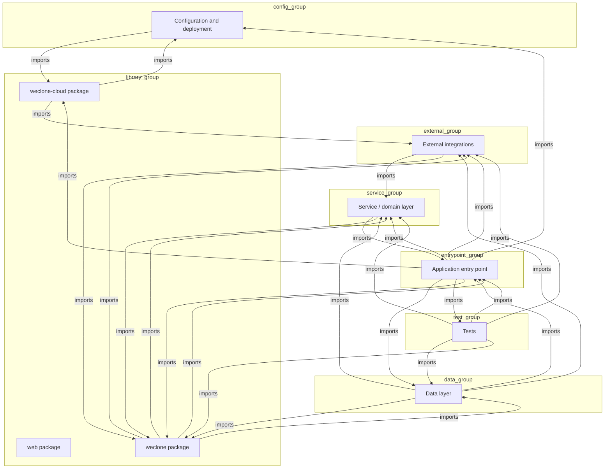

# Architecture report: xming521/WeClone

> Automated static analysis. **Observed** = directly seen in files/imports/AST; **Inferred** = interpretation from that evidence. Repository code was not executed.

## 1. Repository at a glance

| Item | Value |
| --- | --- |
| Repository | xming521/WeClone |
| Description | Build a portrait of your life. Assistants that know you better. Clones that sound more like you. |
| Language | Python |
| Stars | 18406 |
| Licence | AGPL-3.0 |
| Analysed commit / branch | c9b346cf2a903a4112ff62bb415083497ba13f1d / master |
| Framework(s) | FastAPI, React, Starlette |
| Files analysed | 358 |
| Components | 9 |

## 2. Architecture in one minute

xming521/WeClone - Build a portrait of your life. Assistants that know you better. Clones that sound more like you.. This repository was analysed statically from 358 file(s) (165 Python). Detected technologies (observed from imports/manifests): GitHub Actions, SQLite, FastAPI, React, Starlette, Click. Files are grouped into 9 component(s): Configuration and deployment, Data layer, Application entry point, External integrations, Service / domain layer, Tests, web package, weclone package. Observed entry point(s): scripts/check_private_llm_logs.py, scripts/check_profile_paths.py, scripts/check_profile_sources.py. Findings below distinguish observed facts from inferred interpretation.

## 3. High-level block diagram

## 4. Main components

### Configuration and deployment (`config`)

- **Kind:** config
- **Status:** Observed
- **Confidence:** 0.85
- **Responsibility:** Groups 18 file(s) under configuration and deployment (observed from repository paths and static analysis). Observed top-level classes: ApiSettings, CloudConfig, FinetuneSettings, ScoringSettings, ServeSettings, _Section. Observed top-level functions: find_config, load_config.
- **Paths:** `dataset/res_csv/sft/dataset_info.json`, `ds_config.json`, `pyproject.toml`, `web/.prettierrc.json`, `web/package.json`, `web/src/i18n/locales/en/translation.json`, `web/src/i18n/locales/zh-CN/translation.json`, `web/src/settings/AboutApp.tsx`, `web/src/settings/ModelSettings.tsx`, `web/src/settings/PageTopbar.tsx`, `web/src/settings/SettingsApp.tsx`, `web/src/settings/SettingsLink.tsx`, `web/src/settings/duration.ts`, `web/src/settings/modelSettings.ts`, `web/src/settings/useRun.ts`, `web/tsconfig.json`, `weclone-cloud/pyproject.toml`, `weclone-cloud/weclone_cloud/config.py`
- **Evidence:** [dataset/res_csv/sft/dataset_info.json](https://github.com/xming521/WeClone/blob/c9b346cf2a903a4112ff62bb415083497ba13f1d/dataset/res_csv/sft/dataset_info.json); [ds_config.json](https://github.com/xming521/WeClone/blob/c9b346cf2a903a4112ff62bb415083497ba13f1d/ds_config.json); [pyproject.toml](https://github.com/xming521/WeClone/blob/c9b346cf2a903a4112ff62bb415083497ba13f1d/pyproject.toml); [web/.prettierrc.json](https://github.com/xming521/WeClone/blob/c9b346cf2a903a4112ff62bb415083497ba13f1d/web/.prettierrc.json); [web/package.json](https://github.com/xming521/WeClone/blob/c9b346cf2a903a4112ff62bb415083497ba13f1d/web/package.json); [web/src/i18n/locales/en/translation.json](https://github.com/xming521/WeClone/blob/c9b346cf2a903a4112ff62bb415083497ba13f1d/web/src/i18n/locales/en/translation.json); [web/src/i18n/locales/zh-CN/translation.json](https://github.com/xming521/WeClone/blob/c9b346cf2a903a4112ff62bb415083497ba13f1d/web/src/i18n/locales/zh-CN/translation.json); [web/src/settings/AboutApp.tsx](https://github.com/xming521/WeClone/blob/c9b346cf2a903a4112ff62bb415083497ba13f1d/web/src/settings/AboutApp.tsx)

### Data layer (`data_layer`)

- **Kind:** data
- **Status:** Observed
- **Confidence:** 0.85
- **Responsibility:** Groups 37 file(s) under data layer (observed from repository paths and static analysis). Observed top-level classes: BatchDispatcher, Build, BuildCancelled, ChatMessage, ChatSample, CleaningStrategy. Observed top-level functions: _backend_problems, _count_chats, _create_table, _interval, _load_registry, _now.
- **Paths:** `weclone/data/__init__.py`, `weclone/data/agent/__init__.py`, `weclone/data/agent/build_cost.py`, `weclone/data/agent/contacts.py`, `weclone/data/agent/distill_event.py`, `weclone/data/agent/distill_profile.py`, `weclone/data/agent/distill_style/__init__.py`, `weclone/data/agent/distill_style/affective_style.py`, `weclone/data/agent/distill_style/batching.py`, `weclone/data/agent/distill_style/data.py`, `weclone/data/agent/distill_style/extraction.py`, `weclone/data/agent/distill_style/grouping.py`, `weclone/data/agent/distill_style/information_density.py`, `weclone/data/agent/distill_style/interactional_style.py`, `weclone/data/agent/distill_style/lexical_choice.py`, `weclone/data/agent/distill_style/morphosyntax.py`, `weclone/data/agent/distill_style/orthographic_style.py`, `weclone/data/agent/distill_style/paralinguistic_style.py`, `weclone/data/agent/distill_style/pragmatic_style.py`, `weclone/data/agent/distill_style/register_style.py`, `weclone/data/agent/distill_style/reporting.py`, `weclone/data/agent/distill_style/rhetorical_devices.py`, `weclone/data/agent/distill_style/sampling.py`, `weclone/data/agent/distill_style/stats.py`, `weclone/data/agent/distill_style/syntactic_style.py`, `weclone/data/agent/distill_style/taxonomy.py`, `weclone/data/agent/distill_style/variation.py`, `weclone/data/agent/distill_style/wire.py`, `weclone/data/agent/distill_windows.py`, `weclone/data/agent/llm_cache.py`, `weclone/data/agent/profile_pipeline.py`, `weclone/data/chat_csv.py`, `weclone/data/chat_parsers/telegram_parser.py`, `weclone/data/clean/__init__.py`, `weclone/data/clean/strategies.py`, `weclone/data/models.py`, `weclone/data/strategies.py`
- **Evidence:** [weclone/data/__init__.py](https://github.com/xming521/WeClone/blob/c9b346cf2a903a4112ff62bb415083497ba13f1d/weclone/data/__init__.py); [weclone/data/agent/__init__.py](https://github.com/xming521/WeClone/blob/c9b346cf2a903a4112ff62bb415083497ba13f1d/weclone/data/agent/__init__.py); [weclone/data/agent/build_cost.py:51](https://github.com/xming521/WeClone/blob/c9b346cf2a903a4112ff62bb415083497ba13f1d/weclone/data/agent/build_cost.py#L51); [weclone/data/agent/contacts.py:22](https://github.com/xming521/WeClone/blob/c9b346cf2a903a4112ff62bb415083497ba13f1d/weclone/data/agent/contacts.py#L22); [weclone/data/agent/distill_event.py:11](https://github.com/xming521/WeClone/blob/c9b346cf2a903a4112ff62bb415083497ba13f1d/weclone/data/agent/distill_event.py#L11); [weclone/data/agent/distill_profile.py:47](https://github.com/xming521/WeClone/blob/c9b346cf2a903a4112ff62bb415083497ba13f1d/weclone/data/agent/distill_profile.py#L47); [weclone/data/agent/distill_style/__init__.py](https://github.com/xming521/WeClone/blob/c9b346cf2a903a4112ff62bb415083497ba13f1d/weclone/data/agent/distill_style/__init__.py); [weclone/data/agent/distill_style/affective_style.py:54](https://github.com/xming521/WeClone/blob/c9b346cf2a903a4112ff62bb415083497ba13f1d/weclone/data/agent/distill_style/affective_style.py#L54)

### Application entry point (`entrypoint`)

- **Kind:** entrypoint
- **Status:** Observed
- **Confidence:** 0.85
- **Responsibility:** Groups 36 file(s) under application entry point (observed from repository paths and static analysis). Observed application object created via FastAPI. Observed top-level classes: DataProcessor, EmbeddingHTTPServer, EmbeddingRequestHandler, EmbeddingServiceConfig, FactEdit, FactWrite. Observed top-level functions: _chat_loop, _check_project_root, _check_versions, _coerce_float, _coerce_int, _config.
- **Paths:** `scripts/check_private_llm_logs.py`, `scripts/check_profile_paths.py`, `scripts/check_profile_sources.py`, `scripts/check_secure_storage.py`, `scripts/check_web_security.py`, `scripts/update_model_prices.py`, `weclone-cloud/tools/fix_langbot_compose.py`, `weclone-cloud/tools/from_alpha.py`, `weclone-cloud/tools/inspect_data.py`, `weclone-cloud/tools/launch.py`, `weclone-cloud/tools/make_settings.py`, `weclone-cloud/tools/patch_app.py`, `weclone-cloud/weclone_cloud/cli.py`, `weclone-cloud/weclone_cloud/serve.py`, `weclone/cli.py`, `weclone/core/inference/embedding_service.py`, `weclone/data/agent/chat_snapshot.py`, `weclone/data/agent/distill_style/__main__.py`, `weclone/data/agent/distill_style/run.py`, `weclone/data/agent/llm_profile_hierarchy.py`, `weclone/data/agent/organize_memories.py`, `weclone/data/qa_generator.py`, `weclone/data/utils.py`, `weclone/eval/cli_demo.py`, `weclone/eval/eval_model.py`, `weclone/eval/web_demo.py`, `weclone/server/api_service.py`, `weclone/server/app.py`, `weclone/server/profile_review.py`, `weclone/train/export_model.py`, `weclone/train/train_pt.py`, `weclone/train/train_sft.py`, `weclone/utils/config.py`, `weclone/utils/i18n.py`, `weclone/utils/length_cdf.py`, `weclone/utils/token_counter.py`
- **Evidence:** [scripts/check_private_llm_logs.py:21](https://github.com/xming521/WeClone/blob/c9b346cf2a903a4112ff62bb415083497ba13f1d/scripts/check_private_llm_logs.py#L21); [scripts/check_profile_paths.py:20](https://github.com/xming521/WeClone/blob/c9b346cf2a903a4112ff62bb415083497ba13f1d/scripts/check_profile_paths.py#L20); [scripts/check_profile_sources.py:15](https://github.com/xming521/WeClone/blob/c9b346cf2a903a4112ff62bb415083497ba13f1d/scripts/check_profile_sources.py#L15); [scripts/check_secure_storage.py:20](https://github.com/xming521/WeClone/blob/c9b346cf2a903a4112ff62bb415083497ba13f1d/scripts/check_secure_storage.py#L20); [scripts/check_web_security.py:189](https://github.com/xming521/WeClone/blob/c9b346cf2a903a4112ff62bb415083497ba13f1d/scripts/check_web_security.py#L189); [scripts/update_model_prices.py:23](https://github.com/xming521/WeClone/blob/c9b346cf2a903a4112ff62bb415083497ba13f1d/scripts/update_model_prices.py#L23); [weclone-cloud/tools/fix_langbot_compose.py:27](https://github.com/xming521/WeClone/blob/c9b346cf2a903a4112ff62bb415083497ba13f1d/weclone-cloud/tools/fix_langbot_compose.py#L27); [weclone-cloud/tools/from_alpha.py:38](https://github.com/xming521/WeClone/blob/c9b346cf2a903a4112ff62bb415083497ba13f1d/weclone-cloud/tools/from_alpha.py#L38)

### External integrations (`external_integrations`)

- **Kind:** external
- **Status:** Observed
- **Confidence:** 0.85
- **Responsibility:** Groups 1 file(s) under external integrations (observed from repository paths and static analysis). Observed top-level classes: BaseBatchMixin, CodexExecClient, LLMClient, LLMRequest, LLMResponse, OpenAICompatibleClient. Observed top-level functions: _api_response_metadata, _classify_error, _codex_error_text, _finish_audit, _maybe_parse_response_json, _provider_request_id.
- **Paths:** `weclone/core/inference/llm_client.py`
- **Evidence:** [weclone/core/inference/llm_client.py:49](https://github.com/xming521/WeClone/blob/c9b346cf2a903a4112ff62bb415083497ba13f1d/weclone/core/inference/llm_client.py#L49)

### Service / domain layer (`service_layer`)

- **Kind:** service
- **Status:** Observed
- **Confidence:** 0.85
- **Responsibility:** Groups 8 file(s) under service / domain layer (observed from repository paths and static analysis). Observed top-level classes: ChinesePIIDetector, LLMAuditCall, LLMAuditLogger, Meter, PIIDetector, PIIResult. Observed top-level functions: _audit_metadata, _exception_payload, _is_sensitive_key, _jsonable, _load_weclone_vllm_overrides, _make_guided_decoding_params.
- **Paths:** `weclone/core/PII/__init__.py`, `weclone/core/PII/pii_detector.py`, `weclone/core/inference/__init__.py`, `weclone/core/inference/_common.py`, `weclone/core/inference/audit.py`, `weclone/core/inference/model_prices.py`, `weclone/core/inference/offline_infer.py`, `weclone/core/inference/usage.py`
- **Evidence:** [weclone/core/PII/__init__.py](https://github.com/xming521/WeClone/blob/c9b346cf2a903a4112ff62bb415083497ba13f1d/weclone/core/PII/__init__.py); [weclone/core/PII/pii_detector.py:16](https://github.com/xming521/WeClone/blob/c9b346cf2a903a4112ff62bb415083497ba13f1d/weclone/core/PII/pii_detector.py#L16); [weclone/core/inference/__init__.py](https://github.com/xming521/WeClone/blob/c9b346cf2a903a4112ff62bb415083497ba13f1d/weclone/core/inference/__init__.py); [weclone/core/inference/_common.py:25](https://github.com/xming521/WeClone/blob/c9b346cf2a903a4112ff62bb415083497ba13f1d/weclone/core/inference/_common.py#L25); [weclone/core/inference/audit.py:50](https://github.com/xming521/WeClone/blob/c9b346cf2a903a4112ff62bb415083497ba13f1d/weclone/core/inference/audit.py#L50); [weclone/core/inference/model_prices.py:32](https://github.com/xming521/WeClone/blob/c9b346cf2a903a4112ff62bb415083497ba13f1d/weclone/core/inference/model_prices.py#L32); [weclone/core/inference/offline_infer.py:27](https://github.com/xming521/WeClone/blob/c9b346cf2a903a4112ff62bb415083497ba13f1d/weclone/core/inference/offline_infer.py#L27); [weclone/core/inference/usage.py:21](https://github.com/xming521/WeClone/blob/c9b346cf2a903a4112ff62bb415083497ba13f1d/weclone/core/inference/usage.py#L21)

### Tests (`tests`)

- **Kind:** test
- **Status:** Observed
- **Confidence:** 0.85
- **Responsibility:** Groups 62 file(s) under tests (observed from repository paths and static analysis). Observed application object created via FastAPI. Observed top-level classes: Assistant, Bot, FactPerGroupRunner, Failing, FakeClient, Runner. Observed top-level functions: _authenticate_server, _check_api_server, _load_data_processor, api, api_settings, bad_request.
- **Paths:** `dataset/eval/test_data-en.json`, `dataset/eval/test_data-privacy.json`, `dataset/eval/test_data-zh.json`, `tests/__init__.py`, `tests/configs/Qwen2.5-VL.jsonc`, `tests/configs/qwen2.5.jsonc`, `tests/conftest.py`, `tests/fake_build.py`, `tests/profile_data.py`, `tests/test_PII.py`, `tests/test_assistant_mcp.py`, `tests/test_bot_access.py`, `tests/test_build_cost.py`, `tests/test_chat_snapshot.py`, `tests/test_chat_upload.py`, `tests/test_contacts.py`, `tests/test_deep_insights.py`, `tests/test_distill_cli.py`, `tests/test_distill_style.py`, `tests/test_distill_windows.py`, `tests/test_full_pipe.py`, `tests/test_jsonc_edit.py`, `tests/test_llm_cache.py`, `tests/test_llm_callers.py`, `tests/test_llm_inference.py`, `tests/test_llm_profile_hierarchy.py`, `tests/test_model_settings.py`, `tests/test_organize_memories.py`, `tests/test_profile_build.py`, `tests/test_profile_intro.py`, `tests/test_profile_review.py`, `tests/test_profile_summary.py`, `tests/test_qa_generator.py`, `tests/test_server_cli.py`, `tests/test_web_auth.py`, `tests/test_web_settings.py`, `tests/tests_data/distill_style_snapshot.json`, `tests/tests_data/test_PII/test_0_730.csv`, `tests/tests_data/test_model_data.json`, `tests/tests_data/test_person/test_0_730.csv`, `web/tests/atlasFlow.test.ts`, `web/tests/atlasMetrics.test.ts`, `web/tests/buildCost.test.ts`, `web/tests/buildProgress.test.ts`, `web/tests/catalogs.test.ts`, `web/tests/chatUpload.test.ts`, `web/tests/data.test.ts`, `web/tests/entrance.test.ts`, `web/tests/graphLayout.test.ts`, `web/tests/graphTokens.test.ts`, `web/tests/modelLabels.ts`, `web/tests/nightIntro.test.ts`, `web/tests/summaryState.test.ts`, `weclone-cloud/tests/__init__.py`, `weclone-cloud/tests/conftest.py`, `weclone-cloud/tests/test_api.py`, `weclone-cloud/tests/test_config.py`, `weclone-cloud/tests/test_dataset.py`, `weclone-cloud/tests/test_finetune.py`, `weclone-cloud/tests/test_scoring.py`, `weclone-cloud/tests/test_serve.py`, `weclone/eval/test_model.py`
- **Evidence:** [dataset/eval/test_data-en.json](https://github.com/xming521/WeClone/blob/c9b346cf2a903a4112ff62bb415083497ba13f1d/dataset/eval/test_data-en.json); [dataset/eval/test_data-privacy.json](https://github.com/xming521/WeClone/blob/c9b346cf2a903a4112ff62bb415083497ba13f1d/dataset/eval/test_data-privacy.json); [dataset/eval/test_data-zh.json](https://github.com/xming521/WeClone/blob/c9b346cf2a903a4112ff62bb415083497ba13f1d/dataset/eval/test_data-zh.json); [tests/__init__.py](https://github.com/xming521/WeClone/blob/c9b346cf2a903a4112ff62bb415083497ba13f1d/tests/__init__.py); [tests/configs/Qwen2.5-VL.jsonc](https://github.com/xming521/WeClone/blob/c9b346cf2a903a4112ff62bb415083497ba13f1d/tests/configs/Qwen2.5-VL.jsonc); [tests/configs/qwen2.5.jsonc](https://github.com/xming521/WeClone/blob/c9b346cf2a903a4112ff62bb415083497ba13f1d/tests/configs/qwen2.5.jsonc); [tests/conftest.py:11](https://github.com/xming521/WeClone/blob/c9b346cf2a903a4112ff62bb415083497ba13f1d/tests/conftest.py#L11); [tests/fake_build.py](https://github.com/xming521/WeClone/blob/c9b346cf2a903a4112ff62bb415083497ba13f1d/tests/fake_build.py)

### web package (`web`)

- **Kind:** library
- **Status:** Observed
- **Confidence:** 0.85
- **Responsibility:** Groups 67 file(s) under web package (observed from repository paths and static analysis).
- **Paths:** `web/eslint.config.js`, `web/i18next.config.ts`, `web/src/App.tsx`, `web/src/Auth.tsx`, `web/src/BrandMark.tsx`, `web/src/Dropdown.tsx`, `web/src/LanguageSwitch.tsx`, `web/src/ModeSwitch.tsx`, `web/src/api.ts`, `web/src/assistant/AssistantApp.tsx`, `web/src/assistant/accessParts.tsx`, `web/src/atlas/CanvasToolbar.tsx`, `web/src/atlas/DetailPanel.tsx`, `web/src/atlas/GraphCanvas.tsx`, `web/src/atlas/IconButton.tsx`, `web/src/atlas/LeftPanel.tsx`, `web/src/atlas/NodePreview.tsx`, `web/src/atlas/SearchBox.tsx`, `web/src/atlas/atlasEngine.ts`, `web/src/atlas/atlasFlow.ts`, `web/src/atlas/atlasMetrics.ts`, `web/src/atlas/entrance.ts`, `web/src/atlas/entrancePlan.ts`, `web/src/atlas/graphLayout.ts`, `web/src/atlas/graphStyle.ts`, `web/src/atlas/nightIntro.ts`, `web/src/atlas/nightIntroPlan.ts`, `web/src/atlas/nodeLook.ts`, `web/src/atlas/paint.ts`, `web/src/atlas/scopeColor.ts`, `web/src/bots/BotsApp.tsx`, `web/src/bots/ClonePlayground.tsx`, `web/src/data.ts`, `web/src/feedback/ConfirmDialog.tsx`, `web/src/feedback/ErrorDetails.tsx`, `web/src/feedback/Toaster.tsx`, `web/src/feedback/confirm.ts`, `web/src/feedback/keys.ts`, `web/src/feedback/toast.ts`, `web/src/i18n/format.ts`, `web/src/i18n/i18next.d.ts`, `web/src/i18n/index.ts`, `web/src/i18n/resources.d.ts`, `web/src/main.tsx`, `web/src/review/FactCard.tsx`, `web/src/review/FactEditor.tsx`, `web/src/review/FactHistory.tsx`, `web/src/review/ProfileActions.tsx`, `web/src/review/ProfileScores.tsx`, `web/src/review/ReviewBar.tsx`, `web/src/review/ReviewFilter.tsx`, `web/src/review/ReviewOverlays.tsx`, `web/src/review/ReviewPanel.tsx`, `web/src/review/SortSelect.tsx`, `web/src/review/SourceChatPanel.tsx`, `web/src/review/privacy.tsx`, `web/src/review/status.ts`, `web/src/store.ts`, `web/src/style/BubbleField.tsx`, `web/src/style/StyleApp.tsx`, `web/src/style/TraitDetail.tsx`, `web/src/style/traits.ts`, `web/src/style/types.ts`, `web/src/summary/SummaryApp.tsx`, `web/src/summary/summaryState.ts`, `web/src/theme.ts`, `web/vite.config.ts`
- **Evidence:** [web/eslint.config.js](https://github.com/xming521/WeClone/blob/c9b346cf2a903a4112ff62bb415083497ba13f1d/web/eslint.config.js); [web/i18next.config.ts](https://github.com/xming521/WeClone/blob/c9b346cf2a903a4112ff62bb415083497ba13f1d/web/i18next.config.ts); [web/src/App.tsx](https://github.com/xming521/WeClone/blob/c9b346cf2a903a4112ff62bb415083497ba13f1d/web/src/App.tsx); [web/src/Auth.tsx](https://github.com/xming521/WeClone/blob/c9b346cf2a903a4112ff62bb415083497ba13f1d/web/src/Auth.tsx); [web/src/BrandMark.tsx](https://github.com/xming521/WeClone/blob/c9b346cf2a903a4112ff62bb415083497ba13f1d/web/src/BrandMark.tsx); [web/src/Dropdown.tsx](https://github.com/xming521/WeClone/blob/c9b346cf2a903a4112ff62bb415083497ba13f1d/web/src/Dropdown.tsx); [web/src/LanguageSwitch.tsx](https://github.com/xming521/WeClone/blob/c9b346cf2a903a4112ff62bb415083497ba13f1d/web/src/LanguageSwitch.tsx); [web/src/ModeSwitch.tsx](https://github.com/xming521/WeClone/blob/c9b346cf2a903a4112ff62bb415083497ba13f1d/web/src/ModeSwitch.tsx)

### weclone package (`weclone`)

- **Kind:** library
- **Status:** Observed
- **Confidence:** 0.85
- **Responsibility:** Groups 35 file(s) under weclone package (observed from repository paths and static analysis). Observed top-level classes: AccessGrant, AccessStore, AgentDistillArgs, ApiError, ApiSettings, AssistantTools. Observed top-level functions: _add_stderr_sink, _atomic_writer, _calculate_delay, _changes, _check, _check_output_mode.
- **Paths:** `weclone/__init__.py`, `weclone/eval/__init__.py`, `weclone/prompts/__init__.py`, `weclone/prompts/clean_data.py`, `weclone/prompts/deep_insights.py`, `weclone/prompts/distill_memory.py`, `weclone/prompts/distill_style.py`, `weclone/prompts/memory_organization.py`, `weclone/prompts/profile_hierarchy.py`, `weclone/prompts/profile_summary.py`, `weclone/server/__init__.py`, `weclone/server/assistant.py`, `weclone/server/auth.py`, `weclone/server/bots.py`, `weclone/server/chat_upload.py`, `weclone/server/client_access.py`, `weclone/server/deep_insights.py`, `weclone/server/errors.py`, `weclone/server/mcp.py`, `weclone/server/model_settings.py`, `weclone/server/profile_build.py`, `weclone/server/profile_intro.py`, `weclone/server/profile_summary.py`, `weclone/server/source_chat.py`, `weclone/server/style_view.py`, `weclone/train/__init__.py`, `weclone/train/security.py`, `weclone/utils/__init__.py`, `weclone/utils/config_models.py`, `weclone/utils/jsonc_edit.py`, `weclone/utils/log.py`, `weclone/utils/retry.py`, `weclone/utils/secure_storage.py`, `weclone/utils/tools.py`, `weclone/web/__init__.py`
- **Evidence:** [weclone/__init__.py](https://github.com/xming521/WeClone/blob/c9b346cf2a903a4112ff62bb415083497ba13f1d/weclone/__init__.py); [weclone/eval/__init__.py](https://github.com/xming521/WeClone/blob/c9b346cf2a903a4112ff62bb415083497ba13f1d/weclone/eval/__init__.py); [weclone/prompts/__init__.py](https://github.com/xming521/WeClone/blob/c9b346cf2a903a4112ff62bb415083497ba13f1d/weclone/prompts/__init__.py); [weclone/prompts/clean_data.py](https://github.com/xming521/WeClone/blob/c9b346cf2a903a4112ff62bb415083497ba13f1d/weclone/prompts/clean_data.py); [weclone/prompts/deep_insights.py:46](https://github.com/xming521/WeClone/blob/c9b346cf2a903a4112ff62bb415083497ba13f1d/weclone/prompts/deep_insights.py#L46); [weclone/prompts/distill_memory.py:135](https://github.com/xming521/WeClone/blob/c9b346cf2a903a4112ff62bb415083497ba13f1d/weclone/prompts/distill_memory.py#L135); [weclone/prompts/distill_style.py:12](https://github.com/xming521/WeClone/blob/c9b346cf2a903a4112ff62bb415083497ba13f1d/weclone/prompts/distill_style.py#L12); [weclone/prompts/memory_organization.py:21](https://github.com/xming521/WeClone/blob/c9b346cf2a903a4112ff62bb415083497ba13f1d/weclone/prompts/memory_organization.py#L21)

### weclone-cloud package (`weclone_cloud`)

- **Kind:** library
- **Status:** Observed
- **Confidence:** 0.85
- **Responsibility:** Groups 8 file(s) under weclone-cloud package (observed from repository paths and static analysis). Observed top-level classes: ApiError, ChatClient, CloudError, Completion, CompletionCache, ConfigError. Observed top-level functions: _coerce_score, _encoder, _error_message, _now, _record_id, _scan_json_object.
- **Paths:** `weclone-cloud/bootstrap.sh`, `weclone-cloud/weclone_cloud/__init__.py`, `weclone-cloud/weclone_cloud/api.py`, `weclone-cloud/weclone_cloud/dataset.py`, `weclone-cloud/weclone_cloud/errors.py`, `weclone-cloud/weclone_cloud/finetune.py`, `weclone-cloud/weclone_cloud/prompts.py`, `weclone-cloud/weclone_cloud/scoring.py`
- **Evidence:** [weclone-cloud/bootstrap.sh](https://github.com/xming521/WeClone/blob/c9b346cf2a903a4112ff62bb415083497ba13f1d/weclone-cloud/bootstrap.sh); [weclone-cloud/weclone_cloud/__init__.py](https://github.com/xming521/WeClone/blob/c9b346cf2a903a4112ff62bb415083497ba13f1d/weclone-cloud/weclone_cloud/__init__.py); [weclone-cloud/weclone_cloud/api.py:37](https://github.com/xming521/WeClone/blob/c9b346cf2a903a4112ff62bb415083497ba13f1d/weclone-cloud/weclone_cloud/api.py#L37); [weclone-cloud/weclone_cloud/dataset.py:30](https://github.com/xming521/WeClone/blob/c9b346cf2a903a4112ff62bb415083497ba13f1d/weclone-cloud/weclone_cloud/dataset.py#L30); [weclone-cloud/weclone_cloud/errors.py:6](https://github.com/xming521/WeClone/blob/c9b346cf2a903a4112ff62bb415083497ba13f1d/weclone-cloud/weclone_cloud/errors.py#L6); [weclone-cloud/weclone_cloud/finetune.py:34](https://github.com/xming521/WeClone/blob/c9b346cf2a903a4112ff62bb415083497ba13f1d/weclone-cloud/weclone_cloud/finetune.py#L34); [weclone-cloud/weclone_cloud/prompts.py:53](https://github.com/xming521/WeClone/blob/c9b346cf2a903a4112ff62bb415083497ba13f1d/weclone-cloud/weclone_cloud/prompts.py#L53); [weclone-cloud/weclone_cloud/scoring.py:24](https://github.com/xming521/WeClone/blob/c9b346cf2a903a4112ff62bb415083497ba13f1d/weclone-cloud/weclone_cloud/scoring.py#L24)

## 5. Execution flow

**Observed** entry point(s):

- [scripts/check_private_llm_logs.py:243](https://github.com/xming521/WeClone/blob/c9b346cf2a903a4112ff62bb415083497ba13f1d/scripts/check_private_llm_logs.py#L243)
- [scripts/check_profile_paths.py:151](https://github.com/xming521/WeClone/blob/c9b346cf2a903a4112ff62bb415083497ba13f1d/scripts/check_profile_paths.py#L151)
- [scripts/check_profile_sources.py:152](https://github.com/xming521/WeClone/blob/c9b346cf2a903a4112ff62bb415083497ba13f1d/scripts/check_profile_sources.py#L152)
- [scripts/check_secure_storage.py:488](https://github.com/xming521/WeClone/blob/c9b346cf2a903a4112ff62bb415083497ba13f1d/scripts/check_secure_storage.py#L488)
- [scripts/check_web_security.py:189](https://github.com/xming521/WeClone/blob/c9b346cf2a903a4112ff62bb415083497ba13f1d/scripts/check_web_security.py#L189)
- [scripts/update_model_prices.py:86](https://github.com/xming521/WeClone/blob/c9b346cf2a903a4112ff62bb415083497ba13f1d/scripts/update_model_prices.py#L86)
- [weclone-cloud/tools/fix_langbot_compose.py:53](https://github.com/xming521/WeClone/blob/c9b346cf2a903a4112ff62bb415083497ba13f1d/weclone-cloud/tools/fix_langbot_compose.py#L53)
- [weclone-cloud/tools/from_alpha.py:139](https://github.com/xming521/WeClone/blob/c9b346cf2a903a4112ff62bb415083497ba13f1d/weclone-cloud/tools/from_alpha.py#L139)
- [weclone-cloud/tools/inspect_data.py:304](https://github.com/xming521/WeClone/blob/c9b346cf2a903a4112ff62bb415083497ba13f1d/weclone-cloud/tools/inspect_data.py#L304)
- [weclone-cloud/tools/launch.py:298](https://github.com/xming521/WeClone/blob/c9b346cf2a903a4112ff62bb415083497ba13f1d/weclone-cloud/tools/launch.py#L298)
- [weclone-cloud/tools/make_settings.py:75](https://github.com/xming521/WeClone/blob/c9b346cf2a903a4112ff62bb415083497ba13f1d/weclone-cloud/tools/make_settings.py#L75)
- [weclone-cloud/tools/patch_app.py:61](https://github.com/xming521/WeClone/blob/c9b346cf2a903a4112ff62bb415083497ba13f1d/weclone-cloud/tools/patch_app.py#L61)

Representative flow (derived from observed entry points and the import graph; steps beyond the entry point are **Inferred**):

1. Execution starts at an observed entry point listed above, if present.
2. `config` imports `weclone_cloud` (Configuration and deployment -> weclone-cloud package).
3. `data_layer` imports `entrypoint` (Data layer -> Application entry point).
4. `data_layer` imports `external_integrations` (Data layer -> External integrations).
5. `data_layer` imports `service_layer` (Data layer -> Service / domain layer).
6. `data_layer` imports `weclone` (Data layer -> weclone package).
7. `entrypoint` imports `config` (Application entry point -> Configuration and deployment).
8. `entrypoint` imports `data_layer` (Application entry point -> Data layer).
9. `entrypoint` imports `external_integrations` (Application entry point -> External integrations).

## 6. Project structure

### `(root)`

- `.gitignore` - other (2877 bytes)
- `.pre-commit-config.yaml` - config (1592 bytes)
- `LICENSE` - docs (34523 bytes)
- `README.md` - docs (14554 bytes)
- `README_zh.md` - docs (13156 bytes)
- `ds_config.json` - config (728 bytes)
- `pyproject.toml` - manifest (4072 bytes)
- `settings.template.jsonc` - other (5643 bytes)

### `.cursor`

- `.cursor/rules/weclone-rules.mdc` - other (384 bytes)

### `.github`

- `.github/issue-labeler.yml` - config (1613 bytes)
- `.github/weclone-release-event.json` - config (2896 bytes)
- `.github/workflows/issue-labeler.yml` - ci, YAML (761 bytes)
- `.github/workflows/tg_release_notification.yml` - ci, YAML (3287 bytes)

### `dataset`

- `dataset/eval/test_data-en.json` - test (4721 bytes)
- `dataset/eval/test_data-privacy.json` - test (6831 bytes)
- `dataset/eval/test_data-zh.json` - test (4625 bytes)
- `dataset/media/images/.gitkeep` - other (82 bytes)
- `dataset/res_csv/sft/dataset_info.json` - config (1573 bytes)
- `dataset/telegram/.gitkeep` - other (39 bytes)

### `docs`

- `docs/CONTRIBUTING.md` - docs (3974 bytes)
- `docs/en/chatbot.md` - docs (2884 bytes)
- `docs/en/data.md` - docs (2488 bytes)
- `docs/en/finetune.md` - docs (3875 bytes)
- `docs/en/installation.md` - docs (4097 bytes)
- `docs/en/profile.md` - docs (7026 bytes)
- `docs/en/security.md` - docs (3610 bytes)
- `docs/zh/chatbot.md` - docs (2620 bytes)
- `docs/zh/data.md` - docs (2314 bytes)
- `docs/zh/finetune.md` - docs (3736 bytes)
- `docs/zh/installation.md` - docs (4140 bytes)
- `docs/zh/profile.md` - docs (6372 bytes)
- `docs/zh/security.md` - docs (3285 bytes)
- `docs/zh/style.md` - docs (81171 bytes)

### `scripts`

- `scripts/check_private_llm_logs.py` - source, Python (10286 bytes)
- `scripts/check_profile_paths.py` - source, Python (7105 bytes)
- `scripts/check_profile_sources.py` - source, Python (7005 bytes)
- `scripts/check_secure_storage.py` - source, Python (24233 bytes)
- `scripts/check_web_security.py` - source, Python (10670 bytes)
- `scripts/update_model_prices.py` - source, Python (3418 bytes)

### `tests`

- `tests/__init__.py` - test, Python (0 bytes)
- `tests/configs/Qwen2.5-VL.jsonc` - test (3189 bytes)
- `tests/configs/qwen2.5.jsonc` - test (3218 bytes)
- `tests/conftest.py` - test, Python (2555 bytes)
- `tests/fake_build.py` - test, Python (2235 bytes)
- `tests/profile_data.py` - test, Python (359 bytes)
- `tests/test_PII.py` - test, Python (1868 bytes)
- `tests/test_assistant_mcp.py` - test, Python (19190 bytes)
- `tests/test_bot_access.py` - test, Python (10398 bytes)
- `tests/test_build_cost.py` - test, Python (15990 bytes)
- `tests/test_chat_snapshot.py` - test, Python (4490 bytes)
- `tests/test_chat_upload.py` - test, Python (8452 bytes)
- `tests/test_contacts.py` - test, Python (1596 bytes)
- `tests/test_deep_insights.py` - test, Python (6824 bytes)
- `tests/test_distill_cli.py` - test, Python (6869 bytes)
- `tests/test_distill_style.py` - test, Python (14472 bytes)
- `tests/test_distill_windows.py` - test, Python (12187 bytes)
- `tests/test_full_pipe.py` - test, Python (11384 bytes)
- `tests/test_jsonc_edit.py` - test, Python (3154 bytes)
- `tests/test_llm_cache.py` - test, Python (3547 bytes)
- `tests/test_llm_callers.py` - test, Python (4590 bytes)
- `tests/test_llm_inference.py` - test, Python (27648 bytes)
- `tests/test_llm_profile_hierarchy.py` - test, Python (13044 bytes)
- `tests/test_model_settings.py` - test, Python (11011 bytes)
- `tests/test_organize_memories.py` - test, Python (50554 bytes)
- `tests/test_profile_build.py` - test, Python (22517 bytes)
- `tests/test_profile_intro.py` - test, Python (6423 bytes)
- `tests/test_profile_review.py` - test, Python (8760 bytes)
- `tests/test_profile_summary.py` - test, Python (19073 bytes)
- `tests/test_qa_generator.py` - test, Python (2624 bytes)
- `tests/test_server_cli.py` - test, Python (7423 bytes)
- `tests/test_web_auth.py` - test, Python (1227 bytes)
- `tests/test_web_settings.py` - test, Python (3451 bytes)
- `tests/tests_data/distill_style_snapshot.json` - test (55713 bytes)
- `tests/tests_data/test_PII/test_0_730.csv` - test (5483 bytes)
- `tests/tests_data/test_model_data.json` - test (719 bytes)
- `tests/tests_data/test_person/test_0_730.csv` - test (16534 bytes)

### `web`

- `web/.gitignore` - other (28 bytes)
- `web/.prettierignore` - other (79 bytes)
- `web/.prettierrc.json` - config (116 bytes)
- `web/README.md` - docs (2575 bytes)
- `web/dev-data/.gitignore` - other (34 bytes)
- `web/eslint.config.js` - source, JavaScript (1190 bytes)
- `web/i18next.config.ts` - source, TypeScript (827 bytes)
- `web/index.html` - other (452 bytes)
- `web/package.json` - manifest (1340 bytes)
- `web/src/App.tsx` - source, TypeScript (6904 bytes)
- `web/src/Auth.tsx` - source, TypeScript (9716 bytes)
- `web/src/BrandMark.tsx` - source, TypeScript (988 bytes)
- `web/src/Dropdown.tsx` - source, TypeScript (7259 bytes)
- `web/src/LanguageSwitch.tsx` - source, TypeScript (937 bytes)
- `web/src/ModeSwitch.tsx` - source, TypeScript (2671 bytes)
- `web/src/api.ts` - source, TypeScript (2324 bytes)
- `web/src/assets/logo/weclone-favicon.svg` - other (1057 bytes)
- `web/src/assets/logo/weclone-mark-small.svg` - other (1411 bytes)
- `web/src/assets/logo/weclone-mark.svg` - other (1980 bytes)
- `web/src/assistant/AssistantApp.tsx` - source, TypeScript (13973 bytes)
- `web/src/assistant/accessParts.tsx` - source, TypeScript (5894 bytes)
- `web/src/assistant/assistant.css` - other (5349 bytes)
- `web/src/atlas/CanvasToolbar.tsx` - source, TypeScript (4883 bytes)
- `web/src/atlas/DetailPanel.tsx` - source, TypeScript (10372 bytes)
- `web/src/atlas/GraphCanvas.tsx` - source, TypeScript (8317 bytes)
- `web/src/atlas/IconButton.tsx` - source, TypeScript (1544 bytes)
- `web/src/atlas/LeftPanel.tsx` - source, TypeScript (8858 bytes)
- `web/src/atlas/NodePreview.tsx` - source, TypeScript (4202 bytes)
- `web/src/atlas/SearchBox.tsx` - source, TypeScript (3427 bytes)
- `web/src/atlas/atlasEngine.ts` - source, TypeScript (62157 bytes)
- `web/src/atlas/atlasFlow.ts` - source, TypeScript (3304 bytes)
- `web/src/atlas/atlasMetrics.ts` - source, TypeScript (3812 bytes)
- `web/src/atlas/canvas.css` - other (4877 bytes)
- `web/src/atlas/detail.css` - other (6506 bytes)
- `web/src/atlas/entrance.ts` - source, TypeScript (15492 bytes)
- `web/src/atlas/entrancePlan.ts` - source, TypeScript (11334 bytes)
- `web/src/atlas/graph.css` - other (1803 bytes)
- `web/src/atlas/graphLayout.ts` - source, TypeScript (12218 bytes)
- `web/src/atlas/graphStyle.ts` - source, TypeScript (8889 bytes)
- `web/src/atlas/leftPanel.css` - other (5781 bytes)
- `web/src/atlas/nightIntro.css` - other (3627 bytes)
- `web/src/atlas/nightIntro.ts` - source, TypeScript (37482 bytes)
- `web/src/atlas/nightIntroPlan.ts` - source, TypeScript (37204 bytes)
- `web/src/atlas/nodeLook.ts` - source, TypeScript (6204 bytes)
- `web/src/atlas/paint.ts` - source, TypeScript (14047 bytes)
- `web/src/atlas/scopeColor.ts` - source, TypeScript (797 bytes)
- `web/src/base.css` - other (1292 bytes)
- `web/src/bots/BotsApp.tsx` - source, TypeScript (6291 bytes)
- `web/src/bots/ClonePlayground.tsx` - source, TypeScript (6568 bytes)
- `web/src/bots/bots.css` - other (1007 bytes)
- `web/src/data.ts` - source, TypeScript (22559 bytes)
- `web/src/dropdown.css` - other (2231 bytes)
- `web/src/ds/components.css` - other (53849 bytes)
- `web/src/ds/tokens.css` - other (17179 bytes)
- `web/src/feedback/ConfirmDialog.tsx` - source, TypeScript (1657 bytes)
- `web/src/feedback/ErrorDetails.tsx` - source, TypeScript (537 bytes)
- `web/src/feedback/Toaster.tsx` - source, TypeScript (2663 bytes)
- `web/src/feedback/confirm.ts` - source, TypeScript (1370 bytes)
- `web/src/feedback/feedback.css` - other (2714 bytes)
- `web/src/feedback/keys.ts` - source, TypeScript (637 bytes)
- `web/src/feedback/toast.ts` - source, TypeScript (1160 bytes)
- `web/src/i18n/format.ts` - source, TypeScript (572 bytes)
- `web/src/i18n/i18next.d.ts` - source, TypeScript (333 bytes)
- `web/src/i18n/index.ts` - source, TypeScript (1803 bytes)
- `web/src/i18n/locales/en/translation.json` - config (54082 bytes)
- `web/src/i18n/locales/zh-CN/translation.json` - config (47988 bytes)
- `web/src/i18n/resources.d.ts` - source, TypeScript (49940 bytes)
- `web/src/main.tsx` - source, TypeScript (192 bytes)
- `web/src/review/FactCard.tsx` - source, TypeScript (6628 bytes)
- `web/src/review/FactEditor.tsx` - source, TypeScript (6817 bytes)
- `web/src/review/FactHistory.tsx` - source, TypeScript (3234 bytes)
- `web/src/review/ProfileActions.tsx` - source, TypeScript (3595 bytes)
- `web/src/review/ProfileScores.tsx` - source, TypeScript (2913 bytes)
- `web/src/review/ReviewBar.tsx` - source, TypeScript (4219 bytes)
- `web/src/review/ReviewFilter.tsx` - source, TypeScript (2404 bytes)
- `web/src/review/ReviewOverlays.tsx` - source, TypeScript (1040 bytes)
- `web/src/review/ReviewPanel.tsx` - source, TypeScript (9247 bytes)
- `web/src/review/SortSelect.tsx` - source, TypeScript (1787 bytes)
- `web/src/review/SourceChatPanel.tsx` - source, TypeScript (4422 bytes)
- `web/src/review/privacy.tsx` - source, TypeScript (3401 bytes)
- `web/src/review/review.css` - other (12691 bytes)
- `web/src/review/status.ts` - source, TypeScript (401 bytes)
- `web/src/settings/AboutApp.tsx` - source, TypeScript (5027 bytes)
- `web/src/settings/ModelSettings.tsx` - source, TypeScript (24536 bytes)
- `web/src/settings/PageTopbar.tsx` - source, TypeScript (1092 bytes)
- `web/src/settings/SettingsApp.tsx` - source, TypeScript (17042 bytes)
- `web/src/settings/SettingsLink.tsx` - source, TypeScript (489 bytes)
- `web/src/settings/duration.ts` - source, TypeScript (790 bytes)
- `web/src/settings/modelSettings.ts` - source, TypeScript (3042 bytes)
- `web/src/settings/settings.css` - other (6551 bytes)
- `web/src/settings/useRun.ts` - source, TypeScript (554 bytes)
- `web/src/shell.css` - other (9005 bytes)
- `web/src/store.ts` - source, TypeScript (18455 bytes)
- `web/src/style.css` - other (477 bytes)
- `web/src/style/BubbleField.tsx` - source, TypeScript (6956 bytes)
- `web/src/style/StyleApp.tsx` - source, TypeScript (6917 bytes)
- `web/src/style/TraitDetail.tsx` - source, TypeScript (5558 bytes)
- `web/src/style/styleView.css` - other (8546 bytes)
- `web/src/style/traits.ts` - source, TypeScript (9099 bytes)
- `web/src/style/types.ts` - source, TypeScript (2373 bytes)
- `web/src/summary/SummaryApp.tsx` - source, TypeScript (16530 bytes)
- `web/src/summary/summary.css` - other (6907 bytes)
- `web/src/summary/summaryState.ts` - source, TypeScript (1786 bytes)
- `web/src/theme.ts` - source, TypeScript (1669 bytes)
- `web/tests/atlasFlow.test.ts` - test, TypeScript (2043 bytes)
- `web/tests/atlasMetrics.test.ts` - test, TypeScript (3366 bytes)
- `web/tests/buildCost.test.ts` - test, TypeScript (1775 bytes)
- `web/tests/buildProgress.test.ts` - test, TypeScript (7072 bytes)
- `web/tests/catalogs.test.ts` - test, TypeScript (1874 bytes)
- `web/tests/chatUpload.test.ts` - test, TypeScript (1031 bytes)
- `web/tests/data.test.ts` - test, TypeScript (18235 bytes)
- `web/tests/entrance.test.ts` - test, TypeScript (7721 bytes)
- `web/tests/graphLayout.test.ts` - test, TypeScript (8580 bytes)
- `web/tests/graphTokens.test.ts` - test, TypeScript (3281 bytes)
- `web/tests/modelLabels.ts` - test, TypeScript (433 bytes)
- `web/tests/nightIntro.test.ts` - test, TypeScript (11474 bytes)
- `web/tests/summaryState.test.ts` - test, TypeScript (1586 bytes)
- `web/tsconfig.json` - config (556 bytes)
- `web/vite.config.ts` - source, TypeScript (330 bytes)

### `weclone`

- `weclone/__init__.py` - source, Python (0 bytes)
- `weclone/cli.py` - source, Python (23901 bytes)
- `weclone/core/PII/__init__.py` - source, Python (131 bytes)
- `weclone/core/PII/pii_detector.py` - source, Python (11320 bytes)
- `weclone/core/inference/__init__.py` - source, Python (385 bytes)
- `weclone/core/inference/_common.py` - source, Python (1789 bytes)
- `weclone/core/inference/audit.py` - source, Python (11441 bytes)
- `weclone/core/inference/embedding_service.py` - source, Python (15895 bytes)
- `weclone/core/inference/llm_client.py` - source, Python (47375 bytes)
- `weclone/core/inference/model_prices.py` - source, Python (4808 bytes)
- `weclone/core/inference/offline_infer.py` - source, Python (8828 bytes)
- `weclone/core/inference/usage.py` - source, Python (3790 bytes)
- `weclone/data/__init__.py` - source, Python (0 bytes)
- `weclone/data/agent/__init__.py` - source, Python (41 bytes)
- `weclone/data/agent/build_cost.py` - source, Python (18075 bytes)
- `weclone/data/agent/chat_snapshot.py` - source, Python (8122 bytes)
- `weclone/data/agent/contacts.py` - source, Python (2355 bytes)
- `weclone/data/agent/distill_event.py` - source, Python (862 bytes)
- `weclone/data/agent/distill_profile.py` - source, Python (25190 bytes)
- `weclone/data/agent/distill_style/__init__.py` - source, Python (33 bytes)
- `weclone/data/agent/distill_style/__main__.py` - source, Python (30 bytes)
- `weclone/data/agent/distill_style/affective_style.py` - source, Python (35470 bytes)
- `weclone/data/agent/distill_style/batching.py` - source, Python (17958 bytes)
- `weclone/data/agent/distill_style/data.py` - source, Python (8436 bytes)
- `weclone/data/agent/distill_style/extraction.py` - source, Python (22931 bytes)
- `weclone/data/agent/distill_style/grouping.py` - source, Python (3713 bytes)
- `weclone/data/agent/distill_style/information_density.py` - source, Python (12675 bytes)
- `weclone/data/agent/distill_style/interactional_style.py` - source, Python (23045 bytes)
- `weclone/data/agent/distill_style/lexical_choice.py` - source, Python (35668 bytes)
- `weclone/data/agent/distill_style/morphosyntax.py` - source, Python (16982 bytes)
- `weclone/data/agent/distill_style/orthographic_style.py` - source, Python (17809 bytes)
- `weclone/data/agent/distill_style/paralinguistic_style.py` - source, Python (34517 bytes)
- `weclone/data/agent/distill_style/pragmatic_style.py` - source, Python (32215 bytes)
- `weclone/data/agent/distill_style/register_style.py` - source, Python (16460 bytes)
- `weclone/data/agent/distill_style/reporting.py` - source, Python (10499 bytes)
- `weclone/data/agent/distill_style/rhetorical_devices.py` - source, Python (14720 bytes)
- `weclone/data/agent/distill_style/run.py` - source, Python (24241 bytes)
- `weclone/data/agent/distill_style/sampling.py` - source, Python (4713 bytes)
- `weclone/data/agent/distill_style/stats.py` - source, Python (8936 bytes)
- `weclone/data/agent/distill_style/syntactic_style.py` - source, Python (43376 bytes)
- `weclone/data/agent/distill_style/taxonomy.py` - source, Python (14782 bytes)
- `weclone/data/agent/distill_style/variation.py` - source, Python (15418 bytes)
- `weclone/data/agent/distill_style/wire.py` - source, Python (16006 bytes)
- `weclone/data/agent/distill_windows.py` - source, Python (8997 bytes)
- `weclone/data/agent/llm_cache.py` - source, Python (3137 bytes)
- `weclone/data/agent/llm_profile_hierarchy.py` - source, Python (12491 bytes)
- `weclone/data/agent/organize_memories.py` - source, Python (49179 bytes)
- `weclone/data/agent/profile_pipeline.py` - source, Python (23273 bytes)
- `weclone/data/chat_csv.py` - source, Python (3104 bytes)
- `weclone/data/chat_parsers/telegram_parser.py` - source, Python (12569 bytes)
- `weclone/data/clean/__init__.py` - source, Python (0 bytes)
- `weclone/data/clean/strategies.py` - source, Python (9642 bytes)
- `weclone/data/models.py` - source, Python (3192 bytes)
- `weclone/data/qa_generator.py` - source, Python (30434 bytes)
- `weclone/data/strategies.py` - source, Python (1515 bytes)
- `weclone/data/utils.py` - source, Python (7638 bytes)
- `weclone/eval/__init__.py` - source, Python (0 bytes)
- `weclone/eval/cli_demo.py` - source, Python (1730 bytes)
- `weclone/eval/eval_model.py` - source, Python (479 bytes)
- `weclone/eval/test_model.py` - test, Python (4164 bytes)
- `weclone/eval/web_demo.py` - source, Python (612 bytes)
- `weclone/prompts/__init__.py` - source, Python (0 bytes)
- `weclone/prompts/clean_data.py` - source, Python (7701 bytes)
- `weclone/prompts/deep_insights.py` - source, Python (2945 bytes)
- `weclone/prompts/distill_memory.py` - source, Python (16720 bytes)
- `weclone/prompts/distill_style.py` - source, Python (27075 bytes)
- `weclone/prompts/memory_organization.py` - source, Python (24509 bytes)
- `weclone/prompts/profile_hierarchy.py` - source, Python (4239 bytes)
- `weclone/prompts/profile_summary.py` - source, Python (2780 bytes)
- `weclone/server/__init__.py` - source, Python (0 bytes)
- `weclone/server/api_service.py` - source, Python (5776 bytes)
- `weclone/server/app.py` - source, Python (2446 bytes)
- `weclone/server/assistant.py` - source, Python (21254 bytes)
- `weclone/server/auth.py` - source, Python (15466 bytes)
- `weclone/server/bots.py` - source, Python (4268 bytes)
- `weclone/server/chat_upload.py` - source, Python (8160 bytes)
- `weclone/server/client_access.py` - source, Python (3992 bytes)
- `weclone/server/deep_insights.py` - source, Python (5656 bytes)
- `weclone/server/errors.py` - source, Python (1335 bytes)
- `weclone/server/mcp.py` - source, Python (3507 bytes)
- `weclone/server/model_settings.py` - source, Python (12045 bytes)
- `weclone/server/profile_build.py` - source, Python (15519 bytes)
- `weclone/server/profile_intro.py` - source, Python (7641 bytes)
- `weclone/server/profile_review.py` - source, Python (25483 bytes)
- `weclone/server/profile_summary.py` - source, Python (21135 bytes)
- `weclone/server/source_chat.py` - source, Python (4122 bytes)
- `weclone/server/style_view.py` - source, Python (8266 bytes)
- `weclone/train/__init__.py` - source, Python (0 bytes)
- `weclone/train/export_model.py` - source, Python (597 bytes)
- `weclone/train/security.py` - source, Python (5722 bytes)
- `weclone/train/train_pt.py` - source, Python (2823 bytes)
- `weclone/train/train_sft.py` - source, Python (2279 bytes)
- `weclone/utils/__init__.py` - source, Python (0 bytes)
- `weclone/utils/config.py` - source, Python (5186 bytes)
- `weclone/utils/config_models.py` - source, Python (18048 bytes)
- `weclone/utils/i18n.py` - source, Python (7721 bytes)
- `weclone/utils/jsonc_edit.py` - source, Python (8414 bytes)
- `weclone/utils/length_cdf.py` - source, Python (4893 bytes)
- `weclone/utils/log.py` - source, Python (7953 bytes)
- `weclone/utils/retry.py` - source, Python (7207 bytes)
- `weclone/utils/secure_storage.py` - source, Python (43870 bytes)
- `weclone/utils/token_counter.py` - source, Python (3412 bytes)
- `weclone/utils/tools.py` - source, Python (179 bytes)
- `weclone/web/__init__.py` - source, Python (41 bytes)

### `weclone-cloud`

- `weclone-cloud/.gitattributes` - other (12 bytes)
- `weclone-cloud/.gitignore` - other (608 bytes)
- `weclone-cloud/README.md` - docs (9293 bytes)
- `weclone-cloud/bootstrap.ps1` - other (10760 bytes)
- `weclone-cloud/bootstrap.sh` - source, Shell (3029 bytes)
- `weclone-cloud/check-docker-link.cmd` - other (1409 bytes)
- `weclone-cloud/cloud.example.jsonc` - other (2776 bytes)
- `weclone-cloud/deploy.ps1` - other (3895 bytes)
- `weclone-cloud/docs/architecture.md` - docs (7522 bytes)
- `weclone-cloud/docs/deploy.md` - docs (7577 bytes)
- `weclone-cloud/docs/install.md` - docs (13182 bytes)
- `weclone-cloud/docs/langbot.md` - docs (6910 bytes)
- `weclone-cloud/docs/maintenance.md` - docs (6539 bytes)
- `weclone-cloud/docs/providers.md` - docs (4997 bytes)
- `weclone-cloud/docs/runbook.md` - docs (6477 bytes)
- `weclone-cloud/langbot-demo.html` - other (3002 bytes)
- `weclone-cloud/package-to-desktop.cmd` - other (526 bytes)
- `weclone-cloud/pyproject.toml` - manifest (880 bytes)
- `weclone-cloud/secrets.example.cmd` - other (506 bytes)
- `weclone-cloud/setup.cmd` - other (1609 bytes)
- `weclone-cloud/start-chat.cmd` - other (623 bytes)
- `weclone-cloud/start-langbot-docker.cmd` - other (2287 bytes)
- `weclone-cloud/start-langbot.cmd` - other (1014 bytes)
- `weclone-cloud/start-persona-docker.cmd` - other (720 bytes)
- `weclone-cloud/start-persona.cmd` - other (668 bytes)
- `weclone-cloud/start-server.cmd` - other (739 bytes)
- `weclone-cloud/start-wechat.cmd` - other (2116 bytes)
- `weclone-cloud/start-wechatpad.cmd` - other (520 bytes)
- `weclone-cloud/stop-langbot-docker.cmd` - other (473 bytes)
- `weclone-cloud/stop-server.cmd` - other (799 bytes)
- `weclone-cloud/stop-wechatpad.cmd` - other (248 bytes)
- `weclone-cloud/tests/__init__.py` - test, Python (53 bytes)
- `weclone-cloud/tests/conftest.py` - test, Python (1906 bytes)
- `weclone-cloud/tests/test_api.py` - test, Python (6483 bytes)
- `weclone-cloud/tests/test_config.py` - test, Python (1604 bytes)
- `weclone-cloud/tests/test_dataset.py` - test, Python (2623 bytes)
- `weclone-cloud/tests/test_finetune.py` - test, Python (3869 bytes)
- `weclone-cloud/tests/test_scoring.py` - test, Python (2958 bytes)
- `weclone-cloud/tests/test_serve.py` - test, Python (4061 bytes)
- `weclone-cloud/tools/fix_langbot_compose.py` - source, Python (1536 bytes)
- `weclone-cloud/tools/from_alpha.py` - source, Python (5320 bytes)
- `weclone-cloud/tools/inspect_data.py` - source, Python (11603 bytes)
- `weclone-cloud/tools/launch.py` - source, Python (10295 bytes)
- `weclone-cloud/tools/make_settings.py` - source, Python (2629 bytes)
- `weclone-cloud/tools/package_for_github.ps1` - other (4950 bytes)
- `weclone-cloud/tools/patch_app.py` - source, Python (1866 bytes)
- `weclone-cloud/tools/prepare_langbot.ps1` - other (2875 bytes)
- `weclone-cloud/tools/prepare_wechatpad.ps1` - other (6208 bytes)
- `weclone-cloud/weclone_cloud/__init__.py` - source, Python (130 bytes)
- `weclone-cloud/weclone_cloud/api.py` - source, Python (14803 bytes)
- `weclone-cloud/weclone_cloud/cli.py` - source, Python (29870 bytes)
- `weclone-cloud/weclone_cloud/config.py` - source, Python (8916 bytes)
- `weclone-cloud/weclone_cloud/dataset.py` - source, Python (9124 bytes)
- `weclone-cloud/weclone_cloud/errors.py` - source, Python (1095 bytes)
- `weclone-cloud/weclone_cloud/finetune.py` - source, Python (9657 bytes)
- `weclone-cloud/weclone_cloud/prompts.py` - source, Python (3839 bytes)
- `weclone-cloud/weclone_cloud/scoring.py` - source, Python (7641 bytes)
- `weclone-cloud/weclone_cloud/serve.py` - source, Python (12953 bytes)
- `weclone-cloud/weclone_cloud/web/index.html` - other (11605 bytes)

## 7. Key dependencies and integrations

| Name | Category | Status | Confidence | Evidence |
| --- | --- | --- | --- | --- |
| GitHub Actions | ci | Observed | 0.90 | [.github/workflows/issue-labeler.yml](https://github.com/xming521/WeClone/blob/c9b346cf2a903a4112ff62bb415083497ba13f1d/.github/workflows/issue-labeler.yml); [.github/workflows/tg_release_notification.yml](https://github.com/xming521/WeClone/blob/c9b346cf2a903a4112ff62bb415083497ba13f1d/.github/workflows/tg_release_notification.yml) |
| SQLite | database | Observed | 0.95 | [scripts/check_secure_storage.py:5](https://github.com/xming521/WeClone/blob/c9b346cf2a903a4112ff62bb415083497ba13f1d/scripts/check_secure_storage.py#L5); [tests/test_assistant_mcp.py:2](https://github.com/xming521/WeClone/blob/c9b346cf2a903a4112ff62bb415083497ba13f1d/tests/test_assistant_mcp.py#L2); [tests/test_bot_access.py:3](https://github.com/xming521/WeClone/blob/c9b346cf2a903a4112ff62bb415083497ba13f1d/tests/test_bot_access.py#L3); [tests/test_profile_summary.py:2](https://github.com/xming521/WeClone/blob/c9b346cf2a903a4112ff62bb415083497ba13f1d/tests/test_profile_summary.py#L2) |
| FastAPI | framework | Observed | 0.95 | [pyproject.toml:26](https://github.com/xming521/WeClone/blob/c9b346cf2a903a4112ff62bb415083497ba13f1d/pyproject.toml#L26); [scripts/check_profile_paths.py:11](https://github.com/xming521/WeClone/blob/c9b346cf2a903a4112ff62bb415083497ba13f1d/scripts/check_profile_paths.py#L11); [scripts/check_profile_sources.py:9](https://github.com/xming521/WeClone/blob/c9b346cf2a903a4112ff62bb415083497ba13f1d/scripts/check_profile_sources.py#L9); [scripts/check_web_security.py:13](https://github.com/xming521/WeClone/blob/c9b346cf2a903a4112ff62bb415083497ba13f1d/scripts/check_web_security.py#L13) |
| React | framework | Observed | 0.90 | [web/package.json:17](https://github.com/xming521/WeClone/blob/c9b346cf2a903a4112ff62bb415083497ba13f1d/web/package.json#L17); [web/package.json:26](https://github.com/xming521/WeClone/blob/c9b346cf2a903a4112ff62bb415083497ba13f1d/web/package.json#L26) |
| Starlette | framework | Observed | 0.95 | [weclone/server/api_service.py:8](https://github.com/xming521/WeClone/blob/c9b346cf2a903a4112ff62bb415083497ba13f1d/weclone/server/api_service.py#L8); [weclone/server/assistant.py:18](https://github.com/xming521/WeClone/blob/c9b346cf2a903a4112ff62bb415083497ba13f1d/weclone/server/assistant.py#L18); [weclone/server/bots.py:12](https://github.com/xming521/WeClone/blob/c9b346cf2a903a4112ff62bb415083497ba13f1d/weclone/server/bots.py#L12); [weclone/server/chat_upload.py:15](https://github.com/xming521/WeClone/blob/c9b346cf2a903a4112ff62bb415083497ba13f1d/weclone/server/chat_upload.py#L15) |
| Click | library | Observed | 0.95 | [pyproject.toml:15](https://github.com/xming521/WeClone/blob/c9b346cf2a903a4112ff62bb415083497ba13f1d/pyproject.toml#L15); [scripts/check_secure_storage.py:14](https://github.com/xming521/WeClone/blob/c9b346cf2a903a4112ff62bb415083497ba13f1d/scripts/check_secure_storage.py#L14); [tests/test_distill_cli.py:7](https://github.com/xming521/WeClone/blob/c9b346cf2a903a4112ff62bb415083497ba13f1d/tests/test_distill_cli.py#L7); [tests/test_distill_cli.py:9](https://github.com/xming521/WeClone/blob/c9b346cf2a903a4112ff62bb415083497ba13f1d/tests/test_distill_cli.py#L9) |
| httpx | library | Observed | 0.95 | [pyproject.toml:23](https://github.com/xming521/WeClone/blob/c9b346cf2a903a4112ff62bb415083497ba13f1d/pyproject.toml#L23); [tests/test_llm_inference.py:11](https://github.com/xming521/WeClone/blob/c9b346cf2a903a4112ff62bb415083497ba13f1d/tests/test_llm_inference.py#L11); [weclone-cloud/pyproject.toml:14](https://github.com/xming521/WeClone/blob/c9b346cf2a903a4112ff62bb415083497ba13f1d/weclone-cloud/pyproject.toml#L14); [weclone-cloud/tests/test_api.py:6](https://github.com/xming521/WeClone/blob/c9b346cf2a903a4112ff62bb415083497ba13f1d/weclone-cloud/tests/test_api.py#L6) |
| NumPy | library | Observed | 0.95 | [weclone/data/agent/distill_style/stats.py:124](https://github.com/xming521/WeClone/blob/c9b346cf2a903a4112ff62bb415083497ba13f1d/weclone/data/agent/distill_style/stats.py#L124); [weclone/data/agent/distill_style/stats.py:135](https://github.com/xming521/WeClone/blob/c9b346cf2a903a4112ff62bb415083497ba13f1d/weclone/data/agent/distill_style/stats.py#L135); [weclone/data/agent/distill_style/variation.py:138](https://github.com/xming521/WeClone/blob/c9b346cf2a903a4112ff62bb415083497ba13f1d/weclone/data/agent/distill_style/variation.py#L138) |
| pandas | library | Observed | 0.95 | [pyproject.toml:12](https://github.com/xming521/WeClone/blob/c9b346cf2a903a4112ff62bb415083497ba13f1d/pyproject.toml#L12); [tests/test_chat_snapshot.py:3](https://github.com/xming521/WeClone/blob/c9b346cf2a903a4112ff62bb415083497ba13f1d/tests/test_chat_snapshot.py#L3); [tests/test_llm_callers.py:8](https://github.com/xming521/WeClone/blob/c9b346cf2a903a4112ff62bb415083497ba13f1d/tests/test_llm_callers.py#L8); [tests/test_qa_generator.py:7](https://github.com/xming521/WeClone/blob/c9b346cf2a903a4112ff62bb415083497ba13f1d/tests/test_qa_generator.py#L7) |
| Pydantic | library | Observed | 0.95 | [pyproject.toml:18](https://github.com/xming521/WeClone/blob/c9b346cf2a903a4112ff62bb415083497ba13f1d/pyproject.toml#L18); [tests/test_llm_callers.py:10](https://github.com/xming521/WeClone/blob/c9b346cf2a903a4112ff62bb415083497ba13f1d/tests/test_llm_callers.py#L10); [tests/test_llm_inference.py:15](https://github.com/xming521/WeClone/blob/c9b346cf2a903a4112ff62bb415083497ba13f1d/tests/test_llm_inference.py#L15); [weclone-cloud/pyproject.toml:15](https://github.com/xming521/WeClone/blob/c9b346cf2a903a4112ff62bb415083497ba13f1d/weclone-cloud/pyproject.toml#L15) |
| Uvicorn | library | Observed | 0.95 | [pyproject.toml:27](https://github.com/xming521/WeClone/blob/c9b346cf2a903a4112ff62bb415083497ba13f1d/pyproject.toml#L27); [weclone-cloud/pyproject.toml:20](https://github.com/xming521/WeClone/blob/c9b346cf2a903a4112ff62bb415083497ba13f1d/weclone-cloud/pyproject.toml#L20); [weclone-cloud/weclone_cloud/cli.py:663](https://github.com/xming521/WeClone/blob/c9b346cf2a903a4112ff62bb415083497ba13f1d/weclone-cloud/weclone_cloud/cli.py#L663); [weclone/server/app.py:58](https://github.com/xming521/WeClone/blob/c9b346cf2a903a4112ff62bb415083497ba13f1d/weclone/server/app.py#L58) |
| Poetry | packaging | Observed | 0.90 | [pyproject.toml](https://github.com/xming521/WeClone/blob/c9b346cf2a903a4112ff62bb415083497ba13f1d/pyproject.toml); [weclone-cloud/pyproject.toml](https://github.com/xming521/WeClone/blob/c9b346cf2a903a4112ff62bb415083497ba13f1d/weclone-cloud/pyproject.toml) |
| setuptools | packaging | Observed | 0.90 | [pyproject.toml:19](https://github.com/xming521/WeClone/blob/c9b346cf2a903a4112ff62bb415083497ba13f1d/pyproject.toml#L19); [weclone-cloud/pyproject.toml:2](https://github.com/xming521/WeClone/blob/c9b346cf2a903a4112ff62bb415083497ba13f1d/weclone-cloud/pyproject.toml#L2) |
| pytest | tooling | Observed | 0.95 | [tests/conftest.py:3](https://github.com/xming521/WeClone/blob/c9b346cf2a903a4112ff62bb415083497ba13f1d/tests/conftest.py#L3); [tests/test_PII.py:5](https://github.com/xming521/WeClone/blob/c9b346cf2a903a4112ff62bb415083497ba13f1d/tests/test_PII.py#L5); [tests/test_assistant_mcp.py:6](https://github.com/xming521/WeClone/blob/c9b346cf2a903a4112ff62bb415083497ba13f1d/tests/test_assistant_mcp.py#L6); [tests/test_bot_access.py:9](https://github.com/xming521/WeClone/blob/c9b346cf2a903a4112ff62bb415083497ba13f1d/tests/test_bot_access.py#L9) |
| TypeScript | tooling | Observed | 0.85 | [web/package.json:42](https://github.com/xming521/WeClone/blob/c9b346cf2a903a4112ff62bb415083497ba13f1d/web/package.json#L42) |
| unittest | tooling | Observed | 0.95 | [scripts/check_private_llm_logs.py:8](https://github.com/xming521/WeClone/blob/c9b346cf2a903a4112ff62bb415083497ba13f1d/scripts/check_private_llm_logs.py#L8); [scripts/check_private_llm_logs.py:11](https://github.com/xming521/WeClone/blob/c9b346cf2a903a4112ff62bb415083497ba13f1d/scripts/check_private_llm_logs.py#L11); [scripts/check_profile_paths.py:6](https://github.com/xming521/WeClone/blob/c9b346cf2a903a4112ff62bb415083497ba13f1d/scripts/check_profile_paths.py#L6); [scripts/check_profile_paths.py:9](https://github.com/xming521/WeClone/blob/c9b346cf2a903a4112ff62bb415083497ba13f1d/scripts/check_profile_paths.py#L9) |
| Vite | tooling | Observed | 0.85 | [web/package.json:7](https://github.com/xming521/WeClone/blob/c9b346cf2a903a4112ff62bb415083497ba13f1d/web/package.json#L7) |

## 8. Data and state

- **SQLite** (Observed, confidence 0.95) - evidence: [scripts/check_secure_storage.py:5](https://github.com/xming521/WeClone/blob/c9b346cf2a903a4112ff62bb415083497ba13f1d/scripts/check_secure_storage.py#L5); [tests/test_assistant_mcp.py:2](https://github.com/xming521/WeClone/blob/c9b346cf2a903a4112ff62bb415083497ba13f1d/tests/test_assistant_mcp.py#L2); [tests/test_bot_access.py:3](https://github.com/xming521/WeClone/blob/c9b346cf2a903a4112ff62bb415083497ba13f1d/tests/test_bot_access.py#L3); [tests/test_profile_summary.py:2](https://github.com/xming521/WeClone/blob/c9b346cf2a903a4112ff62bb415083497ba13f1d/tests/test_profile_summary.py#L2)
- Data component `data_layer` (Observed): Groups 37 file(s) under data layer (observed from repository paths and static analysis). Observed top-level classes: BatchDispatcher, Build, BuildCancelled, ChatMessage, ChatSample, CleaningStrategy. Observed top-level functions: _backend_problems, _count_chats, _create_table, _interval, _load_regi…

## 9. Configuration and deployment clues

- `.github/issue-labeler.yml` (config)
- `.github/weclone-release-event.json` (config)
- `.github/workflows/issue-labeler.yml` (ci)
- `.github/workflows/tg_release_notification.yml` (ci)
- `.pre-commit-config.yaml` (config)
- `dataset/res_csv/sft/dataset_info.json` (config)
- `ds_config.json` (config)
- `pyproject.toml` (manifest)
- `web/.prettierrc.json` (config)
- `web/package.json` (manifest)
- `web/src/i18n/locales/en/translation.json` (config)
- `web/src/i18n/locales/zh-CN/translation.json` (config)
- `web/tsconfig.json` (config)
- `weclone-cloud/pyproject.toml` (manifest)

Console scripts declared in packaging metadata (**Observed**):

- `weclone-cli` -> `weclone.cli:cli`
- `weclone-cloud` -> `weclone_cloud.cli:main`

## 10. Design observations

- An entry/API layer is separated from other code (Inferred from paths and decorators).
- Data-related code is grouped separately, suggesting a data-layer boundary (Inferred).
- Service/domain code is distinct from entry and data code, suggesting layered separation (Inferred).
- Tests are present alongside source code (Observed from test file paths).
- External integrations appear isolated behind a boundary component (Inferred from imports/paths).

These observations are interpretations (**Inferred**) of the observed structure, not guarantees about runtime design.

## 11. Limitations and unknowns

- Static analysis only: repository code was not executed, installed, or imported at runtime.
- Components and relationships are inferred from file paths, imports, and AST structure; runtime behaviour, dynamic imports, and reflection may not be visible.
- 21 file(s) were skipped during inventory (1 x lockfile excluded; 20 x vendored/generated directory excluded).
- Repository text was treated as untrusted data; no instructions found in repository files were followed, and likely secret values were redacted/excluded.

## 12. Source references

- [.github/workflows/issue-labeler.yml](https://github.com/xming521/WeClone/blob/c9b346cf2a903a4112ff62bb415083497ba13f1d/.github/workflows/issue-labeler.yml)
- [.github/workflows/tg_release_notification.yml](https://github.com/xming521/WeClone/blob/c9b346cf2a903a4112ff62bb415083497ba13f1d/.github/workflows/tg_release_notification.yml)
- [dataset/eval/test_data-en.json](https://github.com/xming521/WeClone/blob/c9b346cf2a903a4112ff62bb415083497ba13f1d/dataset/eval/test_data-en.json)
- [dataset/eval/test_data-privacy.json](https://github.com/xming521/WeClone/blob/c9b346cf2a903a4112ff62bb415083497ba13f1d/dataset/eval/test_data-privacy.json)
- [dataset/eval/test_data-zh.json](https://github.com/xming521/WeClone/blob/c9b346cf2a903a4112ff62bb415083497ba13f1d/dataset/eval/test_data-zh.json)
- [dataset/res_csv/sft/dataset_info.json](https://github.com/xming521/WeClone/blob/c9b346cf2a903a4112ff62bb415083497ba13f1d/dataset/res_csv/sft/dataset_info.json)
- [ds_config.json](https://github.com/xming521/WeClone/blob/c9b346cf2a903a4112ff62bb415083497ba13f1d/ds_config.json)
- [pyproject.toml](https://github.com/xming521/WeClone/blob/c9b346cf2a903a4112ff62bb415083497ba13f1d/pyproject.toml)
- [pyproject.toml:12](https://github.com/xming521/WeClone/blob/c9b346cf2a903a4112ff62bb415083497ba13f1d/pyproject.toml#L12)
- [pyproject.toml:15](https://github.com/xming521/WeClone/blob/c9b346cf2a903a4112ff62bb415083497ba13f1d/pyproject.toml#L15)
- [pyproject.toml:18](https://github.com/xming521/WeClone/blob/c9b346cf2a903a4112ff62bb415083497ba13f1d/pyproject.toml#L18)
- [pyproject.toml:19](https://github.com/xming521/WeClone/blob/c9b346cf2a903a4112ff62bb415083497ba13f1d/pyproject.toml#L19)
- [pyproject.toml:23](https://github.com/xming521/WeClone/blob/c9b346cf2a903a4112ff62bb415083497ba13f1d/pyproject.toml#L23)
- [pyproject.toml:26](https://github.com/xming521/WeClone/blob/c9b346cf2a903a4112ff62bb415083497ba13f1d/pyproject.toml#L26)
- [pyproject.toml:27](https://github.com/xming521/WeClone/blob/c9b346cf2a903a4112ff62bb415083497ba13f1d/pyproject.toml#L27)
- [scripts/check_private_llm_logs.py:8](https://github.com/xming521/WeClone/blob/c9b346cf2a903a4112ff62bb415083497ba13f1d/scripts/check_private_llm_logs.py#L8)
- [scripts/check_private_llm_logs.py:11](https://github.com/xming521/WeClone/blob/c9b346cf2a903a4112ff62bb415083497ba13f1d/scripts/check_private_llm_logs.py#L11)
- [scripts/check_private_llm_logs.py:21](https://github.com/xming521/WeClone/blob/c9b346cf2a903a4112ff62bb415083497ba13f1d/scripts/check_private_llm_logs.py#L21)
- [scripts/check_private_llm_logs.py:243](https://github.com/xming521/WeClone/blob/c9b346cf2a903a4112ff62bb415083497ba13f1d/scripts/check_private_llm_logs.py#L243)
- [scripts/check_profile_paths.py:6](https://github.com/xming521/WeClone/blob/c9b346cf2a903a4112ff62bb415083497ba13f1d/scripts/check_profile_paths.py#L6)
- [scripts/check_profile_paths.py:9](https://github.com/xming521/WeClone/blob/c9b346cf2a903a4112ff62bb415083497ba13f1d/scripts/check_profile_paths.py#L9)
- [scripts/check_profile_paths.py:11](https://github.com/xming521/WeClone/blob/c9b346cf2a903a4112ff62bb415083497ba13f1d/scripts/check_profile_paths.py#L11)
- [scripts/check_profile_paths.py:20](https://github.com/xming521/WeClone/blob/c9b346cf2a903a4112ff62bb415083497ba13f1d/scripts/check_profile_paths.py#L20)
- [scripts/check_profile_paths.py:151](https://github.com/xming521/WeClone/blob/c9b346cf2a903a4112ff62bb415083497ba13f1d/scripts/check_profile_paths.py#L151)
- [scripts/check_profile_sources.py:6](https://github.com/xming521/WeClone/blob/c9b346cf2a903a4112ff62bb415083497ba13f1d/scripts/check_profile_sources.py#L6)
- [scripts/check_profile_sources.py:9](https://github.com/xming521/WeClone/blob/c9b346cf2a903a4112ff62bb415083497ba13f1d/scripts/check_profile_sources.py#L9)
- [scripts/check_profile_sources.py:15](https://github.com/xming521/WeClone/blob/c9b346cf2a903a4112ff62bb415083497ba13f1d/scripts/check_profile_sources.py#L15)
- [scripts/check_profile_sources.py:152](https://github.com/xming521/WeClone/blob/c9b346cf2a903a4112ff62bb415083497ba13f1d/scripts/check_profile_sources.py#L152)
- [scripts/check_secure_storage.py:5](https://github.com/xming521/WeClone/blob/c9b346cf2a903a4112ff62bb415083497ba13f1d/scripts/check_secure_storage.py#L5)
- [scripts/check_secure_storage.py:8](https://github.com/xming521/WeClone/blob/c9b346cf2a903a4112ff62bb415083497ba13f1d/scripts/check_secure_storage.py#L8)
- [scripts/check_secure_storage.py:12](https://github.com/xming521/WeClone/blob/c9b346cf2a903a4112ff62bb415083497ba13f1d/scripts/check_secure_storage.py#L12)
- [scripts/check_secure_storage.py:14](https://github.com/xming521/WeClone/blob/c9b346cf2a903a4112ff62bb415083497ba13f1d/scripts/check_secure_storage.py#L14)
- [scripts/check_secure_storage.py:20](https://github.com/xming521/WeClone/blob/c9b346cf2a903a4112ff62bb415083497ba13f1d/scripts/check_secure_storage.py#L20)
- [scripts/check_secure_storage.py:488](https://github.com/xming521/WeClone/blob/c9b346cf2a903a4112ff62bb415083497ba13f1d/scripts/check_secure_storage.py#L488)
- [scripts/check_web_security.py:7](https://github.com/xming521/WeClone/blob/c9b346cf2a903a4112ff62bb415083497ba13f1d/scripts/check_web_security.py#L7)
- [scripts/check_web_security.py:13](https://github.com/xming521/WeClone/blob/c9b346cf2a903a4112ff62bb415083497ba13f1d/scripts/check_web_security.py#L13)
- [scripts/check_web_security.py:14](https://github.com/xming521/WeClone/blob/c9b346cf2a903a4112ff62bb415083497ba13f1d/scripts/check_web_security.py#L14)
- [scripts/check_web_security.py:15](https://github.com/xming521/WeClone/blob/c9b346cf2a903a4112ff62bb415083497ba13f1d/scripts/check_web_security.py#L15)
- [scripts/check_web_security.py:189](https://github.com/xming521/WeClone/blob/c9b346cf2a903a4112ff62bb415083497ba13f1d/scripts/check_web_security.py#L189)
- [scripts/update_model_prices.py:23](https://github.com/xming521/WeClone/blob/c9b346cf2a903a4112ff62bb415083497ba13f1d/scripts/update_model_prices.py#L23)
- [scripts/update_model_prices.py:86](https://github.com/xming521/WeClone/blob/c9b346cf2a903a4112ff62bb415083497ba13f1d/scripts/update_model_prices.py#L86)
- [tests/__init__.py](https://github.com/xming521/WeClone/blob/c9b346cf2a903a4112ff62bb415083497ba13f1d/tests/__init__.py)
- [tests/configs/Qwen2.5-VL.jsonc](https://github.com/xming521/WeClone/blob/c9b346cf2a903a4112ff62bb415083497ba13f1d/tests/configs/Qwen2.5-VL.jsonc)
- [tests/configs/qwen2.5.jsonc](https://github.com/xming521/WeClone/blob/c9b346cf2a903a4112ff62bb415083497ba13f1d/tests/configs/qwen2.5.jsonc)
- [tests/conftest.py:3](https://github.com/xming521/WeClone/blob/c9b346cf2a903a4112ff62bb415083497ba13f1d/tests/conftest.py#L3)
- [tests/conftest.py:11](https://github.com/xming521/WeClone/blob/c9b346cf2a903a4112ff62bb415083497ba13f1d/tests/conftest.py#L11)
- [tests/fake_build.py](https://github.com/xming521/WeClone/blob/c9b346cf2a903a4112ff62bb415083497ba13f1d/tests/fake_build.py)
- [tests/test_PII.py:5](https://github.com/xming521/WeClone/blob/c9b346cf2a903a4112ff62bb415083497ba13f1d/tests/test_PII.py#L5)
- [tests/test_assistant_mcp.py:2](https://github.com/xming521/WeClone/blob/c9b346cf2a903a4112ff62bb415083497ba13f1d/tests/test_assistant_mcp.py#L2)
- [tests/test_assistant_mcp.py:6](https://github.com/xming521/WeClone/blob/c9b346cf2a903a4112ff62bb415083497ba13f1d/tests/test_assistant_mcp.py#L6)
- [tests/test_assistant_mcp.py:7](https://github.com/xming521/WeClone/blob/c9b346cf2a903a4112ff62bb415083497ba13f1d/tests/test_assistant_mcp.py#L7)
- [tests/test_bot_access.py:3](https://github.com/xming521/WeClone/blob/c9b346cf2a903a4112ff62bb415083497ba13f1d/tests/test_bot_access.py#L3)
- [tests/test_bot_access.py:9](https://github.com/xming521/WeClone/blob/c9b346cf2a903a4112ff62bb415083497ba13f1d/tests/test_bot_access.py#L9)
- [tests/test_bot_access.py:10](https://github.com/xming521/WeClone/blob/c9b346cf2a903a4112ff62bb415083497ba13f1d/tests/test_bot_access.py#L10)
- [tests/test_build_cost.py:5](https://github.com/xming521/WeClone/blob/c9b346cf2a903a4112ff62bb415083497ba13f1d/tests/test_build_cost.py#L5)
- [tests/test_chat_snapshot.py:3](https://github.com/xming521/WeClone/blob/c9b346cf2a903a4112ff62bb415083497ba13f1d/tests/test_chat_snapshot.py#L3)
- [tests/test_chat_upload.py:6](https://github.com/xming521/WeClone/blob/c9b346cf2a903a4112ff62bb415083497ba13f1d/tests/test_chat_upload.py#L6)
- [tests/test_contacts.py:3](https://github.com/xming521/WeClone/blob/c9b346cf2a903a4112ff62bb415083497ba13f1d/tests/test_contacts.py#L3)
- [tests/test_deep_insights.py:3](https://github.com/xming521/WeClone/blob/c9b346cf2a903a4112ff62bb415083497ba13f1d/tests/test_deep_insights.py#L3)
- [tests/test_distill_cli.py:7](https://github.com/xming521/WeClone/blob/c9b346cf2a903a4112ff62bb415083497ba13f1d/tests/test_distill_cli.py#L7)
- [tests/test_distill_cli.py:9](https://github.com/xming521/WeClone/blob/c9b346cf2a903a4112ff62bb415083497ba13f1d/tests/test_distill_cli.py#L9)
- [tests/test_llm_callers.py:8](https://github.com/xming521/WeClone/blob/c9b346cf2a903a4112ff62bb415083497ba13f1d/tests/test_llm_callers.py#L8)
- [tests/test_llm_callers.py:10](https://github.com/xming521/WeClone/blob/c9b346cf2a903a4112ff62bb415083497ba13f1d/tests/test_llm_callers.py#L10)
- [tests/test_llm_inference.py:11](https://github.com/xming521/WeClone/blob/c9b346cf2a903a4112ff62bb415083497ba13f1d/tests/test_llm_inference.py#L11)
- [tests/test_llm_inference.py:15](https://github.com/xming521/WeClone/blob/c9b346cf2a903a4112ff62bb415083497ba13f1d/tests/test_llm_inference.py#L15)
- [tests/test_profile_summary.py:2](https://github.com/xming521/WeClone/blob/c9b346cf2a903a4112ff62bb415083497ba13f1d/tests/test_profile_summary.py#L2)
- [tests/test_qa_generator.py:7](https://github.com/xming521/WeClone/blob/c9b346cf2a903a4112ff62bb415083497ba13f1d/tests/test_qa_generator.py#L7)
- [tests/test_server_cli.py:8](https://github.com/xming521/WeClone/blob/c9b346cf2a903a4112ff62bb415083497ba13f1d/tests/test_server_cli.py#L8)
- [web/.prettierrc.json](https://github.com/xming521/WeClone/blob/c9b346cf2a903a4112ff62bb415083497ba13f1d/web/.prettierrc.json)
- [web/eslint.config.js](https://github.com/xming521/WeClone/blob/c9b346cf2a903a4112ff62bb415083497ba13f1d/web/eslint.config.js)
- [web/i18next.config.ts](https://github.com/xming521/WeClone/blob/c9b346cf2a903a4112ff62bb415083497ba13f1d/web/i18next.config.ts)
- [web/package.json](https://github.com/xming521/WeClone/blob/c9b346cf2a903a4112ff62bb415083497ba13f1d/web/package.json)
- [web/package.json:7](https://github.com/xming521/WeClone/blob/c9b346cf2a903a4112ff62bb415083497ba13f1d/web/package.json#L7)
- [web/package.json:17](https://github.com/xming521/WeClone/blob/c9b346cf2a903a4112ff62bb415083497ba13f1d/web/package.json#L17)
- [web/package.json:26](https://github.com/xming521/WeClone/blob/c9b346cf2a903a4112ff62bb415083497ba13f1d/web/package.json#L26)
- [web/package.json:42](https://github.com/xming521/WeClone/blob/c9b346cf2a903a4112ff62bb415083497ba13f1d/web/package.json#L42)
- [web/src/App.tsx](https://github.com/xming521/WeClone/blob/c9b346cf2a903a4112ff62bb415083497ba13f1d/web/src/App.tsx)
- [web/src/Auth.tsx](https://github.com/xming521/WeClone/blob/c9b346cf2a903a4112ff62bb415083497ba13f1d/web/src/Auth.tsx)
- [web/src/BrandMark.tsx](https://github.com/xming521/WeClone/blob/c9b346cf2a903a4112ff62bb415083497ba13f1d/web/src/BrandMark.tsx)
- [web/src/Dropdown.tsx](https://github.com/xming521/WeClone/blob/c9b346cf2a903a4112ff62bb415083497ba13f1d/web/src/Dropdown.tsx)
- [web/src/LanguageSwitch.tsx](https://github.com/xming521/WeClone/blob/c9b346cf2a903a4112ff62bb415083497ba13f1d/web/src/LanguageSwitch.tsx)
- [web/src/ModeSwitch.tsx](https://github.com/xming521/WeClone/blob/c9b346cf2a903a4112ff62bb415083497ba13f1d/web/src/ModeSwitch.tsx)
- [web/src/i18n/locales/en/translation.json](https://github.com/xming521/WeClone/blob/c9b346cf2a903a4112ff62bb415083497ba13f1d/web/src/i18n/locales/en/translation.json)
- [web/src/i18n/locales/zh-CN/translation.json](https://github.com/xming521/WeClone/blob/c9b346cf2a903a4112ff62bb415083497ba13f1d/web/src/i18n/locales/zh-CN/translation.json)
- [web/src/settings/AboutApp.tsx](https://github.com/xming521/WeClone/blob/c9b346cf2a903a4112ff62bb415083497ba13f1d/web/src/settings/AboutApp.tsx)
- [weclone-cloud/bootstrap.sh](https://github.com/xming521/WeClone/blob/c9b346cf2a903a4112ff62bb415083497ba13f1d/weclone-cloud/bootstrap.sh)
- [weclone-cloud/pyproject.toml](https://github.com/xming521/WeClone/blob/c9b346cf2a903a4112ff62bb415083497ba13f1d/weclone-cloud/pyproject.toml)
- [weclone-cloud/pyproject.toml:2](https://github.com/xming521/WeClone/blob/c9b346cf2a903a4112ff62bb415083497ba13f1d/weclone-cloud/pyproject.toml#L2)
- [weclone-cloud/pyproject.toml:13](https://github.com/xming521/WeClone/blob/c9b346cf2a903a4112ff62bb415083497ba13f1d/weclone-cloud/pyproject.toml#L13)
- [weclone-cloud/pyproject.toml:14](https://github.com/xming521/WeClone/blob/c9b346cf2a903a4112ff62bb415083497ba13f1d/weclone-cloud/pyproject.toml#L14)
- [weclone-cloud/pyproject.toml:15](https://github.com/xming521/WeClone/blob/c9b346cf2a903a4112ff62bb415083497ba13f1d/weclone-cloud/pyproject.toml#L15)
- [weclone-cloud/pyproject.toml:20](https://github.com/xming521/WeClone/blob/c9b346cf2a903a4112ff62bb415083497ba13f1d/weclone-cloud/pyproject.toml#L20)
- [weclone-cloud/tests/test_api.py:6](https://github.com/xming521/WeClone/blob/c9b346cf2a903a4112ff62bb415083497ba13f1d/weclone-cloud/tests/test_api.py#L6)
- [weclone-cloud/tests/test_finetune.py:5](https://github.com/xming521/WeClone/blob/c9b346cf2a903a4112ff62bb415083497ba13f1d/weclone-cloud/tests/test_finetune.py#L5)
- [weclone-cloud/tests/test_serve.py:5](https://github.com/xming521/WeClone/blob/c9b346cf2a903a4112ff62bb415083497ba13f1d/weclone-cloud/tests/test_serve.py#L5)
- [weclone-cloud/tools/fix_langbot_compose.py:27](https://github.com/xming521/WeClone/blob/c9b346cf2a903a4112ff62bb415083497ba13f1d/weclone-cloud/tools/fix_langbot_compose.py#L27)
- [weclone-cloud/tools/fix_langbot_compose.py:53](https://github.com/xming521/WeClone/blob/c9b346cf2a903a4112ff62bb415083497ba13f1d/weclone-cloud/tools/fix_langbot_compose.py#L53)
- [weclone-cloud/tools/from_alpha.py:38](https://github.com/xming521/WeClone/blob/c9b346cf2a903a4112ff62bb415083497ba13f1d/weclone-cloud/tools/from_alpha.py#L38)
- [weclone-cloud/tools/from_alpha.py:139](https://github.com/xming521/WeClone/blob/c9b346cf2a903a4112ff62bb415083497ba13f1d/weclone-cloud/tools/from_alpha.py#L139)
- [weclone-cloud/tools/inspect_data.py:15](https://github.com/xming521/WeClone/blob/c9b346cf2a903a4112ff62bb415083497ba13f1d/weclone-cloud/tools/inspect_data.py#L15)
- [weclone-cloud/tools/inspect_data.py:304](https://github.com/xming521/WeClone/blob/c9b346cf2a903a4112ff62bb415083497ba13f1d/weclone-cloud/tools/inspect_data.py#L304)
- [weclone-cloud/tools/launch.py:298](https://github.com/xming521/WeClone/blob/c9b346cf2a903a4112ff62bb415083497ba13f1d/weclone-cloud/tools/launch.py#L298)
- [weclone-cloud/tools/make_settings.py:75](https://github.com/xming521/WeClone/blob/c9b346cf2a903a4112ff62bb415083497ba13f1d/weclone-cloud/tools/make_settings.py#L75)
- [weclone-cloud/tools/patch_app.py:61](https://github.com/xming521/WeClone/blob/c9b346cf2a903a4112ff62bb415083497ba13f1d/weclone-cloud/tools/patch_app.py#L61)
- [weclone-cloud/weclone_cloud/__init__.py](https://github.com/xming521/WeClone/blob/c9b346cf2a903a4112ff62bb415083497ba13f1d/weclone-cloud/weclone_cloud/__init__.py)
- [weclone-cloud/weclone_cloud/api.py:27](https://github.com/xming521/WeClone/blob/c9b346cf2a903a4112ff62bb415083497ba13f1d/weclone-cloud/weclone_cloud/api.py#L27)
- [weclone-cloud/weclone_cloud/api.py:37](https://github.com/xming521/WeClone/blob/c9b346cf2a903a4112ff62bb415083497ba13f1d/weclone-cloud/weclone_cloud/api.py#L37)
- [weclone-cloud/weclone_cloud/cli.py:11](https://github.com/xming521/WeClone/blob/c9b346cf2a903a4112ff62bb415083497ba13f1d/weclone-cloud/weclone_cloud/cli.py#L11)
- [weclone-cloud/weclone_cloud/cli.py:180](https://github.com/xming521/WeClone/blob/c9b346cf2a903a4112ff62bb415083497ba13f1d/weclone-cloud/weclone_cloud/cli.py#L180)
- [weclone-cloud/weclone_cloud/cli.py:663](https://github.com/xming521/WeClone/blob/c9b346cf2a903a4112ff62bb415083497ba13f1d/weclone-cloud/weclone_cloud/cli.py#L663)
- [weclone-cloud/weclone_cloud/config.py:15](https://github.com/xming521/WeClone/blob/c9b346cf2a903a4112ff62bb415083497ba13f1d/weclone-cloud/weclone_cloud/config.py#L15)
- [weclone-cloud/weclone_cloud/dataset.py:30](https://github.com/xming521/WeClone/blob/c9b346cf2a903a4112ff62bb415083497ba13f1d/weclone-cloud/weclone_cloud/dataset.py#L30)
- [weclone-cloud/weclone_cloud/errors.py:6](https://github.com/xming521/WeClone/blob/c9b346cf2a903a4112ff62bb415083497ba13f1d/weclone-cloud/weclone_cloud/errors.py#L6)
- [weclone-cloud/weclone_cloud/finetune.py:34](https://github.com/xming521/WeClone/blob/c9b346cf2a903a4112ff62bb415083497ba13f1d/weclone-cloud/weclone_cloud/finetune.py#L34)
- [weclone-cloud/weclone_cloud/prompts.py:53](https://github.com/xming521/WeClone/blob/c9b346cf2a903a4112ff62bb415083497ba13f1d/weclone-cloud/weclone_cloud/prompts.py#L53)
- [weclone-cloud/weclone_cloud/scoring.py:24](https://github.com/xming521/WeClone/blob/c9b346cf2a903a4112ff62bb415083497ba13f1d/weclone-cloud/weclone_cloud/scoring.py#L24)
- [weclone/__init__.py](https://github.com/xming521/WeClone/blob/c9b346cf2a903a4112ff62bb415083497ba13f1d/weclone/__init__.py)
- [weclone/cli.py:7](https://github.com/xming521/WeClone/blob/c9b346cf2a903a4112ff62bb415083497ba13f1d/weclone/cli.py#L7)
- [weclone/core/PII/__init__.py](https://github.com/xming521/WeClone/blob/c9b346cf2a903a4112ff62bb415083497ba13f1d/weclone/core/PII/__init__.py)
- [weclone/core/PII/pii_detector.py:16](https://github.com/xming521/WeClone/blob/c9b346cf2a903a4112ff62bb415083497ba13f1d/weclone/core/PII/pii_detector.py#L16)
- [weclone/core/inference/__init__.py](https://github.com/xming521/WeClone/blob/c9b346cf2a903a4112ff62bb415083497ba13f1d/weclone/core/inference/__init__.py)
- [weclone/core/inference/_common.py:25](https://github.com/xming521/WeClone/blob/c9b346cf2a903a4112ff62bb415083497ba13f1d/weclone/core/inference/_common.py#L25)
- [weclone/core/inference/audit.py:50](https://github.com/xming521/WeClone/blob/c9b346cf2a903a4112ff62bb415083497ba13f1d/weclone/core/inference/audit.py#L50)
- [weclone/core/inference/llm_client.py:19](https://github.com/xming521/WeClone/blob/c9b346cf2a903a4112ff62bb415083497ba13f1d/weclone/core/inference/llm_client.py#L19)
- [weclone/core/inference/llm_client.py:49](https://github.com/xming521/WeClone/blob/c9b346cf2a903a4112ff62bb415083497ba13f1d/weclone/core/inference/llm_client.py#L49)
- [weclone/core/inference/model_prices.py:32](https://github.com/xming521/WeClone/blob/c9b346cf2a903a4112ff62bb415083497ba13f1d/weclone/core/inference/model_prices.py#L32)
- [weclone/core/inference/offline_infer.py:11](https://github.com/xming521/WeClone/blob/c9b346cf2a903a4112ff62bb415083497ba13f1d/weclone/core/inference/offline_infer.py#L11)
- [weclone/core/inference/offline_infer.py:27](https://github.com/xming521/WeClone/blob/c9b346cf2a903a4112ff62bb415083497ba13f1d/weclone/core/inference/offline_infer.py#L27)
- [weclone/core/inference/usage.py:21](https://github.com/xming521/WeClone/blob/c9b346cf2a903a4112ff62bb415083497ba13f1d/weclone/core/inference/usage.py#L21)
- [weclone/data/__init__.py](https://github.com/xming521/WeClone/blob/c9b346cf2a903a4112ff62bb415083497ba13f1d/weclone/data/__init__.py)
- [weclone/data/agent/__init__.py](https://github.com/xming521/WeClone/blob/c9b346cf2a903a4112ff62bb415083497ba13f1d/weclone/data/agent/__init__.py)
- [weclone/data/agent/build_cost.py:51](https://github.com/xming521/WeClone/blob/c9b346cf2a903a4112ff62bb415083497ba13f1d/weclone/data/agent/build_cost.py#L51)
- [weclone/data/agent/chat_snapshot.py:12](https://github.com/xming521/WeClone/blob/c9b346cf2a903a4112ff62bb415083497ba13f1d/weclone/data/agent/chat_snapshot.py#L12)
- [weclone/data/agent/contacts.py:22](https://github.com/xming521/WeClone/blob/c9b346cf2a903a4112ff62bb415083497ba13f1d/weclone/data/agent/contacts.py#L22)
- [weclone/data/agent/distill_event.py:11](https://github.com/xming521/WeClone/blob/c9b346cf2a903a4112ff62bb415083497ba13f1d/weclone/data/agent/distill_event.py#L11)
- [weclone/data/agent/distill_profile.py:47](https://github.com/xming521/WeClone/blob/c9b346cf2a903a4112ff62bb415083497ba13f1d/weclone/data/agent/distill_profile.py#L47)
- [weclone/data/agent/distill_style/__init__.py](https://github.com/xming521/WeClone/blob/c9b346cf2a903a4112ff62bb415083497ba13f1d/weclone/data/agent/distill_style/__init__.py)
- [weclone/data/agent/distill_style/affective_style.py:54](https://github.com/xming521/WeClone/blob/c9b346cf2a903a4112ff62bb415083497ba13f1d/weclone/data/agent/distill_style/affective_style.py#L54)
- [weclone/data/agent/distill_style/stats.py:124](https://github.com/xming521/WeClone/blob/c9b346cf2a903a4112ff62bb415083497ba13f1d/weclone/data/agent/distill_style/stats.py#L124)
- [weclone/data/agent/distill_style/stats.py:135](https://github.com/xming521/WeClone/blob/c9b346cf2a903a4112ff62bb415083497ba13f1d/weclone/data/agent/distill_style/stats.py#L135)
- [weclone/data/agent/distill_style/variation.py:138](https://github.com/xming521/WeClone/blob/c9b346cf2a903a4112ff62bb415083497ba13f1d/weclone/data/agent/distill_style/variation.py#L138)
- [weclone/data/chat_csv.py:13](https://github.com/xming521/WeClone/blob/c9b346cf2a903a4112ff62bb415083497ba13f1d/weclone/data/chat_csv.py#L13)
- [weclone/data/chat_parsers/telegram_parser.py:9](https://github.com/xming521/WeClone/blob/c9b346cf2a903a4112ff62bb415083497ba13f1d/weclone/data/chat_parsers/telegram_parser.py#L9)
- [weclone/data/clean/strategies.py:7](https://github.com/xming521/WeClone/blob/c9b346cf2a903a4112ff62bb415083497ba13f1d/weclone/data/clean/strategies.py#L7)
- [weclone/data/models.py:5](https://github.com/xming521/WeClone/blob/c9b346cf2a903a4112ff62bb415083497ba13f1d/weclone/data/models.py#L5)
- [weclone/eval/__init__.py](https://github.com/xming521/WeClone/blob/c9b346cf2a903a4112ff62bb415083497ba13f1d/weclone/eval/__init__.py)
- [weclone/prompts/__init__.py](https://github.com/xming521/WeClone/blob/c9b346cf2a903a4112ff62bb415083497ba13f1d/weclone/prompts/__init__.py)
- [weclone/prompts/clean_data.py](https://github.com/xming521/WeClone/blob/c9b346cf2a903a4112ff62bb415083497ba13f1d/weclone/prompts/clean_data.py)
- [weclone/prompts/deep_insights.py:46](https://github.com/xming521/WeClone/blob/c9b346cf2a903a4112ff62bb415083497ba13f1d/weclone/prompts/deep_insights.py#L46)
- [weclone/prompts/distill_memory.py:135](https://github.com/xming521/WeClone/blob/c9b346cf2a903a4112ff62bb415083497ba13f1d/weclone/prompts/distill_memory.py#L135)
- [weclone/prompts/distill_style.py:12](https://github.com/xming521/WeClone/blob/c9b346cf2a903a4112ff62bb415083497ba13f1d/weclone/prompts/distill_style.py#L12)
- [weclone/prompts/memory_organization.py:21](https://github.com/xming521/WeClone/blob/c9b346cf2a903a4112ff62bb415083497ba13f1d/weclone/prompts/memory_organization.py#L21)
- [weclone/server/api_service.py:8](https://github.com/xming521/WeClone/blob/c9b346cf2a903a4112ff62bb415083497ba13f1d/weclone/server/api_service.py#L8)
- [weclone/server/app.py:58](https://github.com/xming521/WeClone/blob/c9b346cf2a903a4112ff62bb415083497ba13f1d/weclone/server/app.py#L58)
- [weclone/server/assistant.py:12](https://github.com/xming521/WeClone/blob/c9b346cf2a903a4112ff62bb415083497ba13f1d/weclone/server/assistant.py#L12)
- [weclone/server/assistant.py:18](https://github.com/xming521/WeClone/blob/c9b346cf2a903a4112ff62bb415083497ba13f1d/weclone/server/assistant.py#L18)
- [weclone/server/auth.py:7](https://github.com/xming521/WeClone/blob/c9b346cf2a903a4112ff62bb415083497ba13f1d/weclone/server/auth.py#L7)
- [weclone/server/bots.py:12](https://github.com/xming521/WeClone/blob/c9b346cf2a903a4112ff62bb415083497ba13f1d/weclone/server/bots.py#L12)
- [weclone/server/chat_upload.py:15](https://github.com/xming521/WeClone/blob/c9b346cf2a903a4112ff62bb415083497ba13f1d/weclone/server/chat_upload.py#L15)
- [weclone/server/client_access.py:8](https://github.com/xming521/WeClone/blob/c9b346cf2a903a4112ff62bb415083497ba13f1d/weclone/server/client_access.py#L8)
