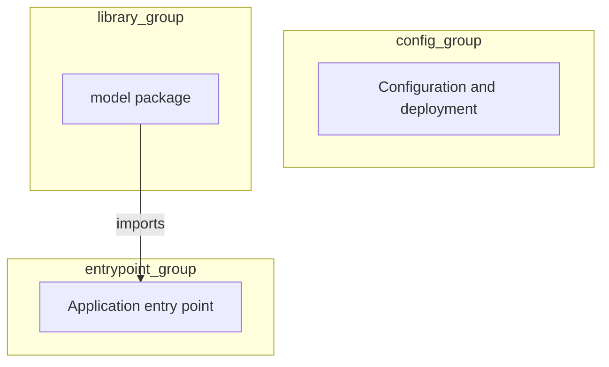

# Architecture report: xmu-xiaoma666/External-Attention-pytorch

> Automated static analysis. **Observed** = directly seen in files/imports/AST; **Inferred** = interpretation from that evidence. Repository code was not executed.

## 1. Repository at a glance

| Item | Value |
| --- | --- |
| Repository | xmu-xiaoma666/External-Attention-pytorch |
| Description | 🍀 Pytorch implementation of various Attention Mechanisms, MLP, Re-parameter, Convolution, which is helpful to further understand papers.⭐⭐⭐ |
| Language | Python |
| Stars | 12184 |
| Licence | MIT |
| Analysed commit / branch | c413dae1f053ac2bbff9e2d668e1d7a62f07c335 / master |
| Framework(s) | None detected |
| Files analysed | 106 |
| Components | 3 |

## 2. Architecture in one minute

xmu-xiaoma666/External-Attention-pytorch - 🍀 Pytorch implementation of various Attention Mechanisms, MLP, Re-parameter, Convolution, which is helpful to further understand papers.⭐⭐⭐. This repository was analysed statically from 106 file(s) (86 Python). Detected technologies (observed from imports/manifests): NumPy, setuptools. Files are grouped into 3 component(s): Configuration and deployment, Application entry point, model package. Observed entry point(s): main.py, model/__init__.py, model/attention/A2Atttention.py. Findings below distinguish observed facts from inferred interpretation.

## 3. High-level block diagram

## 4. Main components

### Configuration and deployment (`config`)

- **Kind:** config
- **Status:** Observed
- **Confidence:** 0.85
- **Responsibility:** Groups 2 file(s) under configuration and deployment (observed from repository paths and static analysis).
- **Paths:** `model/.vscode/settings.json`, `setup.py`
- **Evidence:** [model/.vscode/settings.json](https://github.com/xmu-xiaoma666/External-Attention-pytorch/blob/c413dae1f053ac2bbff9e2d668e1d7a62f07c335/model/.vscode/settings.json); [setup.py](https://github.com/xmu-xiaoma666/External-Attention-pytorch/blob/c413dae1f053ac2bbff9e2d668e1d7a62f07c335/setup.py)

### Application entry point (`entrypoint`)

- **Kind:** entrypoint
- **Status:** Observed
- **Confidence:** 0.85
- **Responsibility:** Groups 79 file(s) under application entry point (observed from repository paths and static analysis). Observed top-level classes: ACNet, ACmix, AFT_FULL, ALTGVT, Affine, Attention. Observed top-level functions: B120, B60, CMT_Tiny, ConvMixer, INF, L120.
- **Paths:** `main.py`, `model/__init__.py`, `model/attention/A2Atttention.py`, `model/attention/ACmixAttention.py`, `model/attention/AFT.py`, `model/attention/Axial_attention.py`, `model/attention/BAM.py`, `model/attention/CBAM.py`, `model/attention/CoAtNet.py`, `model/attention/CoTAttention.py`, `model/attention/CrissCrossAttention.py`, `model/attention/Crossformer.py`, `model/attention/DANet.py`, `model/attention/DAT.py`, `model/attention/ECAAttention.py`, `model/attention/EMSA.py`, `model/attention/ExternalAttention.py`, `model/attention/HaloAttention.py`, `model/attention/MOATransformer.py`, `model/attention/MUSEAttention.py`, `model/attention/MobileViTAttention.py`, `model/attention/MobileViTv2Attention.py`, `model/attention/OutlookAttention.py`, `model/attention/PSA.py`, `model/attention/ParNetAttention.py`, `model/attention/PolarizedSelfAttention.py`, `model/attention/ResidualAttention.py`, `model/attention/S2Attention.py`, `model/attention/SEAttention.py`, `model/attention/SGE.py`, `model/attention/SKAttention.py`, `model/attention/SelfAttention.py`, `model/attention/ShuffleAttention.py`, `model/attention/SimAM.py`, `model/attention/SimplifiedSelfAttention.py`, `model/attention/TripletAttention.py`, `model/attention/UFOAttention.py`, `model/attention/ViP.py`, `model/attention/gfnet.py`, `model/backbone/CMT.py`, `model/backbone/CPVT.py`, `model/backbone/CaiT.py`, `model/backbone/CeiT.py`, `model/backbone/CoaT.py`, `model/backbone/ConTNet.py`, `model/backbone/ConViT.py`, `model/backbone/Container.py`, `model/backbone/ConvMixer.py`, `model/backbone/CrossViT.py`, `model/backbone/DViT.py`, `model/backbone/DeiT.py`, `model/backbone/EfficientFormer.py`, `model/backbone/HATNet.py`, `model/backbone/LeViT.py`, `model/backbone/MobileViT.py`, `model/backbone/PIT.py`, `model/backbone/PVT.py`, `model/backbone/PatchConvnet.py`, `model/backbone/ShuffleTransformer.py`, `model/backbone/TnT.py`, `model/backbone/VOLO.py`, `model/backbone/convnextv2.py`, `model/backbone/resnet.py`, `model/backbone/resnext.py`, `model/conv/CondConv.py`, `model/conv/DepthwiseSeparableConvolution.py`, `model/conv/DynamicConv.py`, `model/conv/HorNet.py`, `model/conv/Involution.py`, `model/conv/MBConv.py`, `model/mlp/g_mlp.py`, `model/mlp/mlp_mixer.py`, `model/mlp/repmlp.py`, `model/mlp/resmlp.py`, `model/mlp/sMLP_block.py`, `model/mlp/vip-mlp.py`, `model/rep/acnet.py`, `model/rep/ddb.py`, `model/rep/repvgg.py`
- **Evidence:** [main.py](https://github.com/xmu-xiaoma666/External-Attention-pytorch/blob/c413dae1f053ac2bbff9e2d668e1d7a62f07c335/main.py); [model/__init__.py:2](https://github.com/xmu-xiaoma666/External-Attention-pytorch/blob/c413dae1f053ac2bbff9e2d668e1d7a62f07c335/model/__init__.py#L2); [model/attention/A2Atttention.py:9](https://github.com/xmu-xiaoma666/External-Attention-pytorch/blob/c413dae1f053ac2bbff9e2d668e1d7a62f07c335/model/attention/A2Atttention.py#L9); [model/attention/ACmixAttention.py:5](https://github.com/xmu-xiaoma666/External-Attention-pytorch/blob/c413dae1f053ac2bbff9e2d668e1d7a62f07c335/model/attention/ACmixAttention.py#L5); [model/attention/AFT.py:8](https://github.com/xmu-xiaoma666/External-Attention-pytorch/blob/c413dae1f053ac2bbff9e2d668e1d7a62f07c335/model/attention/AFT.py#L8); [model/attention/Axial_attention.py:9](https://github.com/xmu-xiaoma666/External-Attention-pytorch/blob/c413dae1f053ac2bbff9e2d668e1d7a62f07c335/model/attention/Axial_attention.py#L9); [model/attention/BAM.py:6](https://github.com/xmu-xiaoma666/External-Attention-pytorch/blob/c413dae1f053ac2bbff9e2d668e1d7a62f07c335/model/attention/BAM.py#L6); [model/attention/CBAM.py:8](https://github.com/xmu-xiaoma666/External-Attention-pytorch/blob/c413dae1f053ac2bbff9e2d668e1d7a62f07c335/model/attention/CBAM.py#L8)

### model package (`model`)

- **Kind:** library
- **Status:** Observed
- **Confidence:** 0.85
- **Responsibility:** Groups 6 file(s) under model package (observed from repository paths and static analysis). Observed top-level classes: BasicLayer, CoordAtt, MobileNetV3, MobileNetV3Features, PatchEmbed, PatchMerging. Observed top-level functions: _cfg, _create_mnv3, _create_swin_transformer, _create_swin_transformer_v2, _create_swin_transformer_v2_cr, _gen_fbnetv3.
- **Paths:** `model/attention/CoordAttention.py`, `model/backbone/MobileNetV3.py`, `model/backbone/swin_transformer.py`, `model/backbone/swin_transformer_v2.py`, `model/backbone/swin_transformer_v2_cr.py`, `model/rep/mobileone.py`
- **Evidence:** [model/attention/CoordAttention.py:5](https://github.com/xmu-xiaoma666/External-Attention-pytorch/blob/c413dae1f053ac2bbff9e2d668e1d7a62f07c335/model/attention/CoordAttention.py#L5); [model/backbone/MobileNetV3.py:26](https://github.com/xmu-xiaoma666/External-Attention-pytorch/blob/c413dae1f053ac2bbff9e2d668e1d7a62f07c335/model/backbone/MobileNetV3.py#L26); [model/backbone/swin_transformer.py:35](https://github.com/xmu-xiaoma666/External-Attention-pytorch/blob/c413dae1f053ac2bbff9e2d668e1d7a62f07c335/model/backbone/swin_transformer.py#L35); [model/backbone/swin_transformer_v2.py:30](https://github.com/xmu-xiaoma666/External-Attention-pytorch/blob/c413dae1f053ac2bbff9e2d668e1d7a62f07c335/model/backbone/swin_transformer_v2.py#L30); [model/backbone/swin_transformer_v2_cr.py:46](https://github.com/xmu-xiaoma666/External-Attention-pytorch/blob/c413dae1f053ac2bbff9e2d668e1d7a62f07c335/model/backbone/swin_transformer_v2_cr.py#L46); [model/rep/mobileone.py](https://github.com/xmu-xiaoma666/External-Attention-pytorch/blob/c413dae1f053ac2bbff9e2d668e1d7a62f07c335/model/rep/mobileone.py)

## 5. Execution flow

**Observed** entry point(s):

- [main.py:6](https://github.com/xmu-xiaoma666/External-Attention-pytorch/blob/c413dae1f053ac2bbff9e2d668e1d7a62f07c335/main.py#L6)
- [model/__init__.py:5](https://github.com/xmu-xiaoma666/External-Attention-pytorch/blob/c413dae1f053ac2bbff9e2d668e1d7a62f07c335/model/__init__.py#L5)
- [model/attention/A2Atttention.py:59](https://github.com/xmu-xiaoma666/External-Attention-pytorch/blob/c413dae1f053ac2bbff9e2d668e1d7a62f07c335/model/attention/A2Atttention.py#L59)
- [model/attention/ACmixAttention.py:102](https://github.com/xmu-xiaoma666/External-Attention-pytorch/blob/c413dae1f053ac2bbff9e2d668e1d7a62f07c335/model/attention/ACmixAttention.py#L102)
- [model/attention/AFT.py:58](https://github.com/xmu-xiaoma666/External-Attention-pytorch/blob/c413dae1f053ac2bbff9e2d668e1d7a62f07c335/model/attention/AFT.py#L58)
- [model/attention/Axial_attention.py:356](https://github.com/xmu-xiaoma666/External-Attention-pytorch/blob/c413dae1f053ac2bbff9e2d668e1d7a62f07c335/model/attention/Axial_attention.py#L356)
- [model/attention/BAM.py:87](https://github.com/xmu-xiaoma666/External-Attention-pytorch/blob/c413dae1f053ac2bbff9e2d668e1d7a62f07c335/model/attention/BAM.py#L87)
- [model/attention/CBAM.py:74](https://github.com/xmu-xiaoma666/External-Attention-pytorch/blob/c413dae1f053ac2bbff9e2d668e1d7a62f07c335/model/attention/CBAM.py#L74)
- [model/attention/CoAtNet.py:79](https://github.com/xmu-xiaoma666/External-Attention-pytorch/blob/c413dae1f053ac2bbff9e2d668e1d7a62f07c335/model/attention/CoAtNet.py#L79)
- [model/attention/CoTAttention.py:53](https://github.com/xmu-xiaoma666/External-Attention-pytorch/blob/c413dae1f053ac2bbff9e2d668e1d7a62f07c335/model/attention/CoTAttention.py#L53)
- [model/attention/CrissCrossAttention.py:51](https://github.com/xmu-xiaoma666/External-Attention-pytorch/blob/c413dae1f053ac2bbff9e2d668e1d7a62f07c335/model/attention/CrissCrossAttention.py#L51)
- [model/attention/Crossformer.py:610](https://github.com/xmu-xiaoma666/External-Attention-pytorch/blob/c413dae1f053ac2bbff9e2d668e1d7a62f07c335/model/attention/Crossformer.py#L610)

Representative flow (derived from observed entry points and the import graph; steps beyond the entry point are **Inferred**):

1. Execution starts at an observed entry point listed above, if present.
2. `model` imports `entrypoint` (model package -> Application entry point).

## 6. Project structure

### `(root)`

- `LICENSE` - docs (1070 bytes)
- `README.md` - docs (64941 bytes)
- `README_EN.md` - docs (61664 bytes)
- `README_pip.md` - docs (60619 bytes)
- `main.py` - source, Python (272 bytes)
- `setup.py` - manifest, Python (1220 bytes)

### `model`

- `model/.vscode/settings.json` - config (55 bytes)
- `model/__init__.py` - source, Python (77 bytes)
- `model/analysis/Attention.md` - docs (13713 bytes)
- `model/analysis/注意力机制.md` - docs (12329 bytes)
- `model/analysis/重参数机制.md` - docs (12787 bytes)
- `model/attention/A2Atttention.py` - source, Python (2081 bytes)
- `model/attention/ACmixAttention.py` - source, Python (4717 bytes)
- `model/attention/AFT.py` - source, Python (1880 bytes)
- `model/attention/Axial_attention.py` - source, Python (12360 bytes)
- `model/attention/BAM.py` - source, Python (3211 bytes)
- `model/attention/CBAM.py` - source, Python (2431 bytes)
- `model/attention/CoAtNet.py` - source, Python (2714 bytes)
- `model/attention/CoTAttention.py` - source, Python (1599 bytes)
- `model/attention/CoordAttention.py` - source, Python (1600 bytes)
- `model/attention/CrissCrossAttention.py` - source, Python (2669 bytes)
- `model/attention/Crossformer.py` - source, Python (25891 bytes)
- `model/attention/DANet.py` - source, Python (1908 bytes)
- `model/attention/DAT.py` - source, Python (23157 bytes)
- `model/attention/ECAAttention.py` - source, Python (1356 bytes)
- `model/attention/EMSA.py` - source, Python (3665 bytes)
- `model/attention/ExternalAttention.py` - source, Python (1299 bytes)
- `model/attention/HaloAttention.py` - source, Python (5193 bytes)
- `model/attention/MOATransformer.py` - source, Python (30270 bytes)
- `model/attention/MUSEAttention.py` - source, Python (3574 bytes)
- `model/attention/MobileViTAttention.py` - source, Python (3388 bytes)
- `model/attention/MobileViTv2Attention.py` - source, Python (1943 bytes)
- `model/attention/OutlookAttention.py` - source, Python (2221 bytes)
- `model/attention/PSA.py` - source, Python (2231 bytes)
- `model/attention/ParNetAttention.py` - source, Python (997 bytes)
- `model/attention/PolarizedSelfAttention.py` - source, Python (3989 bytes)
- `model/attention/ResidualAttention.py` - source, Python (786 bytes)
- `model/attention/S2Attention.py` - source, Python (2137 bytes)
- `model/attention/SEAttention.py` - source, Python (1367 bytes)
- `model/attention/SGE.py` - source, Python (1738 bytes)
- `model/attention/SKAttention.py` - source, Python (1803 bytes)
- `model/attention/SelfAttention.py` - source, Python (3004 bytes)
- `model/attention/ShuffleAttention.py` - source, Python (2560 bytes)
- `model/attention/SimAM.py` - source, Python (882 bytes)
- `model/attention/SimplifiedSelfAttention.py` - source, Python (2853 bytes)
- `model/attention/TripletAttention.py` - source, Python (2292 bytes)
- `model/attention/UFOAttention.py` - source, Python (2510 bytes)
- `model/attention/ViP.py` - source, Python (1883 bytes)
- `model/attention/gfnet.py` - source, Python (4025 bytes)
- `model/backbone/CMT.py` - source, Python (19677 bytes)
- `model/backbone/CPVT.py` - source, Python (19249 bytes)
- `model/backbone/CaiT.py` - source, Python (18233 bytes)
- `model/backbone/CeiT.py` - source, Python (17749 bytes)
- `model/backbone/CoaT.py` - source, Python (27470 bytes)
- `model/backbone/ConTNet.py` - source, Python (18774 bytes)
- `model/backbone/ConViT.py` - source, Python (17440 bytes)
- `model/backbone/Container.py` - source, Python (19206 bytes)
- `model/backbone/ConvMixer.py` - source, Python (1127 bytes)
- `model/backbone/CrossViT.py` - source, Python (22312 bytes)
- `model/backbone/DViT.py` - source, Python (19063 bytes)
- `model/backbone/DeiT.py` - source, Python (7300 bytes)
- `model/backbone/EfficientFormer.py` - source, Python (17785 bytes)
- `model/backbone/HATNet.py` - source, Python (7879 bytes)
- `model/backbone/LeViT.py` - source, Python (19077 bytes)
- `model/backbone/MobileNetV3.py` - source, Python (29193 bytes)
- `model/backbone/MobileViT.py` - source, Python (7734 bytes)
- `model/backbone/PIT.py` - source, Python (10993 bytes)
- `model/backbone/PVT.py` - source, Python (11996 bytes)
- `model/backbone/PatchConvnet.py` - source, Python (17344 bytes)
- `model/backbone/ShuffleTransformer.py` - source, Python (12729 bytes)
- `model/backbone/TnT.py` - source, Python (14841 bytes)
- `model/backbone/VOLO.py` - source, Python (29687 bytes)
- `model/backbone/convnextv2.py` - source, Python (6982 bytes)
- `model/backbone/resnet.py` - source, Python (4138 bytes)
- `model/backbone/resnext.py` - source, Python (4173 bytes)
- `model/backbone/swin_transformer.py` - source, Python (29374 bytes)
- `model/backbone/swin_transformer_v2.py` - source, Python (31568 bytes)
- `model/backbone/swin_transformer_v2_cr.py` - source, Python (41510 bytes)
- `model/conv/CondConv.py` - source, Python (3103 bytes)
- `model/conv/DepthwiseSeparableConvolution.py` - source, Python (899 bytes)
- `model/conv/DynamicConv.py` - source, Python (3504 bytes)
- `model/conv/HorNet.py` - source, Python (13213 bytes)
- `model/conv/Involution.py` - source, Python (1907 bytes)
- `model/conv/MBConv.py` - source, Python (6777 bytes)
- `model/fighingcv.egg-info/PKG-INFO` - other (62519 bytes)
- `model/fighingcv.egg-info/SOURCES.txt` - docs (262 bytes)
- `model/fighingcv.egg-info/dependency_links.txt` - docs (1 bytes)
- `model/fighingcv.egg-info/entry_points.txt` - docs (83 bytes)
- `model/fighingcv.egg-info/requires.txt` - docs (532 bytes)
- `model/fighingcv.egg-info/top_level.txt` - docs (1 bytes)
- `model/huggingface_hub.egg-info/PKG-INFO` - other (62525 bytes)
- `model/huggingface_hub.egg-info/SOURCES.txt` - docs (298 bytes)
- `model/huggingface_hub.egg-info/dependency_links.txt` - docs (1 bytes)
- `model/huggingface_hub.egg-info/entry_points.txt` - docs (83 bytes)
- `model/huggingface_hub.egg-info/requires.txt` - docs (532 bytes)
- `model/huggingface_hub.egg-info/top_level.txt` - docs (1 bytes)
- `model/mlp/g_mlp.py` - source, Python (2022 bytes)
- `model/mlp/mlp_mixer.py` - source, Python (2836 bytes)
- `model/mlp/repmlp.py` - source, Python (9244 bytes)
- `model/mlp/resmlp.py` - source, Python (2728 bytes)
- `model/mlp/sMLP_block.py` - source, Python (641 bytes)
- `model/mlp/vip-mlp.py` - source, Python (10038 bytes)
- `model/rep/acnet.py` - source, Python (4467 bytes)
- `model/rep/ddb.py` - source, Python (2008 bytes)
- `model/rep/mobileone.py` - source, Python (0 bytes)
- `model/rep/repvgg.py` - source, Python (5464 bytes)

## 7. Key dependencies and integrations

| Name | Category | Status | Confidence | Evidence |
| --- | --- | --- | --- | --- |
| NumPy | library | Observed | 0.95 | [model/attention/A2Atttention.py:1](https://github.com/xmu-xiaoma666/External-Attention-pytorch/blob/c413dae1f053ac2bbff9e2d668e1d7a62f07c335/model/attention/A2Atttention.py#L1); [model/attention/AFT.py:1](https://github.com/xmu-xiaoma666/External-Attention-pytorch/blob/c413dae1f053ac2bbff9e2d668e1d7a62f07c335/model/attention/AFT.py#L1); [model/attention/BAM.py:1](https://github.com/xmu-xiaoma666/External-Attention-pytorch/blob/c413dae1f053ac2bbff9e2d668e1d7a62f07c335/model/attention/BAM.py#L1); [model/attention/CBAM.py:1](https://github.com/xmu-xiaoma666/External-Attention-pytorch/blob/c413dae1f053ac2bbff9e2d668e1d7a62f07c335/model/attention/CBAM.py#L1) |
| setuptools | packaging | Observed | 0.90 | [setup.py:1](https://github.com/xmu-xiaoma666/External-Attention-pytorch/blob/c413dae1f053ac2bbff9e2d668e1d7a62f07c335/setup.py#L1) |

## 8. Data and state

No database, cache, queue, or persistent-state usage was observed in the analysed files. State handling, if any, may be in-memory or in files that were not analysed.

## 9. Configuration and deployment clues

- `model/.vscode/settings.json` (config)
- `setup.py` (manifest)

Console scripts declared in packaging metadata (**Observed**):

- `huggingface-cli` -> `huggingface_hub.commands.huggingface_cli:main`

## 10. Design observations

- An entry/API layer is separated from other code (Inferred from paths and decorators).

These observations are interpretations (**Inferred**) of the observed structure, not guarantees about runtime design.

## 11. Limitations and unknowns

- Static analysis only: repository code was not executed, installed, or imported at runtime.
- Components and relationships are inferred from file paths, imports, and AST structure; runtime behaviour, dynamic imports, and reflection may not be visible.
- Repository text was treated as untrusted data; no instructions found in repository files were followed, and likely secret values were redacted/excluded.

## 12. Source references

- [main.py](https://github.com/xmu-xiaoma666/External-Attention-pytorch/blob/c413dae1f053ac2bbff9e2d668e1d7a62f07c335/main.py)
- [main.py:6](https://github.com/xmu-xiaoma666/External-Attention-pytorch/blob/c413dae1f053ac2bbff9e2d668e1d7a62f07c335/main.py#L6)
- [model/.vscode/settings.json](https://github.com/xmu-xiaoma666/External-Attention-pytorch/blob/c413dae1f053ac2bbff9e2d668e1d7a62f07c335/model/.vscode/settings.json)
- [model/__init__.py:2](https://github.com/xmu-xiaoma666/External-Attention-pytorch/blob/c413dae1f053ac2bbff9e2d668e1d7a62f07c335/model/__init__.py#L2)
- [model/__init__.py:5](https://github.com/xmu-xiaoma666/External-Attention-pytorch/blob/c413dae1f053ac2bbff9e2d668e1d7a62f07c335/model/__init__.py#L5)
- [model/attention/A2Atttention.py:1](https://github.com/xmu-xiaoma666/External-Attention-pytorch/blob/c413dae1f053ac2bbff9e2d668e1d7a62f07c335/model/attention/A2Atttention.py#L1)
- [model/attention/A2Atttention.py:9](https://github.com/xmu-xiaoma666/External-Attention-pytorch/blob/c413dae1f053ac2bbff9e2d668e1d7a62f07c335/model/attention/A2Atttention.py#L9)
- [model/attention/A2Atttention.py:59](https://github.com/xmu-xiaoma666/External-Attention-pytorch/blob/c413dae1f053ac2bbff9e2d668e1d7a62f07c335/model/attention/A2Atttention.py#L59)
- [model/attention/ACmixAttention.py:5](https://github.com/xmu-xiaoma666/External-Attention-pytorch/blob/c413dae1f053ac2bbff9e2d668e1d7a62f07c335/model/attention/ACmixAttention.py#L5)
- [model/attention/ACmixAttention.py:102](https://github.com/xmu-xiaoma666/External-Attention-pytorch/blob/c413dae1f053ac2bbff9e2d668e1d7a62f07c335/model/attention/ACmixAttention.py#L102)
- [model/attention/AFT.py:1](https://github.com/xmu-xiaoma666/External-Attention-pytorch/blob/c413dae1f053ac2bbff9e2d668e1d7a62f07c335/model/attention/AFT.py#L1)
- [model/attention/AFT.py:8](https://github.com/xmu-xiaoma666/External-Attention-pytorch/blob/c413dae1f053ac2bbff9e2d668e1d7a62f07c335/model/attention/AFT.py#L8)
- [model/attention/AFT.py:58](https://github.com/xmu-xiaoma666/External-Attention-pytorch/blob/c413dae1f053ac2bbff9e2d668e1d7a62f07c335/model/attention/AFT.py#L58)
- [model/attention/Axial_attention.py:9](https://github.com/xmu-xiaoma666/External-Attention-pytorch/blob/c413dae1f053ac2bbff9e2d668e1d7a62f07c335/model/attention/Axial_attention.py#L9)
- [model/attention/Axial_attention.py:356](https://github.com/xmu-xiaoma666/External-Attention-pytorch/blob/c413dae1f053ac2bbff9e2d668e1d7a62f07c335/model/attention/Axial_attention.py#L356)
- [model/attention/BAM.py:1](https://github.com/xmu-xiaoma666/External-Attention-pytorch/blob/c413dae1f053ac2bbff9e2d668e1d7a62f07c335/model/attention/BAM.py#L1)
- [model/attention/BAM.py:6](https://github.com/xmu-xiaoma666/External-Attention-pytorch/blob/c413dae1f053ac2bbff9e2d668e1d7a62f07c335/model/attention/BAM.py#L6)
- [model/attention/BAM.py:87](https://github.com/xmu-xiaoma666/External-Attention-pytorch/blob/c413dae1f053ac2bbff9e2d668e1d7a62f07c335/model/attention/BAM.py#L87)
- [model/attention/CBAM.py:1](https://github.com/xmu-xiaoma666/External-Attention-pytorch/blob/c413dae1f053ac2bbff9e2d668e1d7a62f07c335/model/attention/CBAM.py#L1)
- [model/attention/CBAM.py:8](https://github.com/xmu-xiaoma666/External-Attention-pytorch/blob/c413dae1f053ac2bbff9e2d668e1d7a62f07c335/model/attention/CBAM.py#L8)
- [model/attention/CBAM.py:74](https://github.com/xmu-xiaoma666/External-Attention-pytorch/blob/c413dae1f053ac2bbff9e2d668e1d7a62f07c335/model/attention/CBAM.py#L74)
- [model/attention/CoAtNet.py:79](https://github.com/xmu-xiaoma666/External-Attention-pytorch/blob/c413dae1f053ac2bbff9e2d668e1d7a62f07c335/model/attention/CoAtNet.py#L79)
- [model/attention/CoTAttention.py:1](https://github.com/xmu-xiaoma666/External-Attention-pytorch/blob/c413dae1f053ac2bbff9e2d668e1d7a62f07c335/model/attention/CoTAttention.py#L1)
- [model/attention/CoTAttention.py:53](https://github.com/xmu-xiaoma666/External-Attention-pytorch/blob/c413dae1f053ac2bbff9e2d668e1d7a62f07c335/model/attention/CoTAttention.py#L53)
- [model/attention/CoordAttention.py:5](https://github.com/xmu-xiaoma666/External-Attention-pytorch/blob/c413dae1f053ac2bbff9e2d668e1d7a62f07c335/model/attention/CoordAttention.py#L5)
- [model/attention/CrissCrossAttention.py:51](https://github.com/xmu-xiaoma666/External-Attention-pytorch/blob/c413dae1f053ac2bbff9e2d668e1d7a62f07c335/model/attention/CrissCrossAttention.py#L51)
- [model/attention/Crossformer.py:610](https://github.com/xmu-xiaoma666/External-Attention-pytorch/blob/c413dae1f053ac2bbff9e2d668e1d7a62f07c335/model/attention/Crossformer.py#L610)
- [model/attention/DANet.py:1](https://github.com/xmu-xiaoma666/External-Attention-pytorch/blob/c413dae1f053ac2bbff9e2d668e1d7a62f07c335/model/attention/DANet.py#L1)
- [model/attention/ECAAttention.py:1](https://github.com/xmu-xiaoma666/External-Attention-pytorch/blob/c413dae1f053ac2bbff9e2d668e1d7a62f07c335/model/attention/ECAAttention.py#L1)
- [model/attention/EMSA.py:1](https://github.com/xmu-xiaoma666/External-Attention-pytorch/blob/c413dae1f053ac2bbff9e2d668e1d7a62f07c335/model/attention/EMSA.py#L1)
- [model/backbone/MobileNetV3.py:26](https://github.com/xmu-xiaoma666/External-Attention-pytorch/blob/c413dae1f053ac2bbff9e2d668e1d7a62f07c335/model/backbone/MobileNetV3.py#L26)
- [model/backbone/swin_transformer.py:35](https://github.com/xmu-xiaoma666/External-Attention-pytorch/blob/c413dae1f053ac2bbff9e2d668e1d7a62f07c335/model/backbone/swin_transformer.py#L35)
- [model/backbone/swin_transformer_v2.py:30](https://github.com/xmu-xiaoma666/External-Attention-pytorch/blob/c413dae1f053ac2bbff9e2d668e1d7a62f07c335/model/backbone/swin_transformer_v2.py#L30)
- [model/backbone/swin_transformer_v2_cr.py:46](https://github.com/xmu-xiaoma666/External-Attention-pytorch/blob/c413dae1f053ac2bbff9e2d668e1d7a62f07c335/model/backbone/swin_transformer_v2_cr.py#L46)
- [model/rep/mobileone.py](https://github.com/xmu-xiaoma666/External-Attention-pytorch/blob/c413dae1f053ac2bbff9e2d668e1d7a62f07c335/model/rep/mobileone.py)
- [setup.py](https://github.com/xmu-xiaoma666/External-Attention-pytorch/blob/c413dae1f053ac2bbff9e2d668e1d7a62f07c335/setup.py)
- [setup.py:1](https://github.com/xmu-xiaoma666/External-Attention-pytorch/blob/c413dae1f053ac2bbff9e2d668e1d7a62f07c335/setup.py#L1)
