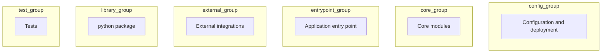

# Architecture report: ycm-core/YouCompleteMe

> Automated static analysis. **Observed** = directly seen in files/imports/AST; **Inferred** = interpretation from that evidence. Repository code was not executed.

## 1. Repository at a glance

| Item | Value |
| --- | --- |
| Repository | ycm-core/YouCompleteMe |
| Description | A code-completion engine for Vim |
| Language | Python |
| Stars | 25875 |
| Licence | GPL-3.0 |
| Analysed commit / branch | d4c91430b70a21ce471c8572400b647d313995b4 / master |
| Framework(s) | None detected |
| Files analysed | 140 |
| Components | 6 |

## 2. Architecture in one minute

ycm-core/YouCompleteMe - A code-completion engine for Vim. This repository was analysed statically from 140 file(s) (61 Python). Detected technologies (observed from imports/manifests): GitHub Actions, Docker, unittest. Files are grouped into 6 component(s): Configuration and deployment, Core modules, Application entry point, External integrations, python package, Tests. Observed entry point(s): install.py, run_tests.py. Findings below distinguish observed facts from inferred interpretation.

## 3. High-level block diagram

## 4. Main components

### Configuration and deployment (`config`)

- **Kind:** config
- **Status:** Observed
- **Confidence:** 0.85
- **Responsibility:** Groups 4 file(s) under configuration and deployment (observed from repository paths and static analysis).
- **Paths:** `codecov.yml`, `test/docker/ci/image/Dockerfile`, `test/docker/manual/image/Dockerfile`, `tox.ini`
- **Evidence:** [codecov.yml](https://github.com/ycm-core/YouCompleteMe/blob/d4c91430b70a21ce471c8572400b647d313995b4/codecov.yml); [test/docker/ci/image/Dockerfile](https://github.com/ycm-core/YouCompleteMe/blob/d4c91430b70a21ce471c8572400b647d313995b4/test/docker/ci/image/Dockerfile); [test/docker/manual/image/Dockerfile](https://github.com/ycm-core/YouCompleteMe/blob/d4c91430b70a21ce471c8572400b647d313995b4/test/docker/manual/image/Dockerfile); [tox.ini](https://github.com/ycm-core/YouCompleteMe/blob/d4c91430b70a21ce471c8572400b647d313995b4/tox.ini)

### Core modules (`core`)

- **Kind:** core
- **Status:** Observed
- **Confidence:** 0.85
- **Responsibility:** Groups 2 file(s) under core modules (observed from repository paths and static analysis).
- **Paths:** `install.sh`, `print_todos.sh`
- **Evidence:** [install.sh](https://github.com/ycm-core/YouCompleteMe/blob/d4c91430b70a21ce471c8572400b647d313995b4/install.sh); [print_todos.sh](https://github.com/ycm-core/YouCompleteMe/blob/d4c91430b70a21ce471c8572400b647d313995b4/print_todos.sh)

### Application entry point (`entrypoint`)

- **Kind:** entrypoint
- **Status:** Observed
- **Confidence:** 0.85
- **Responsibility:** Groups 1 file(s) under application entry point (observed from repository paths and static analysis). Observed top-level functions: CheckCall, Main.
- **Paths:** `install.py`
- **Evidence:** [install.py:23](https://github.com/ycm-core/YouCompleteMe/blob/d4c91430b70a21ce471c8572400b647d313995b4/install.py#L23)

### External integrations (`external_integrations`)

- **Kind:** external
- **Status:** Observed
- **Confidence:** 0.85
- **Responsibility:** Groups 15 file(s) under external integrations (observed from repository paths and static analysis). Observed top-level classes: BaseRequest, CommandRequest, CompleterAvailableRequest, CompletionRequest, DebugInfoRequest, EventNotification. Observed top-level functions: BuildRequestData, BuildRequestDataForLocation, ConvertCompletionDataToVimData, DisplayServerException, FormatDebugInfoResponse, GetCommandResponse.
- **Paths:** `python/ycm/client/__init__.py`, `python/ycm/client/base_request.py`, `python/ycm/client/command_request.py`, `python/ycm/client/completer_available_request.py`, `python/ycm/client/completion_request.py`, `python/ycm/client/debug_info_request.py`, `python/ycm/client/event_notification.py`, `python/ycm/client/inlay_hints_request.py`, `python/ycm/client/messages_request.py`, `python/ycm/client/omni_completion_request.py`, `python/ycm/client/resolve_completion_request.py`, `python/ycm/client/semantic_tokens_request.py`, `python/ycm/client/shutdown_request.py`, `python/ycm/client/signature_help_request.py`, `python/ycm/client/ycmd_keepalive.py`
- **Evidence:** [python/ycm/client/__init__.py](https://github.com/ycm-core/YouCompleteMe/blob/d4c91430b70a21ce471c8572400b647d313995b4/python/ycm/client/__init__.py); [python/ycm/client/base_request.py:41](https://github.com/ycm-core/YouCompleteMe/blob/d4c91430b70a21ce471c8572400b647d313995b4/python/ycm/client/base_request.py#L41); [python/ycm/client/command_request.py:26](https://github.com/ycm-core/YouCompleteMe/blob/d4c91430b70a21ce471c8572400b647d313995b4/python/ycm/client/command_request.py#L26); [python/ycm/client/completer_available_request.py:21](https://github.com/ycm-core/YouCompleteMe/blob/d4c91430b70a21ce471c8572400b647d313995b4/python/ycm/client/completer_available_request.py#L21); [python/ycm/client/completion_request.py:30](https://github.com/ycm-core/YouCompleteMe/blob/d4c91430b70a21ce471c8572400b647d313995b4/python/ycm/client/completion_request.py#L30); [python/ycm/client/debug_info_request.py:21](https://github.com/ycm-core/YouCompleteMe/blob/d4c91430b70a21ce471c8572400b647d313995b4/python/ycm/client/debug_info_request.py#L21); [python/ycm/client/event_notification.py:21](https://github.com/ycm-core/YouCompleteMe/blob/d4c91430b70a21ce471c8572400b647d313995b4/python/ycm/client/event_notification.py#L21); [python/ycm/client/inlay_hints_request.py:28](https://github.com/ycm-core/YouCompleteMe/blob/d4c91430b70a21ce471c8572400b647d313995b4/python/ycm/client/inlay_hints_request.py#L28)

### python package (`python`)

- **Kind:** library
- **Status:** Observed
- **Confidence:** 0.85
- **Responsibility:** Groups 17 file(s) under python package (observed from repository paths and static analysis). Observed top-level classes: Buffer, BufferDict, DiagnosticFilter, DiagnosticInterface, DiagnosticProperty, HierarchyNode. Observed top-level functions: AddTextProperty, AddTextPropertyType, AdjustCandidateInsertionText, AllOpenedFiletypes, AutoCloseOnCurrentBuffer, BufferIsUsable.
- **Paths:** `python/ycm/__init__.py`, `python/ycm/base.py`, `python/ycm/buffer.py`, `python/ycm/diagnostic_filter.py`, `python/ycm/diagnostic_interface.py`, `python/ycm/hierarchy_tree.py`, `python/ycm/inlay_hints.py`, `python/ycm/omni_completer.py`, `python/ycm/paths.py`, `python/ycm/scrolling_range.py`, `python/ycm/semantic_highlighting.py`, `python/ycm/signature_help.py`, `python/ycm/syntax_parse.py`, `python/ycm/text_properties.py`, `python/ycm/unsafe_thread_pool_executor.py`, `python/ycm/vimsupport.py`, `python/ycm/youcompleteme.py`
- **Evidence:** [python/ycm/__init__.py](https://github.com/ycm-core/YouCompleteMe/blob/d4c91430b70a21ce471c8572400b647d313995b4/python/ycm/__init__.py); [python/ycm/base.py:27](https://github.com/ycm-core/YouCompleteMe/blob/d4c91430b70a21ce471c8572400b647d313995b4/python/ycm/base.py#L27); [python/ycm/buffer.py:29](https://github.com/ycm-core/YouCompleteMe/blob/d4c91430b70a21ce471c8572400b647d313995b4/python/ycm/buffer.py#L29); [python/ycm/diagnostic_filter.py:21](https://github.com/ycm-core/YouCompleteMe/blob/d4c91430b70a21ce471c8572400b647d313995b4/python/ycm/diagnostic_filter.py#L21); [python/ycm/diagnostic_interface.py:26](https://github.com/ycm-core/YouCompleteMe/blob/d4c91430b70a21ce471c8572400b647d313995b4/python/ycm/diagnostic_interface.py#L26); [python/ycm/hierarchy_tree.py:23](https://github.com/ycm-core/YouCompleteMe/blob/d4c91430b70a21ce471c8572400b647d313995b4/python/ycm/hierarchy_tree.py#L23); [python/ycm/inlay_hints.py:34](https://github.com/ycm-core/YouCompleteMe/blob/d4c91430b70a21ce471c8572400b647d313995b4/python/ycm/inlay_hints.py#L34); [python/ycm/omni_completer.py:29](https://github.com/ycm-core/YouCompleteMe/blob/d4c91430b70a21ce471c8572400b647d313995b4/python/ycm/omni_completer.py#L29)

### Tests (`tests`)

- **Kind:** test
- **Status:** Observed
- **Confidence:** 0.85
- **Responsibility:** Groups 75 file(s) under tests (observed from repository paths and static analysis). Observed routes: PATCH ycm.client.base_request.GetCurrentDirectory, PATCH ycm.client.base_request.GetCurrentDirectory, PATCH ycm.vimsupport.VariableExists, PATCH ycm.vimsupport.SetFittingHeightForCurrentWindow, PATCH vim.command. Observed top-level classes: BaseRequestTest, BaseTest, CommandTest, CompletionTest, ConvertCompletionResponseToVimDatasTest, DebugInfoRequestTest. Observed top-level functions: AssertBuffersAreEqualAsBytes, BuildCompletion, BuildCompletionFixIt, BuildCompletionNamespace, BuildOmnicomp…
- **Paths:** `python/test_requirements.txt`, `python/ycm/tests/__init__.py`, `python/ycm/tests/base_test.py`, `python/ycm/tests/client/__init__.py`, `python/ycm/tests/client/base_request_test.py`, `python/ycm/tests/client/command_request_test.py`, `python/ycm/tests/client/completion_request_test.py`, `python/ycm/tests/client/debug_info_request_test.py`, `python/ycm/tests/client/messages_request_test.py`, `python/ycm/tests/client/omni_completion_request_test.py`, `python/ycm/tests/command_test.py`, `python/ycm/tests/completion_test.py`, `python/ycm/tests/diagnostic_filter_test.py`, `python/ycm/tests/diagnostic_interface_test.py`, `python/ycm/tests/event_notification_test.py`, `python/ycm/tests/mock_utils.py`, `python/ycm/tests/omni_completer_test.py`, `python/ycm/tests/paths_test.py`, `python/ycm/tests/postcomplete_test.py`, `python/ycm/tests/signature_help_test.py`, `python/ycm/tests/syntax_parse_test.py`, `python/ycm/tests/test_utils.py`, `python/ycm/tests/testdata/.ycm_extra_conf.py`, `python/ycm/tests/testdata/cpp_syntax`, `python/ycm/tests/testdata/java_syntax`, `python/ycm/tests/testdata/python_syntax`, `python/ycm/tests/testdata/uni¢od€/tags`, `python/ycm/tests/vimsupport_test.py`, `python/ycm/tests/youcompleteme_test.py`, `run_tests.py`, `test/.gitignore`, `test/.vimspector.json`, `test/Makefile`, `test/README.md`, `test/commands.test.vim`, `test/completion.common.vim`, `test/completion.test.vim`, `test/completion_info.test.vim`, `test/completion_noresolve.test.vim`, `test/diagnostics.test.vim`, `test/docker/ci/push`, `test/docker/ci/rebuild`, `test/docker/manual/image/.vim/vimrc`, `test/docker/manual/push`, `test/docker/manual/rebuild`, `test/docker/manual/run`, `test/docker/rebuild_all`, `test/filesize.test.vim`, `test/finder.test.vim`, `test/fixit.test.vim`, `test/hierarchies.test.vim`, `test/hover.test.vim`, `test/lib/autoload/youcompleteme/test/commands.vim`, `test/lib/autoload/youcompleteme/test/popup.vim`, `test/lib/autoload/youcompleteme/test/setup.vim`, `test/lib/plugin/completion.vim`, `test/lib/plugin/shared.vim`, `test/lib/plugin/util.vim`, `test/lib/run_test.vim`, `test/run_vim_tests`, `test/signature_help.test.vim`, `test/testdata/cpp/auto_include.cc`, `test/testdata/cpp/auto_include.h`, `test/testdata/cpp/auto_include_workaround.cc`, `test/testdata/cpp/complete_with_sig_help.cc`, `test/testdata/cpp/completion.cc`, `test/testdata/cpp/finder_test.cc`, `test/testdata/cpp/fixit.cpp`, `test/testdata/cpp/hierarchies.cc`, `test/testdata/diagnostics/foo.cpp`, `test/testdata/diagnostics/foo.xml`, `test/testdata/python/doc.py`, `test/testdata/python/test.py`, `test/testdata/vim/mixed_filetype.vim`, `test/vimrc`
- **Evidence:** [python/test_requirements.txt](https://github.com/ycm-core/YouCompleteMe/blob/d4c91430b70a21ce471c8572400b647d313995b4/python/test_requirements.txt); [python/ycm/tests/__init__.py:33](https://github.com/ycm-core/YouCompleteMe/blob/d4c91430b70a21ce471c8572400b647d313995b4/python/ycm/tests/__init__.py#L33); [python/ycm/tests/base_test.py:30](https://github.com/ycm-core/YouCompleteMe/blob/d4c91430b70a21ce471c8572400b647d313995b4/python/ycm/tests/base_test.py#L30); [python/ycm/tests/client/__init__.py](https://github.com/ycm-core/YouCompleteMe/blob/d4c91430b70a21ce471c8572400b647d313995b4/python/ycm/tests/client/__init__.py); [python/ycm/tests/client/base_request_test.py:27](https://github.com/ycm-core/YouCompleteMe/blob/d4c91430b70a21ce471c8572400b647d313995b4/python/ycm/tests/client/base_request_test.py#L27); [python/ycm/tests/client/command_request_test.py:28](https://github.com/ycm-core/YouCompleteMe/blob/d4c91430b70a21ce471c8572400b647d313995b4/python/ycm/tests/client/command_request_test.py#L28); [python/ycm/tests/client/completion_request_test.py:28](https://github.com/ycm-core/YouCompleteMe/blob/d4c91430b70a21ce471c8572400b647d313995b4/python/ycm/tests/client/completion_request_test.py#L28); [python/ycm/tests/client/debug_info_request_test.py:70](https://github.com/ycm-core/YouCompleteMe/blob/d4c91430b70a21ce471c8572400b647d313995b4/python/ycm/tests/client/debug_info_request_test.py#L70)

## 5. Execution flow

**Observed** entry point(s):

- [install.py:49](https://github.com/ycm-core/YouCompleteMe/blob/d4c91430b70a21ce471c8572400b647d313995b4/install.py#L49)
- [run_tests.py:115](https://github.com/ycm-core/YouCompleteMe/blob/d4c91430b70a21ce471c8572400b647d313995b4/run_tests.py#L115)

**Observed** routes (from decorators):

- `PATCH ycm.client.base_request.GetCurrentDirectory` -> `test_BuildRequestData_AddWorkingDir` in `python/ycm/tests/client/base_request_test.py:30`
- `PATCH ycm.client.base_request.GetCurrentDirectory` -> `test_BuildRequestData_AddWorkingDirWithFileName` in `python/ycm/tests/client/base_request_test.py:38`
- `PATCH ycm.vimsupport.VariableExists` -> `_CheckGoToList` in `python/ycm/tests/client/command_request_test.py:150`
- `PATCH ycm.vimsupport.SetFittingHeightForCurrentWindow` -> `_CheckGoToList` in `python/ycm/tests/client/command_request_test.py:150`
- `PATCH vim.command` -> `_CheckGoToList` in `python/ycm/tests/client/command_request_test.py:150`
- `PATCH vim.eval` -> `_CheckGoToList` in `python/ycm/tests/client/command_request_test.py:150`
- `PATCH ycm.client.messages_request.PostVimMessage` -> `test_HandlePollResponse_SingleMessage` in `python/ycm/tests/client/messages_request_test.py:48`
- `PATCH ycm.client.messages_request.PostVimMessage` -> `test_HandlePollResponse_MultipleMessages` in `python/ycm/tests/client/messages_request_test.py:60`
- `PATCH ycm.client.messages_request.PostVimMessage` -> `test_HandlePollResponse_MultipleMessagesAndDiagnostics` in `python/ycm/tests/client/messages_request_test.py:106`
- `PATCH ycm.vimsupport.PostVimMessage` -> `test_SendCompletionRequest_ResponseContainingError` in `python/ycm/tests/completion_test.py:97`
- `PATCH ycm.client.base_request._logger` -> `test_SendCompletionRequest_ErrorFromServer` in `python/ycm/tests/completion_test.py:151`
- `PATCH ycm.vimsupport.PostVimMessage` -> `test_SendCompletionRequest_ErrorFromServer` in `python/ycm/tests/completion_test.py:151`
- `PATCH ycm.client.base_request._logger` -> `test_ResolveCompletionRequest_Resolves` in `python/ycm/tests/completion_test.py:179`
- `PATCH ycm.vimsupport.PostVimMessage` -> `test_ResolveCompletionRequest_Resolves` in `python/ycm/tests/completion_test.py:179`
- `PATCH ycm.client.base_request._logger` -> `test_ResolveCompletionRequest_ResponseContainsErrors` in `python/ycm/tests/completion_test.py:275`
- `PATCH ycm.vimsupport.PostVimMessage` -> `test_ResolveCompletionRequest_ResponseContainsErrors` in `python/ycm/tests/completion_test.py:275`
- `PATCH ycm.vimsupport.PostVimMessage` -> `test_ResolveCompletionItem_NoUserData` in `python/ycm/tests/completion_test.py:372`
- `PATCH ycm.client.base_request._logger` -> `test_ResolveCompletionRequest_ServerError` in `python/ycm/tests/completion_test.py:427`
- `PATCH ycm.vimsupport.PostVimMessage` -> `test_ResolveCompletionRequest_ServerError` in `python/ycm/tests/completion_test.py:427`
- `PATCH ycm.vimsupport.PostVimMessage` -> `test_EventNotification_FileReadyToParse_NonDiagnostic_Error` in `python/ycm/tests/event_notification_test.py:202`
- `PATCH ycm.youcompleteme.YouCompleteMe._AddUltiSnipsDataIfNeeded` -> `test_EventNotification_FileReadyToParse_TagFiles_UnicodeWorkingDirectory` in `python/ycm/tests/event_notification_test.py:380`
- `PATCH ycm.youcompleteme.YouCompleteMe._AddUltiSnipsDataIfNeeded` -> `test_EventNotification_BufferVisit_BuildRequestForCurrentAndUnsavedBuffers` in `python/ycm/tests/event_notification_test.py:418`
- `PATCH ycm.vimsupport.CaptureVimCommand` -> `test_EventNotification_FileReadyToParse_SyntaxKeywords_SeedWithCache` in `python/ycm/tests/event_notification_test.py:527`
- `PATCH ycm.vimsupport.CaptureVimCommand` -> `test_EventNotification_FileReadyToParse_SyntaxKeywords_ClearCacheIfRestart` in `python/ycm/tests/event_notification_test.py:562`
- `PATCH ycm.vimsupport.CurrentFiletypes` -> `test_OnCompleteDone_DefaultFixIt` in `python/ycm/tests/postcomplete_test.py:134`
- `PATCH ycm.vimsupport.CurrentFiletypes` -> `test_OnCompleteDone_CsharpFixIt` in `python/ycm/tests/postcomplete_test.py:145`
- `PATCH ycm.vimsupport.CurrentFiletypes` -> `test_OnCompleteDone_NoFixItIfNotDone` in `python/ycm/tests/postcomplete_test.py:156`
- `PATCH ycm.vimsupport.CurrentFiletypes` -> `test_OnCompleteDone_NoFixItForOmnifunc` in `python/ycm/tests/postcomplete_test.py:167`
- `PATCH ycm.vimsupport.GetVariableValue` -> `test_GetExtraDataUserMayHaveCompleted_ReturnEmptyIfPendingMatches` in `python/ycm/tests/postcomplete_test.py:224`
- `PATCH ycm.vimsupport.GetVariableValue` -> `test_GetExtraDataUserMayHaveCompleted_ReturnMatchIfMatches` in `python/ycm/tests/postcomplete_test.py:265`
- `PATCH ycm.vimsupport.GetVariableValue` -> `test_GetExtraDataUserMayHaveCompleted_UseUserData0` in `python/ycm/tests/postcomplete_test.py:277`
- `PATCH ycm.vimsupport.GetVariableValue` -> `test_GetExtraDataUserMayHaveCompleted_UseUserData1` in `python/ycm/tests/postcomplete_test.py:296`
- `PATCH ycm.vimsupport.GetVariableValue` -> `test_GetExtraDataUserMayHaveCompleted_EmptyUserData` in `python/ycm/tests/postcomplete_test.py:312`
- `PATCH ycm.vimsupport.GetVariableValue` -> `test_PostCompleteCsharp_EmptyDoesntInsertNamespace` in `python/ycm/tests/postcomplete_test.py:325`
- `PATCH ycm.vimsupport.GetVariableValue` -> `test_PostCompleteCsharp_ExistingWithoutNamespaceDoesntInsertNamespace` in `python/ycm/tests/postcomplete_test.py:333`
- `PATCH ycm.vimsupport.GetVariableValue` -> `test_PostCompleteCsharp_ValueDoesInsertNamespace` in `python/ycm/tests/postcomplete_test.py:343`
- `PATCH ycm.vimsupport.GetVariableValue` -> `test_PostCompleteCsharp_InsertSecondNamespaceIfSelected` in `python/ycm/tests/postcomplete_test.py:354`
- `PATCH ycm.vimsupport.PresentDialog` -> `test_PostCompleteCsharp_InsertSecondNamespaceIfSelected` in `python/ycm/tests/postcomplete_test.py:354`
- `PATCH ycm.vimsupport.GetVariableValue` -> `test_PostCompleteFixIt_ApplyFixIt_NoFixIts` in `python/ycm/tests/postcomplete_test.py:369`
- `PATCH ycm.vimsupport.ReplaceChunks` -> `test_PostCompleteFixIt_ApplyFixIt_NoFixIts` in `python/ycm/tests/postcomplete_test.py:369`
- `PATCH ycm.vimsupport.GetVariableValue` -> `test_PostCompleteFixIt_ApplyFixIt_EmptyFixIt` in `python/ycm/tests/postcomplete_test.py:381`
- `PATCH ycm.vimsupport.ReplaceChunks` -> `test_PostCompleteFixIt_ApplyFixIt_EmptyFixIt` in `python/ycm/tests/postcomplete_test.py:381`
- `PATCH ycm.vimsupport.GetVariableValue` -> `test_PostCompleteFixIt_ApplyFixIt_NoFixIt` in `python/ycm/tests/postcomplete_test.py:394`
- `PATCH ycm.vimsupport.ReplaceChunks` -> `test_PostCompleteFixIt_ApplyFixIt_NoFixIt` in `python/ycm/tests/postcomplete_test.py:394`
- `PATCH ycm.vimsupport.GetVariableValue` -> `test_PostCompleteFixIt_ApplyFixIt_PickFirst` in `python/ycm/tests/postcomplete_test.py:406`
- `PATCH ycm.vimsupport.ReplaceChunks` -> `test_PostCompleteFixIt_ApplyFixIt_PickFirst` in `python/ycm/tests/postcomplete_test.py:406`
- `PATCH ycm.vimsupport.GetVariableValue` -> `test_PostCompleteFixIt_ApplyFixIt_PickFirstUserData` in `python/ycm/tests/postcomplete_test.py:422`
- `PATCH ycm.vimsupport.ReplaceChunks` -> `test_PostCompleteFixIt_ApplyFixIt_PickFirstUserData` in `python/ycm/tests/postcomplete_test.py:422`
- `PATCH ycm.vimsupport.GetVariableValue` -> `test_PostCompleteFixIt_ApplyFixIt_PickSecond` in `python/ycm/tests/postcomplete_test.py:439`
- `PATCH ycm.vimsupport.ReplaceChunks` -> `test_PostCompleteFixIt_ApplyFixIt_PickSecond` in `python/ycm/tests/postcomplete_test.py:439`
- `PATCH ycm.vimsupport.WinIDForWindow` -> `test_SetLocationListsForBuffer_Current` in `python/ycm/tests/vimsupport_test.py:74`
- `PATCH vim.eval` -> `test_SetLocationListsForBuffer_Current` in `python/ycm/tests/vimsupport_test.py:74`
- `PATCH vim.eval` -> `test_SetLocationListsForBuffer_NotCurrent` in `python/ycm/tests/vimsupport_test.py:96`
- `PATCH vim.eval` -> `test_SetLocationListsForBuffer_NotVisible` in `python/ycm/tests/vimsupport_test.py:114`
- `PATCH ycm.vimsupport.WinIDForWindow` -> `test_SetLocationListsForBuffer_MultipleWindows` in `python/ycm/tests/vimsupport_test.py:133`
- `PATCH vim.eval` -> `test_SetLocationListsForBuffer_MultipleWindows` in `python/ycm/tests/vimsupport_test.py:133`
- `PATCH ycm.vimsupport.WinIDForWindow` -> `test_SetLocationList` in `python/ycm/tests/vimsupport_test.py:157`
- `PATCH vim.eval` -> `test_SetLocationList` in `python/ycm/tests/vimsupport_test.py:157`
- `PATCH ycm.vimsupport.WinIDForWindow` -> `test_SetLocationList_NotCurrent` in `python/ycm/tests/vimsupport_test.py:180`
- `PATCH vim.eval` -> `test_SetLocationList_NotCurrent` in `python/ycm/tests/vimsupport_test.py:180`
- `PATCH ycm.vimsupport.VariableExists` -> `test_OpenLocationList` in `python/ycm/tests/vimsupport_test.py:209`
- `PATCH ycm.vimsupport.SetFittingHeightForCurrentWindow` -> `test_OpenLocationList` in `python/ycm/tests/vimsupport_test.py:209`
- `PATCH vim.command` -> `test_OpenLocationList` in `python/ycm/tests/vimsupport_test.py:209`
- `PATCH vim.command` -> `test_SetFittingHeightForCurrentWindow_LineWrapOn` in `python/ycm/tests/vimsupport_test.py:228`
- `PATCH vim.command` -> `test_SetFittingHeightForCurrentWindow_NoResize` in `python/ycm/tests/vimsupport_test.py:242`
- `PATCH vim.command` -> `test_SetFittingHeightForCurrentWindow_LineWrapOff` in `python/ycm/tests/vimsupport_test.py:257`
- `PATCH vim.current.window.cursor` -> `test_ReplaceChunk_SingleLine_Repl_1` in `python/ycm/tests/vimsupport_test.py:271`
- `PATCH vim.current.window.cursor` -> `test_ReplaceChunk_SingleLine_Repl_2` in `python/ycm/tests/vimsupport_test.py:294`
- `PATCH vim.current.window.cursor` -> `test_ReplaceChunk_SingleLine_Repl_3` in `python/ycm/tests/vimsupport_test.py:304`
- `PATCH vim.current.window.cursor` -> `test_ReplaceChunk_SingleLine_Add_1` in `python/ycm/tests/vimsupport_test.py:314`
- `PATCH vim.current.window.cursor` -> `test_ReplaceChunk_SingleLine_Add_2` in `python/ycm/tests/vimsupport_test.py:324`
- `PATCH vim.current.window.cursor` -> `test_ReplaceChunk_SingleLine_Add_3` in `python/ycm/tests/vimsupport_test.py:334`
- `PATCH vim.current.window.cursor` -> `test_ReplaceChunk_SingleLine_Del_1` in `python/ycm/tests/vimsupport_test.py:344`
- `PATCH vim.current.window.cursor` -> `test_ReplaceChunk_SingleLine_Del_2` in `python/ycm/tests/vimsupport_test.py:354`
- `PATCH vim.current.window.cursor` -> `test_ReplaceChunk_SingleLine_Del_3` in `python/ycm/tests/vimsupport_test.py:364`
- `PATCH vim.current.window.cursor` -> `test_ReplaceChunk_SingleLine_Unicode_ReplaceUnicodeChars` in `python/ycm/tests/vimsupport_test.py:374`
- `PATCH vim.current.window.cursor` -> `test_ReplaceChunk_SingleLine_Unicode_ReplaceAfterUnicode` in `python/ycm/tests/vimsupport_test.py:386`
- `PATCH vim.current.window.cursor` -> `test_ReplaceChunk_SingleLine_Unicode_Grown` in `python/ycm/tests/vimsupport_test.py:398`
- `PATCH vim.current.window.cursor` -> `test_ReplaceChunk_RemoveSingleLine` in `python/ycm/tests/vimsupport_test.py:408`
- `PATCH vim.current.window.cursor` -> `test_ReplaceChunk_SingleToMultipleLines` in `python/ycm/tests/vimsupport_test.py:420`
- `PATCH vim.current.window.cursor` -> `test_ReplaceChunk_SingleToMultipleLines2` in `python/ycm/tests/vimsupport_test.py:442`
- `PATCH vim.current.window.cursor` -> `test_ReplaceChunk_SingleToMultipleLines3` in `python/ycm/tests/vimsupport_test.py:457`
- `PATCH vim.current.window.cursor` -> `test_ReplaceChunk_SingleToMultipleLinesReplace` in `python/ycm/tests/vimsupport_test.py:472`
- `PATCH vim.current.window.cursor` -> `test_ReplaceChunk_SingleToMultipleLinesReplace_2` in `python/ycm/tests/vimsupport_test.py:487`
- `PATCH vim.current.window.cursor` -> `test_ReplaceChunk_MultipleLinesToSingleLine` in `python/ycm/tests/vimsupport_test.py:510`
- `PATCH vim.current.window.cursor` -> `test_ReplaceChunk_MultipleLinesToSameMultipleLines` in `python/ycm/tests/vimsupport_test.py:541`
- `PATCH vim.current.window.cursor` -> `test_ReplaceChunk_MultipleLinesToMoreMultipleLines` in `python/ycm/tests/vimsupport_test.py:556`
- `PATCH vim.current.window.cursor` -> `test_ReplaceChunk_MultipleLinesToLessMultipleLines` in `python/ycm/tests/vimsupport_test.py:572`
- `PATCH vim.current.window.cursor` -> `test_ReplaceChunk_MultipleLinesToEvenLessMultipleLines` in `python/ycm/tests/vimsupport_test.py:586`
- `PATCH vim.current.window.cursor` -> `test_ReplaceChunk_SpanBufferEdge` in `python/ycm/tests/vimsupport_test.py:599`
- `PATCH vim.current.window.cursor` -> `test_ReplaceChunk_DeleteTextInLine` in `python/ycm/tests/vimsupport_test.py:612`
- `PATCH vim.current.window.cursor` -> `test_ReplaceChunk_AddTextInLine` in `python/ycm/tests/vimsupport_test.py:624`
- `PATCH vim.current.window.cursor` -> `test_ReplaceChunk_ReplaceTextInLine` in `python/ycm/tests/vimsupport_test.py:637`
- `PATCH vim.current.window.cursor` -> `test_ReplaceChunk_NewlineChunk` in `python/ycm/tests/vimsupport_test.py:650`
- `PATCH vim.current.window.cursor` -> `test_ReplaceChunk_BeyondEndOfFile` in `python/ycm/tests/vimsupport_test.py:661`
- `PATCH vim.current.window.cursor` -> `test_ReplaceChunk_AtOneLinePastEndOfFile` in `python/ycm/tests/vimsupport_test.py:671`
- `PATCH vim.current.window.cursor` -> `test_ReplaceChunk_CursorPosition` in `python/ycm/tests/vimsupport_test.py:681`
- `PATCH vim.current.window.cursor` -> `test_ReplaceChunksInBuffer_SortedChunks` in `python/ycm/tests/vimsupport_test.py:695`
- `PATCH vim.current.window.cursor` -> `test_ReplaceChunksInBuffer_UnsortedChunks` in `python/ycm/tests/vimsupport_test.py:708`
- `PATCH vim.current.window.cursor` -> `test_ReplaceChunksInBuffer_LineOverlappingChunks` in `python/ycm/tests/vimsupport_test.py:721`
- `PATCH vim.current.window.cursor` -> `test_ReplaceChunksInBuffer_OutdentChunks` in `python/ycm/tests/vimsupport_test.py:741`
- `PATCH vim.current.window.cursor` -> `test_ReplaceChunksInBuffer_OneLineIndentingChunks` in `python/ycm/tests/vimsupport_test.py:759`
- `PATCH vim.current.window.cursor` -> `test_ReplaceChunksInBuffer_SameLocation` in `python/ycm/tests/vimsupport_test.py:779`
- `PATCH vim.current.window.cursor` -> `test_ReplaceChunks_SingleFile_Open` in `python/ycm/tests/vimsupport_test.py:805`
- `PATCH ycm.vimsupport.VariableExists` -> `test_ReplaceChunks_SingleFile_Open` in `python/ycm/tests/vimsupport_test.py:805`
- `PATCH ycm.vimsupport.SetFittingHeightForCurrentWindow` -> `test_ReplaceChunks_SingleFile_Open` in `python/ycm/tests/vimsupport_test.py:805`
- `PATCH vim.command` -> `test_ReplaceChunks_SingleFile_Open` in `python/ycm/tests/vimsupport_test.py:805`
- `PATCH ycm.vimsupport.GetBufferNumberForFilename` -> `test_ReplaceChunks_SingleFile_Open` in `python/ycm/tests/vimsupport_test.py:805`
- `PATCH ycm.vimsupport.BufferIsVisible` -> `test_ReplaceChunks_SingleFile_Open` in `python/ycm/tests/vimsupport_test.py:805`
- `PATCH ycm.vimsupport.OpenFilename` -> `test_ReplaceChunks_SingleFile_Open` in `python/ycm/tests/vimsupport_test.py:805`
- `PATCH ycm.vimsupport.PostVimMessage` -> `test_ReplaceChunks_SingleFile_Open` in `python/ycm/tests/vimsupport_test.py:805`
- `PATCH vim.eval` -> `test_ReplaceChunks_SingleFile_Open` in `python/ycm/tests/vimsupport_test.py:805`
- `PATCH vim.current.window.cursor` -> `test_ReplaceChunks_SingleFile_NotOpen` in `python/ycm/tests/vimsupport_test.py:891`
- `PATCH ycm.vimsupport.VariableExists` -> `test_ReplaceChunks_SingleFile_NotOpen` in `python/ycm/tests/vimsupport_test.py:891`
- `PATCH ycm.vimsupport.SetFittingHeightForCurrentWindow` -> `test_ReplaceChunks_SingleFile_NotOpen` in `python/ycm/tests/vimsupport_test.py:891`
- `PATCH ycm.vimsupport.GetBufferNumberForFilename` -> `test_ReplaceChunks_SingleFile_NotOpen` in `python/ycm/tests/vimsupport_test.py:891`
- `PATCH ycm.vimsupport.BufferIsVisible` -> `test_ReplaceChunks_SingleFile_NotOpen` in `python/ycm/tests/vimsupport_test.py:891`
- `PATCH ycm.vimsupport.OpenFilename` -> `test_ReplaceChunks_SingleFile_NotOpen` in `python/ycm/tests/vimsupport_test.py:891`
- `PATCH ycm.vimsupport.PostVimMessage` -> `test_ReplaceChunks_SingleFile_NotOpen` in `python/ycm/tests/vimsupport_test.py:891`
- `PATCH ycm.vimsupport.Confirm` -> `test_ReplaceChunks_SingleFile_NotOpen` in `python/ycm/tests/vimsupport_test.py:891`
- `PATCH vim.eval` -> `test_ReplaceChunks_SingleFile_NotOpen` in `python/ycm/tests/vimsupport_test.py:891`
- `PATCH vim.command` -> `test_ReplaceChunks_SingleFile_NotOpen` in `python/ycm/tests/vimsupport_test.py:891`
- `PATCH vim.current.window.cursor` -> `test_ReplaceChunks_SingleFile_NotOpen_Silent` in `python/ycm/tests/vimsupport_test.py:1001`
- `PATCH ycm.vimsupport.VariableExists` -> `test_ReplaceChunks_SingleFile_NotOpen_Silent` in `python/ycm/tests/vimsupport_test.py:1001`
- `PATCH ycm.vimsupport.SetFittingHeightForCurrentWindow` -> `test_ReplaceChunks_SingleFile_NotOpen_Silent` in `python/ycm/tests/vimsupport_test.py:1001`
- `PATCH ycm.vimsupport.GetBufferNumberForFilename` -> `test_ReplaceChunks_SingleFile_NotOpen_Silent` in `python/ycm/tests/vimsupport_test.py:1001`
- `PATCH ycm.vimsupport.BufferIsVisible` -> `test_ReplaceChunks_SingleFile_NotOpen_Silent` in `python/ycm/tests/vimsupport_test.py:1001`
- `PATCH ycm.vimsupport.OpenFilename` -> `test_ReplaceChunks_SingleFile_NotOpen_Silent` in `python/ycm/tests/vimsupport_test.py:1001`
- `PATCH ycm.vimsupport.PostVimMessage` -> `test_ReplaceChunks_SingleFile_NotOpen_Silent` in `python/ycm/tests/vimsupport_test.py:1001`
- `PATCH ycm.vimsupport.Confirm` -> `test_ReplaceChunks_SingleFile_NotOpen_Silent` in `python/ycm/tests/vimsupport_test.py:1001`
- `PATCH vim.eval` -> `test_ReplaceChunks_SingleFile_NotOpen_Silent` in `python/ycm/tests/vimsupport_test.py:1001`
- `PATCH vim.command` -> `test_ReplaceChunks_SingleFile_NotOpen_Silent` in `python/ycm/tests/vimsupport_test.py:1001`
- `PATCH vim.current.window.cursor` -> `test_ReplaceChunks_User_Declines_To_Open_File` in `python/ycm/tests/vimsupport_test.py:1101`
- `PATCH ycm.vimsupport.GetBufferNumberForFilename` -> `test_ReplaceChunks_User_Declines_To_Open_File` in `python/ycm/tests/vimsupport_test.py:1101`
- `PATCH ycm.vimsupport.BufferIsVisible` -> `test_ReplaceChunks_User_Declines_To_Open_File` in `python/ycm/tests/vimsupport_test.py:1101`
- `PATCH ycm.vimsupport.OpenFilename` -> `test_ReplaceChunks_User_Declines_To_Open_File` in `python/ycm/tests/vimsupport_test.py:1101`
- `PATCH ycm.vimsupport.PostVimMessage` -> `test_ReplaceChunks_User_Declines_To_Open_File` in `python/ycm/tests/vimsupport_test.py:1101`
- `PATCH ycm.vimsupport.Confirm` -> `test_ReplaceChunks_User_Declines_To_Open_File` in `python/ycm/tests/vimsupport_test.py:1101`
- `PATCH vim.eval` -> `test_ReplaceChunks_User_Declines_To_Open_File` in `python/ycm/tests/vimsupport_test.py:1101`
- `PATCH vim.command` -> `test_ReplaceChunks_User_Declines_To_Open_File` in `python/ycm/tests/vimsupport_test.py:1101`
- `PATCH vim.current.window.cursor` -> `test_ReplaceChunks_User_Aborts_Opening_File` in `python/ycm/tests/vimsupport_test.py:1184`
- `PATCH ycm.vimsupport.GetBufferNumberForFilename` -> `test_ReplaceChunks_User_Aborts_Opening_File` in `python/ycm/tests/vimsupport_test.py:1184`
- `PATCH ycm.vimsupport.BufferIsVisible` -> `test_ReplaceChunks_User_Aborts_Opening_File` in `python/ycm/tests/vimsupport_test.py:1184`
- `PATCH ycm.vimsupport.OpenFilename` -> `test_ReplaceChunks_User_Aborts_Opening_File` in `python/ycm/tests/vimsupport_test.py:1184`
- `PATCH ycm.vimsupport.PostVimMessage` -> `test_ReplaceChunks_User_Aborts_Opening_File` in `python/ycm/tests/vimsupport_test.py:1184`
- `PATCH ycm.vimsupport.Confirm` -> `test_ReplaceChunks_User_Aborts_Opening_File` in `python/ycm/tests/vimsupport_test.py:1184`
- `PATCH vim.eval` -> `test_ReplaceChunks_User_Aborts_Opening_File` in `python/ycm/tests/vimsupport_test.py:1184`
- `PATCH vim.command` -> `test_ReplaceChunks_User_Aborts_Opening_File` in `python/ycm/tests/vimsupport_test.py:1184`
- `PATCH vim.current.window.cursor` -> `test_ReplaceChunks_MultiFile_Open` in `python/ycm/tests/vimsupport_test.py:1273`
- `PATCH ycm.vimsupport.VariableExists` -> `test_ReplaceChunks_MultiFile_Open` in `python/ycm/tests/vimsupport_test.py:1273`
- `PATCH ycm.vimsupport.SetFittingHeightForCurrentWindow` -> `test_ReplaceChunks_MultiFile_Open` in `python/ycm/tests/vimsupport_test.py:1273`
- `PATCH ycm.vimsupport.GetBufferNumberForFilename` -> `test_ReplaceChunks_MultiFile_Open` in `python/ycm/tests/vimsupport_test.py:1273`
- `PATCH ycm.vimsupport.BufferIsVisible` -> `test_ReplaceChunks_MultiFile_Open` in `python/ycm/tests/vimsupport_test.py:1273`
- `PATCH ycm.vimsupport.OpenFilename` -> `test_ReplaceChunks_MultiFile_Open` in `python/ycm/tests/vimsupport_test.py:1273`
- `PATCH ycm.vimsupport.PostVimMessage` -> `test_ReplaceChunks_MultiFile_Open` in `python/ycm/tests/vimsupport_test.py:1273`
- `PATCH ycm.vimsupport.Confirm` -> `test_ReplaceChunks_MultiFile_Open` in `python/ycm/tests/vimsupport_test.py:1273`
- `PATCH vim.eval` -> `test_ReplaceChunks_MultiFile_Open` in `python/ycm/tests/vimsupport_test.py:1273`
- `PATCH vim.command` -> `test_ReplaceChunks_MultiFile_Open` in `python/ycm/tests/vimsupport_test.py:1273`
- `PATCH vim.command` -> `test_WriteToPreviewWindow` in `python/ycm/tests/vimsupport_test.py:1385`
- `PATCH vim.current` -> `test_WriteToPreviewWindow` in `python/ycm/tests/vimsupport_test.py:1385`
- `PATCH vim.command` -> `test_WriteToPreviewWindow_Mods` in `python/ycm/tests/vimsupport_test.py:1413`
- `PATCH vim.current` -> `test_WriteToPreviewWindow_Mods` in `python/ycm/tests/vimsupport_test.py:1413`
- `PATCH vim.current` -> `test_WriteToPreviewWindow_MultiLine` in `python/ycm/tests/vimsupport_test.py:1441`
- `PATCH vim.command` -> `test_WriteToPreviewWindow_JumpFail` in `python/ycm/tests/vimsupport_test.py:1451`
- `PATCH vim.current` -> `test_WriteToPreviewWindow_JumpFail` in `python/ycm/tests/vimsupport_test.py:1451`
- `PATCH vim.command` -> `test_WriteToPreviewWindow_JumpFail_MultiLine` in `python/ycm/tests/vimsupport_test.py:1470`
- `PATCH vim.current` -> `test_WriteToPreviewWindow_JumpFail_MultiLine` in `python/ycm/tests/vimsupport_test.py:1470`
- `PATCH vim.command` -> `test_OpenFilename` in `python/ycm/tests/vimsupport_test.py:1516`
- `PATCH vim.current` -> `test_OpenFilename` in `python/ycm/tests/vimsupport_test.py:1516`
- `PATCH vim.current.line` -> `test_TextBeforeCursor_EncodedUnicode` in `python/ycm/tests/vimsupport_test.py:1569`
- `PATCH ycm.vimsupport.CurrentColumn` -> `test_TextBeforeCursor_EncodedUnicode` in `python/ycm/tests/vimsupport_test.py:1569`
- `PATCH vim.current.line` -> `test_TextAfterCursor_EncodedUnicode` in `python/ycm/tests/vimsupport_test.py:1577`
- `PATCH ycm.vimsupport.CurrentColumn` -> `test_TextAfterCursor_EncodedUnicode` in `python/ycm/tests/vimsupport_test.py:1577`
- `PATCH vim.current.line` -> `test_CurrentLineContents_EncodedUnicode` in `python/ycm/tests/vimsupport_test.py:1582`
- `PATCH vim.eval` -> `test_VimExpressionToPythonType_IntAsUnicode` in `python/ycm/tests/vimsupport_test.py:1587`
- `PATCH vim.eval` -> `test_VimExpressionToPythonType_IntAsBytes` in `python/ycm/tests/vimsupport_test.py:1593`
- `PATCH vim.eval` -> `test_VimExpressionToPythonType_StringAsUnicode` in `python/ycm/tests/vimsupport_test.py:1599`
- `PATCH vim.eval` -> `test_VimExpressionToPythonType_StringAsBytes` in `python/ycm/tests/vimsupport_test.py:1605`
- `PATCH vim.eval` -> `test_VimExpressionToPythonType_ListPassthrough` in `python/ycm/tests/vimsupport_test.py:1611`
- `PATCH vim.eval` -> `test_VimExpressionToPythonType_ObjectPassthrough` in `python/ycm/tests/vimsupport_test.py:1617`
- `PATCH vim.eval` -> `test_VimExpressionToPythonType_GeneratorPassthrough` in `python/ycm/tests/vimsupport_test.py:1623`
- `PATCH vim.eval` -> `test_SelectFromList_LastItem` in `python/ycm/tests/vimsupport_test.py:1631`
- `PATCH vim.eval` -> `test_SelectFromList_FirstItem` in `python/ycm/tests/vimsupport_test.py:1645`
- `PATCH vim.eval` -> `test_SelectFromList_OutOfRange` in `python/ycm/tests/vimsupport_test.py:1657`
- `PATCH vim.eval` -> `test_SelectFromList_SelectPrompt` in `python/ycm/tests/vimsupport_test.py:1664`
- `PATCH vim.eval` -> `test_SelectFromList_Negative` in `python/ycm/tests/vimsupport_test.py:1671`
- `PATCH ycm.vimsupport.VariableExists` -> `test_InsertNamespace_insert` in `python/ycm/tests/vimsupport_test.py:1690`
- `PATCH ycm.vimsupport.SearchInCurrentBuffer` -> `test_InsertNamespace_insert` in `python/ycm/tests/vimsupport_test.py:1690`
- `PATCH vim.current` -> `test_InsertNamespace_insert` in `python/ycm/tests/vimsupport_test.py:1690`
- `PATCH ycm.vimsupport.VariableExists` -> `test_InsertNamespace_append` in `python/ycm/tests/vimsupport_test.py:1711`
- `PATCH ycm.vimsupport.SearchInCurrentBuffer` -> `test_InsertNamespace_append` in `python/ycm/tests/vimsupport_test.py:1711`
- `PATCH vim.current` -> `test_InsertNamespace_append` in `python/ycm/tests/vimsupport_test.py:1711`
- `PATCH vim.command` -> `test_JumpToLocation_SameFile_SameBuffer_NoSwapFile` in `python/ycm/tests/vimsupport_test.py:1734`
- `PATCH vim.command` -> `test_JumpToLocation_DifferentFile_SameBuffer_Unmodified` in `python/ycm/tests/vimsupport_test.py:1752`
- `PATCH vim.command` -> `test_JumpToLocation_SameFile_NoLineCol` in `python/ycm/tests/vimsupport_test.py:1774`
- `PATCH vim.command` -> `test_JumpToLocation_SameFile_NoLine` in `python/ycm/tests/vimsupport_test.py:1793`
- `PATCH vim.command` -> `test_JumpToLocation_SameFile_NoCol` in `python/ycm/tests/vimsupport_test.py:1812`
- `PATCH vim.command` -> `test_JumpToLocation_DifferentFile_NoLineCol` in `python/ycm/tests/vimsupport_test.py:1831`
- `PATCH vim.command` -> `test_JumpToLocation_DifferentFile_NoLine` in `python/ycm/tests/vimsupport_test.py:1851`
- `PATCH vim.command` -> `test_JumpToLocation_DifferentFile_NoCol` in `python/ycm/tests/vimsupport_test.py:1871`
- `PATCH vim.command` -> `test_JumpToLocation_DifferentFile_SameBuffer_Modified_CannotHide` in `python/ycm/tests/vimsupport_test.py:1892`
- `PATCH vim.command` -> `test_JumpToLocation_DifferentFile_SameBuffer_Modified_CanHide` in `python/ycm/tests/vimsupport_test.py:1911`
- `PATCH vim.command` -> `test_JumpToLocation_DifferentFile_SameBuffer_SwapFile_Unexpected` in `python/ycm/tests/vimsupport_test.py:1931`
- `PATCH vim.command` -> `test_JumpToLocation_DifferentFile_SameBuffer_SwapFile_Quit` in `python/ycm/tests/vimsupport_test.py:1950`
- `PATCH vim.command` -> `test_JumpToLocation_DifferentFile_SameBuffer_SwapFile_Abort` in `python/ycm/tests/vimsupport_test.py:1967`
- `PATCH vim.command` -> `test_JumpToLocation_DifferentFile_Split_CurrentTab_NotAlreadyOpened` in `python/ycm/tests/vimsupport_test.py:1982`
- `PATCH vim.command` -> `test_JumpToLocation_DifferentFile_Split_CurrentTab_AlreadyOpened` in `python/ycm/tests/vimsupport_test.py:2008`
- `PATCH vim.command` -> `test_JumpToLocation_DifferentFile_Split_CurrentTab_AlreadyOpened_Case` in `python/ycm/tests/vimsupport_test.py:2038`
- `PATCH vim.command` -> `test_JumpToLocation_DifferentFile_Split_AllTabs_NotAlreadyOpened` in `python/ycm/tests/vimsupport_test.py:2067`
- `PATCH vim.command` -> `test_JumpToLocation_DifferentFile_Split_AllTabs_AlreadyOpened` in `python/ycm/tests/vimsupport_test.py:2089`
- `PATCH vim.command` -> `test_JumpToLocation_DifferentFile_NewOrExistingTab_NotAlreadyOpened` in `python/ycm/tests/vimsupport_test.py:2117`
- `PATCH vim.command` -> `test_JumpToLocation_DifferentFile_NewOrExistingTab_AlreadyOpened` in `python/ycm/tests/vimsupport_test.py:2139`
- `PATCH ycm.tests.test_utils.VIM_VERSION` -> `test_VimVersionAtLeast` in `python/ycm/tests/vimsupport_test.py:2167`
- `PATCH ycm.vimsupport.PostVimMessage` -> `test_YouCompleteMe_InvalidPythonInterpreterPath` in `python/ycm/tests/youcompleteme_test.py:230`
- `PATCH ycmd.utils.PathToFirstExistingExecutable` -> `test_YouCompleteMe_NoPythonInterpreterFound` in `python/ycm/tests/youcompleteme_test.py:260`
- `PATCH ycm.paths._EndsWithPython` -> `test_YouCompleteMe_NoPythonInterpreterFound` in `python/ycm/tests/youcompleteme_test.py:260`
- `PATCH ycm.vimsupport.PostVimMessage` -> `test_YouCompleteMe_NoPythonInterpreterFound` in `python/ycm/tests/youcompleteme_test.py:260`
- `PATCH ycm.vimsupport.PostVimMessage` -> `test_YouCompleteMe_NotifyUserIfServerCrashed_UnexpectedCore` in `python/ycm/tests/youcompleteme_test.py:290`
- `PATCH ycm.vimsupport.PostVimMessage` -> `test_YouCompleteMe_NotifyUserIfServerCrashed_MissingCore` in `python/ycm/tests/youcompleteme_test.py:304`
- `PATCH ycm.vimsupport.PostVimMessage` -> `test_YouCompleteMe_NotifyUserIfServerCrashed_OutdatedCore` in `python/ycm/tests/youcompleteme_test.py:317`
- `PATCH ycm.vimsupport.PostVimMessage` -> `test_YouCompleteMe_NotifyUserIfServerCrashed_UnexpectedExitCode` in `python/ycm/tests/youcompleteme_test.py:330`
- `PATCH ycm.vimsupport.VimSupportsPopupWindows` -> `test_YouCompleteMe_DebugInfo_ServerRunning` in `python/ycm/tests/youcompleteme_test.py:344`
- `PATCH ycm.vimsupport.VimSupportsPopupWindows` -> `test_YouCompleteMe_DebugInfo_ServerNotRunning` in `python/ycm/tests/youcompleteme_test.py:373`
- `PATCH ycm.vimsupport.CloseBuffersForFilename` -> `test_YouCompleteMe_ToggleLogs_WithParameters` in `python/ycm/tests/youcompleteme_test.py:415`
- `PATCH ycm.vimsupport.OpenFilename` -> `test_YouCompleteMe_ToggleLogs_WithParameters` in `python/ycm/tests/youcompleteme_test.py:415`
- `PATCH ycm.vimsupport.SelectFromList` -> `test_YouCompleteMe_ToggleLogs_WithoutParameters_SelectLogfileNotAlreadyOpen` in `python/ycm/tests/youcompleteme_test.py:442`
- `PATCH ycm.vimsupport.OpenFilename` -> `test_YouCompleteMe_ToggleLogs_WithoutParameters_SelectLogfileNotAlreadyOpen` in `python/ycm/tests/youcompleteme_test.py:442`
- `PATCH ycm.vimsupport.SelectFromList` -> `test_YouCompleteMe_ToggleLogs_WithoutParameters_SelectLogfileAlreadyOpen` in `python/ycm/tests/youcompleteme_test.py:464`
- `PATCH ycm.vimsupport.CloseBuffersForFilename` -> `test_YouCompleteMe_ToggleLogs_WithoutParameters_SelectLogfileAlreadyOpen` in `python/ycm/tests/youcompleteme_test.py:464`
- `PATCH ycm.vimsupport.SelectFromList` -> `test_YouCompleteMe_ToggleLogs_WithoutParameters_NoSelection` in `python/ycm/tests/youcompleteme_test.py:480`
- `PATCH ycm.vimsupport.PostVimMessage` -> `test_YouCompleteMe_ToggleLogs_WithoutParameters_NoSelection` in `python/ycm/tests/youcompleteme_test.py:480`
- `PATCH ycm.client.base_request._logger` -> `test_YouCompleteMe_GetDefinedSubcommands_ErrorFromServer` in `python/ycm/tests/youcompleteme_test.py:512`
- `PATCH ycm.vimsupport.PostVimMessage` -> `test_YouCompleteMe_GetDefinedSubcommands_ErrorFromServer` in `python/ycm/tests/youcompleteme_test.py:512`
- `PATCH ycm.vimsupport.PostVimMessage` -> `test_YouCompleteMe_ShowDetailedDiagnostic_MessageFromServer` in `python/ycm/tests/youcompleteme_test.py:530`
- `PATCH ycm.vimsupport.PostVimMessage` -> `test_YouCompleteMe_ShowDetailedDiagnostic_Exception` in `python/ycm/tests/youcompleteme_test.py:546`
- `PATCH ycm.vimsupport.PostVimMessage` -> `test_YouCompleteMe_ShowDiagnostics_FiletypeNotSupported` in `python/ycm/tests/youcompleteme_test.py:562`
- `PATCH ycm.youcompleteme.YouCompleteMe.FiletypeCompleterExistsForFiletype` -> `test_YouCompleteMe_ShowDiagnostics_NoDiagnosticsDetected` in `python/ycm/tests/youcompleteme_test.py:580`
- `PATCH ycm.vimsupport.PostVimMessage` -> `test_YouCompleteMe_ShowDiagnostics_NoDiagnosticsDetected` in `python/ycm/tests/youcompleteme_test.py:580`
- `PATCH ycm.vimsupport.SetLocationListForWindow` -> `test_YouCompleteMe_ShowDiagnostics_NoDiagnosticsDetected` in `python/ycm/tests/youcompleteme_test.py:580`
- `PATCH ycm.youcompleteme.YouCompleteMe.FiletypeCompleterExistsForFiletype` -> `test_YouCompleteMe_ShowDiagnostics_DiagnosticsFound_DoNotOpenLocationList` in `python/ycm/tests/youcompleteme_test.py:613`
- `PATCH ycm.vimsupport.PostVimMessage` -> `test_YouCompleteMe_ShowDiagnostics_DiagnosticsFound_DoNotOpenLocationList` in `python/ycm/tests/youcompleteme_test.py:613`
- `PATCH ycm.vimsupport.SetLocationListForWindow` -> `test_YouCompleteMe_ShowDiagnostics_DiagnosticsFound_DoNotOpenLocationList` in `python/ycm/tests/youcompleteme_test.py:613`
- `PATCH ycm.youcompleteme.YouCompleteMe.FiletypeCompleterExistsForFiletype` -> `test_YouCompleteMe_ShowDiagnostics_DiagnosticsFound_OpenLocationList` in `python/ycm/tests/youcompleteme_test.py:672`
- `PATCH ycm.vimsupport.PostVimMessage` -> `test_YouCompleteMe_ShowDiagnostics_DiagnosticsFound_OpenLocationList` in `python/ycm/tests/youcompleteme_test.py:672`
- `PATCH ycm.vimsupport.SetLocationListForWindow` -> `test_YouCompleteMe_ShowDiagnostics_DiagnosticsFound_OpenLocationList` in `python/ycm/tests/youcompleteme_test.py:672`
- `PATCH ycm.vimsupport.OpenLocationList` -> `test_YouCompleteMe_ShowDiagnostics_DiagnosticsFound_OpenLocationList` in `python/ycm/tests/youcompleteme_test.py:672`
- `PATCH ycm.youcompleteme.YouCompleteMe.FiletypeCompleterExistsForFiletype` -> `test_YouCompleteMe_UpdateDiagnosticInterface_OldVim` in `python/ycm/tests/youcompleteme_test.py:735`
- `PATCH ycm.client.event_notification.EventNotification.Done` -> `test_YouCompleteMe_UpdateDiagnosticInterface_OldVim` in `python/ycm/tests/youcompleteme_test.py:735`
- `PATCH ycm.vimsupport.PostVimMessage` -> `test_YouCompleteMe_UpdateDiagnosticInterface_OldVim` in `python/ycm/tests/youcompleteme_test.py:735`
- `PATCH ycm.youcompleteme.YouCompleteMe.FiletypeCompleterExistsForFiletype` -> `test_YouCompleteMe_UpdateDiagnosticInterface_NewVim` in `python/ycm/tests/youcompleteme_test.py:749`
- `PATCH ycm.tests.test_utils.VIM_VERSION` -> `test_YouCompleteMe_UpdateDiagnosticInterface_NewVim` in `python/ycm/tests/youcompleteme_test.py:749`
- `PATCH ycm.client.event_notification.EventNotification.Done` -> `test_YouCompleteMe_UpdateDiagnosticInterface_NewVim` in `python/ycm/tests/youcompleteme_test.py:749`
- `PATCH ycm.vimsupport.PostVimMessage` -> `test_YouCompleteMe_UpdateDiagnosticInterface_NewVim` in `python/ycm/tests/youcompleteme_test.py:749`
- `PATCH ycm.youcompleteme.YouCompleteMe.FiletypeCompleterExistsForFiletype` -> `test_YouCompleteMe_AsyncDiagnosticUpdate_UserDisabled` in `python/ycm/tests/youcompleteme_test.py:782`
- `PATCH ycm.vimsupport.PostVimMessage` -> `test_YouCompleteMe_AsyncDiagnosticUpdate_UserDisabled` in `python/ycm/tests/youcompleteme_test.py:782`
- `PATCH ycm.youcompleteme.YouCompleteMe.FiletypeCompleterExistsForFiletype` -> `test_YouCompleteMe_AsyncDiagnosticUpdate_SingleFile` in `python/ycm/tests/youcompleteme_test.py:842`
- `PATCH ycm.vimsupport.PostVimMessage` -> `test_YouCompleteMe_AsyncDiagnosticUpdate_SingleFile` in `python/ycm/tests/youcompleteme_test.py:842`
- `PATCH ycm.youcompleteme.YouCompleteMe.FiletypeCompleterExistsForFiletype` -> `test_YouCompleteMe_AsyncDiagnosticUpdate_PerFile` in `python/ycm/tests/youcompleteme_test.py:1005`
- `PATCH ycm.vimsupport.PostVimMessage` -> `test_YouCompleteMe_AsyncDiagnosticUpdate_PerFile` in `python/ycm/tests/youcompleteme_test.py:1005`
- `PATCH ycm.youcompleteme.YouCompleteMe.FiletypeCompleterExistsForFiletype` -> `test_YouCompleteMe_OnPeriodicTick_DontRetry` in `python/ycm/tests/youcompleteme_test.py:1208`
- `PATCH ycm.client.base_request._ValidateResponseObject` -> `test_YouCompleteMe_OnPeriodicTick_DontRetry` in `python/ycm/tests/youcompleteme_test.py:1208`
- `PATCH ycm.client.base_request.BaseRequest.PostDataToHandlerAsync` -> `test_YouCompleteMe_OnPeriodicTick_DontRetry` in `python/ycm/tests/youcompleteme_test.py:1208`
- `PATCH ycm.youcompleteme.YouCompleteMe.FiletypeCompleterExistsForFiletype` -> `test_YouCompleteMe_OnPeriodicTick_Exception` in `python/ycm/tests/youcompleteme_test.py:1268`
- `PATCH ycm.client.base_request._ValidateResponseObject` -> `test_YouCompleteMe_OnPeriodicTick_Exception` in `python/ycm/tests/youcompleteme_test.py:1268`
- `PATCH ycm.client.base_request.BaseRequest.PostDataToHandlerAsync` -> `test_YouCompleteMe_OnPeriodicTick_Exception` in `python/ycm/tests/youcompleteme_test.py:1268`
- `PATCH ycm.youcompleteme.YouCompleteMe.FiletypeCompleterExistsForFiletype` -> `test_YouCompleteMe_OnPeriodicTick_ValidResponse` in `python/ycm/tests/youcompleteme_test.py:1311`
- `PATCH ycm.client.base_request._ValidateResponseObject` -> `test_YouCompleteMe_OnPeriodicTick_ValidResponse` in `python/ycm/tests/youcompleteme_test.py:1311`
- `PATCH ycm.client.base_request.BaseRequest.PostDataToHandlerAsync` -> `test_YouCompleteMe_OnPeriodicTick_ValidResponse` in `python/ycm/tests/youcompleteme_test.py:1311`
- `PATCH ycm.client.messages_request._HandlePollResponse` -> `test_YouCompleteMe_OnPeriodicTick_ValidResponse` in `python/ycm/tests/youcompleteme_test.py:1311`
- `PATCH ycm.client.completion_request.CompletionRequest.OnCompleteDone` -> `test_YouCompleteMe_OnCompleteDone_CompletionRequest` in `python/ycm/tests/youcompleteme_test.py:1348`
- `PATCH ycm.client.completion_request.CompletionRequest.OnCompleteDone` -> `test_YouCompleteMe_OnCompleteDone_NoCompletionRequest` in `python/ycm/tests/youcompleteme_test.py:1359`

Representative flow (derived from observed entry points and the import graph; steps beyond the entry point are **Inferred**):

1. Execution starts at an observed entry point listed above, if present.
2. No internal import relationships between components were observed.

## 6. Project structure

### `(root)`

- `.coveragerc` - other (91 bytes)
- `.gitignore` - other (944 bytes)
- `.gitmodules` - other (96 bytes)
- `.mergify.yml` - config (5485 bytes)
- `.readme.utf-8.add` - other (828 bytes)
- `.vimspector.json` - config (1502 bytes)
- `.ycm_extra_conf.py` - source, Python (3104 bytes)
- `CODE_OF_CONDUCT.md` - docs (411 bytes)
- `CONTRIBUTING.md` - docs (8784 bytes)
- `COPYING.txt` - docs (35147 bytes)
- `README.md` - docs (151400 bytes)
- `codecov.yml` - config (432 bytes)
- `install.py` - source, Python (1391 bytes)
- `install.sh` - source, Shell (182 bytes)
- `print_todos.sh` - source, Shell (153 bytes)
- `run_tests.py` - test, Python (3761 bytes)
- `tox.ini` - config (174 bytes)
- `update-vim-docs` - other (518 bytes)
- `vimrc_ycm_minimal` - other (590 bytes)

### `.github`

- `.github/ISSUE_TEMPLATE/config.yml` - config (228 bytes)
- `.github/ISSUE_TEMPLATE/issue.md` - docs (3798 bytes)
- `.github/PULL_REQUEST_TEMPLATE.md` - docs (809 bytes)
- `.github/workflows/ci.yml` - ci, YAML (2512 bytes)
- `.github/workflows/lock_old_issues.yaml` - ci, YAML (721 bytes)
- `.github/workflows/update_vim_docs.yaml` - ci, YAML (1012 bytes)

### `autoload`

- `autoload/youcompleteme.vim` - other (53717 bytes)
- `autoload/youcompleteme/filetypes.vim` - other (1369 bytes)
- `autoload/youcompleteme/finder.vim` - other (26298 bytes)
- `autoload/youcompleteme/hierarchy.vim` - other (8403 bytes)
- `autoload/youcompleteme/symbol.vim` - other (2472 bytes)

### `doc`

- `doc/youcompleteme.txt` - docs (182655 bytes)

### `plugin`

- `plugin/youcompleteme.vim` - other (9520 bytes)

### `python`

- `python/test_requirements.txt` - test (192 bytes)
- `python/ycm/__init__.py` - source, Python (0 bytes)
- `python/ycm/base.py` - source, Python (5606 bytes)
- `python/ycm/buffer.py` - source, Python (5163 bytes)
- `python/ycm/client/__init__.py` - source, Python (0 bytes)
- `python/ycm/client/base_request.py` - source, Python (11461 bytes)
- `python/ycm/client/command_request.py` - source, Python (9355 bytes)
- `python/ycm/client/completer_available_request.py` - source, Python (1464 bytes)
- `python/ycm/client/completion_request.py` - source, Python (8476 bytes)
- `python/ycm/client/debug_info_request.py` - source, Python (3773 bytes)
- `python/ycm/client/event_notification.py` - source, Python (2226 bytes)
- `python/ycm/client/inlay_hints_request.py` - source, Python (2151 bytes)
- `python/ycm/client/messages_request.py` - source, Python (2901 bytes)
- `python/ycm/client/omni_completion_request.py` - source, Python (1418 bytes)
- `python/ycm/client/resolve_completion_request.py` - source, Python (3675 bytes)
- `python/ycm/client/semantic_tokens_request.py` - source, Python (2162 bytes)
- `python/ycm/client/shutdown_request.py` - source, Python (1209 bytes)
- `python/ycm/client/signature_help_request.py` - source, Python (3141 bytes)
- `python/ycm/client/ycmd_keepalive.py` - source, Python (1445 bytes)
- `python/ycm/diagnostic_filter.py` - source, Python (3185 bytes)
- `python/ycm/diagnostic_interface.py` - source, Python (12808 bytes)
- `python/ycm/hierarchy_tree.py` - source, Python (6843 bytes)
- `python/ycm/inlay_hints.py` - source, Python (4208 bytes)
- `python/ycm/omni_completer.py` - source, Python (5705 bytes)
- `python/ycm/paths.py` - source, Python (3317 bytes)
- `python/ycm/scrolling_range.py` - source, Python (4879 bytes)
- `python/ycm/semantic_highlighting.py` - source, Python (3982 bytes)
- `python/ycm/signature_help.py` - source, Python (7097 bytes)
- `python/ycm/syntax_parse.py` - source, Python (6371 bytes)
- `python/ycm/tests/__init__.py` - test, Python (4670 bytes)
- `python/ycm/tests/base_test.py` - test, Python (12200 bytes)
- `python/ycm/tests/client/__init__.py` - test, Python (0 bytes)
- `python/ycm/tests/client/base_request_test.py` - test, Python (1760 bytes)
- `python/ycm/tests/client/command_request_test.py` - test, Python (10655 bytes)
- `python/ycm/tests/client/completion_request_test.py` - test, Python (9479 bytes)
- `python/ycm/tests/client/debug_info_request_test.py` - test, Python (5100 bytes)
- `python/ycm/tests/client/messages_request_test.py` - test, Python (5563 bytes)
- `python/ycm/tests/client/omni_completion_request_test.py` - test, Python (1743 bytes)
- `python/ycm/tests/command_test.py` - test, Python (5746 bytes)
- `python/ycm/tests/completion_test.py` - test, Python (16482 bytes)
- `python/ycm/tests/diagnostic_filter_test.py` - test, Python (4364 bytes)
- `python/ycm/tests/diagnostic_interface_test.py` - test, Python (6284 bytes)
- `python/ycm/tests/event_notification_test.py` - test, Python (23101 bytes)
- `python/ycm/tests/mock_utils.py` - test, Python (4448 bytes)
- `python/ycm/tests/omni_completer_test.py` - test, Python (31259 bytes)
- `python/ycm/tests/paths_test.py` - test, Python (1791 bytes)
- `python/ycm/tests/postcomplete_test.py` - test, Python (17826 bytes)
- `python/ycm/tests/signature_help_test.py` - test, Python (1372 bytes)
- `python/ycm/tests/syntax_parse_test.py` - test, Python (15195 bytes)
- `python/ycm/tests/test_utils.py` - test, Python (24374 bytes)
- `python/ycm/tests/testdata/.ycm_extra_conf.py` - test, Python (158 bytes)
- `python/ycm/tests/testdata/cpp_syntax` - test (13958 bytes)
- `python/ycm/tests/testdata/java_syntax` - test (16040 bytes)
- `python/ycm/tests/testdata/python_syntax` - test (4440 bytes)
- `python/ycm/tests/testdata/uni¢od€/tags` - test (0 bytes)
- `python/ycm/tests/vimsupport_test.py` - test, Python (81314 bytes)
- `python/ycm/tests/youcompleteme_test.py` - test, Python (48739 bytes)
- `python/ycm/text_properties.py` - source, Python (3184 bytes)
- `python/ycm/unsafe_thread_pool_executor.py` - source, Python (3781 bytes)
- `python/ycm/vimsupport.py` - source, Python (55350 bytes)
- `python/ycm/youcompleteme.py` - source, Python (36674 bytes)

### `test`

- `test/.gitignore` - test (77 bytes)
- `test/.vimspector.json` - test (451 bytes)
- `test/Makefile` - test (184 bytes)
- `test/README.md` - test (10821 bytes)
- `test/commands.test.vim` - test (3817 bytes)
- `test/completion.common.vim` - test (16697 bytes)
- `test/completion.test.vim` - test (935 bytes)
- `test/completion_info.test.vim` - test (8305 bytes)
- `test/completion_noresolve.test.vim` - test (905 bytes)
- `test/diagnostics.test.vim` - test (15035 bytes)
- `test/docker/ci/image/Dockerfile` - container (1519 bytes)
- `test/docker/ci/push` - test (98 bytes)
- `test/docker/ci/rebuild` - test (270 bytes)
- `test/docker/manual/image/.vim/vimrc` - test (80 bytes)
- `test/docker/manual/image/Dockerfile` - container (570 bytes)
- `test/docker/manual/push` - test (100 bytes)
- `test/docker/manual/rebuild` - test (312 bytes)
- `test/docker/manual/run` - test (252 bytes)
- `test/docker/rebuild_all` - test (119 bytes)
- `test/filesize.test.vim` - test (1163 bytes)
- `test/finder.test.vim` - test (28202 bytes)
- `test/fixit.test.vim` - test (1827 bytes)
- `test/hierarchies.test.vim` - test (9676 bytes)
- `test/hover.test.vim` - test (15049 bytes)
- `test/lib/autoload/youcompleteme/test/commands.vim` - test (526 bytes)
- `test/lib/autoload/youcompleteme/test/popup.vim` - test (1901 bytes)
- `test/lib/autoload/youcompleteme/test/setup.vim` - test (2784 bytes)
- `test/lib/plugin/completion.vim` - test (2475 bytes)
- `test/lib/plugin/shared.vim` - test (2508 bytes)
- `test/lib/plugin/util.vim` - test (3075 bytes)
- `test/lib/run_test.vim` - test (10641 bytes)
- `test/run_vim_tests` - test (1876 bytes)
- `test/signature_help.test.vim` - test (27653 bytes)
- `test/testdata/cpp/auto_include.cc` - test (16 bytes)
- `test/testdata/cpp/auto_include.h` - test, C/C++ (90 bytes)
- `test/testdata/cpp/auto_include_workaround.cc` - test (87 bytes)
- `test/testdata/cpp/complete_with_sig_help.cc` - test (108 bytes)
- `test/testdata/cpp/completion.cc` - test (507 bytes)
- `test/testdata/cpp/finder_test.cc` - test (113 bytes)
- `test/testdata/cpp/fixit.cpp` - test, C++ (52 bytes)
- `test/testdata/cpp/hierarchies.cc` - test (171 bytes)
- `test/testdata/diagnostics/foo.cpp` - test, C++ (4 bytes)
- `test/testdata/diagnostics/foo.xml` - test (5 bytes)
- `test/testdata/python/doc.py` - test, Python (1830 bytes)
- `test/testdata/python/test.py` - test, Python (55 bytes)
- `test/testdata/vim/mixed_filetype.vim` - test (64 bytes)
- `test/vimrc` - test (357 bytes)

## 7. Key dependencies and integrations

| Name | Category | Status | Confidence | Evidence |
| --- | --- | --- | --- | --- |
| GitHub Actions | ci | Observed | 0.90 | [.github/workflows/ci.yml](https://github.com/ycm-core/YouCompleteMe/blob/d4c91430b70a21ce471c8572400b647d313995b4/.github/workflows/ci.yml); [.github/workflows/lock_old_issues.yaml](https://github.com/ycm-core/YouCompleteMe/blob/d4c91430b70a21ce471c8572400b647d313995b4/.github/workflows/lock_old_issues.yaml); [.github/workflows/update_vim_docs.yaml](https://github.com/ycm-core/YouCompleteMe/blob/d4c91430b70a21ce471c8572400b647d313995b4/.github/workflows/update_vim_docs.yaml) |
| Docker | tooling | Observed | 0.90 | [test/docker/ci/image/Dockerfile](https://github.com/ycm-core/YouCompleteMe/blob/d4c91430b70a21ce471c8572400b647d313995b4/test/docker/ci/image/Dockerfile); [test/docker/manual/image/Dockerfile](https://github.com/ycm-core/YouCompleteMe/blob/d4c91430b70a21ce471c8572400b647d313995b4/test/docker/manual/image/Dockerfile) |
| unittest | tooling | Observed | 0.95 | [python/ycm/tests/base_test.py:21](https://github.com/ycm-core/YouCompleteMe/blob/d4c91430b70a21ce471c8572400b647d313995b4/python/ycm/tests/base_test.py#L21); [python/ycm/tests/base_test.py:22](https://github.com/ycm-core/YouCompleteMe/blob/d4c91430b70a21ce471c8572400b647d313995b4/python/ycm/tests/base_test.py#L22); [python/ycm/tests/client/base_request_test.py:22](https://github.com/ycm-core/YouCompleteMe/blob/d4c91430b70a21ce471c8572400b647d313995b4/python/ycm/tests/client/base_request_test.py#L22); [python/ycm/tests/client/base_request_test.py:23](https://github.com/ycm-core/YouCompleteMe/blob/d4c91430b70a21ce471c8572400b647d313995b4/python/ycm/tests/client/base_request_test.py#L23) |

## 8. Data and state

No database, cache, queue, or persistent-state usage was observed in the analysed files. State handling, if any, may be in-memory or in files that were not analysed.

## 9. Configuration and deployment clues

- `.github/ISSUE_TEMPLATE/config.yml` (config)
- `.github/workflows/ci.yml` (ci)
- `.github/workflows/lock_old_issues.yaml` (ci)
- `.github/workflows/update_vim_docs.yaml` (ci)
- `.mergify.yml` (config)
- `.vimspector.json` (config)
- `codecov.yml` (config)
- `test/docker/ci/image/Dockerfile` (container)
- `test/docker/manual/image/Dockerfile` (container)
- `tox.ini` (config)

## 10. Design observations

- An entry/API layer is separated from other code (Inferred from paths and decorators).
- Tests are present alongside source code (Observed from test file paths).
- External integrations appear isolated behind a boundary component (Inferred from imports/paths).

These observations are interpretations (**Inferred**) of the observed structure, not guarantees about runtime design.

## 11. Limitations and unknowns

- Static analysis only: repository code was not executed, installed, or imported at runtime.
- Components and relationships are inferred from file paths, imports, and AST structure; runtime behaviour, dynamic imports, and reflection may not be visible.
- Repository text was treated as untrusted data; no instructions found in repository files were followed, and likely secret values were redacted/excluded.

## 12. Source references

- [.github/workflows/ci.yml](https://github.com/ycm-core/YouCompleteMe/blob/d4c91430b70a21ce471c8572400b647d313995b4/.github/workflows/ci.yml)
- [.github/workflows/lock_old_issues.yaml](https://github.com/ycm-core/YouCompleteMe/blob/d4c91430b70a21ce471c8572400b647d313995b4/.github/workflows/lock_old_issues.yaml)
- [.github/workflows/update_vim_docs.yaml](https://github.com/ycm-core/YouCompleteMe/blob/d4c91430b70a21ce471c8572400b647d313995b4/.github/workflows/update_vim_docs.yaml)
- [codecov.yml](https://github.com/ycm-core/YouCompleteMe/blob/d4c91430b70a21ce471c8572400b647d313995b4/codecov.yml)
- [install.py:23](https://github.com/ycm-core/YouCompleteMe/blob/d4c91430b70a21ce471c8572400b647d313995b4/install.py#L23)
- [install.py:49](https://github.com/ycm-core/YouCompleteMe/blob/d4c91430b70a21ce471c8572400b647d313995b4/install.py#L49)
- [install.sh](https://github.com/ycm-core/YouCompleteMe/blob/d4c91430b70a21ce471c8572400b647d313995b4/install.sh)
- [print_todos.sh](https://github.com/ycm-core/YouCompleteMe/blob/d4c91430b70a21ce471c8572400b647d313995b4/print_todos.sh)
- [python/test_requirements.txt](https://github.com/ycm-core/YouCompleteMe/blob/d4c91430b70a21ce471c8572400b647d313995b4/python/test_requirements.txt)
- [python/ycm/__init__.py](https://github.com/ycm-core/YouCompleteMe/blob/d4c91430b70a21ce471c8572400b647d313995b4/python/ycm/__init__.py)
- [python/ycm/base.py:27](https://github.com/ycm-core/YouCompleteMe/blob/d4c91430b70a21ce471c8572400b647d313995b4/python/ycm/base.py#L27)
- [python/ycm/buffer.py:29](https://github.com/ycm-core/YouCompleteMe/blob/d4c91430b70a21ce471c8572400b647d313995b4/python/ycm/buffer.py#L29)
- [python/ycm/client/__init__.py](https://github.com/ycm-core/YouCompleteMe/blob/d4c91430b70a21ce471c8572400b647d313995b4/python/ycm/client/__init__.py)
- [python/ycm/client/base_request.py:41](https://github.com/ycm-core/YouCompleteMe/blob/d4c91430b70a21ce471c8572400b647d313995b4/python/ycm/client/base_request.py#L41)
- [python/ycm/client/command_request.py:26](https://github.com/ycm-core/YouCompleteMe/blob/d4c91430b70a21ce471c8572400b647d313995b4/python/ycm/client/command_request.py#L26)
- [python/ycm/client/completer_available_request.py:21](https://github.com/ycm-core/YouCompleteMe/blob/d4c91430b70a21ce471c8572400b647d313995b4/python/ycm/client/completer_available_request.py#L21)
- [python/ycm/client/completion_request.py:30](https://github.com/ycm-core/YouCompleteMe/blob/d4c91430b70a21ce471c8572400b647d313995b4/python/ycm/client/completion_request.py#L30)
- [python/ycm/client/debug_info_request.py:21](https://github.com/ycm-core/YouCompleteMe/blob/d4c91430b70a21ce471c8572400b647d313995b4/python/ycm/client/debug_info_request.py#L21)
- [python/ycm/client/event_notification.py:21](https://github.com/ycm-core/YouCompleteMe/blob/d4c91430b70a21ce471c8572400b647d313995b4/python/ycm/client/event_notification.py#L21)
- [python/ycm/client/inlay_hints_request.py:28](https://github.com/ycm-core/YouCompleteMe/blob/d4c91430b70a21ce471c8572400b647d313995b4/python/ycm/client/inlay_hints_request.py#L28)
- [python/ycm/diagnostic_filter.py:21](https://github.com/ycm-core/YouCompleteMe/blob/d4c91430b70a21ce471c8572400b647d313995b4/python/ycm/diagnostic_filter.py#L21)
- [python/ycm/diagnostic_interface.py:26](https://github.com/ycm-core/YouCompleteMe/blob/d4c91430b70a21ce471c8572400b647d313995b4/python/ycm/diagnostic_interface.py#L26)
- [python/ycm/hierarchy_tree.py:23](https://github.com/ycm-core/YouCompleteMe/blob/d4c91430b70a21ce471c8572400b647d313995b4/python/ycm/hierarchy_tree.py#L23)
- [python/ycm/inlay_hints.py:34](https://github.com/ycm-core/YouCompleteMe/blob/d4c91430b70a21ce471c8572400b647d313995b4/python/ycm/inlay_hints.py#L34)
- [python/ycm/omni_completer.py:29](https://github.com/ycm-core/YouCompleteMe/blob/d4c91430b70a21ce471c8572400b647d313995b4/python/ycm/omni_completer.py#L29)
- [python/ycm/tests/__init__.py:33](https://github.com/ycm-core/YouCompleteMe/blob/d4c91430b70a21ce471c8572400b647d313995b4/python/ycm/tests/__init__.py#L33)
- [python/ycm/tests/base_test.py:21](https://github.com/ycm-core/YouCompleteMe/blob/d4c91430b70a21ce471c8572400b647d313995b4/python/ycm/tests/base_test.py#L21)
- [python/ycm/tests/base_test.py:22](https://github.com/ycm-core/YouCompleteMe/blob/d4c91430b70a21ce471c8572400b647d313995b4/python/ycm/tests/base_test.py#L22)
- [python/ycm/tests/base_test.py:30](https://github.com/ycm-core/YouCompleteMe/blob/d4c91430b70a21ce471c8572400b647d313995b4/python/ycm/tests/base_test.py#L30)
- [python/ycm/tests/client/__init__.py](https://github.com/ycm-core/YouCompleteMe/blob/d4c91430b70a21ce471c8572400b647d313995b4/python/ycm/tests/client/__init__.py)
- [python/ycm/tests/client/base_request_test.py:22](https://github.com/ycm-core/YouCompleteMe/blob/d4c91430b70a21ce471c8572400b647d313995b4/python/ycm/tests/client/base_request_test.py#L22)
- [python/ycm/tests/client/base_request_test.py:23](https://github.com/ycm-core/YouCompleteMe/blob/d4c91430b70a21ce471c8572400b647d313995b4/python/ycm/tests/client/base_request_test.py#L23)
- [python/ycm/tests/client/base_request_test.py:27](https://github.com/ycm-core/YouCompleteMe/blob/d4c91430b70a21ce471c8572400b647d313995b4/python/ycm/tests/client/base_request_test.py#L27)
- [python/ycm/tests/client/command_request_test.py:23](https://github.com/ycm-core/YouCompleteMe/blob/d4c91430b70a21ce471c8572400b647d313995b4/python/ycm/tests/client/command_request_test.py#L23)
- [python/ycm/tests/client/command_request_test.py:24](https://github.com/ycm-core/YouCompleteMe/blob/d4c91430b70a21ce471c8572400b647d313995b4/python/ycm/tests/client/command_request_test.py#L24)
- [python/ycm/tests/client/command_request_test.py:28](https://github.com/ycm-core/YouCompleteMe/blob/d4c91430b70a21ce471c8572400b647d313995b4/python/ycm/tests/client/command_request_test.py#L28)
- [python/ycm/tests/client/completion_request_test.py:20](https://github.com/ycm-core/YouCompleteMe/blob/d4c91430b70a21ce471c8572400b647d313995b4/python/ycm/tests/client/completion_request_test.py#L20)
- [python/ycm/tests/client/completion_request_test.py:28](https://github.com/ycm-core/YouCompleteMe/blob/d4c91430b70a21ce471c8572400b647d313995b4/python/ycm/tests/client/completion_request_test.py#L28)
- [python/ycm/tests/client/debug_info_request_test.py:20](https://github.com/ycm-core/YouCompleteMe/blob/d4c91430b70a21ce471c8572400b647d313995b4/python/ycm/tests/client/debug_info_request_test.py#L20)
- [python/ycm/tests/client/debug_info_request_test.py:70](https://github.com/ycm-core/YouCompleteMe/blob/d4c91430b70a21ce471c8572400b647d313995b4/python/ycm/tests/client/debug_info_request_test.py#L70)
- [run_tests.py:115](https://github.com/ycm-core/YouCompleteMe/blob/d4c91430b70a21ce471c8572400b647d313995b4/run_tests.py#L115)
- [test/docker/ci/image/Dockerfile](https://github.com/ycm-core/YouCompleteMe/blob/d4c91430b70a21ce471c8572400b647d313995b4/test/docker/ci/image/Dockerfile)
- [test/docker/manual/image/Dockerfile](https://github.com/ycm-core/YouCompleteMe/blob/d4c91430b70a21ce471c8572400b647d313995b4/test/docker/manual/image/Dockerfile)
- [tox.ini](https://github.com/ycm-core/YouCompleteMe/blob/d4c91430b70a21ce471c8572400b647d313995b4/tox.ini)
