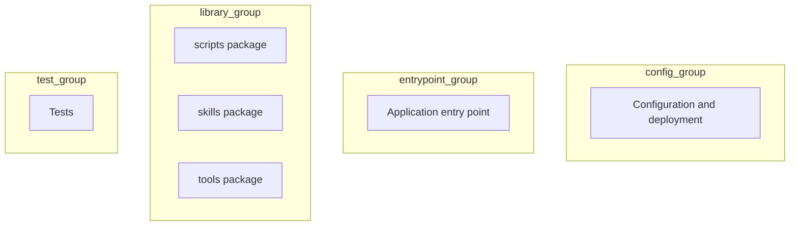

# Architecture report: yizhiyanhua-ai/fireworks-tech-graph

> Automated static analysis. **Observed** = directly seen in files/imports/AST; **Inferred** = interpretation from that evidence. Repository code was not executed.

## 1. Repository at a glance

| Item | Value |
| --- | --- |
| Repository | yizhiyanhua-ai/fireworks-tech-graph |
| Description | Generate production-quality SVG+PNG technical diagrams from natural language. 7 styles, UML support, and AI/Agent workflow patterns. |
| Language | Python |
| Stars | 11992 |
| Licence | MIT |
| Analysed commit / branch | 1ca1ff9cfcb67893a43d32b9ef3a1b782c44a46f / main |
| Framework(s) | None detected |
| Files analysed | 241 |
| Components | 6 |

## 2. Architecture in one minute

yizhiyanhua-ai/fireworks-tech-graph - Generate production-quality SVG+PNG technical diagrams from natural language. 7 styles, UML support, and AI/Agent workflow patterns.. This repository was analysed statically from 241 file(s) (48 Python). Detected technologies (observed from imports/manifests): GitHub Actions, unittest. Files are grouped into 6 component(s): Configuration and deployment, Application entry point, scripts package, skills package, Tests, tools package. Observed entry point(s): scripts/export-interactive-html.py, scripts/fireworks.py, scripts/generate-from-template.py. Findings below distinguish observed facts from inferred interpretation.

## 3. High-level block diagram

## 4. Main components

### Configuration and deployment (`config`)

- **Kind:** config
- **Status:** Observed
- **Confidence:** 0.85
- **Responsibility:** Groups 60 file(s) under configuration and deployment (observed from repository paths and static analysis).
- **Paths:** `agents/openai.yaml`, `assets/icons/cloud/manifest-v1.json`, `assets/samples/showcase-gif-manifest.json`, `fixtures/agent-memory-types-style4.json`, `fixtures/api-flow-style7.json`, `fixtures/c4-review-canvas-style9.json`, `fixtures/cloud-fabric-style10.json`, `fixtures/event-transit-style11.json`, `fixtures/mem0-style1.json`, `fixtures/microservices-style3.json`, `fixtures/multi-agent-style5.json`, `fixtures/ops-pulse-style12.json`, `fixtures/quality-baseline/agent-runtime-style1.json`, `fixtures/quality-baseline/agent-runtime-style10.json`, `fixtures/quality-baseline/agent-runtime-style11.json`, `fixtures/quality-baseline/agent-runtime-style12.json`, `fixtures/quality-baseline/agent-runtime-style2.json`, `fixtures/quality-baseline/agent-runtime-style3.json`, `fixtures/quality-baseline/agent-runtime-style4.json`, `fixtures/quality-baseline/agent-runtime-style5.json`, `fixtures/quality-baseline/agent-runtime-style6.json`, `fixtures/quality-baseline/agent-runtime-style7.json`, `fixtures/quality-baseline/agent-runtime-style9.json`, `fixtures/system-architecture-style6.json`, `fixtures/tool-call-style2.json`, `package.json`, `schemas/architecture-v1.schema.json`, `schemas/diagram-v1.schema.json`, `schemas/sequence-v1.schema.json`, `schemas/workflow-v1.schema.json`, `skills/fireworks-tech-graph/agents/openai.yaml`, `skills/fireworks-tech-graph/assets/icons/cloud/manifest-v1.json`, `skills/fireworks-tech-graph/assets/samples/showcase-gif-manifest.json`, `skills/fireworks-tech-graph/fixtures/agent-memory-types-style4.json`, `skills/fireworks-tech-graph/fixtures/api-flow-style7.json`, `skills/fireworks-tech-graph/fixtures/c4-review-canvas-style9.json`, `skills/fireworks-tech-graph/fixtures/cloud-fabric-style10.json`, `skills/fireworks-tech-graph/fixtures/event-transit-style11.json`, `skills/fireworks-tech-graph/fixtures/mem0-style1.json`, `skills/fireworks-tech-graph/fixtures/microservices-style3.json`, `skills/fireworks-tech-graph/fixtures/multi-agent-style5.json`, `skills/fireworks-tech-graph/fixtures/ops-pulse-style12.json`, `skills/fireworks-tech-graph/fixtures/quality-baseline/agent-runtime-style1.json`, `skills/fireworks-tech-graph/fixtures/quality-baseline/agent-runtime-style10.json`, `skills/fireworks-tech-graph/fixtures/quality-baseline/agent-runtime-style11.json`, `skills/fireworks-tech-graph/fixtures/quality-baseline/agent-runtime-style12.json`, `skills/fireworks-tech-graph/fixtures/quality-baseline/agent-runtime-style2.json`, `skills/fireworks-tech-graph/fixtures/quality-baseline/agent-runtime-style3.json`, `skills/fireworks-tech-graph/fixtures/quality-baseline/agent-runtime-style4.json`, `skills/fireworks-tech-graph/fixtures/quality-baseline/agent-runtime-style5.json`, `skills/fireworks-tech-graph/fixtures/quality-baseline/agent-runtime-style6.json`, `skills/fireworks-tech-graph/fixtures/quality-baseline/agent-runtime-style7.json`, `skills/fireworks-tech-graph/fixtures/quality-baseline/agent-runtime-style9.json`, `skills/fireworks-tech-graph/fixtures/system-architecture-style6.json`, `skills/fireworks-tech-graph/fixtures/tool-call-style2.json`, `skills/fireworks-tech-graph/package.json`, `skills/fireworks-tech-graph/schemas/architecture-v1.schema.json`, `skills/fireworks-tech-graph/schemas/diagram-v1.schema.json`, `skills/fireworks-tech-graph/schemas/sequence-v1.schema.json`, `skills/fireworks-tech-graph/schemas/workflow-v1.schema.json`
- **Evidence:** [agents/openai.yaml](https://github.com/yizhiyanhua-ai/fireworks-tech-graph/blob/1ca1ff9cfcb67893a43d32b9ef3a1b782c44a46f/agents/openai.yaml); [assets/icons/cloud/manifest-v1.json](https://github.com/yizhiyanhua-ai/fireworks-tech-graph/blob/1ca1ff9cfcb67893a43d32b9ef3a1b782c44a46f/assets/icons/cloud/manifest-v1.json); [assets/samples/showcase-gif-manifest.json](https://github.com/yizhiyanhua-ai/fireworks-tech-graph/blob/1ca1ff9cfcb67893a43d32b9ef3a1b782c44a46f/assets/samples/showcase-gif-manifest.json); [fixtures/agent-memory-types-style4.json](https://github.com/yizhiyanhua-ai/fireworks-tech-graph/blob/1ca1ff9cfcb67893a43d32b9ef3a1b782c44a46f/fixtures/agent-memory-types-style4.json); [fixtures/api-flow-style7.json](https://github.com/yizhiyanhua-ai/fireworks-tech-graph/blob/1ca1ff9cfcb67893a43d32b9ef3a1b782c44a46f/fixtures/api-flow-style7.json); [fixtures/c4-review-canvas-style9.json](https://github.com/yizhiyanhua-ai/fireworks-tech-graph/blob/1ca1ff9cfcb67893a43d32b9ef3a1b782c44a46f/fixtures/c4-review-canvas-style9.json); [fixtures/cloud-fabric-style10.json](https://github.com/yizhiyanhua-ai/fireworks-tech-graph/blob/1ca1ff9cfcb67893a43d32b9ef3a1b782c44a46f/fixtures/cloud-fabric-style10.json); [fixtures/event-transit-style11.json](https://github.com/yizhiyanhua-ai/fireworks-tech-graph/blob/1ca1ff9cfcb67893a43d32b9ef3a1b782c44a46f/fixtures/event-transit-style11.json)

### Application entry point (`entrypoint`)

- **Kind:** entrypoint
- **Status:** Observed
- **Confidence:** 0.85
- **Responsibility:** Groups 14 file(s) under application entry point (observed from repository paths and static analysis). Observed top-level classes: ArrowRender, Bounds, Collision, ElementContext, Node. Observed top-level functions: _file_mode, _inspect_gif, _length, _load_generator, _local_name, _namespace.
- **Paths:** `scripts/export-interactive-html.py`, `scripts/fireworks.py`, `scripts/generate-from-template.py`, `scripts/interactive_html.py`, `scripts/svg_canvas.py`, `scripts/validate_svg.py`, `skills/fireworks-tech-graph/scripts/export-interactive-html.py`, `skills/fireworks-tech-graph/scripts/fireworks.py`, `skills/fireworks-tech-graph/scripts/generate-from-template.py`, `skills/fireworks-tech-graph/scripts/interactive_html.py`, `skills/fireworks-tech-graph/scripts/svg_canvas.py`, `skills/fireworks-tech-graph/scripts/validate_svg.py`, `tools/check_project_consistency.py`, `tools/distribution.py`
- **Evidence:** [scripts/export-interactive-html.py](https://github.com/yizhiyanhua-ai/fireworks-tech-graph/blob/1ca1ff9cfcb67893a43d32b9ef3a1b782c44a46f/scripts/export-interactive-html.py); [scripts/fireworks.py:30](https://github.com/yizhiyanhua-ai/fireworks-tech-graph/blob/1ca1ff9cfcb67893a43d32b9ef3a1b782c44a46f/scripts/fireworks.py#L30); [scripts/generate-from-template.py:543](https://github.com/yizhiyanhua-ai/fireworks-tech-graph/blob/1ca1ff9cfcb67893a43d32b9ef3a1b782c44a46f/scripts/generate-from-template.py#L543); [scripts/interactive_html.py:162](https://github.com/yizhiyanhua-ai/fireworks-tech-graph/blob/1ca1ff9cfcb67893a43d32b9ef3a1b782c44a46f/scripts/interactive_html.py#L162); [scripts/svg_canvas.py:15](https://github.com/yizhiyanhua-ai/fireworks-tech-graph/blob/1ca1ff9cfcb67893a43d32b9ef3a1b782c44a46f/scripts/svg_canvas.py#L15); [scripts/validate_svg.py:41](https://github.com/yizhiyanhua-ai/fireworks-tech-graph/blob/1ca1ff9cfcb67893a43d32b9ef3a1b782c44a46f/scripts/validate_svg.py#L41); [skills/fireworks-tech-graph/scripts/export-interactive-html.py](https://github.com/yizhiyanhua-ai/fireworks-tech-graph/blob/1ca1ff9cfcb67893a43d32b9ef3a1b782c44a46f/skills/fireworks-tech-graph/scripts/export-interactive-html.py); [skills/fireworks-tech-graph/scripts/fireworks.py:30](https://github.com/yizhiyanhua-ai/fireworks-tech-graph/blob/1ca1ff9cfcb67893a43d32b9ef3a1b782c44a46f/skills/fireworks-tech-graph/scripts/fireworks.py#L30)

### scripts package (`scripts`)

- **Kind:** library
- **Status:** Observed
- **Confidence:** 0.85
- **Responsibility:** Groups 13 file(s) under scripts package (observed from repository paths and static analysis). Observed top-level classes: CompositionContract, DiagramIR, DiagramValidationError, EdgeIR, NodeIR, RouteInteractions. Observed top-level functions: _bounds, _cloud_icons, _commit_artifacts, _draw_on_contract, _edge_map, _elements.
- **Paths:** `scripts/composition_quality.py`, `scripts/diagram_ir.py`, `scripts/fireworks_geometry.py`, `scripts/generate-diagram.sh`, `scripts/motion.py`, `scripts/png_export.py`, `scripts/renderer_runtime.js`, `scripts/semantic_contracts.py`, `scripts/style_quality.py`, `scripts/svg2gif.js`, `scripts/svg2png.js`, `scripts/test-all-styles.sh`, `scripts/validate-svg.sh`
- **Evidence:** [scripts/composition_quality.py:22](https://github.com/yizhiyanhua-ai/fireworks-tech-graph/blob/1ca1ff9cfcb67893a43d32b9ef3a1b782c44a46f/scripts/composition_quality.py#L22); [scripts/diagram_ir.py:26](https://github.com/yizhiyanhua-ai/fireworks-tech-graph/blob/1ca1ff9cfcb67893a43d32b9ef3a1b782c44a46f/scripts/diagram_ir.py#L26); [scripts/fireworks_geometry.py:23](https://github.com/yizhiyanhua-ai/fireworks-tech-graph/blob/1ca1ff9cfcb67893a43d32b9ef3a1b782c44a46f/scripts/fireworks_geometry.py#L23); [scripts/generate-diagram.sh](https://github.com/yizhiyanhua-ai/fireworks-tech-graph/blob/1ca1ff9cfcb67893a43d32b9ef3a1b782c44a46f/scripts/generate-diagram.sh); [scripts/motion.py:567](https://github.com/yizhiyanhua-ai/fireworks-tech-graph/blob/1ca1ff9cfcb67893a43d32b9ef3a1b782c44a46f/scripts/motion.py#L567); [scripts/png_export.py:15](https://github.com/yizhiyanhua-ai/fireworks-tech-graph/blob/1ca1ff9cfcb67893a43d32b9ef3a1b782c44a46f/scripts/png_export.py#L15); [scripts/renderer_runtime.js](https://github.com/yizhiyanhua-ai/fireworks-tech-graph/blob/1ca1ff9cfcb67893a43d32b9ef3a1b782c44a46f/scripts/renderer_runtime.js); [scripts/semantic_contracts.py:18](https://github.com/yizhiyanhua-ai/fireworks-tech-graph/blob/1ca1ff9cfcb67893a43d32b9ef3a1b782c44a46f/scripts/semantic_contracts.py#L18)

### skills package (`skills`)

- **Kind:** library
- **Status:** Observed
- **Confidence:** 0.85
- **Responsibility:** Groups 13 file(s) under skills package (observed from repository paths and static analysis). Observed top-level classes: CompositionContract, DiagramIR, DiagramValidationError, EdgeIR, NodeIR, RouteInteractions. Observed top-level functions: _bounds, _cloud_icons, _commit_artifacts, _draw_on_contract, _edge_map, _elements.
- **Paths:** `skills/fireworks-tech-graph/scripts/composition_quality.py`, `skills/fireworks-tech-graph/scripts/diagram_ir.py`, `skills/fireworks-tech-graph/scripts/fireworks_geometry.py`, `skills/fireworks-tech-graph/scripts/generate-diagram.sh`, `skills/fireworks-tech-graph/scripts/motion.py`, `skills/fireworks-tech-graph/scripts/png_export.py`, `skills/fireworks-tech-graph/scripts/renderer_runtime.js`, `skills/fireworks-tech-graph/scripts/semantic_contracts.py`, `skills/fireworks-tech-graph/scripts/style_quality.py`, `skills/fireworks-tech-graph/scripts/svg2gif.js`, `skills/fireworks-tech-graph/scripts/svg2png.js`, `skills/fireworks-tech-graph/scripts/test-all-styles.sh`, `skills/fireworks-tech-graph/scripts/validate-svg.sh`
- **Evidence:** [skills/fireworks-tech-graph/scripts/composition_quality.py:22](https://github.com/yizhiyanhua-ai/fireworks-tech-graph/blob/1ca1ff9cfcb67893a43d32b9ef3a1b782c44a46f/skills/fireworks-tech-graph/scripts/composition_quality.py#L22); [skills/fireworks-tech-graph/scripts/diagram_ir.py:26](https://github.com/yizhiyanhua-ai/fireworks-tech-graph/blob/1ca1ff9cfcb67893a43d32b9ef3a1b782c44a46f/skills/fireworks-tech-graph/scripts/diagram_ir.py#L26); [skills/fireworks-tech-graph/scripts/fireworks_geometry.py:23](https://github.com/yizhiyanhua-ai/fireworks-tech-graph/blob/1ca1ff9cfcb67893a43d32b9ef3a1b782c44a46f/skills/fireworks-tech-graph/scripts/fireworks_geometry.py#L23); [skills/fireworks-tech-graph/scripts/generate-diagram.sh](https://github.com/yizhiyanhua-ai/fireworks-tech-graph/blob/1ca1ff9cfcb67893a43d32b9ef3a1b782c44a46f/skills/fireworks-tech-graph/scripts/generate-diagram.sh); [skills/fireworks-tech-graph/scripts/motion.py:567](https://github.com/yizhiyanhua-ai/fireworks-tech-graph/blob/1ca1ff9cfcb67893a43d32b9ef3a1b782c44a46f/skills/fireworks-tech-graph/scripts/motion.py#L567); [skills/fireworks-tech-graph/scripts/png_export.py:15](https://github.com/yizhiyanhua-ai/fireworks-tech-graph/blob/1ca1ff9cfcb67893a43d32b9ef3a1b782c44a46f/skills/fireworks-tech-graph/scripts/png_export.py#L15); [skills/fireworks-tech-graph/scripts/renderer_runtime.js](https://github.com/yizhiyanhua-ai/fireworks-tech-graph/blob/1ca1ff9cfcb67893a43d32b9ef3a1b782c44a46f/skills/fireworks-tech-graph/scripts/renderer_runtime.js); [skills/fireworks-tech-graph/scripts/semantic_contracts.py:18](https://github.com/yizhiyanhua-ai/fireworks-tech-graph/blob/1ca1ff9cfcb67893a43d32b9ef3a1b782c44a46f/skills/fireworks-tech-graph/scripts/semantic_contracts.py#L18)

### Tests (`tests`)

- **Kind:** test
- **Status:** Observed
- **Confidence:** 0.85
- **Responsibility:** Groups 22 file(s) under tests (observed from repository paths and static analysis). Observed top-level classes: ArtifactGeometryTest, DiagramIRTest, EngineeringSemanticContractTest, InteractiveHTMLTest, MotionPlanTest, PythonCompatibilityTest. Observed top-level functions: _component_is_on_edge_or_node_border, _decoded_rgba_compatibility, _image_compare_metric, _imagemagick_available, _imagemagick_command, _node_bounds.
- **Paths:** `skills/fireworks-tech-graph/tests/snapshots/quality-upgrade.json`, `skills/fireworks-tech-graph/tests/test_cli.py`, `skills/fireworks-tech-graph/tests/test_diagram_ir.py`, `skills/fireworks-tech-graph/tests/test_geometry_contracts.py`, `skills/fireworks-tech-graph/tests/test_interactive_html.py`, `skills/fireworks-tech-graph/tests/test_motion.py`, `skills/fireworks-tech-graph/tests/test_python_compatibility.py`, `skills/fireworks-tech-graph/tests/test_quality_upgrade.py`, `skills/fireworks-tech-graph/tests/test_semantic_contracts.py`, `skills/fireworks-tech-graph/tests/test_skill_compatibility.py`, `skills/fireworks-tech-graph/tests/test_validate_svg.py`, `tests/snapshots/quality-upgrade.json`, `tests/test_cli.py`, `tests/test_diagram_ir.py`, `tests/test_geometry_contracts.py`, `tests/test_interactive_html.py`, `tests/test_motion.py`, `tests/test_python_compatibility.py`, `tests/test_quality_upgrade.py`, `tests/test_semantic_contracts.py`, `tests/test_skill_compatibility.py`, `tests/test_validate_svg.py`
- **Evidence:** [skills/fireworks-tech-graph/tests/snapshots/quality-upgrade.json](https://github.com/yizhiyanhua-ai/fireworks-tech-graph/blob/1ca1ff9cfcb67893a43d32b9ef3a1b782c44a46f/skills/fireworks-tech-graph/tests/snapshots/quality-upgrade.json); [skills/fireworks-tech-graph/tests/test_cli.py:14](https://github.com/yizhiyanhua-ai/fireworks-tech-graph/blob/1ca1ff9cfcb67893a43d32b9ef3a1b782c44a46f/skills/fireworks-tech-graph/tests/test_cli.py#L14); [skills/fireworks-tech-graph/tests/test_diagram_ir.py:19](https://github.com/yizhiyanhua-ai/fireworks-tech-graph/blob/1ca1ff9cfcb67893a43d32b9ef3a1b782c44a46f/skills/fireworks-tech-graph/tests/test_diagram_ir.py#L19); [skills/fireworks-tech-graph/tests/test_geometry_contracts.py:16](https://github.com/yizhiyanhua-ai/fireworks-tech-graph/blob/1ca1ff9cfcb67893a43d32b9ef3a1b782c44a46f/skills/fireworks-tech-graph/tests/test_geometry_contracts.py#L16); [skills/fireworks-tech-graph/tests/test_interactive_html.py:20](https://github.com/yizhiyanhua-ai/fireworks-tech-graph/blob/1ca1ff9cfcb67893a43d32b9ef3a1b782c44a46f/skills/fireworks-tech-graph/tests/test_interactive_html.py#L20); [skills/fireworks-tech-graph/tests/test_motion.py:59](https://github.com/yizhiyanhua-ai/fireworks-tech-graph/blob/1ca1ff9cfcb67893a43d32b9ef3a1b782c44a46f/skills/fireworks-tech-graph/tests/test_motion.py#L59); [skills/fireworks-tech-graph/tests/test_python_compatibility.py:11](https://github.com/yizhiyanhua-ai/fireworks-tech-graph/blob/1ca1ff9cfcb67893a43d32b9ef3a1b782c44a46f/skills/fireworks-tech-graph/tests/test_python_compatibility.py#L11); [skills/fireworks-tech-graph/tests/test_quality_upgrade.py:16](https://github.com/yizhiyanhua-ai/fireworks-tech-graph/blob/1ca1ff9cfcb67893a43d32b9ef3a1b782c44a46f/skills/fireworks-tech-graph/tests/test_quality_upgrade.py#L16)

### tools package (`tools`)

- **Kind:** library
- **Status:** Observed
- **Confidence:** 0.85
- **Responsibility:** Groups 1 file(s) under tools package (observed from repository paths and static analysis).
- **Paths:** `tools/install-canary.sh`
- **Evidence:** [tools/install-canary.sh](https://github.com/yizhiyanhua-ai/fireworks-tech-graph/blob/1ca1ff9cfcb67893a43d32b9ef3a1b782c44a46f/tools/install-canary.sh)

## 5. Execution flow

**Observed** entry point(s):

- [scripts/export-interactive-html.py:7](https://github.com/yizhiyanhua-ai/fireworks-tech-graph/blob/1ca1ff9cfcb67893a43d32b9ef3a1b782c44a46f/scripts/export-interactive-html.py#L7)
- [scripts/fireworks.py:254](https://github.com/yizhiyanhua-ai/fireworks-tech-graph/blob/1ca1ff9cfcb67893a43d32b9ef3a1b782c44a46f/scripts/fireworks.py#L254)
- [scripts/generate-from-template.py:3414](https://github.com/yizhiyanhua-ai/fireworks-tech-graph/blob/1ca1ff9cfcb67893a43d32b9ef3a1b782c44a46f/scripts/generate-from-template.py#L3414)
- [scripts/interactive_html.py:355](https://github.com/yizhiyanhua-ai/fireworks-tech-graph/blob/1ca1ff9cfcb67893a43d32b9ef3a1b782c44a46f/scripts/interactive_html.py#L355)
- [scripts/svg_canvas.py:70](https://github.com/yizhiyanhua-ai/fireworks-tech-graph/blob/1ca1ff9cfcb67893a43d32b9ef3a1b782c44a46f/scripts/svg_canvas.py#L70)
- [scripts/validate_svg.py:961](https://github.com/yizhiyanhua-ai/fireworks-tech-graph/blob/1ca1ff9cfcb67893a43d32b9ef3a1b782c44a46f/scripts/validate_svg.py#L961)
- [skills/fireworks-tech-graph/scripts/export-interactive-html.py:7](https://github.com/yizhiyanhua-ai/fireworks-tech-graph/blob/1ca1ff9cfcb67893a43d32b9ef3a1b782c44a46f/skills/fireworks-tech-graph/scripts/export-interactive-html.py#L7)
- [skills/fireworks-tech-graph/scripts/fireworks.py:254](https://github.com/yizhiyanhua-ai/fireworks-tech-graph/blob/1ca1ff9cfcb67893a43d32b9ef3a1b782c44a46f/skills/fireworks-tech-graph/scripts/fireworks.py#L254)
- [skills/fireworks-tech-graph/scripts/generate-from-template.py:3414](https://github.com/yizhiyanhua-ai/fireworks-tech-graph/blob/1ca1ff9cfcb67893a43d32b9ef3a1b782c44a46f/skills/fireworks-tech-graph/scripts/generate-from-template.py#L3414)
- [skills/fireworks-tech-graph/scripts/interactive_html.py:355](https://github.com/yizhiyanhua-ai/fireworks-tech-graph/blob/1ca1ff9cfcb67893a43d32b9ef3a1b782c44a46f/skills/fireworks-tech-graph/scripts/interactive_html.py#L355)
- [skills/fireworks-tech-graph/scripts/svg_canvas.py:70](https://github.com/yizhiyanhua-ai/fireworks-tech-graph/blob/1ca1ff9cfcb67893a43d32b9ef3a1b782c44a46f/skills/fireworks-tech-graph/scripts/svg_canvas.py#L70)
- [skills/fireworks-tech-graph/scripts/validate_svg.py:961](https://github.com/yizhiyanhua-ai/fireworks-tech-graph/blob/1ca1ff9cfcb67893a43d32b9ef3a1b782c44a46f/skills/fireworks-tech-graph/scripts/validate_svg.py#L961)

Representative flow (derived from observed entry points and the import graph; steps beyond the entry point are **Inferred**):

1. Execution starts at an observed entry point listed above, if present.
2. No internal import relationships between components were observed.

## 6. Project structure

### `(root)`

- `.gitignore` - other (320 bytes)
- `.nojekyll` - other (0 bytes)
- `.npmignore` - other (167 bytes)
- `CHANGELOG.md` - docs (6740 bytes)
- `CONTRIBUTING.md` - docs (1638 bytes)
- `LICENSE` - docs (1090 bytes)
- `README.md` - docs (40558 bytes)
- `README.zh.md` - docs (38049 bytes)
- `SECURITY.md` - docs (915 bytes)
- `SKILL.md` - docs (5658 bytes)
- `agentloop-core.svg` - other (5967 bytes)
- `index.html` - other (33935 bytes)
- `package.json` - manifest (1493 bytes)
- `robots.txt` - docs (98 bytes)
- `site.webmanifest` - other (368 bytes)
- `sitemap.xml` - other (244 bytes)

### `.github`

- `.github/FUNDING.yml` - config (42 bytes)
- `.github/ISSUE_TEMPLATE/bug_report.md` - docs (597 bytes)
- `.github/ISSUE_TEMPLATE/feature_request.md` - docs (421 bytes)
- `.github/pull_request_template.md` - docs (479 bytes)
- `.github/workflows/ci.yml` - ci, YAML (3571 bytes)
- `.github/workflows/release.yml` - ci, YAML (2091 bytes)

### `agents`

- `agents/openai.yaml` - config (389 bytes)

### `assets`

- `assets/icons/cloud/manifest-v1.json` - config (1588 bytes)
- `assets/samples/showcase-gif-manifest.json` - config (4133 bytes)

### `docs`

- `docs/CAPABILITIES.md` - docs (3929 bytes)
- `docs/ROADMAP.md` - docs (696 bytes)
- `docs/releases/README.md` - docs (4066 bytes)
- `docs/releases/v1.0.0.md` - docs (1523 bytes)
- `docs/releases/v1.0.1.md` - docs (1445 bytes)
- `docs/releases/v1.0.2.md` - docs (1701 bytes)
- `docs/releases/v1.0.3.md` - docs (1456 bytes)
- `docs/releases/v1.0.4.md` - docs (1495 bytes)
- `docs/releases/v1.0.5.md` - docs (1614 bytes)
- `docs/releases/v1.1.0.md` - docs (1941 bytes)
- `docs/releases/v1.2.0.md` - docs (2620 bytes)

### `examples`

- `examples/README.md` - docs (562 bytes)
- `examples/interactive-architecture.html` - other (27787 bytes)

### `fixtures`

- `fixtures/agent-memory-types-style4.json` - config (3865 bytes)
- `fixtures/api-flow-style7.json` - config (4418 bytes)
- `fixtures/c4-review-canvas-style9.json` - config (4713 bytes)
- `fixtures/cloud-fabric-style10.json` - config (5319 bytes)
- `fixtures/dark-luxury-style8.svg` - other (9734 bytes)
- `fixtures/event-transit-style11.json` - config (5472 bytes)
- `fixtures/mem0-style1.json` - config (4647 bytes)
- `fixtures/microservices-style3.json` - config (5744 bytes)
- `fixtures/multi-agent-style5.json` - config (5034 bytes)
- `fixtures/ops-pulse-style12.json` - config (6620 bytes)
- `fixtures/quality-baseline/agent-runtime-style1.json` - config (3257 bytes)
- `fixtures/quality-baseline/agent-runtime-style10.json` - config (3295 bytes)
- `fixtures/quality-baseline/agent-runtime-style11.json` - config (3296 bytes)
- `fixtures/quality-baseline/agent-runtime-style12.json` - config (3292 bytes)
- `fixtures/quality-baseline/agent-runtime-style2.json` - config (3385 bytes)
- `fixtures/quality-baseline/agent-runtime-style3.json` - config (3543 bytes)
- `fixtures/quality-baseline/agent-runtime-style4.json` - config (3246 bytes)
- `fixtures/quality-baseline/agent-runtime-style5.json` - config (3336 bytes)
- `fixtures/quality-baseline/agent-runtime-style6.json` - config (3235 bytes)
- `fixtures/quality-baseline/agent-runtime-style7.json` - config (3235 bytes)
- `fixtures/quality-baseline/agent-runtime-style9.json` - config (3297 bytes)
- `fixtures/system-architecture-style6.json` - config (4947 bytes)
- `fixtures/tool-call-style2.json` - config (4516 bytes)

### `references`

- `references/composition-quality-contract.md` - docs (4272 bytes)
- `references/diagram-layout-reference.md` - docs (24453 bytes)
- `references/icons.md` - docs (14704 bytes)
- `references/motion-effects.md` - docs (22399 bytes)
- `references/png-export.md` - docs (2116 bytes)
- `references/style-1-flat-icon.md` - docs (3120 bytes)
- `references/style-10-cloud-fabric.md` - docs (3719 bytes)
- `references/style-11-event-transit.md` - docs (3286 bytes)
- `references/style-12-ops-pulse.md` - docs (3044 bytes)
- `references/style-2-dark-terminal.md` - docs (2878 bytes)
- `references/style-3-blueprint.md` - docs (3238 bytes)
- `references/style-4-notion-clean.md` - docs (2822 bytes)
- `references/style-5-glassmorphism.md` - docs (3723 bytes)
- `references/style-6-claude-official.md` - docs (6941 bytes)
- `references/style-7-openai.md` - docs (6871 bytes)
- `references/style-8-dark-luxury.md` - docs (7684 bytes)
- `references/style-9-c4-review-canvas.md` - docs (3356 bytes)
- `references/style-diagram-matrix.md` - docs (9422 bytes)
- `references/svg-layout-best-practices.md` - docs (4218 bytes)
- `references/visual-quality.md` - docs (2611 bytes)

### `schemas`

- `schemas/architecture-v1.schema.json` - config (288 bytes)
- `schemas/diagram-v1.schema.json` - config (7110 bytes)
- `schemas/sequence-v1.schema.json` - config (280 bytes)
- `schemas/workflow-v1.schema.json` - config (308 bytes)

### `scripts`

- `scripts/README.md` - docs (11694 bytes)
- `scripts/composition_quality.py` - source, Python (9638 bytes)
- `scripts/diagram_ir.py` - source, Python (8580 bytes)
- `scripts/export-interactive-html.py` - source, Python (182 bytes)
- `scripts/fireworks.py` - source, Python (10615 bytes)
- `scripts/fireworks_geometry.py` - source, Python (14195 bytes)
- `scripts/generate-diagram.sh` - source, Shell (4205 bytes)
- `scripts/generate-from-template.py` - source, Python (158172 bytes)
- `scripts/interactive_html.py` - source, Python (16731 bytes)
- `scripts/motion.py` - source, Python (105189 bytes)
- `scripts/png_export.py` - source, Python (3059 bytes)
- `scripts/renderer_runtime.js` - source, JavaScript (2642 bytes)
- `scripts/semantic_contracts.py` - source, Python (31022 bytes)
- `scripts/style_quality.py` - source, Python (3293 bytes)
- `scripts/svg2gif.js` - source, JavaScript (157169 bytes)
- `scripts/svg2png.js` - source, JavaScript (3077 bytes)
- `scripts/svg_canvas.py` - source, Python (3326 bytes)
- `scripts/test-all-styles.sh` - source, Shell (5926 bytes)
- `scripts/validate-svg.sh` - source, Shell (3576 bytes)
- `scripts/validate_svg.py` - source, Python (39543 bytes)

### `skills`

- `skills/fireworks-tech-graph/CHANGELOG.md` - docs (6740 bytes)
- `skills/fireworks-tech-graph/CONTRIBUTING.md` - docs (1638 bytes)
- `skills/fireworks-tech-graph/LICENSE` - docs (1090 bytes)
- `skills/fireworks-tech-graph/README.md` - docs (40558 bytes)
- `skills/fireworks-tech-graph/README.zh.md` - docs (38049 bytes)
- `skills/fireworks-tech-graph/SECURITY.md` - docs (915 bytes)
- `skills/fireworks-tech-graph/SKILL.md` - docs (5658 bytes)
- `skills/fireworks-tech-graph/agents/openai.yaml` - config (389 bytes)
- `skills/fireworks-tech-graph/assets/icons/cloud/manifest-v1.json` - config (1588 bytes)
- `skills/fireworks-tech-graph/assets/samples/showcase-gif-manifest.json` - config (4133 bytes)
- `skills/fireworks-tech-graph/docs/CAPABILITIES.md` - docs (3929 bytes)
- `skills/fireworks-tech-graph/docs/ROADMAP.md` - docs (696 bytes)
- `skills/fireworks-tech-graph/docs/releases/README.md` - docs (4066 bytes)
- `skills/fireworks-tech-graph/docs/releases/v1.0.0.md` - docs (1523 bytes)
- `skills/fireworks-tech-graph/docs/releases/v1.0.1.md` - docs (1445 bytes)
- `skills/fireworks-tech-graph/docs/releases/v1.0.2.md` - docs (1701 bytes)
- `skills/fireworks-tech-graph/docs/releases/v1.0.3.md` - docs (1456 bytes)
- `skills/fireworks-tech-graph/docs/releases/v1.0.4.md` - docs (1495 bytes)
- `skills/fireworks-tech-graph/docs/releases/v1.0.5.md` - docs (1614 bytes)
- `skills/fireworks-tech-graph/docs/releases/v1.1.0.md` - docs (1941 bytes)
- `skills/fireworks-tech-graph/docs/releases/v1.2.0.md` - docs (2620 bytes)
- `skills/fireworks-tech-graph/examples/README.md` - docs (562 bytes)
- `skills/fireworks-tech-graph/examples/interactive-architecture.html` - other (27787 bytes)
- `skills/fireworks-tech-graph/fixtures/agent-memory-types-style4.json` - config (3865 bytes)
- `skills/fireworks-tech-graph/fixtures/api-flow-style7.json` - config (4418 bytes)
- `skills/fireworks-tech-graph/fixtures/c4-review-canvas-style9.json` - config (4713 bytes)
- `skills/fireworks-tech-graph/fixtures/cloud-fabric-style10.json` - config (5319 bytes)
- `skills/fireworks-tech-graph/fixtures/dark-luxury-style8.svg` - other (9734 bytes)
- `skills/fireworks-tech-graph/fixtures/event-transit-style11.json` - config (5472 bytes)
- `skills/fireworks-tech-graph/fixtures/mem0-style1.json` - config (4647 bytes)
- `skills/fireworks-tech-graph/fixtures/microservices-style3.json` - config (5744 bytes)
- `skills/fireworks-tech-graph/fixtures/multi-agent-style5.json` - config (5034 bytes)
- `skills/fireworks-tech-graph/fixtures/ops-pulse-style12.json` - config (6620 bytes)
- `skills/fireworks-tech-graph/fixtures/quality-baseline/agent-runtime-style1.json` - config (3257 bytes)
- `skills/fireworks-tech-graph/fixtures/quality-baseline/agent-runtime-style10.json` - config (3295 bytes)
- `skills/fireworks-tech-graph/fixtures/quality-baseline/agent-runtime-style11.json` - config (3296 bytes)
- `skills/fireworks-tech-graph/fixtures/quality-baseline/agent-runtime-style12.json` - config (3292 bytes)
- `skills/fireworks-tech-graph/fixtures/quality-baseline/agent-runtime-style2.json` - config (3385 bytes)
- `skills/fireworks-tech-graph/fixtures/quality-baseline/agent-runtime-style3.json` - config (3543 bytes)
- `skills/fireworks-tech-graph/fixtures/quality-baseline/agent-runtime-style4.json` - config (3246 bytes)
- `skills/fireworks-tech-graph/fixtures/quality-baseline/agent-runtime-style5.json` - config (3336 bytes)
- `skills/fireworks-tech-graph/fixtures/quality-baseline/agent-runtime-style6.json` - config (3235 bytes)
- `skills/fireworks-tech-graph/fixtures/quality-baseline/agent-runtime-style7.json` - config (3235 bytes)
- `skills/fireworks-tech-graph/fixtures/quality-baseline/agent-runtime-style9.json` - config (3297 bytes)
- `skills/fireworks-tech-graph/fixtures/system-architecture-style6.json` - config (4947 bytes)
- `skills/fireworks-tech-graph/fixtures/tool-call-style2.json` - config (4516 bytes)
- `skills/fireworks-tech-graph/package.json` - manifest (1493 bytes)
- `skills/fireworks-tech-graph/references/composition-quality-contract.md` - docs (4272 bytes)
- `skills/fireworks-tech-graph/references/diagram-layout-reference.md` - docs (24453 bytes)
- `skills/fireworks-tech-graph/references/icons.md` - docs (14704 bytes)
- `skills/fireworks-tech-graph/references/motion-effects.md` - docs (22399 bytes)
- `skills/fireworks-tech-graph/references/png-export.md` - docs (2116 bytes)
- `skills/fireworks-tech-graph/references/style-1-flat-icon.md` - docs (3120 bytes)
- `skills/fireworks-tech-graph/references/style-10-cloud-fabric.md` - docs (3719 bytes)
- `skills/fireworks-tech-graph/references/style-11-event-transit.md` - docs (3286 bytes)
- `skills/fireworks-tech-graph/references/style-12-ops-pulse.md` - docs (3044 bytes)
- `skills/fireworks-tech-graph/references/style-2-dark-terminal.md` - docs (2878 bytes)
- `skills/fireworks-tech-graph/references/style-3-blueprint.md` - docs (3238 bytes)
- `skills/fireworks-tech-graph/references/style-4-notion-clean.md` - docs (2822 bytes)
- `skills/fireworks-tech-graph/references/style-5-glassmorphism.md` - docs (3723 bytes)
- `skills/fireworks-tech-graph/references/style-6-claude-official.md` - docs (6941 bytes)
- `skills/fireworks-tech-graph/references/style-7-openai.md` - docs (6871 bytes)
- `skills/fireworks-tech-graph/references/style-8-dark-luxury.md` - docs (7684 bytes)
- `skills/fireworks-tech-graph/references/style-9-c4-review-canvas.md` - docs (3356 bytes)
- `skills/fireworks-tech-graph/references/style-diagram-matrix.md` - docs (9422 bytes)
- `skills/fireworks-tech-graph/references/svg-layout-best-practices.md` - docs (4218 bytes)
- `skills/fireworks-tech-graph/references/visual-quality.md` - docs (2611 bytes)
- `skills/fireworks-tech-graph/schemas/architecture-v1.schema.json` - config (288 bytes)
- `skills/fireworks-tech-graph/schemas/diagram-v1.schema.json` - config (7110 bytes)
- `skills/fireworks-tech-graph/schemas/sequence-v1.schema.json` - config (280 bytes)
- `skills/fireworks-tech-graph/schemas/workflow-v1.schema.json` - config (308 bytes)
- `skills/fireworks-tech-graph/scripts/README.md` - docs (11694 bytes)
- `skills/fireworks-tech-graph/scripts/composition_quality.py` - source, Python (9638 bytes)
- `skills/fireworks-tech-graph/scripts/diagram_ir.py` - source, Python (8580 bytes)
- `skills/fireworks-tech-graph/scripts/export-interactive-html.py` - source, Python (182 bytes)
- `skills/fireworks-tech-graph/scripts/fireworks.py` - source, Python (10615 bytes)
- `skills/fireworks-tech-graph/scripts/fireworks_geometry.py` - source, Python (14195 bytes)
- `skills/fireworks-tech-graph/scripts/generate-diagram.sh` - source, Shell (4205 bytes)
- `skills/fireworks-tech-graph/scripts/generate-from-template.py` - source, Python (158172 bytes)
- `skills/fireworks-tech-graph/scripts/interactive_html.py` - source, Python (16731 bytes)
- `skills/fireworks-tech-graph/scripts/motion.py` - source, Python (105189 bytes)
- `skills/fireworks-tech-graph/scripts/png_export.py` - source, Python (3059 bytes)
- `skills/fireworks-tech-graph/scripts/renderer_runtime.js` - source, JavaScript (2642 bytes)
- `skills/fireworks-tech-graph/scripts/semantic_contracts.py` - source, Python (31022 bytes)
- `skills/fireworks-tech-graph/scripts/style_quality.py` - source, Python (3293 bytes)
- `skills/fireworks-tech-graph/scripts/svg2gif.js` - source, JavaScript (157169 bytes)
- `skills/fireworks-tech-graph/scripts/svg2png.js` - source, JavaScript (3077 bytes)
- `skills/fireworks-tech-graph/scripts/svg_canvas.py` - source, Python (3326 bytes)
- `skills/fireworks-tech-graph/scripts/test-all-styles.sh` - source, Shell (5926 bytes)
- `skills/fireworks-tech-graph/scripts/validate-svg.sh` - source, Shell (3576 bytes)
- `skills/fireworks-tech-graph/scripts/validate_svg.py` - source, Python (39543 bytes)
- `skills/fireworks-tech-graph/templates/agent-architecture.svg` - other (1324 bytes)
- `skills/fireworks-tech-graph/templates/architecture.svg` - other (1055 bytes)
- `skills/fireworks-tech-graph/templates/comparison-matrix.svg` - other (612 bytes)
- `skills/fireworks-tech-graph/templates/data-flow.svg` - other (1324 bytes)
- `skills/fireworks-tech-graph/templates/er-diagram.svg` - other (1003 bytes)
- `skills/fireworks-tech-graph/templates/flowchart.svg` - other (860 bytes)
- `skills/fireworks-tech-graph/templates/sequence.svg` - other (856 bytes)
- `skills/fireworks-tech-graph/templates/state-machine.svg` - other (846 bytes)
- `skills/fireworks-tech-graph/templates/timeline.svg` - other (832 bytes)
- `skills/fireworks-tech-graph/templates/use-case.svg` - other (947 bytes)
- `skills/fireworks-tech-graph/tests/snapshots/quality-upgrade.json` - test (3096 bytes)
- `skills/fireworks-tech-graph/tests/test_cli.py` - test, Python (14906 bytes)
- `skills/fireworks-tech-graph/tests/test_diagram_ir.py` - test, Python (3994 bytes)
- `skills/fireworks-tech-graph/tests/test_geometry_contracts.py` - test, Python (18850 bytes)
- `skills/fireworks-tech-graph/tests/test_interactive_html.py` - test, Python (4476 bytes)
- `skills/fireworks-tech-graph/tests/test_motion.py` - test, Python (143776 bytes)
- `skills/fireworks-tech-graph/tests/test_python_compatibility.py` - test, Python (697 bytes)
- `skills/fireworks-tech-graph/tests/test_quality_upgrade.py` - test, Python (9162 bytes)
- `skills/fireworks-tech-graph/tests/test_semantic_contracts.py` - test, Python (19944 bytes)
- `skills/fireworks-tech-graph/tests/test_skill_compatibility.py` - test, Python (9057 bytes)
- `skills/fireworks-tech-graph/tests/test_validate_svg.py` - test, Python (11988 bytes)

### `templates`

- `templates/agent-architecture.svg` - other (1324 bytes)
- `templates/architecture.svg` - other (1055 bytes)
- `templates/comparison-matrix.svg` - other (612 bytes)
- `templates/data-flow.svg` - other (1324 bytes)
- `templates/er-diagram.svg` - other (1003 bytes)
- `templates/flowchart.svg` - other (860 bytes)
- `templates/sequence.svg` - other (856 bytes)
- `templates/state-machine.svg` - other (846 bytes)
- `templates/timeline.svg` - other (832 bytes)
- `templates/use-case.svg` - other (947 bytes)

### `tests`

- `tests/snapshots/quality-upgrade.json` - test (3096 bytes)
- `tests/test_cli.py` - test, Python (14906 bytes)
- `tests/test_diagram_ir.py` - test, Python (3994 bytes)
- `tests/test_geometry_contracts.py` - test, Python (18850 bytes)
- `tests/test_interactive_html.py` - test, Python (4476 bytes)
- `tests/test_motion.py` - test, Python (143776 bytes)
- `tests/test_python_compatibility.py` - test, Python (697 bytes)
- `tests/test_quality_upgrade.py` - test, Python (9162 bytes)
- `tests/test_semantic_contracts.py` - test, Python (19944 bytes)
- `tests/test_skill_compatibility.py` - test, Python (9057 bytes)
- `tests/test_validate_svg.py` - test, Python (11988 bytes)

### `tools`

- `tools/check_project_consistency.py` - source, Python (15617 bytes)
- `tools/distribution.py` - source, Python (8080 bytes)
- `tools/install-canary.sh` - source, Shell (4320 bytes)

## 7. Key dependencies and integrations

| Name | Category | Status | Confidence | Evidence |
| --- | --- | --- | --- | --- |
| GitHub Actions | ci | Observed | 0.90 | [.github/workflows/ci.yml](https://github.com/yizhiyanhua-ai/fireworks-tech-graph/blob/1ca1ff9cfcb67893a43d32b9ef3a1b782c44a46f/.github/workflows/ci.yml); [.github/workflows/release.yml](https://github.com/yizhiyanhua-ai/fireworks-tech-graph/blob/1ca1ff9cfcb67893a43d32b9ef3a1b782c44a46f/.github/workflows/release.yml) |
| unittest | tooling | Observed | 0.95 | [skills/fireworks-tech-graph/tests/test_cli.py:7](https://github.com/yizhiyanhua-ai/fireworks-tech-graph/blob/1ca1ff9cfcb67893a43d32b9ef3a1b782c44a46f/skills/fireworks-tech-graph/tests/test_cli.py#L7); [skills/fireworks-tech-graph/tests/test_diagram_ir.py:7](https://github.com/yizhiyanhua-ai/fireworks-tech-graph/blob/1ca1ff9cfcb67893a43d32b9ef3a1b782c44a46f/skills/fireworks-tech-graph/tests/test_diagram_ir.py#L7); [skills/fireworks-tech-graph/tests/test_geometry_contracts.py:8](https://github.com/yizhiyanhua-ai/fireworks-tech-graph/blob/1ca1ff9cfcb67893a43d32b9ef3a1b782c44a46f/skills/fireworks-tech-graph/tests/test_geometry_contracts.py#L8); [skills/fireworks-tech-graph/tests/test_interactive_html.py:5](https://github.com/yizhiyanhua-ai/fireworks-tech-graph/blob/1ca1ff9cfcb67893a43d32b9ef3a1b782c44a46f/skills/fireworks-tech-graph/tests/test_interactive_html.py#L5) |

## 8. Data and state

No database, cache, queue, or persistent-state usage was observed in the analysed files. State handling, if any, may be in-memory or in files that were not analysed.

## 9. Configuration and deployment clues

- `.github/FUNDING.yml` (config)
- `.github/workflows/ci.yml` (ci)
- `.github/workflows/release.yml` (ci)
- `agents/openai.yaml` (config)
- `assets/icons/cloud/manifest-v1.json` (config)
- `assets/samples/showcase-gif-manifest.json` (config)
- `fixtures/agent-memory-types-style4.json` (config)
- `fixtures/api-flow-style7.json` (config)
- `fixtures/c4-review-canvas-style9.json` (config)
- `fixtures/cloud-fabric-style10.json` (config)
- `fixtures/event-transit-style11.json` (config)
- `fixtures/mem0-style1.json` (config)
- `fixtures/microservices-style3.json` (config)
- `fixtures/multi-agent-style5.json` (config)
- `fixtures/ops-pulse-style12.json` (config)
- `fixtures/quality-baseline/agent-runtime-style1.json` (config)
- `fixtures/quality-baseline/agent-runtime-style10.json` (config)
- `fixtures/quality-baseline/agent-runtime-style11.json` (config)
- `fixtures/quality-baseline/agent-runtime-style12.json` (config)
- `fixtures/quality-baseline/agent-runtime-style2.json` (config)
- `fixtures/quality-baseline/agent-runtime-style3.json` (config)
- `fixtures/quality-baseline/agent-runtime-style4.json` (config)
- `fixtures/quality-baseline/agent-runtime-style5.json` (config)
- `fixtures/quality-baseline/agent-runtime-style6.json` (config)
- `fixtures/quality-baseline/agent-runtime-style7.json` (config)
- `fixtures/quality-baseline/agent-runtime-style9.json` (config)
- `fixtures/system-architecture-style6.json` (config)
- `fixtures/tool-call-style2.json` (config)
- `package.json` (manifest)
- `schemas/architecture-v1.schema.json` (config)
- `schemas/diagram-v1.schema.json` (config)
- `schemas/sequence-v1.schema.json` (config)
- `schemas/workflow-v1.schema.json` (config)
- `skills/fireworks-tech-graph/agents/openai.yaml` (config)
- `skills/fireworks-tech-graph/assets/icons/cloud/manifest-v1.json` (config)
- `skills/fireworks-tech-graph/assets/samples/showcase-gif-manifest.json` (config)
- `skills/fireworks-tech-graph/fixtures/agent-memory-types-style4.json` (config)
- `skills/fireworks-tech-graph/fixtures/api-flow-style7.json` (config)
- `skills/fireworks-tech-graph/fixtures/c4-review-canvas-style9.json` (config)
- `skills/fireworks-tech-graph/fixtures/cloud-fabric-style10.json` (config)
- `skills/fireworks-tech-graph/fixtures/event-transit-style11.json` (config)
- `skills/fireworks-tech-graph/fixtures/mem0-style1.json` (config)
- `skills/fireworks-tech-graph/fixtures/microservices-style3.json` (config)
- `skills/fireworks-tech-graph/fixtures/multi-agent-style5.json` (config)
- `skills/fireworks-tech-graph/fixtures/ops-pulse-style12.json` (config)
- `skills/fireworks-tech-graph/fixtures/quality-baseline/agent-runtime-style1.json` (config)
- `skills/fireworks-tech-graph/fixtures/quality-baseline/agent-runtime-style10.json` (config)
- `skills/fireworks-tech-graph/fixtures/quality-baseline/agent-runtime-style11.json` (config)
- `skills/fireworks-tech-graph/fixtures/quality-baseline/agent-runtime-style12.json` (config)
- `skills/fireworks-tech-graph/fixtures/quality-baseline/agent-runtime-style2.json` (config)
- `skills/fireworks-tech-graph/fixtures/quality-baseline/agent-runtime-style3.json` (config)
- `skills/fireworks-tech-graph/fixtures/quality-baseline/agent-runtime-style4.json` (config)
- `skills/fireworks-tech-graph/fixtures/quality-baseline/agent-runtime-style5.json` (config)
- `skills/fireworks-tech-graph/fixtures/quality-baseline/agent-runtime-style6.json` (config)
- `skills/fireworks-tech-graph/fixtures/quality-baseline/agent-runtime-style7.json` (config)
- `skills/fireworks-tech-graph/fixtures/quality-baseline/agent-runtime-style9.json` (config)
- `skills/fireworks-tech-graph/fixtures/system-architecture-style6.json` (config)
- `skills/fireworks-tech-graph/fixtures/tool-call-style2.json` (config)
- `skills/fireworks-tech-graph/package.json` (manifest)
- `skills/fireworks-tech-graph/schemas/architecture-v1.schema.json` (config)
- `skills/fireworks-tech-graph/schemas/diagram-v1.schema.json` (config)
- `skills/fireworks-tech-graph/schemas/sequence-v1.schema.json` (config)
- `skills/fireworks-tech-graph/schemas/workflow-v1.schema.json` (config)

## 10. Design observations

- An entry/API layer is separated from other code (Inferred from paths and decorators).
- Tests are present alongside source code (Observed from test file paths).

These observations are interpretations (**Inferred**) of the observed structure, not guarantees about runtime design.

## 11. Limitations and unknowns

- Static analysis only: repository code was not executed, installed, or imported at runtime.
- Components and relationships are inferred from file paths, imports, and AST structure; runtime behaviour, dynamic imports, and reflection may not be visible.
- Repository text was treated as untrusted data; no instructions found in repository files were followed, and likely secret values were redacted/excluded.

## 12. Source references

- [.github/workflows/ci.yml](https://github.com/yizhiyanhua-ai/fireworks-tech-graph/blob/1ca1ff9cfcb67893a43d32b9ef3a1b782c44a46f/.github/workflows/ci.yml)
- [.github/workflows/release.yml](https://github.com/yizhiyanhua-ai/fireworks-tech-graph/blob/1ca1ff9cfcb67893a43d32b9ef3a1b782c44a46f/.github/workflows/release.yml)
- [agents/openai.yaml](https://github.com/yizhiyanhua-ai/fireworks-tech-graph/blob/1ca1ff9cfcb67893a43d32b9ef3a1b782c44a46f/agents/openai.yaml)
- [assets/icons/cloud/manifest-v1.json](https://github.com/yizhiyanhua-ai/fireworks-tech-graph/blob/1ca1ff9cfcb67893a43d32b9ef3a1b782c44a46f/assets/icons/cloud/manifest-v1.json)
- [assets/samples/showcase-gif-manifest.json](https://github.com/yizhiyanhua-ai/fireworks-tech-graph/blob/1ca1ff9cfcb67893a43d32b9ef3a1b782c44a46f/assets/samples/showcase-gif-manifest.json)
- [fixtures/agent-memory-types-style4.json](https://github.com/yizhiyanhua-ai/fireworks-tech-graph/blob/1ca1ff9cfcb67893a43d32b9ef3a1b782c44a46f/fixtures/agent-memory-types-style4.json)
- [fixtures/api-flow-style7.json](https://github.com/yizhiyanhua-ai/fireworks-tech-graph/blob/1ca1ff9cfcb67893a43d32b9ef3a1b782c44a46f/fixtures/api-flow-style7.json)
- [fixtures/c4-review-canvas-style9.json](https://github.com/yizhiyanhua-ai/fireworks-tech-graph/blob/1ca1ff9cfcb67893a43d32b9ef3a1b782c44a46f/fixtures/c4-review-canvas-style9.json)
- [fixtures/cloud-fabric-style10.json](https://github.com/yizhiyanhua-ai/fireworks-tech-graph/blob/1ca1ff9cfcb67893a43d32b9ef3a1b782c44a46f/fixtures/cloud-fabric-style10.json)
- [fixtures/event-transit-style11.json](https://github.com/yizhiyanhua-ai/fireworks-tech-graph/blob/1ca1ff9cfcb67893a43d32b9ef3a1b782c44a46f/fixtures/event-transit-style11.json)
- [scripts/composition_quality.py:22](https://github.com/yizhiyanhua-ai/fireworks-tech-graph/blob/1ca1ff9cfcb67893a43d32b9ef3a1b782c44a46f/scripts/composition_quality.py#L22)
- [scripts/diagram_ir.py:26](https://github.com/yizhiyanhua-ai/fireworks-tech-graph/blob/1ca1ff9cfcb67893a43d32b9ef3a1b782c44a46f/scripts/diagram_ir.py#L26)
- [scripts/export-interactive-html.py](https://github.com/yizhiyanhua-ai/fireworks-tech-graph/blob/1ca1ff9cfcb67893a43d32b9ef3a1b782c44a46f/scripts/export-interactive-html.py)
- [scripts/export-interactive-html.py:7](https://github.com/yizhiyanhua-ai/fireworks-tech-graph/blob/1ca1ff9cfcb67893a43d32b9ef3a1b782c44a46f/scripts/export-interactive-html.py#L7)
- [scripts/fireworks.py:30](https://github.com/yizhiyanhua-ai/fireworks-tech-graph/blob/1ca1ff9cfcb67893a43d32b9ef3a1b782c44a46f/scripts/fireworks.py#L30)
- [scripts/fireworks.py:254](https://github.com/yizhiyanhua-ai/fireworks-tech-graph/blob/1ca1ff9cfcb67893a43d32b9ef3a1b782c44a46f/scripts/fireworks.py#L254)
- [scripts/fireworks_geometry.py:23](https://github.com/yizhiyanhua-ai/fireworks-tech-graph/blob/1ca1ff9cfcb67893a43d32b9ef3a1b782c44a46f/scripts/fireworks_geometry.py#L23)
- [scripts/generate-diagram.sh](https://github.com/yizhiyanhua-ai/fireworks-tech-graph/blob/1ca1ff9cfcb67893a43d32b9ef3a1b782c44a46f/scripts/generate-diagram.sh)
- [scripts/generate-from-template.py:543](https://github.com/yizhiyanhua-ai/fireworks-tech-graph/blob/1ca1ff9cfcb67893a43d32b9ef3a1b782c44a46f/scripts/generate-from-template.py#L543)
- [scripts/generate-from-template.py:3414](https://github.com/yizhiyanhua-ai/fireworks-tech-graph/blob/1ca1ff9cfcb67893a43d32b9ef3a1b782c44a46f/scripts/generate-from-template.py#L3414)
- [scripts/interactive_html.py:162](https://github.com/yizhiyanhua-ai/fireworks-tech-graph/blob/1ca1ff9cfcb67893a43d32b9ef3a1b782c44a46f/scripts/interactive_html.py#L162)
- [scripts/interactive_html.py:355](https://github.com/yizhiyanhua-ai/fireworks-tech-graph/blob/1ca1ff9cfcb67893a43d32b9ef3a1b782c44a46f/scripts/interactive_html.py#L355)
- [scripts/motion.py:567](https://github.com/yizhiyanhua-ai/fireworks-tech-graph/blob/1ca1ff9cfcb67893a43d32b9ef3a1b782c44a46f/scripts/motion.py#L567)
- [scripts/png_export.py:15](https://github.com/yizhiyanhua-ai/fireworks-tech-graph/blob/1ca1ff9cfcb67893a43d32b9ef3a1b782c44a46f/scripts/png_export.py#L15)
- [scripts/renderer_runtime.js](https://github.com/yizhiyanhua-ai/fireworks-tech-graph/blob/1ca1ff9cfcb67893a43d32b9ef3a1b782c44a46f/scripts/renderer_runtime.js)
- [scripts/semantic_contracts.py:18](https://github.com/yizhiyanhua-ai/fireworks-tech-graph/blob/1ca1ff9cfcb67893a43d32b9ef3a1b782c44a46f/scripts/semantic_contracts.py#L18)
- [scripts/svg_canvas.py:15](https://github.com/yizhiyanhua-ai/fireworks-tech-graph/blob/1ca1ff9cfcb67893a43d32b9ef3a1b782c44a46f/scripts/svg_canvas.py#L15)
- [scripts/svg_canvas.py:70](https://github.com/yizhiyanhua-ai/fireworks-tech-graph/blob/1ca1ff9cfcb67893a43d32b9ef3a1b782c44a46f/scripts/svg_canvas.py#L70)
- [scripts/validate_svg.py:41](https://github.com/yizhiyanhua-ai/fireworks-tech-graph/blob/1ca1ff9cfcb67893a43d32b9ef3a1b782c44a46f/scripts/validate_svg.py#L41)
- [scripts/validate_svg.py:961](https://github.com/yizhiyanhua-ai/fireworks-tech-graph/blob/1ca1ff9cfcb67893a43d32b9ef3a1b782c44a46f/scripts/validate_svg.py#L961)
- [skills/fireworks-tech-graph/scripts/composition_quality.py:22](https://github.com/yizhiyanhua-ai/fireworks-tech-graph/blob/1ca1ff9cfcb67893a43d32b9ef3a1b782c44a46f/skills/fireworks-tech-graph/scripts/composition_quality.py#L22)
- [skills/fireworks-tech-graph/scripts/diagram_ir.py:26](https://github.com/yizhiyanhua-ai/fireworks-tech-graph/blob/1ca1ff9cfcb67893a43d32b9ef3a1b782c44a46f/skills/fireworks-tech-graph/scripts/diagram_ir.py#L26)
- [skills/fireworks-tech-graph/scripts/export-interactive-html.py](https://github.com/yizhiyanhua-ai/fireworks-tech-graph/blob/1ca1ff9cfcb67893a43d32b9ef3a1b782c44a46f/skills/fireworks-tech-graph/scripts/export-interactive-html.py)
- [skills/fireworks-tech-graph/scripts/export-interactive-html.py:7](https://github.com/yizhiyanhua-ai/fireworks-tech-graph/blob/1ca1ff9cfcb67893a43d32b9ef3a1b782c44a46f/skills/fireworks-tech-graph/scripts/export-interactive-html.py#L7)
- [skills/fireworks-tech-graph/scripts/fireworks.py:30](https://github.com/yizhiyanhua-ai/fireworks-tech-graph/blob/1ca1ff9cfcb67893a43d32b9ef3a1b782c44a46f/skills/fireworks-tech-graph/scripts/fireworks.py#L30)
- [skills/fireworks-tech-graph/scripts/fireworks.py:254](https://github.com/yizhiyanhua-ai/fireworks-tech-graph/blob/1ca1ff9cfcb67893a43d32b9ef3a1b782c44a46f/skills/fireworks-tech-graph/scripts/fireworks.py#L254)
- [skills/fireworks-tech-graph/scripts/fireworks_geometry.py:23](https://github.com/yizhiyanhua-ai/fireworks-tech-graph/blob/1ca1ff9cfcb67893a43d32b9ef3a1b782c44a46f/skills/fireworks-tech-graph/scripts/fireworks_geometry.py#L23)
- [skills/fireworks-tech-graph/scripts/generate-diagram.sh](https://github.com/yizhiyanhua-ai/fireworks-tech-graph/blob/1ca1ff9cfcb67893a43d32b9ef3a1b782c44a46f/skills/fireworks-tech-graph/scripts/generate-diagram.sh)
- [skills/fireworks-tech-graph/scripts/generate-from-template.py:3414](https://github.com/yizhiyanhua-ai/fireworks-tech-graph/blob/1ca1ff9cfcb67893a43d32b9ef3a1b782c44a46f/skills/fireworks-tech-graph/scripts/generate-from-template.py#L3414)
- [skills/fireworks-tech-graph/scripts/interactive_html.py:355](https://github.com/yizhiyanhua-ai/fireworks-tech-graph/blob/1ca1ff9cfcb67893a43d32b9ef3a1b782c44a46f/skills/fireworks-tech-graph/scripts/interactive_html.py#L355)
- [skills/fireworks-tech-graph/scripts/motion.py:567](https://github.com/yizhiyanhua-ai/fireworks-tech-graph/blob/1ca1ff9cfcb67893a43d32b9ef3a1b782c44a46f/skills/fireworks-tech-graph/scripts/motion.py#L567)
- [skills/fireworks-tech-graph/scripts/png_export.py:15](https://github.com/yizhiyanhua-ai/fireworks-tech-graph/blob/1ca1ff9cfcb67893a43d32b9ef3a1b782c44a46f/skills/fireworks-tech-graph/scripts/png_export.py#L15)
- [skills/fireworks-tech-graph/scripts/renderer_runtime.js](https://github.com/yizhiyanhua-ai/fireworks-tech-graph/blob/1ca1ff9cfcb67893a43d32b9ef3a1b782c44a46f/skills/fireworks-tech-graph/scripts/renderer_runtime.js)
- [skills/fireworks-tech-graph/scripts/semantic_contracts.py:18](https://github.com/yizhiyanhua-ai/fireworks-tech-graph/blob/1ca1ff9cfcb67893a43d32b9ef3a1b782c44a46f/skills/fireworks-tech-graph/scripts/semantic_contracts.py#L18)
- [skills/fireworks-tech-graph/scripts/svg_canvas.py:70](https://github.com/yizhiyanhua-ai/fireworks-tech-graph/blob/1ca1ff9cfcb67893a43d32b9ef3a1b782c44a46f/skills/fireworks-tech-graph/scripts/svg_canvas.py#L70)
- [skills/fireworks-tech-graph/scripts/validate_svg.py:961](https://github.com/yizhiyanhua-ai/fireworks-tech-graph/blob/1ca1ff9cfcb67893a43d32b9ef3a1b782c44a46f/skills/fireworks-tech-graph/scripts/validate_svg.py#L961)
- [skills/fireworks-tech-graph/tests/snapshots/quality-upgrade.json](https://github.com/yizhiyanhua-ai/fireworks-tech-graph/blob/1ca1ff9cfcb67893a43d32b9ef3a1b782c44a46f/skills/fireworks-tech-graph/tests/snapshots/quality-upgrade.json)
- [skills/fireworks-tech-graph/tests/test_cli.py:7](https://github.com/yizhiyanhua-ai/fireworks-tech-graph/blob/1ca1ff9cfcb67893a43d32b9ef3a1b782c44a46f/skills/fireworks-tech-graph/tests/test_cli.py#L7)
- [skills/fireworks-tech-graph/tests/test_cli.py:14](https://github.com/yizhiyanhua-ai/fireworks-tech-graph/blob/1ca1ff9cfcb67893a43d32b9ef3a1b782c44a46f/skills/fireworks-tech-graph/tests/test_cli.py#L14)
- [skills/fireworks-tech-graph/tests/test_diagram_ir.py:7](https://github.com/yizhiyanhua-ai/fireworks-tech-graph/blob/1ca1ff9cfcb67893a43d32b9ef3a1b782c44a46f/skills/fireworks-tech-graph/tests/test_diagram_ir.py#L7)
- [skills/fireworks-tech-graph/tests/test_diagram_ir.py:19](https://github.com/yizhiyanhua-ai/fireworks-tech-graph/blob/1ca1ff9cfcb67893a43d32b9ef3a1b782c44a46f/skills/fireworks-tech-graph/tests/test_diagram_ir.py#L19)
- [skills/fireworks-tech-graph/tests/test_geometry_contracts.py:8](https://github.com/yizhiyanhua-ai/fireworks-tech-graph/blob/1ca1ff9cfcb67893a43d32b9ef3a1b782c44a46f/skills/fireworks-tech-graph/tests/test_geometry_contracts.py#L8)
- [skills/fireworks-tech-graph/tests/test_geometry_contracts.py:16](https://github.com/yizhiyanhua-ai/fireworks-tech-graph/blob/1ca1ff9cfcb67893a43d32b9ef3a1b782c44a46f/skills/fireworks-tech-graph/tests/test_geometry_contracts.py#L16)
- [skills/fireworks-tech-graph/tests/test_interactive_html.py:5](https://github.com/yizhiyanhua-ai/fireworks-tech-graph/blob/1ca1ff9cfcb67893a43d32b9ef3a1b782c44a46f/skills/fireworks-tech-graph/tests/test_interactive_html.py#L5)
- [skills/fireworks-tech-graph/tests/test_interactive_html.py:20](https://github.com/yizhiyanhua-ai/fireworks-tech-graph/blob/1ca1ff9cfcb67893a43d32b9ef3a1b782c44a46f/skills/fireworks-tech-graph/tests/test_interactive_html.py#L20)
- [skills/fireworks-tech-graph/tests/test_motion.py:13](https://github.com/yizhiyanhua-ai/fireworks-tech-graph/blob/1ca1ff9cfcb67893a43d32b9ef3a1b782c44a46f/skills/fireworks-tech-graph/tests/test_motion.py#L13)
- [skills/fireworks-tech-graph/tests/test_motion.py:16](https://github.com/yizhiyanhua-ai/fireworks-tech-graph/blob/1ca1ff9cfcb67893a43d32b9ef3a1b782c44a46f/skills/fireworks-tech-graph/tests/test_motion.py#L16)
- [skills/fireworks-tech-graph/tests/test_motion.py:59](https://github.com/yizhiyanhua-ai/fireworks-tech-graph/blob/1ca1ff9cfcb67893a43d32b9ef3a1b782c44a46f/skills/fireworks-tech-graph/tests/test_motion.py#L59)
- [skills/fireworks-tech-graph/tests/test_python_compatibility.py:4](https://github.com/yizhiyanhua-ai/fireworks-tech-graph/blob/1ca1ff9cfcb67893a43d32b9ef3a1b782c44a46f/skills/fireworks-tech-graph/tests/test_python_compatibility.py#L4)
- [skills/fireworks-tech-graph/tests/test_python_compatibility.py:11](https://github.com/yizhiyanhua-ai/fireworks-tech-graph/blob/1ca1ff9cfcb67893a43d32b9ef3a1b782c44a46f/skills/fireworks-tech-graph/tests/test_python_compatibility.py#L11)
- [skills/fireworks-tech-graph/tests/test_quality_upgrade.py:10](https://github.com/yizhiyanhua-ai/fireworks-tech-graph/blob/1ca1ff9cfcb67893a43d32b9ef3a1b782c44a46f/skills/fireworks-tech-graph/tests/test_quality_upgrade.py#L10)
- [skills/fireworks-tech-graph/tests/test_quality_upgrade.py:16](https://github.com/yizhiyanhua-ai/fireworks-tech-graph/blob/1ca1ff9cfcb67893a43d32b9ef3a1b782c44a46f/skills/fireworks-tech-graph/tests/test_quality_upgrade.py#L16)
- [tools/install-canary.sh](https://github.com/yizhiyanhua-ai/fireworks-tech-graph/blob/1ca1ff9cfcb67893a43d32b9ef3a1b782c44a46f/tools/install-canary.sh)
