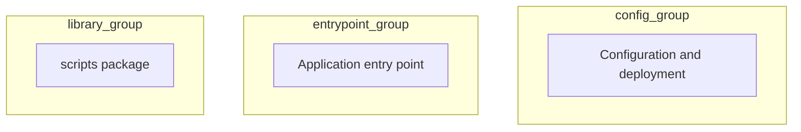

# Architecture report: ymcui/Chinese-LLaMA-Alpaca

> Automated static analysis. **Observed** = directly seen in files/imports/AST; **Inferred** = interpretation from that evidence. Repository code was not executed.

## 1. Repository at a glance

| Item | Value |
| --- | --- |
| Repository | ymcui/Chinese-LLaMA-Alpaca |
| Description | 中文LLaMA&Alpaca大语言模型+本地CPU/GPU训练部署 (Chinese LLaMA & Alpaca LLMs) |
| Language | Python |
| Stars | 18911 |
| Licence | Apache-2.0 |
| Analysed commit / branch | 5b8bb552e8b738da0f19a8e2cedf6db6b5c3fd14 / main |
| Framework(s) | FastAPI |
| Files analysed | 89 |
| Components | 3 |

## 2. Architecture in one minute

ymcui/Chinese-LLaMA-Alpaca - 中文LLaMA&Alpaca大语言模型+本地CPU/GPU训练部署 (Chinese LLaMA & Alpaca LLMs). This repository was analysed statically from 89 file(s) (18 Python). Detected technologies (observed from imports/manifests): GitHub Actions, FastAPI, NumPy, pandas, Pydantic, Uvicorn. Files are grouped into 3 component(s): Configuration and deployment, Application entry point, scripts package. Observed entry point(s): scripts/ceval/eval.py, scripts/crawl_prompt.py, scripts/inference/inference_hf.py. Findings below distinguish observed facts from inferred interpretation.

## 3. High-level block diagram

## 4. Main components

### Configuration and deployment (`config`)

- **Kind:** config
- **Status:** Observed
- **Confidence:** 0.85
- **Responsibility:** Groups 3 file(s) under configuration and deployment (observed from repository paths and static analysis).
- **Paths:** `requirements.txt`, `scripts/ceval/subject_mapping.json`, `scripts/training/ds_zero2_no_offload.json`
- **Evidence:** [requirements.txt](https://github.com/ymcui/Chinese-LLaMA-Alpaca/blob/5b8bb552e8b738da0f19a8e2cedf6db6b5c3fd14/requirements.txt); [scripts/ceval/subject_mapping.json](https://github.com/ymcui/Chinese-LLaMA-Alpaca/blob/5b8bb552e8b738da0f19a8e2cedf6db6b5c3fd14/scripts/ceval/subject_mapping.json); [scripts/training/ds_zero2_no_offload.json](https://github.com/ymcui/Chinese-LLaMA-Alpaca/blob/5b8bb552e8b738da0f19a8e2cedf6db6b5c3fd14/scripts/training/ds_zero2_no_offload.json)

### Application entry point (`entrypoint`)

- **Kind:** entrypoint
- **Status:** Observed
- **Confidence:** 0.85
- **Responsibility:** Groups 10 file(s) under application entry point (observed from repository paths and static analysis). Observed application object created via FastAPI. Observed routes: POST /v1/chat/completions, POST /v1/completions, POST /v1/embeddings. Observed top-level classes: DataTrainingArguments, ModelArguments, MyTrainingArguments, SavePeftModelCallback. Observed top-level functions: accuracy, compute_metrics, create_chat_completion, create_completion, create_embeddings, fault_tolerance_data_collator.
- **Paths:** `scripts/ceval/eval.py`, `scripts/crawl_prompt.py`, `scripts/inference/inference_hf.py`, `scripts/langchain/langchain_qa.py`, `scripts/langchain/langchain_sum.py`, `scripts/merge_llama_with_chinese_lora.py`, `scripts/merge_llama_with_chinese_lora_low_mem.py`, `scripts/openai_server_demo/openai_api_server.py`, `scripts/training/run_clm_pt_with_peft.py`, `scripts/training/run_clm_sft_with_peft.py`
- **Evidence:** [scripts/ceval/eval.py:13](https://github.com/ymcui/Chinese-LLaMA-Alpaca/blob/5b8bb552e8b738da0f19a8e2cedf6db6b5c3fd14/scripts/ceval/eval.py#L13); [scripts/crawl_prompt.py:9](https://github.com/ymcui/Chinese-LLaMA-Alpaca/blob/5b8bb552e8b738da0f19a8e2cedf6db6b5c3fd14/scripts/crawl_prompt.py#L9); [scripts/inference/inference_hf.py:50](https://github.com/ymcui/Chinese-LLaMA-Alpaca/blob/5b8bb552e8b738da0f19a8e2cedf6db6b5c3fd14/scripts/inference/inference_hf.py#L50); [scripts/langchain/langchain_qa.py](https://github.com/ymcui/Chinese-LLaMA-Alpaca/blob/5b8bb552e8b738da0f19a8e2cedf6db6b5c3fd14/scripts/langchain/langchain_qa.py); [scripts/langchain/langchain_sum.py](https://github.com/ymcui/Chinese-LLaMA-Alpaca/blob/5b8bb552e8b738da0f19a8e2cedf6db6b5c3fd14/scripts/langchain/langchain_sum.py); [scripts/merge_llama_with_chinese_lora.py:77](https://github.com/ymcui/Chinese-LLaMA-Alpaca/blob/5b8bb552e8b738da0f19a8e2cedf6db6b5c3fd14/scripts/merge_llama_with_chinese_lora.py#L77); [scripts/merge_llama_with_chinese_lora_low_mem.py:79](https://github.com/ymcui/Chinese-LLaMA-Alpaca/blob/5b8bb552e8b738da0f19a8e2cedf6db6b5c3fd14/scripts/merge_llama_with_chinese_lora_low_mem.py#L79); [scripts/openai_server_demo/openai_api_server.py:172](https://github.com/ymcui/Chinese-LLaMA-Alpaca/blob/5b8bb552e8b738da0f19a8e2cedf6db6b5c3fd14/scripts/openai_server_demo/openai_api_server.py#L172)

### scripts package (`scripts`)

- **Kind:** library
- **Status:** Observed
- **Confidence:** 0.85
- **Responsibility:** Groups 10 file(s) under scripts package (observed from repository paths and static analysis). Observed top-level classes: ChatCompletionRequest, ChatCompletionResponse, ChatCompletionResponseChoice, ChatMessage, CompletionRequest, CompletionResponse. Observed top-level functions: adaptive_ntk_forward, adaptive_ntk_init, apply_attention_patch, apply_ntk_scaling_patch, apply_rotary_pos_emb_single, build_instruction_dataset.
- **Paths:** `scripts/ceval/evaluator.py`, `scripts/ceval/llama_evaluator.py`, `scripts/inference/gradio_demo.py`, `scripts/inference/patches.py`, `scripts/merge_tokenizer/merge_tokenizers.py`, `scripts/openai_server_demo/openai_api_protocol.py`, `scripts/openai_server_demo/patches.py`, `scripts/training/build_dataset.py`, `scripts/training/run_pt.sh`, `scripts/training/run_sft.sh`
- **Evidence:** [scripts/ceval/evaluator.py:4](https://github.com/ymcui/Chinese-LLaMA-Alpaca/blob/5b8bb552e8b738da0f19a8e2cedf6db6b5c3fd14/scripts/ceval/evaluator.py#L4); [scripts/ceval/llama_evaluator.py:12](https://github.com/ymcui/Chinese-LLaMA-Alpaca/blob/5b8bb552e8b738da0f19a8e2cedf6db6b5c3fd14/scripts/ceval/llama_evaluator.py#L12); [scripts/inference/gradio_demo.py:73](https://github.com/ymcui/Chinese-LLaMA-Alpaca/blob/5b8bb552e8b738da0f19a8e2cedf6db6b5c3fd14/scripts/inference/gradio_demo.py#L73); [scripts/inference/patches.py:22](https://github.com/ymcui/Chinese-LLaMA-Alpaca/blob/5b8bb552e8b738da0f19a8e2cedf6db6b5c3fd14/scripts/inference/patches.py#L22); [scripts/merge_tokenizer/merge_tokenizers.py](https://github.com/ymcui/Chinese-LLaMA-Alpaca/blob/5b8bb552e8b738da0f19a8e2cedf6db6b5c3fd14/scripts/merge_tokenizer/merge_tokenizers.py); [scripts/openai_server_demo/openai_api_protocol.py:8](https://github.com/ymcui/Chinese-LLaMA-Alpaca/blob/5b8bb552e8b738da0f19a8e2cedf6db6b5c3fd14/scripts/openai_server_demo/openai_api_protocol.py#L8); [scripts/openai_server_demo/patches.py:22](https://github.com/ymcui/Chinese-LLaMA-Alpaca/blob/5b8bb552e8b738da0f19a8e2cedf6db6b5c3fd14/scripts/openai_server_demo/patches.py#L22); [scripts/training/build_dataset.py:21](https://github.com/ymcui/Chinese-LLaMA-Alpaca/blob/5b8bb552e8b738da0f19a8e2cedf6db6b5c3fd14/scripts/training/build_dataset.py#L21)

## 5. Execution flow

**Observed** entry point(s):

- [scripts/ceval/eval.py:79](https://github.com/ymcui/Chinese-LLaMA-Alpaca/blob/5b8bb552e8b738da0f19a8e2cedf6db6b5c3fd14/scripts/ceval/eval.py#L79)
- [scripts/crawl_prompt.py:31](https://github.com/ymcui/Chinese-LLaMA-Alpaca/blob/5b8bb552e8b738da0f19a8e2cedf6db6b5c3fd14/scripts/crawl_prompt.py#L31)
- [scripts/inference/inference_hf.py:56](https://github.com/ymcui/Chinese-LLaMA-Alpaca/blob/5b8bb552e8b738da0f19a8e2cedf6db6b5c3fd14/scripts/inference/inference_hf.py#L56)
- [scripts/langchain/langchain_qa.py:56](https://github.com/ymcui/Chinese-LLaMA-Alpaca/blob/5b8bb552e8b738da0f19a8e2cedf6db6b5c3fd14/scripts/langchain/langchain_qa.py#L56)
- [scripts/langchain/langchain_sum.py:37](https://github.com/ymcui/Chinese-LLaMA-Alpaca/blob/5b8bb552e8b738da0f19a8e2cedf6db6b5c3fd14/scripts/langchain/langchain_sum.py#L37)
- [scripts/merge_llama_with_chinese_lora.py:214](https://github.com/ymcui/Chinese-LLaMA-Alpaca/blob/5b8bb552e8b738da0f19a8e2cedf6db6b5c3fd14/scripts/merge_llama_with_chinese_lora.py#L214)
- [scripts/merge_llama_with_chinese_lora_low_mem.py:226](https://github.com/ymcui/Chinese-LLaMA-Alpaca/blob/5b8bb552e8b738da0f19a8e2cedf6db6b5c3fd14/scripts/merge_llama_with_chinese_lora_low_mem.py#L226)
- [scripts/openai_server_demo/openai_api_server.py:172](https://github.com/ymcui/Chinese-LLaMA-Alpaca/blob/5b8bb552e8b738da0f19a8e2cedf6db6b5c3fd14/scripts/openai_server_demo/openai_api_server.py#L172)
- [scripts/training/run_clm_pt_with_peft.py:641](https://github.com/ymcui/Chinese-LLaMA-Alpaca/blob/5b8bb552e8b738da0f19a8e2cedf6db6b5c3fd14/scripts/training/run_clm_pt_with_peft.py#L641)
- [scripts/training/run_clm_sft_with_peft.py:440](https://github.com/ymcui/Chinese-LLaMA-Alpaca/blob/5b8bb552e8b738da0f19a8e2cedf6db6b5c3fd14/scripts/training/run_clm_sft_with_peft.py#L440)

**Observed** routes (from decorators):

- `POST /v1/chat/completions` -> `create_chat_completion` in `scripts/openai_server_demo/openai_api_server.py:175`
- `POST /v1/completions` -> `create_completion` in `scripts/openai_server_demo/openai_api_server.py:197`
- `POST /v1/embeddings` -> `create_embeddings` in `scripts/openai_server_demo/openai_api_server.py:213`

Representative flow (derived from observed entry points and the import graph; steps beyond the entry point are **Inferred**):

1. Execution starts at an observed entry point listed above, if present.
2. No internal import relationships between components were observed.

## 6. Project structure

### `(root)`

- `.gitattributes` - other (31 bytes)
- `.gitignore` - other (22 bytes)
- `CITATION.cff` - other (829 bytes)
- `LICENSE.md` - docs (11362 bytes)
- `README.md` - docs (31334 bytes)
- `README_EN.md` - docs (34408 bytes)
- `SHA256.md` - docs (8720 bytes)
- `requirements.txt` - manifest (109 bytes)

### `.github`

- `.github/ISSUE_TEMPLATE/ISSUE_TEMPLATE_EN.yml` - config (3919 bytes)
- `.github/ISSUE_TEMPLATE/ISSUE_TEMPLATE_ZH.yml` - config (3626 bytes)
- `.github/ISSUE_TEMPLATE/config.yml` - config (27 bytes)
- `.github/workflows/stale.yml` - ci, YAML (1215 bytes)

### `data`

- `data/README.md` - docs (305 bytes)

### `examples`

- `examples/README.md` - docs (1460 bytes)
- `examples/f16-p7b-p13b-33b/CODE.md` - docs (20012 bytes)
- `examples/f16-p7b-p13b-33b/DIALOGUE.md` - docs (104265 bytes)
- `examples/f16-p7b-p13b-33b/ENTERTAINMENT.md` - docs (17201 bytes)
- `examples/f16-p7b-p13b-33b/ETHICS.md` - docs (19312 bytes)
- `examples/f16-p7b-p13b-33b/GENERATION.md` - docs (38934 bytes)
- `examples/f16-p7b-p13b-33b/LITERATURE.md` - docs (13493 bytes)
- `examples/f16-p7b-p13b-33b/OQA.md` - docs (28348 bytes)
- `examples/f16-p7b-p13b-33b/QA.md` - docs (18658 bytes)
- `examples/f16-p7b-p13b-33b/README.md` - docs (4085 bytes)
- `examples/f16-p7b-p13b-33b/REASONING.md` - docs (9635 bytes)
- `examples/f16-p7b-p13b-33b/TRANSLATION.md` - docs (18795 bytes)
- `examples/q4_7b-13b/CODE.md` - docs (12734 bytes)
- `examples/q4_7b-13b/DIALOGUE.md` - docs (24714 bytes)
- `examples/q4_7b-13b/ENTERTAINMENT.md` - docs (12695 bytes)
- `examples/q4_7b-13b/ETHICS.md` - docs (4812 bytes)
- `examples/q4_7b-13b/GENERATION.md` - docs (17983 bytes)
- `examples/q4_7b-13b/LITERATURE.md` - docs (7728 bytes)
- `examples/q4_7b-13b/OQA.md` - docs (17222 bytes)
- `examples/q4_7b-13b/QA.md` - docs (10999 bytes)
- `examples/q4_7b-13b/README.md` - docs (3527 bytes)
- `examples/q4_7b-13b/REASONING.md` - docs (6641 bytes)
- `examples/q4_7b-13b/TRANSLATION.md` - docs (12545 bytes)
- `examples/q8_13b-p7b-p13b/CODE.md` - docs (22489 bytes)
- `examples/q8_13b-p7b-p13b/DIALOGUE.md` - docs (96812 bytes)
- `examples/q8_13b-p7b-p13b/ENTERTAINMENT.md` - docs (16183 bytes)
- `examples/q8_13b-p7b-p13b/ETHICS.md` - docs (17498 bytes)
- `examples/q8_13b-p7b-p13b/GENERATION.md` - docs (40181 bytes)
- `examples/q8_13b-p7b-p13b/LITERATURE.md` - docs (12110 bytes)
- `examples/q8_13b-p7b-p13b/OQA.md` - docs (28793 bytes)
- `examples/q8_13b-p7b-p13b/QA.md` - docs (18342 bytes)
- `examples/q8_13b-p7b-p13b/README.md` - docs (4066 bytes)
- `examples/q8_13b-p7b-p13b/REASONING.md` - docs (9685 bytes)
- `examples/q8_13b-p7b-p13b/TRANSLATION.md` - docs (18874 bytes)
- `examples/q8_7b-13b-p7b/CODE.md` - docs (23510 bytes)
- `examples/q8_7b-13b-p7b/DIALOGUE.md` - docs (89051 bytes)
- `examples/q8_7b-13b-p7b/ENTERTAINMENT.md` - docs (15650 bytes)
- `examples/q8_7b-13b-p7b/ETHICS.md` - docs (17441 bytes)
- `examples/q8_7b-13b-p7b/GENERATION.md` - docs (38635 bytes)
- `examples/q8_7b-13b-p7b/LITERATURE.md` - docs (11850 bytes)
- `examples/q8_7b-13b-p7b/OQA.md` - docs (28012 bytes)
- `examples/q8_7b-13b-p7b/QA.md` - docs (16069 bytes)
- `examples/q8_7b-13b-p7b/README.md` - docs (4162 bytes)
- `examples/q8_7b-13b-p7b/REASONING.md` - docs (7113 bytes)
- `examples/q8_7b-13b-p7b/TRANSLATION.md` - docs (18493 bytes)

### `notebooks`

- `notebooks/README.md` - docs (2192 bytes)
- `notebooks/finetune_chinese_alpaca_lora.ipynb` - other (62553 bytes)
- `notebooks/gradio_web_demo.ipynb` - other (4590 bytes)
- `notebooks/legacy/convert_and_quantize_chinese_alpaca_plus.ipynb` - other (143763 bytes)
- `notebooks/legacy/convert_and_quantize_chinese_llama.ipynb` - other (197178 bytes)
- `notebooks/pretrain_chinese_llama_lora.ipynb` - other (101732 bytes)

### `scripts`

- `scripts/README.md` - docs (3226 bytes)
- `scripts/ceval/eval.py` - source, Python (4786 bytes)
- `scripts/ceval/evaluator.py` - source, Python (1563 bytes)
- `scripts/ceval/llama_evaluator.py` - source, Python (8298 bytes)
- `scripts/ceval/subject_mapping.json` - config (5299 bytes)
- `scripts/crawl_prompt.py` - source, Python (3334 bytes)
- `scripts/inference/gradio_demo.py` - source, Python (11559 bytes)
- `scripts/inference/inference_hf.py` - source, Python (7235 bytes)
- `scripts/inference/patches.py` - source, Python (8629 bytes)
- `scripts/langchain/doc.txt` - docs (6154 bytes)
- `scripts/langchain/langchain_qa.py` - source, Python (4268 bytes)
- `scripts/langchain/langchain_sum.py` - source, Python (2806 bytes)
- `scripts/merge_llama_with_chinese_lora.py` - source, Python (14726 bytes)
- `scripts/merge_llama_with_chinese_lora_low_mem.py` - source, Python (14888 bytes)
- `scripts/merge_tokenizer/merge_tokenizers.py` - source, Python (2680 bytes)
- `scripts/openai_server_demo/README.md` - docs (9383 bytes)
- `scripts/openai_server_demo/openai_api_protocol.py` - source, Python (2294 bytes)
- `scripts/openai_server_demo/openai_api_server.py` - source, Python (8009 bytes)
- `scripts/openai_server_demo/patches.py` - source, Python (8629 bytes)
- `scripts/training/build_dataset.py` - source, Python (4035 bytes)
- `scripts/training/ds_zero2_no_offload.json` - config (686 bytes)
- `scripts/training/run_clm_pt_with_peft.py` - source, Python (28313 bytes)
- `scripts/training/run_clm_sft_with_peft.py` - source, Python (17951 bytes)
- `scripts/training/run_pt.sh` - source, Shell (1792 bytes)
- `scripts/training/run_sft.sh` - source, Shell (1974 bytes)

## 7. Key dependencies and integrations

| Name | Category | Status | Confidence | Evidence |
| --- | --- | --- | --- | --- |
| GitHub Actions | ci | Observed | 0.85 | [.github/workflows/stale.yml](https://github.com/ymcui/Chinese-LLaMA-Alpaca/blob/5b8bb552e8b738da0f19a8e2cedf6db6b5c3fd14/.github/workflows/stale.yml) |
| FastAPI | framework | Observed | 0.90 | [scripts/openai_server_demo/openai_api_server.py:3](https://github.com/ymcui/Chinese-LLaMA-Alpaca/blob/5b8bb552e8b738da0f19a8e2cedf6db6b5c3fd14/scripts/openai_server_demo/openai_api_server.py#L3) |
| NumPy | library | Observed | 0.95 | [scripts/ceval/llama_evaluator.py:7](https://github.com/ymcui/Chinese-LLaMA-Alpaca/blob/5b8bb552e8b738da0f19a8e2cedf6db6b5c3fd14/scripts/ceval/llama_evaluator.py#L7); [scripts/training/run_clm_pt_with_peft.py:25](https://github.com/ymcui/Chinese-LLaMA-Alpaca/blob/5b8bb552e8b738da0f19a8e2cedf6db6b5c3fd14/scripts/training/run_clm_pt_with_peft.py#L25) |
| pandas | library | Observed | 0.90 | [scripts/ceval/eval.py:5](https://github.com/ymcui/Chinese-LLaMA-Alpaca/blob/5b8bb552e8b738da0f19a8e2cedf6db6b5c3fd14/scripts/ceval/eval.py#L5) |
| Pydantic | library | Observed | 0.90 | [scripts/openai_server_demo/openai_api_protocol.py:6](https://github.com/ymcui/Chinese-LLaMA-Alpaca/blob/5b8bb552e8b738da0f19a8e2cedf6db6b5c3fd14/scripts/openai_server_demo/openai_api_protocol.py#L6) |
| Uvicorn | library | Observed | 0.90 | [scripts/openai_server_demo/openai_api_server.py:4](https://github.com/ymcui/Chinese-LLaMA-Alpaca/blob/5b8bb552e8b738da0f19a8e2cedf6db6b5c3fd14/scripts/openai_server_demo/openai_api_server.py#L4) |

## 8. Data and state

No database, cache, queue, or persistent-state usage was observed in the analysed files. State handling, if any, may be in-memory or in files that were not analysed.

## 9. Configuration and deployment clues

- `.github/ISSUE_TEMPLATE/ISSUE_TEMPLATE_EN.yml` (config)
- `.github/ISSUE_TEMPLATE/ISSUE_TEMPLATE_ZH.yml` (config)
- `.github/ISSUE_TEMPLATE/config.yml` (config)
- `.github/workflows/stale.yml` (ci)
- `requirements.txt` (manifest)
- `scripts/ceval/subject_mapping.json` (config)
- `scripts/training/ds_zero2_no_offload.json` (config)

## 10. Design observations

- An entry/API layer is separated from other code (Inferred from paths and decorators).

These observations are interpretations (**Inferred**) of the observed structure, not guarantees about runtime design.

## 11. Limitations and unknowns

- Static analysis only: repository code was not executed, installed, or imported at runtime.
- Components and relationships are inferred from file paths, imports, and AST structure; runtime behaviour, dynamic imports, and reflection may not be visible.
- Repository text was treated as untrusted data; no instructions found in repository files were followed, and likely secret values were redacted/excluded.

## 12. Source references

- [.github/workflows/stale.yml](https://github.com/ymcui/Chinese-LLaMA-Alpaca/blob/5b8bb552e8b738da0f19a8e2cedf6db6b5c3fd14/.github/workflows/stale.yml)
- [requirements.txt](https://github.com/ymcui/Chinese-LLaMA-Alpaca/blob/5b8bb552e8b738da0f19a8e2cedf6db6b5c3fd14/requirements.txt)
- [scripts/ceval/eval.py:5](https://github.com/ymcui/Chinese-LLaMA-Alpaca/blob/5b8bb552e8b738da0f19a8e2cedf6db6b5c3fd14/scripts/ceval/eval.py#L5)
- [scripts/ceval/eval.py:13](https://github.com/ymcui/Chinese-LLaMA-Alpaca/blob/5b8bb552e8b738da0f19a8e2cedf6db6b5c3fd14/scripts/ceval/eval.py#L13)
- [scripts/ceval/eval.py:79](https://github.com/ymcui/Chinese-LLaMA-Alpaca/blob/5b8bb552e8b738da0f19a8e2cedf6db6b5c3fd14/scripts/ceval/eval.py#L79)
- [scripts/ceval/evaluator.py:4](https://github.com/ymcui/Chinese-LLaMA-Alpaca/blob/5b8bb552e8b738da0f19a8e2cedf6db6b5c3fd14/scripts/ceval/evaluator.py#L4)
- [scripts/ceval/llama_evaluator.py:7](https://github.com/ymcui/Chinese-LLaMA-Alpaca/blob/5b8bb552e8b738da0f19a8e2cedf6db6b5c3fd14/scripts/ceval/llama_evaluator.py#L7)
- [scripts/ceval/llama_evaluator.py:12](https://github.com/ymcui/Chinese-LLaMA-Alpaca/blob/5b8bb552e8b738da0f19a8e2cedf6db6b5c3fd14/scripts/ceval/llama_evaluator.py#L12)
- [scripts/ceval/subject_mapping.json](https://github.com/ymcui/Chinese-LLaMA-Alpaca/blob/5b8bb552e8b738da0f19a8e2cedf6db6b5c3fd14/scripts/ceval/subject_mapping.json)
- [scripts/crawl_prompt.py:9](https://github.com/ymcui/Chinese-LLaMA-Alpaca/blob/5b8bb552e8b738da0f19a8e2cedf6db6b5c3fd14/scripts/crawl_prompt.py#L9)
- [scripts/crawl_prompt.py:31](https://github.com/ymcui/Chinese-LLaMA-Alpaca/blob/5b8bb552e8b738da0f19a8e2cedf6db6b5c3fd14/scripts/crawl_prompt.py#L31)
- [scripts/inference/gradio_demo.py:73](https://github.com/ymcui/Chinese-LLaMA-Alpaca/blob/5b8bb552e8b738da0f19a8e2cedf6db6b5c3fd14/scripts/inference/gradio_demo.py#L73)
- [scripts/inference/inference_hf.py:50](https://github.com/ymcui/Chinese-LLaMA-Alpaca/blob/5b8bb552e8b738da0f19a8e2cedf6db6b5c3fd14/scripts/inference/inference_hf.py#L50)
- [scripts/inference/inference_hf.py:56](https://github.com/ymcui/Chinese-LLaMA-Alpaca/blob/5b8bb552e8b738da0f19a8e2cedf6db6b5c3fd14/scripts/inference/inference_hf.py#L56)
- [scripts/inference/patches.py:22](https://github.com/ymcui/Chinese-LLaMA-Alpaca/blob/5b8bb552e8b738da0f19a8e2cedf6db6b5c3fd14/scripts/inference/patches.py#L22)
- [scripts/langchain/langchain_qa.py](https://github.com/ymcui/Chinese-LLaMA-Alpaca/blob/5b8bb552e8b738da0f19a8e2cedf6db6b5c3fd14/scripts/langchain/langchain_qa.py)
- [scripts/langchain/langchain_qa.py:56](https://github.com/ymcui/Chinese-LLaMA-Alpaca/blob/5b8bb552e8b738da0f19a8e2cedf6db6b5c3fd14/scripts/langchain/langchain_qa.py#L56)
- [scripts/langchain/langchain_sum.py](https://github.com/ymcui/Chinese-LLaMA-Alpaca/blob/5b8bb552e8b738da0f19a8e2cedf6db6b5c3fd14/scripts/langchain/langchain_sum.py)
- [scripts/langchain/langchain_sum.py:37](https://github.com/ymcui/Chinese-LLaMA-Alpaca/blob/5b8bb552e8b738da0f19a8e2cedf6db6b5c3fd14/scripts/langchain/langchain_sum.py#L37)
- [scripts/merge_llama_with_chinese_lora.py:77](https://github.com/ymcui/Chinese-LLaMA-Alpaca/blob/5b8bb552e8b738da0f19a8e2cedf6db6b5c3fd14/scripts/merge_llama_with_chinese_lora.py#L77)
- [scripts/merge_llama_with_chinese_lora.py:214](https://github.com/ymcui/Chinese-LLaMA-Alpaca/blob/5b8bb552e8b738da0f19a8e2cedf6db6b5c3fd14/scripts/merge_llama_with_chinese_lora.py#L214)
- [scripts/merge_llama_with_chinese_lora_low_mem.py:79](https://github.com/ymcui/Chinese-LLaMA-Alpaca/blob/5b8bb552e8b738da0f19a8e2cedf6db6b5c3fd14/scripts/merge_llama_with_chinese_lora_low_mem.py#L79)
- [scripts/merge_llama_with_chinese_lora_low_mem.py:226](https://github.com/ymcui/Chinese-LLaMA-Alpaca/blob/5b8bb552e8b738da0f19a8e2cedf6db6b5c3fd14/scripts/merge_llama_with_chinese_lora_low_mem.py#L226)
- [scripts/merge_tokenizer/merge_tokenizers.py](https://github.com/ymcui/Chinese-LLaMA-Alpaca/blob/5b8bb552e8b738da0f19a8e2cedf6db6b5c3fd14/scripts/merge_tokenizer/merge_tokenizers.py)
- [scripts/openai_server_demo/openai_api_protocol.py:6](https://github.com/ymcui/Chinese-LLaMA-Alpaca/blob/5b8bb552e8b738da0f19a8e2cedf6db6b5c3fd14/scripts/openai_server_demo/openai_api_protocol.py#L6)
- [scripts/openai_server_demo/openai_api_protocol.py:8](https://github.com/ymcui/Chinese-LLaMA-Alpaca/blob/5b8bb552e8b738da0f19a8e2cedf6db6b5c3fd14/scripts/openai_server_demo/openai_api_protocol.py#L8)
- [scripts/openai_server_demo/openai_api_server.py:3](https://github.com/ymcui/Chinese-LLaMA-Alpaca/blob/5b8bb552e8b738da0f19a8e2cedf6db6b5c3fd14/scripts/openai_server_demo/openai_api_server.py#L3)
- [scripts/openai_server_demo/openai_api_server.py:4](https://github.com/ymcui/Chinese-LLaMA-Alpaca/blob/5b8bb552e8b738da0f19a8e2cedf6db6b5c3fd14/scripts/openai_server_demo/openai_api_server.py#L4)
- [scripts/openai_server_demo/openai_api_server.py:172](https://github.com/ymcui/Chinese-LLaMA-Alpaca/blob/5b8bb552e8b738da0f19a8e2cedf6db6b5c3fd14/scripts/openai_server_demo/openai_api_server.py#L172)
- [scripts/openai_server_demo/patches.py:22](https://github.com/ymcui/Chinese-LLaMA-Alpaca/blob/5b8bb552e8b738da0f19a8e2cedf6db6b5c3fd14/scripts/openai_server_demo/patches.py#L22)
- [scripts/training/build_dataset.py:21](https://github.com/ymcui/Chinese-LLaMA-Alpaca/blob/5b8bb552e8b738da0f19a8e2cedf6db6b5c3fd14/scripts/training/build_dataset.py#L21)
- [scripts/training/ds_zero2_no_offload.json](https://github.com/ymcui/Chinese-LLaMA-Alpaca/blob/5b8bb552e8b738da0f19a8e2cedf6db6b5c3fd14/scripts/training/ds_zero2_no_offload.json)
- [scripts/training/run_clm_pt_with_peft.py:25](https://github.com/ymcui/Chinese-LLaMA-Alpaca/blob/5b8bb552e8b738da0f19a8e2cedf6db6b5c3fd14/scripts/training/run_clm_pt_with_peft.py#L25)
- [scripts/training/run_clm_pt_with_peft.py:641](https://github.com/ymcui/Chinese-LLaMA-Alpaca/blob/5b8bb552e8b738da0f19a8e2cedf6db6b5c3fd14/scripts/training/run_clm_pt_with_peft.py#L641)
- [scripts/training/run_clm_sft_with_peft.py:440](https://github.com/ymcui/Chinese-LLaMA-Alpaca/blob/5b8bb552e8b738da0f19a8e2cedf6db6b5c3fd14/scripts/training/run_clm_sft_with_peft.py#L440)
