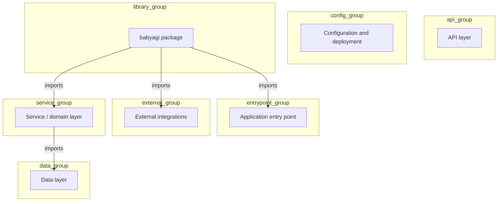

# Architecture report: yoheinakajima/babyagi

> Automated static analysis. **Observed** = directly seen in files/imports/AST; **Inferred** = interpretation from that evidence. Repository code was not executed.

## 1. Repository at a glance

| Item | Value |
| --- | --- |
| Repository | yoheinakajima/babyagi |
| Description | Not provided |
| Language | Python |
| Stars | 22359 |
| Licence | Not detected |
| Analysed commit / branch | fa8930ebe72a82e5ad57b356e7cbec96290e5bb2 / main |
| Framework(s) | Flask |
| Files analysed | 65 |
| Components | 7 |

## 2. Architecture in one minute

yoheinakajima/babyagi. This repository was analysed statically from 65 file(s) (41 Python). Detected technologies (observed from imports/manifests): Flask, NumPy, Pydantic, requests, SQLAlchemy, Poetry. Files are grouped into 7 component(s): API layer, babyagi package, Configuration and deployment, Data layer, Application entry point, External integrations, Service / domain layer. Observed entry point(s): babyagi/__init__.py, main.py. Findings below distinguish observed facts from inferred interpretation.

## 3. High-level block diagram

## 4. Main components

### API layer (`api_layer`)

- **Kind:** api
- **Status:** Observed
- **Confidence:** 0.85
- **Responsibility:** Groups 1 file(s) under api layer (observed from repository paths and static analysis). Observed top-level functions: create_api_blueprint.
- **Paths:** `babyagi/api/__init__.py`
- **Evidence:** [babyagi/api/__init__.py:13](https://github.com/yoheinakajima/babyagi/blob/fa8930ebe72a82e5ad57b356e7cbec96290e5bb2/babyagi/api/__init__.py#L13)

### babyagi package (`babyagi`)

- **Kind:** library
- **Status:** Observed
- **Confidence:** 0.85
- **Responsibility:** Groups 27 file(s) under babyagi package (observed from repository paths and static analysis). Observed top-level functions: activate_function_version_wrapper, add_function_to_database, add_key_wrapper, add_new_function, add_trigger_wrapper, ai_description_generator.
- **Paths:** `babyagi/dashboard/__init__.py`, `babyagi/dashboard/static/js/dashboard.js`, `babyagi/dashboard/static/js/function_details.js`, `babyagi/dashboard/static/js/function_graph.js`, `babyagi/dashboard/static/js/log_dashboard.js`, `babyagi/dashboard/static/js/log_graph.js`, `babyagi/functionz/__init__.py`, `babyagi/functionz/packs/default/ai_functions.py`, `babyagi/functionz/packs/default/default_functions.py`, `babyagi/functionz/packs/default/function_calling_chat.py`, `babyagi/functionz/packs/default/os.py`, `babyagi/functionz/packs/drafts/choose_or_create_function.py`, `babyagi/functionz/packs/drafts/code_writing_functions.py`, `babyagi/functionz/packs/drafts/generate_function.py`, `babyagi/functionz/packs/drafts/react_agent.py`, `babyagi/functionz/packs/drafts/self_build.py`, `babyagi/functionz/packs/drafts/self_build2.py`, `babyagi/functionz/packs/drafts/user_db.py`, `babyagi/functionz/packs/plugins/airtable.py`, `babyagi/functionz/packs/plugins/augie.py`, `babyagi/functionz/packs/plugins/e2b.py`, `babyagi/functionz/packs/plugins/firecrawl.py`, `babyagi/functionz/packs/plugins/harmonic.py`, `babyagi/functionz/packs/plugins/payman.py`, `babyagi/functionz/packs/plugins/serpapi.py`, `babyagi/functionz/packs/plugins/voilanorbert.py`, `babyagi/functionz/packs/plugins/wokelo.py`
- **Evidence:** [babyagi/dashboard/__init__.py:9](https://github.com/yoheinakajima/babyagi/blob/fa8930ebe72a82e5ad57b356e7cbec96290e5bb2/babyagi/dashboard/__init__.py#L9); [babyagi/dashboard/static/js/dashboard.js](https://github.com/yoheinakajima/babyagi/blob/fa8930ebe72a82e5ad57b356e7cbec96290e5bb2/babyagi/dashboard/static/js/dashboard.js); [babyagi/dashboard/static/js/function_details.js](https://github.com/yoheinakajima/babyagi/blob/fa8930ebe72a82e5ad57b356e7cbec96290e5bb2/babyagi/dashboard/static/js/function_details.js); [babyagi/dashboard/static/js/function_graph.js](https://github.com/yoheinakajima/babyagi/blob/fa8930ebe72a82e5ad57b356e7cbec96290e5bb2/babyagi/dashboard/static/js/function_graph.js); [babyagi/dashboard/static/js/log_dashboard.js](https://github.com/yoheinakajima/babyagi/blob/fa8930ebe72a82e5ad57b356e7cbec96290e5bb2/babyagi/dashboard/static/js/log_dashboard.js); [babyagi/dashboard/static/js/log_graph.js](https://github.com/yoheinakajima/babyagi/blob/fa8930ebe72a82e5ad57b356e7cbec96290e5bb2/babyagi/dashboard/static/js/log_graph.js); [babyagi/functionz/__init__.py](https://github.com/yoheinakajima/babyagi/blob/fa8930ebe72a82e5ad57b356e7cbec96290e5bb2/babyagi/functionz/__init__.py); [babyagi/functionz/packs/default/ai_functions.py:10](https://github.com/yoheinakajima/babyagi/blob/fa8930ebe72a82e5ad57b356e7cbec96290e5bb2/babyagi/functionz/packs/default/ai_functions.py#L10)

### Configuration and deployment (`config`)

- **Kind:** config
- **Status:** Observed
- **Confidence:** 0.85
- **Responsibility:** Groups 4 file(s) under configuration and deployment (observed from repository paths and static analysis). Observed top-level functions: parse_requirements.
- **Paths:** `MANIFEST.in`, `pyproject.toml`, `requirements.txt`, `setup.py`
- **Evidence:** [MANIFEST.in](https://github.com/yoheinakajima/babyagi/blob/fa8930ebe72a82e5ad57b356e7cbec96290e5bb2/MANIFEST.in); [pyproject.toml](https://github.com/yoheinakajima/babyagi/blob/fa8930ebe72a82e5ad57b356e7cbec96290e5bb2/pyproject.toml); [requirements.txt](https://github.com/yoheinakajima/babyagi/blob/fa8930ebe72a82e5ad57b356e7cbec96290e5bb2/requirements.txt); [setup.py:9](https://github.com/yoheinakajima/babyagi/blob/fa8930ebe72a82e5ad57b356e7cbec96290e5bb2/setup.py#L9)

### Data layer (`data_layer`)

- **Kind:** data
- **Status:** Observed
- **Confidence:** 0.85
- **Responsibility:** Groups 5 file(s) under data layer (observed from repository paths and static analysis). Observed top-level classes: BaseDB, DBRouter, Function, FunctionVersion, Import, ImportResult. Observed top-level functions: get_or_create_key.
- **Paths:** `babyagi/functionz/db/__init__.py`, `babyagi/functionz/db/base_db.py`, `babyagi/functionz/db/db_router.py`, `babyagi/functionz/db/local_db.py`, `babyagi/functionz/db/models.py`
- **Evidence:** [babyagi/functionz/db/__init__.py](https://github.com/yoheinakajima/babyagi/blob/fa8930ebe72a82e5ad57b356e7cbec96290e5bb2/babyagi/functionz/db/__init__.py); [babyagi/functionz/db/base_db.py:5](https://github.com/yoheinakajima/babyagi/blob/fa8930ebe72a82e5ad57b356e7cbec96290e5bb2/babyagi/functionz/db/base_db.py#L5); [babyagi/functionz/db/db_router.py:9](https://github.com/yoheinakajima/babyagi/blob/fa8930ebe72a82e5ad57b356e7cbec96290e5bb2/babyagi/functionz/db/db_router.py#L9); [babyagi/functionz/db/local_db.py:12](https://github.com/yoheinakajima/babyagi/blob/fa8930ebe72a82e5ad57b356e7cbec96290e5bb2/babyagi/functionz/db/local_db.py#L12); [babyagi/functionz/db/models.py:17](https://github.com/yoheinakajima/babyagi/blob/fa8930ebe72a82e5ad57b356e7cbec96290e5bb2/babyagi/functionz/db/models.py#L17)

### Application entry point (`entrypoint`)

- **Kind:** entrypoint
- **Status:** Observed
- **Confidence:** 0.85
- **Responsibility:** Groups 2 file(s) under application entry point (observed from repository paths and static analysis). Observed application object created via Flask. Observed routes: ROUTE /. Observed top-level functions: __getattr__, create_app, get_func_instance, home, load_functions, register_function.
- **Paths:** `babyagi/__init__.py`, `main.py`
- **Evidence:** [babyagi/__init__.py:20](https://github.com/yoheinakajima/babyagi/blob/fa8930ebe72a82e5ad57b356e7cbec96290e5bb2/babyagi/__init__.py#L20); [main.py:12](https://github.com/yoheinakajima/babyagi/blob/fa8930ebe72a82e5ad57b356e7cbec96290e5bb2/main.py#L12)

### External integrations (`external_integrations`)

- **Kind:** external
- **Status:** Inferred
- **Confidence:** 0.70
- **Responsibility:** Groups 0 file(s) under external integrations (observed from repository paths and static analysis).
- **Evidence:** [babyagi/functionz/db/local_db.py:3](https://github.com/yoheinakajima/babyagi/blob/fa8930ebe72a82e5ad57b356e7cbec96290e5bb2/babyagi/functionz/db/local_db.py#L3); [babyagi/functionz/db/local_db.py:4](https://github.com/yoheinakajima/babyagi/blob/fa8930ebe72a82e5ad57b356e7cbec96290e5bb2/babyagi/functionz/db/local_db.py#L4); [babyagi/functionz/db/local_db.py:5](https://github.com/yoheinakajima/babyagi/blob/fa8930ebe72a82e5ad57b356e7cbec96290e5bb2/babyagi/functionz/db/local_db.py#L5); [babyagi/functionz/db/models.py:3](https://github.com/yoheinakajima/babyagi/blob/fa8930ebe72a82e5ad57b356e7cbec96290e5bb2/babyagi/functionz/db/models.py#L3); [babyagi/functionz/db/models.py:4](https://github.com/yoheinakajima/babyagi/blob/fa8930ebe72a82e5ad57b356e7cbec96290e5bb2/babyagi/functionz/db/models.py#L4); [babyagi/functionz/db/models.py:5](https://github.com/yoheinakajima/babyagi/blob/fa8930ebe72a82e5ad57b356e7cbec96290e5bb2/babyagi/functionz/db/models.py#L5)

### Service / domain layer (`service_layer`)

- **Kind:** service
- **Status:** Observed
- **Confidence:** 0.85
- **Responsibility:** Groups 4 file(s) under service / domain layer (observed from repository paths and static analysis). Observed top-level classes: FunctionExecutor, FunctionRegistrar, Functionz.
- **Paths:** `babyagi/functionz/core/__init__.py`, `babyagi/functionz/core/execution.py`, `babyagi/functionz/core/framework.py`, `babyagi/functionz/core/registration.py`
- **Evidence:** [babyagi/functionz/core/__init__.py](https://github.com/yoheinakajima/babyagi/blob/fa8930ebe72a82e5ad57b356e7cbec96290e5bb2/babyagi/functionz/core/__init__.py); [babyagi/functionz/core/execution.py:11](https://github.com/yoheinakajima/babyagi/blob/fa8930ebe72a82e5ad57b356e7cbec96290e5bb2/babyagi/functionz/core/execution.py#L11); [babyagi/functionz/core/framework.py:16](https://github.com/yoheinakajima/babyagi/blob/fa8930ebe72a82e5ad57b356e7cbec96290e5bb2/babyagi/functionz/core/framework.py#L16); [babyagi/functionz/core/registration.py:12](https://github.com/yoheinakajima/babyagi/blob/fa8930ebe72a82e5ad57b356e7cbec96290e5bb2/babyagi/functionz/core/registration.py#L12)

## 5. Execution flow

**Observed** entry point(s):

- [babyagi/__init__.py:20](https://github.com/yoheinakajima/babyagi/blob/fa8930ebe72a82e5ad57b356e7cbec96290e5bb2/babyagi/__init__.py#L20)
- [main.py:15](https://github.com/yoheinakajima/babyagi/blob/fa8930ebe72a82e5ad57b356e7cbec96290e5bb2/main.py#L15)

**Observed** routes (from decorators):

- `ROUTE /` -> `home` in `examples/custom_flask_example.py:19`
- `ROUTE /` -> `home` in `examples/custom_route_example.py:12`
- `ROUTE /` -> `home` in `examples/quickstart_example.py:14`
- `ROUTE /` -> `home` in `examples/self_build_example.py:15`
- `ROUTE /` -> `home` in `examples/simple_example.py:21`
- `ROUTE /` -> `home` in `examples/trigger_example.py:16`
- `ROUTE /` -> `home` in `main.py:12`

Representative flow (derived from observed entry points and the import graph; steps beyond the entry point are **Inferred**):

1. Execution starts at an observed entry point listed above, if present.
2. `babyagi` imports `entrypoint` (babyagi package -> Application entry point).
3. `babyagi` imports `external_integrations` (babyagi package -> External integrations).
4. `babyagi` imports `service_layer` (babyagi package -> Service / domain layer).
5. `service_layer` imports `data_layer` (Service / domain layer -> Data layer).

## 6. Project structure

### `(root)`

- `.gitignore` - other (3129 bytes)
- `.replit` - other (387 bytes)
- `CNAME` - other (11 bytes)
- `CODE_READINESS_ANALYSIS.md` - docs (10895 bytes)
- `MANIFEST.in` - manifest (551 bytes)
- `README.md` - docs (10814 bytes)
- `main.py` - source, Python (419 bytes)
- `pyproject.toml` - manifest (610 bytes)
- `requirements.txt` - manifest (74 bytes)
- `setup.py` - manifest, Python (1554 bytes)

### `babyagi`

- `babyagi/__init__.py` - source, Python (5109 bytes)
- `babyagi/api/__init__.py` - source, Python (7635 bytes)
- `babyagi/dashboard/__init__.py` - source, Python (5719 bytes)
- `babyagi/dashboard/static/css/style.css` - other (7529 bytes)
- `babyagi/dashboard/static/js/dashboard.js` - source, JavaScript (8144 bytes)
- `babyagi/dashboard/static/js/function_details.js` - source, JavaScript (14000 bytes)
- `babyagi/dashboard/static/js/function_graph.js` - source, JavaScript (7774 bytes)
- `babyagi/dashboard/static/js/log_dashboard.js` - source, JavaScript (10553 bytes)
- `babyagi/dashboard/static/js/log_graph.js` - source, JavaScript (2396 bytes)
- `babyagi/dashboard/templates/base.html` - other (1493 bytes)
- `babyagi/dashboard/templates/chat.html` - other (19879 bytes)
- `babyagi/dashboard/templates/function_details.html` - other (3450 bytes)
- `babyagi/dashboard/templates/function_graph.html` - other (19892 bytes)
- `babyagi/dashboard/templates/function_graph_3d.html` - other (4466 bytes)
- `babyagi/dashboard/templates/function_graph_mermaid.html` - other (10469 bytes)
- `babyagi/dashboard/templates/index.html` - other (1643 bytes)
- `babyagi/dashboard/templates/log_page.html` - other (6352 bytes)
- `babyagi/dashboard/templates/log_relationship_graph.html` - other (1656 bytes)
- `babyagi/dashboard/templates/logs_dashboard.html` - other (2887 bytes)
- `babyagi/functionz/__init__.py` - source, Python (53 bytes)
- `babyagi/functionz/core/__init__.py` - source, Python (0 bytes)
- `babyagi/functionz/core/execution.py` - source, Python (11373 bytes)
- `babyagi/functionz/core/framework.py` - source, Python (5632 bytes)
- `babyagi/functionz/core/registration.py` - source, Python (11896 bytes)
- `babyagi/functionz/db/__init__.py` - source, Python (0 bytes)
- `babyagi/functionz/db/base_db.py` - source, Python (2158 bytes)
- `babyagi/functionz/db/db_router.py` - source, Python (13272 bytes)
- `babyagi/functionz/db/local_db.py` - source, Python (9489 bytes)
- `babyagi/functionz/db/models.py` - source, Python (4754 bytes)
- `babyagi/functionz/packs/default/ai_functions.py` - source, Python (9998 bytes)
- `babyagi/functionz/packs/default/default_functions.py` - source, Python (4391 bytes)
- `babyagi/functionz/packs/default/function_calling_chat.py` - source, Python (6875 bytes)
- `babyagi/functionz/packs/default/os.py` - source, Python (1140 bytes)
- `babyagi/functionz/packs/drafts/choose_or_create_function.py` - source, Python (10198 bytes)
- `babyagi/functionz/packs/drafts/code_writing_functions.py` - source, Python (18154 bytes)
- `babyagi/functionz/packs/drafts/generate_function.py` - source, Python (37797 bytes)
- `babyagi/functionz/packs/drafts/react_agent.py` - source, Python (9032 bytes)
- `babyagi/functionz/packs/drafts/self_build.py` - source, Python (4285 bytes)
- `babyagi/functionz/packs/drafts/self_build2.py` - source, Python (5943 bytes)
- `babyagi/functionz/packs/drafts/user_db.py` - source, Python (17353 bytes)
- `babyagi/functionz/packs/plugins/airtable.py` - source, Python (7568 bytes)
- `babyagi/functionz/packs/plugins/augie.py` - source, Python (4346 bytes)
- `babyagi/functionz/packs/plugins/e2b.py` - source, Python (4093 bytes)
- `babyagi/functionz/packs/plugins/firecrawl.py` - source, Python (2320 bytes)
- `babyagi/functionz/packs/plugins/harmonic.py` - source, Python (2642 bytes)
- `babyagi/functionz/packs/plugins/payman.py` - source, Python (6851 bytes)
- `babyagi/functionz/packs/plugins/serpapi.py` - source, Python (2633 bytes)
- `babyagi/functionz/packs/plugins/voilanorbert.py` - source, Python (3192 bytes)
- `babyagi/functionz/packs/plugins/wokelo.py` - source, Python (5657 bytes)

### `examples`

- `examples/custom_flask_example.py` - source, Python (588 bytes)
- `examples/custom_route_example.py` - source, Python (449 bytes)
- `examples/quickstart_example.py` - source, Python (421 bytes)
- `examples/self_build_example.py` - source, Python (672 bytes)
- `examples/simple_example.py` - source, Python (760 bytes)
- `examples/trigger_example.py` - source, Python (594 bytes)

## 7. Key dependencies and integrations

| Name | Category | Status | Confidence | Evidence |
| --- | --- | --- | --- | --- |
| Flask | framework | Observed | 0.95 | [babyagi/__init__.py:3](https://github.com/yoheinakajima/babyagi/blob/fa8930ebe72a82e5ad57b356e7cbec96290e5bb2/babyagi/__init__.py#L3); [babyagi/api/__init__.py:3](https://github.com/yoheinakajima/babyagi/blob/fa8930ebe72a82e5ad57b356e7cbec96290e5bb2/babyagi/api/__init__.py#L3); [babyagi/dashboard/__init__.py:3](https://github.com/yoheinakajima/babyagi/blob/fa8930ebe72a82e5ad57b356e7cbec96290e5bb2/babyagi/dashboard/__init__.py#L3); [examples/custom_flask_example.py:3](https://github.com/yoheinakajima/babyagi/blob/fa8930ebe72a82e5ad57b356e7cbec96290e5bb2/examples/custom_flask_example.py#L3) |
| NumPy | library | Observed | 0.90 | [babyagi/functionz/packs/default/ai_functions.py:173](https://github.com/yoheinakajima/babyagi/blob/fa8930ebe72a82e5ad57b356e7cbec96290e5bb2/babyagi/functionz/packs/default/ai_functions.py#L173) |
| Pydantic | library | Observed | 0.95 | [babyagi/functionz/packs/drafts/choose_or_create_function.py:29](https://github.com/yoheinakajima/babyagi/blob/fa8930ebe72a82e5ad57b356e7cbec96290e5bb2/babyagi/functionz/packs/drafts/choose_or_create_function.py#L29); [babyagi/functionz/packs/drafts/generate_function.py:57](https://github.com/yoheinakajima/babyagi/blob/fa8930ebe72a82e5ad57b356e7cbec96290e5bb2/babyagi/functionz/packs/drafts/generate_function.py#L57); [babyagi/functionz/packs/drafts/generate_function.py:198](https://github.com/yoheinakajima/babyagi/blob/fa8930ebe72a82e5ad57b356e7cbec96290e5bb2/babyagi/functionz/packs/drafts/generate_function.py#L198); [babyagi/functionz/packs/drafts/generate_function.py:299](https://github.com/yoheinakajima/babyagi/blob/fa8930ebe72a82e5ad57b356e7cbec96290e5bb2/babyagi/functionz/packs/drafts/generate_function.py#L299) |
| requests | library | Observed | 0.95 | [babyagi/functionz/packs/plugins/augie.py:54](https://github.com/yoheinakajima/babyagi/blob/fa8930ebe72a82e5ad57b356e7cbec96290e5bb2/babyagi/functionz/packs/plugins/augie.py#L54); [babyagi/functionz/packs/plugins/augie.py:77](https://github.com/yoheinakajima/babyagi/blob/fa8930ebe72a82e5ad57b356e7cbec96290e5bb2/babyagi/functionz/packs/plugins/augie.py#L77); [babyagi/functionz/packs/plugins/wokelo.py:8](https://github.com/yoheinakajima/babyagi/blob/fa8930ebe72a82e5ad57b356e7cbec96290e5bb2/babyagi/functionz/packs/plugins/wokelo.py#L8); [babyagi/functionz/packs/plugins/wokelo.py:38](https://github.com/yoheinakajima/babyagi/blob/fa8930ebe72a82e5ad57b356e7cbec96290e5bb2/babyagi/functionz/packs/plugins/wokelo.py#L38) |
| SQLAlchemy | library | Observed | 0.95 | [babyagi/functionz/db/local_db.py:3](https://github.com/yoheinakajima/babyagi/blob/fa8930ebe72a82e5ad57b356e7cbec96290e5bb2/babyagi/functionz/db/local_db.py#L3); [babyagi/functionz/db/local_db.py:4](https://github.com/yoheinakajima/babyagi/blob/fa8930ebe72a82e5ad57b356e7cbec96290e5bb2/babyagi/functionz/db/local_db.py#L4); [babyagi/functionz/db/local_db.py:5](https://github.com/yoheinakajima/babyagi/blob/fa8930ebe72a82e5ad57b356e7cbec96290e5bb2/babyagi/functionz/db/local_db.py#L5); [babyagi/functionz/db/models.py:3](https://github.com/yoheinakajima/babyagi/blob/fa8930ebe72a82e5ad57b356e7cbec96290e5bb2/babyagi/functionz/db/models.py#L3) |
| Poetry | packaging | Observed | 0.85 | [pyproject.toml:1](https://github.com/yoheinakajima/babyagi/blob/fa8930ebe72a82e5ad57b356e7cbec96290e5bb2/pyproject.toml#L1) |
| setuptools | packaging | Observed | 0.90 | [pyproject.toml:12](https://github.com/yoheinakajima/babyagi/blob/fa8930ebe72a82e5ad57b356e7cbec96290e5bb2/pyproject.toml#L12); [setup.py:1](https://github.com/yoheinakajima/babyagi/blob/fa8930ebe72a82e5ad57b356e7cbec96290e5bb2/setup.py#L1) |

## 8. Data and state

- Data component `data_layer` (Observed): Groups 5 file(s) under data layer (observed from repository paths and static analysis). Observed top-level classes: BaseDB, DBRouter, Function, FunctionVersion, Import, ImportResult. Observed top-level functions: get_or_create_key.

## 9. Configuration and deployment clues

- `MANIFEST.in` (manifest)
- `pyproject.toml` (manifest)
- `requirements.txt` (manifest)
- `setup.py` (manifest)

Console scripts declared in packaging metadata (**Observed**):

- `babyagi` -> `babyagi.main:main`

## 10. Design observations

- An entry/API layer is separated from other code (Inferred from paths and decorators).
- Data-related code is grouped separately, suggesting a data-layer boundary (Inferred).
- Service/domain code is distinct from entry and data code, suggesting layered separation (Inferred).
- External integrations appear isolated behind a boundary component (Inferred from imports/paths).

These observations are interpretations (**Inferred**) of the observed structure, not guarantees about runtime design.

## 11. Limitations and unknowns

- Static analysis only: repository code was not executed, installed, or imported at runtime.
- Components and relationships are inferred from file paths, imports, and AST structure; runtime behaviour, dynamic imports, and reflection may not be visible.
- 1 file(s) were skipped during inventory (1 x lockfile excluded).
- File babyagi/functionz/packs/drafts/user_db.py could not be parsed as Python (possible SyntaxError) and was skipped for AST analysis.
- Repository text was treated as untrusted data; no instructions found in repository files were followed, and likely secret values were redacted/excluded.

## 12. Source references

- [MANIFEST.in](https://github.com/yoheinakajima/babyagi/blob/fa8930ebe72a82e5ad57b356e7cbec96290e5bb2/MANIFEST.in)
- [babyagi/__init__.py:3](https://github.com/yoheinakajima/babyagi/blob/fa8930ebe72a82e5ad57b356e7cbec96290e5bb2/babyagi/__init__.py#L3)
- [babyagi/__init__.py:20](https://github.com/yoheinakajima/babyagi/blob/fa8930ebe72a82e5ad57b356e7cbec96290e5bb2/babyagi/__init__.py#L20)
- [babyagi/api/__init__.py:3](https://github.com/yoheinakajima/babyagi/blob/fa8930ebe72a82e5ad57b356e7cbec96290e5bb2/babyagi/api/__init__.py#L3)
- [babyagi/api/__init__.py:13](https://github.com/yoheinakajima/babyagi/blob/fa8930ebe72a82e5ad57b356e7cbec96290e5bb2/babyagi/api/__init__.py#L13)
- [babyagi/dashboard/__init__.py:3](https://github.com/yoheinakajima/babyagi/blob/fa8930ebe72a82e5ad57b356e7cbec96290e5bb2/babyagi/dashboard/__init__.py#L3)
- [babyagi/dashboard/__init__.py:9](https://github.com/yoheinakajima/babyagi/blob/fa8930ebe72a82e5ad57b356e7cbec96290e5bb2/babyagi/dashboard/__init__.py#L9)
- [babyagi/dashboard/static/js/dashboard.js](https://github.com/yoheinakajima/babyagi/blob/fa8930ebe72a82e5ad57b356e7cbec96290e5bb2/babyagi/dashboard/static/js/dashboard.js)
- [babyagi/dashboard/static/js/function_details.js](https://github.com/yoheinakajima/babyagi/blob/fa8930ebe72a82e5ad57b356e7cbec96290e5bb2/babyagi/dashboard/static/js/function_details.js)
- [babyagi/dashboard/static/js/function_graph.js](https://github.com/yoheinakajima/babyagi/blob/fa8930ebe72a82e5ad57b356e7cbec96290e5bb2/babyagi/dashboard/static/js/function_graph.js)
- [babyagi/dashboard/static/js/log_dashboard.js](https://github.com/yoheinakajima/babyagi/blob/fa8930ebe72a82e5ad57b356e7cbec96290e5bb2/babyagi/dashboard/static/js/log_dashboard.js)
- [babyagi/dashboard/static/js/log_graph.js](https://github.com/yoheinakajima/babyagi/blob/fa8930ebe72a82e5ad57b356e7cbec96290e5bb2/babyagi/dashboard/static/js/log_graph.js)
- [babyagi/functionz/__init__.py](https://github.com/yoheinakajima/babyagi/blob/fa8930ebe72a82e5ad57b356e7cbec96290e5bb2/babyagi/functionz/__init__.py)
- [babyagi/functionz/core/__init__.py](https://github.com/yoheinakajima/babyagi/blob/fa8930ebe72a82e5ad57b356e7cbec96290e5bb2/babyagi/functionz/core/__init__.py)
- [babyagi/functionz/core/execution.py:11](https://github.com/yoheinakajima/babyagi/blob/fa8930ebe72a82e5ad57b356e7cbec96290e5bb2/babyagi/functionz/core/execution.py#L11)
- [babyagi/functionz/core/framework.py:16](https://github.com/yoheinakajima/babyagi/blob/fa8930ebe72a82e5ad57b356e7cbec96290e5bb2/babyagi/functionz/core/framework.py#L16)
- [babyagi/functionz/core/registration.py:12](https://github.com/yoheinakajima/babyagi/blob/fa8930ebe72a82e5ad57b356e7cbec96290e5bb2/babyagi/functionz/core/registration.py#L12)
- [babyagi/functionz/db/__init__.py](https://github.com/yoheinakajima/babyagi/blob/fa8930ebe72a82e5ad57b356e7cbec96290e5bb2/babyagi/functionz/db/__init__.py)
- [babyagi/functionz/db/base_db.py:5](https://github.com/yoheinakajima/babyagi/blob/fa8930ebe72a82e5ad57b356e7cbec96290e5bb2/babyagi/functionz/db/base_db.py#L5)
- [babyagi/functionz/db/db_router.py:9](https://github.com/yoheinakajima/babyagi/blob/fa8930ebe72a82e5ad57b356e7cbec96290e5bb2/babyagi/functionz/db/db_router.py#L9)
- [babyagi/functionz/db/local_db.py:3](https://github.com/yoheinakajima/babyagi/blob/fa8930ebe72a82e5ad57b356e7cbec96290e5bb2/babyagi/functionz/db/local_db.py#L3)
- [babyagi/functionz/db/local_db.py:4](https://github.com/yoheinakajima/babyagi/blob/fa8930ebe72a82e5ad57b356e7cbec96290e5bb2/babyagi/functionz/db/local_db.py#L4)
- [babyagi/functionz/db/local_db.py:5](https://github.com/yoheinakajima/babyagi/blob/fa8930ebe72a82e5ad57b356e7cbec96290e5bb2/babyagi/functionz/db/local_db.py#L5)
- [babyagi/functionz/db/local_db.py:12](https://github.com/yoheinakajima/babyagi/blob/fa8930ebe72a82e5ad57b356e7cbec96290e5bb2/babyagi/functionz/db/local_db.py#L12)
- [babyagi/functionz/db/models.py:3](https://github.com/yoheinakajima/babyagi/blob/fa8930ebe72a82e5ad57b356e7cbec96290e5bb2/babyagi/functionz/db/models.py#L3)
- [babyagi/functionz/db/models.py:4](https://github.com/yoheinakajima/babyagi/blob/fa8930ebe72a82e5ad57b356e7cbec96290e5bb2/babyagi/functionz/db/models.py#L4)
- [babyagi/functionz/db/models.py:5](https://github.com/yoheinakajima/babyagi/blob/fa8930ebe72a82e5ad57b356e7cbec96290e5bb2/babyagi/functionz/db/models.py#L5)
- [babyagi/functionz/db/models.py:8](https://github.com/yoheinakajima/babyagi/blob/fa8930ebe72a82e5ad57b356e7cbec96290e5bb2/babyagi/functionz/db/models.py#L8)
- [babyagi/functionz/db/models.py:17](https://github.com/yoheinakajima/babyagi/blob/fa8930ebe72a82e5ad57b356e7cbec96290e5bb2/babyagi/functionz/db/models.py#L17)
- [babyagi/functionz/packs/default/ai_functions.py:10](https://github.com/yoheinakajima/babyagi/blob/fa8930ebe72a82e5ad57b356e7cbec96290e5bb2/babyagi/functionz/packs/default/ai_functions.py#L10)
- [babyagi/functionz/packs/default/ai_functions.py:173](https://github.com/yoheinakajima/babyagi/blob/fa8930ebe72a82e5ad57b356e7cbec96290e5bb2/babyagi/functionz/packs/default/ai_functions.py#L173)
- [babyagi/functionz/packs/drafts/choose_or_create_function.py:29](https://github.com/yoheinakajima/babyagi/blob/fa8930ebe72a82e5ad57b356e7cbec96290e5bb2/babyagi/functionz/packs/drafts/choose_or_create_function.py#L29)
- [babyagi/functionz/packs/drafts/generate_function.py:57](https://github.com/yoheinakajima/babyagi/blob/fa8930ebe72a82e5ad57b356e7cbec96290e5bb2/babyagi/functionz/packs/drafts/generate_function.py#L57)
- [babyagi/functionz/packs/drafts/generate_function.py:198](https://github.com/yoheinakajima/babyagi/blob/fa8930ebe72a82e5ad57b356e7cbec96290e5bb2/babyagi/functionz/packs/drafts/generate_function.py#L198)
- [babyagi/functionz/packs/drafts/generate_function.py:299](https://github.com/yoheinakajima/babyagi/blob/fa8930ebe72a82e5ad57b356e7cbec96290e5bb2/babyagi/functionz/packs/drafts/generate_function.py#L299)
- [babyagi/functionz/packs/drafts/generate_function.py:534](https://github.com/yoheinakajima/babyagi/blob/fa8930ebe72a82e5ad57b356e7cbec96290e5bb2/babyagi/functionz/packs/drafts/generate_function.py#L534)
- [babyagi/functionz/packs/drafts/generate_function.py:796](https://github.com/yoheinakajima/babyagi/blob/fa8930ebe72a82e5ad57b356e7cbec96290e5bb2/babyagi/functionz/packs/drafts/generate_function.py#L796)
- [babyagi/functionz/packs/drafts/self_build2.py:37](https://github.com/yoheinakajima/babyagi/blob/fa8930ebe72a82e5ad57b356e7cbec96290e5bb2/babyagi/functionz/packs/drafts/self_build2.py#L37)
- [babyagi/functionz/packs/plugins/augie.py:54](https://github.com/yoheinakajima/babyagi/blob/fa8930ebe72a82e5ad57b356e7cbec96290e5bb2/babyagi/functionz/packs/plugins/augie.py#L54)
- [babyagi/functionz/packs/plugins/augie.py:77](https://github.com/yoheinakajima/babyagi/blob/fa8930ebe72a82e5ad57b356e7cbec96290e5bb2/babyagi/functionz/packs/plugins/augie.py#L77)
- [babyagi/functionz/packs/plugins/wokelo.py:8](https://github.com/yoheinakajima/babyagi/blob/fa8930ebe72a82e5ad57b356e7cbec96290e5bb2/babyagi/functionz/packs/plugins/wokelo.py#L8)
- [babyagi/functionz/packs/plugins/wokelo.py:38](https://github.com/yoheinakajima/babyagi/blob/fa8930ebe72a82e5ad57b356e7cbec96290e5bb2/babyagi/functionz/packs/plugins/wokelo.py#L38)
- [babyagi/functionz/packs/plugins/wokelo.py:58](https://github.com/yoheinakajima/babyagi/blob/fa8930ebe72a82e5ad57b356e7cbec96290e5bb2/babyagi/functionz/packs/plugins/wokelo.py#L58)
- [babyagi/functionz/packs/plugins/wokelo.py:77](https://github.com/yoheinakajima/babyagi/blob/fa8930ebe72a82e5ad57b356e7cbec96290e5bb2/babyagi/functionz/packs/plugins/wokelo.py#L77)
- [examples/custom_flask_example.py:3](https://github.com/yoheinakajima/babyagi/blob/fa8930ebe72a82e5ad57b356e7cbec96290e5bb2/examples/custom_flask_example.py#L3)
- [main.py:12](https://github.com/yoheinakajima/babyagi/blob/fa8930ebe72a82e5ad57b356e7cbec96290e5bb2/main.py#L12)
- [main.py:15](https://github.com/yoheinakajima/babyagi/blob/fa8930ebe72a82e5ad57b356e7cbec96290e5bb2/main.py#L15)
- [pyproject.toml](https://github.com/yoheinakajima/babyagi/blob/fa8930ebe72a82e5ad57b356e7cbec96290e5bb2/pyproject.toml)
- [pyproject.toml:1](https://github.com/yoheinakajima/babyagi/blob/fa8930ebe72a82e5ad57b356e7cbec96290e5bb2/pyproject.toml#L1)
- [pyproject.toml:10](https://github.com/yoheinakajima/babyagi/blob/fa8930ebe72a82e5ad57b356e7cbec96290e5bb2/pyproject.toml#L10)
- [pyproject.toml:12](https://github.com/yoheinakajima/babyagi/blob/fa8930ebe72a82e5ad57b356e7cbec96290e5bb2/pyproject.toml#L12)
- [requirements.txt](https://github.com/yoheinakajima/babyagi/blob/fa8930ebe72a82e5ad57b356e7cbec96290e5bb2/requirements.txt)
- [requirements.txt:1](https://github.com/yoheinakajima/babyagi/blob/fa8930ebe72a82e5ad57b356e7cbec96290e5bb2/requirements.txt#L1)
- [requirements.txt:2](https://github.com/yoheinakajima/babyagi/blob/fa8930ebe72a82e5ad57b356e7cbec96290e5bb2/requirements.txt#L2)
- [setup.py:1](https://github.com/yoheinakajima/babyagi/blob/fa8930ebe72a82e5ad57b356e7cbec96290e5bb2/setup.py#L1)
- [setup.py:9](https://github.com/yoheinakajima/babyagi/blob/fa8930ebe72a82e5ad57b356e7cbec96290e5bb2/setup.py#L9)
