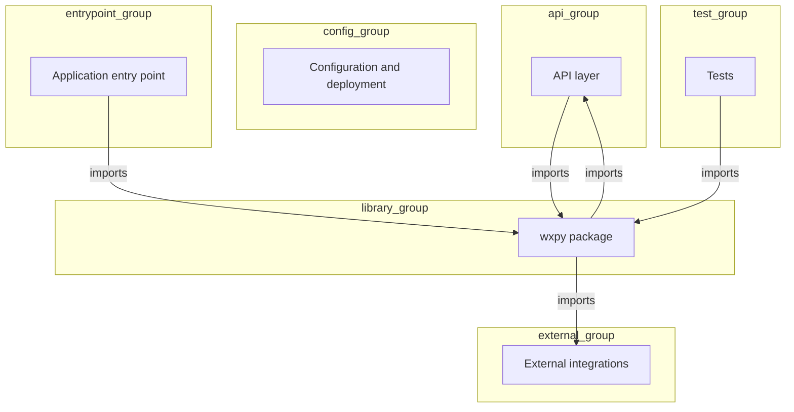

# Architecture report: youfou/wxpy

> Automated static analysis. **Observed** = directly seen in files/imports/AST; **Inferred** = interpretation from that evidence. Repository code was not executed.

## 1. Repository at a glance

| Item | Value |
| --- | --- |
| Repository | youfou/wxpy |
| Description | 微信机器人 / 可能是最优雅的微信个人号 API ✨✨ |
| Language | Python |
| Stars | 14252 |
| Licence | MIT |
| Analysed commit / branch | ab63e12da822dc85615fa203e5be9fa28ae0b59f / master |
| Framework(s) | None detected |
| Files analysed | 75 |
| Components | 6 |

## 2. Architecture in one minute

youfou/wxpy - 微信机器人 / 可能是最优雅的微信个人号 API ✨✨. This repository was analysed statically from 75 file(s) (56 Python). Detected technologies (observed from imports/manifests): requests, setuptools, pytest. Files are grouped into 6 component(s): API layer, Configuration and deployment, Application entry point, External integrations, Tests, wxpy package. Observed entry point(s): wxpy/__main__.py, wxpy/utils/__init__.py. Findings below distinguish observed facts from inferred interpretation.

## 3. High-level block diagram

## 4. Main components

### API layer (`api_layer`)

- **Kind:** api
- **Status:** Observed
- **Confidence:** 0.85
- **Responsibility:** Groups 19 file(s) under api layer (observed from repository paths and static analysis). Observed top-level classes: Article, Bot, Chat, Chats, Friend, Group. Observed top-level functions: wrapped_send.
- **Paths:** `wxpy/api/__init__.py`, `wxpy/api/bot.py`, `wxpy/api/chats/__init__.py`, `wxpy/api/chats/chat.py`, `wxpy/api/chats/chats.py`, `wxpy/api/chats/friend.py`, `wxpy/api/chats/group.py`, `wxpy/api/chats/groups.py`, `wxpy/api/chats/member.py`, `wxpy/api/chats/mp.py`, `wxpy/api/chats/user.py`, `wxpy/api/consts.py`, `wxpy/api/messages/__init__.py`, `wxpy/api/messages/article.py`, `wxpy/api/messages/message.py`, `wxpy/api/messages/message_config.py`, `wxpy/api/messages/messages.py`, `wxpy/api/messages/registered.py`, `wxpy/api/messages/sent_message.py`
- **Evidence:** [wxpy/api/__init__.py](https://github.com/youfou/wxpy/blob/ab63e12da822dc85615fa203e5be9fa28ae0b59f/wxpy/api/__init__.py); [wxpy/api/bot.py:33](https://github.com/youfou/wxpy/blob/ab63e12da822dc85615fa203e5be9fa28ae0b59f/wxpy/api/bot.py#L33); [wxpy/api/chats/__init__.py](https://github.com/youfou/wxpy/blob/ab63e12da822dc85615fa203e5be9fa28ae0b59f/wxpy/api/chats/__init__.py); [wxpy/api/chats/chat.py:18](https://github.com/youfou/wxpy/blob/ab63e12da822dc85615fa203e5be9fa28ae0b59f/wxpy/api/chats/chat.py#L18); [wxpy/api/chats/chats.py:14](https://github.com/youfou/wxpy/blob/ab63e12da822dc85615fa203e5be9fa28ae0b59f/wxpy/api/chats/chats.py#L14); [wxpy/api/chats/friend.py:11](https://github.com/youfou/wxpy/blob/ab63e12da822dc85615fa203e5be9fa28ae0b59f/wxpy/api/chats/friend.py#L11); [wxpy/api/chats/group.py:14](https://github.com/youfou/wxpy/blob/ab63e12da822dc85615fa203e5be9fa28ae0b59f/wxpy/api/chats/group.py#L14); [wxpy/api/chats/groups.py:8](https://github.com/youfou/wxpy/blob/ab63e12da822dc85615fa203e5be9fa28ae0b59f/wxpy/api/chats/groups.py#L8)

### Configuration and deployment (`config`)

- **Kind:** config
- **Status:** Observed
- **Confidence:** 0.85
- **Responsibility:** Groups 4 file(s) under configuration and deployment (observed from repository paths and static analysis).
- **Paths:** `MANIFEST.in`, `requirements.txt`, `setup.cfg`, `setup.py`
- **Evidence:** [MANIFEST.in](https://github.com/youfou/wxpy/blob/ab63e12da822dc85615fa203e5be9fa28ae0b59f/MANIFEST.in); [requirements.txt](https://github.com/youfou/wxpy/blob/ab63e12da822dc85615fa203e5be9fa28ae0b59f/requirements.txt); [setup.cfg](https://github.com/youfou/wxpy/blob/ab63e12da822dc85615fa203e5be9fa28ae0b59f/setup.cfg); [setup.py](https://github.com/youfou/wxpy/blob/ab63e12da822dc85615fa203e5be9fa28ae0b59f/setup.py)

### Application entry point (`entrypoint`)

- **Kind:** entrypoint
- **Status:** Observed
- **Confidence:** 0.85
- **Responsibility:** Groups 1 file(s) under application entry point (observed from repository paths and static analysis).
- **Paths:** `wxpy/__main__.py`
- **Evidence:** [wxpy/__main__.py](https://github.com/youfou/wxpy/blob/ab63e12da822dc85615fa203e5be9fa28ae0b59f/wxpy/__main__.py)

### External integrations (`external_integrations`)

- **Kind:** external
- **Status:** Inferred
- **Confidence:** 0.70
- **Responsibility:** Groups 0 file(s) under external integrations (observed from repository paths and static analysis).
- **Evidence:** [wxpy/ext/tuling.py:6](https://github.com/youfou/wxpy/blob/ab63e12da822dc85615fa203e5be9fa28ae0b59f/wxpy/ext/tuling.py#L6); [wxpy/ext/xiaoi.py:9](https://github.com/youfou/wxpy/blob/ab63e12da822dc85615fa203e5be9fa28ae0b59f/wxpy/ext/xiaoi.py#L9); [wxpy/utils/misc.py:12](https://github.com/youfou/wxpy/blob/ab63e12da822dc85615fa203e5be9fa28ae0b59f/wxpy/utils/misc.py#L12); [wxpy/utils/misc.py:13](https://github.com/youfou/wxpy/blob/ab63e12da822dc85615fa203e5be9fa28ae0b59f/wxpy/utils/misc.py#L13)

### Tests (`tests`)

- **Kind:** test
- **Status:** Observed
- **Confidence:** 0.85
- **Responsibility:** Groups 18 file(s) under tests (observed from repository paths and static analysis). Observed top-level classes: TestBot, TestChat, TestChats, TestFriend, TestGroup, TestGroups. Observed top-level functions: base_dir, bot, file_path, friend, group, image_path.
- **Paths:** `tests/__init__.py`, `tests/api/__init__.py`, `tests/api/chats/__init__.py`, `tests/api/chats/test_chat.py`, `tests/api/chats/test_chats.py`, `tests/api/chats/test_friend.py`, `tests/api/chats/test_group.py`, `tests/api/chats/test_groups.py`, `tests/api/chats/test_member.py`, `tests/api/chats/test_mp.py`, `tests/api/chats/test_user.py`, `tests/api/messages/__init__.py`, `tests/api/messages/test_message.py`, `tests/api/test_bot.py`, `tests/attachments/file.txt`, `tests/conftest.py`, `tests/ext/__init__.py`, `tests/utils/__init__.py`
- **Evidence:** [tests/__init__.py](https://github.com/youfou/wxpy/blob/ab63e12da822dc85615fa203e5be9fa28ae0b59f/tests/__init__.py); [tests/api/__init__.py](https://github.com/youfou/wxpy/blob/ab63e12da822dc85615fa203e5be9fa28ae0b59f/tests/api/__init__.py); [tests/api/chats/__init__.py](https://github.com/youfou/wxpy/blob/ab63e12da822dc85615fa203e5be9fa28ae0b59f/tests/api/chats/__init__.py); [tests/api/chats/test_chat.py:1](https://github.com/youfou/wxpy/blob/ab63e12da822dc85615fa203e5be9fa28ae0b59f/tests/api/chats/test_chat.py#L1); [tests/api/chats/test_chats.py:6](https://github.com/youfou/wxpy/blob/ab63e12da822dc85615fa203e5be9fa28ae0b59f/tests/api/chats/test_chats.py#L6); [tests/api/chats/test_friend.py:1](https://github.com/youfou/wxpy/blob/ab63e12da822dc85615fa203e5be9fa28ae0b59f/tests/api/chats/test_friend.py#L1); [tests/api/chats/test_group.py:6](https://github.com/youfou/wxpy/blob/ab63e12da822dc85615fa203e5be9fa28ae0b59f/tests/api/chats/test_group.py#L6); [tests/api/chats/test_groups.py:1](https://github.com/youfou/wxpy/blob/ab63e12da822dc85615fa203e5be9fa28ae0b59f/tests/api/chats/test_groups.py#L1)

### wxpy package (`wxpy`)

- **Kind:** library
- **Status:** Observed
- **Confidence:** 0.85
- **Responsibility:** Groups 17 file(s) under wxpy package (observed from repository paths and static analysis). Observed top-level classes: BaseRequest, PuidMap, ResponseError, TemporaryDirectory, Tuling, TwoWayDict. Observed top-level functions: _bpython, _ipython, _python, assign_emoji, check_response_body, decode_text_from_webwx.
- **Paths:** `wxpy/__compat__.py`, `wxpy/__init__.py`, `wxpy/compatible/__init__.py`, `wxpy/compatible/utils.py`, `wxpy/exceptions.py`, `wxpy/ext/__init__.py`, `wxpy/ext/logging_with_wechat.py`, `wxpy/ext/sync_message_in_groups.py`, `wxpy/ext/talk_bot_utils.py`, `wxpy/ext/tuling.py`, `wxpy/ext/xiaoi.py`, `wxpy/utils/__init__.py`, `wxpy/utils/base_request.py`, `wxpy/utils/console.py`, `wxpy/utils/misc.py`, `wxpy/utils/puid_map.py`, `wxpy/utils/tools.py`
- **Evidence:** [wxpy/__compat__.py](https://github.com/youfou/wxpy/blob/ab63e12da822dc85615fa203e5be9fa28ae0b59f/wxpy/__compat__.py); [wxpy/__init__.py](https://github.com/youfou/wxpy/blob/ab63e12da822dc85615fa203e5be9fa28ae0b59f/wxpy/__init__.py); [wxpy/compatible/__init__.py](https://github.com/youfou/wxpy/blob/ab63e12da822dc85615fa203e5be9fa28ae0b59f/wxpy/compatible/__init__.py); [wxpy/compatible/utils.py:14](https://github.com/youfou/wxpy/blob/ab63e12da822dc85615fa203e5be9fa28ae0b59f/wxpy/compatible/utils.py#L14); [wxpy/exceptions.py:5](https://github.com/youfou/wxpy/blob/ab63e12da822dc85615fa203e5be9fa28ae0b59f/wxpy/exceptions.py#L5); [wxpy/ext/__init__.py](https://github.com/youfou/wxpy/blob/ab63e12da822dc85615fa203e5be9fa28ae0b59f/wxpy/ext/__init__.py); [wxpy/ext/logging_with_wechat.py:11](https://github.com/youfou/wxpy/blob/ab63e12da822dc85615fa203e5be9fa28ae0b59f/wxpy/ext/logging_with_wechat.py#L11); [wxpy/ext/sync_message_in_groups.py:26](https://github.com/youfou/wxpy/blob/ab63e12da822dc85615fa203e5be9fa28ae0b59f/wxpy/ext/sync_message_in_groups.py#L26)

## 5. Execution flow

**Observed** entry point(s):

- [wxpy/__main__.py:5](https://github.com/youfou/wxpy/blob/ab63e12da822dc85615fa203e5be9fa28ae0b59f/wxpy/__main__.py#L5)
- [wxpy/utils/__init__.py](https://github.com/youfou/wxpy/blob/ab63e12da822dc85615fa203e5be9fa28ae0b59f/wxpy/utils/__init__.py)

Representative flow (derived from observed entry points and the import graph; steps beyond the entry point are **Inferred**):

1. Execution starts at an observed entry point listed above, if present.
2. `api_layer` imports `wxpy` (API layer -> wxpy package).
3. `entrypoint` imports `wxpy` (Application entry point -> wxpy package).
4. `tests` imports `wxpy` (Tests -> wxpy package).
5. `wxpy` imports `api_layer` (wxpy package -> API layer).
6. `wxpy` imports `external_integrations` (wxpy package -> External integrations).

## 6. Project structure

### `(root)`

- `.gitignore` - other (3023 bytes)
- `LICENSE` - docs (1096 bytes)
- `MANIFEST.in` - manifest (27 bytes)
- `README.rst` - docs (4171 bytes)
- `requirements.txt` - manifest (30 bytes)
- `setup.cfg` - manifest (46 bytes)
- `setup.py` - manifest, Python (1475 bytes)

### `docs`

- `docs/Makefile` - docs (605 bytes)
- `docs/bot.rst` - docs (3380 bytes)
- `docs/chats.rst` - docs (4810 bytes)
- `docs/conf.py` - docs (5663 bytes)
- `docs/console.rst` - docs (2510 bytes)
- `docs/faq.rst` - docs (2227 bytes)
- `docs/index.rst` - docs (3173 bytes)
- `docs/itchat.rst` - docs (1242 bytes)
- `docs/logging_with_wechat.rst` - docs (1905 bytes)
- `docs/make.bat` - docs (812 bytes)
- `docs/messages.rst` - docs (6731 bytes)
- `docs/response_error.rst` - docs (2946 bytes)
- `docs/utils.rst` - docs (2139 bytes)

### `tests`

- `tests/__init__.py` - test, Python (0 bytes)
- `tests/api/__init__.py` - test, Python (0 bytes)
- `tests/api/chats/__init__.py` - test, Python (0 bytes)
- `tests/api/chats/test_chat.py` - test, Python (98 bytes)
- `tests/api/chats/test_chats.py` - test, Python (593 bytes)
- `tests/api/chats/test_friend.py` - test, Python (26 bytes)
- `tests/api/chats/test_group.py` - test, Python (855 bytes)
- `tests/api/chats/test_groups.py` - test, Python (185 bytes)
- `tests/api/chats/test_member.py` - test, Python (0 bytes)
- `tests/api/chats/test_mp.py` - test, Python (23 bytes)
- `tests/api/chats/test_user.py` - test, Python (1090 bytes)
- `tests/api/messages/__init__.py` - test, Python (0 bytes)
- `tests/api/messages/test_message.py` - test, Python (2800 bytes)
- `tests/api/test_bot.py` - test, Python (2779 bytes)
- `tests/attachments/file.txt` - test (17 bytes)
- `tests/conftest.py` - test, Python (2287 bytes)
- `tests/ext/__init__.py` - test, Python (0 bytes)
- `tests/utils/__init__.py` - test, Python (0 bytes)

### `wxpy`

- `wxpy/__compat__.py` - source, Python (0 bytes)
- `wxpy/__init__.py` - source, Python (2313 bytes)
- `wxpy/__main__.py` - source, Python (94 bytes)
- `wxpy/api/__init__.py` - source, Python (0 bytes)
- `wxpy/api/bot.py` - source, Python (18363 bytes)
- `wxpy/api/chats/__init__.py` - source, Python (196 bytes)
- `wxpy/api/chats/chat.py` - source, Python (12093 bytes)
- `wxpy/api/chats/chats.py` - source, Python (4860 bytes)
- `wxpy/api/chats/friend.py` - source, Python (199 bytes)
- `wxpy/api/chats/group.py` - source, Python (4762 bytes)
- `wxpy/api/chats/groups.py` - source, Python (2550 bytes)
- `wxpy/api/chats/member.py` - source, Python (1276 bytes)
- `wxpy/api/chats/mp.py` - source, Python (103 bytes)
- `wxpy/api/chats/user.py` - source, Python (2436 bytes)
- `wxpy/api/consts.py` - source, Python (398 bytes)
- `wxpy/api/messages/__init__.py` - source, Python (204 bytes)
- `wxpy/api/messages/article.py` - source, Python (885 bytes)
- `wxpy/api/messages/message.py` - source, Python (16073 bytes)
- `wxpy/api/messages/message_config.py` - source, Python (1613 bytes)
- `wxpy/api/messages/messages.py` - source, Python (1329 bytes)
- `wxpy/api/messages/registered.py` - source, Python (2720 bytes)
- `wxpy/api/messages/sent_message.py` - source, Python (2873 bytes)
- `wxpy/compatible/__init__.py` - source, Python (193 bytes)
- `wxpy/compatible/utils.py` - source, Python (3213 bytes)
- `wxpy/exceptions.py` - source, Python (387 bytes)
- `wxpy/ext/__init__.py` - source, Python (184 bytes)
- `wxpy/ext/logging_with_wechat.py` - source, Python (1918 bytes)
- `wxpy/ext/sync_message_in_groups.py` - source, Python (4343 bytes)
- `wxpy/ext/talk_bot_utils.py` - source, Python (1206 bytes)
- `wxpy/ext/tuling.py` - source, Python (4388 bytes)
- `wxpy/ext/xiaoi.py` - source, Python (3546 bytes)
- `wxpy/utils/__init__.py` - source, Python (481 bytes)
- `wxpy/utils/base_request.py` - source, Python (1962 bytes)
- `wxpy/utils/console.py` - source, Python (4594 bytes)
- `wxpy/utils/misc.py` - source, Python (12856 bytes)
- `wxpy/utils/puid_map.py` - source, Python (5358 bytes)
- `wxpy/utils/tools.py` - source, Python (3134 bytes)

## 7. Key dependencies and integrations

| Name | Category | Status | Confidence | Evidence |
| --- | --- | --- | --- | --- |
| requests | library | Observed | 0.95 | [requirements.txt:2](https://github.com/youfou/wxpy/blob/ab63e12da822dc85615fa203e5be9fa28ae0b59f/requirements.txt#L2); [setup.py:27](https://github.com/youfou/wxpy/blob/ab63e12da822dc85615fa203e5be9fa28ae0b59f/setup.py#L27); [wxpy/ext/tuling.py:6](https://github.com/youfou/wxpy/blob/ab63e12da822dc85615fa203e5be9fa28ae0b59f/wxpy/ext/tuling.py#L6); [wxpy/ext/xiaoi.py:9](https://github.com/youfou/wxpy/blob/ab63e12da822dc85615fa203e5be9fa28ae0b59f/wxpy/ext/xiaoi.py#L9) |
| setuptools | packaging | Observed | 0.90 | [setup.py:7](https://github.com/youfou/wxpy/blob/ab63e12da822dc85615fa203e5be9fa28ae0b59f/setup.py#L7) |
| pytest | tooling | Observed | 0.95 | [setup.py:31](https://github.com/youfou/wxpy/blob/ab63e12da822dc85615fa203e5be9fa28ae0b59f/setup.py#L31); [tests/api/chats/test_group.py:1](https://github.com/youfou/wxpy/blob/ab63e12da822dc85615fa203e5be9fa28ae0b59f/tests/api/chats/test_group.py#L1); [tests/conftest.py:12](https://github.com/youfou/wxpy/blob/ab63e12da822dc85615fa203e5be9fa28ae0b59f/tests/conftest.py#L12) |

## 8. Data and state

No database, cache, queue, or persistent-state usage was observed in the analysed files. State handling, if any, may be in-memory or in files that were not analysed.

## 9. Configuration and deployment clues

- `MANIFEST.in` (manifest)
- `requirements.txt` (manifest)
- `setup.cfg` (manifest)
- `setup.py` (manifest)

Console scripts declared in packaging metadata (**Observed**):

- `wxpy` -> `wxpy.utils:shell_entry`

## 10. Design observations

- An entry/API layer is separated from other code (Inferred from paths and decorators).
- Tests are present alongside source code (Observed from test file paths).
- External integrations appear isolated behind a boundary component (Inferred from imports/paths).

These observations are interpretations (**Inferred**) of the observed structure, not guarantees about runtime design.

## 11. Limitations and unknowns

- Static analysis only: repository code was not executed, installed, or imported at runtime.
- Components and relationships are inferred from file paths, imports, and AST structure; runtime behaviour, dynamic imports, and reflection may not be visible.
- Repository text was treated as untrusted data; no instructions found in repository files were followed, and likely secret values were redacted/excluded.
- The GitHub repository was marked archived at selection time.

## 12. Source references

- [MANIFEST.in](https://github.com/youfou/wxpy/blob/ab63e12da822dc85615fa203e5be9fa28ae0b59f/MANIFEST.in)
- [requirements.txt](https://github.com/youfou/wxpy/blob/ab63e12da822dc85615fa203e5be9fa28ae0b59f/requirements.txt)
- [requirements.txt:2](https://github.com/youfou/wxpy/blob/ab63e12da822dc85615fa203e5be9fa28ae0b59f/requirements.txt#L2)
- [setup.cfg](https://github.com/youfou/wxpy/blob/ab63e12da822dc85615fa203e5be9fa28ae0b59f/setup.cfg)
- [setup.py](https://github.com/youfou/wxpy/blob/ab63e12da822dc85615fa203e5be9fa28ae0b59f/setup.py)
- [setup.py:7](https://github.com/youfou/wxpy/blob/ab63e12da822dc85615fa203e5be9fa28ae0b59f/setup.py#L7)
- [setup.py:27](https://github.com/youfou/wxpy/blob/ab63e12da822dc85615fa203e5be9fa28ae0b59f/setup.py#L27)
- [setup.py:31](https://github.com/youfou/wxpy/blob/ab63e12da822dc85615fa203e5be9fa28ae0b59f/setup.py#L31)
- [tests/__init__.py](https://github.com/youfou/wxpy/blob/ab63e12da822dc85615fa203e5be9fa28ae0b59f/tests/__init__.py)
- [tests/api/__init__.py](https://github.com/youfou/wxpy/blob/ab63e12da822dc85615fa203e5be9fa28ae0b59f/tests/api/__init__.py)
- [tests/api/chats/__init__.py](https://github.com/youfou/wxpy/blob/ab63e12da822dc85615fa203e5be9fa28ae0b59f/tests/api/chats/__init__.py)
- [tests/api/chats/test_chat.py:1](https://github.com/youfou/wxpy/blob/ab63e12da822dc85615fa203e5be9fa28ae0b59f/tests/api/chats/test_chat.py#L1)
- [tests/api/chats/test_chats.py:6](https://github.com/youfou/wxpy/blob/ab63e12da822dc85615fa203e5be9fa28ae0b59f/tests/api/chats/test_chats.py#L6)
- [tests/api/chats/test_friend.py:1](https://github.com/youfou/wxpy/blob/ab63e12da822dc85615fa203e5be9fa28ae0b59f/tests/api/chats/test_friend.py#L1)
- [tests/api/chats/test_group.py:1](https://github.com/youfou/wxpy/blob/ab63e12da822dc85615fa203e5be9fa28ae0b59f/tests/api/chats/test_group.py#L1)
- [tests/api/chats/test_group.py:6](https://github.com/youfou/wxpy/blob/ab63e12da822dc85615fa203e5be9fa28ae0b59f/tests/api/chats/test_group.py#L6)
- [tests/api/chats/test_groups.py:1](https://github.com/youfou/wxpy/blob/ab63e12da822dc85615fa203e5be9fa28ae0b59f/tests/api/chats/test_groups.py#L1)
- [tests/conftest.py:12](https://github.com/youfou/wxpy/blob/ab63e12da822dc85615fa203e5be9fa28ae0b59f/tests/conftest.py#L12)
- [wxpy/__compat__.py](https://github.com/youfou/wxpy/blob/ab63e12da822dc85615fa203e5be9fa28ae0b59f/wxpy/__compat__.py)
- [wxpy/__init__.py](https://github.com/youfou/wxpy/blob/ab63e12da822dc85615fa203e5be9fa28ae0b59f/wxpy/__init__.py)
- [wxpy/__main__.py](https://github.com/youfou/wxpy/blob/ab63e12da822dc85615fa203e5be9fa28ae0b59f/wxpy/__main__.py)
- [wxpy/__main__.py:5](https://github.com/youfou/wxpy/blob/ab63e12da822dc85615fa203e5be9fa28ae0b59f/wxpy/__main__.py#L5)
- [wxpy/api/__init__.py](https://github.com/youfou/wxpy/blob/ab63e12da822dc85615fa203e5be9fa28ae0b59f/wxpy/api/__init__.py)
- [wxpy/api/bot.py:33](https://github.com/youfou/wxpy/blob/ab63e12da822dc85615fa203e5be9fa28ae0b59f/wxpy/api/bot.py#L33)
- [wxpy/api/chats/__init__.py](https://github.com/youfou/wxpy/blob/ab63e12da822dc85615fa203e5be9fa28ae0b59f/wxpy/api/chats/__init__.py)
- [wxpy/api/chats/chat.py:18](https://github.com/youfou/wxpy/blob/ab63e12da822dc85615fa203e5be9fa28ae0b59f/wxpy/api/chats/chat.py#L18)
- [wxpy/api/chats/chats.py:14](https://github.com/youfou/wxpy/blob/ab63e12da822dc85615fa203e5be9fa28ae0b59f/wxpy/api/chats/chats.py#L14)
- [wxpy/api/chats/friend.py:11](https://github.com/youfou/wxpy/blob/ab63e12da822dc85615fa203e5be9fa28ae0b59f/wxpy/api/chats/friend.py#L11)
- [wxpy/api/chats/group.py:14](https://github.com/youfou/wxpy/blob/ab63e12da822dc85615fa203e5be9fa28ae0b59f/wxpy/api/chats/group.py#L14)
- [wxpy/api/chats/groups.py:8](https://github.com/youfou/wxpy/blob/ab63e12da822dc85615fa203e5be9fa28ae0b59f/wxpy/api/chats/groups.py#L8)
- [wxpy/compatible/__init__.py](https://github.com/youfou/wxpy/blob/ab63e12da822dc85615fa203e5be9fa28ae0b59f/wxpy/compatible/__init__.py)
- [wxpy/compatible/utils.py:14](https://github.com/youfou/wxpy/blob/ab63e12da822dc85615fa203e5be9fa28ae0b59f/wxpy/compatible/utils.py#L14)
- [wxpy/exceptions.py:5](https://github.com/youfou/wxpy/blob/ab63e12da822dc85615fa203e5be9fa28ae0b59f/wxpy/exceptions.py#L5)
- [wxpy/ext/__init__.py](https://github.com/youfou/wxpy/blob/ab63e12da822dc85615fa203e5be9fa28ae0b59f/wxpy/ext/__init__.py)
- [wxpy/ext/logging_with_wechat.py:11](https://github.com/youfou/wxpy/blob/ab63e12da822dc85615fa203e5be9fa28ae0b59f/wxpy/ext/logging_with_wechat.py#L11)
- [wxpy/ext/sync_message_in_groups.py:26](https://github.com/youfou/wxpy/blob/ab63e12da822dc85615fa203e5be9fa28ae0b59f/wxpy/ext/sync_message_in_groups.py#L26)
- [wxpy/ext/tuling.py:6](https://github.com/youfou/wxpy/blob/ab63e12da822dc85615fa203e5be9fa28ae0b59f/wxpy/ext/tuling.py#L6)
- [wxpy/ext/xiaoi.py:9](https://github.com/youfou/wxpy/blob/ab63e12da822dc85615fa203e5be9fa28ae0b59f/wxpy/ext/xiaoi.py#L9)
- [wxpy/utils/__init__.py](https://github.com/youfou/wxpy/blob/ab63e12da822dc85615fa203e5be9fa28ae0b59f/wxpy/utils/__init__.py)
- [wxpy/utils/misc.py:12](https://github.com/youfou/wxpy/blob/ab63e12da822dc85615fa203e5be9fa28ae0b59f/wxpy/utils/misc.py#L12)
- [wxpy/utils/misc.py:13](https://github.com/youfou/wxpy/blob/ab63e12da822dc85615fa203e5be9fa28ae0b59f/wxpy/utils/misc.py#L13)
