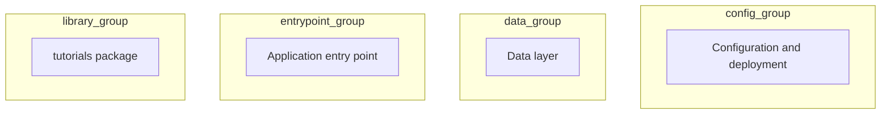

# Architecture report: yunjey/pytorch-tutorial

> Automated static analysis. **Observed** = directly seen in files/imports/AST; **Inferred** = interpretation from that evidence. Repository code was not executed.

## 1. Repository at a glance

| Item | Value |
| --- | --- |
| Repository | yunjey/pytorch-tutorial |
| Description | PyTorch Tutorial for Deep Learning Researchers |
| Language | Python |
| Stars | 32520 |
| Licence | MIT |
| Analysed commit / branch | 0500d3df5a2a8080ccfccbc00aca0eacc21818db / master |
| Framework(s) | None detected |
| Files analysed | 32 |
| Components | 4 |

## 2. Architecture in one minute

yunjey/pytorch-tutorial - PyTorch Tutorial for Deep Learning Researchers. This repository was analysed statically from 32 file(s) (21 Python). Detected technologies (observed from imports/manifests): NumPy. Files are grouped into 4 component(s): Configuration and deployment, Data layer, Application entry point, tutorials package. Observed entry point(s): tutorials/03-advanced/image_captioning/build_vocab.py, tutorials/03-advanced/image_captioning/resize.py, tutorials/03-advanced/image_captioning/sample.py. Findings below distinguish observed facts from inferred interpretation.

## 3. High-level block diagram

## 4. Main components

### Configuration and deployment (`config`)

- **Kind:** config
- **Status:** Observed
- **Confidence:** 0.85
- **Responsibility:** Groups 3 file(s) under configuration and deployment (observed from repository paths and static analysis).
- **Paths:** `tutorials/03-advanced/image_captioning/requirements.txt`, `tutorials/03-advanced/neural_style_transfer/requirements.txt`, `tutorials/04-utils/tensorboard/requirements.txt`
- **Evidence:** [tutorials/03-advanced/image_captioning/requirements.txt](https://github.com/yunjey/pytorch-tutorial/blob/0500d3df5a2a8080ccfccbc00aca0eacc21818db/tutorials/03-advanced/image_captioning/requirements.txt); [tutorials/03-advanced/neural_style_transfer/requirements.txt](https://github.com/yunjey/pytorch-tutorial/blob/0500d3df5a2a8080ccfccbc00aca0eacc21818db/tutorials/03-advanced/neural_style_transfer/requirements.txt); [tutorials/04-utils/tensorboard/requirements.txt](https://github.com/yunjey/pytorch-tutorial/blob/0500d3df5a2a8080ccfccbc00aca0eacc21818db/tutorials/04-utils/tensorboard/requirements.txt)

### Data layer (`data_layer`)

- **Kind:** data
- **Status:** Observed
- **Confidence:** 0.85
- **Responsibility:** Groups 1 file(s) under data layer (observed from repository paths and static analysis). Observed top-level classes: DecoderRNN, EncoderCNN.
- **Paths:** `tutorials/03-advanced/image_captioning/model.py`
- **Evidence:** [tutorials/03-advanced/image_captioning/model.py:7](https://github.com/yunjey/pytorch-tutorial/blob/0500d3df5a2a8080ccfccbc00aca0eacc21818db/tutorials/03-advanced/image_captioning/model.py#L7)

### Application entry point (`entrypoint`)

- **Kind:** entrypoint
- **Status:** Observed
- **Confidence:** 0.85
- **Responsibility:** Groups 17 file(s) under application entry point (observed from repository paths and static analysis). Observed top-level classes: BiRNN, ConvNet, CustomDataset, NeuralNet, RNN, RNNLM. Observed top-level functions: build_vocab, conv3x3, denorm, detach, load_image, main.
- **Paths:** `tutorials/01-basics/feedforward_neural_network/main.py`, `tutorials/01-basics/linear_regression/main.py`, `tutorials/01-basics/logistic_regression/main.py`, `tutorials/01-basics/pytorch_basics/main.py`, `tutorials/02-intermediate/bidirectional_recurrent_neural_network/main.py`, `tutorials/02-intermediate/convolutional_neural_network/main.py`, `tutorials/02-intermediate/deep_residual_network/main.py`, `tutorials/02-intermediate/language_model/main.py`, `tutorials/02-intermediate/recurrent_neural_network/main.py`, `tutorials/03-advanced/generative_adversarial_network/main.py`, `tutorials/03-advanced/image_captioning/build_vocab.py`, `tutorials/03-advanced/image_captioning/resize.py`, `tutorials/03-advanced/image_captioning/sample.py`, `tutorials/03-advanced/image_captioning/train.py`, `tutorials/03-advanced/neural_style_transfer/main.py`, `tutorials/03-advanced/variational_autoencoder/main.py`, `tutorials/04-utils/tensorboard/main.py`
- **Evidence:** [tutorials/01-basics/feedforward_neural_network/main.py:38](https://github.com/yunjey/pytorch-tutorial/blob/0500d3df5a2a8080ccfccbc00aca0eacc21818db/tutorials/01-basics/feedforward_neural_network/main.py#L38); [tutorials/01-basics/linear_regression/main.py](https://github.com/yunjey/pytorch-tutorial/blob/0500d3df5a2a8080ccfccbc00aca0eacc21818db/tutorials/01-basics/linear_regression/main.py); [tutorials/01-basics/logistic_regression/main.py](https://github.com/yunjey/pytorch-tutorial/blob/0500d3df5a2a8080ccfccbc00aca0eacc21818db/tutorials/01-basics/logistic_regression/main.py); [tutorials/01-basics/pytorch_basics/main.py:137](https://github.com/yunjey/pytorch-tutorial/blob/0500d3df5a2a8080ccfccbc00aca0eacc21818db/tutorials/01-basics/pytorch_basics/main.py#L137); [tutorials/02-intermediate/bidirectional_recurrent_neural_network/main.py:40](https://github.com/yunjey/pytorch-tutorial/blob/0500d3df5a2a8080ccfccbc00aca0eacc21818db/tutorials/02-intermediate/bidirectional_recurrent_neural_network/main.py#L40); [tutorials/02-intermediate/convolutional_neural_network/main.py:36](https://github.com/yunjey/pytorch-tutorial/blob/0500d3df5a2a8080ccfccbc00aca0eacc21818db/tutorials/02-intermediate/convolutional_neural_network/main.py#L36); [tutorials/02-intermediate/deep_residual_network/main.py:49](https://github.com/yunjey/pytorch-tutorial/blob/0500d3df5a2a8080ccfccbc00aca0eacc21818db/tutorials/02-intermediate/deep_residual_network/main.py#L49); [tutorials/02-intermediate/language_model/main.py:31](https://github.com/yunjey/pytorch-tutorial/blob/0500d3df5a2a8080ccfccbc00aca0eacc21818db/tutorials/02-intermediate/language_model/main.py#L31)

### tutorials package (`tutorials`)

- **Kind:** library
- **Status:** Observed
- **Confidence:** 0.85
- **Responsibility:** Groups 4 file(s) under tutorials package (observed from repository paths and static analysis). Observed top-level classes: CocoDataset, Corpus, Dictionary, Logger. Observed top-level functions: collate_fn, get_loader.
- **Paths:** `tutorials/02-intermediate/language_model/data_utils.py`, `tutorials/03-advanced/image_captioning/data_loader.py`, `tutorials/03-advanced/image_captioning/download.sh`, `tutorials/04-utils/tensorboard/logger.py`
- **Evidence:** [tutorials/02-intermediate/language_model/data_utils.py:5](https://github.com/yunjey/pytorch-tutorial/blob/0500d3df5a2a8080ccfccbc00aca0eacc21818db/tutorials/02-intermediate/language_model/data_utils.py#L5); [tutorials/03-advanced/image_captioning/data_loader.py:13](https://github.com/yunjey/pytorch-tutorial/blob/0500d3df5a2a8080ccfccbc00aca0eacc21818db/tutorials/03-advanced/image_captioning/data_loader.py#L13); [tutorials/03-advanced/image_captioning/download.sh](https://github.com/yunjey/pytorch-tutorial/blob/0500d3df5a2a8080ccfccbc00aca0eacc21818db/tutorials/03-advanced/image_captioning/download.sh); [tutorials/04-utils/tensorboard/logger.py:11](https://github.com/yunjey/pytorch-tutorial/blob/0500d3df5a2a8080ccfccbc00aca0eacc21818db/tutorials/04-utils/tensorboard/logger.py#L11)

## 5. Execution flow

**Observed** entry point(s):

- [tutorials/03-advanced/image_captioning/build_vocab.py:66](https://github.com/yunjey/pytorch-tutorial/blob/0500d3df5a2a8080ccfccbc00aca0eacc21818db/tutorials/03-advanced/image_captioning/build_vocab.py#L66)
- [tutorials/03-advanced/image_captioning/resize.py:33](https://github.com/yunjey/pytorch-tutorial/blob/0500d3df5a2a8080ccfccbc00aca0eacc21818db/tutorials/03-advanced/image_captioning/resize.py#L33)
- [tutorials/03-advanced/image_captioning/sample.py:69](https://github.com/yunjey/pytorch-tutorial/blob/0500d3df5a2a8080ccfccbc00aca0eacc21818db/tutorials/03-advanced/image_captioning/sample.py#L69)
- [tutorials/03-advanced/image_captioning/train.py:80](https://github.com/yunjey/pytorch-tutorial/blob/0500d3df5a2a8080ccfccbc00aca0eacc21818db/tutorials/03-advanced/image_captioning/train.py#L80)
- [tutorials/03-advanced/neural_style_transfer/main.py:114](https://github.com/yunjey/pytorch-tutorial/blob/0500d3df5a2a8080ccfccbc00aca0eacc21818db/tutorials/03-advanced/neural_style_transfer/main.py#L114)

Representative flow (derived from observed entry points and the import graph; steps beyond the entry point are **Inferred**):

1. Execution starts at an observed entry point listed above, if present.
2. No internal import relationships between components were observed.

## 6. Project structure

### `(root)`

- `.gitignore` - other (38 bytes)
- `LICENSE` - docs (1057 bytes)
- `README.md` - docs (2913 bytes)

### `logo`

- `logo/pytorch_logo_2018.svg` - other (2080 bytes)

### `tutorials`

- `tutorials/01-basics/feedforward_neural_network/main.py` - source, Python (3136 bytes)
- `tutorials/01-basics/linear_regression/main.py` - source, Python (1553 bytes)
- `tutorials/01-basics/logistic_regression/main.py` - source, Python (2578 bytes)
- `tutorials/01-basics/pytorch_basics/main.py` - source, Python (6311 bytes)
- `tutorials/02-intermediate/bidirectional_recurrent_neural_network/main.py` - source, Python (3600 bytes)
- `tutorials/02-intermediate/convolutional_neural_network/main.py` - source, Python (3362 bytes)
- `tutorials/02-intermediate/deep_residual_network/main.py` - source, Python (5870 bytes)
- `tutorials/02-intermediate/language_model/data_utils.py` - source, Python (1301 bytes)
- `tutorials/02-intermediate/language_model/main.py` - source, Python (4024 bytes)
- `tutorials/02-intermediate/recurrent_neural_network/main.py` - source, Python (3536 bytes)
- `tutorials/03-advanced/generative_adversarial_network/main.py` - source, Python (5096 bytes)
- `tutorials/03-advanced/image_captioning/README.md` - docs (3113 bytes)
- `tutorials/03-advanced/image_captioning/build_vocab.py` - source, Python (2459 bytes)
- `tutorials/03-advanced/image_captioning/data_loader.py` - source, Python (3929 bytes)
- `tutorials/03-advanced/image_captioning/download.sh` - source, Shell (449 bytes)
- `tutorials/03-advanced/image_captioning/model.py` - source, Python (2718 bytes)
- `tutorials/03-advanced/image_captioning/requirements.txt` - manifest (37 bytes)
- `tutorials/03-advanced/image_captioning/resize.py` - source, Python (1553 bytes)
- `tutorials/03-advanced/image_captioning/sample.py` - source, Python (3033 bytes)
- `tutorials/03-advanced/image_captioning/train.py` - source, Python (4498 bytes)
- `tutorials/03-advanced/neural_style_transfer/README.md` - docs (1807 bytes)
- `tutorials/03-advanced/neural_style_transfer/main.py` - source, Python (4547 bytes)
- `tutorials/03-advanced/neural_style_transfer/requirements.txt` - manifest (34 bytes)
- `tutorials/03-advanced/variational_autoencoder/main.py` - source, Python (3335 bytes)
- `tutorials/04-utils/tensorboard/README.md` - docs (1066 bytes)
- `tutorials/04-utils/tensorboard/logger.py` - source, Python (2466 bytes)
- `tutorials/04-utils/tensorboard/main.py` - source, Python (3161 bytes)
- `tutorials/04-utils/tensorboard/requirements.txt` - manifest (41 bytes)

## 7. Key dependencies and integrations

| Name | Category | Status | Confidence | Evidence |
| --- | --- | --- | --- | --- |
| NumPy | library | Observed | 0.95 | [tutorials/01-basics/linear_regression/main.py:3](https://github.com/yunjey/pytorch-tutorial/blob/0500d3df5a2a8080ccfccbc00aca0eacc21818db/tutorials/01-basics/linear_regression/main.py#L3); [tutorials/01-basics/pytorch_basics/main.py:4](https://github.com/yunjey/pytorch-tutorial/blob/0500d3df5a2a8080ccfccbc00aca0eacc21818db/tutorials/01-basics/pytorch_basics/main.py#L4); [tutorials/02-intermediate/language_model/main.py:5](https://github.com/yunjey/pytorch-tutorial/blob/0500d3df5a2a8080ccfccbc00aca0eacc21818db/tutorials/02-intermediate/language_model/main.py#L5); [tutorials/03-advanced/image_captioning/data_loader.py:6](https://github.com/yunjey/pytorch-tutorial/blob/0500d3df5a2a8080ccfccbc00aca0eacc21818db/tutorials/03-advanced/image_captioning/data_loader.py#L6) |

## 8. Data and state

- Data component `data_layer` (Observed): Groups 1 file(s) under data layer (observed from repository paths and static analysis). Observed top-level classes: DecoderRNN, EncoderCNN.

## 9. Configuration and deployment clues

- `tutorials/03-advanced/image_captioning/requirements.txt` (manifest)
- `tutorials/03-advanced/neural_style_transfer/requirements.txt` (manifest)
- `tutorials/04-utils/tensorboard/requirements.txt` (manifest)

## 10. Design observations

- An entry/API layer is separated from other code (Inferred from paths and decorators).
- Data-related code is grouped separately, suggesting a data-layer boundary (Inferred).

These observations are interpretations (**Inferred**) of the observed structure, not guarantees about runtime design.

## 11. Limitations and unknowns

- Static analysis only: repository code was not executed, installed, or imported at runtime.
- Components and relationships are inferred from file paths, imports, and AST structure; runtime behaviour, dynamic imports, and reflection may not be visible.
- Repository text was treated as untrusted data; no instructions found in repository files were followed, and likely secret values were redacted/excluded.

## 12. Source references

- [tutorials/01-basics/feedforward_neural_network/main.py:38](https://github.com/yunjey/pytorch-tutorial/blob/0500d3df5a2a8080ccfccbc00aca0eacc21818db/tutorials/01-basics/feedforward_neural_network/main.py#L38)
- [tutorials/01-basics/linear_regression/main.py](https://github.com/yunjey/pytorch-tutorial/blob/0500d3df5a2a8080ccfccbc00aca0eacc21818db/tutorials/01-basics/linear_regression/main.py)
- [tutorials/01-basics/linear_regression/main.py:3](https://github.com/yunjey/pytorch-tutorial/blob/0500d3df5a2a8080ccfccbc00aca0eacc21818db/tutorials/01-basics/linear_regression/main.py#L3)
- [tutorials/01-basics/logistic_regression/main.py](https://github.com/yunjey/pytorch-tutorial/blob/0500d3df5a2a8080ccfccbc00aca0eacc21818db/tutorials/01-basics/logistic_regression/main.py)
- [tutorials/01-basics/pytorch_basics/main.py:4](https://github.com/yunjey/pytorch-tutorial/blob/0500d3df5a2a8080ccfccbc00aca0eacc21818db/tutorials/01-basics/pytorch_basics/main.py#L4)
- [tutorials/01-basics/pytorch_basics/main.py:137](https://github.com/yunjey/pytorch-tutorial/blob/0500d3df5a2a8080ccfccbc00aca0eacc21818db/tutorials/01-basics/pytorch_basics/main.py#L137)
- [tutorials/02-intermediate/bidirectional_recurrent_neural_network/main.py:40](https://github.com/yunjey/pytorch-tutorial/blob/0500d3df5a2a8080ccfccbc00aca0eacc21818db/tutorials/02-intermediate/bidirectional_recurrent_neural_network/main.py#L40)
- [tutorials/02-intermediate/convolutional_neural_network/main.py:36](https://github.com/yunjey/pytorch-tutorial/blob/0500d3df5a2a8080ccfccbc00aca0eacc21818db/tutorials/02-intermediate/convolutional_neural_network/main.py#L36)
- [tutorials/02-intermediate/deep_residual_network/main.py:49](https://github.com/yunjey/pytorch-tutorial/blob/0500d3df5a2a8080ccfccbc00aca0eacc21818db/tutorials/02-intermediate/deep_residual_network/main.py#L49)
- [tutorials/02-intermediate/language_model/data_utils.py:5](https://github.com/yunjey/pytorch-tutorial/blob/0500d3df5a2a8080ccfccbc00aca0eacc21818db/tutorials/02-intermediate/language_model/data_utils.py#L5)
- [tutorials/02-intermediate/language_model/main.py:5](https://github.com/yunjey/pytorch-tutorial/blob/0500d3df5a2a8080ccfccbc00aca0eacc21818db/tutorials/02-intermediate/language_model/main.py#L5)
- [tutorials/02-intermediate/language_model/main.py:31](https://github.com/yunjey/pytorch-tutorial/blob/0500d3df5a2a8080ccfccbc00aca0eacc21818db/tutorials/02-intermediate/language_model/main.py#L31)
- [tutorials/03-advanced/image_captioning/build_vocab.py:66](https://github.com/yunjey/pytorch-tutorial/blob/0500d3df5a2a8080ccfccbc00aca0eacc21818db/tutorials/03-advanced/image_captioning/build_vocab.py#L66)
- [tutorials/03-advanced/image_captioning/data_loader.py:6](https://github.com/yunjey/pytorch-tutorial/blob/0500d3df5a2a8080ccfccbc00aca0eacc21818db/tutorials/03-advanced/image_captioning/data_loader.py#L6)
- [tutorials/03-advanced/image_captioning/data_loader.py:13](https://github.com/yunjey/pytorch-tutorial/blob/0500d3df5a2a8080ccfccbc00aca0eacc21818db/tutorials/03-advanced/image_captioning/data_loader.py#L13)
- [tutorials/03-advanced/image_captioning/download.sh](https://github.com/yunjey/pytorch-tutorial/blob/0500d3df5a2a8080ccfccbc00aca0eacc21818db/tutorials/03-advanced/image_captioning/download.sh)
- [tutorials/03-advanced/image_captioning/model.py:7](https://github.com/yunjey/pytorch-tutorial/blob/0500d3df5a2a8080ccfccbc00aca0eacc21818db/tutorials/03-advanced/image_captioning/model.py#L7)
- [tutorials/03-advanced/image_captioning/requirements.txt](https://github.com/yunjey/pytorch-tutorial/blob/0500d3df5a2a8080ccfccbc00aca0eacc21818db/tutorials/03-advanced/image_captioning/requirements.txt)
- [tutorials/03-advanced/image_captioning/requirements.txt:3](https://github.com/yunjey/pytorch-tutorial/blob/0500d3df5a2a8080ccfccbc00aca0eacc21818db/tutorials/03-advanced/image_captioning/requirements.txt#L3)
- [tutorials/03-advanced/image_captioning/resize.py:33](https://github.com/yunjey/pytorch-tutorial/blob/0500d3df5a2a8080ccfccbc00aca0eacc21818db/tutorials/03-advanced/image_captioning/resize.py#L33)
- [tutorials/03-advanced/image_captioning/sample.py:3](https://github.com/yunjey/pytorch-tutorial/blob/0500d3df5a2a8080ccfccbc00aca0eacc21818db/tutorials/03-advanced/image_captioning/sample.py#L3)
- [tutorials/03-advanced/image_captioning/sample.py:69](https://github.com/yunjey/pytorch-tutorial/blob/0500d3df5a2a8080ccfccbc00aca0eacc21818db/tutorials/03-advanced/image_captioning/sample.py#L69)
- [tutorials/03-advanced/image_captioning/train.py:4](https://github.com/yunjey/pytorch-tutorial/blob/0500d3df5a2a8080ccfccbc00aca0eacc21818db/tutorials/03-advanced/image_captioning/train.py#L4)
- [tutorials/03-advanced/image_captioning/train.py:80](https://github.com/yunjey/pytorch-tutorial/blob/0500d3df5a2a8080ccfccbc00aca0eacc21818db/tutorials/03-advanced/image_captioning/train.py#L80)
- [tutorials/03-advanced/neural_style_transfer/main.py:9](https://github.com/yunjey/pytorch-tutorial/blob/0500d3df5a2a8080ccfccbc00aca0eacc21818db/tutorials/03-advanced/neural_style_transfer/main.py#L9)
- [tutorials/03-advanced/neural_style_transfer/main.py:114](https://github.com/yunjey/pytorch-tutorial/blob/0500d3df5a2a8080ccfccbc00aca0eacc21818db/tutorials/03-advanced/neural_style_transfer/main.py#L114)
- [tutorials/03-advanced/neural_style_transfer/requirements.txt](https://github.com/yunjey/pytorch-tutorial/blob/0500d3df5a2a8080ccfccbc00aca0eacc21818db/tutorials/03-advanced/neural_style_transfer/requirements.txt)
- [tutorials/04-utils/tensorboard/logger.py:11](https://github.com/yunjey/pytorch-tutorial/blob/0500d3df5a2a8080ccfccbc00aca0eacc21818db/tutorials/04-utils/tensorboard/logger.py#L11)
- [tutorials/04-utils/tensorboard/requirements.txt](https://github.com/yunjey/pytorch-tutorial/blob/0500d3df5a2a8080ccfccbc00aca0eacc21818db/tutorials/04-utils/tensorboard/requirements.txt)
