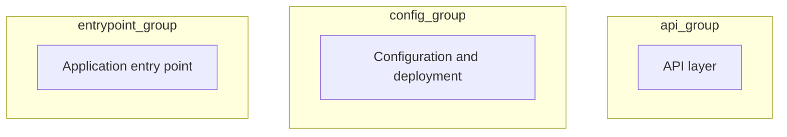

# Architecture report: yusufkaraaslan/Skill_Seekers

> Automated static analysis. **Observed** = directly seen in files/imports/AST; **Inferred** = interpretation from that evidence. Repository code was not executed.

## 1. Repository at a glance

| Item | Value |
| --- | --- |
| Repository | yusufkaraaslan/Skill_Seekers |
| Description | Convert documentation websites, GitHub repositories, and PDFs into Claude AI skills with automatic conflict detection |
| Language | Python |
| Stars | 15309 |
| Licence | MIT |
| Analysed commit / branch | 5b5d8dfca263fa76e6daae9f292890b311ef36aa / development |
| Framework(s) | FastAPI |
| Files analysed | 800 |
| Components | 3 |

## 2. Architecture in one minute

yusufkaraaslan/Skill_Seekers - Convert documentation websites, GitHub repositories, and PDFs into Claude AI skills with automatic conflict detection. This repository was analysed statically from 800 file(s) (3 Python). Detected technologies (observed from imports/manifests): GitHub Actions, FastAPI, Uvicorn, Docker, Docker Compose, pytest. Files are grouped into 3 component(s): API layer, Configuration and deployment, Application entry point. Observed entry point(s): api/main.py. Findings below distinguish observed facts from inferred interpretation.

## 3. High-level block diagram

## 4. Main components

### API layer (`api_layer`)

- **Kind:** api
- **Status:** Observed
- **Confidence:** 0.85
- **Responsibility:** Groups 2 file(s) under api layer (observed from repository paths and static analysis). Observed top-level classes: ConfigAnalyzer.
- **Paths:** `api/__init__.py`, `api/config_analyzer.py`
- **Evidence:** [api/__init__.py](https://github.com/yusufkaraaslan/Skill_Seekers/blob/5b5d8dfca263fa76e6daae9f292890b311ef36aa/api/__init__.py); [api/config_analyzer.py:13](https://github.com/yusufkaraaslan/Skill_Seekers/blob/5b5d8dfca263fa76e6daae9f292890b311ef36aa/api/config_analyzer.py#L13)

### Configuration and deployment (`config`)

- **Kind:** config
- **Status:** Observed
- **Confidence:** 0.85
- **Responsibility:** Groups 20 file(s) under configuration and deployment (observed from repository paths and static analysis).
- **Paths:** `Dockerfile`, `Dockerfile.mcp`, `api/requirements.txt`, `codecov.yml`, `configs/astrovalley_unified.json`, `configs/blender-unified.json`, `configs/claude-code-unified.json`, `configs/claude-code.json`, `configs/godot.json`, `configs/godot_unified.json`, `configs/httpx_comprehensive.json`, `configs/medusa-mercurjs.json`, `configs/react.json`, `configs/unity-addressables.json`, `configs/unity-dotween.json`, `configs/unity-spine.json`, `distribution/claude-plugin/.claude-plugin/plugin.json`, `distribution/claude-plugin/.mcp.json`, `distribution/github-action/action.yml`, `docker-compose.yml`
- **Evidence:** [Dockerfile](https://github.com/yusufkaraaslan/Skill_Seekers/blob/5b5d8dfca263fa76e6daae9f292890b311ef36aa/Dockerfile); [Dockerfile.mcp](https://github.com/yusufkaraaslan/Skill_Seekers/blob/5b5d8dfca263fa76e6daae9f292890b311ef36aa/Dockerfile.mcp); [api/requirements.txt](https://github.com/yusufkaraaslan/Skill_Seekers/blob/5b5d8dfca263fa76e6daae9f292890b311ef36aa/api/requirements.txt); [codecov.yml](https://github.com/yusufkaraaslan/Skill_Seekers/blob/5b5d8dfca263fa76e6daae9f292890b311ef36aa/codecov.yml); [configs/astrovalley_unified.json](https://github.com/yusufkaraaslan/Skill_Seekers/blob/5b5d8dfca263fa76e6daae9f292890b311ef36aa/configs/astrovalley_unified.json); [configs/blender-unified.json](https://github.com/yusufkaraaslan/Skill_Seekers/blob/5b5d8dfca263fa76e6daae9f292890b311ef36aa/configs/blender-unified.json); [configs/claude-code-unified.json](https://github.com/yusufkaraaslan/Skill_Seekers/blob/5b5d8dfca263fa76e6daae9f292890b311ef36aa/configs/claude-code-unified.json); [configs/claude-code.json](https://github.com/yusufkaraaslan/Skill_Seekers/blob/5b5d8dfca263fa76e6daae9f292890b311ef36aa/configs/claude-code.json)

### Application entry point (`entrypoint`)

- **Kind:** entrypoint
- **Status:** Observed
- **Confidence:** 0.85
- **Responsibility:** Groups 1 file(s) under application entry point (observed from repository paths and static analysis). Observed application object created via FastAPI. Observed routes: GET /, GET /api/configs, GET /api/configs/{name}, GET /api/categories, GET /api/download/{config_name}. Observed top-level functions: download_config, get_config, health_check, list_categories, list_configs, root.
- **Paths:** `api/main.py`
- **Evidence:** [api/main.py:16](https://github.com/yusufkaraaslan/Skill_Seekers/blob/5b5d8dfca263fa76e6daae9f292890b311ef36aa/api/main.py#L16)

## 5. Execution flow

**Observed** entry point(s):

- [api/main.py:16](https://github.com/yusufkaraaslan/Skill_Seekers/blob/5b5d8dfca263fa76e6daae9f292890b311ef36aa/api/main.py#L16)

**Observed** routes (from decorators):

- `GET /` -> `root` in `api/main.py:56`
- `GET /api/configs` -> `list_configs` in `api/main.py:75`
- `GET /api/configs/{name}` -> `get_config` in `api/main.py:124`
- `GET /api/categories` -> `list_categories` in `api/main.py:149`
- `GET /api/download/{config_name}` -> `download_config` in `api/main.py:173`
- `GET /health` -> `health_check` in `api/main.py:210`

Representative flow (derived from observed entry points and the import graph; steps beyond the entry point are **Inferred**):

1. Execution starts at an observed entry point listed above, if present.
2. No internal import relationships between components were observed.

## 6. Project structure

### `(root)`

- `.dockerignore` - container (697 bytes)
- `.env.example` - config (1609 bytes)
- `.gitignore` - other (1163 bytes)
- `.gitmodules` - other (123 bytes)
- `.mcp.json` - config (139 bytes)
- `AGENTS.md` - docs (15251 bytes)
- `CLAUDE.md` - docs (22164 bytes)
- `CONTRIBUTING.md` - docs (17710 bytes)
- `Dockerfile` - container (2169 bytes)
- `Dockerfile.mcp` - container (1949 bytes)
- `LICENSE` - docs (1072 bytes)
- `QWEN.md` - docs (2918 bytes)
- `README.ar.md` - docs (26421 bytes)
- `README.de.md` - docs (21962 bytes)
- `README.es.md` - docs (22826 bytes)
- `README.fr.md` - docs (22966 bytes)
- `README.hi.md` - docs (32811 bytes)
- `README.ja.md` - docs (25722 bytes)
- `README.ko.md` - docs (22752 bytes)
- `README.md` - docs (21001 bytes)
- `README.pt-BR.md` - docs (22468 bytes)
- `README.ru.md` - docs (29133 bytes)
- `README.tr.md` - docs (22453 bytes)
- `README.zh-CN.md` - docs (20776 bytes)
- `ROADMAP.md` - docs (16096 bytes)
- `SPONSORS.md` - docs (663 bytes)
- `SPONSORSHIP.md` - docs (4307 bytes)
- `codecov.yml` - config (628 bytes)
- `docker-compose.yml` - container (2621 bytes)

### `.claude`

- `.claude/mcp_config.example.json` - config (285 bytes)

### `.codex-plugin`

- `.codex-plugin/plugin.json` - config (805 bytes)

### `.github`

- `.github/FUNDING.yml` - config (301 bytes)
- `.github/ISSUE_TEMPLATE/bug_report.md` - docs (968 bytes)
- `.github/ISSUE_TEMPLATE/documentation.md` - docs (823 bytes)
- `.github/ISSUE_TEMPLATE/feature_request.md` - docs (848 bytes)
- `.github/ISSUE_TEMPLATE/mcp_tool.md` - docs (853 bytes)
- `.github/PULL_REQUEST_TEMPLATE.md` - docs (1418 bytes)
- `.github/create_issues.sh` - source, Shell (1640 bytes)
- `.github/workflows/docker-publish.yml` - ci, YAML (4666 bytes)
- `.github/workflows/quality-metrics.yml` - ci, YAML (5093 bytes)
- `.github/workflows/release.yml` - ci, YAML (4747 bytes)
- `.github/workflows/scheduled-updates.yml` - ci, YAML (6273 bytes)
- `.github/workflows/test-vector-dbs.yml` - ci, YAML (3361 bytes)
- `.github/workflows/tests.yml` - ci, YAML (5725 bytes)
- `.github/workflows/vector-db-export.yml` - ci, YAML (5973 bytes)

### `.vscode`

- `.vscode/settings.json` - config (104 bytes)

### `api`

- `api/.gitignore` - other (78 bytes)
- `api/README.md` - docs (6160 bytes)
- `api/__init__.py` - source, Python (117 bytes)
- `api/config_analyzer.py` - source, Python (12328 bytes)
- `api/main.py` - source, Python (6784 bytes)
- `api/requirements.txt` - manifest (68 bytes)

### `configs`

- `configs/astrovalley_unified.json` - config (942 bytes)
- `configs/blender-unified.json` - config (7104 bytes)
- `configs/claude-code-unified.json` - config (7860 bytes)
- `configs/claude-code.json` - config (5535 bytes)
- `configs/godot.json` - config (1454 bytes)
- `configs/godot_unified.json` - config (2789 bytes)
- `configs/httpx_comprehensive.json` - config (2441 bytes)
- `configs/medusa-mercurjs.json` - config (4851 bytes)
- `configs/react.json` - config (1619 bytes)
- `configs/unity-addressables.json` - config (3351 bytes)
- `configs/unity-dotween.json` - config (3042 bytes)
- `configs/unity-spine.json` - config (3468 bytes)

### `distribution`

- `distribution/claude-plugin/.claude-plugin/plugin.json` - config (435 bytes)
- `distribution/claude-plugin/.mcp.json` - config (109 bytes)
- `distribution/claude-plugin/README.md` - docs (2678 bytes)
- `distribution/claude-plugin/commands/create-skill.md` - docs (1948 bytes)
- `distribution/claude-plugin/commands/install-skill.md` - docs (1576 bytes)
- `distribution/claude-plugin/commands/sync-config.md` - docs (834 bytes)
- `distribution/claude-plugin/skills/skill-builder/SKILL.md` - docs (4447 bytes)
- `distribution/github-action/README.md` - docs (3775 bytes)
- `distribution/github-action/action.yml` - config (3051 bytes)
- `distribution/smithery/README.md` - docs (3796 bytes)

### `docs`

- `docs/ARCHITECTURE.md` - docs (5861 bytes)
- `docs/BEST_PRACTICES.md` - docs (12331 bytes)
- `docs/BUG_AUDIT.md` - docs (88706 bytes)
- `docs/DOCKER_DEPLOYMENT.md` - docs (14991 bytes)
- `docs/FAQ.md` - docs (24706 bytes)
- `docs/KUBERNETES_DEPLOYMENT.md` - docs (17913 bytes)
- `docs/PRODUCTION_DEPLOYMENT.md` - docs (16411 bytes)
- `docs/README.md` - docs (7047 bytes)
- `docs/TROUBLESHOOTING.md` - docs (29109 bytes)
- `docs/UML/html/index.html/assets/css/bootstrap.css` - docs (127246 bytes)
- `docs/UML/html/index.html/assets/css/jquery.bonsai.css` - docs (542 bytes)
- `docs/UML/html/index.html/assets/css/main.css` - docs (14759 bytes)
- `docs/UML/html/index.html/assets/icon-font/icons.css` - docs (34570 bytes)
- `docs/UML/html/index.html/assets/icon-font/icons.html` - docs (124867 bytes)
- `docs/UML/html/index.html/assets/js/bootstrap.js` - docs (61752 bytes)
- `docs/UML/html/index.html/assets/js/jquery.bonsai.js` - docs (8276 bytes)
- `docs/UML/html/index.html/contents/001c2eb31f7c3880775f9ab7ae4d0300.html` - docs (6479 bytes)
- `docs/UML/html/index.html/contents/0025564de1473d71f4a6a0503fcdb056.html` - docs (8924 bytes)
- `docs/UML/html/index.html/contents/00509100c34315b0f095eb3ccb34b023.html` - docs (9851 bytes)
- `docs/UML/html/index.html/contents/007ccbce3f2ec8a3534b719b3f0fca25.html` - docs (6169 bytes)
- `docs/UML/html/index.html/contents/00910695df59fa1e85314f6d17e4051f.html` - docs (6198 bytes)
- `docs/UML/html/index.html/contents/00b94cf5cf9ebf3c6672e9c21deff7ee.html` - docs (6214 bytes)
- `docs/UML/html/index.html/contents/00cb702eeb69e434bafcc1e2b04507b1.html` - docs (7396 bytes)
- `docs/UML/html/index.html/contents/00fb8de24d76667858a719d127f22f51.html` - docs (6180 bytes)
- `docs/UML/html/index.html/contents/010d7f06abc5890127077ec8d4d1038f.html` - docs (6488 bytes)
- `docs/UML/html/index.html/contents/0145e471015eac4d3ed45baa8579cb6b.html` - docs (5618 bytes)
- `docs/UML/html/index.html/contents/017fe081f5f76bed1d02586c4bb7f0b9.html` - docs (6501 bytes)
- `docs/UML/html/index.html/contents/01d30778d4613da403d3225af832495c.html` - docs (6489 bytes)
- `docs/UML/html/index.html/contents/01ff8f1b7d9d7beccdfac55ed1d3017d.html` - docs (6504 bytes)
- `docs/UML/html/index.html/contents/020e1bb770a7768e07c0338ecb4bda09.html` - docs (6165 bytes)
- `docs/UML/html/index.html/contents/02231b18c56eee1fe00db0b3cc88d3f3.html` - docs (9414 bytes)
- `docs/UML/html/index.html/contents/02524d7a310024538b8bf2b5217a0405.html` - docs (6602 bytes)
- `docs/UML/html/index.html/contents/0268261b9eda98ff7a999e6589b545c3.html` - docs (6492 bytes)
- `docs/UML/html/index.html/contents/0285f49d97b595de19ad3a55a9aa5fac.html` - docs (6539 bytes)
- `docs/UML/html/index.html/contents/029322692df61d1c9239a003a4f4947d.html` - docs (5659 bytes)
- `docs/UML/html/index.html/contents/02be13f7c985dd6b4b7a23916cf05ae4.html` - docs (6186 bytes)
- `docs/UML/html/index.html/contents/02c5b0d5c646f5b2a4735851a1a20a8f.html` - docs (6193 bytes)
- `docs/UML/html/index.html/contents/02d026fb13af0923877f41f68fb5585e.html` - docs (6970 bytes)
- `docs/UML/html/index.html/contents/02ddacbfe77e6d70d993a01120ddd2ac.html` - docs (6240 bytes)
- `docs/UML/html/index.html/contents/02e78bb1d9b10da68dd8d62379086a6e.html` - docs (6210 bytes)
- `docs/UML/html/index.html/contents/02f04803adb5c2b766559ee9412753dc.html` - docs (6491 bytes)
- `docs/UML/html/index.html/contents/030c139fa6e0d10e86fdb3d57e91149f.html` - docs (6522 bytes)
- `docs/UML/html/index.html/contents/0316bf28f31dfcc53a38fff09e04d662.html` - docs (6212 bytes)
- `docs/UML/html/index.html/contents/03453c84f468d387ae974dc92ceda0d6.html` - docs (6339 bytes)
- `docs/UML/html/index.html/contents/034b43824827421add2453b7695fc9b3.html` - docs (6205 bytes)
- `docs/UML/html/index.html/contents/0380ecfd61cacc868ff1d659572725bc.html` - docs (6179 bytes)
- `docs/UML/html/index.html/contents/03a572027e9889827df3efe4865d6c04.html` - docs (6213 bytes)
- `docs/UML/html/index.html/contents/03a80d0c833ca4ccb7d1214c35c1e1f3.html` - docs (8248 bytes)
- `docs/UML/html/index.html/contents/03b3d85c37ae6295a16b15383df9c540.html` - docs (6514 bytes)
- `docs/UML/html/index.html/contents/03d20cc75938c4aab55c8ce9feb554c5.html` - docs (6164 bytes)
- `docs/UML/html/index.html/contents/03e029aaa80cc56c5487c5172dbf41cc.html` - docs (6207 bytes)
- `docs/UML/html/index.html/contents/03ec42466372e6ac1f6317227d6a0563.html` - docs (10111 bytes)
- `docs/UML/html/index.html/contents/03f058a533840c37160ba9cbb3005bef.html` - docs (6193 bytes)
- `docs/UML/html/index.html/contents/040003573ebaf30612a0b6c775cc3702.html` - docs (6201 bytes)
- `docs/UML/html/index.html/contents/0423a6d6ebaedf5e0aa9c0cd98b8bff1.html` - docs (6223 bytes)
- `docs/UML/html/index.html/contents/044b5cd04d02bac8cea889cb65106f43.html` - docs (6287 bytes)
- `docs/UML/html/index.html/contents/0483a3757c109c28a7230e73efd926a1.html` - docs (6201 bytes)
- `docs/UML/html/index.html/contents/0490a212778e5ffa6d79cdf230143138.html` - docs (6199 bytes)
- `docs/UML/html/index.html/contents/04be98ec9bb8041fa720700c2ccc1351.html` - docs (6166 bytes)
- `docs/UML/html/index.html/contents/04d495ef445aec5ab8fada58f2ad2025.html` - docs (7519 bytes)
- `docs/UML/html/index.html/contents/04e0dd3038afc17aadc753ad9b8ffcd2.html` - docs (7287 bytes)
- `docs/UML/html/index.html/contents/04e975cb83b23b9c6a67aad0a9f79acf.html` - docs (6017 bytes)
- `docs/UML/html/index.html/contents/04f7b9e78182b7d501da5a2a7e9ab415.html` - docs (8329 bytes)
- `docs/UML/html/index.html/contents/0502b099c81cd8ec649f26367f0dc00c.html` - docs (6487 bytes)
- `docs/UML/html/index.html/contents/0525e1fe146314bf2258c8b421b5b4aa.html` - docs (6180 bytes)
- `docs/UML/html/index.html/contents/05266a4a31f3cfbb0093b305667bc937.html` - docs (6510 bytes)
- `docs/UML/html/index.html/contents/0551bb6cbac15533f87c5838f117a454.html` - docs (6156 bytes)
- `docs/UML/html/index.html/contents/055516bb90ac718f5b8c1c8da847c7b0.html` - docs (6603 bytes)
- `docs/UML/html/index.html/contents/0565785c1fa564d4b90864c7c45922e5.html` - docs (6176 bytes)
- `docs/UML/html/index.html/contents/0581aae259550c0b2f535f82a27a20d2.html` - docs (6200 bytes)
- `docs/UML/html/index.html/contents/05d2236199bcdc97250863d4d250f673.html` - docs (7496 bytes)
- `docs/UML/html/index.html/contents/05d2f64f779d9377edddfd01920b899f.html` - docs (6489 bytes)
- `docs/UML/html/index.html/contents/05d3258d24905a654413605b5e0974f5.html` - docs (6213 bytes)
- `docs/UML/html/index.html/contents/05d369359212eac14ceb7a81753d2e87.html` - docs (6451 bytes)
- `docs/UML/html/index.html/contents/05d6ebcd7c258f23a170566a10c631f2.html` - docs (12721 bytes)
- `docs/UML/html/index.html/contents/05e160e75f565278ee83d6208b57c04a.html` - docs (6517 bytes)
- `docs/UML/html/index.html/contents/068d87025fe2aadb0507fe941fef8c06.html` - docs (6218 bytes)
- `docs/UML/html/index.html/contents/06959fa5355b0e6089c1c9f9f7af3aa6.html` - docs (6486 bytes)
- `docs/UML/html/index.html/contents/06d8f28dd785295227c8a1d664901ca6.html` - docs (6314 bytes)
- `docs/UML/html/index.html/contents/06f8f577e16e7d14c5086f3106796bd7.html` - docs (6209 bytes)
- `docs/UML/html/index.html/contents/070148fb11e435ea8f68b1d19cc19db3.html` - docs (6274 bytes)
- `docs/UML/html/index.html/contents/071d0d0f0f869f58f3ea4bc2dd916024.html` - docs (7222 bytes)
- `docs/UML/html/index.html/contents/073c989581e4b19401094d4e6b51a5b7.html` - docs (6214 bytes)
- `docs/UML/html/index.html/contents/07cf2536e7dbcf8d87afb33d4f6b2bdf.html` - docs (6485 bytes)
- `docs/UML/html/index.html/contents/07dacffc54f86475400204d093091588.html` - docs (6511 bytes)
- `docs/UML/html/index.html/contents/07ddaa4469eef6b224bce1f3f94752ef.html` - docs (5767 bytes)
- `docs/UML/html/index.html/contents/07eacff5fbd0a5a70fe3f321c7debba4.html` - docs (6210 bytes)
- `docs/UML/html/index.html/contents/08042f3437de69e3a4e3d65f86fde219.html` - docs (6245 bytes)
- `docs/UML/html/index.html/contents/081582bfe433eed0e3f57b298ed41f30.html` - docs (6224 bytes)
- `docs/UML/html/index.html/contents/08252d0c94f009b38c67287903edcb46.html` - docs (5763 bytes)
- `docs/UML/html/index.html/contents/083bd48e3733bd417ab8120d83062ed6.html` - docs (6178 bytes)
- `docs/UML/html/index.html/contents/084f65230d8e15d82dca008da5251503.html` - docs (6168 bytes)
- `docs/UML/html/index.html/contents/0875b7edc4d8e095b97f5adc19022083.html` - docs (6501 bytes)
- `docs/UML/html/index.html/contents/08a42a9cb33085033c589053dbef600c.html` - docs (6213 bytes)
- `docs/UML/html/index.html/contents/08a4b7115cae2a5970b962330796c00f.html` - docs (6182 bytes)
- `docs/UML/html/index.html/contents/08be6fb667da531dffce499974b3d41e.html` - docs (6230 bytes)
- `docs/UML/html/index.html/contents/08c6a1e6dfd23011c9f97fc41749fcbf.html` - docs (6191 bytes)
- `docs/UML/html/index.html/contents/08f15a81b2edd5a6cfdd763c99b3e6d9.html` - docs (7891 bytes)
- `docs/UML/html/index.html/contents/0904333092b12540d685f51441775d3f.html` - docs (6189 bytes)
- `docs/UML/html/index.html/contents/09a413250fe5275c26bd7fafb7a6af9b.html` - docs (6495 bytes)
- `docs/UML/html/index.html/contents/09a660aa19e69354745dd6da7ad168d5.html` - docs (6164 bytes)
- `docs/UML/html/index.html/contents/09befc42a3401e984c3472d643915c12.html` - docs (6534 bytes)
- `docs/UML/html/index.html/contents/09c94c5e380c212e227886b2d7bd34f8.html` - docs (6500 bytes)
- `docs/UML/html/index.html/contents/09efe71eec1d050cea48d72ce2e3afc5.html` - docs (6528 bytes)
- `docs/UML/html/index.html/contents/0a0f1f352ebda364e54afcee85ff8e31.html` - docs (6258 bytes)
- `docs/UML/html/index.html/contents/0a2c3c32f8650cc60d6a251e325931b7.html` - docs (6180 bytes)
- `docs/UML/html/index.html/contents/0a628ab23c874b12d2bb7c57f08bacd3.html` - docs (6160 bytes)
- `docs/UML/html/index.html/contents/0a8fab81ff1fe4fcf2830088d57a3389.html` - docs (6234 bytes)
- `docs/UML/html/index.html/contents/0a97292d8e93749d795ceb9d3a7ea43b.html` - docs (6302 bytes)
- `docs/UML/html/index.html/contents/0a98b22d6960a0d5d4b45307cf38a376.html` - docs (6245 bytes)
- `docs/UML/html/index.html/contents/0aea6c69f9758e6f7ec260bb3a67fb7d.html` - docs (5906 bytes)
- `docs/UML/html/index.html/contents/0af0718934b7c9bf0704b33c6edceb0a.html` - docs (6316 bytes)
- `docs/UML/html/index.html/contents/0b13587dd50b418879fcc9d5fb4b0d63.html` - docs (6465 bytes)
- `docs/UML/html/index.html/contents/0b2e3d4a9fce6033c27315c1506e1a28.html` - docs (6324 bytes)
- `docs/UML/html/index.html/contents/0b3368eb34da708c263183ff1314e1e5.html` - docs (6473 bytes)
- `docs/UML/html/index.html/contents/0ba48cfc547154448e9c53149d02ba85.html` - docs (6188 bytes)
- `docs/UML/html/index.html/contents/0bd4e8e7709356647d357de05db61d58.html` - docs (6163 bytes)
- `docs/UML/html/index.html/contents/0bf25460dca20f004b5c7e9765713ebb.html` - docs (6494 bytes)
- `docs/UML/html/index.html/contents/0bf4a6eae08b8881efe05b065e34faf9.html` - docs (6206 bytes)
- `docs/UML/html/index.html/contents/0c160ff8f76fbba9a4fa77033ab14dd0.html` - docs (6172 bytes)
- `docs/UML/html/index.html/contents/0c19835748910e666b4024ad2c4af1bb.html` - docs (6497 bytes)
- `docs/UML/html/index.html/contents/0c50e065455272d0f3e04945a6f664a5.html` - docs (6180 bytes)
- `docs/UML/html/index.html/contents/0c6eeccbfdd67aa968a241acce05e20d.html` - docs (7245 bytes)
- `docs/UML/html/index.html/contents/0c9e5ca62bc924e5da1379e801442e93.html` - docs (6227 bytes)
- `docs/UML/html/index.html/contents/0c9e640b81f484da7afde63d602d539c.html` - docs (6513 bytes)
- `docs/UML/html/index.html/contents/0ca567fad7b9d9a27305963eb49265f0.html` - docs (6201 bytes)
- `docs/UML/html/index.html/contents/0ca634ac151ac989621cda7dbad8bbb3.html` - docs (6474 bytes)
- `docs/UML/html/index.html/contents/0ce998f85652a8a9bcd417c92151f180.html` - docs (6215 bytes)
- `docs/UML/html/index.html/contents/0cfde902fa6cc188f0f08edf2bd3ef29.html` - docs (6164 bytes)
- `docs/UML/html/index.html/contents/0d01421788d1b29d79573983bfd4caaa.html` - docs (6193 bytes)
- `docs/UML/html/index.html/contents/0d14235e77e55ae4ee596bb1eb4c055e.html` - docs (6163 bytes)
- `docs/UML/html/index.html/contents/0d1b85060ff7cc969454ac1749edd700.html` - docs (6470 bytes)
- `docs/UML/html/index.html/contents/0d650a90204a1dd25dea24fce6f69ed2.html` - docs (6239 bytes)
- `docs/UML/html/index.html/contents/0da0ff49bfbd36a16396c2cd7a62b986.html` - docs (6209 bytes)
- `docs/UML/html/index.html/contents/0dabb2990f22100d81566f0109ad7389.html` - docs (6013 bytes)
- `docs/UML/html/index.html/contents/0e1a6b013283ca18f16dd031d52ab495.html` - docs (6517 bytes)
- `docs/UML/html/index.html/contents/0e395d236ae8d376218b062ce6691548.html` - docs (6213 bytes)
- `docs/UML/html/index.html/contents/0e49055b2ea91c18f9d50c145f6b0065.html` - docs (6544 bytes)
- `docs/UML/html/index.html/contents/0e9b3e70fbb779d118f3feb75efea17b.html` - docs (6287 bytes)
- `docs/UML/html/index.html/contents/0eae83fbc2e3eaaf8315f122a5692fa0.html` - docs (6274 bytes)
- `docs/UML/html/index.html/contents/0ef2cd6fed7cb2d0466028600e2ff1f2.html` - docs (6548 bytes)
- `docs/UML/html/index.html/contents/0f0975f4892715f4a25dd889110d21c2.html` - docs (6161 bytes)
- `docs/UML/html/index.html/contents/0f0d72eccee0ef091c4c447e410e0e74.html` - docs (7024 bytes)
- `docs/UML/html/index.html/contents/0f14d67760ca6deb4dae7b7d38dc1cd0.html` - docs (6179 bytes)
- `docs/UML/html/index.html/contents/0f43fabe86dd7f957b2715cf4ec5acff.html` - docs (6208 bytes)
- `docs/UML/html/index.html/contents/0f5cd430c28c59b81e7bdde42b5879a5.html` - docs (6227 bytes)
- `docs/UML/html/index.html/contents/0f6fcbea117c51a2843622edb82d45bc.html` - docs (6475 bytes)
- `docs/UML/html/index.html/contents/0f770dc4609b7edef4100bdf3c7da9cf.html` - docs (6754 bytes)
- `docs/UML/html/index.html/contents/0fb51df235772849702822ad6564bd14.html` - docs (6200 bytes)
- `docs/UML/html/index.html/contents/1007964c31ec39afd330c60257d2ddab.html` - docs (6251 bytes)
- `docs/UML/html/index.html/contents/104b47e35354ace97825be9e2e305a0f.html` - docs (6214 bytes)
- `docs/UML/html/index.html/contents/1083fbd39aa8abaa59ca84522db4c329.html` - docs (6201 bytes)
- `docs/UML/html/index.html/contents/109fa302e9f6af1e2bc26aa7a753cd1b.html` - docs (6241 bytes)
- `docs/UML/html/index.html/contents/10aceb25f1816142e1f6cd6f583ba60f.html` - docs (6165 bytes)
- `docs/UML/html/index.html/contents/10ae53552fd674a8c15ff88684f4f7e8.html` - docs (6500 bytes)
- `docs/UML/html/index.html/contents/10ae7246a744d30d9e4442c50682919f.html` - docs (7539 bytes)
- `docs/UML/html/index.html/contents/10b08a6d5cf01426a1d15a925ffa2abb.html` - docs (7245 bytes)
- `docs/UML/html/index.html/contents/10bb05ff02c44eb4cb7e56e656414409.html` - docs (6188 bytes)
- `docs/UML/html/index.html/contents/10ddb05d66e61da66fdd5294e32336db.html` - docs (6230 bytes)
- `docs/UML/html/index.html/contents/10e89b885b07c612d0c3e3ad4d3a5c9a.html` - docs (6204 bytes)
- `docs/UML/html/index.html/contents/1131ea23ab69d35d15d1c4b9cd8d7259.html` - docs (6250 bytes)
- `docs/UML/html/index.html/contents/1151c0a323c804e5dda7d1e6e2dcc5a6.html` - docs (6192 bytes)
- `docs/UML/html/index.html/contents/11e1d95f8dfd5e98db160728b2d14f64.html` - docs (6292 bytes)
- `docs/UML/html/index.html/contents/1204398e31612f8163e172c7c9d69506.html` - docs (6523 bytes)
- `docs/UML/html/index.html/contents/1275a65b66a51f6db9de16fe1df1dc04.html` - docs (6497 bytes)
- `docs/UML/html/index.html/contents/12931ba4dfb5230e6930a1d78b1cbfb1.html` - docs (6211 bytes)
- `docs/UML/html/index.html/contents/12948c9de9d05fb6f1a89c9a2c49f601.html` - docs (6178 bytes)
- `docs/UML/html/index.html/contents/12ca541a28ac30817b08abed5b789b53.html` - docs (6226 bytes)
- `docs/UML/html/index.html/contents/12cc48b9085aa2f3e8448f5d6c68d86d.html` - docs (6111 bytes)
- `docs/UML/html/index.html/contents/12f781340de55ea5c75d418ab74cf196.html` - docs (6501 bytes)
- `docs/UML/html/index.html/contents/12f8523c165ccc233919e066ea39ce59.html` - docs (6167 bytes)
- `docs/UML/html/index.html/contents/1339e1301b5e1a6500fc24d2ad8c21e3.html` - docs (6403 bytes)
- `docs/UML/html/index.html/contents/133d163d58905e9388b375e4e8a2a931.html` - docs (7503 bytes)
- `docs/UML/html/index.html/contents/133e0b7302027f743b0350eae86efc95.html` - docs (6166 bytes)
- `docs/UML/html/index.html/contents/136e9c05d710dc4dc71692abb7b4072c.html` - docs (11052 bytes)
- `docs/UML/html/index.html/contents/137ad1783cc7f455239915618dcfbbfb.html` - docs (6487 bytes)
- `docs/UML/html/index.html/contents/138fdc81880d347a9f7353f299ae298b.html` - docs (6329 bytes)
- `docs/UML/html/index.html/contents/13e66ee87e9a12a8405abdd0ae7086ef.html` - docs (6202 bytes)
- `docs/UML/html/index.html/contents/14413868c72d0d5dbb4895e5c67c4e3b.html` - docs (6227 bytes)
- `docs/UML/html/index.html/contents/14ed62b4bedb9fd3fecedd2603cd2749.html` - docs (6223 bytes)
- `docs/UML/html/index.html/contents/1527d9d2b8fd801e023b742b83749728.html` - docs (6486 bytes)
- `docs/UML/html/index.html/contents/153daf03c24c25715b2780ca36b33939.html` - docs (6502 bytes)
- `docs/UML/html/index.html/contents/1543ca7cf7ffe834417433376a78765d.html` - docs (6205 bytes)
- `docs/UML/html/index.html/contents/15616554d6102b01662c73fd5052306e.html` - docs (6200 bytes)
- `docs/UML/html/index.html/contents/159dc9839a25bd96de00acbd9b769206.html` - docs (6199 bytes)
- `docs/UML/html/index.html/contents/15b01c548fbf787215eefb723dd73d56.html` - docs (6192 bytes)
- `docs/UML/html/index.html/contents/15e9103b13f3a783fe6db5bf294e12f8.html` - docs (6329 bytes)
- `docs/UML/html/index.html/contents/15ead2572f98388553c1ba03a28e8322.html` - docs (6283 bytes)
- `docs/UML/html/index.html/contents/1605dfe3fc5d685694f94105b3e2fa6b.html` - docs (6214 bytes)
- `docs/UML/html/index.html/contents/160688b9cc340c7eadebfb391d74e16a.html` - docs (7253 bytes)
- `docs/UML/html/index.html/contents/1606fbf6550c23690a7eb89de46e8a5c.html` - docs (6296 bytes)
- `docs/UML/html/index.html/contents/160e96fe088fc50abe64342d07fdabe2.html` - docs (5757 bytes)
- `docs/UML/html/index.html/contents/162b4a208dbb050db14ab5a412ef284b.html` - docs (6497 bytes)
- `docs/UML/html/index.html/contents/1650213ee2ffc9a3cdbac2f940ce34a6.html` - docs (6490 bytes)
- `docs/UML/html/index.html/contents/165d33e6e148cdb9786c9a2c90658815.html` - docs (8285 bytes)
- `docs/UML/html/index.html/contents/1664443b916c6f148a8c3e41c44f66e4.html` - docs (6198 bytes)
- `docs/UML/html/index.html/contents/167558f3be82547e5d04c3d2a8e3fbe7.html` - docs (6187 bytes)
- `docs/UML/html/index.html/contents/17096c8b1c91b2c3f3f883dc58ee83af.html` - docs (6210 bytes)
- `docs/UML/html/index.html/contents/17123b7b6ae3e80ccdda788e3d5ec287.html` - docs (6199 bytes)
- `docs/UML/html/index.html/contents/1750eeac1450db235def25b8916a9123.html` - docs (6194 bytes)
- `docs/UML/html/index.html/contents/1760bffa8edf160a10b394c7ed51500b.html` - docs (6193 bytes)
- `docs/UML/html/index.html/contents/177bb964f1e06fd25015baf4b333d187.html` - docs (6273 bytes)
- `docs/UML/html/index.html/contents/17a1c4794ab2467de72b75901ea2f914.html` - docs (6230 bytes)
- `docs/UML/html/index.html/contents/17a6b3d24bf0cd5698d284f3b94d7960.html` - docs (6274 bytes)
- `docs/UML/html/index.html/contents/17c9968b2c0a8b79e942213dfe132b00.html` - docs (6243 bytes)
- `docs/UML/html/index.html/contents/181083f6a4f72266e539ae1ba17525e2.html` - docs (6227 bytes)
- `docs/UML/html/index.html/contents/181289e9fcc05cc1a54df37baff006a7.html` - docs (6532 bytes)
- `docs/UML/html/index.html/contents/191233b150b9f02c5b0df1f5314ac6b9.html` - docs (6214 bytes)
- `docs/UML/html/index.html/contents/19144b86a3e677ae82857e1785386520.html` - docs (6510 bytes)
- `docs/UML/html/index.html/contents/1959ecd67a9f11092cfa0fa76551477a.html` - docs (6501 bytes)
- `docs/UML/html/index.html/contents/199c687357538ffcceab91bf2f5a7a8f.html` - docs (6219 bytes)
- `docs/UML/html/index.html/contents/19aa5c7cf22d1481600dfdb3a9dd185c.html` - docs (6525 bytes)
- `docs/UML/html/index.html/contents/19b266d59e7c2645851867cd937c5d82.html` - docs (6193 bytes)
- `docs/UML/html/index.html/contents/19bb9755c13fe616fd937b0ef811861d.html` - docs (6168 bytes)
- `docs/UML/html/index.html/contents/19c4071974cfc930ad375a4e44bb346f.html` - docs (6216 bytes)
- `docs/UML/html/index.html/contents/19cbc6a831bb997a57d3bfb40ce9b7dc.html` - docs (6496 bytes)
- `docs/UML/html/index.html/contents/19d49b05aefad7ee088628a984dc71be.html` - docs (6493 bytes)
- `docs/UML/html/index.html/contents/19fafbea28e5d5f773d66b64b077ad83.html` - docs (8631 bytes)
- `docs/UML/html/index.html/contents/1a6ca6010dac571b1d1045bb8904a7b2.html` - docs (6195 bytes)
- `docs/UML/html/index.html/contents/1aa992524e3baab6fa31dc5a4882bd8f.html` - docs (10434 bytes)
- `docs/UML/html/index.html/contents/1acf021a7d5a4e4675e75acdcd9c8fb2.html` - docs (6499 bytes)
- `docs/UML/html/index.html/contents/1ad4e805c5d9fef62e91a7fe69ff62de.html` - docs (6219 bytes)
- `docs/UML/html/index.html/contents/1b3a9c5f5f5c0dff2ce442439628dc61.html` - docs (6230 bytes)
- `docs/UML/html/index.html/contents/1b502cde6ab7eb4f4b89b37b16693eb2.html` - docs (6296 bytes)
- `docs/UML/html/index.html/contents/1b575a3d3abb12c553bb74f558756cc2.html` - docs (6506 bytes)
- `docs/UML/html/index.html/contents/1b6d0c60cc234dc9cb28cd306d007836.html` - docs (6246 bytes)
- `docs/UML/html/index.html/contents/1b84dfb8675aed69043b948bea836c22.html` - docs (6218 bytes)
- `docs/UML/html/index.html/contents/1b9aae25d3c3c260af0db476bb7479b0.html` - docs (6513 bytes)
- `docs/UML/html/index.html/contents/1bf6f985687b00551aa7c41c540587ad.html` - docs (6180 bytes)
- `docs/UML/html/index.html/contents/1c0f1480a88315b39bf99fdb3005775b.html` - docs (6166 bytes)
- `docs/UML/html/index.html/contents/1c281349161d02cdbfcd992861b9fc7a.html` - docs (6221 bytes)
- `docs/UML/html/index.html/contents/1cd9ca0598c279cc254da8b0b8fc8162.html` - docs (6192 bytes)
- `docs/UML/html/index.html/contents/1cee35c9874a55c6ea83c2acd2609358.html` - docs (6467 bytes)
- `docs/UML/html/index.html/contents/1d5b7033ee49b0f9ac8bce3d1c3fcba5.html` - docs (6197 bytes)
- `docs/UML/html/index.html/contents/1d6f3f444c008ac7088cf8f0335a4add.html` - docs (6220 bytes)
- `docs/UML/html/index.html/contents/1d826af1ce33518d0b3c7f406ccb47e8.html` - docs (6199 bytes)
- `docs/UML/html/index.html/contents/1da40a6efac2b652728d1d5516dbc700.html` - docs (9450 bytes)
- `docs/UML/html/index.html/contents/1dc68e7f211b430d28209226b527206c.html` - docs (6556 bytes)
- `docs/UML/html/index.html/contents/1e0799e10f4b614cbc844718c41a9469.html` - docs (6213 bytes)
- `docs/UML/html/index.html/contents/1e303aaac065b7802550fb3f15cc8b64.html` - docs (6518 bytes)
- `docs/UML/html/index.html/contents/1e68d69de155e4c4815d3ce063a14511.html` - docs (6172 bytes)
- `docs/UML/html/index.html/contents/1e812b285a05e5766801ae3a9f9dceeb.html` - docs (7812 bytes)
- `docs/UML/html/index.html/contents/1ee8533b6d95a29aa1a8628010b11bfc.html` - docs (6204 bytes)
- `docs/UML/html/index.html/contents/1f134fe7a8d24985c2bb689805de76e8.html` - docs (6233 bytes)
- `docs/UML/html/index.html/contents/1f180d81f85db347214ae45f4d884838.html` - docs (12215 bytes)
- `docs/UML/html/index.html/contents/1f23f34eb1622957c41e488556b1e928.html` - docs (6317 bytes)
- `docs/UML/html/index.html/contents/1f33d932613ef4f73e8b271adaa67b88.html` - docs (6161 bytes)
- `docs/UML/html/index.html/contents/1f37ad81f15bfb1c7293f4a9367db409.html` - docs (6508 bytes)
- `docs/UML/html/index.html/contents/1f49afe6fa2be8730becbe074d550763.html` - docs (6196 bytes)
- `docs/UML/html/index.html/contents/1f4a843ab902e8801eb180f24de6d359.html` - docs (6492 bytes)
- `docs/UML/html/index.html/contents/1f4e4b7ee724f3a511217ded69b458c1.html` - docs (6510 bytes)
- `docs/UML/html/index.html/contents/1f63925b731195133e1da45ff0a9b32e.html` - docs (6261 bytes)
- `docs/UML/html/index.html/contents/1f6fa1dbd7ebaf633e35b49b9555bd33.html` - docs (6322 bytes)
- `docs/UML/html/index.html/contents/1fa8251942f80a51a2f4fdd5957661ee.html` - docs (6222 bytes)
- `docs/UML/html/index.html/contents/1fdec12e919d6e94c4996d066fb65247.html` - docs (6177 bytes)
- `docs/UML/html/index.html/contents/200b04a90076abbec97a2c32cdaf18ca.html` - docs (6314 bytes)
- `docs/UML/html/index.html/contents/200c5f070762855652e8a9fede4a8fe8.html` - docs (6485 bytes)
- `docs/UML/html/index.html/contents/209fae8aefd7aef250a6f5be0f302a96.html` - docs (6214 bytes)
- `docs/UML/html/index.html/contents/20acf3b2cfbaab28bb83d6cf4adb4c8a.html` - docs (6222 bytes)
- `docs/UML/html/index.html/contents/20b8567bdfffcad686eb964848dd5211.html` - docs (7402 bytes)
- `docs/UML/html/index.html/contents/2103768dc1ca580a1bfadaf61935883c.html` - docs (6218 bytes)
- `docs/UML/html/index.html/contents/210f221a2b7951e6b923a583e33fa859.html` - docs (6216 bytes)
- `docs/UML/html/index.html/contents/21366b6d26099eb84405c27adbed5a75.html` - docs (6526 bytes)
- `docs/UML/html/index.html/contents/213e00ea0ddd75982e7e19f614e908c5.html` - docs (6491 bytes)
- `docs/UML/html/index.html/contents/2159010c157ed648011788148e598a33.html` - docs (6515 bytes)
- `docs/UML/html/index.html/contents/21d85e78074831e8a2b85bd6dc54e6eb.html` - docs (6311 bytes)
- `docs/UML/html/index.html/contents/21dc1e872beff2210aa899f2d49a2ce2.html` - docs (6207 bytes)
- `docs/UML/html/index.html/contents/220e966f6f4bccb4695fddacc8d74269.html` - docs (8145 bytes)
- `docs/UML/html/index.html/contents/226fd91ed0bcb0a9ba367ea5ec0ac3ac.html` - docs (5936 bytes)
- `docs/UML/html/index.html/contents/229cdfe921fbf1768b0051820d62184e.html` - docs (6507 bytes)
- `docs/UML/html/index.html/contents/22db054d3e8770bdfe26e8b41f934b9b.html` - docs (6218 bytes)
- `docs/UML/html/index.html/contents/232cf306625a0263d58b34171fe362e9.html` - docs (6481 bytes)
- `docs/UML/html/index.html/contents/234d9448d77cdb4e4d4387ff2ac78284.html` - docs (7312 bytes)
- `docs/UML/html/index.html/contents/2362b73658985f8a4e4b8294cf346b57.html` - docs (6164 bytes)
- `docs/UML/html/index.html/contents/237a43ba868c6c920d8ce325368f2a1d.html` - docs (6215 bytes)
- `docs/UML/html/index.html/contents/23a0768f01ccbabf5487315fd4c555d5.html` - docs (6244 bytes)
- `docs/UML/html/index.html/contents/23a6a04d443f04f3187e63da508f7f2a.html` - docs (6208 bytes)
- `docs/UML/html/index.html/contents/23ac4f62fe4ed4ce76d7cf65bca3af25.html` - docs (6224 bytes)
- `docs/UML/html/index.html/contents/23c1aac26f47869ff00947595b1b3834.html` - docs (6195 bytes)
- `docs/UML/html/index.html/contents/23da6cb8091e23fa2793501ee3c6ef83.html` - docs (6232 bytes)
- `docs/UML/html/index.html/contents/2433890d6636fdbefd8a0a156e861811.html` - docs (6189 bytes)
- `docs/UML/html/index.html/contents/243c1b72a7ee5c112d9261244aa298e0.html` - docs (6196 bytes)
- `docs/UML/html/index.html/contents/245f11fc3d0d9a835a368c096c0a02b4.html` - docs (6268 bytes)
- `docs/UML/html/index.html/contents/2467f8029a96cc66874251878ca2a63c.html` - docs (6224 bytes)
- `docs/UML/html/index.html/contents/24725f22d7d4d3c8b9d839c178fcbccb.html` - docs (6233 bytes)
- `docs/UML/html/index.html/contents/2475c248ab0e744ad13c8427b9cba0e4.html` - docs (6213 bytes)
- `docs/UML/html/index.html/contents/249dbefd43e65f8d9ad3c148886a55c8.html` - docs (6510 bytes)
- `docs/UML/html/index.html/contents/252337c625b14499b0123e98a2b0f71b.html` - docs (6252 bytes)
- `docs/UML/html/index.html/contents/253f8b544aea98e0c2ec579722ea8bd6.html` - docs (6496 bytes)
- `docs/UML/html/index.html/contents/25939e1c109b408703b2be54908a4003.html` - docs (6222 bytes)
- `docs/UML/html/index.html/contents/25affc2a408e8fc7b8ed42122a662ebd.html` - docs (6200 bytes)
- `docs/UML/html/index.html/contents/26061f7c81c44b51584c9ecc23969809.html` - docs (6331 bytes)
- `docs/UML/html/index.html/contents/26312230555bc2746cd63d3048aa8cd1.html` - docs (6204 bytes)
- `docs/UML/html/index.html/contents/2667cb6fb1055266377d9cabe369495e.html` - docs (6200 bytes)
- `docs/UML/html/index.html/contents/268956b34d17632b58c1be72427272eb.html` - docs (6498 bytes)
- `docs/UML/html/index.html/contents/26960d32231706f44b6e77254d628351.html` - docs (6245 bytes)
- `docs/UML/html/index.html/contents/26c52ed1b2f98ce15e4fe00c2385caf5.html` - docs (6017 bytes)
- `docs/UML/html/index.html/contents/26d8099812c379cec448e1d549dee375.html` - docs (6503 bytes)
- `docs/UML/html/index.html/contents/26f0a218b2aa56d89cdc69647eeaf82b.html` - docs (6154 bytes)
- `docs/UML/html/index.html/contents/26f69649909a2cda95a20a23d6727aab.html` - docs (8148 bytes)
- `docs/UML/html/index.html/contents/2730da71eca1fe14b6a2f6e7abcccfd7.html` - docs (6201 bytes)
- `docs/UML/html/index.html/contents/275371c4bf0ed338b4e9039b202c4829.html` - docs (6344 bytes)
- `docs/UML/html/index.html/contents/27663187617eca38262dc18c4af98333.html` - docs (6494 bytes)
- `docs/UML/html/index.html/contents/279ec68b9f1301b39a629fba2cf04924.html` - docs (6200 bytes)
- `docs/UML/html/index.html/contents/27edccfb3b4df2ff1bd859ff07b9c56a.html` - docs (6207 bytes)
- `docs/UML/html/index.html/contents/27fa8dbe981edd3a531ad9a64b64031c.html` - docs (6268 bytes)
- `docs/UML/html/index.html/contents/27fc5d7c59bfe6baeadf94e1f63ad393.html` - docs (10743 bytes)
- `docs/UML/html/index.html/contents/280bf057219ff67b6d1298e6cea19a57.html` - docs (6489 bytes)
- `docs/UML/html/index.html/contents/285a23b9b9c0bc77f2ea403a30d26c8a.html` - docs (6190 bytes)
- `docs/UML/html/index.html/contents/2887c50cc9d4998f681dcc5be3d960c5.html` - docs (6168 bytes)
- `docs/UML/html/index.html/contents/28a10f4cf0d4deec2b82f11feb536d19.html` - docs (6503 bytes)
- `docs/UML/html/index.html/contents/2946761d820167be3c3ab799ed4d9a91.html` - docs (6512 bytes)
- `docs/UML/html/index.html/contents/295276c85d9891f43780d31e11e708c5.html` - docs (6231 bytes)
- `docs/UML/html/index.html/contents/296419f7b94a5f1d241a638d5f7a3f05.html` - docs (6490 bytes)
- `docs/UML/html/index.html/contents/2995abb64ee013126f2e123a0dfba573.html` - docs (6165 bytes)
- `docs/UML/html/index.html/contents/29ce6f9445a634a884c0bc2c38b34a76.html` - docs (6212 bytes)
- `docs/UML/html/index.html/contents/29e09fe60f0b7f659c4b36d0afee93e0.html` - docs (6174 bytes)
- `docs/UML/html/index.html/contents/2a9daa0ebe6c131686ca12779bd59ced.html` - docs (7610 bytes)
- `docs/UML/html/index.html/contents/2ae6e60e44704cae514912a78f438353.html` - docs (6169 bytes)
- `docs/UML/html/index.html/contents/2b06db0ad573ff0cfd7ca2381835f689.html` - docs (6235 bytes)
- `docs/UML/html/index.html/contents/2b24899e1f12fdf2d677c26187576d95.html` - docs (6179 bytes)
- `docs/UML/html/index.html/contents/2b2548a0f652c92803d834cdda45e4a7.html` - docs (6223 bytes)
- `docs/UML/html/index.html/contents/2b54f4b5c843614daa3b8b3ba8b4193e.html` - docs (6500 bytes)
- `docs/UML/html/index.html/contents/2b862739db03447a0e02cff6dc5622df.html` - docs (7563 bytes)
- `docs/UML/html/index.html/contents/2b9fa359daa68c2a0fc7fc896fcf13b7.html` - docs (6179 bytes)
- `docs/UML/html/index.html/contents/2baaf49077df34a613c960881676062d.html` - docs (6345 bytes)
- `docs/UML/html/index.html/contents/2bf202dc3d214ceba325e5552059ec11.html` - docs (6192 bytes)
- `docs/UML/html/index.html/contents/2c5c141f9fbf2dd6881a4ede2b172314.html` - docs (6316 bytes)
- `docs/UML/html/index.html/contents/2c885607d32e685c884be088d3a6e76b.html` - docs (6208 bytes)
- `docs/UML/html/index.html/contents/2cdfce726870bb1cc26eada094d274a1.html` - docs (6219 bytes)
- `docs/UML/html/index.html/contents/2ce1eafdbd88fdde25e27747fb7bde16.html` - docs (6017 bytes)
- `docs/UML/html/index.html/contents/2d5bf8be3d80f6305c740e1d127115f0.html` - docs (6512 bytes)
- `docs/UML/html/index.html/contents/2d68810b0d0c4b0d278fc16bfad37ea7.html` - docs (6196 bytes)
- `docs/UML/html/index.html/contents/2d73820363628c18f058af259760da9c.html` - docs (6222 bytes)
- `docs/UML/html/index.html/contents/2dd3cb3232834a6b125f60fcab29a110.html` - docs (7309 bytes)
- `docs/UML/html/index.html/contents/2de1a1a11414ed67f84dfc6efac2e7f6.html` - docs (7660 bytes)
- `docs/UML/html/index.html/contents/2e10a7e360174a951f452da0a0b1c8bf.html` - docs (6172 bytes)
- `docs/UML/html/index.html/contents/2e173b9bc6777a1383b4694ed37ecb78.html` - docs (6485 bytes)
- `docs/UML/html/index.html/contents/2e25208e715d59436de44b27a44ac697.html` - docs (6496 bytes)
- `docs/UML/html/index.html/contents/2e447af7bbf653358676478d5b9c85c6.html` - docs (6209 bytes)
- `docs/UML/html/index.html/contents/2ed814b1eb0435b4d95bf5d9834fefa6.html` - docs (6452 bytes)
- `docs/UML/html/index.html/contents/2f13b5a8014891bd8aeab24fdbbae145.html` - docs (6258 bytes)
- `docs/UML/html/index.html/contents/2f1eff87acd52465ff6d4e3ac2e60e40.html` - docs (6211 bytes)
- `docs/UML/html/index.html/contents/2f572180d8483b0855fa17dbb52be9bd.html` - docs (6235 bytes)
- `docs/UML/html/index.html/contents/2f6f465a10f0f751b20f2b9fa6ba785d.html` - docs (6315 bytes)
- `docs/UML/html/index.html/contents/2f89c448e2d27fba3fe2b80141fbfee0.html` - docs (7090 bytes)
- `docs/UML/html/index.html/contents/2f8dbb2af3ab150e8d2a3dbb79d57426.html` - docs (6230 bytes)
- `docs/UML/html/index.html/contents/2fc5d10ed30626f42b62bffae1449723.html` - docs (6286 bytes)
- `docs/UML/html/index.html/contents/2fd6b9481a7b30e89ec477b80f5d74d5.html` - docs (6237 bytes)
- `docs/UML/html/index.html/contents/301efe54a29d3457e6f64439d034cfc1.html` - docs (6209 bytes)
- `docs/UML/html/index.html/contents/301fa8a34766e022b91d47782a0eb9e2.html` - docs (6163 bytes)
- `docs/UML/html/index.html/contents/30a6785552ff78bf2d4a2b56fe89bd41.html` - docs (8156 bytes)
- `docs/UML/html/index.html/contents/30e588fec65d47f21c7393d412572106.html` - docs (5212 bytes)
- `docs/UML/html/index.html/contents/30e7b10c45d83d395c9065e7d522f8c5.html` - docs (6248 bytes)
- `docs/UML/html/index.html/contents/310340d9273a0fcde54e1436a63253a7.html` - docs (6352 bytes)
- `docs/UML/html/index.html/contents/3127b5e8b9afcd79148641d02039a191.html` - docs (8811 bytes)
- `docs/UML/html/index.html/contents/31a600f4e035c7656bdee1875ad11750.html` - docs (6310 bytes)
- `docs/UML/html/index.html/contents/31ead21e06afc26298aa0b7e0c12372a.html` - docs (11083 bytes)
- `docs/UML/html/index.html/contents/320ccdd717b1d3c1602f965834981ff1.html` - docs (6504 bytes)
- `docs/UML/html/index.html/contents/324032f1575138205edf628e46d0039a.html` - docs (6313 bytes)
- `docs/UML/html/index.html/contents/325e44da078321794cbce9b63df04874.html` - docs (6280 bytes)
- `docs/UML/html/index.html/contents/32848042874b1a596561432caa3ee792.html` - docs (6200 bytes)
- `docs/UML/html/index.html/contents/32d7a1b4118e89e761afb4bd1535397c.html` - docs (6282 bytes)
- `docs/UML/html/index.html/contents/32db8ad50a649d659e8c619f571df87d.html` - docs (6937 bytes)
- `docs/UML/html/index.html/contents/3341b3a4553e628f3511e71142194339.html` - docs (6502 bytes)
- `docs/UML/html/index.html/contents/3359340e9f06e544c06382103b6667df.html` - docs (6316 bytes)
- `docs/UML/html/index.html/contents/3368899a55cb104325a3ca3c45b58645.html` - docs (6502 bytes)
- `docs/UML/html/index.html/contents/336b3c6d65e8d8f1afa31ae20f8842d0.html` - docs (7589 bytes)
- `docs/UML/html/index.html/contents/3383324c9ad0ce1e80830d2218dfd3e8.html` - docs (6166 bytes)
- `docs/UML/html/index.html/contents/33bbdec27a17b8bd242093abf45232c9.html` - docs (7895 bytes)
- `docs/UML/html/index.html/contents/34b348865a8332674e2c7e9d50370a18.html` - docs (6215 bytes)
- `docs/UML/html/index.html/contents/353c509c5b5bcba6c62513f717733ab9.html` - docs (6496 bytes)
- `docs/UML/html/index.html/contents/3551222ab96be3dde77819d7f92a28bb.html` - docs (6202 bytes)
- `docs/UML/html/index.html/contents/3597cb890f4035b1753f1f1ee656577d.html` - docs (6220 bytes)
- `docs/UML/html/index.html/contents/35d4c11fc5b354780bf3d7c38003a93f.html` - docs (6178 bytes)
- `docs/UML/html/index.html/contents/35f14fb8e976614d89f09421e8fb9837.html` - docs (6503 bytes)
- `docs/UML/html/index.html/contents/35fa64601006bd687f12388153118bd7.html` - docs (6192 bytes)
- `docs/UML/html/index.html/contents/36154038f4707406901f8306d9f4f691.html` - docs (6464 bytes)
- `docs/UML/html/index.html/contents/3619541c6aff0a2641fe8bf67dd28616.html` - docs (6498 bytes)
- `docs/UML/html/index.html/contents/361ecc03b0e61c2f457a2e170f698c5e.html` - docs (6509 bytes)
- `docs/UML/html/index.html/contents/362bbf24871d8b3a3671e582f05e2a2c.html` - docs (8567 bytes)
- `docs/UML/html/index.html/contents/369dfd55790c16101cc23844bf4adf48.html` - docs (6184 bytes)
- `docs/UML/html/index.html/contents/369fdb496dfac3cdc35c1116943bae50.html` - docs (8085 bytes)
- `docs/UML/html/index.html/contents/36af59e59486bf023f0b0c4ae8fd6d9c.html` - docs (6343 bytes)
- `docs/UML/html/index.html/contents/36ebe6633b3489a836799cf75538407f.html` - docs (7136 bytes)
- `docs/UML/html/index.html/contents/36ec5e74528ee9a2e564b63d29f8649c.html` - docs (8913 bytes)
- `docs/UML/html/index.html/contents/36efd8f989eee51e8a88438f97f78bea.html` - docs (6284 bytes)
- `docs/UML/html/index.html/contents/36f130bf6d3df1acddfdc52f0223e887.html` - docs (6162 bytes)
- `docs/UML/html/index.html/contents/371c300b2fbd983a23941d1c60640e3f.html` - docs (12672 bytes)
- `docs/UML/html/index.html/contents/3759fb92985a12b31125dcacb827ec1a.html` - docs (8930 bytes)
- `docs/UML/html/index.html/contents/37915a03a37e1ee69eb2a7a29e40603d.html` - docs (6371 bytes)
- `docs/UML/html/index.html/contents/379a4f9f5a91c19f5813e84fb92e6558.html` - docs (6167 bytes)
- `docs/UML/html/index.html/contents/37c9a47b25ea8e878f51da6ece627ccb.html` - docs (6498 bytes)
- `docs/UML/html/index.html/contents/37e2d9dfe3483d68b44218e6d34bcaf8.html` - docs (6486 bytes)
- `docs/UML/html/index.html/contents/38224ff752961db85b13ae2797e06859.html` - docs (6205 bytes)
- `docs/UML/html/index.html/contents/38343b14941c062c9015e3974951841b.html` - docs (6223 bytes)
- `docs/UML/html/index.html/contents/3857bfbd5714843923c9df53ace5f78b.html` - docs (6527 bytes)
- `docs/UML/html/index.html/contents/38587f33d8dd92dfb68cc4c3c676e2e5.html` - docs (6500 bytes)
- `docs/UML/html/index.html/contents/3861074c1d5e911c0444972dfa5b3929.html` - docs (6374 bytes)
- `docs/UML/html/index.html/contents/386d402c41239aa9ce3138dbcfecb60e.html` - docs (6173 bytes)
- `docs/UML/html/index.html/contents/3870c69c351bd332a9f9697d479fe536.html` - docs (6251 bytes)
- `docs/UML/html/index.html/contents/387478afff5f6a78354eb795bbc300e5.html` - docs (6203 bytes)
- `docs/UML/html/index.html/contents/38876e19aab80e2dd8ee0b244200f584.html` - docs (6237 bytes)
- `docs/UML/html/index.html/contents/38abe7d99428d99e6e690b64704af9fe.html` - docs (6236 bytes)
- `docs/UML/html/index.html/contents/38c69294c112299d217fc9a5f729dbb4.html` - docs (6210 bytes)
- `docs/UML/html/index.html/contents/38cb4d38a46f5bd5601628c767d2344b.html` - docs (6487 bytes)
- `docs/UML/html/index.html/contents/38f0cd50425ea72051a394a2ed425939.html` - docs (6173 bytes)
- `docs/UML/html/index.html/contents/38f2517875133911725d0cad2a8c07e9.html` - docs (6469 bytes)
- `docs/UML/html/index.html/contents/390038ed8252d68ebe33bd740f0e156d.html` - docs (6518 bytes)
- `docs/UML/html/index.html/contents/39081c09b2170695a9c61a48962ec0c5.html` - docs (6284 bytes)
- `docs/UML/html/index.html/contents/3913669e4bf93a4748fac372ae71e259.html` - docs (6207 bytes)
- `docs/UML/html/index.html/contents/39648ab4a46c6a2ae27264dad90fdd47.html` - docs (5243 bytes)
- `docs/UML/html/index.html/contents/39758492db5640cf1f8478f196edc993.html` - docs (11841 bytes)
- `docs/UML/html/index.html/contents/3994fbb92507d014aa41bbe0a490931a.html` - docs (6486 bytes)
- `docs/UML/html/index.html/contents/39cfd126c769370ab70fff39f1894fa8.html` - docs (6310 bytes)
- `docs/UML/html/index.html/contents/39d7469dc7c7aaa78aa1f269711de5ad.html` - docs (6208 bytes)
- `docs/UML/html/index.html/contents/3a1ece376f0cbeb72e9fd0748ef6762c.html` - docs (6207 bytes)
- `docs/UML/html/index.html/contents/3a3464a2a27859b50fee5ff286778d2e.html` - docs (6232 bytes)
- `docs/UML/html/index.html/contents/3a45afb4aa1f2645e64f04d24e5b77bd.html` - docs (6197 bytes)
- `docs/UML/html/index.html/contents/3a4831c36245207f94d7a76fa17b6d8f.html` - docs (6497 bytes)
- `docs/UML/html/index.html/contents/3a58fbd92644e259e4d2de75e397b872.html` - docs (6487 bytes)
- `docs/UML/html/index.html/contents/3a69214dd9a52e9e0617b3863a8a36b9.html` - docs (6294 bytes)
- `docs/UML/html/index.html/contents/3a6f454a16dc4eb6005706d3d09421f3.html` - docs (6167 bytes)
- `docs/UML/html/index.html/contents/3a775d750d7e2bcf731796f881a0bbb3.html` - docs (11061 bytes)
- `docs/UML/html/index.html/contents/3a7e6d511304325a081e9c2ce7ba6bf0.html` - docs (6178 bytes)
- `docs/UML/html/index.html/contents/3a83252ee8ba5d75a9ab198e9ccca190.html` - docs (6253 bytes)
- `docs/UML/html/index.html/contents/3a9462557ef3868d93f06820c9fc0497.html` - docs (6282 bytes)
- `docs/UML/html/index.html/contents/3ab1c4b8220dac7db47d9f3526086ec5.html` - docs (6200 bytes)
- `docs/UML/html/index.html/contents/3ab38e425e748fee2fab2758e5f0b37e.html` - docs (6218 bytes)
- `docs/UML/html/index.html/contents/3af2ef8f9357b8c52b64f9d099fdd43c.html` - docs (6230 bytes)
- `docs/UML/html/index.html/contents/3af5ea4716a6bdcdb5593eb62d9fe016.html` - docs (11471 bytes)
- `docs/UML/html/index.html/contents/3af80cc042cd28f573d294b27ef33c15.html` - docs (6234 bytes)
- `docs/UML/html/index.html/contents/3b2cfbe85edac83c52ee2871a3871fa5.html` - docs (6013 bytes)
- `docs/UML/html/index.html/contents/3b35256cfac3e2ef7de552f8a55e5a50.html` - docs (6572 bytes)
- `docs/UML/html/index.html/contents/3b78739cdb4032f81c31a205f4a5c934.html` - docs (6160 bytes)
- `docs/UML/html/index.html/contents/3b7b6895d4c4033d89efa325506f083a.html` - docs (6454 bytes)
- `docs/UML/html/index.html/contents/3bba106dd89cfbb665b80b7085005439.html` - docs (6481 bytes)
- `docs/UML/html/index.html/contents/3bbe68f38776205b98b05aa18397acb1.html` - docs (6258 bytes)
- `docs/UML/html/index.html/contents/3cbb5658d125764e887a26d5293de781.html` - docs (6213 bytes)
- `docs/UML/html/index.html/contents/3cf701ea92cc9bb83e6018dd7ea9f6c2.html` - docs (6182 bytes)
- `docs/UML/html/index.html/contents/3d3704106ef34d371fd534a8c2f7739d.html` - docs (6490 bytes)
- `docs/UML/html/index.html/contents/3d583c51b2d2bdd6b8b9b6e03cfc8a37.html` - docs (6194 bytes)
- `docs/UML/html/index.html/contents/3d6df3c4ecf914af3143c0f65f067961.html` - docs (8267 bytes)
- `docs/UML/html/index.html/contents/3d70b9be2ff60d898edbcda3b571f957.html` - docs (6199 bytes)
- `docs/UML/html/index.html/contents/3d78477b9b8100d7fab8f94b6c39db15.html` - docs (6545 bytes)
- `docs/UML/html/index.html/contents/3d866dbc23f140338a9a34bb70a05bcc.html` - docs (6282 bytes)
- `docs/UML/html/index.html/contents/3dd2e49d41599c331b9275084a9e40a6.html` - docs (6217 bytes)
- `docs/UML/html/index.html/contents/3ddc67040343f01dfbbe14ff7df0a8af.html` - docs (6168 bytes)
- `docs/UML/html/index.html/contents/3df22a3ce5138fbe45e51f9f78eb982a.html` - docs (6220 bytes)
- `docs/UML/html/index.html/contents/3e1882e7d31e3ae30c721f25495aea17.html` - docs (6252 bytes)
- `docs/UML/html/index.html/contents/3e27e3140d2eee091c8ddd0f7be5c9e6.html` - docs (6509 bytes)
- `docs/UML/html/index.html/contents/3e2e582bc84aef04c467e4252ff5ad74.html` - docs (6284 bytes)
- `docs/UML/html/index.html/contents/3e3d1db40f4e6318490b311c3bd934fb.html` - docs (6481 bytes)
- `docs/UML/html/index.html/contents/3e4aa5732e0e7f992b626dbb13279a13.html` - docs (6480 bytes)
- `docs/UML/html/index.html/contents/3e521c88fb14a310d04645e9aba96fb7.html` - docs (6493 bytes)
- `docs/UML/html/index.html/contents/3e6133661381b7648890fcede3a9f7a7.html` - docs (6520 bytes)
- `docs/UML/html/index.html/contents/3e6ab2ce33701b6845cc6809200ced7b.html` - docs (6306 bytes)
- `docs/UML/html/index.html/contents/3e95bba7d7f12a9ffeaaf3cad0033554.html` - docs (6218 bytes)
- `docs/UML/html/index.html/contents/3ec281cfe4fef095029523cf4de7443a.html` - docs (7409 bytes)
- `docs/UML/html/index.html/contents/3ed1d92f20c1a2252e262c40da2052e7.html` - docs (7607 bytes)
- `docs/UML/html/index.html/contents/3ee818ae6c9bd7e11ec089321851094b.html` - docs (9087 bytes)
- `docs/UML/html/index.html/contents/3effb50b361b5e00f99243a9cb3965bc.html` - docs (6490 bytes)
- `docs/UML/html/index.html/contents/3f0ad2d810028d52c2c844cf8f7824ec.html` - docs (6212 bytes)
- `docs/UML/html/index.html/contents/3f1aa7388076a2cfacc9edf296143e81.html` - docs (6521 bytes)
- `docs/UML/html/index.html/contents/3f216bd7999bb004b32837734ad20883.html` - docs (6237 bytes)
- `docs/UML/html/index.html/contents/3f37d84312929118bde7eea2f375bf24.html` - docs (6017 bytes)
- `docs/UML/html/index.html/contents/3f3c059566d2b14fc5c353d7f626b2cc.html` - docs (6186 bytes)
- `docs/UML/html/index.html/contents/3f3ef9abf3d2871590e3dfa9d7bcd9da.html` - docs (6543 bytes)
- `docs/UML/html/index.html/contents/3f7aea6cb618d84da0e2f0c3fdbadab4.html` - docs (6320 bytes)
- `docs/UML/html/index.html/contents/3f7b90c9fca89a298ab4e7c7d662e59b.html` - docs (6318 bytes)
- `docs/UML/html/index.html/contents/3f9cdcb7c510c57dc74afabc1a62d3ad.html` - docs (6320 bytes)
- `docs/UML/html/index.html/contents/3fa45fcc2f4be5188c0b7b04be4e3245.html` - docs (6156 bytes)
- `docs/UML/html/index.html/contents/3fa51210e706aa8550e7933bb41f4458.html` - docs (6481 bytes)
- `docs/UML/html/index.html/contents/3fe24c3491f5d338fe385ac2e199e5a5.html` - docs (10933 bytes)
- `docs/UML/html/index.html/contents/3fe9d31f893b857f5cd073ee949150cd.html` - docs (6636 bytes)
- `docs/UML/html/index.html/contents/400907f650dd7376d9d8b86dd22214eb.html` - docs (6306 bytes)
- `docs/UML/html/index.html/contents/405cd0ddf2fff0c98f33b9bdb4883baa.html` - docs (6499 bytes)
- `docs/UML/html/index.html/contents/405e3ec539575c992453f2c096d860b8.html` - docs (6163 bytes)
- `docs/UML/html/index.html/contents/40978f2e33f996c8afc2b09d3006bcb3.html` - docs (6499 bytes)
- `docs/UML/html/index.html/contents/40a3cc19e818cfc3b0828c8a326d9171.html` - docs (12960 bytes)
- `docs/UML/html/index.html/contents/40b4744b500108403ab15be99767f426.html` - docs (6221 bytes)
- `docs/UML/html/index.html/contents/40c7fea8f8437dfc92f51f6a0d27794b.html` - docs (6202 bytes)
- `docs/UML/html/index.html/contents/40dd78625a24ccf827c484b31374c2f3.html` - docs (6227 bytes)
- `docs/UML/html/index.html/contents/410d5d9b21716886b10a55c208b4564f.html` - docs (6199 bytes)
- `docs/UML/html/index.html/contents/4125ada28546f64b0a1faca9023a6314.html` - docs (6202 bytes)
- `docs/UML/html/index.html/contents/414d643c48e603d427eb104550082377.html` - docs (6206 bytes)
- `docs/UML/html/index.html/contents/41515af04a5d4262a044738080aaff7c.html` - docs (6196 bytes)
- `docs/UML/html/index.html/contents/41963db2bb3f5abcb78acbaca78cf37a.html` - docs (6194 bytes)
- `docs/UML/html/index.html/contents/4197618cd46d2db5cc5f8a4711310854.html` - docs (6613 bytes)
- `docs/UML/html/index.html/contents/4209354a52c511e4fda913e417abbe49.html` - docs (6499 bytes)
- `docs/UML/html/index.html/contents/4232d7d3b6030a860088d03085de6e7a.html` - docs (6482 bytes)
- `docs/UML/html/index.html/contents/4236b009900ae9f24244d42cae8800ed.html` - docs (6493 bytes)
- `docs/UML/html/index.html/contents/42378fa576adb442331c6a6003136388.html` - docs (6202 bytes)
- `docs/UML/html/index.html/contents/42a937886ad1e7416759df5800be9246.html` - docs (6195 bytes)
- `docs/UML/html/index.html/contents/42b9384b73f02840e77274b49dc60500.html` - docs (6422 bytes)
- `docs/UML/html/index.html/contents/42e9cec5b18ccfc48dbcb8d64177b512.html` - docs (6227 bytes)
- `docs/UML/html/index.html/contents/42f2131db5d32e61081d8abe6f09d323.html` - docs (6501 bytes)
- `docs/UML/html/index.html/contents/42facd9c5cbc3353ff2d1bff34aea06f.html` - docs (6214 bytes)
- `docs/UML/html/index.html/contents/42fd6ab13d5f054dbb78375c00bdd07f.html` - docs (6284 bytes)
- `docs/UML/html/index.html/contents/4307bdbbb9855580283beb98878f4984.html` - docs (6214 bytes)
- `docs/UML/html/index.html/contents/43141b35bd3e108ac97ab7cd54ee00d2.html` - docs (6372 bytes)
- `docs/UML/html/index.html/contents/4314c1482a291ef501cbaebe75222193.html` - docs (6166 bytes)
- `docs/UML/html/index.html/contents/4323069cfc9640314abce0f13b6c11a6.html` - docs (13429 bytes)
- `docs/UML/html/index.html/contents/43b727ac38acfe76a016e61962ee1eb5.html` - docs (6216 bytes)
- `docs/UML/html/index.html/contents/43d8c1611a800bc7b4155d331e5a34fb.html` - docs (7354 bytes)
- `docs/UML/html/index.html/contents/43e928f97c52eeab7ae10469e409e0d8.html` - docs (6162 bytes)
- `docs/UML/html/index.html/contents/43f2a029d5a43004c18bdb4fb1abb24c.html` - docs (6520 bytes)
- `docs/UML/html/index.html/contents/4426e2f74e82e0bc367c37c24e5efe05.html` - docs (6205 bytes)
- `docs/UML/html/index.html/contents/443e83e25373b14385d3796f952375a2.html` - docs (6308 bytes)
- `docs/UML/html/index.html/contents/4440581d437d360e0aa11105b1f705a0.html` - docs (6189 bytes)
- `docs/UML/html/index.html/contents/448d3206e681924bedde69b511a55c07.html` - docs (6229 bytes)
- `docs/UML/html/index.html/contents/44d6668b25dcacbebbdd9afe26895499.html` - docs (6205 bytes)
- `docs/UML/html/index.html/contents/44f10f9566d80eea64bbc225bff7d8d3.html` - docs (6518 bytes)
- `docs/UML/html/index.html/contents/451b162d9cf822e19cb1b2af9cc546c9.html` - docs (6168 bytes)
- `docs/UML/html/index.html/contents/451c70e702e9866810e2753086b97b15.html` - docs (6228 bytes)
- `docs/UML/html/index.html/contents/45455dc1b93e25f3d013ccc5995da97c.html` - docs (6235 bytes)
- `docs/UML/html/index.html/contents/45798c81b263501c40acf160ece59cc2.html` - docs (7527 bytes)
- `docs/UML/html/index.html/contents/4582c98170c1b49fc05cb5016fe43148.html` - docs (6231 bytes)
- `docs/UML/html/index.html/contents/458b028268c8353678303a345074c8af.html` - docs (7277 bytes)
- `docs/UML/html/index.html/contents/45e58a7ee56a78f49305ce198e0efb3e.html` - docs (6186 bytes)
- `docs/UML/html/index.html/contents/45f5d4691aad5f36b26792dedbac0bfe.html` - docs (6217 bytes)
- `docs/UML/html/index.html/contents/46198b621922b88dcb8b4ab74746c82b.html` - docs (6218 bytes)
- `docs/UML/html/index.html/contents/4675b270bf6913f1c59c59e259b9ad58.html` - docs (6310 bytes)
- `docs/UML/html/index.html/contents/46997039b2e36d2219f8deee8361d8b6.html` - docs (6224 bytes)
- `docs/UML/html/index.html/contents/469e87f8967539fe0d99f03b051da40d.html` - docs (6537 bytes)
- `docs/UML/html/index.html/contents/46a72fb3639f2d6d8845209650f7c128.html` - docs (8089 bytes)
- `docs/UML/html/index.html/contents/46a7b0fcad04de8a73019798dab84ad6.html` - docs (7452 bytes)
- `docs/UML/html/index.html/contents/46bbbde1d3d18b44c7013f823276b419.html` - docs (6280 bytes)
- `docs/UML/html/index.html/contents/46cd62c28c5514cd843dbbbe91f8357c.html` - docs (6214 bytes)
- `docs/UML/html/index.html/contents/46cd7ee72c22209eadbfe5e231840294.html` - docs (6284 bytes)
- `docs/UML/html/index.html/contents/46f8c5af95476336d8ac17920aa78925.html` - docs (6180 bytes)
- `docs/UML/html/index.html/contents/47665a0c8c104b48b923c28723f72b65.html` - docs (6161 bytes)
- `docs/UML/html/index.html/contents/4785ee3344b4825edf4aef0c54c24e20.html` - docs (6181 bytes)
- `docs/UML/html/index.html/contents/479340e4434c2b7860404acfd6203ecb.html` - docs (6484 bytes)
- `docs/UML/html/index.html/contents/479a8d3ca5fed82046f9867ff37418c0.html` - docs (8922 bytes)
- `docs/UML/html/index.html/contents/479aeb596e98986da79a53fd5a58340b.html` - docs (6500 bytes)
- `docs/UML/html/index.html/contents/47bda583dc2fee445b4d761de9e6b486.html` - docs (7347 bytes)
- `docs/UML/html/index.html/contents/47d2886bcd16d50b085dc62ffc8f2c1f.html` - docs (6461 bytes)
- `docs/UML/html/index.html/contents/4841a88ae5b095edd4d6f377fdf31245.html` - docs (6535 bytes)
- `docs/UML/html/index.html/contents/4853ebf39b0adf67fd356a85aca7a430.html` - docs (9970 bytes)
- `docs/UML/html/index.html/contents/4874c8f727e7f58a9dd9ad265e3d4bf9.html` - docs (6205 bytes)
- `docs/UML/html/index.html/contents/4892786a2d7e18bd07ec297f95949221.html` - docs (6716 bytes)
- `docs/UML/html/index.html/contents/48c9ec13e5ca5d2339e1566638ea7334.html` - docs (6208 bytes)
- `docs/UML/html/index.html/contents/48f435fea56c199681875eb9b24edd26.html` - docs (6256 bytes)
- `docs/UML/html/index.html/contents/492c18914c8e2487ac95cd3397ec447c.html` - docs (6224 bytes)
- `docs/UML/html/index.html/contents/499480b09bfbe1fa88a3bc6224235067.html` - docs (6537 bytes)
- `docs/UML/html/index.html/contents/4999558e57d51918765af91e120c3edf.html` - docs (6198 bytes)
- `docs/UML/html/index.html/contents/49ab040caddebbbdfb77f798d0a0ce82.html` - docs (6359 bytes)
- `docs/UML/html/index.html/contents/49ba67190561502dcc59f37557f9fa6a.html` - docs (6930 bytes)
- `docs/UML/html/index.html/contents/49d55d7b6395724dd2bf8979a087068c.html` - docs (6465 bytes)
- `docs/UML/html/index.html/contents/49d9820d2cb5299dc19011e2155f3d53.html` - docs (6298 bytes)
- `docs/UML/html/index.html/contents/49e6b0a7d2ae9a43cb3f5c04af8f0a40.html` - docs (6232 bytes)
- `docs/UML/html/index.html/contents/49f2e917526b89864b3f6b5681d9f9ae.html` - docs (6202 bytes)
- `docs/UML/html/index.html/contents/4a20e5664bb1ceed45ae08c1dcacbe1d.html` - docs (6280 bytes)
- `docs/UML/html/index.html/contents/4a9deec81e6f7aaedf8c08afbd86cbcf.html` - docs (6254 bytes)
- `docs/UML/html/index.html/contents/4acfc984d902dc1933d5d5191acb8890.html` - docs (6504 bytes)
- `docs/UML/html/index.html/contents/4b2f1e90c820933ea089147de8b555b7.html` - docs (6233 bytes)
- `docs/UML/html/index.html/contents/4b444f278a0124202eb10e9beb629464.html` - docs (6199 bytes)
- `docs/UML/html/index.html/contents/4b66a299ff1e1420de1c4c4ecf98b9ee.html` - docs (6510 bytes)
- `docs/UML/html/index.html/contents/4b7eea618d1e475b852e38fb58d69447.html` - docs (6469 bytes)
- `docs/UML/html/index.html/contents/4b8b9312c32580d490448b6b030746d9.html` - docs (7278 bytes)
- `docs/UML/html/index.html/contents/4b8c730e022bd1e40244caf915724a01.html` - docs (7258 bytes)
- `docs/UML/html/index.html/contents/4b99baf47649e80e7759a35964c8708e.html` - docs (6507 bytes)
- `docs/UML/html/index.html/contents/4ba5b0784c64c5fc8793537687d78547.html` - docs (6220 bytes)
- `docs/UML/html/index.html/contents/4bb542b73f8d2c4dc284f2fd78c977b2.html` - docs (6479 bytes)
- `docs/UML/html/index.html/contents/4be322aef79c0084ccaed25a2e553117.html` - docs (6490 bytes)
- `docs/UML/html/index.html/contents/4bee01039f3da6e55750a0a2922021d3.html` - docs (6211 bytes)
- `docs/UML/html/index.html/contents/4bf2408399265322afe89766d5bbc282.html` - docs (6213 bytes)
- `docs/UML/html/index.html/contents/4c042951730db2cce95b3934f350b33f.html` - docs (6496 bytes)
- `docs/UML/html/index.html/contents/4c1d7e9b448b0fbdde8d6491114af659.html` - docs (6474 bytes)
- `docs/UML/html/index.html/contents/4c3d4332b4d481e12a64f2b2dd59d253.html` - docs (6189 bytes)
- `docs/UML/html/index.html/contents/4c3d4d95b54fee708dbaf4d3251d74d9.html` - docs (9397 bytes)
- `docs/UML/html/index.html/contents/4c41d9f2298b29dadc917aa1cea4f26f.html` - docs (6314 bytes)
- `docs/UML/html/index.html/contents/4c8be821151df33ec285486b42508f3d.html` - docs (6510 bytes)
- `docs/UML/html/index.html/contents/4c8c1e7aeca716953fef0910dc5ea506.html` - docs (6511 bytes)
- `docs/UML/html/index.html/contents/4c9e87ac213fd9b853db4650b2bde5c4.html` - docs (7352 bytes)
- `docs/UML/html/index.html/contents/4d09fc947454f39e602c264b04d9889c.html` - docs (6182 bytes)
- `docs/UML/html/index.html/contents/4d21633311eda1f30c96d5b4311081cd.html` - docs (6220 bytes)
- `docs/UML/html/index.html/contents/4d4a6557f19341aa7d1ff9a5974f52d9.html` - docs (6497 bytes)
- `docs/UML/html/index.html/contents/4d6d095b242e64893b888ca7d6bffb8e.html` - docs (6017 bytes)
- `docs/UML/html/index.html/contents/4d80d417c8000706dbb7edaa65b5c115.html` - docs (6531 bytes)
- `docs/UML/html/index.html/contents/4d9fe3ed620307c0f4026f581b1adf1e.html` - docs (6234 bytes)
- `docs/UML/html/index.html/contents/4e1fa2eb96c12a3cd526e136042b6138.html` - docs (6236 bytes)
- `docs/UML/html/index.html/contents/4e2ad97f9f465f0660ab333bf7bf49c2.html` - docs (6180 bytes)
- `docs/UML/html/index.html/contents/4e9dd7c2ad1921be81d47d60b329c0d1.html` - docs (6189 bytes)
- `docs/UML/html/index.html/contents/4eb8263776fcb815ebd7504b2f74cad5.html` - docs (6213 bytes)
- `docs/UML/html/index.html/contents/4ed5ace6b5668bc1a7fd53a8d2447631.html` - docs (6212 bytes)
- `docs/UML/html/index.html/contents/4eff5f6f841deb77ece97c98c8e1dc84.html` - docs (6465 bytes)
- `docs/UML/html/index.html/contents/4f646af023dd9bea2efd0b4ab1c0a643.html` - docs (6193 bytes)
- `docs/UML/html/index.html/contents/4f66e3836dd340af77b0e958ee88c62b.html` - docs (6232 bytes)
- `docs/UML/html/index.html/contents/4f85fa68a0bacb3b3b59de7b28249d6e.html` - docs (6222 bytes)
- `docs/UML/html/index.html/contents/4f90a649181aac63caf6637dc7906eb4.html` - docs (6202 bytes)
- `docs/UML/html/index.html/contents/4f9c4c98f940a9bd5c315d0376b939f6.html` - docs (6161 bytes)
- `docs/UML/html/index.html/contents/4fa946271a6929249146f1f7ff050b3d.html` - docs (6531 bytes)
- `docs/UML/html/index.html/contents/4fad2db3059750ceb5136bd76af2b36f.html` - docs (6203 bytes)
- `docs/UML/html/index.html/contents/4fad34a184416fdb6f9647ce7d636d49.html` - docs (6322 bytes)
- `docs/UML/html/index.html/contents/4fb3fb5d9e60fa3d7dc11a02f15fab7c.html` - docs (6835 bytes)
- `docs/UML/html/index.html/contents/4fbfc00f55a1873ca0d351eb7df44349.html` - docs (7378 bytes)
- `docs/UML/html/index.html/contents/4fe3ad80944702091c6de9cc1d2bc38e.html` - docs (6482 bytes)
- `docs/UML/html/index.html/contents/5008904fbce2aeaaead4fd098a082aae.html` - docs (6161 bytes)
- `docs/UML/html/index.html/contents/504151fc3993c9111eb7cca1d4bd8186.html` - docs (6275 bytes)
- `docs/UML/html/index.html/contents/50428c36eb64d874b69817e4f91d6f7b.html` - docs (6176 bytes)
- `docs/UML/html/index.html/contents/507316102a09da50a3a384992aea85b1.html` - docs (6331 bytes)
- `docs/UML/html/index.html/contents/508daa4310865e5471294746f3c114b6.html` - docs (6225 bytes)
- `docs/UML/html/index.html/contents/508fe9916e183daefde37d978350d888.html` - docs (6176 bytes)
- `docs/UML/html/index.html/contents/50c94d49c4f3c594d8dd4cb8c67e2b7c.html` - docs (9416 bytes)
- `docs/UML/html/index.html/contents/50ec50dc4973124f3357e8ddaaa35223.html` - docs (6176 bytes)
- `docs/UML/html/index.html/contents/513d3fc959ba97f63afc7538e3cc4aa5.html` - docs (6219 bytes)
- `docs/UML/html/index.html/contents/51f5edc823ff1cb215ce49b5175c3ff5.html` - docs (6711 bytes)
- `docs/UML/html/index.html/contents/521ada0ede7b04f46b932a04b3e95ae3.html` - docs (6195 bytes)
- `docs/UML/html/index.html/contents/52622b8685074b90c8b84c89c9bcc105.html` - docs (5617 bytes)
- `docs/UML/html/index.html/contents/5267ed38f2ab5da7858d7ce69b70fa37.html` - docs (6259 bytes)
- `docs/UML/html/index.html/contents/52b72947597e1eb8edbe531f304802a4.html` - docs (6213 bytes)
- `docs/UML/html/index.html/contents/52c9dabba4d8e43f6641273e54cbbfac.html` - docs (6531 bytes)
- `docs/UML/html/index.html/contents/531e1a0a3af0e521659620f630f9b965.html` - docs (6202 bytes)
- `docs/UML/html/index.html/contents/533539c40e2f436cacd6f5cb63b8d368.html` - docs (6234 bytes)
- `docs/UML/html/index.html/contents/533cc42c82b35f77d8b9076edddf614c.html` - docs (6154 bytes)
- `docs/UML/html/index.html/contents/5352781dc48cdbf9e61e14e7bfec43c6.html` - docs (6507 bytes)
- `docs/UML/html/index.html/contents/53587186c1c9b901a08e3087b70dddde.html` - docs (6499 bytes)
- `docs/UML/html/index.html/contents/5359d9429ae9b9e5c22f64c22ef4a52a.html` - docs (6134 bytes)
- `docs/UML/html/index.html/contents/538b954053f58dad6ca48ee1883835e6.html` - docs (6270 bytes)
- `docs/UML/html/index.html/contents/53c2f510b0b84df0598d832ceee2ae2e.html` - docs (6203 bytes)
- `docs/UML/html/index.html/contents/53e57cdd2f5704c09cef74991889b70f.html` - docs (6200 bytes)
- `docs/UML/html/index.html/contents/53e7bf64e35ef8ba9a6c4848aee567d2.html` - docs (6225 bytes)
- `docs/UML/html/index.html/contents/541e9c3567c43a1d5193963ab927b0aa.html` - docs (6478 bytes)
- `docs/UML/html/index.html/contents/5471d78388067e777fcc3b45aeb2d021.html` - docs (6209 bytes)
- `docs/UML/html/index.html/contents/54e2bce410774a7534ef5114723e9c29.html` - docs (6280 bytes)
- `docs/UML/html/index.html/contents/54f2b2455cd35c31c485523e1ea9aaa8.html` - docs (6311 bytes)
- `docs/UML/html/index.html/contents/54fbf232e8ee0978a015d3904c68f9c3.html` - docs (6231 bytes)
- `docs/UML/html/index.html/contents/55059f34c380386137c1445dfb78cfc2.html` - docs (10049 bytes)
- `docs/UML/html/index.html/contents/552698d9688576091cfefdb839ef19a1.html` - docs (6523 bytes)
- `docs/UML/html/index.html/contents/5541c323f937abda33d6dadae4cedc53.html` - docs (5744 bytes)
- `docs/UML/html/index.html/contents/55503044f6056ca833de6ac0cb10ee2c.html` - docs (6238 bytes)
- `docs/UML/html/index.html/contents/5574c976c8fd82f819548ff05180aacc.html` - docs (6406 bytes)
- `docs/UML/html/index.html/contents/557633afa63f676085eb21465fe1e101.html` - docs (6524 bytes)
- `docs/UML/html/index.html/contents/55a1ea61adb93d82180fe92bd70df0e2.html` - docs (6351 bytes)
- `docs/UML/html/index.html/contents/55a7b61dc2eba15c3f98ed730658067d.html` - docs (6290 bytes)
- `docs/UML/html/index.html/contents/55b8590cb14ace98c807dfd72d3a1220.html` - docs (6195 bytes)
- `docs/UML/html/index.html/contents/55bf60075bf7a6937e02dc4dca1fcb15.html` - docs (6498 bytes)
- `docs/UML/html/index.html/contents/55fd31c41183952f97062701f0ab3503.html` - docs (6515 bytes)
- `docs/UML/html/index.html/contents/5645e0f19e205fb6a80ba09a15baa2ad.html` - docs (6495 bytes)
- `docs/UML/html/index.html/contents/566dc4c2eb5e62405748edd8a23f7b80.html` - docs (5697 bytes)
- `docs/UML/html/index.html/contents/56aaccda7419501c29bd4e14da25a231.html` - docs (6220 bytes)
- `docs/UML/html/index.html/contents/56e0686ceef01f2b9e3d14d08c1dabc1.html` - docs (6479 bytes)
- `docs/UML/html/index.html/contents/56e37b07cd1c6c53906e6fc6f815dc20.html` - docs (6498 bytes)
- `docs/UML/html/index.html/contents/56f366085e37c7b7911dc33e91f254d7.html` - docs (6220 bytes)
- `docs/UML/html/index.html/contents/570f16285d62d73a2d774f0ae90bfa5c.html` - docs (6502 bytes)
- `docs/UML/html/index.html/contents/57109a4eea39512ca642b319d20103dd.html` - docs (6258 bytes)
- `docs/UML/html/index.html/contents/571bf29265e313d5f21394c535c6d566.html` - docs (9702 bytes)
- `docs/UML/html/index.html/contents/5736244f884406b943017aa39ea7b5af.html` - docs (9098 bytes)
- `docs/UML/html/index.html/contents/57649a626959fd0a76dfbb12484bd560.html` - docs (6163 bytes)
- `docs/UML/html/index.html/contents/577135d0397e93f600807f288faa80ad.html` - docs (6230 bytes)
- `docs/UML/html/index.html/contents/577c853cfc9c13b400122c492cc3e640.html` - docs (6557 bytes)
- `docs/UML/html/index.html/contents/57e41674ebfadd698205e7ff20acd3a0.html` - docs (6232 bytes)
- `docs/UML/html/index.html/contents/57e49138e2708293c723ff5862c2db1d.html` - docs (6741 bytes)
- `docs/UML/html/index.html/contents/5823bf3158da0c280b5a0508e305b99a.html` - docs (6214 bytes)
- `docs/UML/html/index.html/contents/58341fc66cc305bef4c3b53b970a7497.html` - docs (6205 bytes)
- `docs/UML/html/index.html/contents/585f877eabd5dc7bcd0a97dc34de37d3.html` - docs (6192 bytes)
- `docs/UML/html/index.html/contents/587a2fe7f134e8bd7b089d751990a378.html` - docs (6204 bytes)
- `docs/UML/html/index.html/contents/587fe6308e4744edfcb340d1de196765.html` - docs (6235 bytes)
- `docs/UML/html/index.html/contents/58a4d2e5371472c2dd93ffc099fa2187.html` - docs (6469 bytes)
- `docs/UML/html/index.html/contents/58a51eb70c7dfd6210bd6ffd60922475.html` - docs (6513 bytes)
- `docs/UML/html/index.html/contents/58a7e9f01adbbeb7149a51e440961a40.html` - docs (6336 bytes)
- `docs/UML/html/index.html/contents/58cfeae64fa36a7df5c9ae66690fbfe9.html` - docs (6226 bytes)
- `docs/UML/html/index.html/contents/59034e14a1ff70892ded8e93b2cbff45.html` - docs (6205 bytes)
- `docs/UML/html/index.html/contents/591be56177008b3fdcd8a8e188a699a5.html` - docs (6510 bytes)
- `docs/UML/html/index.html/contents/591e7c92627e72f6385f800d095686f5.html` - docs (6201 bytes)
- `docs/UML/html/index.html/contents/592f2e8f58d54aeb490f6265b5db6c8d.html` - docs (7504 bytes)
- `docs/UML/html/index.html/contents/59cea33763fe478285b999cb0dac1840.html` - docs (6280 bytes)
- `docs/UML/html/index.html/contents/59d253aad5f03a2f7a5b11c6552d2d2c.html` - docs (6161 bytes)
- `docs/UML/html/index.html/contents/5a24d57f6dd45afdb4b57ba6079b2555.html` - docs (6225 bytes)
- `docs/UML/html/index.html/contents/5a34652e61d14473341d41817db62b90.html` - docs (6513 bytes)
- `docs/UML/html/index.html/contents/5a743b6df1c34dfa55a2901492b39083.html` - docs (6288 bytes)
- `docs/UML/html/index.html/contents/5a99ad5bd40668c6ab3ba6c43dd4d780.html` - docs (6318 bytes)
- `docs/UML/html/index.html/contents/5aa7a8f85fc87b62f1a8312d9718b71d.html` - docs (6504 bytes)
- `docs/UML/html/index.html/contents/5ada2e76c2f5a18e2027b3a8cb19f5b4.html` - docs (6510 bytes)
- `docs/UML/html/index.html/contents/5adcd2d86e95f28f331218acfbcb69a2.html` - docs (7539 bytes)
- `docs/UML/html/index.html/contents/5aed048619037fd409f2563cc9ad7c15.html` - docs (5767 bytes)
- `docs/UML/html/index.html/contents/5b2ea38471f13d73aff3da64b3583ac9.html` - docs (6212 bytes)
- `docs/UML/html/index.html/contents/5b40d509f68233bdc1740b87ec92647c.html` - docs (6194 bytes)
- `docs/UML/html/index.html/contents/5b91e8a55541a1ea74abc8b5ec818c45.html` - docs (6501 bytes)
- `docs/UML/html/index.html/contents/5bd46556b00fe73355c2dbbfd8d8b743.html` - docs (6441 bytes)
- `docs/UML/html/index.html/contents/5bddceaa2d1234f5551eeafd67fd4dcc.html` - docs (6205 bytes)
- `docs/UML/html/index.html/contents/5c3ba46a6aa4c45f43f6211efcf126ec.html` - docs (7620 bytes)
- `docs/UML/html/index.html/contents/5c4d400d9a0ba1a67ccaacec42878f35.html` - docs (6201 bytes)
- `docs/UML/html/index.html/contents/5c7213e06487cad0f7fe846fdc3faa5b.html` - docs (6180 bytes)
- `docs/UML/html/index.html/contents/5c7b162d10d20fa81377595dee3cb625.html` - docs (9851 bytes)
- `docs/UML/html/index.html/contents/5ca7bf366f6e96fb4f8a1b673c0c9a99.html` - docs (6205 bytes)
- `docs/UML/html/index.html/contents/5d0888b036bca431c000a5463f5ac011.html` - docs (6261 bytes)
- `docs/UML/html/index.html/contents/5d29493a7cfe15fa5c4851543ede1e6f.html` - docs (6186 bytes)
- `docs/UML/html/index.html/contents/5d42b7cd6b9122ea68ef010ce8158de5.html` - docs (6232 bytes)
- `docs/UML/html/index.html/contents/5d5c2fa3213442a0ba485e101da16535.html` - docs (6224 bytes)
- `docs/UML/html/index.html/contents/5d7f7b2a435011dd6a8d8d7c897cb5dd.html` - docs (6217 bytes)
- `docs/UML/html/index.html/contents/5d8270929a3ebf138127907c38797268.html` - docs (6225 bytes)
- `docs/UML/html/index.html/contents/5d8ea677c6f3af8acda9011dbad4ffd2.html` - docs (6172 bytes)
- `docs/UML/html/index.html/contents/5da945fc607e3afee89bcc9824273db6.html` - docs (6477 bytes)
- `docs/UML/html/index.html/contents/5daddaee7b89651f93efed07b52ebc60.html` - docs (6494 bytes)
- `docs/UML/html/index.html/contents/5dd9fcf590ef73e2b441761dcdfe5b5e.html` - docs (8146 bytes)
- `docs/UML/html/index.html/contents/5deabf2b2be337cef393615938ed51ef.html` - docs (6510 bytes)
- `docs/UML/html/index.html/contents/5dfb81c33b5d3e2133dd0b64963ad4dc.html` - docs (5210 bytes)
- `docs/UML/html/index.html/contents/5e071801a8160767bdd4f9c607334482.html` - docs (6284 bytes)
- `docs/UML/html/index.html/contents/5e2ef011d06ce8319720b5920ef2989a.html` - docs (6194 bytes)
- `docs/UML/html/index.html/contents/5e3aad043322f2f5b2acedbc3f2b9fb6.html` - docs (9242 bytes)
- `docs/UML/html/index.html/contents/5e5c04b979b2db964c5715aeb2976efc.html` - docs (6194 bytes)
- `docs/UML/html/index.html/contents/5e8d5f584ac0dd2ce0f7b80b9bdd3769.html` - docs (6501 bytes)
- `docs/UML/html/index.html/contents/5e9415f4c89ed5f4bb8574d6a9829793.html` - docs (6230 bytes)
- `docs/UML/html/index.html/contents/5ea8baabd9316c91752f4a397f7b0096.html` - docs (6214 bytes)
- `docs/UML/html/index.html/contents/5eb79fb6e9ba48f75bfa02db67c65d5a.html` - docs (6227 bytes)
- `docs/UML/html/index.html/contents/5ed6f8bd8558876c0d0ae22b05a44614.html` - docs (6523 bytes)
- `docs/UML/html/index.html/contents/5f0ac78787a8baedfb228b5236f16c01.html` - docs (6492 bytes)
- `docs/UML/html/index.html/contents/5f0fc8c9a8d68e2d81f1ae09f555f3c2.html` - docs (6505 bytes)
- `docs/UML/html/index.html/contents/5f3052edb93ea83eb0bc3f6b5a2e7b70.html` - docs (6225 bytes)
- `docs/UML/html/index.html/contents/5f42db891c7cab53e77218be0d6a066d.html` - docs (6284 bytes)
- `docs/UML/html/index.html/contents/5f4bb59309e6fd16ff354fac114ca2b4.html` - docs (5226 bytes)
- `docs/UML/html/index.html/contents/5fb81f571e9e478a71ee95a98bfaa977.html` - docs (6502 bytes)
- `docs/UML/html/index.html/contents/5fbf2cd376427e361d43dad16bc5146c.html` - docs (8334 bytes)
- `docs/UML/html/index.html/contents/5fd7099b44c2e60f64faacf64a025a80.html` - docs (16526 bytes)
- `docs/UML/html/index.html/contents/6014ad3fab95f3c7ce1eeca3c6ade623.html` - docs (6489 bytes)
- `docs/UML/html/index.html/contents/6037732d8eb06db04e9a41ca3e18dc51.html` - docs (6216 bytes)
- `docs/UML/html/index.html/contents/6042bd1ad4836106d060799041a2f8dc.html` - docs (6215 bytes)
- `docs/UML/html/index.html/contents/60648e818218cd36de72316be0493a7c.html` - docs (6272 bytes)
- `docs/UML/html/index.html/contents/606976142b92c30df8a10a398571f41c.html` - docs (9499 bytes)
- `docs/UML/html/index.html/contents/606d6f80511f0d0657cc34ab014a850c.html` - docs (7433 bytes)
- `docs/UML/html/index.html/contents/609b42e6cd5f59a264549e8c61847ad9.html` - docs (6303 bytes)
- `docs/UML/html/index.html/contents/609e4b01d74fa0df03212588cace4ea4.html` - docs (6164 bytes)
- `docs/UML/html/index.html/contents/60b389fd7f33339ebd810aef6c726737.html` - docs (6531 bytes)

## 7. Key dependencies and integrations

| Name | Category | Status | Confidence | Evidence |
| --- | --- | --- | --- | --- |
| GitHub Actions | ci | Observed | 0.90 | [.github/workflows/docker-publish.yml](https://github.com/yusufkaraaslan/Skill_Seekers/blob/5b5d8dfca263fa76e6daae9f292890b311ef36aa/.github/workflows/docker-publish.yml); [.github/workflows/quality-metrics.yml](https://github.com/yusufkaraaslan/Skill_Seekers/blob/5b5d8dfca263fa76e6daae9f292890b311ef36aa/.github/workflows/quality-metrics.yml); [.github/workflows/release.yml](https://github.com/yusufkaraaslan/Skill_Seekers/blob/5b5d8dfca263fa76e6daae9f292890b311ef36aa/.github/workflows/release.yml); [.github/workflows/scheduled-updates.yml](https://github.com/yusufkaraaslan/Skill_Seekers/blob/5b5d8dfca263fa76e6daae9f292890b311ef36aa/.github/workflows/scheduled-updates.yml) |
| FastAPI | framework | Observed | 0.95 | [api/main.py:12](https://github.com/yusufkaraaslan/Skill_Seekers/blob/5b5d8dfca263fa76e6daae9f292890b311ef36aa/api/main.py#L12); [api/main.py:13](https://github.com/yusufkaraaslan/Skill_Seekers/blob/5b5d8dfca263fa76e6daae9f292890b311ef36aa/api/main.py#L13); [api/main.py:14](https://github.com/yusufkaraaslan/Skill_Seekers/blob/5b5d8dfca263fa76e6daae9f292890b311ef36aa/api/main.py#L14); [api/requirements.txt:1](https://github.com/yusufkaraaslan/Skill_Seekers/blob/5b5d8dfca263fa76e6daae9f292890b311ef36aa/api/requirements.txt#L1) |
| Uvicorn | library | Observed | 0.90 | [api/main.py:216](https://github.com/yusufkaraaslan/Skill_Seekers/blob/5b5d8dfca263fa76e6daae9f292890b311ef36aa/api/main.py#L216); [api/requirements.txt:2](https://github.com/yusufkaraaslan/Skill_Seekers/blob/5b5d8dfca263fa76e6daae9f292890b311ef36aa/api/requirements.txt#L2) |
| Docker | tooling | Observed | 0.90 | [.github/workflows/docker-publish.yml:1](https://github.com/yusufkaraaslan/Skill_Seekers/blob/5b5d8dfca263fa76e6daae9f292890b311ef36aa/.github/workflows/docker-publish.yml#L1); [.github/workflows/test-vector-dbs.yml:14](https://github.com/yusufkaraaslan/Skill_Seekers/blob/5b5d8dfca263fa76e6daae9f292890b311ef36aa/.github/workflows/test-vector-dbs.yml#L14); [Dockerfile](https://github.com/yusufkaraaslan/Skill_Seekers/blob/5b5d8dfca263fa76e6daae9f292890b311ef36aa/Dockerfile); [Dockerfile.mcp](https://github.com/yusufkaraaslan/Skill_Seekers/blob/5b5d8dfca263fa76e6daae9f292890b311ef36aa/Dockerfile.mcp) |
| Docker Compose | tooling | Observed | 0.85 | [docker-compose.yml](https://github.com/yusufkaraaslan/Skill_Seekers/blob/5b5d8dfca263fa76e6daae9f292890b311ef36aa/docker-compose.yml) |
| pytest | tooling | Observed | 0.80 | [.github/workflows/release.yml:43](https://github.com/yusufkaraaslan/Skill_Seekers/blob/5b5d8dfca263fa76e6daae9f292890b311ef36aa/.github/workflows/release.yml#L43); [.github/workflows/test-vector-dbs.yml:52](https://github.com/yusufkaraaslan/Skill_Seekers/blob/5b5d8dfca263fa76e6daae9f292890b311ef36aa/.github/workflows/test-vector-dbs.yml#L52); [.github/workflows/tests.yml:90](https://github.com/yusufkaraaslan/Skill_Seekers/blob/5b5d8dfca263fa76e6daae9f292890b311ef36aa/.github/workflows/tests.yml#L90) |

## 8. Data and state

No database, cache, queue, or persistent-state usage was observed in the analysed files. State handling, if any, may be in-memory or in files that were not analysed.

## 9. Configuration and deployment clues

- `.claude/mcp_config.example.json` (config)
- `.codex-plugin/plugin.json` (config)
- `.dockerignore` (container)
- `.env.example` (config)
- `.github/FUNDING.yml` (config)
- `.github/workflows/docker-publish.yml` (ci)
- `.github/workflows/quality-metrics.yml` (ci)
- `.github/workflows/release.yml` (ci)
- `.github/workflows/scheduled-updates.yml` (ci)
- `.github/workflows/test-vector-dbs.yml` (ci)
- `.github/workflows/tests.yml` (ci)
- `.github/workflows/vector-db-export.yml` (ci)
- `.mcp.json` (config)
- `.vscode/settings.json` (config)
- `Dockerfile` (container)
- `Dockerfile.mcp` (container)
- `api/requirements.txt` (manifest)
- `codecov.yml` (config)
- `configs/astrovalley_unified.json` (config)
- `configs/blender-unified.json` (config)
- `configs/claude-code-unified.json` (config)
- `configs/claude-code.json` (config)
- `configs/godot.json` (config)
- `configs/godot_unified.json` (config)
- `configs/httpx_comprehensive.json` (config)
- `configs/medusa-mercurjs.json` (config)
- `configs/react.json` (config)
- `configs/unity-addressables.json` (config)
- `configs/unity-dotween.json` (config)
- `configs/unity-spine.json` (config)
- `distribution/claude-plugin/.claude-plugin/plugin.json` (config)
- `distribution/claude-plugin/.mcp.json` (config)
- `distribution/github-action/action.yml` (config)
- `docker-compose.yml` (container)

Environment variable *names* seen in example env files (values never recorded):

- `.env.example`: `ANTHROPIC_API_KEY`, `GITHUB_TOKEN`, `GOOGLE_API_KEY`, `MCP_PORT`, `MCP_TRANSPORT`, `MINIMAX_API_KEY`, `MINIMAX_API_PROTOCOL`, `MINIMAX_API_REGION`, `MINIMAX_THINKING`, `MINIMAX_VISION_MODEL`, `OPENAI_API_KEY`, `PINECONE_API_KEY`

## 10. Design observations

- An entry/API layer is separated from other code (Inferred from paths and decorators).

These observations are interpretations (**Inferred**) of the observed structure, not guarantees about runtime design.

## 11. Limitations and unknowns

- Static analysis only: repository code was not executed, installed, or imported at runtime.
- Components and relationships are inferred from file paths, imports, and AST structure; runtime behaviour, dynamic imports, and reflection may not be visible.
- Repository text was treated as untrusted data; no instructions found in repository files were followed, and likely secret values were redacted/excluded.

## 12. Source references

- [.github/workflows/docker-publish.yml](https://github.com/yusufkaraaslan/Skill_Seekers/blob/5b5d8dfca263fa76e6daae9f292890b311ef36aa/.github/workflows/docker-publish.yml)
- [.github/workflows/docker-publish.yml:1](https://github.com/yusufkaraaslan/Skill_Seekers/blob/5b5d8dfca263fa76e6daae9f292890b311ef36aa/.github/workflows/docker-publish.yml#L1)
- [.github/workflows/quality-metrics.yml](https://github.com/yusufkaraaslan/Skill_Seekers/blob/5b5d8dfca263fa76e6daae9f292890b311ef36aa/.github/workflows/quality-metrics.yml)
- [.github/workflows/release.yml](https://github.com/yusufkaraaslan/Skill_Seekers/blob/5b5d8dfca263fa76e6daae9f292890b311ef36aa/.github/workflows/release.yml)
- [.github/workflows/release.yml:43](https://github.com/yusufkaraaslan/Skill_Seekers/blob/5b5d8dfca263fa76e6daae9f292890b311ef36aa/.github/workflows/release.yml#L43)
- [.github/workflows/scheduled-updates.yml](https://github.com/yusufkaraaslan/Skill_Seekers/blob/5b5d8dfca263fa76e6daae9f292890b311ef36aa/.github/workflows/scheduled-updates.yml)
- [.github/workflows/test-vector-dbs.yml](https://github.com/yusufkaraaslan/Skill_Seekers/blob/5b5d8dfca263fa76e6daae9f292890b311ef36aa/.github/workflows/test-vector-dbs.yml)
- [.github/workflows/test-vector-dbs.yml:14](https://github.com/yusufkaraaslan/Skill_Seekers/blob/5b5d8dfca263fa76e6daae9f292890b311ef36aa/.github/workflows/test-vector-dbs.yml#L14)
- [.github/workflows/test-vector-dbs.yml:52](https://github.com/yusufkaraaslan/Skill_Seekers/blob/5b5d8dfca263fa76e6daae9f292890b311ef36aa/.github/workflows/test-vector-dbs.yml#L52)
- [.github/workflows/tests.yml](https://github.com/yusufkaraaslan/Skill_Seekers/blob/5b5d8dfca263fa76e6daae9f292890b311ef36aa/.github/workflows/tests.yml)
- [.github/workflows/tests.yml:90](https://github.com/yusufkaraaslan/Skill_Seekers/blob/5b5d8dfca263fa76e6daae9f292890b311ef36aa/.github/workflows/tests.yml#L90)
- [.github/workflows/vector-db-export.yml](https://github.com/yusufkaraaslan/Skill_Seekers/blob/5b5d8dfca263fa76e6daae9f292890b311ef36aa/.github/workflows/vector-db-export.yml)
- [Dockerfile](https://github.com/yusufkaraaslan/Skill_Seekers/blob/5b5d8dfca263fa76e6daae9f292890b311ef36aa/Dockerfile)
- [Dockerfile.mcp](https://github.com/yusufkaraaslan/Skill_Seekers/blob/5b5d8dfca263fa76e6daae9f292890b311ef36aa/Dockerfile.mcp)
- [api/__init__.py](https://github.com/yusufkaraaslan/Skill_Seekers/blob/5b5d8dfca263fa76e6daae9f292890b311ef36aa/api/__init__.py)
- [api/config_analyzer.py:13](https://github.com/yusufkaraaslan/Skill_Seekers/blob/5b5d8dfca263fa76e6daae9f292890b311ef36aa/api/config_analyzer.py#L13)
- [api/main.py:12](https://github.com/yusufkaraaslan/Skill_Seekers/blob/5b5d8dfca263fa76e6daae9f292890b311ef36aa/api/main.py#L12)
- [api/main.py:13](https://github.com/yusufkaraaslan/Skill_Seekers/blob/5b5d8dfca263fa76e6daae9f292890b311ef36aa/api/main.py#L13)
- [api/main.py:14](https://github.com/yusufkaraaslan/Skill_Seekers/blob/5b5d8dfca263fa76e6daae9f292890b311ef36aa/api/main.py#L14)
- [api/main.py:16](https://github.com/yusufkaraaslan/Skill_Seekers/blob/5b5d8dfca263fa76e6daae9f292890b311ef36aa/api/main.py#L16)
- [api/main.py:216](https://github.com/yusufkaraaslan/Skill_Seekers/blob/5b5d8dfca263fa76e6daae9f292890b311ef36aa/api/main.py#L216)
- [api/requirements.txt](https://github.com/yusufkaraaslan/Skill_Seekers/blob/5b5d8dfca263fa76e6daae9f292890b311ef36aa/api/requirements.txt)
- [api/requirements.txt:1](https://github.com/yusufkaraaslan/Skill_Seekers/blob/5b5d8dfca263fa76e6daae9f292890b311ef36aa/api/requirements.txt#L1)
- [api/requirements.txt:2](https://github.com/yusufkaraaslan/Skill_Seekers/blob/5b5d8dfca263fa76e6daae9f292890b311ef36aa/api/requirements.txt#L2)
- [codecov.yml](https://github.com/yusufkaraaslan/Skill_Seekers/blob/5b5d8dfca263fa76e6daae9f292890b311ef36aa/codecov.yml)
- [configs/astrovalley_unified.json](https://github.com/yusufkaraaslan/Skill_Seekers/blob/5b5d8dfca263fa76e6daae9f292890b311ef36aa/configs/astrovalley_unified.json)
- [configs/blender-unified.json](https://github.com/yusufkaraaslan/Skill_Seekers/blob/5b5d8dfca263fa76e6daae9f292890b311ef36aa/configs/blender-unified.json)
- [configs/claude-code-unified.json](https://github.com/yusufkaraaslan/Skill_Seekers/blob/5b5d8dfca263fa76e6daae9f292890b311ef36aa/configs/claude-code-unified.json)
- [configs/claude-code.json](https://github.com/yusufkaraaslan/Skill_Seekers/blob/5b5d8dfca263fa76e6daae9f292890b311ef36aa/configs/claude-code.json)
- [docker-compose.yml](https://github.com/yusufkaraaslan/Skill_Seekers/blob/5b5d8dfca263fa76e6daae9f292890b311ef36aa/docker-compose.yml)
