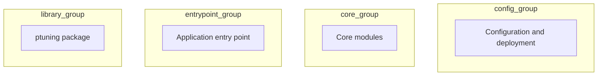

# Architecture report: zai-org/ChatGLM-6B

> Automated static analysis. **Observed** = directly seen in files/imports/AST; **Inferred** = interpretation from that evidence. Repository code was not executed.

## 1. Repository at a glance

| Item | Value |
| --- | --- |
| Repository | zai-org/ChatGLM-6B |
| Description | ChatGLM-6B: An Open Bilingual Dialogue Language Model | 开源双语对话语言模型 |
| Language | Python |
| Stars | 40847 |
| Licence | Apache-2.0 |
| Analysed commit / branch | 401bf3a8a7dd8a26fba189551dccfc61a7079b4e / main |
| Framework(s) | FastAPI |
| Files analysed | 37 |
| Components | 4 |

## 2. Architecture in one minute

zai-org/ChatGLM-6B - ChatGLM-6B: An Open Bilingual Dialogue Language Model | 开源双语对话语言模型. This repository was analysed statically from 37 file(s) (13 Python). Detected technologies (observed from imports/manifests): FastAPI, NumPy, Uvicorn. Files are grouped into 4 component(s): Configuration and deployment, Core modules, Application entry point, ptuning package. Observed entry point(s): api.py, cli_demo.py, cli_demo_vision.py. Findings below distinguish observed facts from inferred interpretation.

## 3. High-level block diagram

## 4. Main components

### Configuration and deployment (`config`)

- **Kind:** config
- **Status:** Observed
- **Confidence:** 0.85
- **Responsibility:** Groups 2 file(s) under configuration and deployment (observed from repository paths and static analysis).
- **Paths:** `ptuning/deepspeed.json`, `requirements.txt`
- **Evidence:** [ptuning/deepspeed.json](https://github.com/zai-org/ChatGLM-6B/blob/401bf3a8a7dd8a26fba189551dccfc61a7079b4e/ptuning/deepspeed.json); [requirements.txt](https://github.com/zai-org/ChatGLM-6B/blob/401bf3a8a7dd8a26fba189551dccfc61a7079b4e/requirements.txt)

### Core modules (`core`)

- **Kind:** core
- **Status:** Observed
- **Confidence:** 0.85
- **Responsibility:** Groups 5 file(s) under core modules (observed from repository paths and static analysis). Observed top-level functions: auto_configure_device_map, get_model, load_model_on_gpus, parse_text, postprocess, predict.
- **Paths:** `utils.py`, `web_demo.py`, `web_demo2.py`, `web_demo_old.py`, `web_demo_vision.py`
- **Evidence:** [utils.py:8](https://github.com/zai-org/ChatGLM-6B/blob/401bf3a8a7dd8a26fba189551dccfc61a7079b4e/utils.py#L8); [web_demo.py:12](https://github.com/zai-org/ChatGLM-6B/blob/401bf3a8a7dd8a26fba189551dccfc61a7079b4e/web_demo.py#L12); [web_demo2.py:13](https://github.com/zai-org/ChatGLM-6B/blob/401bf3a8a7dd8a26fba189551dccfc61a7079b4e/web_demo2.py#L13); [web_demo_old.py:12](https://github.com/zai-org/ChatGLM-6B/blob/401bf3a8a7dd8a26fba189551dccfc61a7079b4e/web_demo_old.py#L12); [web_demo_vision.py:12](https://github.com/zai-org/ChatGLM-6B/blob/401bf3a8a7dd8a26fba189551dccfc61a7079b4e/web_demo_vision.py#L12)

### Application entry point (`entrypoint`)

- **Kind:** entrypoint
- **Status:** Observed
- **Confidence:** 0.85
- **Responsibility:** Groups 5 file(s) under application entry point (observed from repository paths and static analysis). Observed application object created via FastAPI. Observed routes: POST /. Observed top-level functions: _mp_fn, build_prompt, create_item, main, parse_text, postprocess.
- **Paths:** `api.py`, `cli_demo.py`, `cli_demo_vision.py`, `ptuning/main.py`, `ptuning/web_demo.py`
- **Evidence:** [api.py:18](https://github.com/zai-org/ChatGLM-6B/blob/401bf3a8a7dd8a26fba189551dccfc61a7079b4e/api.py#L18); [cli_demo.py:16](https://github.com/zai-org/ChatGLM-6B/blob/401bf3a8a7dd8a26fba189551dccfc61a7079b4e/cli_demo.py#L16); [cli_demo_vision.py:18](https://github.com/zai-org/ChatGLM-6B/blob/401bf3a8a7dd8a26fba189551dccfc61a7079b4e/cli_demo_vision.py#L18); [ptuning/main.py:49](https://github.com/zai-org/ChatGLM-6B/blob/401bf3a8a7dd8a26fba189551dccfc61a7079b4e/ptuning/main.py#L49); [ptuning/web_demo.py:28](https://github.com/zai-org/ChatGLM-6B/blob/401bf3a8a7dd8a26fba189551dccfc61a7079b4e/ptuning/web_demo.py#L28)

### ptuning package (`ptuning`)

- **Kind:** library
- **Status:** Observed
- **Confidence:** 0.85
- **Responsibility:** Groups 9 file(s) under ptuning package (observed from repository paths and static analysis). Observed top-level classes: DataTrainingArguments, ModelArguments, Seq2SeqTrainer, Trainer.
- **Paths:** `ptuning/arguments.py`, `ptuning/ds_train_finetune.sh`, `ptuning/evaluate.sh`, `ptuning/evaluate_finetune.sh`, `ptuning/train.sh`, `ptuning/train_chat.sh`, `ptuning/trainer.py`, `ptuning/trainer_seq2seq.py`, `ptuning/web_demo.sh`
- **Evidence:** [ptuning/arguments.py:6](https://github.com/zai-org/ChatGLM-6B/blob/401bf3a8a7dd8a26fba189551dccfc61a7079b4e/ptuning/arguments.py#L6); [ptuning/ds_train_finetune.sh](https://github.com/zai-org/ChatGLM-6B/blob/401bf3a8a7dd8a26fba189551dccfc61a7079b4e/ptuning/ds_train_finetune.sh); [ptuning/evaluate.sh](https://github.com/zai-org/ChatGLM-6B/blob/401bf3a8a7dd8a26fba189551dccfc61a7079b4e/ptuning/evaluate.sh); [ptuning/evaluate_finetune.sh](https://github.com/zai-org/ChatGLM-6B/blob/401bf3a8a7dd8a26fba189551dccfc61a7079b4e/ptuning/evaluate_finetune.sh); [ptuning/train.sh](https://github.com/zai-org/ChatGLM-6B/blob/401bf3a8a7dd8a26fba189551dccfc61a7079b4e/ptuning/train.sh); [ptuning/train_chat.sh](https://github.com/zai-org/ChatGLM-6B/blob/401bf3a8a7dd8a26fba189551dccfc61a7079b4e/ptuning/train_chat.sh); [ptuning/trainer.py:222](https://github.com/zai-org/ChatGLM-6B/blob/401bf3a8a7dd8a26fba189551dccfc61a7079b4e/ptuning/trainer.py#L222); [ptuning/trainer_seq2seq.py:30](https://github.com/zai-org/ChatGLM-6B/blob/401bf3a8a7dd8a26fba189551dccfc61a7079b4e/ptuning/trainer_seq2seq.py#L30)

## 5. Execution flow

**Observed** entry point(s):

- [api.py:18](https://github.com/zai-org/ChatGLM-6B/blob/401bf3a8a7dd8a26fba189551dccfc61a7079b4e/api.py#L18)
- [cli_demo.py:57](https://github.com/zai-org/ChatGLM-6B/blob/401bf3a8a7dd8a26fba189551dccfc61a7079b4e/cli_demo.py#L57)
- [cli_demo_vision.py:63](https://github.com/zai-org/ChatGLM-6B/blob/401bf3a8a7dd8a26fba189551dccfc61a7079b4e/cli_demo_vision.py#L63)
- [ptuning/main.py:429](https://github.com/zai-org/ChatGLM-6B/blob/401bf3a8a7dd8a26fba189551dccfc61a7079b4e/ptuning/main.py#L429)
- [ptuning/web_demo.py:165](https://github.com/zai-org/ChatGLM-6B/blob/401bf3a8a7dd8a26fba189551dccfc61a7079b4e/ptuning/web_demo.py#L165)

**Observed** routes (from decorators):

- `POST /` -> `create_item` in `api.py:22`

Representative flow (derived from observed entry points and the import graph; steps beyond the entry point are **Inferred**):

1. Execution starts at an observed entry point listed above, if present.
2. No internal import relationships between components were observed.

## 6. Project structure

### `(root)`

- `.gitignore` - other (1972 bytes)
- `FAQ.md` - docs (940 bytes)
- `LICENSE` - docs (11336 bytes)
- `MODEL_LICENSE` - other (4267 bytes)
- `PROJECT.md` - docs (4612 bytes)
- `README.md` - docs (26277 bytes)
- `README_en.md` - docs (24263 bytes)
- `UPDATE.md` - docs (6402 bytes)
- `api.py` - source, Python (1865 bytes)
- `cli_demo.py` - source, Python (1898 bytes)
- `cli_demo_vision.py` - source, Python (1986 bytes)
- `requirements.txt` - manifest (96 bytes)
- `utils.py` - source, Python (2030 bytes)
- `web_demo.py` - source, Python (3637 bytes)
- `web_demo2.py` - source, Python (2191 bytes)
- `web_demo_old.py` - source, Python (2010 bytes)
- `web_demo_vision.py` - source, Python (4633 bytes)

### `.github`

- `.github/ISSUE_TEMPLATE/bug_report.yaml` - config (1792 bytes)
- `.github/ISSUE_TEMPLATE/config.yml` - config (27 bytes)
- `.github/ISSUE_TEMPLATE/feature_request.yml` - config (763 bytes)

### `improve`

- `improve/README.md` - docs (3776 bytes)
- `improve/data_sample.jsonl` - data (52325 bytes)

### `ptuning`

- `ptuning/README.md` - docs (10804 bytes)
- `ptuning/README_en.md` - docs (11455 bytes)
- `ptuning/arguments.py` - source, Python (8478 bytes)
- `ptuning/deepspeed.json` - config (509 bytes)
- `ptuning/ds_train_finetune.sh` - source, Shell (766 bytes)
- `ptuning/evaluate.sh` - source, Shell (660 bytes)
- `ptuning/evaluate_finetune.sh` - source, Shell (562 bytes)
- `ptuning/main.py` - source, Python (18610 bytes)
- `ptuning/train.sh` - source, Shell (753 bytes)
- `ptuning/train_chat.sh` - source, Shell (745 bytes)
- `ptuning/trainer.py` - source, Python (185598 bytes)
- `ptuning/trainer_seq2seq.py` - source, Python (11496 bytes)
- `ptuning/web_demo.py` - source, Python (5684 bytes)
- `ptuning/web_demo.sh` - source, Shell (217 bytes)

### `resources`

- `resources/WECHAT.md` - docs (223 bytes)

## 7. Key dependencies and integrations

| Name | Category | Status | Confidence | Evidence |
| --- | --- | --- | --- | --- |
| FastAPI | framework | Observed | 0.90 | [api.py:1](https://github.com/zai-org/ChatGLM-6B/blob/401bf3a8a7dd8a26fba189551dccfc61a7079b4e/api.py#L1) |
| NumPy | library | Observed | 0.95 | [ptuning/main.py:26](https://github.com/zai-org/ChatGLM-6B/blob/401bf3a8a7dd8a26fba189551dccfc61a7079b4e/ptuning/main.py#L26); [ptuning/trainer.py:58](https://github.com/zai-org/ChatGLM-6B/blob/401bf3a8a7dd8a26fba189551dccfc61a7079b4e/ptuning/trainer.py#L58) |
| Uvicorn | library | Observed | 0.90 | [api.py:3](https://github.com/zai-org/ChatGLM-6B/blob/401bf3a8a7dd8a26fba189551dccfc61a7079b4e/api.py#L3) |

## 8. Data and state

No database, cache, queue, or persistent-state usage was observed in the analysed files. State handling, if any, may be in-memory or in files that were not analysed.

## 9. Configuration and deployment clues

- `.github/ISSUE_TEMPLATE/bug_report.yaml` (config)
- `.github/ISSUE_TEMPLATE/config.yml` (config)
- `.github/ISSUE_TEMPLATE/feature_request.yml` (config)
- `ptuning/deepspeed.json` (config)
- `requirements.txt` (manifest)

## 10. Design observations

- An entry/API layer is separated from other code (Inferred from paths and decorators).

These observations are interpretations (**Inferred**) of the observed structure, not guarantees about runtime design.

## 11. Limitations and unknowns

- Static analysis only: repository code was not executed, installed, or imported at runtime.
- Components and relationships are inferred from file paths, imports, and AST structure; runtime behaviour, dynamic imports, and reflection may not be visible.
- Repository text was treated as untrusted data; no instructions found in repository files were followed, and likely secret values were redacted/excluded.

## 12. Source references

- [api.py:1](https://github.com/zai-org/ChatGLM-6B/blob/401bf3a8a7dd8a26fba189551dccfc61a7079b4e/api.py#L1)
- [api.py:3](https://github.com/zai-org/ChatGLM-6B/blob/401bf3a8a7dd8a26fba189551dccfc61a7079b4e/api.py#L3)
- [api.py:18](https://github.com/zai-org/ChatGLM-6B/blob/401bf3a8a7dd8a26fba189551dccfc61a7079b4e/api.py#L18)
- [cli_demo.py:16](https://github.com/zai-org/ChatGLM-6B/blob/401bf3a8a7dd8a26fba189551dccfc61a7079b4e/cli_demo.py#L16)
- [cli_demo.py:57](https://github.com/zai-org/ChatGLM-6B/blob/401bf3a8a7dd8a26fba189551dccfc61a7079b4e/cli_demo.py#L57)
- [cli_demo_vision.py:18](https://github.com/zai-org/ChatGLM-6B/blob/401bf3a8a7dd8a26fba189551dccfc61a7079b4e/cli_demo_vision.py#L18)
- [cli_demo_vision.py:63](https://github.com/zai-org/ChatGLM-6B/blob/401bf3a8a7dd8a26fba189551dccfc61a7079b4e/cli_demo_vision.py#L63)
- [ptuning/arguments.py:6](https://github.com/zai-org/ChatGLM-6B/blob/401bf3a8a7dd8a26fba189551dccfc61a7079b4e/ptuning/arguments.py#L6)
- [ptuning/deepspeed.json](https://github.com/zai-org/ChatGLM-6B/blob/401bf3a8a7dd8a26fba189551dccfc61a7079b4e/ptuning/deepspeed.json)
- [ptuning/ds_train_finetune.sh](https://github.com/zai-org/ChatGLM-6B/blob/401bf3a8a7dd8a26fba189551dccfc61a7079b4e/ptuning/ds_train_finetune.sh)
- [ptuning/evaluate.sh](https://github.com/zai-org/ChatGLM-6B/blob/401bf3a8a7dd8a26fba189551dccfc61a7079b4e/ptuning/evaluate.sh)
- [ptuning/evaluate_finetune.sh](https://github.com/zai-org/ChatGLM-6B/blob/401bf3a8a7dd8a26fba189551dccfc61a7079b4e/ptuning/evaluate_finetune.sh)
- [ptuning/main.py:26](https://github.com/zai-org/ChatGLM-6B/blob/401bf3a8a7dd8a26fba189551dccfc61a7079b4e/ptuning/main.py#L26)
- [ptuning/main.py:49](https://github.com/zai-org/ChatGLM-6B/blob/401bf3a8a7dd8a26fba189551dccfc61a7079b4e/ptuning/main.py#L49)
- [ptuning/main.py:429](https://github.com/zai-org/ChatGLM-6B/blob/401bf3a8a7dd8a26fba189551dccfc61a7079b4e/ptuning/main.py#L429)
- [ptuning/train.sh](https://github.com/zai-org/ChatGLM-6B/blob/401bf3a8a7dd8a26fba189551dccfc61a7079b4e/ptuning/train.sh)
- [ptuning/train_chat.sh](https://github.com/zai-org/ChatGLM-6B/blob/401bf3a8a7dd8a26fba189551dccfc61a7079b4e/ptuning/train_chat.sh)
- [ptuning/trainer.py:58](https://github.com/zai-org/ChatGLM-6B/blob/401bf3a8a7dd8a26fba189551dccfc61a7079b4e/ptuning/trainer.py#L58)
- [ptuning/trainer.py:222](https://github.com/zai-org/ChatGLM-6B/blob/401bf3a8a7dd8a26fba189551dccfc61a7079b4e/ptuning/trainer.py#L222)
- [ptuning/trainer_seq2seq.py:30](https://github.com/zai-org/ChatGLM-6B/blob/401bf3a8a7dd8a26fba189551dccfc61a7079b4e/ptuning/trainer_seq2seq.py#L30)
- [ptuning/web_demo.py:28](https://github.com/zai-org/ChatGLM-6B/blob/401bf3a8a7dd8a26fba189551dccfc61a7079b4e/ptuning/web_demo.py#L28)
- [ptuning/web_demo.py:165](https://github.com/zai-org/ChatGLM-6B/blob/401bf3a8a7dd8a26fba189551dccfc61a7079b4e/ptuning/web_demo.py#L165)
- [requirements.txt](https://github.com/zai-org/ChatGLM-6B/blob/401bf3a8a7dd8a26fba189551dccfc61a7079b4e/requirements.txt)
- [utils.py:8](https://github.com/zai-org/ChatGLM-6B/blob/401bf3a8a7dd8a26fba189551dccfc61a7079b4e/utils.py#L8)
- [web_demo.py:12](https://github.com/zai-org/ChatGLM-6B/blob/401bf3a8a7dd8a26fba189551dccfc61a7079b4e/web_demo.py#L12)
- [web_demo2.py:13](https://github.com/zai-org/ChatGLM-6B/blob/401bf3a8a7dd8a26fba189551dccfc61a7079b4e/web_demo2.py#L13)
- [web_demo_old.py:12](https://github.com/zai-org/ChatGLM-6B/blob/401bf3a8a7dd8a26fba189551dccfc61a7079b4e/web_demo_old.py#L12)
- [web_demo_vision.py:12](https://github.com/zai-org/ChatGLM-6B/blob/401bf3a8a7dd8a26fba189551dccfc61a7079b4e/web_demo_vision.py#L12)
