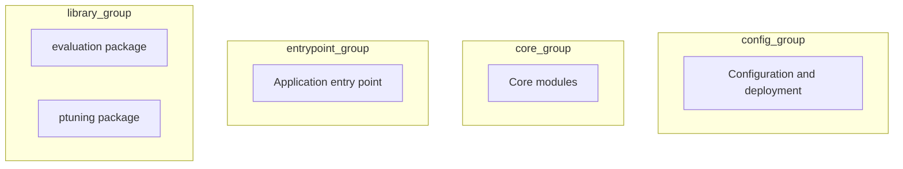

# Architecture report: zai-org/ChatGLM2-6B

> Automated static analysis. **Observed** = directly seen in files/imports/AST; **Inferred** = interpretation from that evidence. Repository code was not executed.

## 1. Repository at a glance

| Item | Value |
| --- | --- |
| Repository | zai-org/ChatGLM2-6B |
| Description | ChatGLM2-6B: An Open Bilingual Chat LLM | 开源双语对话语言模型 |
| Language | Python |
| Stars | 15475 |
| Licence | Other |
| Analysed commit / branch | cb8e8b43c0951b32614f25c03e1ab593a0603a1c / main |
| Framework(s) | FastAPI |
| Files analysed | 30 |
| Components | 5 |

## 2. Architecture in one minute

zai-org/ChatGLM2-6B - ChatGLM2-6B: An Open Bilingual Chat LLM | 开源双语对话语言模型. This repository was analysed statically from 30 file(s) (12 Python). Detected technologies (observed from imports/manifests): FastAPI, NumPy, Pydantic, Uvicorn. Files are grouped into 5 component(s): Configuration and deployment, Core modules, Application entry point, evaluation package, ptuning package. Observed entry point(s): api.py, cli_demo.py, openai_api.py. Findings below distinguish observed facts from inferred interpretation.

## 3. High-level block diagram

## 4. Main components

### Configuration and deployment (`config`)

- **Kind:** config
- **Status:** Observed
- **Confidence:** 0.85
- **Responsibility:** Groups 2 file(s) under configuration and deployment (observed from repository paths and static analysis).
- **Paths:** `ptuning/deepspeed.json`, `requirements.txt`
- **Evidence:** [ptuning/deepspeed.json](https://github.com/zai-org/ChatGLM2-6B/blob/cb8e8b43c0951b32614f25c03e1ab593a0603a1c/ptuning/deepspeed.json); [requirements.txt](https://github.com/zai-org/ChatGLM2-6B/blob/cb8e8b43c0951b32614f25c03e1ab593a0603a1c/requirements.txt)

### Core modules (`core`)

- **Kind:** core
- **Status:** Observed
- **Confidence:** 0.85
- **Responsibility:** Groups 3 file(s) under core modules (observed from repository paths and static analysis). Observed top-level functions: auto_configure_device_map, get_model, load_model_on_gpus, parse_text, postprocess, predict.
- **Paths:** `utils.py`, `web_demo.py`, `web_demo2.py`
- **Evidence:** [utils.py:8](https://github.com/zai-org/ChatGLM2-6B/blob/cb8e8b43c0951b32614f25c03e1ab593a0603a1c/utils.py#L8); [web_demo.py:16](https://github.com/zai-org/ChatGLM2-6B/blob/cb8e8b43c0951b32614f25c03e1ab593a0603a1c/web_demo.py#L16); [web_demo2.py:13](https://github.com/zai-org/ChatGLM2-6B/blob/cb8e8b43c0951b32614f25c03e1ab593a0603a1c/web_demo2.py#L13)

### Application entry point (`entrypoint`)

- **Kind:** entrypoint
- **Status:** Observed
- **Confidence:** 0.85
- **Responsibility:** Groups 5 file(s) under application entry point (observed from repository paths and static analysis). Observed application object created via FastAPI. Observed routes: POST /, GET /v1/models, POST /v1/chat/completions. Observed top-level classes: ChatCompletionRequest, ChatCompletionResponse, ChatCompletionResponseChoice, ChatCompletionResponseStreamChoice, ChatMessage, DeltaMessage. Observed top-level functions: _mp_fn, build_prompt, create_chat_completion, create_item, lifespan, list_models.
- **Paths:** `api.py`, `cli_demo.py`, `openai_api.py`, `ptuning/main.py`, `ptuning/web_demo.py`
- **Evidence:** [api.py:18](https://github.com/zai-org/ChatGLM2-6B/blob/cb8e8b43c0951b32614f25c03e1ab593a0603a1c/api.py#L18); [cli_demo.py:19](https://github.com/zai-org/ChatGLM2-6B/blob/cb8e8b43c0951b32614f25c03e1ab593a0603a1c/cli_demo.py#L19); [openai_api.py:27](https://github.com/zai-org/ChatGLM2-6B/blob/cb8e8b43c0951b32614f25c03e1ab593a0603a1c/openai_api.py#L27); [ptuning/main.py:49](https://github.com/zai-org/ChatGLM2-6B/blob/cb8e8b43c0951b32614f25c03e1ab593a0603a1c/ptuning/main.py#L49); [ptuning/web_demo.py:28](https://github.com/zai-org/ChatGLM2-6B/blob/cb8e8b43c0951b32614f25c03e1ab593a0603a1c/ptuning/web_demo.py#L28)

### evaluation package (`evaluation`)

- **Kind:** library
- **Status:** Observed
- **Confidence:** 0.85
- **Responsibility:** Groups 1 file(s) under evaluation package (observed from repository paths and static analysis). Observed top-level functions: build_prompt.
- **Paths:** `evaluation/evaluate_ceval.py`
- **Evidence:** [evaluation/evaluate_ceval.py:17](https://github.com/zai-org/ChatGLM2-6B/blob/cb8e8b43c0951b32614f25c03e1ab593a0603a1c/evaluation/evaluate_ceval.py#L17)

### ptuning package (`ptuning`)

- **Kind:** library
- **Status:** Observed
- **Confidence:** 0.85
- **Responsibility:** Groups 9 file(s) under ptuning package (observed from repository paths and static analysis). Observed top-level classes: DataTrainingArguments, ModelArguments, PrefixTrainer, Seq2SeqTrainer.
- **Paths:** `ptuning/arguments.py`, `ptuning/ds_train_finetune.sh`, `ptuning/evaluate.sh`, `ptuning/evaluate_finetune.sh`, `ptuning/train.sh`, `ptuning/train_chat.sh`, `ptuning/trainer.py`, `ptuning/trainer_seq2seq.py`, `ptuning/web_demo.sh`
- **Evidence:** [ptuning/arguments.py:6](https://github.com/zai-org/ChatGLM2-6B/blob/cb8e8b43c0951b32614f25c03e1ab593a0603a1c/ptuning/arguments.py#L6); [ptuning/ds_train_finetune.sh](https://github.com/zai-org/ChatGLM2-6B/blob/cb8e8b43c0951b32614f25c03e1ab593a0603a1c/ptuning/ds_train_finetune.sh); [ptuning/evaluate.sh](https://github.com/zai-org/ChatGLM2-6B/blob/cb8e8b43c0951b32614f25c03e1ab593a0603a1c/ptuning/evaluate.sh); [ptuning/evaluate_finetune.sh](https://github.com/zai-org/ChatGLM2-6B/blob/cb8e8b43c0951b32614f25c03e1ab593a0603a1c/ptuning/evaluate_finetune.sh); [ptuning/train.sh](https://github.com/zai-org/ChatGLM2-6B/blob/cb8e8b43c0951b32614f25c03e1ab593a0603a1c/ptuning/train.sh); [ptuning/train_chat.sh](https://github.com/zai-org/ChatGLM2-6B/blob/cb8e8b43c0951b32614f25c03e1ab593a0603a1c/ptuning/train_chat.sh); [ptuning/trainer.py:32](https://github.com/zai-org/ChatGLM2-6B/blob/cb8e8b43c0951b32614f25c03e1ab593a0603a1c/ptuning/trainer.py#L32); [ptuning/trainer_seq2seq.py:30](https://github.com/zai-org/ChatGLM2-6B/blob/cb8e8b43c0951b32614f25c03e1ab593a0603a1c/ptuning/trainer_seq2seq.py#L30)

## 5. Execution flow

**Observed** entry point(s):

- [api.py:18](https://github.com/zai-org/ChatGLM2-6B/blob/cb8e8b43c0951b32614f25c03e1ab593a0603a1c/api.py#L18)
- [cli_demo.py:59](https://github.com/zai-org/ChatGLM2-6B/blob/cb8e8b43c0951b32614f25c03e1ab593a0603a1c/cli_demo.py#L59)
- [openai_api.py:27](https://github.com/zai-org/ChatGLM2-6B/blob/cb8e8b43c0951b32614f25c03e1ab593a0603a1c/openai_api.py#L27)
- [ptuning/main.py:410](https://github.com/zai-org/ChatGLM2-6B/blob/cb8e8b43c0951b32614f25c03e1ab593a0603a1c/ptuning/main.py#L410)
- [ptuning/web_demo.py:166](https://github.com/zai-org/ChatGLM2-6B/blob/cb8e8b43c0951b32614f25c03e1ab593a0603a1c/ptuning/web_demo.py#L166)

**Observed** routes (from decorators):

- `POST /` -> `create_item` in `api.py:22`
- `GET /v1/models` -> `list_models` in `openai_api.py:91`
- `POST /v1/chat/completions` -> `create_chat_completion` in `openai_api.py:98`

Representative flow (derived from observed entry points and the import graph; steps beyond the entry point are **Inferred**):

1. Execution starts at an observed entry point listed above, if present.
2. No internal import relationships between components were observed.

## 6. Project structure

### `(root)`

- `FAQ.md` - docs (946 bytes)
- `MODEL_LICENSE` - other (4133 bytes)
- `README.md` - docs (22088 bytes)
- `README_EN.md` - docs (18309 bytes)
- `api.py` - source, Python (2145 bytes)
- `cli_demo.py` - source, Python (2226 bytes)
- `openai_api.py` - source, Python (5699 bytes)
- `requirements.txt` - manifest (127 bytes)
- `utils.py` - source, Python (2273 bytes)
- `web_demo.py` - source, Python (4221 bytes)
- `web_demo2.py` - source, Python (2508 bytes)

### `.github`

- `.github/ISSUE_TEMPLATE/bug_report.yaml` - config (1792 bytes)
- `.github/ISSUE_TEMPLATE/config.yml` - config (27 bytes)
- `.github/ISSUE_TEMPLATE/feature_request.yml` - config (763 bytes)

### `evaluation`

- `evaluation/README.md` - docs (607 bytes)
- `evaluation/evaluate_ceval.py` - source, Python (2582 bytes)

### `ptuning`

- `ptuning/README.md` - docs (9567 bytes)
- `ptuning/arguments.py` - source, Python (8474 bytes)
- `ptuning/deepspeed.json` - config (489 bytes)
- `ptuning/ds_train_finetune.sh` - source, Shell (768 bytes)
- `ptuning/evaluate.sh` - source, Shell (702 bytes)
- `ptuning/evaluate_finetune.sh` - source, Shell (603 bytes)
- `ptuning/main.py` - source, Python (17804 bytes)
- `ptuning/train.sh` - source, Shell (833 bytes)
- `ptuning/train_chat.sh` - source, Shell (823 bytes)
- `ptuning/trainer.py` - source, Python (3155 bytes)
- `ptuning/trainer_seq2seq.py` - source, Python (11508 bytes)
- `ptuning/web_demo.py` - source, Python (6014 bytes)
- `ptuning/web_demo.sh` - source, Shell (219 bytes)

### `resources`

- `resources/WECHAT.md` - docs (223 bytes)

## 7. Key dependencies and integrations

| Name | Category | Status | Confidence | Evidence |
| --- | --- | --- | --- | --- |
| FastAPI | framework | Observed | 0.95 | [api.py:1](https://github.com/zai-org/ChatGLM2-6B/blob/cb8e8b43c0951b32614f25c03e1ab593a0603a1c/api.py#L1); [openai_api.py:11](https://github.com/zai-org/ChatGLM2-6B/blob/cb8e8b43c0951b32614f25c03e1ab593a0603a1c/openai_api.py#L11); [openai_api.py:12](https://github.com/zai-org/ChatGLM2-6B/blob/cb8e8b43c0951b32614f25c03e1ab593a0603a1c/openai_api.py#L12) |
| NumPy | library | Observed | 0.90 | [ptuning/main.py:26](https://github.com/zai-org/ChatGLM2-6B/blob/cb8e8b43c0951b32614f25c03e1ab593a0603a1c/ptuning/main.py#L26) |
| Pydantic | library | Observed | 0.90 | [openai_api.py:10](https://github.com/zai-org/ChatGLM2-6B/blob/cb8e8b43c0951b32614f25c03e1ab593a0603a1c/openai_api.py#L10) |
| Uvicorn | library | Observed | 0.95 | [api.py:3](https://github.com/zai-org/ChatGLM2-6B/blob/cb8e8b43c0951b32614f25c03e1ab593a0603a1c/api.py#L3); [openai_api.py:9](https://github.com/zai-org/ChatGLM2-6B/blob/cb8e8b43c0951b32614f25c03e1ab593a0603a1c/openai_api.py#L9) |

## 8. Data and state

No database, cache, queue, or persistent-state usage was observed in the analysed files. State handling, if any, may be in-memory or in files that were not analysed.

## 9. Configuration and deployment clues

- `.github/ISSUE_TEMPLATE/bug_report.yaml` (config)
- `.github/ISSUE_TEMPLATE/config.yml` (config)
- `.github/ISSUE_TEMPLATE/feature_request.yml` (config)
- `ptuning/deepspeed.json` (config)
- `requirements.txt` (manifest)

## 10. Design observations

- An entry/API layer is separated from other code (Inferred from paths and decorators).

These observations are interpretations (**Inferred**) of the observed structure, not guarantees about runtime design.

## 11. Limitations and unknowns

- Static analysis only: repository code was not executed, installed, or imported at runtime.
- Components and relationships are inferred from file paths, imports, and AST structure; runtime behaviour, dynamic imports, and reflection may not be visible.
- Repository text was treated as untrusted data; no instructions found in repository files were followed, and likely secret values were redacted/excluded.

## 12. Source references

- [api.py:1](https://github.com/zai-org/ChatGLM2-6B/blob/cb8e8b43c0951b32614f25c03e1ab593a0603a1c/api.py#L1)
- [api.py:3](https://github.com/zai-org/ChatGLM2-6B/blob/cb8e8b43c0951b32614f25c03e1ab593a0603a1c/api.py#L3)
- [api.py:18](https://github.com/zai-org/ChatGLM2-6B/blob/cb8e8b43c0951b32614f25c03e1ab593a0603a1c/api.py#L18)
- [cli_demo.py:19](https://github.com/zai-org/ChatGLM2-6B/blob/cb8e8b43c0951b32614f25c03e1ab593a0603a1c/cli_demo.py#L19)
- [cli_demo.py:59](https://github.com/zai-org/ChatGLM2-6B/blob/cb8e8b43c0951b32614f25c03e1ab593a0603a1c/cli_demo.py#L59)
- [evaluation/evaluate_ceval.py:17](https://github.com/zai-org/ChatGLM2-6B/blob/cb8e8b43c0951b32614f25c03e1ab593a0603a1c/evaluation/evaluate_ceval.py#L17)
- [openai_api.py:9](https://github.com/zai-org/ChatGLM2-6B/blob/cb8e8b43c0951b32614f25c03e1ab593a0603a1c/openai_api.py#L9)
- [openai_api.py:10](https://github.com/zai-org/ChatGLM2-6B/blob/cb8e8b43c0951b32614f25c03e1ab593a0603a1c/openai_api.py#L10)
- [openai_api.py:11](https://github.com/zai-org/ChatGLM2-6B/blob/cb8e8b43c0951b32614f25c03e1ab593a0603a1c/openai_api.py#L11)
- [openai_api.py:12](https://github.com/zai-org/ChatGLM2-6B/blob/cb8e8b43c0951b32614f25c03e1ab593a0603a1c/openai_api.py#L12)
- [openai_api.py:27](https://github.com/zai-org/ChatGLM2-6B/blob/cb8e8b43c0951b32614f25c03e1ab593a0603a1c/openai_api.py#L27)
- [ptuning/arguments.py:6](https://github.com/zai-org/ChatGLM2-6B/blob/cb8e8b43c0951b32614f25c03e1ab593a0603a1c/ptuning/arguments.py#L6)
- [ptuning/deepspeed.json](https://github.com/zai-org/ChatGLM2-6B/blob/cb8e8b43c0951b32614f25c03e1ab593a0603a1c/ptuning/deepspeed.json)
- [ptuning/ds_train_finetune.sh](https://github.com/zai-org/ChatGLM2-6B/blob/cb8e8b43c0951b32614f25c03e1ab593a0603a1c/ptuning/ds_train_finetune.sh)
- [ptuning/evaluate.sh](https://github.com/zai-org/ChatGLM2-6B/blob/cb8e8b43c0951b32614f25c03e1ab593a0603a1c/ptuning/evaluate.sh)
- [ptuning/evaluate_finetune.sh](https://github.com/zai-org/ChatGLM2-6B/blob/cb8e8b43c0951b32614f25c03e1ab593a0603a1c/ptuning/evaluate_finetune.sh)
- [ptuning/main.py:26](https://github.com/zai-org/ChatGLM2-6B/blob/cb8e8b43c0951b32614f25c03e1ab593a0603a1c/ptuning/main.py#L26)
- [ptuning/main.py:49](https://github.com/zai-org/ChatGLM2-6B/blob/cb8e8b43c0951b32614f25c03e1ab593a0603a1c/ptuning/main.py#L49)
- [ptuning/main.py:410](https://github.com/zai-org/ChatGLM2-6B/blob/cb8e8b43c0951b32614f25c03e1ab593a0603a1c/ptuning/main.py#L410)
- [ptuning/train.sh](https://github.com/zai-org/ChatGLM2-6B/blob/cb8e8b43c0951b32614f25c03e1ab593a0603a1c/ptuning/train.sh)
- [ptuning/train_chat.sh](https://github.com/zai-org/ChatGLM2-6B/blob/cb8e8b43c0951b32614f25c03e1ab593a0603a1c/ptuning/train_chat.sh)
- [ptuning/trainer.py:32](https://github.com/zai-org/ChatGLM2-6B/blob/cb8e8b43c0951b32614f25c03e1ab593a0603a1c/ptuning/trainer.py#L32)
- [ptuning/trainer_seq2seq.py:30](https://github.com/zai-org/ChatGLM2-6B/blob/cb8e8b43c0951b32614f25c03e1ab593a0603a1c/ptuning/trainer_seq2seq.py#L30)
- [ptuning/web_demo.py:28](https://github.com/zai-org/ChatGLM2-6B/blob/cb8e8b43c0951b32614f25c03e1ab593a0603a1c/ptuning/web_demo.py#L28)
- [ptuning/web_demo.py:166](https://github.com/zai-org/ChatGLM2-6B/blob/cb8e8b43c0951b32614f25c03e1ab593a0603a1c/ptuning/web_demo.py#L166)
- [requirements.txt](https://github.com/zai-org/ChatGLM2-6B/blob/cb8e8b43c0951b32614f25c03e1ab593a0603a1c/requirements.txt)
- [utils.py:8](https://github.com/zai-org/ChatGLM2-6B/blob/cb8e8b43c0951b32614f25c03e1ab593a0603a1c/utils.py#L8)
- [web_demo.py:16](https://github.com/zai-org/ChatGLM2-6B/blob/cb8e8b43c0951b32614f25c03e1ab593a0603a1c/web_demo.py#L16)
- [web_demo2.py:13](https://github.com/zai-org/ChatGLM2-6B/blob/cb8e8b43c0951b32614f25c03e1ab593a0603a1c/web_demo2.py#L13)
