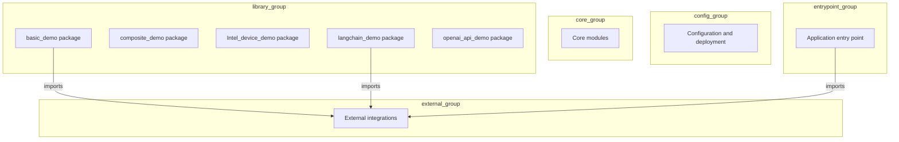

# Architecture report: zai-org/ChatGLM3

> Automated static analysis. **Observed** = directly seen in files/imports/AST; **Inferred** = interpretation from that evidence. Repository code was not executed.

## 1. Repository at a glance

| Item | Value |
| --- | --- |
| Repository | zai-org/ChatGLM3 |
| Description | ChatGLM3 series: Open Bilingual Chat LLMs | 开源双语对话语言模型 |
| Language | Python |
| Stars | 13628 |
| Licence | Apache-2.0 |
| Analysed commit / branch | 732294f42e2625509000daa87a9c3748d0bbb957 / main |
| Framework(s) | FastAPI, Typer |
| Files analysed | 68 |
| Components | 9 |

## 2. Architecture in one minute

zai-org/ChatGLM3 - ChatGLM3 series: Open Bilingual Chat LLMs | 开源双语对话语言模型. This repository was analysed statically from 68 file(s) (34 Python). Detected technologies (observed from imports/manifests): FastAPI, Typer, NumPy, Pydantic, requests, Uvicorn. Files are grouped into 9 component(s): basic_demo package, composite_demo package, Configuration and deployment, Core modules, Application entry point, External integrations, Intel_device_demo package, langchain_demo package. Observed entry point(s): Intel_device_demo/ipex_llm_cpu_demo/api_server.py, Intel_device_demo/ipex_llm_cpu_demo/generate.py, Intel_device_demo/ipex_llm_cpu_demo/openai_api_request.py. Findings below distinguish observed facts from inferred interpretation.

## 3. High-level block diagram

## 4. Main components

### basic_demo package (`basic_demo`)

- **Kind:** library
- **Status:** Observed
- **Confidence:** 0.85
- **Responsibility:** Groups 2 file(s) under basic_demo package (observed from repository paths and static analysis). Observed top-level classes: StopOnTokens. Observed top-level functions: _resolve_path, get_model, load_model_and_tokenizer, parse_text, predict.
- **Paths:** `basic_demo/web_demo_gradio.py`, `basic_demo/web_demo_streamlit.py`
- **Evidence:** [basic_demo/web_demo_gradio.py:48](https://github.com/zai-org/ChatGLM3/blob/732294f42e2625509000daa87a9c3748d0bbb957/basic_demo/web_demo_gradio.py#L48); [basic_demo/web_demo_streamlit.py:29](https://github.com/zai-org/ChatGLM3/blob/732294f42e2625509000daa87a9c3748d0bbb957/basic_demo/web_demo_streamlit.py#L29)

### composite_demo package (`composite_demo`)

- **Kind:** library
- **Status:** Observed
- **Confidence:** 0.85
- **Responsibility:** Groups 4 file(s) under composite_demo package (observed from repository paths and static analysis). Observed top-level classes: CodeKernel, Conversation, Role. Observed top-level functions: append_conversation, b64_2_img, clean_ansi_codes, execute, extract_code, get_kernel.
- **Paths:** `composite_demo/conversation.py`, `composite_demo/demo_chat.py`, `composite_demo/demo_ci.py`, `composite_demo/demo_tool.py`
- **Evidence:** [composite_demo/conversation.py:11](https://github.com/zai-org/ChatGLM3/blob/732294f42e2625509000daa87a9c3748d0bbb957/composite_demo/conversation.py#L11); [composite_demo/demo_chat.py:11](https://github.com/zai-org/ChatGLM3/blob/732294f42e2625509000daa87a9c3748d0bbb957/composite_demo/demo_chat.py#L11); [composite_demo/demo_ci.py:24](https://github.com/zai-org/ChatGLM3/blob/732294f42e2625509000daa87a9c3748d0bbb957/composite_demo/demo_ci.py#L24); [composite_demo/demo_tool.py:31](https://github.com/zai-org/ChatGLM3/blob/732294f42e2625509000daa87a9c3748d0bbb957/composite_demo/demo_tool.py#L31)

### Configuration and deployment (`config`)

- **Kind:** config
- **Status:** Observed
- **Confidence:** 0.85
- **Responsibility:** Groups 10 file(s) under configuration and deployment (observed from repository paths and static analysis).
- **Paths:** `composite_demo/.streamlit/config.toml`, `composite_demo/requirements.txt`, `finetune_demo/configs/ds_zero_2.json`, `finetune_demo/configs/ds_zero_3.json`, `finetune_demo/configs/lora.yaml`, `finetune_demo/configs/ptuning_v2.yaml`, `finetune_demo/configs/sft.yaml`, `finetune_demo/requirements.txt`, `openai_api_demo/docker-compose.yml`, `requirements.txt`
- **Evidence:** [composite_demo/.streamlit/config.toml](https://github.com/zai-org/ChatGLM3/blob/732294f42e2625509000daa87a9c3748d0bbb957/composite_demo/.streamlit/config.toml); [composite_demo/requirements.txt](https://github.com/zai-org/ChatGLM3/blob/732294f42e2625509000daa87a9c3748d0bbb957/composite_demo/requirements.txt); [finetune_demo/configs/ds_zero_2.json](https://github.com/zai-org/ChatGLM3/blob/732294f42e2625509000daa87a9c3748d0bbb957/finetune_demo/configs/ds_zero_2.json); [finetune_demo/configs/ds_zero_3.json](https://github.com/zai-org/ChatGLM3/blob/732294f42e2625509000daa87a9c3748d0bbb957/finetune_demo/configs/ds_zero_3.json); [finetune_demo/configs/lora.yaml](https://github.com/zai-org/ChatGLM3/blob/732294f42e2625509000daa87a9c3748d0bbb957/finetune_demo/configs/lora.yaml); [finetune_demo/configs/ptuning_v2.yaml](https://github.com/zai-org/ChatGLM3/blob/732294f42e2625509000daa87a9c3748d0bbb957/finetune_demo/configs/ptuning_v2.yaml); [finetune_demo/configs/sft.yaml](https://github.com/zai-org/ChatGLM3/blob/732294f42e2625509000daa87a9c3748d0bbb957/finetune_demo/configs/sft.yaml); [finetune_demo/requirements.txt](https://github.com/zai-org/ChatGLM3/blob/732294f42e2625509000daa87a9c3748d0bbb957/finetune_demo/requirements.txt)

### Core modules (`core`)

- **Kind:** core
- **Status:** Observed
- **Confidence:** 0.85
- **Responsibility:** Groups 1 file(s) under core modules (observed from repository paths and static analysis).
- **Paths:** `update_requirements.sh`
- **Evidence:** [update_requirements.sh](https://github.com/zai-org/ChatGLM3/blob/732294f42e2625509000daa87a9c3748d0bbb957/update_requirements.sh)

### Application entry point (`entrypoint`)

- **Kind:** entrypoint
- **Status:** Observed
- **Confidence:** 0.85
- **Responsibility:** Groups 19 file(s) under application entry point (observed from repository paths and static analysis). Observed application object created via FastAPI, Typer. Observed routes: GET /health, POST /v1/embeddings, GET /v1/models, POST /v1/chat/completions, GET /health. Observed top-level classes: ChatCompletionRequest, ChatCompletionResponse, ChatCompletionResponseChoice, ChatCompletionResponseStreamChoice, ChatMessage, CompletionUsage. Observed top-level functions: _get_yaml_parser, _load_datasets, _prepare_model_for_training, _resolve_path, _sanity_check, batch.
- **Paths:** `Intel_device_demo/ipex_llm_cpu_demo/api_server.py`, `Intel_device_demo/ipex_llm_cpu_demo/generate.py`, `Intel_device_demo/ipex_llm_cpu_demo/openai_api_request.py`, `Intel_device_demo/openvino_demo/openvino_cli_demo.py`, `basic_demo/cli_batch_request_demo.py`, `basic_demo/cli_demo.py`, `basic_demo/cli_demo_bad_word_ids.py`, `composite_demo/main.py`, `composite_demo/tool_registry.py`, `finetune_demo/finetune_hf.py`, `finetune_demo/inference_hf.py`, `langchain_demo/main.py`, `openai_api_demo/api_server.py`, `openai_api_demo/langchain_openai_api.py`, `openai_api_demo/openai_api_request.py`, `tensorrt_llm_demo/tensorrt_llm_cli_demo.py`, `tools_using_demo/cli_demo_tool.py`, `tools_using_demo/openai_api_demo.py`, `tools_using_demo/tool_register.py`
- **Evidence:** [Intel_device_demo/ipex_llm_cpu_demo/api_server.py:67](https://github.com/zai-org/ChatGLM3/blob/732294f42e2625509000daa87a9c3748d0bbb957/Intel_device_demo/ipex_llm_cpu_demo/api_server.py#L67); [Intel_device_demo/ipex_llm_cpu_demo/generate.py](https://github.com/zai-org/ChatGLM3/blob/732294f42e2625509000daa87a9c3748d0bbb957/Intel_device_demo/ipex_llm_cpu_demo/generate.py); [Intel_device_demo/ipex_llm_cpu_demo/openai_api_request.py:20](https://github.com/zai-org/ChatGLM3/blob/732294f42e2625509000daa87a9c3748d0bbb957/Intel_device_demo/ipex_llm_cpu_demo/openai_api_request.py#L20); [Intel_device_demo/openvino_demo/openvino_cli_demo.py:10](https://github.com/zai-org/ChatGLM3/blob/732294f42e2625509000daa87a9c3748d0bbb957/Intel_device_demo/openvino_demo/openvino_cli_demo.py#L10); [basic_demo/cli_batch_request_demo.py:11](https://github.com/zai-org/ChatGLM3/blob/732294f42e2625509000daa87a9c3748d0bbb957/basic_demo/cli_batch_request_demo.py#L11); [basic_demo/cli_demo.py:20](https://github.com/zai-org/ChatGLM3/blob/732294f42e2625509000daa87a9c3748d0bbb957/basic_demo/cli_demo.py#L20); [basic_demo/cli_demo_bad_word_ids.py:37](https://github.com/zai-org/ChatGLM3/blob/732294f42e2625509000daa87a9c3748d0bbb957/basic_demo/cli_demo_bad_word_ids.py#L37); [composite_demo/main.py:26](https://github.com/zai-org/ChatGLM3/blob/732294f42e2625509000daa87a9c3748d0bbb957/composite_demo/main.py#L26)

### External integrations (`external_integrations`)

- **Kind:** external
- **Status:** Observed
- **Confidence:** 0.85
- **Responsibility:** Groups 1 file(s) under external integrations (observed from repository paths and static analysis). Observed top-level classes: Client, HFClient. Observed top-level functions: get_client, stream_chat.
- **Paths:** `composite_demo/client.py`
- **Evidence:** [composite_demo/client.py:25](https://github.com/zai-org/ChatGLM3/blob/732294f42e2625509000daa87a9c3748d0bbb957/composite_demo/client.py#L25)

### Intel_device_demo package (`intel_device_demo`)

- **Kind:** library
- **Status:** Observed
- **Confidence:** 0.85
- **Responsibility:** Groups 3 file(s) under intel_device_demo package (observed from repository paths and static analysis). Observed top-level classes: InvalidScoreLogitsProcessor. Observed top-level functions: apply_stopping_strings, generate_chatglm3, generate_stream_chatglm3, get_model, process_chatglm_messages, process_response.
- **Paths:** `Intel_device_demo/ipex_llm_cpu_demo/chatglm3_infer.py`, `Intel_device_demo/ipex_llm_cpu_demo/chatglm3_web_demo.py`, `Intel_device_demo/ipex_llm_cpu_demo/utils.py`
- **Evidence:** [Intel_device_demo/ipex_llm_cpu_demo/chatglm3_infer.py](https://github.com/zai-org/ChatGLM3/blob/732294f42e2625509000daa87a9c3748d0bbb957/Intel_device_demo/ipex_llm_cpu_demo/chatglm3_infer.py); [Intel_device_demo/ipex_llm_cpu_demo/chatglm3_web_demo.py:34](https://github.com/zai-org/ChatGLM3/blob/732294f42e2625509000daa87a9c3748d0bbb957/Intel_device_demo/ipex_llm_cpu_demo/chatglm3_web_demo.py#L34); [Intel_device_demo/ipex_llm_cpu_demo/utils.py:9](https://github.com/zai-org/ChatGLM3/blob/732294f42e2625509000daa87a9c3748d0bbb957/Intel_device_demo/ipex_llm_cpu_demo/utils.py#L9)

### langchain_demo package (`langchain_demo`)

- **Kind:** library
- **Status:** Observed
- **Confidence:** 0.85
- **Responsibility:** Groups 4 file(s) under langchain_demo package (observed from repository paths and static analysis). Observed top-level classes: Calculator, CalculatorInput, ChatGLM3, DistanceConversionInput, DistanceConverter, Weather.
- **Paths:** `langchain_demo/ChatGLM3.py`, `langchain_demo/tools/Calculator.py`, `langchain_demo/tools/DistanceConversion.py`, `langchain_demo/tools/Weather.py`
- **Evidence:** [langchain_demo/ChatGLM3.py:8](https://github.com/zai-org/ChatGLM3/blob/732294f42e2625509000daa87a9c3748d0bbb957/langchain_demo/ChatGLM3.py#L8); [langchain_demo/tools/Calculator.py:8](https://github.com/zai-org/ChatGLM3/blob/732294f42e2625509000daa87a9c3748d0bbb957/langchain_demo/tools/Calculator.py#L8); [langchain_demo/tools/DistanceConversion.py:7](https://github.com/zai-org/ChatGLM3/blob/732294f42e2625509000daa87a9c3748d0bbb957/langchain_demo/tools/DistanceConversion.py#L7); [langchain_demo/tools/Weather.py:8](https://github.com/zai-org/ChatGLM3/blob/732294f42e2625509000daa87a9c3748d0bbb957/langchain_demo/tools/Weather.py#L8)

### openai_api_demo package (`openai_api_demo`)

- **Kind:** library
- **Status:** Observed
- **Confidence:** 0.85
- **Responsibility:** Groups 1 file(s) under openai_api_demo package (observed from repository paths and static analysis). Observed top-level classes: InvalidScoreLogitsProcessor. Observed top-level functions: apply_stopping_strings, generate_chatglm3, generate_stream_chatglm3, process_chatglm_messages, process_response.
- **Paths:** `openai_api_demo/utils.py`
- **Evidence:** [openai_api_demo/utils.py:9](https://github.com/zai-org/ChatGLM3/blob/732294f42e2625509000daa87a9c3748d0bbb957/openai_api_demo/utils.py#L9)

## 5. Execution flow

**Observed** entry point(s):

- [Intel_device_demo/ipex_llm_cpu_demo/api_server.py:67](https://github.com/zai-org/ChatGLM3/blob/732294f42e2625509000daa87a9c3748d0bbb957/Intel_device_demo/ipex_llm_cpu_demo/api_server.py#L67)
- [Intel_device_demo/ipex_llm_cpu_demo/generate.py:14](https://github.com/zai-org/ChatGLM3/blob/732294f42e2625509000daa87a9c3748d0bbb957/Intel_device_demo/ipex_llm_cpu_demo/generate.py#L14)
- [Intel_device_demo/ipex_llm_cpu_demo/openai_api_request.py:87](https://github.com/zai-org/ChatGLM3/blob/732294f42e2625509000daa87a9c3748d0bbb957/Intel_device_demo/ipex_llm_cpu_demo/openai_api_request.py#L87)
- [Intel_device_demo/openvino_demo/openvino_cli_demo.py:55](https://github.com/zai-org/ChatGLM3/blob/732294f42e2625509000daa87a9c3748d0bbb957/Intel_device_demo/openvino_demo/openvino_cli_demo.py#L55)
- [basic_demo/cli_batch_request_demo.py:62](https://github.com/zai-org/ChatGLM3/blob/732294f42e2625509000daa87a9c3748d0bbb957/basic_demo/cli_batch_request_demo.py#L62)
- [basic_demo/cli_demo.py:56](https://github.com/zai-org/ChatGLM3/blob/732294f42e2625509000daa87a9c3748d0bbb957/basic_demo/cli_demo.py#L56)
- [basic_demo/cli_demo_bad_word_ids.py:86](https://github.com/zai-org/ChatGLM3/blob/732294f42e2625509000daa87a9c3748d0bbb957/basic_demo/cli_demo_bad_word_ids.py#L86)
- [composite_demo/tool_registry.py:136](https://github.com/zai-org/ChatGLM3/blob/732294f42e2625509000daa87a9c3748d0bbb957/composite_demo/tool_registry.py#L136)
- [finetune_demo/finetune_hf.py:39](https://github.com/zai-org/ChatGLM3/blob/732294f42e2625509000daa87a9c3748d0bbb957/finetune_demo/finetune_hf.py#L39)
- [finetune_demo/inference_hf.py:20](https://github.com/zai-org/ChatGLM3/blob/732294f42e2625509000daa87a9c3748d0bbb957/finetune_demo/inference_hf.py#L20)
- [langchain_demo/main.py:65](https://github.com/zai-org/ChatGLM3/blob/732294f42e2625509000daa87a9c3748d0bbb957/langchain_demo/main.py#L65)
- [openai_api_demo/api_server.py:69](https://github.com/zai-org/ChatGLM3/blob/732294f42e2625509000daa87a9c3748d0bbb957/openai_api_demo/api_server.py#L69)

**Observed** routes (from decorators):

- `GET /health` -> `health` in `Intel_device_demo/ipex_llm_cpu_demo/api_server.py:171`
- `POST /v1/embeddings` -> `get_embeddings` in `Intel_device_demo/ipex_llm_cpu_demo/api_server.py:177`
- `GET /v1/models` -> `list_models` in `Intel_device_demo/ipex_llm_cpu_demo/api_server.py:211`
- `POST /v1/chat/completions` -> `create_chat_completion` in `Intel_device_demo/ipex_llm_cpu_demo/api_server.py:221`
- `GET /health` -> `health` in `openai_api_demo/api_server.py:173`
- `POST /v1/embeddings` -> `get_embeddings` in `openai_api_demo/api_server.py:179`
- `GET /v1/models` -> `list_models` in `openai_api_demo/api_server.py:216`
- `POST /v1/chat/completions` -> `create_chat_completion` in `openai_api_demo/api_server.py:226`

Representative flow (derived from observed entry points and the import graph; steps beyond the entry point are **Inferred**):

1. Execution starts at an observed entry point listed above, if present.
2. `basic_demo` imports `external_integrations` (basic_demo package -> External integrations).
3. `entrypoint` imports `external_integrations` (Application entry point -> External integrations).
4. `langchain_demo` imports `external_integrations` (langchain_demo package -> External integrations).

## 6. Project structure

### `(root)`

- `.gitignore` - other (175 bytes)
- `DEPLOYMENT.md` - docs (2098 bytes)
- `DEPLOYMENT_en.md` - docs (2304 bytes)
- `LICENSE` - docs (11353 bytes)
- `MODEL_LICENSE` - other (5178 bytes)
- `PROMPT.md` - docs (6885 bytes)
- `PROMPT_en.md` - docs (7118 bytes)
- `README.md` - docs (22179 bytes)
- `README_en.md` - docs (23163 bytes)
- `requirements.txt` - manifest (498 bytes)
- `update_requirements.sh` - source, Shell (240 bytes)

### `.github`

- `.github/ISSUE_TEMPLATE/bug_report.yaml` - config (3889 bytes)
- `.github/ISSUE_TEMPLATE/feature-request.yaml` - config (1202 bytes)
- `.github/PULL_REQUEST_TEMPLATE/pr_template.md` - docs (1849 bytes)

### `Intel_device_demo`

- `Intel_device_demo/README.md` - docs (883 bytes)
- `Intel_device_demo/ipex_llm_cpu_demo/api_server.py` - source, Python (17988 bytes)
- `Intel_device_demo/ipex_llm_cpu_demo/chatglm3_infer.py` - source, Python (1160 bytes)
- `Intel_device_demo/ipex_llm_cpu_demo/chatglm3_web_demo.py` - source, Python (3148 bytes)
- `Intel_device_demo/ipex_llm_cpu_demo/generate.py` - source, Python (2647 bytes)
- `Intel_device_demo/ipex_llm_cpu_demo/openai_api_request.py` - source, Python (2809 bytes)
- `Intel_device_demo/ipex_llm_cpu_demo/utils.py` - source, Python (6076 bytes)
- `Intel_device_demo/openvino_demo/README.md` - docs (4158 bytes)
- `Intel_device_demo/openvino_demo/openvino_cli_demo.py` - source, Python (5514 bytes)

### `basic_demo`

- `basic_demo/cli_batch_request_demo.py` - source, Python (2713 bytes)
- `basic_demo/cli_demo.py` - source, Python (2065 bytes)
- `basic_demo/cli_demo_bad_word_ids.py` - source, Python (3583 bytes)
- `basic_demo/web_demo_gradio.py` - source, Python (6983 bytes)
- `basic_demo/web_demo_streamlit.py` - source, Python (2957 bytes)

### `composite_demo`

- `composite_demo/.streamlit/config.toml` - config (26 bytes)
- `composite_demo/README.md` - docs (3164 bytes)
- `composite_demo/README_en.md` - docs (3567 bytes)
- `composite_demo/client.py` - source, Python (8042 bytes)
- `composite_demo/conversation.py` - source, Python (4007 bytes)
- `composite_demo/demo_chat.py` - source, Python (3005 bytes)
- `composite_demo/demo_ci.py` - source, Python (13243 bytes)
- `composite_demo/demo_tool.py` - source, Python (8086 bytes)
- `composite_demo/main.py` - source, Python (2745 bytes)
- `composite_demo/requirements.txt` - manifest (126 bytes)
- `composite_demo/tool_registry.py` - source, Python (4340 bytes)

### `finetune_demo`

- `finetune_demo/README.md` - docs (14042 bytes)
- `finetune_demo/README_en.md` - docs (15628 bytes)
- `finetune_demo/configs/ds_zero_2.json` - config (728 bytes)
- `finetune_demo/configs/ds_zero_3.json` - config (771 bytes)
- `finetune_demo/configs/lora.yaml` - config (1178 bytes)
- `finetune_demo/configs/ptuning_v2.yaml` - config (1134 bytes)
- `finetune_demo/configs/sft.yaml` - config (987 bytes)
- `finetune_demo/finetune_hf.py` - source, Python (20515 bytes)
- `finetune_demo/inference_hf.py` - source, Python (1626 bytes)
- `finetune_demo/lora_finetune.ipynb` - other (75498 bytes)
- `finetune_demo/requirements.txt` - manifest (131 bytes)

### `langchain_demo`

- `langchain_demo/ChatGLM3.py` - source, Python (4926 bytes)
- `langchain_demo/main.py` - source, Python (3952 bytes)
- `langchain_demo/tools/Calculator.py` - source, Python (2207 bytes)
- `langchain_demo/tools/DistanceConversion.py` - source, Python (1654 bytes)
- `langchain_demo/tools/Weather.py` - source, Python (1111 bytes)

### `openai_api_demo`

- `openai_api_demo/api_server.py` - source, Python (18125 bytes)
- `openai_api_demo/docker-compose.yml` - container (1907 bytes)
- `openai_api_demo/langchain_openai_api.py` - source, Python (1566 bytes)
- `openai_api_demo/openai_api_request.py` - source, Python (3097 bytes)
- `openai_api_demo/utils.py` - source, Python (6285 bytes)

### `resources`

- `resources/WECHAT.md` - docs (223 bytes)

### `tensorrt_llm_demo`

- `tensorrt_llm_demo/README.md` - docs (6908 bytes)
- `tensorrt_llm_demo/tensorrt_llm_cli_demo.py` - source, Python (10905 bytes)

### `tools_using_demo`

- `tools_using_demo/README.md` - docs (2836 bytes)
- `tools_using_demo/README_en.md` - docs (3206 bytes)
- `tools_using_demo/cli_demo_tool.py` - source, Python (4503 bytes)
- `tools_using_demo/openai_api_demo.py` - source, Python (3209 bytes)
- `tools_using_demo/tool_register.py` - source, Python (3671 bytes)

## 7. Key dependencies and integrations

| Name | Category | Status | Confidence | Evidence |
| --- | --- | --- | --- | --- |
| FastAPI | framework | Observed | 0.95 | [Intel_device_demo/ipex_llm_cpu_demo/api_server.py:34](https://github.com/zai-org/ChatGLM3/blob/732294f42e2625509000daa87a9c3748d0bbb957/Intel_device_demo/ipex_llm_cpu_demo/api_server.py#L34); [Intel_device_demo/ipex_llm_cpu_demo/api_server.py:35](https://github.com/zai-org/ChatGLM3/blob/732294f42e2625509000daa87a9c3748d0bbb957/Intel_device_demo/ipex_llm_cpu_demo/api_server.py#L35); [openai_api_demo/api_server.py:37](https://github.com/zai-org/ChatGLM3/blob/732294f42e2625509000daa87a9c3748d0bbb957/openai_api_demo/api_server.py#L37); [openai_api_demo/api_server.py:38](https://github.com/zai-org/ChatGLM3/blob/732294f42e2625509000daa87a9c3748d0bbb957/openai_api_demo/api_server.py#L38) |
| Typer | framework | Observed | 0.95 | [finetune_demo/finetune_hf.py:12](https://github.com/zai-org/ChatGLM3/blob/732294f42e2625509000daa87a9c3748d0bbb957/finetune_demo/finetune_hf.py#L12); [finetune_demo/inference_hf.py:7](https://github.com/zai-org/ChatGLM3/blob/732294f42e2625509000daa87a9c3748d0bbb957/finetune_demo/inference_hf.py#L7) |
| NumPy | library | Observed | 0.95 | [Intel_device_demo/ipex_llm_cpu_demo/generate.py:4](https://github.com/zai-org/ChatGLM3/blob/732294f42e2625509000daa87a9c3748d0bbb957/Intel_device_demo/ipex_llm_cpu_demo/generate.py#L4); [finetune_demo/finetune_hf.py:9](https://github.com/zai-org/ChatGLM3/blob/732294f42e2625509000daa87a9c3748d0bbb957/finetune_demo/finetune_hf.py#L9) |
| Pydantic | library | Observed | 0.95 | [Intel_device_demo/ipex_llm_cpu_demo/api_server.py:40](https://github.com/zai-org/ChatGLM3/blob/732294f42e2625509000daa87a9c3748d0bbb957/Intel_device_demo/ipex_llm_cpu_demo/api_server.py#L40); [langchain_demo/tools/Calculator.py:5](https://github.com/zai-org/ChatGLM3/blob/732294f42e2625509000daa87a9c3748d0bbb957/langchain_demo/tools/Calculator.py#L5); [langchain_demo/tools/DistanceConversion.py:4](https://github.com/zai-org/ChatGLM3/blob/732294f42e2625509000daa87a9c3748d0bbb957/langchain_demo/tools/DistanceConversion.py#L4); [langchain_demo/tools/Weather.py:6](https://github.com/zai-org/ChatGLM3/blob/732294f42e2625509000daa87a9c3748d0bbb957/langchain_demo/tools/Weather.py#L6) |
| requests | library | Observed | 0.95 | [composite_demo/requirements.txt:4](https://github.com/zai-org/ChatGLM3/blob/732294f42e2625509000daa87a9c3748d0bbb957/composite_demo/requirements.txt#L4); [composite_demo/tool_registry.py:106](https://github.com/zai-org/ChatGLM3/blob/732294f42e2625509000daa87a9c3748d0bbb957/composite_demo/tool_registry.py#L106); [langchain_demo/tools/Weather.py:2](https://github.com/zai-org/ChatGLM3/blob/732294f42e2625509000daa87a9c3748d0bbb957/langchain_demo/tools/Weather.py#L2); [tools_using_demo/tool_register.py:103](https://github.com/zai-org/ChatGLM3/blob/732294f42e2625509000daa87a9c3748d0bbb957/tools_using_demo/tool_register.py#L103) |
| Uvicorn | library | Observed | 0.95 | [Intel_device_demo/ipex_llm_cpu_demo/api_server.py:32](https://github.com/zai-org/ChatGLM3/blob/732294f42e2625509000daa87a9c3748d0bbb957/Intel_device_demo/ipex_llm_cpu_demo/api_server.py#L32); [openai_api_demo/api_server.py:35](https://github.com/zai-org/ChatGLM3/blob/732294f42e2625509000daa87a9c3748d0bbb957/openai_api_demo/api_server.py#L35); [requirements.txt:22](https://github.com/zai-org/ChatGLM3/blob/732294f42e2625509000daa87a9c3748d0bbb957/requirements.txt#L22) |
| Docker Compose | tooling | Observed | 0.85 | [openai_api_demo/docker-compose.yml](https://github.com/zai-org/ChatGLM3/blob/732294f42e2625509000daa87a9c3748d0bbb957/openai_api_demo/docker-compose.yml) |

## 8. Data and state

No database, cache, queue, or persistent-state usage was observed in the analysed files. State handling, if any, may be in-memory or in files that were not analysed.

## 9. Configuration and deployment clues

- `.github/ISSUE_TEMPLATE/bug_report.yaml` (config)
- `.github/ISSUE_TEMPLATE/feature-request.yaml` (config)
- `composite_demo/.streamlit/config.toml` (config)
- `composite_demo/requirements.txt` (manifest)
- `finetune_demo/configs/ds_zero_2.json` (config)
- `finetune_demo/configs/ds_zero_3.json` (config)
- `finetune_demo/configs/lora.yaml` (config)
- `finetune_demo/configs/ptuning_v2.yaml` (config)
- `finetune_demo/configs/sft.yaml` (config)
- `finetune_demo/requirements.txt` (manifest)
- `openai_api_demo/docker-compose.yml` (container)
- `requirements.txt` (manifest)

## 10. Design observations

- An entry/API layer is separated from other code (Inferred from paths and decorators).
- External integrations appear isolated behind a boundary component (Inferred from imports/paths).

These observations are interpretations (**Inferred**) of the observed structure, not guarantees about runtime design.

## 11. Limitations and unknowns

- Static analysis only: repository code was not executed, installed, or imported at runtime.
- Components and relationships are inferred from file paths, imports, and AST structure; runtime behaviour, dynamic imports, and reflection may not be visible.
- 1 file(s) were skipped during inventory (1 x likely secret file excluded).
- Repository text was treated as untrusted data; no instructions found in repository files were followed, and likely secret values were redacted/excluded.

## 12. Source references

- [Intel_device_demo/ipex_llm_cpu_demo/api_server.py:32](https://github.com/zai-org/ChatGLM3/blob/732294f42e2625509000daa87a9c3748d0bbb957/Intel_device_demo/ipex_llm_cpu_demo/api_server.py#L32)
- [Intel_device_demo/ipex_llm_cpu_demo/api_server.py:34](https://github.com/zai-org/ChatGLM3/blob/732294f42e2625509000daa87a9c3748d0bbb957/Intel_device_demo/ipex_llm_cpu_demo/api_server.py#L34)
- [Intel_device_demo/ipex_llm_cpu_demo/api_server.py:35](https://github.com/zai-org/ChatGLM3/blob/732294f42e2625509000daa87a9c3748d0bbb957/Intel_device_demo/ipex_llm_cpu_demo/api_server.py#L35)
- [Intel_device_demo/ipex_llm_cpu_demo/api_server.py:40](https://github.com/zai-org/ChatGLM3/blob/732294f42e2625509000daa87a9c3748d0bbb957/Intel_device_demo/ipex_llm_cpu_demo/api_server.py#L40)
- [Intel_device_demo/ipex_llm_cpu_demo/api_server.py:67](https://github.com/zai-org/ChatGLM3/blob/732294f42e2625509000daa87a9c3748d0bbb957/Intel_device_demo/ipex_llm_cpu_demo/api_server.py#L67)
- [Intel_device_demo/ipex_llm_cpu_demo/chatglm3_infer.py](https://github.com/zai-org/ChatGLM3/blob/732294f42e2625509000daa87a9c3748d0bbb957/Intel_device_demo/ipex_llm_cpu_demo/chatglm3_infer.py)
- [Intel_device_demo/ipex_llm_cpu_demo/chatglm3_web_demo.py:34](https://github.com/zai-org/ChatGLM3/blob/732294f42e2625509000daa87a9c3748d0bbb957/Intel_device_demo/ipex_llm_cpu_demo/chatglm3_web_demo.py#L34)
- [Intel_device_demo/ipex_llm_cpu_demo/generate.py](https://github.com/zai-org/ChatGLM3/blob/732294f42e2625509000daa87a9c3748d0bbb957/Intel_device_demo/ipex_llm_cpu_demo/generate.py)
- [Intel_device_demo/ipex_llm_cpu_demo/generate.py:4](https://github.com/zai-org/ChatGLM3/blob/732294f42e2625509000daa87a9c3748d0bbb957/Intel_device_demo/ipex_llm_cpu_demo/generate.py#L4)
- [Intel_device_demo/ipex_llm_cpu_demo/generate.py:14](https://github.com/zai-org/ChatGLM3/blob/732294f42e2625509000daa87a9c3748d0bbb957/Intel_device_demo/ipex_llm_cpu_demo/generate.py#L14)
- [Intel_device_demo/ipex_llm_cpu_demo/openai_api_request.py:20](https://github.com/zai-org/ChatGLM3/blob/732294f42e2625509000daa87a9c3748d0bbb957/Intel_device_demo/ipex_llm_cpu_demo/openai_api_request.py#L20)
- [Intel_device_demo/ipex_llm_cpu_demo/openai_api_request.py:87](https://github.com/zai-org/ChatGLM3/blob/732294f42e2625509000daa87a9c3748d0bbb957/Intel_device_demo/ipex_llm_cpu_demo/openai_api_request.py#L87)
- [Intel_device_demo/ipex_llm_cpu_demo/utils.py:9](https://github.com/zai-org/ChatGLM3/blob/732294f42e2625509000daa87a9c3748d0bbb957/Intel_device_demo/ipex_llm_cpu_demo/utils.py#L9)
- [Intel_device_demo/openvino_demo/openvino_cli_demo.py:10](https://github.com/zai-org/ChatGLM3/blob/732294f42e2625509000daa87a9c3748d0bbb957/Intel_device_demo/openvino_demo/openvino_cli_demo.py#L10)
- [Intel_device_demo/openvino_demo/openvino_cli_demo.py:55](https://github.com/zai-org/ChatGLM3/blob/732294f42e2625509000daa87a9c3748d0bbb957/Intel_device_demo/openvino_demo/openvino_cli_demo.py#L55)
- [basic_demo/cli_batch_request_demo.py:11](https://github.com/zai-org/ChatGLM3/blob/732294f42e2625509000daa87a9c3748d0bbb957/basic_demo/cli_batch_request_demo.py#L11)
- [basic_demo/cli_batch_request_demo.py:62](https://github.com/zai-org/ChatGLM3/blob/732294f42e2625509000daa87a9c3748d0bbb957/basic_demo/cli_batch_request_demo.py#L62)
- [basic_demo/cli_demo.py:20](https://github.com/zai-org/ChatGLM3/blob/732294f42e2625509000daa87a9c3748d0bbb957/basic_demo/cli_demo.py#L20)
- [basic_demo/cli_demo.py:56](https://github.com/zai-org/ChatGLM3/blob/732294f42e2625509000daa87a9c3748d0bbb957/basic_demo/cli_demo.py#L56)
- [basic_demo/cli_demo_bad_word_ids.py:37](https://github.com/zai-org/ChatGLM3/blob/732294f42e2625509000daa87a9c3748d0bbb957/basic_demo/cli_demo_bad_word_ids.py#L37)
- [basic_demo/cli_demo_bad_word_ids.py:86](https://github.com/zai-org/ChatGLM3/blob/732294f42e2625509000daa87a9c3748d0bbb957/basic_demo/cli_demo_bad_word_ids.py#L86)
- [basic_demo/web_demo_gradio.py:48](https://github.com/zai-org/ChatGLM3/blob/732294f42e2625509000daa87a9c3748d0bbb957/basic_demo/web_demo_gradio.py#L48)
- [basic_demo/web_demo_streamlit.py:29](https://github.com/zai-org/ChatGLM3/blob/732294f42e2625509000daa87a9c3748d0bbb957/basic_demo/web_demo_streamlit.py#L29)
- [composite_demo/.streamlit/config.toml](https://github.com/zai-org/ChatGLM3/blob/732294f42e2625509000daa87a9c3748d0bbb957/composite_demo/.streamlit/config.toml)
- [composite_demo/client.py:25](https://github.com/zai-org/ChatGLM3/blob/732294f42e2625509000daa87a9c3748d0bbb957/composite_demo/client.py#L25)
- [composite_demo/conversation.py:11](https://github.com/zai-org/ChatGLM3/blob/732294f42e2625509000daa87a9c3748d0bbb957/composite_demo/conversation.py#L11)
- [composite_demo/demo_chat.py:11](https://github.com/zai-org/ChatGLM3/blob/732294f42e2625509000daa87a9c3748d0bbb957/composite_demo/demo_chat.py#L11)
- [composite_demo/demo_ci.py:24](https://github.com/zai-org/ChatGLM3/blob/732294f42e2625509000daa87a9c3748d0bbb957/composite_demo/demo_ci.py#L24)
- [composite_demo/demo_tool.py:31](https://github.com/zai-org/ChatGLM3/blob/732294f42e2625509000daa87a9c3748d0bbb957/composite_demo/demo_tool.py#L31)
- [composite_demo/main.py:26](https://github.com/zai-org/ChatGLM3/blob/732294f42e2625509000daa87a9c3748d0bbb957/composite_demo/main.py#L26)
- [composite_demo/requirements.txt](https://github.com/zai-org/ChatGLM3/blob/732294f42e2625509000daa87a9c3748d0bbb957/composite_demo/requirements.txt)
- [composite_demo/requirements.txt:4](https://github.com/zai-org/ChatGLM3/blob/732294f42e2625509000daa87a9c3748d0bbb957/composite_demo/requirements.txt#L4)
- [composite_demo/tool_registry.py:106](https://github.com/zai-org/ChatGLM3/blob/732294f42e2625509000daa87a9c3748d0bbb957/composite_demo/tool_registry.py#L106)
- [composite_demo/tool_registry.py:136](https://github.com/zai-org/ChatGLM3/blob/732294f42e2625509000daa87a9c3748d0bbb957/composite_demo/tool_registry.py#L136)
- [finetune_demo/configs/ds_zero_2.json](https://github.com/zai-org/ChatGLM3/blob/732294f42e2625509000daa87a9c3748d0bbb957/finetune_demo/configs/ds_zero_2.json)
- [finetune_demo/configs/ds_zero_3.json](https://github.com/zai-org/ChatGLM3/blob/732294f42e2625509000daa87a9c3748d0bbb957/finetune_demo/configs/ds_zero_3.json)
- [finetune_demo/configs/lora.yaml](https://github.com/zai-org/ChatGLM3/blob/732294f42e2625509000daa87a9c3748d0bbb957/finetune_demo/configs/lora.yaml)
- [finetune_demo/configs/ptuning_v2.yaml](https://github.com/zai-org/ChatGLM3/blob/732294f42e2625509000daa87a9c3748d0bbb957/finetune_demo/configs/ptuning_v2.yaml)
- [finetune_demo/configs/sft.yaml](https://github.com/zai-org/ChatGLM3/blob/732294f42e2625509000daa87a9c3748d0bbb957/finetune_demo/configs/sft.yaml)
- [finetune_demo/finetune_hf.py:9](https://github.com/zai-org/ChatGLM3/blob/732294f42e2625509000daa87a9c3748d0bbb957/finetune_demo/finetune_hf.py#L9)
- [finetune_demo/finetune_hf.py:12](https://github.com/zai-org/ChatGLM3/blob/732294f42e2625509000daa87a9c3748d0bbb957/finetune_demo/finetune_hf.py#L12)
- [finetune_demo/finetune_hf.py:39](https://github.com/zai-org/ChatGLM3/blob/732294f42e2625509000daa87a9c3748d0bbb957/finetune_demo/finetune_hf.py#L39)
- [finetune_demo/inference_hf.py:7](https://github.com/zai-org/ChatGLM3/blob/732294f42e2625509000daa87a9c3748d0bbb957/finetune_demo/inference_hf.py#L7)
- [finetune_demo/inference_hf.py:20](https://github.com/zai-org/ChatGLM3/blob/732294f42e2625509000daa87a9c3748d0bbb957/finetune_demo/inference_hf.py#L20)
- [finetune_demo/requirements.txt](https://github.com/zai-org/ChatGLM3/blob/732294f42e2625509000daa87a9c3748d0bbb957/finetune_demo/requirements.txt)
- [langchain_demo/ChatGLM3.py:8](https://github.com/zai-org/ChatGLM3/blob/732294f42e2625509000daa87a9c3748d0bbb957/langchain_demo/ChatGLM3.py#L8)
- [langchain_demo/main.py:65](https://github.com/zai-org/ChatGLM3/blob/732294f42e2625509000daa87a9c3748d0bbb957/langchain_demo/main.py#L65)
- [langchain_demo/tools/Calculator.py:5](https://github.com/zai-org/ChatGLM3/blob/732294f42e2625509000daa87a9c3748d0bbb957/langchain_demo/tools/Calculator.py#L5)
- [langchain_demo/tools/Calculator.py:8](https://github.com/zai-org/ChatGLM3/blob/732294f42e2625509000daa87a9c3748d0bbb957/langchain_demo/tools/Calculator.py#L8)
- [langchain_demo/tools/DistanceConversion.py:4](https://github.com/zai-org/ChatGLM3/blob/732294f42e2625509000daa87a9c3748d0bbb957/langchain_demo/tools/DistanceConversion.py#L4)
- [langchain_demo/tools/DistanceConversion.py:7](https://github.com/zai-org/ChatGLM3/blob/732294f42e2625509000daa87a9c3748d0bbb957/langchain_demo/tools/DistanceConversion.py#L7)
- [langchain_demo/tools/Weather.py:2](https://github.com/zai-org/ChatGLM3/blob/732294f42e2625509000daa87a9c3748d0bbb957/langchain_demo/tools/Weather.py#L2)
- [langchain_demo/tools/Weather.py:6](https://github.com/zai-org/ChatGLM3/blob/732294f42e2625509000daa87a9c3748d0bbb957/langchain_demo/tools/Weather.py#L6)
- [langchain_demo/tools/Weather.py:8](https://github.com/zai-org/ChatGLM3/blob/732294f42e2625509000daa87a9c3748d0bbb957/langchain_demo/tools/Weather.py#L8)
- [openai_api_demo/api_server.py:35](https://github.com/zai-org/ChatGLM3/blob/732294f42e2625509000daa87a9c3748d0bbb957/openai_api_demo/api_server.py#L35)
- [openai_api_demo/api_server.py:37](https://github.com/zai-org/ChatGLM3/blob/732294f42e2625509000daa87a9c3748d0bbb957/openai_api_demo/api_server.py#L37)
- [openai_api_demo/api_server.py:38](https://github.com/zai-org/ChatGLM3/blob/732294f42e2625509000daa87a9c3748d0bbb957/openai_api_demo/api_server.py#L38)
- [openai_api_demo/api_server.py:43](https://github.com/zai-org/ChatGLM3/blob/732294f42e2625509000daa87a9c3748d0bbb957/openai_api_demo/api_server.py#L43)
- [openai_api_demo/api_server.py:69](https://github.com/zai-org/ChatGLM3/blob/732294f42e2625509000daa87a9c3748d0bbb957/openai_api_demo/api_server.py#L69)
- [openai_api_demo/docker-compose.yml](https://github.com/zai-org/ChatGLM3/blob/732294f42e2625509000daa87a9c3748d0bbb957/openai_api_demo/docker-compose.yml)
- [openai_api_demo/utils.py:9](https://github.com/zai-org/ChatGLM3/blob/732294f42e2625509000daa87a9c3748d0bbb957/openai_api_demo/utils.py#L9)
- [requirements.txt:12](https://github.com/zai-org/ChatGLM3/blob/732294f42e2625509000daa87a9c3748d0bbb957/requirements.txt#L12)
- [requirements.txt:20](https://github.com/zai-org/ChatGLM3/blob/732294f42e2625509000daa87a9c3748d0bbb957/requirements.txt#L20)
- [requirements.txt:22](https://github.com/zai-org/ChatGLM3/blob/732294f42e2625509000daa87a9c3748d0bbb957/requirements.txt#L22)
- [tools_using_demo/tool_register.py:103](https://github.com/zai-org/ChatGLM3/blob/732294f42e2625509000daa87a9c3748d0bbb957/tools_using_demo/tool_register.py#L103)
- [update_requirements.sh](https://github.com/zai-org/ChatGLM3/blob/732294f42e2625509000daa87a9c3748d0bbb957/update_requirements.sh)
