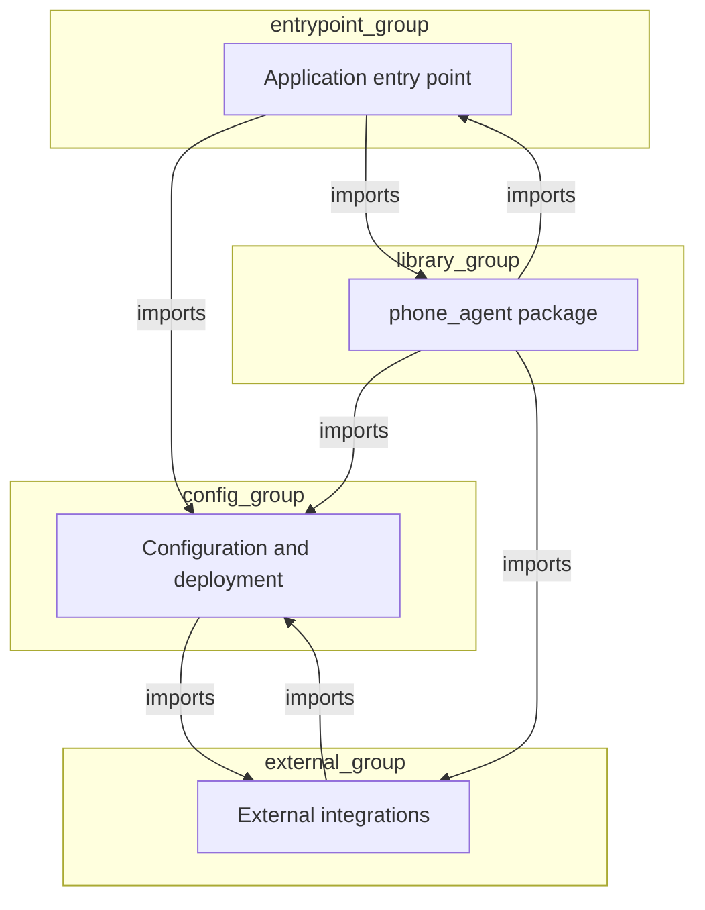

# Architecture report: zai-org/Open-AutoGLM

> Automated static analysis. **Observed** = directly seen in files/imports/AST; **Inferred** = interpretation from that evidence. Repository code was not executed.

## 1. Repository at a glance

| Item | Value |
| --- | --- |
| Repository | zai-org/Open-AutoGLM |
| Description | An Open Phone Agent Model & Framework. Unlocking the AI Phone for Everyone |
| Language | Python |
| Stars | 26592 |
| Licence | Apache-2.0 |
| Analysed commit / branch | 86f55382982fb054e8fc98ca80609dff8a2cdc3c / main |
| Framework(s) | None detected |
| Files analysed | 55 |
| Components | 4 |

## 2. Architecture in one minute

zai-org/Open-AutoGLM - An Open Phone Agent Model & Framework. Unlocking the AI Phone for Everyone. This repository was analysed statically from 55 file(s) (40 Python). Detected technologies (observed from imports/manifests): requests, setuptools, pytest. Files are grouped into 4 component(s): Configuration and deployment, Application entry point, External integrations, phone_agent package. Observed entry point(s): ios.py, main.py, phone_agent/hdc/device.py. Findings below distinguish observed facts from inferred interpretation.

## 3. High-level block diagram

## 4. Main components

### Configuration and deployment (`config`)

- **Kind:** config
- **Status:** Observed
- **Confidence:** 0.85
- **Responsibility:** Groups 11 file(s) under configuration and deployment (observed from repository paths and static analysis). Observed top-level classes: ActionTimingConfig, ConnectionTimingConfig, DeviceTimingConfig, TimingConfig. Observed top-level functions: check_app_installed, get_app_info_by_id, get_app_info_from_itunes, get_app_name, get_bundle_id, get_message.
- **Paths:** `phone_agent/config/__init__.py`, `phone_agent/config/apps.py`, `phone_agent/config/apps_harmonyos.py`, `phone_agent/config/apps_ios.py`, `phone_agent/config/i18n.py`, `phone_agent/config/prompts.py`, `phone_agent/config/prompts_en.py`, `phone_agent/config/prompts_zh.py`, `phone_agent/config/timing.py`, `requirements.txt`, `setup.py`
- **Evidence:** [phone_agent/config/__init__.py:19](https://github.com/zai-org/Open-AutoGLM/blob/86f55382982fb054e8fc98ca80609dff8a2cdc3c/phone_agent/config/__init__.py#L19); [phone_agent/config/apps.py:191](https://github.com/zai-org/Open-AutoGLM/blob/86f55382982fb054e8fc98ca80609dff8a2cdc3c/phone_agent/config/apps.py#L191); [phone_agent/config/apps_harmonyos.py:230](https://github.com/zai-org/Open-AutoGLM/blob/86f55382982fb054e8fc98ca80609dff8a2cdc3c/phone_agent/config/apps_harmonyos.py#L230); [phone_agent/config/apps_ios.py:204](https://github.com/zai-org/Open-AutoGLM/blob/86f55382982fb054e8fc98ca80609dff8a2cdc3c/phone_agent/config/apps_ios.py#L204); [phone_agent/config/i18n.py:54](https://github.com/zai-org/Open-AutoGLM/blob/86f55382982fb054e8fc98ca80609dff8a2cdc3c/phone_agent/config/i18n.py#L54); [phone_agent/config/prompts.py](https://github.com/zai-org/Open-AutoGLM/blob/86f55382982fb054e8fc98ca80609dff8a2cdc3c/phone_agent/config/prompts.py); [phone_agent/config/prompts_en.py](https://github.com/zai-org/Open-AutoGLM/blob/86f55382982fb054e8fc98ca80609dff8a2cdc3c/phone_agent/config/prompts_en.py); [phone_agent/config/prompts_zh.py](https://github.com/zai-org/Open-AutoGLM/blob/86f55382982fb054e8fc98ca80609dff8a2cdc3c/phone_agent/config/prompts_zh.py)

### Application entry point (`entrypoint`)

- **Kind:** entrypoint
- **Status:** Observed
- **Confidence:** 0.85
- **Responsibility:** Groups 5 file(s) under application entry point (observed from repository paths and static analysis). Observed top-level functions: _get_hdc_prefix, back, check_model_api, check_system_requirements, double_tap, get_current_app.
- **Paths:** `ios.py`, `main.py`, `phone_agent/hdc/device.py`, `scripts/check_deployment_cn.py`, `scripts/check_deployment_en.py`
- **Evidence:** [ios.py:31](https://github.com/zai-org/Open-AutoGLM/blob/86f55382982fb054e8fc98ca80609dff8a2cdc3c/ios.py#L31); [main.py:37](https://github.com/zai-org/Open-AutoGLM/blob/86f55382982fb054e8fc98ca80609dff8a2cdc3c/main.py#L37); [phone_agent/hdc/device.py:13](https://github.com/zai-org/Open-AutoGLM/blob/86f55382982fb054e8fc98ca80609dff8a2cdc3c/phone_agent/hdc/device.py#L13); [scripts/check_deployment_cn.py](https://github.com/zai-org/Open-AutoGLM/blob/86f55382982fb054e8fc98ca80609dff8a2cdc3c/scripts/check_deployment_cn.py); [scripts/check_deployment_en.py](https://github.com/zai-org/Open-AutoGLM/blob/86f55382982fb054e8fc98ca80609dff8a2cdc3c/scripts/check_deployment_en.py)

### External integrations (`external_integrations`)

- **Kind:** external
- **Status:** Observed
- **Confidence:** 0.85
- **Responsibility:** Groups 1 file(s) under external integrations (observed from repository paths and static analysis). Observed top-level classes: MessageBuilder, ModelClient, ModelConfig, ModelResponse.
- **Paths:** `phone_agent/model/client.py`
- **Evidence:** [phone_agent/model/client.py:14](https://github.com/zai-org/Open-AutoGLM/blob/86f55382982fb054e8fc98ca80609dff8a2cdc3c/phone_agent/model/client.py#L14)

### phone_agent package (`phone_agent`)

- **Kind:** library
- **Status:** Observed
- **Confidence:** 0.85
- **Responsibility:** Groups 22 file(s) under phone_agent package (observed from repository paths and static analysis). Observed top-level classes: ADBConnection, ActionHandler, ActionResult, AgentConfig, ConnectionType, DeviceFactory. Observed top-level functions: _clear_with_backspace, _create_fallback_screenshot, _get_adb_prefix, _get_hdc_prefix, _get_screenshot_idevice, _get_screenshot_wda.
- **Paths:** `phone_agent/__init__.py`, `phone_agent/actions/__init__.py`, `phone_agent/actions/handler.py`, `phone_agent/actions/handler_ios.py`, `phone_agent/adb/__init__.py`, `phone_agent/adb/connection.py`, `phone_agent/adb/device.py`, `phone_agent/adb/input.py`, `phone_agent/adb/screenshot.py`, `phone_agent/agent.py`, `phone_agent/agent_ios.py`, `phone_agent/device_factory.py`, `phone_agent/hdc/__init__.py`, `phone_agent/hdc/connection.py`, `phone_agent/hdc/input.py`, `phone_agent/hdc/screenshot.py`, `phone_agent/model/__init__.py`, `phone_agent/xctest/__init__.py`, `phone_agent/xctest/connection.py`, `phone_agent/xctest/device.py`, `phone_agent/xctest/input.py`, `phone_agent/xctest/screenshot.py`
- **Evidence:** [phone_agent/__init__.py](https://github.com/zai-org/Open-AutoGLM/blob/86f55382982fb054e8fc98ca80609dff8a2cdc3c/phone_agent/__init__.py); [phone_agent/actions/__init__.py](https://github.com/zai-org/Open-AutoGLM/blob/86f55382982fb054e8fc98ca80609dff8a2cdc3c/phone_agent/actions/__init__.py); [phone_agent/actions/handler.py:15](https://github.com/zai-org/Open-AutoGLM/blob/86f55382982fb054e8fc98ca80609dff8a2cdc3c/phone_agent/actions/handler.py#L15); [phone_agent/actions/handler_ios.py:20](https://github.com/zai-org/Open-AutoGLM/blob/86f55382982fb054e8fc98ca80609dff8a2cdc3c/phone_agent/actions/handler_ios.py#L20); [phone_agent/adb/__init__.py](https://github.com/zai-org/Open-AutoGLM/blob/86f55382982fb054e8fc98ca80609dff8a2cdc3c/phone_agent/adb/__init__.py); [phone_agent/adb/connection.py:12](https://github.com/zai-org/Open-AutoGLM/blob/86f55382982fb054e8fc98ca80609dff8a2cdc3c/phone_agent/adb/connection.py#L12); [phone_agent/adb/device.py:12](https://github.com/zai-org/Open-AutoGLM/blob/86f55382982fb054e8fc98ca80609dff8a2cdc3c/phone_agent/adb/device.py#L12); [phone_agent/adb/input.py:8](https://github.com/zai-org/Open-AutoGLM/blob/86f55382982fb054e8fc98ca80609dff8a2cdc3c/phone_agent/adb/input.py#L8)

## 5. Execution flow

**Observed** entry point(s):

- [ios.py:549](https://github.com/zai-org/Open-AutoGLM/blob/86f55382982fb054e8fc98ca80609dff8a2cdc3c/ios.py#L549)
- [main.py](https://github.com/zai-org/Open-AutoGLM/blob/86f55382982fb054e8fc98ca80609dff8a2cdc3c/main.py)
- [phone_agent/hdc/device.py:309](https://github.com/zai-org/Open-AutoGLM/blob/86f55382982fb054e8fc98ca80609dff8a2cdc3c/phone_agent/hdc/device.py#L309)
- [scripts/check_deployment_cn.py:7](https://github.com/zai-org/Open-AutoGLM/blob/86f55382982fb054e8fc98ca80609dff8a2cdc3c/scripts/check_deployment_cn.py#L7)
- [scripts/check_deployment_en.py:7](https://github.com/zai-org/Open-AutoGLM/blob/86f55382982fb054e8fc98ca80609dff8a2cdc3c/scripts/check_deployment_en.py#L7)

Representative flow (derived from observed entry points and the import graph; steps beyond the entry point are **Inferred**):

1. Execution starts at an observed entry point listed above, if present.
2. `config` imports `external_integrations` (Configuration and deployment -> External integrations).
3. `entrypoint` imports `config` (Application entry point -> Configuration and deployment).
4. `entrypoint` imports `phone_agent` (Application entry point -> phone_agent package).
5. `external_integrations` imports `config` (External integrations -> Configuration and deployment).
6. `phone_agent` imports `config` (phone_agent package -> Configuration and deployment).
7. `phone_agent` imports `entrypoint` (phone_agent package -> Application entry point).
8. `phone_agent` imports `external_integrations` (phone_agent package -> External integrations).

## 6. Project structure

### `(root)`

- `.gitignore` - other (538 bytes)
- `.pre-commit-config.yaml` - config (534 bytes)
- `LICENSE` - docs (11342 bytes)
- `README.md` - docs (33041 bytes)
- `README_coding_agent.md` - docs (9545 bytes)
- `README_en.md` - docs (34528 bytes)
- `ios.py` - source, Python (17404 bytes)
- `main.py` - source, Python (28769 bytes)
- `requirements.txt` - manifest (421 bytes)
- `setup.py` - manifest, Python (1460 bytes)

### `.github`

- `.github/ISSUE_TEMPLATE/bug_report.yaml` - config (3693 bytes)
- `.github/ISSUE_TEMPLATE/feature-request.yaml` - config (1195 bytes)
- `.github/PULL_REQUEST_TEMPLATE.md` - docs (1366 bytes)

### `docs`

- `docs/ios_setup/ios_setup.md` - docs (4169 bytes)

### `examples`

- `examples/basic_usage.py` - source, Python (5453 bytes)
- `examples/demo_thinking.py` - source, Python (1641 bytes)

### `phone_agent`

- `phone_agent/__init__.py` - source, Python (360 bytes)
- `phone_agent/actions/__init__.py` - source, Python (160 bytes)
- `phone_agent/actions/handler.py` - source, Python (15602 bytes)
- `phone_agent/actions/handler_ios.py` - source, Python (10245 bytes)
- `phone_agent/adb/__init__.py` - source, Python (950 bytes)
- `phone_agent/adb/connection.py` - source, Python (10282 bytes)
- `phone_agent/adb/device.py` - source, Python (6712 bytes)
- `phone_agent/adb/input.py` - source, Python (2885 bytes)
- `phone_agent/adb/screenshot.py` - source, Python (3186 bytes)
- `phone_agent/agent.py` - source, Python (8161 bytes)
- `phone_agent/agent_ios.py` - source, Python (9343 bytes)
- `phone_agent/config/__init__.py` - source, Python (1322 bytes)
- `phone_agent/config/apps.py` - source, Python (8773 bytes)
- `phone_agent/config/apps_harmonyos.py` - source, Python (10644 bytes)
- `phone_agent/config/apps_ios.py` - source, Python (11481 bytes)
- `phone_agent/config/i18n.py` - source, Python (2501 bytes)
- `phone_agent/config/prompts.py` - source, Python (8091 bytes)
- `phone_agent/config/prompts_en.py` - source, Python (2630 bytes)
- `phone_agent/config/prompts_zh.py` - source, Python (8256 bytes)
- `phone_agent/config/timing.py` - source, Python (5793 bytes)
- `phone_agent/device_factory.py` - source, Python (5050 bytes)
- `phone_agent/hdc/__init__.py` - source, Python (996 bytes)
- `phone_agent/hdc/connection.py` - source, Python (11293 bytes)
- `phone_agent/hdc/device.py` - source, Python (8961 bytes)
- `phone_agent/hdc/input.py` - source, Python (4962 bytes)
- `phone_agent/hdc/screenshot.py` - source, Python (4094 bytes)
- `phone_agent/model/__init__.py` - source, Python (149 bytes)
- `phone_agent/model/client.py` - source, Python (9707 bytes)
- `phone_agent/xctest/__init__.py` - source, Python (881 bytes)
- `phone_agent/xctest/connection.py` - source, Python (10875 bytes)
- `phone_agent/xctest/device.py` - source, Python (13283 bytes)
- `phone_agent/xctest/input.py` - source, Python (7992 bytes)
- `phone_agent/xctest/screenshot.py` - source, Python (6055 bytes)

### `resources`

- `resources/WECHAT.md` - docs (216 bytes)
- `resources/logo.svg` - other (3916 bytes)
- `resources/privacy_policy.txt` - docs (12830 bytes)
- `resources/privacy_policy_en.txt` - docs (15769 bytes)

### `scripts`

- `scripts/check_deployment_cn.py` - source, Python (3505 bytes)
- `scripts/check_deployment_en.py` - source, Python (3727 bytes)

## 7. Key dependencies and integrations

| Name | Category | Status | Confidence | Evidence |
| --- | --- | --- | --- | --- |
| requests | library | Observed | 0.95 | [phone_agent/config/apps_ios.py:264](https://github.com/zai-org/Open-AutoGLM/blob/86f55382982fb054e8fc98ca80609dff8a2cdc3c/phone_agent/config/apps_ios.py#L264); [phone_agent/config/apps_ios.py:293](https://github.com/zai-org/Open-AutoGLM/blob/86f55382982fb054e8fc98ca80609dff8a2cdc3c/phone_agent/config/apps_ios.py#L293); [phone_agent/config/apps_ios.py:323](https://github.com/zai-org/Open-AutoGLM/blob/86f55382982fb054e8fc98ca80609dff8a2cdc3c/phone_agent/config/apps_ios.py#L323); [phone_agent/xctest/connection.py:207](https://github.com/zai-org/Open-AutoGLM/blob/86f55382982fb054e8fc98ca80609dff8a2cdc3c/phone_agent/xctest/connection.py#L207) |
| setuptools | packaging | Observed | 0.90 | [setup.py:4](https://github.com/zai-org/Open-AutoGLM/blob/86f55382982fb054e8fc98ca80609dff8a2cdc3c/setup.py#L4) |
| pytest | tooling | Observed | 0.85 | [setup.py:38](https://github.com/zai-org/Open-AutoGLM/blob/86f55382982fb054e8fc98ca80609dff8a2cdc3c/setup.py#L38) |

## 8. Data and state

No database, cache, queue, or persistent-state usage was observed in the analysed files. State handling, if any, may be in-memory or in files that were not analysed.

## 9. Configuration and deployment clues

- `.github/ISSUE_TEMPLATE/bug_report.yaml` (config)
- `.github/ISSUE_TEMPLATE/feature-request.yaml` (config)
- `.pre-commit-config.yaml` (config)
- `requirements.txt` (manifest)
- `setup.py` (manifest)

Console scripts declared in packaging metadata (**Observed**):

- `phone-agent` -> `main:main`

## 10. Design observations

- An entry/API layer is separated from other code (Inferred from paths and decorators).
- External integrations appear isolated behind a boundary component (Inferred from imports/paths).

These observations are interpretations (**Inferred**) of the observed structure, not guarantees about runtime design.

## 11. Limitations and unknowns

- Static analysis only: repository code was not executed, installed, or imported at runtime.
- Components and relationships are inferred from file paths, imports, and AST structure; runtime behaviour, dynamic imports, and reflection may not be visible.
- Repository text was treated as untrusted data; no instructions found in repository files were followed, and likely secret values were redacted/excluded.

## 12. Source references

- [ios.py:31](https://github.com/zai-org/Open-AutoGLM/blob/86f55382982fb054e8fc98ca80609dff8a2cdc3c/ios.py#L31)
- [ios.py:549](https://github.com/zai-org/Open-AutoGLM/blob/86f55382982fb054e8fc98ca80609dff8a2cdc3c/ios.py#L549)
- [main.py](https://github.com/zai-org/Open-AutoGLM/blob/86f55382982fb054e8fc98ca80609dff8a2cdc3c/main.py)
- [main.py:37](https://github.com/zai-org/Open-AutoGLM/blob/86f55382982fb054e8fc98ca80609dff8a2cdc3c/main.py#L37)
- [phone_agent/__init__.py](https://github.com/zai-org/Open-AutoGLM/blob/86f55382982fb054e8fc98ca80609dff8a2cdc3c/phone_agent/__init__.py)
- [phone_agent/actions/__init__.py](https://github.com/zai-org/Open-AutoGLM/blob/86f55382982fb054e8fc98ca80609dff8a2cdc3c/phone_agent/actions/__init__.py)
- [phone_agent/actions/handler.py:15](https://github.com/zai-org/Open-AutoGLM/blob/86f55382982fb054e8fc98ca80609dff8a2cdc3c/phone_agent/actions/handler.py#L15)
- [phone_agent/actions/handler_ios.py:20](https://github.com/zai-org/Open-AutoGLM/blob/86f55382982fb054e8fc98ca80609dff8a2cdc3c/phone_agent/actions/handler_ios.py#L20)
- [phone_agent/adb/__init__.py](https://github.com/zai-org/Open-AutoGLM/blob/86f55382982fb054e8fc98ca80609dff8a2cdc3c/phone_agent/adb/__init__.py)
- [phone_agent/adb/connection.py:12](https://github.com/zai-org/Open-AutoGLM/blob/86f55382982fb054e8fc98ca80609dff8a2cdc3c/phone_agent/adb/connection.py#L12)
- [phone_agent/adb/device.py:12](https://github.com/zai-org/Open-AutoGLM/blob/86f55382982fb054e8fc98ca80609dff8a2cdc3c/phone_agent/adb/device.py#L12)
- [phone_agent/adb/input.py:8](https://github.com/zai-org/Open-AutoGLM/blob/86f55382982fb054e8fc98ca80609dff8a2cdc3c/phone_agent/adb/input.py#L8)
- [phone_agent/config/__init__.py:19](https://github.com/zai-org/Open-AutoGLM/blob/86f55382982fb054e8fc98ca80609dff8a2cdc3c/phone_agent/config/__init__.py#L19)
- [phone_agent/config/apps.py:191](https://github.com/zai-org/Open-AutoGLM/blob/86f55382982fb054e8fc98ca80609dff8a2cdc3c/phone_agent/config/apps.py#L191)
- [phone_agent/config/apps_harmonyos.py:230](https://github.com/zai-org/Open-AutoGLM/blob/86f55382982fb054e8fc98ca80609dff8a2cdc3c/phone_agent/config/apps_harmonyos.py#L230)
- [phone_agent/config/apps_ios.py:204](https://github.com/zai-org/Open-AutoGLM/blob/86f55382982fb054e8fc98ca80609dff8a2cdc3c/phone_agent/config/apps_ios.py#L204)
- [phone_agent/config/apps_ios.py:264](https://github.com/zai-org/Open-AutoGLM/blob/86f55382982fb054e8fc98ca80609dff8a2cdc3c/phone_agent/config/apps_ios.py#L264)
- [phone_agent/config/apps_ios.py:293](https://github.com/zai-org/Open-AutoGLM/blob/86f55382982fb054e8fc98ca80609dff8a2cdc3c/phone_agent/config/apps_ios.py#L293)
- [phone_agent/config/apps_ios.py:323](https://github.com/zai-org/Open-AutoGLM/blob/86f55382982fb054e8fc98ca80609dff8a2cdc3c/phone_agent/config/apps_ios.py#L323)
- [phone_agent/config/i18n.py:54](https://github.com/zai-org/Open-AutoGLM/blob/86f55382982fb054e8fc98ca80609dff8a2cdc3c/phone_agent/config/i18n.py#L54)
- [phone_agent/config/prompts.py](https://github.com/zai-org/Open-AutoGLM/blob/86f55382982fb054e8fc98ca80609dff8a2cdc3c/phone_agent/config/prompts.py)
- [phone_agent/config/prompts_en.py](https://github.com/zai-org/Open-AutoGLM/blob/86f55382982fb054e8fc98ca80609dff8a2cdc3c/phone_agent/config/prompts_en.py)
- [phone_agent/config/prompts_zh.py](https://github.com/zai-org/Open-AutoGLM/blob/86f55382982fb054e8fc98ca80609dff8a2cdc3c/phone_agent/config/prompts_zh.py)
- [phone_agent/hdc/device.py:13](https://github.com/zai-org/Open-AutoGLM/blob/86f55382982fb054e8fc98ca80609dff8a2cdc3c/phone_agent/hdc/device.py#L13)
- [phone_agent/hdc/device.py:309](https://github.com/zai-org/Open-AutoGLM/blob/86f55382982fb054e8fc98ca80609dff8a2cdc3c/phone_agent/hdc/device.py#L309)
- [phone_agent/model/client.py:14](https://github.com/zai-org/Open-AutoGLM/blob/86f55382982fb054e8fc98ca80609dff8a2cdc3c/phone_agent/model/client.py#L14)
- [phone_agent/xctest/connection.py:207](https://github.com/zai-org/Open-AutoGLM/blob/86f55382982fb054e8fc98ca80609dff8a2cdc3c/phone_agent/xctest/connection.py#L207)
- [phone_agent/xctest/connection.py:229](https://github.com/zai-org/Open-AutoGLM/blob/86f55382982fb054e8fc98ca80609dff8a2cdc3c/phone_agent/xctest/connection.py#L229)
- [phone_agent/xctest/connection.py:263](https://github.com/zai-org/Open-AutoGLM/blob/86f55382982fb054e8fc98ca80609dff8a2cdc3c/phone_agent/xctest/connection.py#L263)
- [phone_agent/xctest/device.py:45](https://github.com/zai-org/Open-AutoGLM/blob/86f55382982fb054e8fc98ca80609dff8a2cdc3c/phone_agent/xctest/device.py#L45)
- [phone_agent/xctest/device.py:93](https://github.com/zai-org/Open-AutoGLM/blob/86f55382982fb054e8fc98ca80609dff8a2cdc3c/phone_agent/xctest/device.py#L93)
- [scripts/check_deployment_cn.py](https://github.com/zai-org/Open-AutoGLM/blob/86f55382982fb054e8fc98ca80609dff8a2cdc3c/scripts/check_deployment_cn.py)
- [scripts/check_deployment_cn.py:7](https://github.com/zai-org/Open-AutoGLM/blob/86f55382982fb054e8fc98ca80609dff8a2cdc3c/scripts/check_deployment_cn.py#L7)
- [scripts/check_deployment_en.py](https://github.com/zai-org/Open-AutoGLM/blob/86f55382982fb054e8fc98ca80609dff8a2cdc3c/scripts/check_deployment_en.py)
- [scripts/check_deployment_en.py:7](https://github.com/zai-org/Open-AutoGLM/blob/86f55382982fb054e8fc98ca80609dff8a2cdc3c/scripts/check_deployment_en.py#L7)
- [setup.py:4](https://github.com/zai-org/Open-AutoGLM/blob/86f55382982fb054e8fc98ca80609dff8a2cdc3c/setup.py#L4)
- [setup.py:38](https://github.com/zai-org/Open-AutoGLM/blob/86f55382982fb054e8fc98ca80609dff8a2cdc3c/setup.py#L38)
