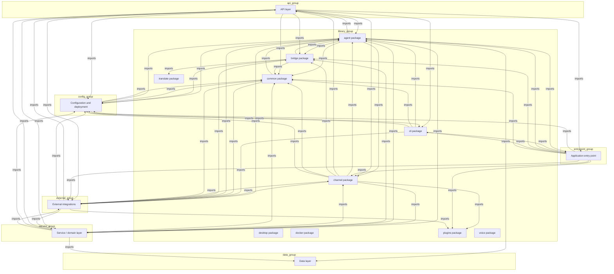

# Architecture report: zhayujie/CowAgent

> Automated static analysis. **Observed** = directly seen in files/imports/AST; **Inferred** = interpretation from that evidence. Repository code was not executed.

## 1. Repository at a glance

| Item | Value |
| --- | --- |
| Repository | zhayujie/CowAgent |
| Description | Open-source personal AI assistant & Agent Harness. Plans tasks, runs tools and skills, self-evolves with memory and knowledge. Multi-agent, multi-model, multi-channel. Lightweight, extensible, one-line install. |
| Language | Python |
| Stars | 47931 |
| Licence | MIT |
| Analysed commit / branch | fd75a33d862fe7ea9dec2fa1c0a27f92f181985d / master |
| Framework(s) | Electron, React |
| Files analysed | 554 |
| Components | 16 |

## 2. Architecture in one minute

zhayujie/CowAgent - Open-source personal AI assistant & Agent Harness. Plans tasks, runs tools and skills, self-evolves with memory and knowledge. Multi-agent, multi-model, multi-channel. Lightweight, extensible, one-li…. This repository was analysed statically from 554 file(s) (288 Python). Detected technologies (observed from imports/manifests): GitHub Actions, SQLite, Electron, React, Click, NumPy. Files are grouped into 16 component(s): agent package, API layer, bridge package, channel package, cli package, common package, Configuration and deployment, Data layer. Observed entry point(s): agent/memory/embedding/rebuild.py, agent/memory/rebuild_index.py, app.py. Findings below distinguish observed facts from inferred interpretation.

## 3. High-level block diagram

## 4. Main components

### agent package (`agent`)

- **Kind:** library
- **Status:** Observed
- **Confidence:** 0.85
- **Responsibility:** Groups 130 file(s) under agent package (observed from repository paths and static analysis). Observed top-level classes: Agent, AgentAction, AgentActionType, AgentAdminError, AgentAdminService, AgentCancelledError. Observed top-level functions: _anysearch_anonymous_enabled, _apply_model, _as_int, _asset_selection, _attributed_history, _b64.
- **Paths:** `agent/admin.py`, `agent/chat/__init__.py`, `agent/evolution/__init__.py`, `agent/evolution/backup.py`, `agent/evolution/executor.py`, `agent/evolution/prompts.py`, `agent/evolution/record.py`, `agent/evolution/trigger.py`, `agent/guest/__init__.py`, `agent/guest/access.py`, `agent/guest/actions.py`, `agent/guest/branding.py`, `agent/guest/paths.py`, `agent/guest/policy.py`, `agent/guest/profile.py`, `agent/guest/runtime.py`, `agent/guest/share.py`, `agent/guest/store.py`, `agent/guest/tools.py`, `agent/knowledge/__init__.py`, `agent/memory/__init__.py`, `agent/memory/chunker.py`, `agent/memory/conversation_store.py`, `agent/memory/embedding/__init__.py`, `agent/memory/embedding/factory.py`, `agent/memory/embedding/provider.py`, `agent/memory/embedding/state.py`, `agent/memory/manager.py`, `agent/memory/reranker.py`, `agent/memory/storage.py`, `agent/memory/summarizer.py`, `agent/memory/vector_backend.py`, `agent/multiagent/__init__.py`, `agent/multiagent/inbound.py`, `agent/multiagent/transport.py`, `agent/permission/__init__.py`, `agent/permission/policy.py`, `agent/prompt/__init__.py`, `agent/prompt/builder.py`, `agent/prompt/guest.py`, `agent/prompt/workspace.py`, `agent/protocol/__init__.py`, `agent/protocol/agent.py`, `agent/protocol/agent_stream.py`, `agent/protocol/artifact.py`, `agent/protocol/cancel.py`, `agent/protocol/context.py`, `agent/protocol/message_utils.py`, `agent/protocol/result.py`, `agent/protocol/steer.py`, `agent/protocol/step_writer.py`, `agent/protocol/task.py`, `agent/registry.py`, `agent/routing.py`, `agent/skills/__init__.py`, `agent/skills/archive.py`, `agent/skills/formatter.py`, `agent/skills/frontmatter.py`, `agent/skills/loader.py`, `agent/skills/manager.py`, `agent/skills/types.py`, `agent/subagent/__init__.py`, `agent/subagent/runner.py`, `agent/subagent/templates.py`, `agent/team.py`, `agent/team_addressing.py`, `agent/tools/__init__.py`, `agent/tools/agent_delegate/__init__.py`, `agent/tools/agent_delegate/agent_delegate.py`, `agent/tools/base_tool.py`, `agent/tools/bash/__init__.py`, `agent/tools/bash/background.py`, `agent/tools/bash/bash.py`, `agent/tools/bash/decode.py`, `agent/tools/bash/exit_codes.py`, `agent/tools/browser/__init__.py`, `agent/tools/browser/browser_env.py`, `agent/tools/browser/browser_tool.py`, `agent/tools/browser/chrome_launcher.py`, `agent/tools/current_time/__init__.py`, `agent/tools/current_time/current_time.py`, `agent/tools/edit/__init__.py`, `agent/tools/edit/edit.py`, `agent/tools/env_config/__init__.py`, `agent/tools/env_config/env_config.py`, `agent/tools/evolution_undo/__init__.py`, `agent/tools/evolution_undo/evolution_undo.py`, `agent/tools/ls/__init__.py`, `agent/tools/ls/ls.py`, `agent/tools/mcp/__init__.py`, `agent/tools/mcp/mcp_oauth.py`, `agent/tools/mcp/mcp_tool.py`, `agent/tools/mcp/tool_retrieval.py`, `agent/tools/memory/__init__.py`, `agent/tools/memory/memory_get.py`, `agent/tools/memory/memory_search.py`, `agent/tools/read/__init__.py`, `agent/tools/read/read.py`, `agent/tools/scheduler/__init__.py`, `agent/tools/scheduler/integration.py`, `agent/tools/scheduler/recipient_store.py`, `agent/tools/scheduler/scheduler_tool.py`, `agent/tools/scheduler/task_store.py`, `agent/tools/scheduler/time_utils.py`, `agent/tools/search_files/__init__.py`, `agent/tools/search_files/search_files.py`, `agent/tools/send/__init__.py`, `agent/tools/send/send.py`, `agent/tools/subagent/__init__.py`, `agent/tools/subagent/subagent.py`, `agent/tools/tool_manager.py`, `agent/tools/utils/__init__.py`, `agent/tools/utils/credentials.py`, `agent/tools/utils/diff.py`, `agent/tools/utils/file_state.py`, `agent/tools/utils/memory_path.py`, `agent/tools/utils/syntax_check.py`, `agent/tools/utils/truncate.py`, `agent/tools/utils/url_safety.py`, `agent/tools/vision/__init__.py`, `agent/tools/vision/vision.py`, `agent/tools/web_fetch/__init__.py`, `agent/tools/web_fetch/web_fetch.py`, `agent/tools/web_search/__init__.py`, `agent/tools/web_search/web_search.py`, `agent/tools/write/__init__.py`, `agent/tools/write/write.py`, `agent/workspace/__init__.py`, `agent/workspace/project_store.py`, `agent/workspace/session_prefs.py`
- **Evidence:** [agent/admin.py:38](https://github.com/zhayujie/CowAgent/blob/fd75a33d862fe7ea9dec2fa1c0a27f92f181985d/agent/admin.py#L38); [agent/chat/__init__.py](https://github.com/zhayujie/CowAgent/blob/fd75a33d862fe7ea9dec2fa1c0a27f92f181985d/agent/chat/__init__.py); [agent/evolution/__init__.py](https://github.com/zhayujie/CowAgent/blob/fd75a33d862fe7ea9dec2fa1c0a27f92f181985d/agent/evolution/__init__.py); [agent/evolution/backup.py:28](https://github.com/zhayujie/CowAgent/blob/fd75a33d862fe7ea9dec2fa1c0a27f92f181985d/agent/evolution/backup.py#L28); [agent/evolution/executor.py:57](https://github.com/zhayujie/CowAgent/blob/fd75a33d862fe7ea9dec2fa1c0a27f92f181985d/agent/evolution/executor.py#L57); [agent/evolution/prompts.py:139](https://github.com/zhayujie/CowAgent/blob/fd75a33d862fe7ea9dec2fa1c0a27f92f181985d/agent/evolution/prompts.py#L139); [agent/evolution/record.py:20](https://github.com/zhayujie/CowAgent/blob/fd75a33d862fe7ea9dec2fa1c0a27f92f181985d/agent/evolution/record.py#L20); [agent/evolution/trigger.py:37](https://github.com/zhayujie/CowAgent/blob/fd75a33d862fe7ea9dec2fa1c0a27f92f181985d/agent/evolution/trigger.py#L37)

### API layer (`api_layer`)

- **Kind:** api
- **Status:** Observed
- **Confidence:** 0.85
- **Responsibility:** Groups 42 file(s) under api layer (observed from repository paths and static analysis). Observed top-level classes: AgentAvatarHandler, AgentCoreFileHandler, AgentsHandler, ArtifactAddHandler, ArtifactDeleteHandler, ArtifactPinHandler. Observed top-level functions: _add_delegate_displays, _add_subagent_displays, _agent_admin_service, _agent_model_name, _agent_registry, _annotate_avatar_revs.
- **Paths:** `channel/web/api/agents.py`, `channel/web/api/artifacts.py`, `channel/web/api/auth.py`, `channel/web/api/channels.py`, `channel/web/api/chat.py`, `channel/web/api/config.py`, `channel/web/api/files.py`, `channel/web/api/guest.py`, `channel/web/api/integrations.py`, `channel/web/api/knowledge.py`, `channel/web/api/logs.py`, `channel/web/api/memory.py`, `channel/web/api/menu.py`, `channel/web/api/models.py`, `channel/web/api/openai_compat.py`, `channel/web/api/pages.py`, `channel/web/api/scheduler.py`, `channel/web/api/sessions.py`, `channel/web/api/skills.py`, `channel/web/api/themes.py`, `channel/web/api/update.py`, `channel/web/api/workspace.py`, `channel/web/static/js/views/agents.js`, `channel/web/static/js/views/artifacts.js`, `channel/web/static/js/views/channels-feishu.js`, `channel/web/static/js/views/channels-wecom.js`, `channel/web/static/js/views/channels-weixin.js`, `channel/web/static/js/views/channels.js`, `channel/web/static/js/views/config.js`, `channel/web/static/js/views/doc-viewers.js`, `channel/web/static/js/views/knowledge.js`, `channel/web/static/js/views/logs.js`, `channel/web/static/js/views/memory.js`, `channel/web/static/js/views/menu-editor.js`, `channel/web/static/js/views/models-custom-provider.js`, `channel/web/static/js/views/models.js`, `channel/web/static/js/views/sessions.js`, `channel/web/static/js/views/shares.js`, `channel/web/static/js/views/skills.js`, `channel/web/static/js/views/tasks-modal.js`, `channel/web/static/js/views/tasks.js`, `desktop/src/renderer/src/api/client.ts`
- **Evidence:** [channel/web/api/agents.py:26](https://github.com/zhayujie/CowAgent/blob/fd75a33d862fe7ea9dec2fa1c0a27f92f181985d/channel/web/api/agents.py#L26); [channel/web/api/artifacts.py:31](https://github.com/zhayujie/CowAgent/blob/fd75a33d862fe7ea9dec2fa1c0a27f92f181985d/channel/web/api/artifacts.py#L31); [channel/web/api/auth.py:32](https://github.com/zhayujie/CowAgent/blob/fd75a33d862fe7ea9dec2fa1c0a27f92f181985d/channel/web/api/auth.py#L32); [channel/web/api/channels.py:29](https://github.com/zhayujie/CowAgent/blob/fd75a33d862fe7ea9dec2fa1c0a27f92f181985d/channel/web/api/channels.py#L29); [channel/web/api/chat.py:14](https://github.com/zhayujie/CowAgent/blob/fd75a33d862fe7ea9dec2fa1c0a27f92f181985d/channel/web/api/chat.py#L14); [channel/web/api/config.py:40](https://github.com/zhayujie/CowAgent/blob/fd75a33d862fe7ea9dec2fa1c0a27f92f181985d/channel/web/api/config.py#L40); [channel/web/api/files.py:43](https://github.com/zhayujie/CowAgent/blob/fd75a33d862fe7ea9dec2fa1c0a27f92f181985d/channel/web/api/files.py#L43); [channel/web/api/guest.py:60](https://github.com/zhayujie/CowAgent/blob/fd75a33d862fe7ea9dec2fa1c0a27f92f181985d/channel/web/api/guest.py#L60)

### bridge package (`bridge`)

- **Kind:** library
- **Status:** Observed
- **Confidence:** 0.85
- **Responsibility:** Groups 6 file(s) under bridge package (observed from repository paths and static analysis). Observed top-level classes: AgentBridge, AgentEventHandler, AgentInitializer, AgentLLMModel, Bridge, Context. Observed top-level functions: _interruption_note, add_openai_compatible_support, configured_runtime_limits.
- **Paths:** `bridge/agent_bridge.py`, `bridge/agent_event_handler.py`, `bridge/agent_initializer.py`, `bridge/bridge.py`, `bridge/context.py`, `bridge/reply.py`
- **Evidence:** [bridge/agent_bridge.py:31](https://github.com/zhayujie/CowAgent/blob/fd75a33d862fe7ea9dec2fa1c0a27f92f181985d/bridge/agent_bridge.py#L31); [bridge/agent_event_handler.py:12](https://github.com/zhayujie/CowAgent/blob/fd75a33d862fe7ea9dec2fa1c0a27f92f181985d/bridge/agent_event_handler.py#L12); [bridge/agent_initializer.py:52](https://github.com/zhayujie/CowAgent/blob/fd75a33d862fe7ea9dec2fa1c0a27f92f181985d/bridge/agent_initializer.py#L52); [bridge/bridge.py:13](https://github.com/zhayujie/CowAgent/blob/fd75a33d862fe7ea9dec2fa1c0a27f92f181985d/bridge/bridge.py#L13); [bridge/context.py:6](https://github.com/zhayujie/CowAgent/blob/fd75a33d862fe7ea9dec2fa1c0a27f92f181985d/bridge/context.py#L6); [bridge/reply.py:6](https://github.com/zhayujie/CowAgent/blob/fd75a33d862fe7ea9dec2fa1c0a27f92f181985d/bridge/reply.py#L6)

### channel package (`channel`)

- **Kind:** library
- **Status:** Observed
- **Confidence:** 0.85
- **Responsibility:** Groups 66 file(s) under channel package (observed from repository paths and static analysis). Observed top-level classes: Channel, ChannelInstance, ChatChannel, ChatMessage, CursorStore, CustomAICardReplier. Observed top-level functions: _activate, _attachment_kind, _build_channel, _button, _carry_weixin_credentials_file, _check.
- **Paths:** `channel/channel.py`, `channel/channel_factory.py`, `channel/channel_instances.py`, `channel/chat_channel.py`, `channel/chat_message.py`, `channel/dingtalk/dingtalk_channel.py`, `channel/dingtalk/dingtalk_message.py`, `channel/dingtalk/dingtalk_stream_card.py`, `channel/discord/__init__.py`, `channel/discord/discord_channel.py`, `channel/discord/discord_message.py`, `channel/feishu/domain.py`, `channel/feishu/feishu_channel.py`, `channel/feishu/feishu_message.py`, `channel/feishu/feishu_progress_card.py`, `channel/feishu/feishu_scheduler_card.py`, `channel/feishu/feishu_static_card.py`, `channel/feishu/lark_install.py`, `channel/file_cache.py`, `channel/qq/__init__.py`, `channel/qq/qq_channel.py`, `channel/qq/qq_message.py`, `channel/slack/__init__.py`, `channel/slack/slack_channel.py`, `channel/slack/slack_message.py`, `channel/telegram/__init__.py`, `channel/telegram/telegram_channel.py`, `channel/telegram/telegram_markdown.py`, `channel/telegram/telegram_message.py`, `channel/terminal/terminal_channel.py`, `channel/web/static/guest/embed.js`, `channel/web/static/guest/guest.js`, `channel/web/static/js/boot.js`, `channel/web/static/js/chat/composer-input.js`, `channel/web/static/js/chat/context-usage.js`, `channel/web/static/js/chat/message-actions.js`, `channel/web/static/js/chat/new-chat.js`, `channel/web/static/js/chat/render.js`, `channel/web/static/js/chat/scheduler-notify.js`, `channel/web/static/js/chat/send.js`, `channel/web/static/js/chat/session-settings.js`, `channel/web/static/js/chat/state.js`, `channel/web/static/js/chat/timeline.js`, `channel/web/static/js/chat/workspace-selector.js`, `channel/web/static/js/doc-editor.js`, `channel/web/static/js/workspace.js`, `channel/web/tools/check-load-order.mjs`, `channel/web/tools/check-router.mjs`, `channel/web/web_channel.py`, `channel/wechat_kf/wechat_kf_channel.py`, `channel/wechat_kf/wechat_kf_cursor_store.py`, `channel/wechat_kf/wechat_kf_message.py`, `channel/wechatcom/wechatcomapp_channel.py`, `channel/wechatcom/wechatcomapp_message.py`, `channel/wechatmp/active_reply.py`, `channel/wechatmp/common.py`, `channel/wechatmp/passive_reply.py`, `channel/wechatmp/wechatmp_channel.py`, `channel/wechatmp/wechatmp_message.py`, `channel/wecom_bot/__init__.py`, `channel/wecom_bot/wecom_bot_channel.py`, `channel/wecom_bot/wecom_bot_crypt.py`, `channel/wecom_bot/wecom_bot_message.py`, `channel/weixin/__init__.py`, `channel/weixin/weixin_channel.py`, `channel/weixin/weixin_message.py`
- **Evidence:** [channel/channel.py:12](https://github.com/zhayujie/CowAgent/blob/fd75a33d862fe7ea9dec2fa1c0a27f92f181985d/channel/channel.py#L12); [channel/channel_factory.py:8](https://github.com/zhayujie/CowAgent/blob/fd75a33d862fe7ea9dec2fa1c0a27f92f181985d/channel/channel_factory.py#L8); [channel/channel_instances.py:38](https://github.com/zhayujie/CowAgent/blob/fd75a33d862fe7ea9dec2fa1c0a27f92f181985d/channel/channel_instances.py#L38); [channel/chat_channel.py:27](https://github.com/zhayujie/CowAgent/blob/fd75a33d862fe7ea9dec2fa1c0a27f92f181985d/channel/chat_channel.py#L27); [channel/chat_message.py:40](https://github.com/zhayujie/CowAgent/blob/fd75a33d862fe7ea9dec2fa1c0a27f92f181985d/channel/chat_message.py#L40); [channel/dingtalk/dingtalk_channel.py:43](https://github.com/zhayujie/CowAgent/blob/fd75a33d862fe7ea9dec2fa1c0a27f92f181985d/channel/dingtalk/dingtalk_channel.py#L43); [channel/dingtalk/dingtalk_message.py:15](https://github.com/zhayujie/CowAgent/blob/fd75a33d862fe7ea9dec2fa1c0a27f92f181985d/channel/dingtalk/dingtalk_message.py#L15); [channel/dingtalk/dingtalk_stream_card.py:49](https://github.com/zhayujie/CowAgent/blob/fd75a33d862fe7ea9dec2fa1c0a27f92f181985d/channel/dingtalk/dingtalk_stream_card.py#L49)

### cli package (`cli`)

- **Kind:** library
- **Status:** Observed
- **Confidence:** 0.85
- **Responsibility:** Groups 10 file(s) under cli package (observed from repository paths and static analysis). Observed top-level classes: InstallResult, SkillInstallError. Observed top-level functions: _apt_install, _atomic_copy, _batch_install_skills, _check_checksum, _check_github_spec, _check_skill_copy_paths.
- **Paths:** `cli/__init__.py`, `cli/commands/__init__.py`, `cli/commands/backup.py`, `cli/commands/context.py`, `cli/commands/install.py`, `cli/commands/knowledge.py`, `cli/commands/process.py`, `cli/commands/skill.py`, `cli/config_json.py`, `cli/utils.py`
- **Evidence:** [cli/__init__.py:5](https://github.com/zhayujie/CowAgent/blob/fd75a33d862fe7ea9dec2fa1c0a27f92f181985d/cli/__init__.py#L5); [cli/commands/__init__.py](https://github.com/zhayujie/CowAgent/blob/fd75a33d862fe7ea9dec2fa1c0a27f92f181985d/cli/commands/__init__.py); [cli/commands/backup.py:21](https://github.com/zhayujie/CowAgent/blob/fd75a33d862fe7ea9dec2fa1c0a27f92f181985d/cli/commands/backup.py#L21); [cli/commands/context.py:16](https://github.com/zhayujie/CowAgent/blob/fd75a33d862fe7ea9dec2fa1c0a27f92f181985d/cli/commands/context.py#L16); [cli/commands/install.py:22](https://github.com/zhayujie/CowAgent/blob/fd75a33d862fe7ea9dec2fa1c0a27f92f181985d/cli/commands/install.py#L22); [cli/commands/knowledge.py:10](https://github.com/zhayujie/CowAgent/blob/fd75a33d862fe7ea9dec2fa1c0a27f92f181985d/cli/commands/knowledge.py#L10); [cli/commands/process.py:16](https://github.com/zhayujie/CowAgent/blob/fd75a33d862fe7ea9dec2fa1c0a27f92f181985d/cli/commands/process.py#L16); [cli/commands/skill.py:36](https://github.com/zhayujie/CowAgent/blob/fd75a33d862fe7ea9dec2fa1c0a27f92f181985d/cli/commands/skill.py#L36)

### common package (`common`)

- **Kind:** library
- **Status:** Observed
- **Confidence:** 0.85
- **Responsibility:** Groups 23 file(s) under common package (observed from repository paths and static analysis). Observed top-level classes: Dequeue, DownloadResult, ExpiredDict, MediaTooLargeError, RuntimeIdentity, SortedDict. Observed top-level functions: _agent_base, _can_write_in_place, _client_os, _copy_mode, _deadline, _deployment_id.
- **Paths:** `common/atomic_write.py`, `common/channel_registry.py`, `common/const.py`, `common/deployment.py`, `common/dequeue.py`, `common/directory_replace.py`, `common/expired_dict.py`, `common/i18n.py`, `common/log.py`, `common/markdown_fence.py`, `common/media_download.py`, `common/memory.py`, `common/office_text.py`, `common/package_manager.py`, `common/runtime_identity.py`, `common/singleton.py`, `common/sorted_dict.py`, `common/ssl_certs.py`, `common/state_dir.py`, `common/time_check.py`, `common/tmp_dir.py`, `common/utils.py`, `common/ws_client_compat.py`
- **Evidence:** [common/atomic_write.py:28](https://github.com/zhayujie/CowAgent/blob/fd75a33d862fe7ea9dec2fa1c0a27f92f181985d/common/atomic_write.py#L28); [common/channel_registry.py:20](https://github.com/zhayujie/CowAgent/blob/fd75a33d862fe7ea9dec2fa1c0a27f92f181985d/common/channel_registry.py#L20); [common/const.py](https://github.com/zhayujie/CowAgent/blob/fd75a33d862fe7ea9dec2fa1c0a27f92f181985d/common/const.py); [common/deployment.py:18](https://github.com/zhayujie/CowAgent/blob/fd75a33d862fe7ea9dec2fa1c0a27f92f181985d/common/deployment.py#L18); [common/dequeue.py:6](https://github.com/zhayujie/CowAgent/blob/fd75a33d862fe7ea9dec2fa1c0a27f92f181985d/common/dequeue.py#L6); [common/directory_replace.py:9](https://github.com/zhayujie/CowAgent/blob/fd75a33d862fe7ea9dec2fa1c0a27f92f181985d/common/directory_replace.py#L9); [common/expired_dict.py:9](https://github.com/zhayujie/CowAgent/blob/fd75a33d862fe7ea9dec2fa1c0a27f92f181985d/common/expired_dict.py#L9); [common/i18n.py:86](https://github.com/zhayujie/CowAgent/blob/fd75a33d862fe7ea9dec2fa1c0a27f92f181985d/common/i18n.py#L86)

### Configuration and deployment (`config`)

- **Kind:** config
- **Status:** Observed
- **Confidence:** 0.85
- **Responsibility:** Groups 23 file(s) under configuration and deployment (observed from repository paths and static analysis). Observed top-level classes: Config, EvolutionConfig, MemoryConfig. Observed top-level functions: _as_bool, _as_pos_int, _default_workspace, _key, _mask_sensitive_recursive, _mask_value.
- **Paths:** `Dockerfile`, `agent/chat/prompts.json`, `agent/evolution/config.py`, `agent/memory/config.py`, `agent/skills/config.py`, `config-template.json`, `config.py`, `desktop/package.json`, `desktop/src/renderer/src/pages/settings/BasicSettings.tsx`, `desktop/src/renderer/src/pages/settings/CapabilityCard.tsx`, `desktop/src/renderer/src/pages/settings/ChatApiCard.tsx`, `desktop/src/renderer/src/pages/settings/ChatFallbackCard.tsx`, `desktop/src/renderer/src/pages/settings/IntegrationsTab.tsx`, `desktop/src/renderer/src/pages/settings/ModelCatalogEditor.tsx`, `desktop/src/renderer/src/pages/settings/ModelsTab.tsx`, `desktop/src/renderer/src/pages/settings/modelsHelpers.ts`, `desktop/src/renderer/src/pages/settings/primitives.tsx`, `desktop/src/renderer/src/pages/settings/shares/GuestSharesCard.tsx`, `desktop/src/renderer/src/pages/settings/shares/ShareDialogs.tsx`, `desktop/src/renderer/src/pages/settings/shares/ShareEditor.tsx`, `desktop/src/renderer/src/pages/settings/shares/shareCommon.ts`, `desktop/tsconfig.json`, `desktop/tsconfig.main.json`
- **Evidence:** [Dockerfile](https://github.com/zhayujie/CowAgent/blob/fd75a33d862fe7ea9dec2fa1c0a27f92f181985d/Dockerfile); [agent/chat/prompts.json](https://github.com/zhayujie/CowAgent/blob/fd75a33d862fe7ea9dec2fa1c0a27f92f181985d/agent/chat/prompts.json); [agent/evolution/config.py:24](https://github.com/zhayujie/CowAgent/blob/fd75a33d862fe7ea9dec2fa1c0a27f92f181985d/agent/evolution/config.py#L24); [agent/memory/config.py:14](https://github.com/zhayujie/CowAgent/blob/fd75a33d862fe7ea9dec2fa1c0a27f92f181985d/agent/memory/config.py#L14); [agent/skills/config.py:21](https://github.com/zhayujie/CowAgent/blob/fd75a33d862fe7ea9dec2fa1c0a27f92f181985d/agent/skills/config.py#L21); [config-template.json](https://github.com/zhayujie/CowAgent/blob/fd75a33d862fe7ea9dec2fa1c0a27f92f181985d/config-template.json); [config.py:388](https://github.com/zhayujie/CowAgent/blob/fd75a33d862fe7ea9dec2fa1c0a27f92f181985d/config.py#L388); [desktop/package.json](https://github.com/zhayujie/CowAgent/blob/fd75a33d862fe7ea9dec2fa1c0a27f92f181985d/desktop/package.json)

### Data layer (`data_layer`)

- **Kind:** data
- **Status:** Observed
- **Confidence:** 0.85
- **Responsibility:** Groups 5 file(s) under data layer (observed from repository paths and static analysis). Observed top-level classes: LLMModel, LLMRequest, ModelFactory.
- **Paths:** `agent/protocol/models.py`, `models/deepseek/__init__.py`, `models/doubao/__init__.py`, `models/mimo/__init__.py`, `models/qianfan/__init__.py`
- **Evidence:** [agent/protocol/models.py:9](https://github.com/zhayujie/CowAgent/blob/fd75a33d862fe7ea9dec2fa1c0a27f92f181985d/agent/protocol/models.py#L9); [models/deepseek/__init__.py](https://github.com/zhayujie/CowAgent/blob/fd75a33d862fe7ea9dec2fa1c0a27f92f181985d/models/deepseek/__init__.py); [models/doubao/__init__.py](https://github.com/zhayujie/CowAgent/blob/fd75a33d862fe7ea9dec2fa1c0a27f92f181985d/models/doubao/__init__.py); [models/mimo/__init__.py](https://github.com/zhayujie/CowAgent/blob/fd75a33d862fe7ea9dec2fa1c0a27f92f181985d/models/mimo/__init__.py); [models/qianfan/__init__.py](https://github.com/zhayujie/CowAgent/blob/fd75a33d862fe7ea9dec2fa1c0a27f92f181985d/models/qianfan/__init__.py)

### desktop package (`desktop`)

- **Kind:** library
- **Status:** Observed
- **Confidence:** 0.85
- **Responsibility:** Groups 103 file(s) under desktop package (observed from repository paths and static analysis).
- **Paths:** `desktop/electron-builder.js`, `desktop/electron-builder.win.js`, `desktop/postcss.config.js`, `desktop/scripts/apply-flavor.mjs`, `desktop/src/main/app-icon.ts`, `desktop/src/main/http-relay.ts`, `desktop/src/main/index.ts`, `desktop/src/main/menu.ts`, `desktop/src/main/preload.ts`, `desktop/src/main/python-manager.ts`, `desktop/src/main/themes.ts`, `desktop/src/main/tray.ts`, `desktop/src/main/updater.ts`, `desktop/src/renderer/assets.d.ts`, `desktop/src/renderer/src/App.tsx`, `desktop/src/renderer/src/components/AgentAvatar.tsx`, `desktop/src/renderer/src/components/AgentScopeSelect.tsx`, `desktop/src/renderer/src/components/AgentSelector.tsx`, `desktop/src/renderer/src/components/ApiBasePresets.tsx`, `desktop/src/renderer/src/components/ChannelTeamSelect.tsx`, `desktop/src/renderer/src/components/ChatInput.tsx`, `desktop/src/renderer/src/components/ChatTimeline.tsx`, `desktop/src/renderer/src/components/ComposerChip.tsx`, `desktop/src/renderer/src/components/ConfirmDialog.tsx`, `desktop/src/renderer/src/components/ContextUsageDonut.tsx`, `desktop/src/renderer/src/components/ContextUsagePopover.tsx`, `desktop/src/renderer/src/components/DocEditor.tsx`, `desktop/src/renderer/src/components/FileCard.tsx`, `desktop/src/renderer/src/components/FileEditor.tsx`, `desktop/src/renderer/src/components/FilePreview.tsx`, `desktop/src/renderer/src/components/FileTree.tsx`, `desktop/src/renderer/src/components/KnowledgeGraph.tsx`, `desktop/src/renderer/src/components/Lightbox.tsx`, `desktop/src/renderer/src/components/LoginGate.tsx`, `desktop/src/renderer/src/components/Markdown.tsx`, `desktop/src/renderer/src/components/MentionText.tsx`, `desktop/src/renderer/src/components/MenuEditor.tsx`, `desktop/src/renderer/src/components/MessageBubble.tsx`, `desktop/src/renderer/src/components/MessageSteps.tsx`, `desktop/src/renderer/src/components/ModelSelector.tsx`, `desktop/src/renderer/src/components/NewChatMenu.tsx`, `desktop/src/renderer/src/components/OnboardingWizard.tsx`, `desktop/src/renderer/src/components/PermissionSelector.tsx`, `desktop/src/renderer/src/components/QrScanPanel.tsx`, `desktop/src/renderer/src/components/StatusScreen.tsx`, `desktop/src/renderer/src/components/ThemeAddModal.tsx`, `desktop/src/renderer/src/components/ThemePicker.tsx`, `desktop/src/renderer/src/components/Tooltip.tsx`, `desktop/src/renderer/src/components/UpdateBanner.tsx`, `desktop/src/renderer/src/components/WorkspacePanel.tsx`, `desktop/src/renderer/src/components/WorkspaceSelector.tsx`, `desktop/src/renderer/src/components/icons.tsx`, `desktop/src/renderer/src/hooks/useBackend.ts`, `desktop/src/renderer/src/hooks/usePlatform.ts`, `desktop/src/renderer/src/hooks/usePushPoll.ts`, `desktop/src/renderer/src/hooks/useSchedulerNotifyPoll.ts`, `desktop/src/renderer/src/hooks/useTheme.ts`, `desktop/src/renderer/src/i18n.ts`, `desktop/src/renderer/src/layout/NavRail.tsx`, `desktop/src/renderer/src/layout/SessionList.tsx`, `desktop/src/renderer/src/layout/WindowControls.tsx`, `desktop/src/renderer/src/lib/chatScroll.ts`, `desktop/src/renderer/src/lib/fileKind.ts`, `desktop/src/renderer/src/lib/handoff.ts`, `desktop/src/renderer/src/lib/menu.ts`, `desktop/src/renderer/src/lib/newChat.ts`, `desktop/src/renderer/src/lib/passwordStrength.ts`, `desktop/src/renderer/src/lib/permission.ts`, `desktop/src/renderer/src/lib/taskNotify.ts`, `desktop/src/renderer/src/main.tsx`, `desktop/src/renderer/src/pages/AgentsPage.tsx`, `desktop/src/renderer/src/pages/ArtifactsPage.tsx`, `desktop/src/renderer/src/pages/ChannelsPage.tsx`, `desktop/src/renderer/src/pages/ChatPage.tsx`, `desktop/src/renderer/src/pages/CustomPage.tsx`, `desktop/src/renderer/src/pages/KnowledgePage.tsx`, `desktop/src/renderer/src/pages/LogsPage.tsx`, `desktop/src/renderer/src/pages/MemoryPage.tsx`, `desktop/src/renderer/src/pages/PlaceholderPage.tsx`, `desktop/src/renderer/src/pages/SettingsPage.tsx`, `desktop/src/renderer/src/pages/SkillsPage.tsx`, `desktop/src/renderer/src/pages/TasksPage.tsx`, `desktop/src/renderer/src/pages/artifacts/ArtifactCard.tsx`, `desktop/src/renderer/src/pages/artifacts/ArtifactPreview.tsx`, `desktop/src/renderer/src/pages/artifacts/format.ts`, `desktop/src/renderer/src/pages/skills/McpEditorModal.tsx`, `desktop/src/renderer/src/pages/skills/SegTabs.tsx`, `desktop/src/renderer/src/pages/skills/SkillAddModal.tsx`, `desktop/src/renderer/src/pages/skills/SkillCreateForm.tsx`, `desktop/src/renderer/src/pages/skills/frontmatter.ts`, `desktop/src/renderer/src/pages/skills/mcpConfig.ts`, `desktop/src/renderer/src/pages/skills/skillLabel.ts`, `desktop/src/renderer/src/product/default/index.ts`, `desktop/src/renderer/src/product/types.ts`, `desktop/src/renderer/src/store/agentStore.ts`, `desktop/src/renderer/src/store/artifactStore.ts`, `desktop/src/renderer/src/store/confirmStore.ts`, `desktop/src/renderer/src/store/docEditorStore.ts`, `desktop/src/renderer/src/store/draftStore.ts`, `desktop/src/renderer/src/store/menuStore.ts`, `desktop/src/renderer/src/store/onboardingStore.ts`, `desktop/src/renderer/src/store/sessionOwners.ts`, `desktop/src/renderer/src/store/timelineStore.ts`
- **Evidence:** [desktop/electron-builder.js](https://github.com/zhayujie/CowAgent/blob/fd75a33d862fe7ea9dec2fa1c0a27f92f181985d/desktop/electron-builder.js); [desktop/electron-builder.win.js](https://github.com/zhayujie/CowAgent/blob/fd75a33d862fe7ea9dec2fa1c0a27f92f181985d/desktop/electron-builder.win.js); [desktop/postcss.config.js](https://github.com/zhayujie/CowAgent/blob/fd75a33d862fe7ea9dec2fa1c0a27f92f181985d/desktop/postcss.config.js); [desktop/scripts/apply-flavor.mjs](https://github.com/zhayujie/CowAgent/blob/fd75a33d862fe7ea9dec2fa1c0a27f92f181985d/desktop/scripts/apply-flavor.mjs); [desktop/src/main/app-icon.ts](https://github.com/zhayujie/CowAgent/blob/fd75a33d862fe7ea9dec2fa1c0a27f92f181985d/desktop/src/main/app-icon.ts); [desktop/src/main/http-relay.ts](https://github.com/zhayujie/CowAgent/blob/fd75a33d862fe7ea9dec2fa1c0a27f92f181985d/desktop/src/main/http-relay.ts); [desktop/src/main/index.ts](https://github.com/zhayujie/CowAgent/blob/fd75a33d862fe7ea9dec2fa1c0a27f92f181985d/desktop/src/main/index.ts); [desktop/src/main/menu.ts](https://github.com/zhayujie/CowAgent/blob/fd75a33d862fe7ea9dec2fa1c0a27f92f181985d/desktop/src/main/menu.ts)

### docker package (`docker`)

- **Kind:** library
- **Status:** Observed
- **Confidence:** 0.85
- **Responsibility:** Groups 1 file(s) under docker package (observed from repository paths and static analysis).
- **Paths:** `docker/build.latest.sh`
- **Evidence:** [docker/build.latest.sh](https://github.com/zhayujie/CowAgent/blob/fd75a33d862fe7ea9dec2fa1c0a27f92f181985d/docker/build.latest.sh)

### Application entry point (`entrypoint`)

- **Kind:** entrypoint
- **Status:** Observed
- **Confidence:** 0.85
- **Responsibility:** Groups 7 file(s) under application entry point (observed from repository paths and static analysis). Observed top-level classes: ChannelManager, CowCLI, InstallKind, RebuildResult, TokenBucket, UpdateError. Observed top-level functions: _clear_singleton_cache, _configure_worker_logging, _deployment, _emit, _github_headers, _has_web_entry.
- **Paths:** `agent/memory/embedding/rebuild.py`, `agent/memory/rebuild_index.py`, `app.py`, `cli/__main__.py`, `cli/cli.py`, `cli/update_service.py`, `common/token_bucket.py`
- **Evidence:** [agent/memory/embedding/rebuild.py:30](https://github.com/zhayujie/CowAgent/blob/fd75a33d862fe7ea9dec2fa1c0a27f92f181985d/agent/memory/embedding/rebuild.py#L30); [agent/memory/rebuild_index.py](https://github.com/zhayujie/CowAgent/blob/fd75a33d862fe7ea9dec2fa1c0a27f92f181985d/agent/memory/rebuild_index.py); [app.py:33](https://github.com/zhayujie/CowAgent/blob/fd75a33d862fe7ea9dec2fa1c0a27f92f181985d/app.py#L33); [cli/__main__.py](https://github.com/zhayujie/CowAgent/blob/fd75a33d862fe7ea9dec2fa1c0a27f92f181985d/cli/__main__.py); [cli/cli.py:36](https://github.com/zhayujie/CowAgent/blob/fd75a33d862fe7ea9dec2fa1c0a27f92f181985d/cli/cli.py#L36); [cli/update_service.py:33](https://github.com/zhayujie/CowAgent/blob/fd75a33d862fe7ea9dec2fa1c0a27f92f181985d/cli/update_service.py#L33); [common/token_bucket.py:5](https://github.com/zhayujie/CowAgent/blob/fd75a33d862fe7ea9dec2fa1c0a27f92f181985d/common/token_bucket.py#L5)

### External integrations (`external_integrations`)

- **Kind:** external
- **Status:** Observed
- **Confidence:** 0.85
- **Responsibility:** Groups 5 file(s) under external integrations (observed from repository paths and static analysis). Observed top-level classes: AgentRegistryUnavailable, CloudClient, McpClient, McpClientRegistry, McpHttpStatusError, McpToolCallError. Observed top-level functions: _acting_user, _aes_ecb_decrypt, _aes_ecb_encrypt, _aes_ecb_padded_size, _build_config, _build_headers.
- **Paths:** `agent/tools/mcp/mcp_client.py`, `channel/wechatcom/wechatcomapp_client.py`, `channel/wechatmp/wechatmp_client.py`, `channel/weixin/weixin_api.py`, `common/cloud_client.py`
- **Evidence:** [agent/tools/mcp/mcp_client.py:76](https://github.com/zhayujie/CowAgent/blob/fd75a33d862fe7ea9dec2fa1c0a27f92f181985d/agent/tools/mcp/mcp_client.py#L76); [channel/wechatcom/wechatcomapp_client.py:16](https://github.com/zhayujie/CowAgent/blob/fd75a33d862fe7ea9dec2fa1c0a27f92f181985d/channel/wechatcom/wechatcomapp_client.py#L16); [channel/wechatmp/wechatmp_client.py:11](https://github.com/zhayujie/CowAgent/blob/fd75a33d862fe7ea9dec2fa1c0a27f92f181985d/channel/wechatmp/wechatmp_client.py#L11); [channel/weixin/weixin_api.py:53](https://github.com/zhayujie/CowAgent/blob/fd75a33d862fe7ea9dec2fa1c0a27f92f181985d/channel/weixin/weixin_api.py#L53); [common/cloud_client.py:62](https://github.com/zhayujie/CowAgent/blob/fd75a33d862fe7ea9dec2fa1c0a27f92f181985d/common/cloud_client.py#L62)

### plugins package (`plugins`)

- **Kind:** library
- **Status:** Observed
- **Confidence:** 0.85
- **Responsibility:** Groups 5 file(s) under plugins package (observed from repository paths and static analysis).
- **Paths:** `plugins/__init__.py`, `plugins/banwords/__init__.py`, `plugins/cow_cli/__init__.py`, `plugins/dungeon/__init__.py`, `plugins/finish/__init__.py`
- **Evidence:** [plugins/__init__.py](https://github.com/zhayujie/CowAgent/blob/fd75a33d862fe7ea9dec2fa1c0a27f92f181985d/plugins/__init__.py); [plugins/banwords/__init__.py](https://github.com/zhayujie/CowAgent/blob/fd75a33d862fe7ea9dec2fa1c0a27f92f181985d/plugins/banwords/__init__.py); [plugins/cow_cli/__init__.py](https://github.com/zhayujie/CowAgent/blob/fd75a33d862fe7ea9dec2fa1c0a27f92f181985d/plugins/cow_cli/__init__.py); [plugins/dungeon/__init__.py](https://github.com/zhayujie/CowAgent/blob/fd75a33d862fe7ea9dec2fa1c0a27f92f181985d/plugins/dungeon/__init__.py); [plugins/finish/__init__.py](https://github.com/zhayujie/CowAgent/blob/fd75a33d862fe7ea9dec2fa1c0a27f92f181985d/plugins/finish/__init__.py)

### Service / domain layer (`service_layer`)

- **Kind:** service
- **Status:** Observed
- **Confidence:** 0.85
- **Responsibility:** Groups 27 file(s) under service / domain layer (observed from repository paths and static analysis). Observed top-level classes: BrowserService, ChatService, GuestPages, GuestRun, KnowledgeService, McpConfigError. Observed top-level functions: _addressed_agent_id, _agent_badge, _assemble_optimize_prompt, _bind_error_codes, _build_artifact_payload, _build_preview_url.
- **Paths:** `agent/chat/service.py`, `agent/chat/session_service.py`, `agent/knowledge/service.py`, `agent/memory/service.py`, `agent/skills/service.py`, `agent/tools/browser/browser_service.py`, `agent/tools/mcp/service.py`, `agent/tools/scheduler/scheduler_service.py`, `agent/workspace/service.py`, `channel/web/core/_common.py`, `channel/web/core/channel.py`, `channel/web/core/guest_pages.py`, `channel/web/core/providers.py`, `channel/web/core/template.py`, `channel/web/core/tls.py`, `channel/web/static/js/core/auth.js`, `channel/web/static/js/core/confirm.js`, `channel/web/static/js/core/i18n.js`, `channel/web/static/js/core/markdown.js`, `channel/web/static/js/core/menu.js`, `channel/web/static/js/core/nav.js`, `channel/web/static/js/core/notify.js`, `channel/web/static/js/core/router.js`, `channel/web/static/js/core/theme.js`, `channel/web/static/js/core/themes.js`, `channel/web/static/js/core/utils.js`, `channel/web/static/js/core/version.js`
- **Evidence:** [agent/chat/service.py:14](https://github.com/zhayujie/CowAgent/blob/fd75a33d862fe7ea9dec2fa1c0a27f92f181985d/agent/chat/service.py#L14); [agent/chat/session_service.py:17](https://github.com/zhayujie/CowAgent/blob/fd75a33d862fe7ea9dec2fa1c0a27f92f181985d/agent/chat/session_service.py#L17); [agent/knowledge/service.py:30](https://github.com/zhayujie/CowAgent/blob/fd75a33d862fe7ea9dec2fa1c0a27f92f181985d/agent/knowledge/service.py#L30); [agent/memory/service.py:20](https://github.com/zhayujie/CowAgent/blob/fd75a33d862fe7ea9dec2fa1c0a27f92f181985d/agent/memory/service.py#L20); [agent/skills/service.py:46](https://github.com/zhayujie/CowAgent/blob/fd75a33d862fe7ea9dec2fa1c0a27f92f181985d/agent/skills/service.py#L46); [agent/tools/browser/browser_service.py:251](https://github.com/zhayujie/CowAgent/blob/fd75a33d862fe7ea9dec2fa1c0a27f92f181985d/agent/tools/browser/browser_service.py#L251); [agent/tools/mcp/service.py:45](https://github.com/zhayujie/CowAgent/blob/fd75a33d862fe7ea9dec2fa1c0a27f92f181985d/agent/tools/mcp/service.py#L45); [agent/tools/scheduler/scheduler_service.py:21](https://github.com/zhayujie/CowAgent/blob/fd75a33d862fe7ea9dec2fa1c0a27f92f181985d/agent/tools/scheduler/scheduler_service.py#L21)

### translate package (`translate`)

- **Kind:** library
- **Status:** Observed
- **Confidence:** 0.85
- **Responsibility:** Groups 3 file(s) under translate package (observed from repository paths and static analysis).
- **Paths:** `translate/__init__.py`, `translate/baidu/__init__.py`, `translate/youdao/__init__.py`
- **Evidence:** [translate/__init__.py](https://github.com/zhayujie/CowAgent/blob/fd75a33d862fe7ea9dec2fa1c0a27f92f181985d/translate/__init__.py); [translate/baidu/__init__.py](https://github.com/zhayujie/CowAgent/blob/fd75a33d862fe7ea9dec2fa1c0a27f92f181985d/translate/baidu/__init__.py); [translate/youdao/__init__.py](https://github.com/zhayujie/CowAgent/blob/fd75a33d862fe7ea9dec2fa1c0a27f92f181985d/translate/youdao/__init__.py)

### voice package (`voice`)

- **Kind:** library
- **Status:** Observed
- **Confidence:** 0.85
- **Responsibility:** Groups 5 file(s) under voice package (observed from repository paths and static analysis).
- **Paths:** `voice/cowagent/__init__.py`, `voice/dashscope/__init__.py`, `voice/mimo/__init__.py`, `voice/minimax/__init__.py`, `voice/zhipuai/__init__.py`
- **Evidence:** [voice/cowagent/__init__.py](https://github.com/zhayujie/CowAgent/blob/fd75a33d862fe7ea9dec2fa1c0a27f92f181985d/voice/cowagent/__init__.py); [voice/dashscope/__init__.py](https://github.com/zhayujie/CowAgent/blob/fd75a33d862fe7ea9dec2fa1c0a27f92f181985d/voice/dashscope/__init__.py); [voice/mimo/__init__.py](https://github.com/zhayujie/CowAgent/blob/fd75a33d862fe7ea9dec2fa1c0a27f92f181985d/voice/mimo/__init__.py); [voice/minimax/__init__.py](https://github.com/zhayujie/CowAgent/blob/fd75a33d862fe7ea9dec2fa1c0a27f92f181985d/voice/minimax/__init__.py); [voice/zhipuai/__init__.py](https://github.com/zhayujie/CowAgent/blob/fd75a33d862fe7ea9dec2fa1c0a27f92f181985d/voice/zhipuai/__init__.py)

## 5. Execution flow

**Observed** entry point(s):

- [agent/memory/embedding/rebuild.py:190](https://github.com/zhayujie/CowAgent/blob/fd75a33d862fe7ea9dec2fa1c0a27f92f181985d/agent/memory/embedding/rebuild.py#L190)
- [agent/memory/rebuild_index.py:11](https://github.com/zhayujie/CowAgent/blob/fd75a33d862fe7ea9dec2fa1c0a27f92f181985d/agent/memory/rebuild_index.py#L11)
- [app.py:870](https://github.com/zhayujie/CowAgent/blob/fd75a33d862fe7ea9dec2fa1c0a27f92f181985d/app.py#L870)
- [cli/cli.py:51](https://github.com/zhayujie/CowAgent/blob/fd75a33d862fe7ea9dec2fa1c0a27f92f181985d/cli/cli.py#L51)
- [cli/commands/backup.py:594](https://github.com/zhayujie/CowAgent/blob/fd75a33d862fe7ea9dec2fa1c0a27f92f181985d/cli/commands/backup.py#L594)
- [cli/commands/context.py:16](https://github.com/zhayujie/CowAgent/blob/fd75a33d862fe7ea9dec2fa1c0a27f92f181985d/cli/commands/context.py#L16)
- [cli/commands/install.py:451](https://github.com/zhayujie/CowAgent/blob/fd75a33d862fe7ea9dec2fa1c0a27f92f181985d/cli/commands/install.py#L451)
- [cli/commands/knowledge.py:27](https://github.com/zhayujie/CowAgent/blob/fd75a33d862fe7ea9dec2fa1c0a27f92f181985d/cli/commands/knowledge.py#L27)
- [cli/commands/process.py:119](https://github.com/zhayujie/CowAgent/blob/fd75a33d862fe7ea9dec2fa1c0a27f92f181985d/cli/commands/process.py#L119)
- [cli/commands/skill.py:743](https://github.com/zhayujie/CowAgent/blob/fd75a33d862fe7ea9dec2fa1c0a27f92f181985d/cli/commands/skill.py#L743)
- [cli/update_service.py:705](https://github.com/zhayujie/CowAgent/blob/fd75a33d862fe7ea9dec2fa1c0a27f92f181985d/cli/update_service.py#L705)
- [common/token_bucket.py:63](https://github.com/zhayujie/CowAgent/blob/fd75a33d862fe7ea9dec2fa1c0a27f92f181985d/common/token_bucket.py#L63)

Representative flow (derived from observed entry points and the import graph; steps beyond the entry point are **Inferred**):

1. Execution starts at an observed entry point listed above, if present.
2. `agent` imports `api_layer` (agent package -> API layer).
3. `agent` imports `bridge` (agent package -> bridge package).
4. `agent` imports `channel` (agent package -> channel package).
5. `agent` imports `common` (agent package -> common package).
6. `agent` imports `config` (agent package -> Configuration and deployment).
7. `agent` imports `data_layer` (agent package -> Data layer).
8. `agent` imports `entrypoint` (agent package -> Application entry point).
9. `agent` imports `external_integrations` (agent package -> External integrations).

## 6. Project structure

### `(root)`

- `.gitignore` - other (1780 bytes)
- `CONTRIBUTING.md` - docs (2018 bytes)
- `Dockerfile` - container (77 bytes)
- `LICENSE` - docs (1051 bytes)
- `README.md` - docs (21474 bytes)
- `SECURITY.md` - docs (2011 bytes)
- `app.py` - source, Python (36127 bytes)
- `config-template.json` - config (1541 bytes)
- `config.py` - source, Python (53995 bytes)

### `.github`

- `.github/ISSUE_TEMPLATE/1.bug.yml` - config (1471 bytes)
- `.github/ISSUE_TEMPLATE/2.feature.yml` - config (1063 bytes)
- `.github/ISSUE_TEMPLATE/config.yml` - config (337 bytes)
- `.github/PULL_REQUEST_TEMPLATE.md` - docs (539 bytes)
- `.github/scripts/register-releases.mjs` - source, JavaScript (4226 bytes)
- `.github/workflows/deploy-image-arm.yml` - ci, YAML (2395 bytes)
- `.github/workflows/deploy-image.yml` - ci, YAML (2455 bytes)
- `.github/workflows/publish-feishu-vendor.yml` - ci, YAML (2586 bytes)
- `.github/workflows/release-overlay-win7.yml` - ci, YAML (14630 bytes)
- `.github/workflows/release-overlay.yml` - ci, YAML (18458 bytes)
- `.github/workflows/release-win7.yml` - ci, YAML (11529 bytes)
- `.github/workflows/release.yml` - ci, YAML (19728 bytes)
- `.github/workflows/test-windows-bash.yml` - ci, YAML (782 bytes)
- `.github/workflows/test.yml` - ci, YAML (2410 bytes)

### `agent`

- `agent/admin.py` - source, Python (39438 bytes)
- `agent/chat/__init__.py` - source, Python (70 bytes)
- `agent/chat/prompts.json` - config (2315 bytes)
- `agent/chat/service.py` - source, Python (39548 bytes)
- `agent/chat/session_service.py` - source, Python (25781 bytes)
- `agent/evolution/__init__.py` - source, Python (614 bytes)
- `agent/evolution/backup.py` - source, Python (6636 bytes)
- `agent/evolution/config.py` - source, Python (2266 bytes)
- `agent/evolution/executor.py` - source, Python (27403 bytes)
- `agent/evolution/prompts.py` - source, Python (9040 bytes)
- `agent/evolution/record.py` - source, Python (2029 bytes)
- `agent/evolution/trigger.py` - source, Python (5999 bytes)
- `agent/guest/__init__.py` - source, Python (777 bytes)
- `agent/guest/access.py` - source, Python (2901 bytes)
- `agent/guest/actions.py` - source, Python (13082 bytes)
- `agent/guest/branding.py` - source, Python (4489 bytes)
- `agent/guest/paths.py` - source, Python (7054 bytes)
- `agent/guest/policy.py` - source, Python (9260 bytes)
- `agent/guest/profile.py` - source, Python (15378 bytes)
- `agent/guest/runtime.py` - source, Python (34590 bytes)
- `agent/guest/share.py` - source, Python (6190 bytes)
- `agent/guest/store.py` - source, Python (22496 bytes)
- `agent/guest/tools.py` - source, Python (14037 bytes)
- `agent/knowledge/__init__.py` - source, Python (0 bytes)
- `agent/knowledge/service.py` - source, Python (40782 bytes)
- `agent/memory/__init__.py` - source, Python (1750 bytes)
- `agent/memory/chunker.py` - source, Python (11226 bytes)
- `agent/memory/config.py` - source, Python (5427 bytes)
- `agent/memory/conversation_store.py` - source, Python (132138 bytes)
- `agent/memory/embedding/__init__.py` - source, Python (1147 bytes)
- `agent/memory/embedding/factory.py` - source, Python (9327 bytes)
- `agent/memory/embedding/provider.py` - source, Python (23819 bytes)
- `agent/memory/embedding/rebuild.py` - source, Python (6750 bytes)
- `agent/memory/embedding/state.py` - source, Python (2547 bytes)
- `agent/memory/manager.py` - source, Python (38617 bytes)
- `agent/memory/rebuild_index.py` - source, Python (341 bytes)
- `agent/memory/reranker.py` - source, Python (5902 bytes)
- `agent/memory/service.py` - source, Python (10645 bytes)
- `agent/memory/storage.py` - source, Python (55628 bytes)
- `agent/memory/summarizer.py` - source, Python (39612 bytes)
- `agent/memory/vector_backend.py` - source, Python (8581 bytes)
- `agent/multiagent/__init__.py` - source, Python (980 bytes)
- `agent/multiagent/inbound.py` - source, Python (13286 bytes)
- `agent/multiagent/transport.py` - source, Python (7652 bytes)
- `agent/permission/__init__.py` - source, Python (498 bytes)
- `agent/permission/policy.py` - source, Python (38054 bytes)
- `agent/prompt/__init__.py` - source, Python (300 bytes)
- `agent/prompt/builder.py` - source, Python (51044 bytes)
- `agent/prompt/guest.py` - source, Python (8947 bytes)
- `agent/prompt/workspace.py` - source, Python (29588 bytes)
- `agent/protocol/__init__.py` - source, Python (883 bytes)
- `agent/protocol/agent.py` - source, Python (48424 bytes)
- `agent/protocol/agent_stream.py` - source, Python (148562 bytes)
- `agent/protocol/artifact.py` - source, Python (16906 bytes)
- `agent/protocol/cancel.py` - source, Python (4176 bytes)
- `agent/protocol/context.py` - source, Python (1133 bytes)
- `agent/protocol/message_utils.py` - source, Python (15392 bytes)
- `agent/protocol/models.py` - source, Python (1789 bytes)
- `agent/protocol/result.py` - source, Python (2924 bytes)
- `agent/protocol/steer.py` - source, Python (4072 bytes)
- `agent/protocol/step_writer.py` - source, Python (5347 bytes)
- `agent/protocol/task.py` - source, Python (3054 bytes)
- `agent/registry.py` - source, Python (17789 bytes)
- `agent/routing.py` - source, Python (4594 bytes)
- `agent/skills/__init__.py` - source, Python (798 bytes)
- `agent/skills/archive.py` - source, Python (5590 bytes)
- `agent/skills/config.py` - source, Python (8078 bytes)
- `agent/skills/formatter.py` - source, Python (3993 bytes)
- `agent/skills/frontmatter.py` - source, Python (6728 bytes)
- `agent/skills/loader.py` - source, Python (14185 bytes)
- `agent/skills/manager.py` - source, Python (20110 bytes)
- `agent/skills/service.py` - source, Python (35354 bytes)
- `agent/skills/types.py` - source, Python (2428 bytes)
- `agent/subagent/__init__.py` - source, Python (866 bytes)
- `agent/subagent/assets/README.md` - docs (4725 bytes)
- `agent/subagent/assets/example.md.template` - other (1068 bytes)
- `agent/subagent/runner.py` - source, Python (15700 bytes)
- `agent/subagent/templates.py` - source, Python (8483 bytes)
- `agent/team.py` - source, Python (9821 bytes)
- `agent/team_addressing.py` - source, Python (6264 bytes)
- `agent/tools/__init__.py` - source, Python (5732 bytes)
- `agent/tools/agent_delegate/__init__.py` - source, Python (156 bytes)
- `agent/tools/agent_delegate/agent_delegate.py` - source, Python (30964 bytes)
- `agent/tools/base_tool.py` - source, Python (9654 bytes)
- `agent/tools/bash/__init__.py` - source, Python (43 bytes)
- `agent/tools/bash/background.py` - source, Python (9031 bytes)
- `agent/tools/bash/bash.py` - source, Python (34104 bytes)
- `agent/tools/bash/decode.py` - source, Python (1485 bytes)
- `agent/tools/bash/exit_codes.py` - source, Python (2891 bytes)
- `agent/tools/browser/__init__.py` - source, Python (84 bytes)
- `agent/tools/browser/browser_env.py` - source, Python (11247 bytes)
- `agent/tools/browser/browser_service.py` - source, Python (56461 bytes)
- `agent/tools/browser/browser_tool.py` - source, Python (21170 bytes)
- `agent/tools/browser/chrome_launcher.py` - source, Python (17924 bytes)
- `agent/tools/current_time/__init__.py` - source, Python (99 bytes)
- `agent/tools/current_time/current_time.py` - source, Python (2162 bytes)
- `agent/tools/edit/__init__.py` - source, Python (43 bytes)
- `agent/tools/edit/edit.py` - source, Python (12674 bytes)
- `agent/tools/env_config/__init__.py` - source, Python (81 bytes)
- `agent/tools/env_config/env_config.py` - source, Python (13064 bytes)
- `agent/tools/evolution_undo/__init__.py` - source, Python (105 bytes)
- `agent/tools/evolution_undo/evolution_undo.py` - source, Python (2352 bytes)
- `agent/tools/ls/__init__.py` - source, Python (37 bytes)
- `agent/tools/ls/ls.py` - source, Python (5688 bytes)
- `agent/tools/mcp/__init__.py` - source, Python (170 bytes)
- `agent/tools/mcp/mcp_client.py` - source, Python (55389 bytes)
- `agent/tools/mcp/mcp_oauth.py` - source, Python (17186 bytes)
- `agent/tools/mcp/mcp_tool.py` - source, Python (1442 bytes)
- `agent/tools/mcp/service.py` - source, Python (12324 bytes)
- `agent/tools/mcp/tool_retrieval.py` - source, Python (10134 bytes)
- `agent/tools/memory/__init__.py` - source, Python (244 bytes)
- `agent/tools/memory/memory_get.py` - source, Python (6421 bytes)
- `agent/tools/memory/memory_search.py` - source, Python (5226 bytes)
- `agent/tools/read/__init__.py` - source, Python (43 bytes)
- `agent/tools/read/read.py` - source, Python (28450 bytes)
- `agent/tools/scheduler/README.md` - docs (6484 bytes)
- `agent/tools/scheduler/__init__.py` - source, Python (124 bytes)
- `agent/tools/scheduler/integration.py` - source, Python (55802 bytes)
- `agent/tools/scheduler/recipient_store.py` - source, Python (7148 bytes)
- `agent/tools/scheduler/scheduler_service.py` - source, Python (16424 bytes)
- `agent/tools/scheduler/scheduler_tool.py` - source, Python (28659 bytes)
- `agent/tools/scheduler/task_store.py` - source, Python (11631 bytes)
- `agent/tools/scheduler/time_utils.py` - source, Python (7714 bytes)
- `agent/tools/search_files/__init__.py` - source, Python (65 bytes)
- `agent/tools/search_files/search_files.py` - source, Python (39379 bytes)
- `agent/tools/send/__init__.py` - source, Python (43 bytes)
- `agent/tools/send/send.py` - source, Python (10638 bytes)
- `agent/tools/subagent/__init__.py` - source, Python (117 bytes)
- `agent/tools/subagent/subagent.py` - source, Python (16708 bytes)
- `agent/tools/tool_manager.py` - source, Python (37951 bytes)
- `agent/tools/utils/__init__.py` - source, Python (1255 bytes)
- `agent/tools/utils/credentials.py` - source, Python (2397 bytes)
- `agent/tools/utils/diff.py` - source, Python (12441 bytes)
- `agent/tools/utils/file_state.py` - source, Python (3316 bytes)
- `agent/tools/utils/memory_path.py` - source, Python (3964 bytes)
- `agent/tools/utils/syntax_check.py` - source, Python (7959 bytes)
- `agent/tools/utils/truncate.py` - source, Python (10021 bytes)
- `agent/tools/utils/url_safety.py` - source, Python (8100 bytes)
- `agent/tools/vision/__init__.py` - source, Python (45 bytes)
- `agent/tools/vision/vision.py` - source, Python (45874 bytes)
- `agent/tools/web_fetch/__init__.py` - source, Python (0 bytes)
- `agent/tools/web_fetch/web_fetch.py` - source, Python (31869 bytes)
- `agent/tools/web_search/__init__.py` - source, Python (81 bytes)
- `agent/tools/web_search/web_search.py` - source, Python (60427 bytes)
- `agent/tools/write/__init__.py` - source, Python (46 bytes)
- `agent/tools/write/write.py` - source, Python (7182 bytes)
- `agent/workspace/__init__.py` - source, Python (203 bytes)
- `agent/workspace/project_store.py` - source, Python (13067 bytes)
- `agent/workspace/service.py` - source, Python (21812 bytes)
- `agent/workspace/session_prefs.py` - source, Python (7507 bytes)

### `bridge`

- `bridge/agent_bridge.py` - source, Python (114326 bytes)
- `bridge/agent_event_handler.py` - source, Python (4110 bytes)
- `bridge/agent_initializer.py` - source, Python (59981 bytes)
- `bridge/bridge.py` - source, Python (8863 bytes)
- `bridge/context.py` - source, Python (2252 bytes)
- `bridge/reply.py` - source, Python (708 bytes)

### `channel`

- `channel/channel.py` - source, Python (7434 bytes)
- `channel/channel_factory.py` - source, Python (4628 bytes)
- `channel/channel_instances.py` - source, Python (24394 bytes)
- `channel/chat_channel.py` - source, Python (41372 bytes)
- `channel/chat_message.py` - source, Python (3441 bytes)
- `channel/dingtalk/dingtalk_channel.py` - source, Python (53724 bytes)
- `channel/dingtalk/dingtalk_message.py` - source, Python (13752 bytes)
- `channel/dingtalk/dingtalk_stream_card.py` - source, Python (12296 bytes)
- `channel/discord/__init__.py` - source, Python (0 bytes)
- `channel/discord/discord_channel.py` - source, Python (23212 bytes)
- `channel/discord/discord_message.py` - source, Python (2132 bytes)
- `channel/feishu/README.md` - docs (4695 bytes)
- `channel/feishu/domain.py` - source, Python (449 bytes)
- `channel/feishu/feishu_channel.py` - source, Python (110363 bytes)
- `channel/feishu/feishu_message.py` - source, Python (18152 bytes)
- `channel/feishu/feishu_progress_card.py` - source, Python (10201 bytes)
- `channel/feishu/feishu_scheduler_card.py` - source, Python (6445 bytes)
- `channel/feishu/feishu_static_card.py` - source, Python (7467 bytes)
- `channel/feishu/lark_install.py` - source, Python (8060 bytes)
- `channel/file_cache.py` - source, Python (2267 bytes)
- `channel/qq/__init__.py` - source, Python (0 bytes)
- `channel/qq/qq_channel.py` - source, Python (50524 bytes)
- `channel/qq/qq_message.py` - source, Python (9906 bytes)
- `channel/slack/__init__.py` - source, Python (1 bytes)
- `channel/slack/slack_channel.py` - source, Python (23361 bytes)
- `channel/slack/slack_message.py` - source, Python (2082 bytes)
- `channel/telegram/__init__.py` - source, Python (0 bytes)
- `channel/telegram/telegram_channel.py` - source, Python (36820 bytes)
- `channel/telegram/telegram_markdown.py` - source, Python (4934 bytes)
- `channel/telegram/telegram_message.py` - source, Python (2208 bytes)
- `channel/terminal/terminal_channel.py` - source, Python (14600 bytes)
- `channel/web/README.md` - docs (25403 bytes)
- `channel/web/api/agents.py` - source, Python (19817 bytes)
- `channel/web/api/artifacts.py` - source, Python (10581 bytes)
- `channel/web/api/auth.py` - source, Python (6104 bytes)
- `channel/web/api/channels.py` - source, Python (56741 bytes)
- `channel/web/api/chat.py` - source, Python (1787 bytes)
- `channel/web/api/config.py` - source, Python (17887 bytes)
- `channel/web/api/files.py` - source, Python (18083 bytes)
- `channel/web/api/guest.py` - source, Python (28875 bytes)
- `channel/web/api/integrations.py` - source, Python (10802 bytes)
- `channel/web/api/knowledge.py` - source, Python (7088 bytes)
- `channel/web/api/logs.py` - source, Python (3718 bytes)
- `channel/web/api/memory.py` - source, Python (2362 bytes)
- `channel/web/api/menu.py` - source, Python (7611 bytes)
- `channel/web/api/models.py` - source, Python (148879 bytes)
- `channel/web/api/openai_compat.py` - source, Python (26995 bytes)
- `channel/web/api/pages.py` - source, Python (5996 bytes)
- `channel/web/api/scheduler.py` - source, Python (34062 bytes)
- `channel/web/api/sessions.py` - source, Python (50171 bytes)
- `channel/web/api/skills.py` - source, Python (28337 bytes)
- `channel/web/api/themes.py` - source, Python (15026 bytes)
- `channel/web/api/update.py` - source, Python (3039 bytes)
- `channel/web/api/workspace.py` - source, Python (25581 bytes)
- `channel/web/chat.html` - other (14058 bytes)
- `channel/web/core/_common.py` - source, Python (35464 bytes)
- `channel/web/core/channel.py` - source, Python (84029 bytes)
- `channel/web/core/guest_pages.py` - source, Python (8913 bytes)
- `channel/web/core/providers.py` - source, Python (10871 bytes)
- `channel/web/core/template.py` - source, Python (5484 bytes)
- `channel/web/core/tls.py` - source, Python (1458 bytes)
- `channel/web/static/css/agents.css` - other (28460 bytes)
- `channel/web/static/css/artifacts.css` - other (23127 bytes)
- `channel/web/static/css/base.css` - other (5297 bytes)
- `channel/web/static/css/chat.css` - other (36915 bytes)
- `channel/web/static/css/components.css` - other (28687 bytes)
- `channel/web/static/css/knowledge.css` - other (5243 bytes)
- `channel/web/static/css/markdown.css` - other (17595 bytes)
- `channel/web/static/css/menu.css` - other (13497 bytes)
- `channel/web/static/css/sessions.css` - other (18752 bytes)
- `channel/web/static/css/shares.css` - other (18178 bytes)
- `channel/web/static/css/themes.css` - other (7026 bytes)
- `channel/web/static/css/workspace.css` - other (28531 bytes)
- `channel/web/static/guest/embed.js` - source, JavaScript (5909 bytes)
- `channel/web/static/guest/guest.css` - other (5007 bytes)
- `channel/web/static/guest/guest.js` - source, JavaScript (59250 bytes)
- `channel/web/static/js/boot.js` - source, JavaScript (1991 bytes)
- `channel/web/static/js/chat/composer-input.js` - source, JavaScript (14222 bytes)
- `channel/web/static/js/chat/context-usage.js` - source, JavaScript (18551 bytes)
- `channel/web/static/js/chat/message-actions.js` - source, JavaScript (7535 bytes)
- `channel/web/static/js/chat/new-chat.js` - source, JavaScript (12903 bytes)
- `channel/web/static/js/chat/render.js` - source, JavaScript (46715 bytes)
- `channel/web/static/js/chat/scheduler-notify.js` - source, JavaScript (5576 bytes)
- `channel/web/static/js/chat/send.js` - source, JavaScript (54111 bytes)
- `channel/web/static/js/chat/session-settings.js` - source, JavaScript (14676 bytes)
- `channel/web/static/js/chat/state.js` - source, JavaScript (38123 bytes)
- `channel/web/static/js/chat/timeline.js` - source, JavaScript (12221 bytes)
- `channel/web/static/js/chat/workspace-selector.js` - source, JavaScript (13976 bytes)
- `channel/web/static/js/core/auth.js` - source, JavaScript (7356 bytes)
- `channel/web/static/js/core/confirm.js` - source, JavaScript (2641 bytes)
- `channel/web/static/js/core/i18n.js` - source, JavaScript (198291 bytes)
- `channel/web/static/js/core/markdown.js` - source, JavaScript (27070 bytes)
- `channel/web/static/js/core/menu.js` - source, JavaScript (13632 bytes)
- `channel/web/static/js/core/nav.js` - source, JavaScript (10794 bytes)
- `channel/web/static/js/core/notify.js` - source, JavaScript (13785 bytes)
- `channel/web/static/js/core/router.js` - source, JavaScript (8552 bytes)
- `channel/web/static/js/core/theme.js` - source, JavaScript (2052 bytes)
- `channel/web/static/js/core/themes.js` - source, JavaScript (30487 bytes)
- `channel/web/static/js/core/utils.js` - source, JavaScript (7972 bytes)
- `channel/web/static/js/core/version.js` - source, JavaScript (11943 bytes)
- `channel/web/static/js/doc-editor.js` - source, JavaScript (12624 bytes)
- `channel/web/static/js/views/agents.js` - source, JavaScript (67115 bytes)
- `channel/web/static/js/views/artifacts.js` - source, JavaScript (44949 bytes)
- `channel/web/static/js/views/channels-feishu.js` - source, JavaScript (14105 bytes)
- `channel/web/static/js/views/channels-wecom.js` - source, JavaScript (11814 bytes)
- `channel/web/static/js/views/channels-weixin.js` - source, JavaScript (14427 bytes)
- `channel/web/static/js/views/channels.js` - source, JavaScript (30142 bytes)
- `channel/web/static/js/views/config.js` - source, JavaScript (38339 bytes)
- `channel/web/static/js/views/doc-viewers.js` - source, JavaScript (4561 bytes)
- `channel/web/static/js/views/knowledge.js` - source, JavaScript (50526 bytes)
- `channel/web/static/js/views/logs.js` - source, JavaScript (2971 bytes)
- `channel/web/static/js/views/memory.js` - source, JavaScript (5129 bytes)
- `channel/web/static/js/views/menu-editor.js` - source, JavaScript (21681 bytes)
- `channel/web/static/js/views/models-custom-provider.js` - source, JavaScript (7325 bytes)
- `channel/web/static/js/views/models.js` - source, JavaScript (141380 bytes)
- `channel/web/static/js/views/sessions.js` - source, JavaScript (37435 bytes)
- `channel/web/static/js/views/shares.js` - source, JavaScript (58274 bytes)
- `channel/web/static/js/views/skills.js` - source, JavaScript (86055 bytes)
- `channel/web/static/js/views/tasks-modal.js` - source, JavaScript (34756 bytes)
- `channel/web/static/js/views/tasks.js` - source, JavaScript (27509 bytes)
- `channel/web/static/js/workspace.js` - source, JavaScript (52587 bytes)
- `channel/web/static/logos/claudeAPI.svg` - other (2998 bytes)
- `channel/web/static/logos/cowagent.svg` - other (458 bytes)
- `channel/web/static/logos/custom.svg` - other (573 bytes)
- `channel/web/static/logos/dashscope.svg` - other (1658 bytes)
- `channel/web/static/logos/deepseek.svg` - other (5272 bytes)
- `channel/web/static/logos/doubao.svg` - other (1717 bytes)
- `channel/web/static/logos/gemini.svg` - other (1499 bytes)
- `channel/web/static/logos/linkai.svg` - other (10994 bytes)
- `channel/web/static/logos/minimax.svg` - other (2303 bytes)
- `channel/web/static/logos/moonshot.svg` - other (1380 bytes)
- `channel/web/static/logos/openai.svg` - other (2172 bytes)
- `channel/web/static/logos/qianfan.svg` - other (4597 bytes)
- `channel/web/static/logos/zhipu.svg` - other (1106 bytes)
- `channel/web/templates/guest/page.html` - other (15387 bytes)
- `channel/web/templates/layout/header.html` - other (7871 bytes)
- `channel/web/templates/layout/login.html` - other (2230 bytes)
- `channel/web/templates/layout/session-panel.html` - other (1191 bytes)
- `channel/web/templates/layout/sidebar.html` - other (13296 bytes)
- `channel/web/templates/modals/confirm-dialog.html` - other (1778 bytes)
- `channel/web/templates/modals/custom-provider.html` - other (7543 bytes)
- `channel/web/templates/modals/folder-picker.html` - other (2279 bytes)
- `channel/web/templates/modals/knowledge-dialog.html` - other (4912 bytes)
- `channel/web/templates/modals/mcp-editor.html` - other (8839 bytes)
- `channel/web/templates/modals/menu-editor.html` - other (2337 bytes)
- `channel/web/templates/modals/rename-dialog.html` - other (2071 bytes)
- `channel/web/templates/modals/run-detail.html` - other (2964 bytes)
- `channel/web/templates/modals/share-dialogs.html` - other (20409 bytes)
- `channel/web/templates/modals/skill-add.html` - other (14645 bytes)
- `channel/web/templates/modals/task-edit.html` - other (14039 bytes)
- `channel/web/templates/modals/team-chat.html` - other (1533 bytes)
- `channel/web/templates/modals/theme-add.html` - other (4176 bytes)
- `channel/web/templates/modals/vendor.html` - other (9205 bytes)
- `channel/web/templates/views/agents.html` - other (10154 bytes)
- `channel/web/templates/views/artifacts.html` - other (7386 bytes)
- `channel/web/templates/views/channels.html` - other (1701 bytes)
- `channel/web/templates/views/chat.html` - other (23377 bytes)
- `channel/web/templates/views/config.html` - other (49785 bytes)
- `channel/web/templates/views/custom.html` - other (391 bytes)
- `channel/web/templates/views/knowledge.html` - other (14161 bytes)
- `channel/web/templates/views/logs.html` - other (4666 bytes)
- `channel/web/templates/views/memory.html` - other (8363 bytes)
- `channel/web/templates/views/skills.html` - other (11566 bytes)
- `channel/web/templates/views/tasks.html` - other (5996 bytes)
- `channel/web/tools/check-load-order.mjs` - source, JavaScript (9465 bytes)
- `channel/web/tools/check-router.mjs` - source, JavaScript (9308 bytes)
- `channel/web/web_channel.py` - source, Python (10204 bytes)
- `channel/wechat_kf/README.md` - docs (5325 bytes)
- `channel/wechat_kf/wechat_kf_channel.py` - source, Python (29212 bytes)
- `channel/wechat_kf/wechat_kf_cursor_store.py` - source, Python (3228 bytes)
- `channel/wechat_kf/wechat_kf_message.py` - source, Python (6138 bytes)
- `channel/wechatcom/README.md` - docs (3861 bytes)
- `channel/wechatcom/wechatcomapp_channel.py` - source, Python (15645 bytes)
- `channel/wechatcom/wechatcomapp_client.py` - source, Python (3208 bytes)
- `channel/wechatcom/wechatcomapp_message.py` - source, Python (2488 bytes)
- `channel/wechatmp/README.md` - docs (7066 bytes)
- `channel/wechatmp/active_reply.py` - source, Python (3485 bytes)
- `channel/wechatmp/common.py` - source, Python (1040 bytes)
- `channel/wechatmp/passive_reply.py` - source, Python (13389 bytes)
- `channel/wechatmp/wechatmp_channel.py` - source, Python (22960 bytes)
- `channel/wechatmp/wechatmp_client.py` - source, Python (2333 bytes)
- `channel/wechatmp/wechatmp_message.py` - source, Python (2767 bytes)
- `channel/wecom_bot/__init__.py` - source, Python (0 bytes)
- `channel/wecom_bot/wecom_bot_channel.py` - source, Python (70542 bytes)
- `channel/wecom_bot/wecom_bot_crypt.py` - source, Python (7471 bytes)
- `channel/wecom_bot/wecom_bot_message.py` - source, Python (10259 bytes)
- `channel/weixin/__init__.py` - source, Python (0 bytes)
- `channel/weixin/weixin_api.py` - source, Python (20593 bytes)
- `channel/weixin/weixin_channel.py` - source, Python (53970 bytes)
- `channel/weixin/weixin_message.py` - source, Python (8182 bytes)

### `cli`

- `cli/VERSION` - other (6 bytes)
- `cli/__init__.py` - source, Python (367 bytes)
- `cli/__main__.py` - source, Python (71 bytes)
- `cli/cli.py` - source, Python (2328 bytes)
- `cli/commands/__init__.py` - source, Python (0 bytes)
- `cli/commands/backup.py` - source, Python (27738 bytes)
- `cli/commands/context.py` - source, Python (788 bytes)
- `cli/commands/install.py` - source, Python (18895 bytes)
- `cli/commands/knowledge.py` - source, Python (4340 bytes)
- `cli/commands/process.py` - source, Python (16507 bytes)
- `cli/commands/skill.py` - source, Python (71204 bytes)
- `cli/config_json.py` - source, Python (1106 bytes)
- `cli/update_service.py` - source, Python (24096 bytes)
- `cli/utils.py` - source, Python (5284 bytes)

### `common`

- `common/atomic_write.py` - source, Python (4490 bytes)
- `common/channel_registry.py` - source, Python (984 bytes)
- `common/cloud_client.py` - source, Python (100813 bytes)
- `common/const.py` - source, Python (15361 bytes)
- `common/deployment.py` - source, Python (1118 bytes)
- `common/dequeue.py` - source, Python (1194 bytes)
- `common/directory_replace.py` - source, Python (2242 bytes)
- `common/expired_dict.py` - source, Python (2589 bytes)
- `common/i18n.py` - source, Python (11407 bytes)
- `common/log.py` - source, Python (2471 bytes)
- `common/markdown_fence.py` - source, Python (4945 bytes)
- `common/media_download.py` - source, Python (5030 bytes)
- `common/memory.py` - source, Python (83 bytes)
- `common/office_text.py` - source, Python (4962 bytes)
- `common/package_manager.py` - source, Python (735 bytes)
- `common/runtime_identity.py` - source, Python (3350 bytes)
- `common/singleton.py` - source, Python (989 bytes)
- `common/sorted_dict.py` - source, Python (3288 bytes)
- `common/ssl_certs.py` - source, Python (1630 bytes)
- `common/state_dir.py` - source, Python (12530 bytes)
- `common/time_check.py` - source, Python (2121 bytes)
- `common/tmp_dir.py` - source, Python (445 bytes)
- `common/token_bucket.py` - source, Python (2717 bytes)
- `common/utils.py` - source, Python (14789 bytes)
- `common/ws_client_compat.py` - source, Python (1088 bytes)

### `desktop`

- `desktop/.gitignore` - other (116 bytes)
- `desktop/README.md` - docs (1915 bytes)
- `desktop/electron-builder.js` - source, JavaScript (3619 bytes)
- `desktop/electron-builder.win.js` - source, JavaScript (5836 bytes)
- `desktop/package.json` - manifest (3798 bytes)
- `desktop/postcss.config.js` - source, JavaScript (82 bytes)
- `desktop/scripts/apply-flavor.mjs` - source, JavaScript (2302 bytes)
- `desktop/src/main/app-icon.ts` - source, TypeScript (22336 bytes)
- `desktop/src/main/http-relay.ts` - source, TypeScript (3444 bytes)
- `desktop/src/main/index.ts` - source, TypeScript (38553 bytes)
- `desktop/src/main/menu.ts` - source, TypeScript (3731 bytes)
- `desktop/src/main/preload.ts` - source, TypeScript (7278 bytes)
- `desktop/src/main/python-manager.ts` - source, TypeScript (40848 bytes)
- `desktop/src/main/themes.ts` - source, TypeScript (21690 bytes)
- `desktop/src/main/tray.ts` - source, TypeScript (1821 bytes)
- `desktop/src/main/updater.ts` - source, TypeScript (16576 bytes)
- `desktop/src/renderer/assets.d.ts` - source, TypeScript (405 bytes)
- `desktop/src/renderer/index.html` - other (1554 bytes)
- `desktop/src/renderer/src/App.tsx` - source, TypeScript (14935 bytes)
- `desktop/src/renderer/src/api/client.ts` - source, TypeScript (62260 bytes)
- `desktop/src/renderer/src/components/AgentAvatar.tsx` - source, TypeScript (5081 bytes)
- `desktop/src/renderer/src/components/AgentScopeSelect.tsx` - source, TypeScript (4637 bytes)
- `desktop/src/renderer/src/components/AgentSelector.tsx` - source, TypeScript (7788 bytes)
- `desktop/src/renderer/src/components/ApiBasePresets.tsx` - source, TypeScript (2686 bytes)
- `desktop/src/renderer/src/components/ChannelTeamSelect.tsx` - source, TypeScript (6396 bytes)
- `desktop/src/renderer/src/components/ChatInput.tsx` - source, TypeScript (39353 bytes)
- `desktop/src/renderer/src/components/ChatTimeline.tsx` - source, TypeScript (14413 bytes)
- `desktop/src/renderer/src/components/ComposerChip.tsx` - source, TypeScript (2567 bytes)
- `desktop/src/renderer/src/components/ConfirmDialog.tsx` - source, TypeScript (1732 bytes)
- `desktop/src/renderer/src/components/ContextUsageDonut.tsx` - source, TypeScript (4471 bytes)
- `desktop/src/renderer/src/components/ContextUsagePopover.tsx` - source, TypeScript (13933 bytes)
- `desktop/src/renderer/src/components/DocEditor.tsx` - source, TypeScript (10644 bytes)
- `desktop/src/renderer/src/components/FileCard.tsx` - source, TypeScript (4201 bytes)
- `desktop/src/renderer/src/components/FileEditor.tsx` - source, TypeScript (4060 bytes)
- `desktop/src/renderer/src/components/FilePreview.tsx` - source, TypeScript (4875 bytes)
- `desktop/src/renderer/src/components/FileTree.tsx` - source, TypeScript (7708 bytes)
- `desktop/src/renderer/src/components/KnowledgeGraph.tsx` - source, TypeScript (16967 bytes)
- `desktop/src/renderer/src/components/Lightbox.tsx` - source, TypeScript (2007 bytes)
- `desktop/src/renderer/src/components/LoginGate.tsx` - source, TypeScript (2901 bytes)
- `desktop/src/renderer/src/components/Markdown.tsx` - source, TypeScript (11824 bytes)
- `desktop/src/renderer/src/components/MentionText.tsx` - source, TypeScript (3758 bytes)
- `desktop/src/renderer/src/components/MenuEditor.tsx` - source, TypeScript (31364 bytes)
- `desktop/src/renderer/src/components/MessageBubble.tsx` - source, TypeScript (14831 bytes)
- `desktop/src/renderer/src/components/MessageSteps.tsx` - source, TypeScript (11948 bytes)
- `desktop/src/renderer/src/components/ModelSelector.tsx` - source, TypeScript (5799 bytes)
- `desktop/src/renderer/src/components/NewChatMenu.tsx` - source, TypeScript (8310 bytes)
- `desktop/src/renderer/src/components/OnboardingWizard.tsx` - source, TypeScript (12009 bytes)
- `desktop/src/renderer/src/components/PermissionSelector.tsx` - source, TypeScript (3841 bytes)
- `desktop/src/renderer/src/components/QrScanPanel.tsx` - source, TypeScript (11649 bytes)
- `desktop/src/renderer/src/components/StatusScreen.tsx` - source, TypeScript (6274 bytes)
- `desktop/src/renderer/src/components/ThemeAddModal.tsx` - source, TypeScript (6804 bytes)
- `desktop/src/renderer/src/components/ThemePicker.tsx` - source, TypeScript (3013 bytes)
- `desktop/src/renderer/src/components/Tooltip.tsx` - source, TypeScript (2776 bytes)
- `desktop/src/renderer/src/components/UpdateBanner.tsx` - source, TypeScript (6941 bytes)
- `desktop/src/renderer/src/components/WorkspacePanel.tsx` - source, TypeScript (10633 bytes)
- `desktop/src/renderer/src/components/WorkspaceSelector.tsx` - source, TypeScript (10912 bytes)
- `desktop/src/renderer/src/components/icons.tsx` - source, TypeScript (792 bytes)
- `desktop/src/renderer/src/highlight.css` - other (4711 bytes)
- `desktop/src/renderer/src/hooks/useBackend.ts` - source, TypeScript (10323 bytes)
- `desktop/src/renderer/src/hooks/usePlatform.ts` - source, TypeScript (1008 bytes)
- `desktop/src/renderer/src/hooks/usePushPoll.ts` - source, TypeScript (3065 bytes)
- `desktop/src/renderer/src/hooks/useSchedulerNotifyPoll.ts` - source, TypeScript (4074 bytes)
- `desktop/src/renderer/src/hooks/useTheme.ts` - source, TypeScript (13603 bytes)
- `desktop/src/renderer/src/i18n.ts` - source, TypeScript (131299 bytes)
- `desktop/src/renderer/src/index.css` - other (36091 bytes)
- `desktop/src/renderer/src/layout/NavRail.tsx` - source, TypeScript (20005 bytes)
- `desktop/src/renderer/src/layout/SessionList.tsx` - source, TypeScript (26002 bytes)
- `desktop/src/renderer/src/layout/WindowControls.tsx` - source, TypeScript (1456 bytes)
- `desktop/src/renderer/src/lib/chatScroll.ts` - source, TypeScript (1166 bytes)
- `desktop/src/renderer/src/lib/fileKind.ts` - source, TypeScript (5952 bytes)
- `desktop/src/renderer/src/lib/handoff.ts` - source, TypeScript (1820 bytes)
- `desktop/src/renderer/src/lib/menu.ts` - source, TypeScript (7109 bytes)
- `desktop/src/renderer/src/lib/newChat.ts` - source, TypeScript (2220 bytes)
- `desktop/src/renderer/src/lib/passwordStrength.ts` - source, TypeScript (1088 bytes)
- `desktop/src/renderer/src/lib/permission.ts` - source, TypeScript (977 bytes)
- `desktop/src/renderer/src/lib/taskNotify.ts` - source, TypeScript (2231 bytes)
- `desktop/src/renderer/src/main.tsx` - source, TypeScript (457 bytes)
- `desktop/src/renderer/src/pages/AgentsPage.tsx` - source, TypeScript (38308 bytes)
- `desktop/src/renderer/src/pages/ArtifactsPage.tsx` - source, TypeScript (16658 bytes)
- `desktop/src/renderer/src/pages/ChannelsPage.tsx` - source, TypeScript (35517 bytes)
- `desktop/src/renderer/src/pages/ChatPage.tsx` - source, TypeScript (26816 bytes)
- `desktop/src/renderer/src/pages/CustomPage.tsx` - source, TypeScript (4610 bytes)
- `desktop/src/renderer/src/pages/KnowledgePage.tsx` - source, TypeScript (56579 bytes)
- `desktop/src/renderer/src/pages/LogsPage.tsx` - source, TypeScript (5226 bytes)
- `desktop/src/renderer/src/pages/MemoryPage.tsx` - source, TypeScript (13995 bytes)
- `desktop/src/renderer/src/pages/PlaceholderPage.tsx` - source, TypeScript (773 bytes)
- `desktop/src/renderer/src/pages/SettingsPage.tsx` - source, TypeScript (3264 bytes)
- `desktop/src/renderer/src/pages/SkillsPage.tsx` - source, TypeScript (42212 bytes)
- `desktop/src/renderer/src/pages/TasksPage.tsx` - source, TypeScript (51205 bytes)
- `desktop/src/renderer/src/pages/artifacts/ArtifactCard.tsx` - source, TypeScript (7696 bytes)
- `desktop/src/renderer/src/pages/artifacts/ArtifactPreview.tsx` - source, TypeScript (9668 bytes)
- `desktop/src/renderer/src/pages/artifacts/format.ts` - source, TypeScript (2276 bytes)
- `desktop/src/renderer/src/pages/settings/BasicSettings.tsx` - source, TypeScript (31909 bytes)
- `desktop/src/renderer/src/pages/settings/CapabilityCard.tsx` - source, TypeScript (9036 bytes)
- `desktop/src/renderer/src/pages/settings/ChatApiCard.tsx` - source, TypeScript (8132 bytes)
- `desktop/src/renderer/src/pages/settings/ChatFallbackCard.tsx` - source, TypeScript (12202 bytes)
- `desktop/src/renderer/src/pages/settings/IntegrationsTab.tsx` - source, TypeScript (10569 bytes)
- `desktop/src/renderer/src/pages/settings/ModelCatalogEditor.tsx` - source, TypeScript (19675 bytes)
- `desktop/src/renderer/src/pages/settings/ModelsTab.tsx` - source, TypeScript (46667 bytes)
- `desktop/src/renderer/src/pages/settings/modelsHelpers.ts` - source, TypeScript (2203 bytes)
- `desktop/src/renderer/src/pages/settings/primitives.tsx` - source, TypeScript (15104 bytes)
- `desktop/src/renderer/src/pages/settings/shares/GuestSharesCard.tsx` - source, TypeScript (16050 bytes)
- `desktop/src/renderer/src/pages/settings/shares/ShareDialogs.tsx` - source, TypeScript (10794 bytes)
- `desktop/src/renderer/src/pages/settings/shares/ShareEditor.tsx` - source, TypeScript (23837 bytes)
- `desktop/src/renderer/src/pages/settings/shares/shareCommon.ts` - source, TypeScript (2298 bytes)
- `desktop/src/renderer/src/pages/skills/McpEditorModal.tsx` - source, TypeScript (18256 bytes)
- `desktop/src/renderer/src/pages/skills/SegTabs.tsx` - source, TypeScript (1069 bytes)
- `desktop/src/renderer/src/pages/skills/SkillAddModal.tsx` - source, TypeScript (25677 bytes)
- `desktop/src/renderer/src/pages/skills/SkillCreateForm.tsx` - source, TypeScript (12014 bytes)
- `desktop/src/renderer/src/pages/skills/frontmatter.ts` - source, TypeScript (3619 bytes)
- `desktop/src/renderer/src/pages/skills/mcpConfig.ts` - source, TypeScript (3692 bytes)
- `desktop/src/renderer/src/pages/skills/skillLabel.ts` - source, TypeScript (631 bytes)
- `desktop/src/renderer/src/product/default/index.ts` - source, TypeScript (294 bytes)
- `desktop/src/renderer/src/product/types.ts` - source, TypeScript (7432 bytes)
- `desktop/src/renderer/src/store/agentStore.ts` - source, TypeScript (11008 bytes)
- `desktop/src/renderer/src/store/artifactStore.ts` - source, TypeScript (13782 bytes)
- `desktop/src/renderer/src/store/confirmStore.ts` - source, TypeScript (2112 bytes)
- `desktop/src/renderer/src/store/docEditorStore.ts` - source, TypeScript (11039 bytes)
- `desktop/src/renderer/src/store/draftStore.ts` - source, TypeScript (934 bytes)
- `desktop/src/renderer/src/store/menuStore.ts` - source, TypeScript (2536 bytes)
- `desktop/src/renderer/src/store/onboardingStore.ts` - source, TypeScript (1565 bytes)
- `desktop/src/renderer/src/store/sessionOwners.ts` - source, TypeScript (3687 bytes)
- `desktop/src/renderer/src/store/timelineStore.ts` - source, TypeScript (932 bytes)
- `desktop/tsconfig.json` - config (714 bytes)
- `desktop/tsconfig.main.json` - config (390 bytes)

### `docker`

- `docker/build.latest.sh` - source, Shell (209 bytes)

### `models`

- `models/deepseek/__init__.py` - source, Python (0 bytes)
- `models/doubao/__init__.py` - source, Python (0 bytes)
- `models/mimo/__init__.py` - source, Python (0 bytes)
- `models/qianfan/__init__.py` - source, Python (17 bytes)

### `plugins`

- `plugins/__init__.py` - source, Python (249 bytes)
- `plugins/banwords/.gitignore` - other (12 bytes)
- `plugins/banwords/__init__.py` - source, Python (24 bytes)
- `plugins/banwords/banwords.txt.template` - other (15 bytes)
- `plugins/banwords/config.json.template` - other (78 bytes)
- `plugins/cow_cli/__init__.py` - source, Python (34 bytes)
- `plugins/dungeon/__init__.py` - source, Python (23 bytes)
- `plugins/finish/__init__.py` - source, Python (22 bytes)

### `translate`

- `translate/__init__.py` - source, Python (0 bytes)
- `translate/baidu/__init__.py` - source, Python (0 bytes)
- `translate/youdao/__init__.py` - source, Python (0 bytes)

### `voice`

- `voice/cowagent/__init__.py` - source, Python (0 bytes)
- `voice/dashscope/__init__.py` - source, Python (0 bytes)
- `voice/mimo/__init__.py` - source, Python (0 bytes)
- `voice/minimax/__init__.py` - source, Python (0 bytes)
- `voice/zhipuai/__init__.py` - source, Python (0 bytes)

## 7. Key dependencies and integrations

| Name | Category | Status | Confidence | Evidence |
| --- | --- | --- | --- | --- |
| GitHub Actions | ci | Observed | 0.90 | [.github/workflows/deploy-image-arm.yml](https://github.com/zhayujie/CowAgent/blob/fd75a33d862fe7ea9dec2fa1c0a27f92f181985d/.github/workflows/deploy-image-arm.yml); [.github/workflows/deploy-image.yml](https://github.com/zhayujie/CowAgent/blob/fd75a33d862fe7ea9dec2fa1c0a27f92f181985d/.github/workflows/deploy-image.yml); [.github/workflows/publish-feishu-vendor.yml](https://github.com/zhayujie/CowAgent/blob/fd75a33d862fe7ea9dec2fa1c0a27f92f181985d/.github/workflows/publish-feishu-vendor.yml); [.github/workflows/release-overlay-win7.yml](https://github.com/zhayujie/CowAgent/blob/fd75a33d862fe7ea9dec2fa1c0a27f92f181985d/.github/workflows/release-overlay-win7.yml) |
| SQLite | database | Observed | 0.95 | [agent/guest/store.py:40](https://github.com/zhayujie/CowAgent/blob/fd75a33d862fe7ea9dec2fa1c0a27f92f181985d/agent/guest/store.py#L40); [agent/memory/conversation_store.py:18](https://github.com/zhayujie/CowAgent/blob/fd75a33d862fe7ea9dec2fa1c0a27f92f181985d/agent/memory/conversation_store.py#L18); [agent/memory/storage.py:12](https://github.com/zhayujie/CowAgent/blob/fd75a33d862fe7ea9dec2fa1c0a27f92f181985d/agent/memory/storage.py#L12); [agent/memory/vector_backend.py:7](https://github.com/zhayujie/CowAgent/blob/fd75a33d862fe7ea9dec2fa1c0a27f92f181985d/agent/memory/vector_backend.py#L7) |
| Electron | framework | Observed | 0.85 | [desktop/package.json:9](https://github.com/zhayujie/CowAgent/blob/fd75a33d862fe7ea9dec2fa1c0a27f92f181985d/desktop/package.json#L9) |
| React | framework | Observed | 0.90 | [desktop/package.json:26](https://github.com/zhayujie/CowAgent/blob/fd75a33d862fe7ea9dec2fa1c0a27f92f181985d/desktop/package.json#L26); [desktop/package.json:30](https://github.com/zhayujie/CowAgent/blob/fd75a33d862fe7ea9dec2fa1c0a27f92f181985d/desktop/package.json#L30) |
| Click | library | Observed | 0.95 | [cli/cli.py:3](https://github.com/zhayujie/CowAgent/blob/fd75a33d862fe7ea9dec2fa1c0a27f92f181985d/cli/cli.py#L3); [cli/commands/backup.py:15](https://github.com/zhayujie/CowAgent/blob/fd75a33d862fe7ea9dec2fa1c0a27f92f181985d/cli/commands/backup.py#L15); [cli/commands/context.py:3](https://github.com/zhayujie/CowAgent/blob/fd75a33d862fe7ea9dec2fa1c0a27f92f181985d/cli/commands/context.py#L3); [cli/commands/install.py:9](https://github.com/zhayujie/CowAgent/blob/fd75a33d862fe7ea9dec2fa1c0a27f92f181985d/cli/commands/install.py#L9) |
| NumPy | library | Observed | 0.95 | [agent/memory/storage.py:25](https://github.com/zhayujie/CowAgent/blob/fd75a33d862fe7ea9dec2fa1c0a27f92f181985d/agent/memory/storage.py#L25); [agent/memory/vector_backend.py:14](https://github.com/zhayujie/CowAgent/blob/fd75a33d862fe7ea9dec2fa1c0a27f92f181985d/agent/memory/vector_backend.py#L14); [agent/tools/mcp/tool_retrieval.py:27](https://github.com/zhayujie/CowAgent/blob/fd75a33d862fe7ea9dec2fa1c0a27f92f181985d/agent/tools/mcp/tool_retrieval.py#L27) |
| React Router | library | Observed | 0.85 | [desktop/package.json:31](https://github.com/zhayujie/CowAgent/blob/fd75a33d862fe7ea9dec2fa1c0a27f92f181985d/desktop/package.json#L31) |
| requests | library | Observed | 0.95 | [agent/guest/actions.py:248](https://github.com/zhayujie/CowAgent/blob/fd75a33d862fe7ea9dec2fa1c0a27f92f181985d/agent/guest/actions.py#L248); [agent/memory/embedding/provider.py:279](https://github.com/zhayujie/CowAgent/blob/fd75a33d862fe7ea9dec2fa1c0a27f92f181985d/agent/memory/embedding/provider.py#L279); [agent/memory/embedding/provider.py:412](https://github.com/zhayujie/CowAgent/blob/fd75a33d862fe7ea9dec2fa1c0a27f92f181985d/agent/memory/embedding/provider.py#L412); [agent/skills/service.py:23](https://github.com/zhayujie/CowAgent/blob/fd75a33d862fe7ea9dec2fa1c0a27f92f181985d/agent/skills/service.py#L23) |
| Tailwind CSS | library | Observed | 0.85 | [desktop/package.json:44](https://github.com/zhayujie/CowAgent/blob/fd75a33d862fe7ea9dec2fa1c0a27f92f181985d/desktop/package.json#L44) |
| Docker | tooling | Observed | 0.90 | [.github/workflows/deploy-image-arm.yml:10](https://github.com/zhayujie/CowAgent/blob/fd75a33d862fe7ea9dec2fa1c0a27f92f181985d/.github/workflows/deploy-image-arm.yml#L10); [.github/workflows/deploy-image.yml:10](https://github.com/zhayujie/CowAgent/blob/fd75a33d862fe7ea9dec2fa1c0a27f92f181985d/.github/workflows/deploy-image.yml#L10); [Dockerfile](https://github.com/zhayujie/CowAgent/blob/fd75a33d862fe7ea9dec2fa1c0a27f92f181985d/Dockerfile) |
| pytest | tooling | Observed | 0.80 | [.github/workflows/test-windows-bash.yml:28](https://github.com/zhayujie/CowAgent/blob/fd75a33d862fe7ea9dec2fa1c0a27f92f181985d/.github/workflows/test-windows-bash.yml#L28); [.github/workflows/test.yml:15](https://github.com/zhayujie/CowAgent/blob/fd75a33d862fe7ea9dec2fa1c0a27f92f181985d/.github/workflows/test.yml#L15) |
| TypeScript | tooling | Observed | 0.85 | [desktop/package.json:45](https://github.com/zhayujie/CowAgent/blob/fd75a33d862fe7ea9dec2fa1c0a27f92f181985d/desktop/package.json#L45) |
| Vite | tooling | Observed | 0.85 | [desktop/package.json:12](https://github.com/zhayujie/CowAgent/blob/fd75a33d862fe7ea9dec2fa1c0a27f92f181985d/desktop/package.json#L12) |

## 8. Data and state

- **SQLite** (Observed, confidence 0.95) - evidence: [agent/guest/store.py:40](https://github.com/zhayujie/CowAgent/blob/fd75a33d862fe7ea9dec2fa1c0a27f92f181985d/agent/guest/store.py#L40); [agent/memory/conversation_store.py:18](https://github.com/zhayujie/CowAgent/blob/fd75a33d862fe7ea9dec2fa1c0a27f92f181985d/agent/memory/conversation_store.py#L18); [agent/memory/storage.py:12](https://github.com/zhayujie/CowAgent/blob/fd75a33d862fe7ea9dec2fa1c0a27f92f181985d/agent/memory/storage.py#L12); [agent/memory/vector_backend.py:7](https://github.com/zhayujie/CowAgent/blob/fd75a33d862fe7ea9dec2fa1c0a27f92f181985d/agent/memory/vector_backend.py#L7)
- Data component `data_layer` (Observed): Groups 5 file(s) under data layer (observed from repository paths and static analysis). Observed top-level classes: LLMModel, LLMRequest, ModelFactory.

## 9. Configuration and deployment clues

- `.github/ISSUE_TEMPLATE/1.bug.yml` (config)
- `.github/ISSUE_TEMPLATE/2.feature.yml` (config)
- `.github/ISSUE_TEMPLATE/config.yml` (config)
- `.github/workflows/deploy-image-arm.yml` (ci)
- `.github/workflows/deploy-image.yml` (ci)
- `.github/workflows/publish-feishu-vendor.yml` (ci)
- `.github/workflows/release-overlay-win7.yml` (ci)
- `.github/workflows/release-overlay.yml` (ci)
- `.github/workflows/release-win7.yml` (ci)
- `.github/workflows/release.yml` (ci)
- `.github/workflows/test-windows-bash.yml` (ci)
- `.github/workflows/test.yml` (ci)
- `Dockerfile` (container)
- `agent/chat/prompts.json` (config)
- `config-template.json` (config)
- `desktop/package.json` (manifest)
- `desktop/tsconfig.json` (config)
- `desktop/tsconfig.main.json` (config)

## 10. Design observations

- An entry/API layer is separated from other code (Inferred from paths and decorators).
- Data-related code is grouped separately, suggesting a data-layer boundary (Inferred).
- Service/domain code is distinct from entry and data code, suggesting layered separation (Inferred).
- External integrations appear isolated behind a boundary component (Inferred from imports/paths).

These observations are interpretations (**Inferred**) of the observed structure, not guarantees about runtime design.

## 11. Limitations and unknowns

- Static analysis only: repository code was not executed, installed, or imported at runtime.
- Components and relationships are inferred from file paths, imports, and AST structure; runtime behaviour, dynamic imports, and reflection may not be visible.
- 12 file(s) were skipped during inventory (12 x vendored/generated directory excluded).
- Repository text was treated as untrusted data; no instructions found in repository files were followed, and likely secret values were redacted/excluded.

## 12. Source references

- [.github/workflows/deploy-image-arm.yml](https://github.com/zhayujie/CowAgent/blob/fd75a33d862fe7ea9dec2fa1c0a27f92f181985d/.github/workflows/deploy-image-arm.yml)
- [.github/workflows/deploy-image-arm.yml:10](https://github.com/zhayujie/CowAgent/blob/fd75a33d862fe7ea9dec2fa1c0a27f92f181985d/.github/workflows/deploy-image-arm.yml#L10)
- [.github/workflows/deploy-image.yml](https://github.com/zhayujie/CowAgent/blob/fd75a33d862fe7ea9dec2fa1c0a27f92f181985d/.github/workflows/deploy-image.yml)
- [.github/workflows/deploy-image.yml:10](https://github.com/zhayujie/CowAgent/blob/fd75a33d862fe7ea9dec2fa1c0a27f92f181985d/.github/workflows/deploy-image.yml#L10)
- [.github/workflows/publish-feishu-vendor.yml](https://github.com/zhayujie/CowAgent/blob/fd75a33d862fe7ea9dec2fa1c0a27f92f181985d/.github/workflows/publish-feishu-vendor.yml)
- [.github/workflows/release-overlay-win7.yml](https://github.com/zhayujie/CowAgent/blob/fd75a33d862fe7ea9dec2fa1c0a27f92f181985d/.github/workflows/release-overlay-win7.yml)
- [.github/workflows/release-overlay.yml](https://github.com/zhayujie/CowAgent/blob/fd75a33d862fe7ea9dec2fa1c0a27f92f181985d/.github/workflows/release-overlay.yml)
- [.github/workflows/release-win7.yml](https://github.com/zhayujie/CowAgent/blob/fd75a33d862fe7ea9dec2fa1c0a27f92f181985d/.github/workflows/release-win7.yml)
- [.github/workflows/release.yml](https://github.com/zhayujie/CowAgent/blob/fd75a33d862fe7ea9dec2fa1c0a27f92f181985d/.github/workflows/release.yml)
- [.github/workflows/test-windows-bash.yml](https://github.com/zhayujie/CowAgent/blob/fd75a33d862fe7ea9dec2fa1c0a27f92f181985d/.github/workflows/test-windows-bash.yml)
- [.github/workflows/test-windows-bash.yml:28](https://github.com/zhayujie/CowAgent/blob/fd75a33d862fe7ea9dec2fa1c0a27f92f181985d/.github/workflows/test-windows-bash.yml#L28)
- [.github/workflows/test.yml:15](https://github.com/zhayujie/CowAgent/blob/fd75a33d862fe7ea9dec2fa1c0a27f92f181985d/.github/workflows/test.yml#L15)
- [Dockerfile](https://github.com/zhayujie/CowAgent/blob/fd75a33d862fe7ea9dec2fa1c0a27f92f181985d/Dockerfile)
- [agent/admin.py:38](https://github.com/zhayujie/CowAgent/blob/fd75a33d862fe7ea9dec2fa1c0a27f92f181985d/agent/admin.py#L38)
- [agent/chat/__init__.py](https://github.com/zhayujie/CowAgent/blob/fd75a33d862fe7ea9dec2fa1c0a27f92f181985d/agent/chat/__init__.py)
- [agent/chat/prompts.json](https://github.com/zhayujie/CowAgent/blob/fd75a33d862fe7ea9dec2fa1c0a27f92f181985d/agent/chat/prompts.json)
- [agent/chat/service.py:14](https://github.com/zhayujie/CowAgent/blob/fd75a33d862fe7ea9dec2fa1c0a27f92f181985d/agent/chat/service.py#L14)
- [agent/chat/session_service.py:17](https://github.com/zhayujie/CowAgent/blob/fd75a33d862fe7ea9dec2fa1c0a27f92f181985d/agent/chat/session_service.py#L17)
- [agent/evolution/__init__.py](https://github.com/zhayujie/CowAgent/blob/fd75a33d862fe7ea9dec2fa1c0a27f92f181985d/agent/evolution/__init__.py)
- [agent/evolution/backup.py:28](https://github.com/zhayujie/CowAgent/blob/fd75a33d862fe7ea9dec2fa1c0a27f92f181985d/agent/evolution/backup.py#L28)
- [agent/evolution/config.py:24](https://github.com/zhayujie/CowAgent/blob/fd75a33d862fe7ea9dec2fa1c0a27f92f181985d/agent/evolution/config.py#L24)
- [agent/evolution/executor.py:57](https://github.com/zhayujie/CowAgent/blob/fd75a33d862fe7ea9dec2fa1c0a27f92f181985d/agent/evolution/executor.py#L57)
- [agent/evolution/prompts.py:139](https://github.com/zhayujie/CowAgent/blob/fd75a33d862fe7ea9dec2fa1c0a27f92f181985d/agent/evolution/prompts.py#L139)
- [agent/evolution/record.py:20](https://github.com/zhayujie/CowAgent/blob/fd75a33d862fe7ea9dec2fa1c0a27f92f181985d/agent/evolution/record.py#L20)
- [agent/evolution/trigger.py:37](https://github.com/zhayujie/CowAgent/blob/fd75a33d862fe7ea9dec2fa1c0a27f92f181985d/agent/evolution/trigger.py#L37)
- [agent/guest/actions.py:248](https://github.com/zhayujie/CowAgent/blob/fd75a33d862fe7ea9dec2fa1c0a27f92f181985d/agent/guest/actions.py#L248)
- [agent/guest/store.py:40](https://github.com/zhayujie/CowAgent/blob/fd75a33d862fe7ea9dec2fa1c0a27f92f181985d/agent/guest/store.py#L40)
- [agent/knowledge/service.py:30](https://github.com/zhayujie/CowAgent/blob/fd75a33d862fe7ea9dec2fa1c0a27f92f181985d/agent/knowledge/service.py#L30)
- [agent/memory/config.py:14](https://github.com/zhayujie/CowAgent/blob/fd75a33d862fe7ea9dec2fa1c0a27f92f181985d/agent/memory/config.py#L14)
- [agent/memory/conversation_store.py:18](https://github.com/zhayujie/CowAgent/blob/fd75a33d862fe7ea9dec2fa1c0a27f92f181985d/agent/memory/conversation_store.py#L18)
- [agent/memory/embedding/provider.py:279](https://github.com/zhayujie/CowAgent/blob/fd75a33d862fe7ea9dec2fa1c0a27f92f181985d/agent/memory/embedding/provider.py#L279)
- [agent/memory/embedding/provider.py:412](https://github.com/zhayujie/CowAgent/blob/fd75a33d862fe7ea9dec2fa1c0a27f92f181985d/agent/memory/embedding/provider.py#L412)
- [agent/memory/embedding/rebuild.py:30](https://github.com/zhayujie/CowAgent/blob/fd75a33d862fe7ea9dec2fa1c0a27f92f181985d/agent/memory/embedding/rebuild.py#L30)
- [agent/memory/embedding/rebuild.py:190](https://github.com/zhayujie/CowAgent/blob/fd75a33d862fe7ea9dec2fa1c0a27f92f181985d/agent/memory/embedding/rebuild.py#L190)
- [agent/memory/rebuild_index.py](https://github.com/zhayujie/CowAgent/blob/fd75a33d862fe7ea9dec2fa1c0a27f92f181985d/agent/memory/rebuild_index.py)
- [agent/memory/rebuild_index.py:11](https://github.com/zhayujie/CowAgent/blob/fd75a33d862fe7ea9dec2fa1c0a27f92f181985d/agent/memory/rebuild_index.py#L11)
- [agent/memory/service.py:20](https://github.com/zhayujie/CowAgent/blob/fd75a33d862fe7ea9dec2fa1c0a27f92f181985d/agent/memory/service.py#L20)
- [agent/memory/storage.py:12](https://github.com/zhayujie/CowAgent/blob/fd75a33d862fe7ea9dec2fa1c0a27f92f181985d/agent/memory/storage.py#L12)
- [agent/memory/storage.py:25](https://github.com/zhayujie/CowAgent/blob/fd75a33d862fe7ea9dec2fa1c0a27f92f181985d/agent/memory/storage.py#L25)
- [agent/memory/vector_backend.py:7](https://github.com/zhayujie/CowAgent/blob/fd75a33d862fe7ea9dec2fa1c0a27f92f181985d/agent/memory/vector_backend.py#L7)
- [agent/memory/vector_backend.py:14](https://github.com/zhayujie/CowAgent/blob/fd75a33d862fe7ea9dec2fa1c0a27f92f181985d/agent/memory/vector_backend.py#L14)
- [agent/protocol/models.py:9](https://github.com/zhayujie/CowAgent/blob/fd75a33d862fe7ea9dec2fa1c0a27f92f181985d/agent/protocol/models.py#L9)
- [agent/skills/config.py:21](https://github.com/zhayujie/CowAgent/blob/fd75a33d862fe7ea9dec2fa1c0a27f92f181985d/agent/skills/config.py#L21)
- [agent/skills/service.py:23](https://github.com/zhayujie/CowAgent/blob/fd75a33d862fe7ea9dec2fa1c0a27f92f181985d/agent/skills/service.py#L23)
- [agent/skills/service.py:46](https://github.com/zhayujie/CowAgent/blob/fd75a33d862fe7ea9dec2fa1c0a27f92f181985d/agent/skills/service.py#L46)
- [agent/tools/browser/browser_service.py:251](https://github.com/zhayujie/CowAgent/blob/fd75a33d862fe7ea9dec2fa1c0a27f92f181985d/agent/tools/browser/browser_service.py#L251)
- [agent/tools/mcp/mcp_client.py:76](https://github.com/zhayujie/CowAgent/blob/fd75a33d862fe7ea9dec2fa1c0a27f92f181985d/agent/tools/mcp/mcp_client.py#L76)
- [agent/tools/mcp/service.py:45](https://github.com/zhayujie/CowAgent/blob/fd75a33d862fe7ea9dec2fa1c0a27f92f181985d/agent/tools/mcp/service.py#L45)
- [agent/tools/mcp/tool_retrieval.py:27](https://github.com/zhayujie/CowAgent/blob/fd75a33d862fe7ea9dec2fa1c0a27f92f181985d/agent/tools/mcp/tool_retrieval.py#L27)
- [agent/tools/scheduler/scheduler_service.py:21](https://github.com/zhayujie/CowAgent/blob/fd75a33d862fe7ea9dec2fa1c0a27f92f181985d/agent/tools/scheduler/scheduler_service.py#L21)
- [agent/tools/utils/url_safety.py:24](https://github.com/zhayujie/CowAgent/blob/fd75a33d862fe7ea9dec2fa1c0a27f92f181985d/agent/tools/utils/url_safety.py#L24)
- [agent/tools/vision/vision.py:28](https://github.com/zhayujie/CowAgent/blob/fd75a33d862fe7ea9dec2fa1c0a27f92f181985d/agent/tools/vision/vision.py#L28)
- [agent/tools/web_fetch/web_fetch.py:20](https://github.com/zhayujie/CowAgent/blob/fd75a33d862fe7ea9dec2fa1c0a27f92f181985d/agent/tools/web_fetch/web_fetch.py#L20)
- [agent/tools/web_search/web_search.py:56](https://github.com/zhayujie/CowAgent/blob/fd75a33d862fe7ea9dec2fa1c0a27f92f181985d/agent/tools/web_search/web_search.py#L56)
- [app.py:33](https://github.com/zhayujie/CowAgent/blob/fd75a33d862fe7ea9dec2fa1c0a27f92f181985d/app.py#L33)
- [app.py:870](https://github.com/zhayujie/CowAgent/blob/fd75a33d862fe7ea9dec2fa1c0a27f92f181985d/app.py#L870)
- [bridge/agent_bridge.py:31](https://github.com/zhayujie/CowAgent/blob/fd75a33d862fe7ea9dec2fa1c0a27f92f181985d/bridge/agent_bridge.py#L31)
- [bridge/agent_event_handler.py:12](https://github.com/zhayujie/CowAgent/blob/fd75a33d862fe7ea9dec2fa1c0a27f92f181985d/bridge/agent_event_handler.py#L12)
- [bridge/agent_initializer.py:52](https://github.com/zhayujie/CowAgent/blob/fd75a33d862fe7ea9dec2fa1c0a27f92f181985d/bridge/agent_initializer.py#L52)
- [bridge/bridge.py:13](https://github.com/zhayujie/CowAgent/blob/fd75a33d862fe7ea9dec2fa1c0a27f92f181985d/bridge/bridge.py#L13)
- [bridge/context.py:6](https://github.com/zhayujie/CowAgent/blob/fd75a33d862fe7ea9dec2fa1c0a27f92f181985d/bridge/context.py#L6)
- [bridge/reply.py:6](https://github.com/zhayujie/CowAgent/blob/fd75a33d862fe7ea9dec2fa1c0a27f92f181985d/bridge/reply.py#L6)
- [channel/channel.py:12](https://github.com/zhayujie/CowAgent/blob/fd75a33d862fe7ea9dec2fa1c0a27f92f181985d/channel/channel.py#L12)
- [channel/channel_factory.py:8](https://github.com/zhayujie/CowAgent/blob/fd75a33d862fe7ea9dec2fa1c0a27f92f181985d/channel/channel_factory.py#L8)
- [channel/channel_instances.py:38](https://github.com/zhayujie/CowAgent/blob/fd75a33d862fe7ea9dec2fa1c0a27f92f181985d/channel/channel_instances.py#L38)
- [channel/chat_channel.py:27](https://github.com/zhayujie/CowAgent/blob/fd75a33d862fe7ea9dec2fa1c0a27f92f181985d/channel/chat_channel.py#L27)
- [channel/chat_message.py:40](https://github.com/zhayujie/CowAgent/blob/fd75a33d862fe7ea9dec2fa1c0a27f92f181985d/channel/chat_message.py#L40)
- [channel/dingtalk/dingtalk_channel.py:43](https://github.com/zhayujie/CowAgent/blob/fd75a33d862fe7ea9dec2fa1c0a27f92f181985d/channel/dingtalk/dingtalk_channel.py#L43)
- [channel/dingtalk/dingtalk_message.py:15](https://github.com/zhayujie/CowAgent/blob/fd75a33d862fe7ea9dec2fa1c0a27f92f181985d/channel/dingtalk/dingtalk_message.py#L15)
- [channel/dingtalk/dingtalk_stream_card.py:49](https://github.com/zhayujie/CowAgent/blob/fd75a33d862fe7ea9dec2fa1c0a27f92f181985d/channel/dingtalk/dingtalk_stream_card.py#L49)
- [channel/web/api/agents.py:26](https://github.com/zhayujie/CowAgent/blob/fd75a33d862fe7ea9dec2fa1c0a27f92f181985d/channel/web/api/agents.py#L26)
- [channel/web/api/artifacts.py:31](https://github.com/zhayujie/CowAgent/blob/fd75a33d862fe7ea9dec2fa1c0a27f92f181985d/channel/web/api/artifacts.py#L31)
- [channel/web/api/auth.py:32](https://github.com/zhayujie/CowAgent/blob/fd75a33d862fe7ea9dec2fa1c0a27f92f181985d/channel/web/api/auth.py#L32)
- [channel/web/api/channels.py:29](https://github.com/zhayujie/CowAgent/blob/fd75a33d862fe7ea9dec2fa1c0a27f92f181985d/channel/web/api/channels.py#L29)
- [channel/web/api/chat.py:14](https://github.com/zhayujie/CowAgent/blob/fd75a33d862fe7ea9dec2fa1c0a27f92f181985d/channel/web/api/chat.py#L14)
- [channel/web/api/config.py:40](https://github.com/zhayujie/CowAgent/blob/fd75a33d862fe7ea9dec2fa1c0a27f92f181985d/channel/web/api/config.py#L40)
- [channel/web/api/files.py:43](https://github.com/zhayujie/CowAgent/blob/fd75a33d862fe7ea9dec2fa1c0a27f92f181985d/channel/web/api/files.py#L43)
- [channel/web/api/guest.py:60](https://github.com/zhayujie/CowAgent/blob/fd75a33d862fe7ea9dec2fa1c0a27f92f181985d/channel/web/api/guest.py#L60)
- [channel/wechatcom/wechatcomapp_client.py:16](https://github.com/zhayujie/CowAgent/blob/fd75a33d862fe7ea9dec2fa1c0a27f92f181985d/channel/wechatcom/wechatcomapp_client.py#L16)
- [channel/wechatmp/wechatmp_client.py:11](https://github.com/zhayujie/CowAgent/blob/fd75a33d862fe7ea9dec2fa1c0a27f92f181985d/channel/wechatmp/wechatmp_client.py#L11)
- [channel/weixin/weixin_api.py:53](https://github.com/zhayujie/CowAgent/blob/fd75a33d862fe7ea9dec2fa1c0a27f92f181985d/channel/weixin/weixin_api.py#L53)
- [cli/__init__.py:5](https://github.com/zhayujie/CowAgent/blob/fd75a33d862fe7ea9dec2fa1c0a27f92f181985d/cli/__init__.py#L5)
- [cli/__main__.py](https://github.com/zhayujie/CowAgent/blob/fd75a33d862fe7ea9dec2fa1c0a27f92f181985d/cli/__main__.py)
- [cli/cli.py:3](https://github.com/zhayujie/CowAgent/blob/fd75a33d862fe7ea9dec2fa1c0a27f92f181985d/cli/cli.py#L3)
- [cli/cli.py:36](https://github.com/zhayujie/CowAgent/blob/fd75a33d862fe7ea9dec2fa1c0a27f92f181985d/cli/cli.py#L36)
- [cli/cli.py:51](https://github.com/zhayujie/CowAgent/blob/fd75a33d862fe7ea9dec2fa1c0a27f92f181985d/cli/cli.py#L51)
- [cli/commands/__init__.py](https://github.com/zhayujie/CowAgent/blob/fd75a33d862fe7ea9dec2fa1c0a27f92f181985d/cli/commands/__init__.py)
- [cli/commands/backup.py:15](https://github.com/zhayujie/CowAgent/blob/fd75a33d862fe7ea9dec2fa1c0a27f92f181985d/cli/commands/backup.py#L15)
- [cli/commands/backup.py:21](https://github.com/zhayujie/CowAgent/blob/fd75a33d862fe7ea9dec2fa1c0a27f92f181985d/cli/commands/backup.py#L21)
- [cli/commands/backup.py:594](https://github.com/zhayujie/CowAgent/blob/fd75a33d862fe7ea9dec2fa1c0a27f92f181985d/cli/commands/backup.py#L594)
- [cli/commands/context.py:3](https://github.com/zhayujie/CowAgent/blob/fd75a33d862fe7ea9dec2fa1c0a27f92f181985d/cli/commands/context.py#L3)
- [cli/commands/context.py:16](https://github.com/zhayujie/CowAgent/blob/fd75a33d862fe7ea9dec2fa1c0a27f92f181985d/cli/commands/context.py#L16)
- [cli/commands/install.py:9](https://github.com/zhayujie/CowAgent/blob/fd75a33d862fe7ea9dec2fa1c0a27f92f181985d/cli/commands/install.py#L9)
- [cli/commands/install.py:22](https://github.com/zhayujie/CowAgent/blob/fd75a33d862fe7ea9dec2fa1c0a27f92f181985d/cli/commands/install.py#L22)
- [cli/commands/install.py:451](https://github.com/zhayujie/CowAgent/blob/fd75a33d862fe7ea9dec2fa1c0a27f92f181985d/cli/commands/install.py#L451)
- [cli/commands/knowledge.py:5](https://github.com/zhayujie/CowAgent/blob/fd75a33d862fe7ea9dec2fa1c0a27f92f181985d/cli/commands/knowledge.py#L5)
- [cli/commands/knowledge.py:10](https://github.com/zhayujie/CowAgent/blob/fd75a33d862fe7ea9dec2fa1c0a27f92f181985d/cli/commands/knowledge.py#L10)
- [cli/commands/knowledge.py:27](https://github.com/zhayujie/CowAgent/blob/fd75a33d862fe7ea9dec2fa1c0a27f92f181985d/cli/commands/knowledge.py#L27)
- [cli/commands/process.py:9](https://github.com/zhayujie/CowAgent/blob/fd75a33d862fe7ea9dec2fa1c0a27f92f181985d/cli/commands/process.py#L9)
- [cli/commands/process.py:16](https://github.com/zhayujie/CowAgent/blob/fd75a33d862fe7ea9dec2fa1c0a27f92f181985d/cli/commands/process.py#L16)
- [cli/commands/process.py:119](https://github.com/zhayujie/CowAgent/blob/fd75a33d862fe7ea9dec2fa1c0a27f92f181985d/cli/commands/process.py#L119)
- [cli/commands/skill.py:18](https://github.com/zhayujie/CowAgent/blob/fd75a33d862fe7ea9dec2fa1c0a27f92f181985d/cli/commands/skill.py#L18)
- [cli/commands/skill.py:36](https://github.com/zhayujie/CowAgent/blob/fd75a33d862fe7ea9dec2fa1c0a27f92f181985d/cli/commands/skill.py#L36)
- [cli/commands/skill.py:743](https://github.com/zhayujie/CowAgent/blob/fd75a33d862fe7ea9dec2fa1c0a27f92f181985d/cli/commands/skill.py#L743)
- [cli/update_service.py:33](https://github.com/zhayujie/CowAgent/blob/fd75a33d862fe7ea9dec2fa1c0a27f92f181985d/cli/update_service.py#L33)
- [cli/update_service.py:705](https://github.com/zhayujie/CowAgent/blob/fd75a33d862fe7ea9dec2fa1c0a27f92f181985d/cli/update_service.py#L705)
- [common/atomic_write.py:28](https://github.com/zhayujie/CowAgent/blob/fd75a33d862fe7ea9dec2fa1c0a27f92f181985d/common/atomic_write.py#L28)
- [common/channel_registry.py:20](https://github.com/zhayujie/CowAgent/blob/fd75a33d862fe7ea9dec2fa1c0a27f92f181985d/common/channel_registry.py#L20)
- [common/cloud_client.py:62](https://github.com/zhayujie/CowAgent/blob/fd75a33d862fe7ea9dec2fa1c0a27f92f181985d/common/cloud_client.py#L62)
- [common/const.py](https://github.com/zhayujie/CowAgent/blob/fd75a33d862fe7ea9dec2fa1c0a27f92f181985d/common/const.py)
- [common/deployment.py:18](https://github.com/zhayujie/CowAgent/blob/fd75a33d862fe7ea9dec2fa1c0a27f92f181985d/common/deployment.py#L18)
- [common/dequeue.py:6](https://github.com/zhayujie/CowAgent/blob/fd75a33d862fe7ea9dec2fa1c0a27f92f181985d/common/dequeue.py#L6)
- [common/directory_replace.py:9](https://github.com/zhayujie/CowAgent/blob/fd75a33d862fe7ea9dec2fa1c0a27f92f181985d/common/directory_replace.py#L9)
- [common/expired_dict.py:9](https://github.com/zhayujie/CowAgent/blob/fd75a33d862fe7ea9dec2fa1c0a27f92f181985d/common/expired_dict.py#L9)
- [common/i18n.py:86](https://github.com/zhayujie/CowAgent/blob/fd75a33d862fe7ea9dec2fa1c0a27f92f181985d/common/i18n.py#L86)
- [common/token_bucket.py:5](https://github.com/zhayujie/CowAgent/blob/fd75a33d862fe7ea9dec2fa1c0a27f92f181985d/common/token_bucket.py#L5)
- [common/token_bucket.py:63](https://github.com/zhayujie/CowAgent/blob/fd75a33d862fe7ea9dec2fa1c0a27f92f181985d/common/token_bucket.py#L63)
- [config-template.json](https://github.com/zhayujie/CowAgent/blob/fd75a33d862fe7ea9dec2fa1c0a27f92f181985d/config-template.json)
- [config.py:388](https://github.com/zhayujie/CowAgent/blob/fd75a33d862fe7ea9dec2fa1c0a27f92f181985d/config.py#L388)
- [desktop/electron-builder.js](https://github.com/zhayujie/CowAgent/blob/fd75a33d862fe7ea9dec2fa1c0a27f92f181985d/desktop/electron-builder.js)
- [desktop/electron-builder.win.js](https://github.com/zhayujie/CowAgent/blob/fd75a33d862fe7ea9dec2fa1c0a27f92f181985d/desktop/electron-builder.win.js)
- [desktop/package.json](https://github.com/zhayujie/CowAgent/blob/fd75a33d862fe7ea9dec2fa1c0a27f92f181985d/desktop/package.json)
- [desktop/package.json:9](https://github.com/zhayujie/CowAgent/blob/fd75a33d862fe7ea9dec2fa1c0a27f92f181985d/desktop/package.json#L9)
- [desktop/package.json:12](https://github.com/zhayujie/CowAgent/blob/fd75a33d862fe7ea9dec2fa1c0a27f92f181985d/desktop/package.json#L12)
- [desktop/package.json:26](https://github.com/zhayujie/CowAgent/blob/fd75a33d862fe7ea9dec2fa1c0a27f92f181985d/desktop/package.json#L26)
- [desktop/package.json:30](https://github.com/zhayujie/CowAgent/blob/fd75a33d862fe7ea9dec2fa1c0a27f92f181985d/desktop/package.json#L30)
- [desktop/package.json:31](https://github.com/zhayujie/CowAgent/blob/fd75a33d862fe7ea9dec2fa1c0a27f92f181985d/desktop/package.json#L31)
- [desktop/package.json:44](https://github.com/zhayujie/CowAgent/blob/fd75a33d862fe7ea9dec2fa1c0a27f92f181985d/desktop/package.json#L44)
- [desktop/package.json:45](https://github.com/zhayujie/CowAgent/blob/fd75a33d862fe7ea9dec2fa1c0a27f92f181985d/desktop/package.json#L45)
- [desktop/postcss.config.js](https://github.com/zhayujie/CowAgent/blob/fd75a33d862fe7ea9dec2fa1c0a27f92f181985d/desktop/postcss.config.js)
- [desktop/scripts/apply-flavor.mjs](https://github.com/zhayujie/CowAgent/blob/fd75a33d862fe7ea9dec2fa1c0a27f92f181985d/desktop/scripts/apply-flavor.mjs)
- [desktop/src/main/app-icon.ts](https://github.com/zhayujie/CowAgent/blob/fd75a33d862fe7ea9dec2fa1c0a27f92f181985d/desktop/src/main/app-icon.ts)
- [desktop/src/main/http-relay.ts](https://github.com/zhayujie/CowAgent/blob/fd75a33d862fe7ea9dec2fa1c0a27f92f181985d/desktop/src/main/http-relay.ts)
- [desktop/src/main/index.ts](https://github.com/zhayujie/CowAgent/blob/fd75a33d862fe7ea9dec2fa1c0a27f92f181985d/desktop/src/main/index.ts)
- [desktop/src/main/menu.ts](https://github.com/zhayujie/CowAgent/blob/fd75a33d862fe7ea9dec2fa1c0a27f92f181985d/desktop/src/main/menu.ts)
- [docker/build.latest.sh](https://github.com/zhayujie/CowAgent/blob/fd75a33d862fe7ea9dec2fa1c0a27f92f181985d/docker/build.latest.sh)
- [models/deepseek/__init__.py](https://github.com/zhayujie/CowAgent/blob/fd75a33d862fe7ea9dec2fa1c0a27f92f181985d/models/deepseek/__init__.py)
- [models/doubao/__init__.py](https://github.com/zhayujie/CowAgent/blob/fd75a33d862fe7ea9dec2fa1c0a27f92f181985d/models/doubao/__init__.py)
- [models/mimo/__init__.py](https://github.com/zhayujie/CowAgent/blob/fd75a33d862fe7ea9dec2fa1c0a27f92f181985d/models/mimo/__init__.py)
- [models/qianfan/__init__.py](https://github.com/zhayujie/CowAgent/blob/fd75a33d862fe7ea9dec2fa1c0a27f92f181985d/models/qianfan/__init__.py)
- [plugins/__init__.py](https://github.com/zhayujie/CowAgent/blob/fd75a33d862fe7ea9dec2fa1c0a27f92f181985d/plugins/__init__.py)
- [plugins/banwords/__init__.py](https://github.com/zhayujie/CowAgent/blob/fd75a33d862fe7ea9dec2fa1c0a27f92f181985d/plugins/banwords/__init__.py)
- [plugins/cow_cli/__init__.py](https://github.com/zhayujie/CowAgent/blob/fd75a33d862fe7ea9dec2fa1c0a27f92f181985d/plugins/cow_cli/__init__.py)
- [plugins/dungeon/__init__.py](https://github.com/zhayujie/CowAgent/blob/fd75a33d862fe7ea9dec2fa1c0a27f92f181985d/plugins/dungeon/__init__.py)
- [plugins/finish/__init__.py](https://github.com/zhayujie/CowAgent/blob/fd75a33d862fe7ea9dec2fa1c0a27f92f181985d/plugins/finish/__init__.py)
- [translate/__init__.py](https://github.com/zhayujie/CowAgent/blob/fd75a33d862fe7ea9dec2fa1c0a27f92f181985d/translate/__init__.py)
- [translate/baidu/__init__.py](https://github.com/zhayujie/CowAgent/blob/fd75a33d862fe7ea9dec2fa1c0a27f92f181985d/translate/baidu/__init__.py)
- [translate/youdao/__init__.py](https://github.com/zhayujie/CowAgent/blob/fd75a33d862fe7ea9dec2fa1c0a27f92f181985d/translate/youdao/__init__.py)
- [voice/cowagent/__init__.py](https://github.com/zhayujie/CowAgent/blob/fd75a33d862fe7ea9dec2fa1c0a27f92f181985d/voice/cowagent/__init__.py)
- [voice/dashscope/__init__.py](https://github.com/zhayujie/CowAgent/blob/fd75a33d862fe7ea9dec2fa1c0a27f92f181985d/voice/dashscope/__init__.py)
- [voice/mimo/__init__.py](https://github.com/zhayujie/CowAgent/blob/fd75a33d862fe7ea9dec2fa1c0a27f92f181985d/voice/mimo/__init__.py)
- [voice/minimax/__init__.py](https://github.com/zhayujie/CowAgent/blob/fd75a33d862fe7ea9dec2fa1c0a27f92f181985d/voice/minimax/__init__.py)
- [voice/zhipuai/__init__.py](https://github.com/zhayujie/CowAgent/blob/fd75a33d862fe7ea9dec2fa1c0a27f92f181985d/voice/zhipuai/__init__.py)
